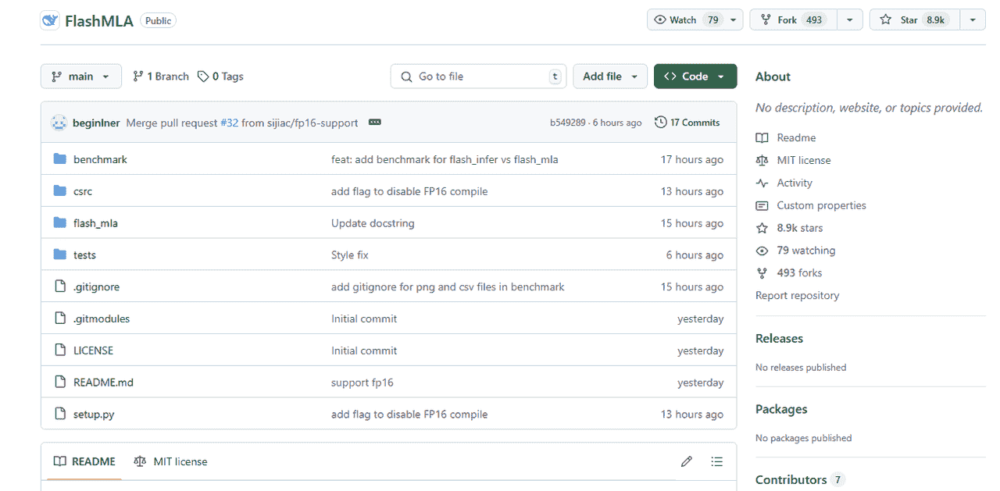
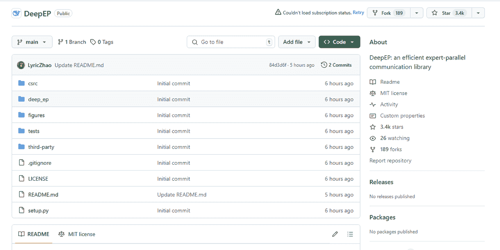
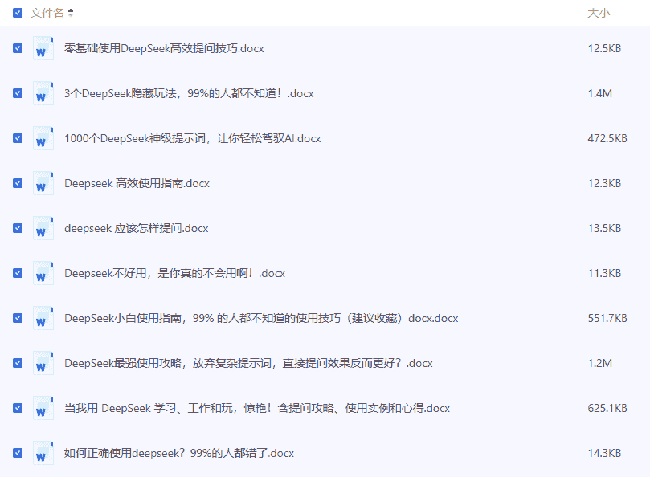
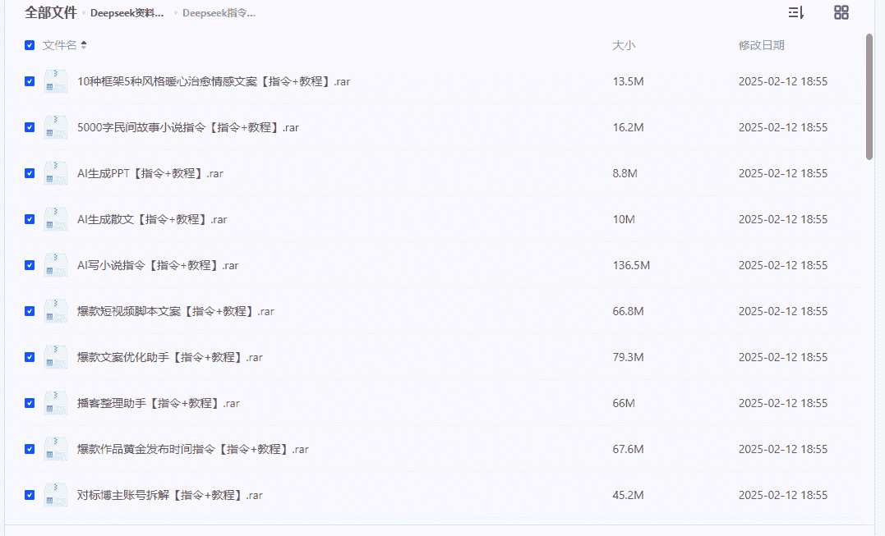
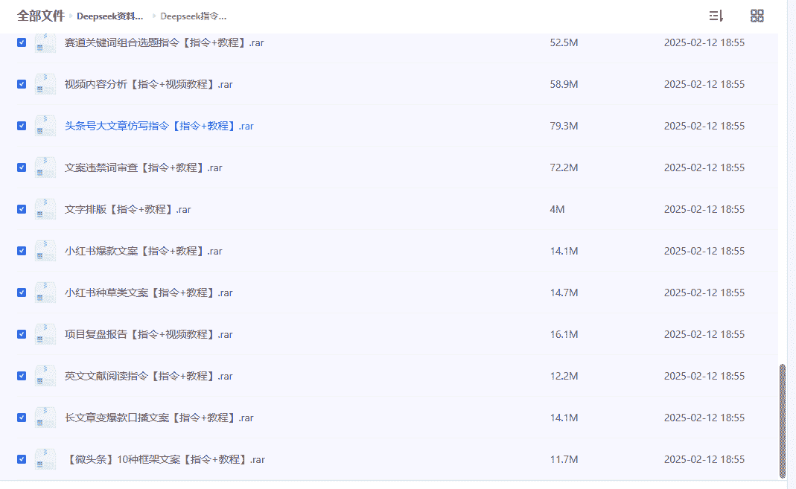
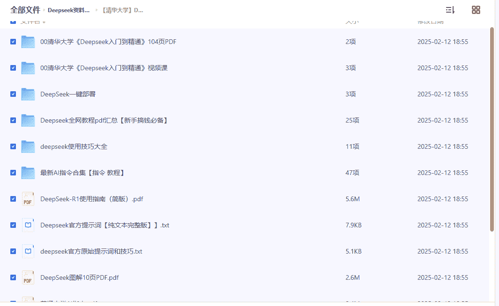
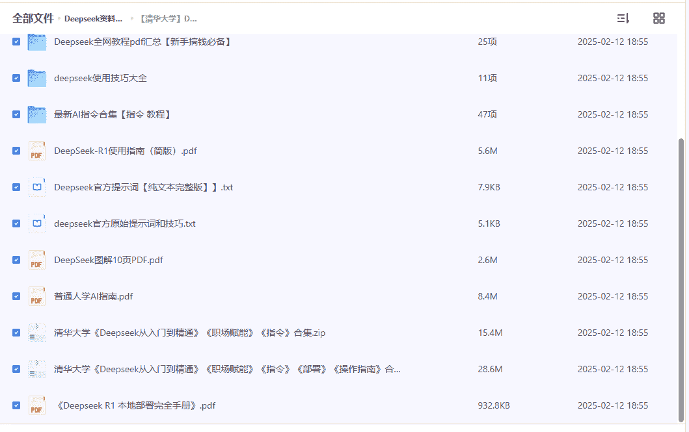

# DeepSeek 开源周：FlashMLA 与 DeepEP 的突破与影响

> 来源：[https://xmgtoagi.feishu.cn/docx/HQNOdynzroCBllxYWNLceTcQngc](https://xmgtoagi.feishu.cn/docx/HQNOdynzroCBllxYWNLceTcQngc)

大家好，我是小码哥，本周DeepSeek 正式启动 “开源周”，2月24日、2月25日开源了FlashMLA 和 DeepEP 两个开源项目，它们不仅展现了 DeepSeek 在技术上的深厚积累，更对行业发展带来了深远影响。

## 一、FlashMLA：高性能显卡的 AI 加速利器

FlashMLA 是专为高性能显卡（Hopper GPU）设计的 AI 加速工具，于 2025 年 2 月 24 日发布。在 AI 处理长句子和短句子时，它能够动态调整资源分配，避免算力浪费，从而实现更高效的运算。FlashMLA 的核心创新在于其引入的 MLA（多头潜在注意力机制），这一架构旨在优化 Transformer 模型的推理效率与内存使用，同时保持良好的模型性能。通过低秩联合压缩技术，MLA 将多头注意力中的键（Key）和值（Value）矩阵投影到低维空间，从而显著减少了键值缓存的存储需求。

想象一下，H800 显卡就像是一条宽阔的高速公路，理论上可以容纳大量的车辆同时行驶。但在没有 FlashMLA 的情况下，这条高速公路的利用率并不高，很多车道都空闲着，车辆行驶速度也较慢。而 FlashMLA 的出现，就像是给这条高速公路安装了一个智能交通管理系统，能够根据车流量动态调整车道分配，让车辆行驶更加顺畅，大大提高了高速公路的利用率。

在没有 FlashMLA 之前，H800 的内存带宽和计算性能并没有得到充分发挥。根据美国出口管制规定，H800 的带宽上限被设定为 600 GB/s。而 FlashMLA 的出现，让 H800 的性能得到了显著提升。使用 FlashMLA 优化后，H800 的内存带宽利用率有望进一步提高甚至突破 H800 GPU 理论上限，在内存访问上达到极致，能让开发群体充分 “压榨” 英伟达 H 系列芯片能力，以更少的芯片实现更强的模型性能，最大化 GPU 价值。这对于需要处理大量文本数据的 AI 应用来说，无疑是一个巨大的福音。它不仅能够降低运算成本，还能提高模型的响应速度和准确性，推动 AI 技术在自然语言处理等领域的进一步发展。

## 二、DeepEP：MoE 模型训练与推理的开源通信库

DeepEP 是首个用于 MoE（Mixture of Experts）模型训练和推理的开源 EP 通信库，于 2025 年 2 月 25 日发布。它具有高效全员沟通、节点内和节点间均支持 NVLink 和 RDMA、用于训练和推理预填充的高吞吐量内核、用于推理解码的低延迟内核、原生 FP8 调度支持以及灵活的 GPU 资源控制等特点，能够实现计算 - 通信重叠。

可以把 DeepEP 看作是一个高效的 “快递配送系统”。在 MoE 模型的训练和推理过程中，各个节点之间需要频繁地交换信息，就像是各个快递站点之间传递包裹。DeepEP 就像是一个智能的快递配送系统，能够快速、准确地将包裹送到目的地。它就像是一个协调员，能够让各个专家（模型的不同部分）之间更好地配合，提高整个模型的运行效率。

DeepEP 的开源，填补了 MoE 模型在通信库方面的空白。它为开发者提供了一个强大的工具，能够更方便地进行 MoE 模型的开发和部署。通过提高通信效率和资源利用率，DeepEP 能够加速模型的训练和推理过程，降低计算成本。在 H800 GPU 上测试时，DeepEP 的内节点通信性能达到 153-158 GB/s 的 NVLink 带宽，而跨节点通信可达 43-47 GB/s 的 RDMA 带宽。这对于推动 MoE 模型在大规模数据处理和复杂任务中的应用具有重要意义，也为 AI 模型的进一步发展提供了新的思路和方向。

## 三、最后

DeepSeek 的开源周活动，通过 FlashMLA 和 DeepEP 等项目的推出，展现了其在 AI 技术领域的强大实力和开放合作的态度。这些开源项目不仅为开发者提供了宝贵的资源，也为整个 AI 行业的发展注入了新的活力。接下来的三天里，DeepSeek每天都会发布开源项目，我们敬请期待吧！

感谢粉丝们对小码哥的支持，全网最全的deepseek 系列文档，扫码回复“dp”，免费赠送啦。

1