# 2024华为AI芯片生态全栈深度分析

> 来源：[https://xmgtoagi.feishu.cn/docx/MGZydcSSOoPSXExDHUVcKsZhnIh](https://xmgtoagi.feishu.cn/docx/MGZydcSSOoPSXExDHUVcKsZhnIh)
>
> 作者：Alsoar

## 一、引言

### 1.1 华为AI芯片发展背景

华为，作为全球通信设备与消费电子行业的领军企业，始终致力于技术创新与前瞻布局。早在2013年，华为便敏锐洞察到人工智能（AI）技术的巨大潜力及其对各行各业深远影响，开始积极构建自身在AI领域的战略版图。华为的AI战略不仅涵盖软件算法、平台服务，更关键的是在硬件层面，尤其是AI芯片的研发与产业化推进，旨在打造端到端、全场景的AI解决方案，以满足未来数字化社会对智能计算能力的旺盛需求。

华为AI芯片的研发历程可追溯至2017年，当时华为宣布进军AI芯片领域，并在随后的全联接大会上发布了首款AI芯片——昇腾系列，标志着华为正式迈入全球AI芯片竞赛的前沿。昇腾系列芯片基于自主研发的`达芬奇架构`，专为AI计算设计，具备高算力、高能效比、灵活可扩展等特点，迅速在业界树立起技术标杆。此后，华为持续加大研发投入，不断迭代升级昇腾系列产品，覆盖从云端训练到边缘推理的全栈应用场景。

华为在AI芯片市场的定位独特且明确，旨在构建全面自主可控的AI基础设施。这既包括高性能的AI处理器，也涵盖配套的软件开发工具、算法库、应用框架等，形成完整的AI生态体系。华为AI芯片不仅服务于自家的终端设备、服务器产品及云服务，还通过开放平台战略，广泛赋能各行各业的合作伙伴，助力他们快速开发和部署AI应用，共同推动AI产业的繁荣与发展。

### 1.2 本文研究目的与意义

#### 理解技术优势

对华为AI芯片进行全栈深度分析，首要目的是揭示其核心技术优势。这包括深入剖析其芯片架构设计理念、硬件创新点（如计算单元设计、内存管理、互连技术等）、软件栈完整性（包括编译器、运行时、开发框架、模型库等），以及软硬件协同优化机制。通过对这些技术细节的细致解读，可以揭示华为如何通过技术创新，实现高算力、低能耗、易编程、广兼容等关键性能指标，从而在激烈的市场竞争中脱颖而出。

#### 评估市场竞争力

全栈分析有助于全面评估华为AI芯片的市场竞争力。这涉及对其在不同应用场景（如数据中心、边缘计算、物联网终端等）的适用性、性能表现、成本效益、用户口碑等方面的考察，以及与主要竞品（如NVIDIA、Google、Intel等公司的AI芯片产品）的对比分析。此外，华为在生态系统建设、合作伙伴关系、客户服务等方面的举措也是评估其市场竞争力的重要维度。

#### 洞察未来发展趋势

通过深度分析，可以洞察华为AI芯片的发展战略、技术研发路线、市场策略的演变趋势，以及在应对行业共性挑战（如摩尔定律放缓、能效瓶颈、数据安全与隐私保护等）上的创新思路与实践。这些洞察对于理解华为在AI芯片领域的长期发展规划，预测其的技术突破、市场布局、生态构建等具有重要价值，同时也为相关行业参与者、投资者、政策制定者提供了决策参考。

## 二、华为AI芯片产品线概览

### 2.1 现有产品梳理

#### 昇腾系列AI芯片

华为昇腾系列AI芯片是其在AI领域的重要产品线，旨在为云、边、端等各类应用场景提供强大的智能计算能力。以下是昇腾系列部分关键产品的梳理：

1. 昇腾910（`Ascend 910`）

+ 发布时间：2018年10月首次发布，后续有更新版本推出。

+ 主要特性：昇腾910是华为面向云端训练场景的旗舰级AI芯片，采用`达芬奇架构`，具有超大规模的计算核心数、高带宽内存接口和高效的片上互联。它在单芯片上实现了极高的计算密度和强大的算力，被誉为全球已发布的单芯片计算密度最大、训练速度最快的AI芯片。其算力远超同代竞品，可支持大规模深度学习模型的高效训练。

+ 应用场景：主要应用于数据中心、公有云、私有云等环境下的AI模型训练，服务于图像识别、语音识别、自然语言处理、推荐系统、强化学习等多种复杂AI任务，尤其适用于科研机构、大型互联网公司和企业级客户的高性能计算需求。

1. 昇腾310（`Ascend 310`）

+ 发布时间：2018年10月与昇腾910一同发布，后续也有迭代更新。

+ 主要特性：昇腾310定位于边缘计算和轻量级服务器场景，同样基于`达芬奇架构`设计，具备出色的能效比和实时推理能力。该芯片支持多种精度计算，能够在低功耗下完成实时的AI推理任务，适用于嵌入式设备、智能摄像头、自动驾驶车辆等边缘设备。

+ 应用场景：广泛应用于智慧城市、智慧交通、智能制造、智能家居、移动终端等领域，为实时视频分析、物体检测、语音唤醒、自然语言交互等功能提供算力支持。

1. 昇腾其他型号

+ 昇腾`Mini系列`：针对边缘和端侧小型化设备设计，进一步降低功耗和体积，适用于智能穿戴、物联网终端等资源受限场景。

### 2.2 技术路线与演进

华为AI芯片的技术路线始终坚持自主创新，围绕`达芬奇架构`为核心进行迭代演进，逐步提升芯片的算力、能效比和适用性。

#### 架构设计创新

+ `达芬奇架构`：华为独创的`达芬奇架构`是昇腾系列AI芯片的基础，其特点是采用`3D Cube`立体计算引擎，通过将计算、存储、通讯资源进行深度融合与调度，实现数据流的高效处理。这种架构特别适合深度神经网络的并行计算需求，有效降低了数据搬运的开销，提高了计算效率。

#### 算力提升策略

+ 计算核心数量与结构优化：随着芯片迭代，华为不断提升单芯片上AI计算核心（如达芬奇核心或`CANN`核心）的数量，并优化核心结构，如改进运算单元设计、增强数据并行与任务并行能力，以实现更高的理论峰值算力。

+ 高速互联与内存访问：通过引入先进的高速总线技术和增大内存带宽，确保大量计算核心间的数据交换无瓶颈，同时优化内存层次结构和访存策略，减少数据访问延迟，提高实际应用中的有效算力。

#### 能效优化手段

+ 精准功耗管理：华为在芯片设计中融入精细化的功耗管理技术，如动态电压频率调整（`DVFS`）、任务调度优化等，确保在满足性能需求的同时，最大限度降低功耗。

+ 计算精度可配置：支持`INT8`、`INT16`、`FP16`、`FP32`等多种计算精度，允许用户根据实际任务需求选择合适的精度，实现性能与功耗之间的平衡。对于许多推理任务，使用较低精度即可保持高准确度，显著节省能源。

+ 硬件加速技术：集成专门的硬件加速模块，如矩阵乘法加速器、张量计算单元等，针对性地提升特定AI计算任务的能效。

## 三、华为AI芯片核心技术解析

### 3.1 架构设计

`Da Vinci架构`是华为昇腾系列AI芯片的核心硬件架构，以其独特的设计在并行计算、异构计算和模型加速方面展现了显著的创新优势。

#### 并行计算

`Da Vinci架构`采用`3D Cube`立体计算引擎，将计算单元（如向量处理器`VP`、标量处理器`SP`、张量处理器`TP`等）以三维网格方式组织，形成高度并行的计算阵列。这种设计使得数据可以在三维空间中流动，极大地减少了数据搬运距离和时间，提高了计算效率。同时，每个计算单元都支持向量计算，能够高效处理大规模并行的神经网络操作，如卷积、矩阵乘法等。

#### 异构计算

`Da Vinci架构`内包含了多种类型的计算单元，它们在功能、性能和功耗上各有侧重，构成异构计算体系。例如，标量处理器擅长处理控制流和条件分支等复杂逻辑，向量处理器擅长处理密集的数学计算，张量处理器则专注于高效的矩阵运算。这种异构设计使得芯片能够在同一时间内处理不同类型的任务，既满足了深度学习模型多样化的计算需求，又实现了计算资源的高效利用。

#### 模型加速

`Da Vinci架构`针对深度学习模型进行了深度优化。其内置的张量计算单元（Tensor Processing Unit, `TPU`）专为神经网络计算设计，支持高效的矩阵乘法和卷积运算。此外，架构中还集成了大量的硬件加速器，如用于激活函数计算的激活器、用于归一化操作的归一化器等，进一步加速模型执行。通过高效的缓存系统和内存管理机制，保证了数据在计算单元间的快速流动，避免了内存访问瓶颈，提升了整体模型执行速度。

`Ascend Core`作为华为AI芯片的硬件基础单元，是指达芬奇核心（`Da Vinci Core`）或类似的专用AI计算核心。这类核心是上述并行计算、异构计算和模型加速能力的具体实现载体，具备高效处理深度学习任务的特性，如支持`INT8`/`INT16`/`FP16`等多种精度计算，能够在低功耗下提供高吞吐量的推理性能。

### 3.2 软件栈与工具链

华为为AI芯片构建了完善的软件栈与工具链，旨在简化开发流程，提升开发效率，促进生态共建。

#### 编译器

华为提供了针对昇腾芯片优化的编译器，如`Ascend Compiler`，能够将高级语言编写的AI模型代码转换为高效运行在昇腾芯片上的机器码。编译器支持自动算子融合、指令级优化、内存优化等技术，确保模型在硬件上高效执行。

#### 运行时环境

华为提供了一套完整的运行时系统，如`Ascend Runtime`，负责管理和调度AI芯片资源，包括内存分配、任务调度、硬件加速器调用等。运行时环境与硬件紧密耦合，通过高效的驱动程序和中间层服务，为上层应用提供稳定、高性能的服务接口。

#### 开发框架

华为推出了自研的深度学习框架`MindSpore`，其设计充分考虑了昇腾芯片的特性，支持模型自动并行、自动微分、自动混合精度等特性，大大简化了模型开发和部署过程。`MindSpore`还提供丰富的`API`、预训练模型和教程文档，帮助开发者快速构建和训练AI模型。

#### 模型库

华为维护了一个包含众多预训练模型的模型库，覆盖计算机视觉、自然语言处理、语音识别等多个领域。这些模型经过优化，可以直接在昇腾芯片上高效运行，为开发者提供了丰富的开箱即用资源。

通过这一整套软件栈与工具链，华为极大地降低了开发者使用昇腾芯片的门槛，促进了AI应用的快速开发与部署。同时，开放的软件生态吸引了广大开发者和合作伙伴加入，共同构建繁荣的AI应用生态，增强了华为AI芯片的市场吸引力和竞争力。

### 3.3 算法优化与模型压缩

华为在AI算法层面采取了一系列优化策略，以提升模型在昇腾芯片上的推理和训练效率，同时降低模型存储和计算资源需求。

#### 模型量化

华为支持`INT8`甚至更低精度的模型量化，通过将浮点模型转换为整数模型，大幅减少模型大小和计算复杂度，同时借助昇腾芯片对低精度计算的良好支持，确保模型精度损失最小化。

#### 模型剪枝

华为在框架和工具链中集成模型剪枝技术，通过对模型权重进行分析，去除对输出影响较小的连接或通道，精简模型结构，降低计算量和内存占用，提高推理速度。

#### 知识蒸馏

华为支持知识蒸馏技术，通过让一个大模型（教师模型）教导一个小模型（学生模型），使小模型在保持较高精度的同时，具备更小的模型尺寸和更快的推理速度，特别适用于资源有限的边缘设备。

在软硬件协同方面，华为的软件栈深度优化以充分利用昇腾芯片的硬件特性。例如，`MindSpore`框架能够自动识别模型结构，进行算子融合和并行化调度，使得模型在硬件上高效执行；编译器能够生成针对昇腾芯片优化的指令集，减少数据搬运和冗余计算；运行时环境则负责精细的资源管理和任务调度，确保硬件资源充分利用。

通过上述算法优化与模型压缩技术，以及软硬件的深度协同，华为AI芯片能够在保证模型性能的前提下，显著提升推理与训练效率，降低资源需求，适应从云端到边缘的各种应用场景，展现出强大的技术实力和生态整合能力。

## 四、华为AI芯片性能评估与应用案例

### 4.1 性能基准测试

华为AI芯片，尤其是昇腾系列，已参与多项国际公认的AI基准测试，如`MLPerf`和`AIBench`，通过这些测试平台，我们可以客观地评估其性能，并与竞品进行横向比较。

#### 算力

在`MLPerf`等测试中，华为AI芯片展示了强大的单芯片及集群算力。以最新的昇腾芯片为例，其在图像分类、语音识别、自然语言理解等任务上取得了优异成绩，单位时间内能处理的样本数量远超行业平均水平。与竞品相比，如英伟达的高端`GPU`，尽管在绝对性能上可能存在差距（如英伟达新发布的`GPU`性能可达华为AI芯片的14倍），但华为AI芯片在特定AI工作负载上展现出高度优化的性能，尤其是在大规模并行计算和张量处理方面，能有效应对深度学习模型的高强度计算需求。

#### 能效

华为AI芯片在设计上注重能效比，通过先进的制程工艺、低功耗架构设计和动态电源管理技术，实现高性能与低功耗的平衡。在`MLPerf` Energy Efficiency（能效）测试中，华为AI芯片往往能在完成相同AI任务时消耗更低的功率，特别是在数据中心和边缘计算场景下，其能效优势更为明显，有助于降低总体运营成本和碳排放。

#### 兼容性

华为AI芯片支持多种编程模型和框架，如`TensorFlow`、`PyTorch`以及自家的`MindSpore`等，确保开发者可以轻松迁移现有模型，无需重写大量代码。此外，华为积极构建开放的生态系统，通过提供丰富的`SDK`、`API`和工具链，确保其AI芯片能够无缝融入各类AI应用环境，包括公有云、私有云、边缘计算节点等。在`AIBench`等兼容性测试中，华为AI芯片表现出良好的跨平台、跨设备兼容性，证明其在多场景下的部署灵活性和通用性。

总结来说，尽管在某些极端性能指标上华为AI芯片可能不及部分竞品，但在实际AI工作负载的算力、能效和兼容性方面，华为凭借其针对性的设计优化和全面的软件支持，展现出了显著的竞争优势，特别是在大规模AI应用部署和长期运营成本控制方面，为用户提供了极具吸引力的选择。

### 4.2 应用场景案例分析

#### 智慧城市

华为AI芯片为智慧城市提供了强大的计算引擎。例如，在视频监控领域，搭载华为AI芯片的智能摄像头能够实时分析海量视频流，精准识别行人、车辆、异常行为等，助力城市管理部门实现精细化管理。芯片的高能效特性使得此类边缘设备能够在低功耗下持续运行，而内置的视觉预处理模块则进一步优化了数据处理流程，降低了对网络带宽的需求。通过与华为云的联动，这些边缘端的智能分析结果可迅速汇聚至中央平台，进行大数据分析与决策支持，形成智慧城市的神经网络。

#### 自动驾驶

在自动驾驶汽车中，华为AI芯片作为计算平台的核心组件，承担着环境感知、路径规划、决策控制等关键任务。其强大的并行计算能力和对深度学习模型的高效支持，使得车辆能够在短时间内处理来自激光雷达、摄像头、毫米波雷达等传感器的海量数据，实时生成高精度的周围环境模型。芯片的低延迟特性和高可靠性对于确保自动驾驶系统的安全性至关重要。此外，华为还在构建开放的自动驾驶软件平台，吸引产业链合作伙伴共同开发自动驾驶解决方案，推动行业创新。

#### 云计算

在华为云服务中，昇腾AI芯片被广泛应用在大规模AI训练和推理服务中。华为云提供的AI开发平台和模型市场，让用户能够直接利用昇腾芯片的强大算力进行模型训练和部署，大大缩短了AI项目的研发周期。在云数据中心内部，通过集群化部署昇腾芯片，华为能够提供大规模分布式训练服务，满足企业级用户对超大规模模型训练的需求。同时，华为云还利用昇腾芯片的高能效特性，提供绿色节能的AI云服务，响应可持续发展的号召。

#### 边缘计算

在边缘计算场景，如工业物联网、远程医疗、零售分析等，华为AI芯片赋能边缘设备进行实时数据分析与决策。例如，在智能制造中，搭载昇腾芯片的边缘服务器可以就近处理产线上的传感器数据，实时监测设备状态、预测故障，甚至调整生产参数以优化产出。由于数据无需传输到云端，这种边缘计算模式既保证了数据隐私，又降低了网络延迟，提升了业务响应速度。

## 五、华为AI芯片生态构建与合作伙伴关系

### 5.1 开发者生态

华为高度重视AI芯片开发者生态的建设，通过一系列举措为开发者提供全方位的支持，以促进AI技术的创新应用和产业生态的发展。

#### 社区支持

华为建立了活跃的开发者社区，如华为开发者联盟、`MindSpore`社区等，为AI芯片开发者提供了一个交流经验、获取最新技术资讯、提出问题并得到专业解答的平台。社区内定期举办线上研讨会、技术讲座、开源项目讨论等活动，鼓励开发者积极参与，形成知识共享和协作创新的良好氛围。此外，华为还通过开发者论坛、博客、技术文档库等方式，提供丰富的技术文档、样例代码和最佳实践，帮助开发者快速上手华为AI芯片及其配套软件栈。

#### 培训资源

华为推出了多种形式的培训课程和教育资源，涵盖AI芯片基础知识、开发工具使用、模型优化技巧、行业解决方案开发等内容。这些资源包括在线课程、实训营、线下研讨会、技术认证培训等，旨在提升开发者的技术能力，适应不断演进的AI芯片技术和应用场景。华为还与高校、研究机构合作，开展学术交流、联合培养项目，为AI芯片领域的未来发展储备人才。

#### 认证体系

华为建立了完善的AI芯片开发者认证体系，如华为认证人工智能工程师（`HCIA-AI`）、华为认证人工智能高级工程师（`HCIP-AI`）等，为开发者的职业发展提供权威资质认可。通过这些认证，开发者可以系统地掌握华为AI芯片相关的技术原理、开发方法和最佳实践，增强在就业市场上的竞争力。同时，认证体系也为华为及合作伙伴筛选和招聘具备华为AI芯片开发能力的专业人才提供了标准依据。

华为的上述举措对吸引和培育开发者群体产生了显著影响：

+ 扩大开发者基数：丰富且易用的开发资源降低了AI芯片开发的学习门槛，吸引了众多初学者和跨领域开发者加入，扩大了华为AI芯片的开发者基数。

+ 提升开发者技能：专业的培训课程和认证体系帮助开发者快速提升技术水平，适应复杂AI应用的开发需求，增强了华为AI芯片在实际项目中的应用效果。

+ 激发创新活力：活跃的社区环境促进了开发者之间的交流与合作，催生了许多创新应用和解决方案，丰富了华为AI芯片的应用生态。

+ 强化品牌忠诚度：通过提供持续的技术支持和服务，华为建立起与开发者之间紧密的联系，增强了开发者对华为AI芯片品牌的认同感和忠诚度，有利于形成稳定的开发者社群。

### 5.2 合作伙伴网络

华为在AI芯片领域构建了广泛而深入的战略合作伙伴网络，涵盖软硬件供应商、`ISV`（独立软件开发商）、系统集成商、科研机构、行业用户等多个层面。以下是一些具有代表性的合作伙伴及合作模式：

#### 硬件合作伙伴

华为与国内外多家硬件制造商合作，如服务器厂商、存储设备供应商等，共同开发基于华为AI芯片的定制化硬件解决方案，提升整体系统的性能和效率。这些合作有助于华为AI芯片更好地融入不同行业的IT基础设施，拓宽市场覆盖范围。

## AI芯片合作伙伴与生态

**软件与算法合作伙伴**：华为与AI软件平台提供商、算法开发商等合作，如深度学习框架开发商、AI中间件供应商等，确保华为AI芯片支持主流开发工具和算法库，提升开发者的使用体验。通过合作，华为能够提供更加完整的AI开发环境，加速AI应用的开发和部署。

**行业解决方案合作伙伴**：华为与行业ISV、系统集成商合作，共同开发针对特定行业的AI解决方案，如金融风控、医疗影像诊断、智能制造等。这些合作伙伴利用华为AI芯片的强大算力，结合各自在行业领域的专业知识，打造出具有竞争力的行业应用，推动AI技术在各行各业的落地。

**科研与教育合作伙伴**：华为与知名高校、科研机构合作，开展前沿技术研发、人才培养以及产学研转化项目。这类合作有助于华为保持技术领先，同时通过联合培养项目为AI芯片产业输送高质量人才。

合作成果体现在以下几个方面：

+ **丰富产品组合**：通过与各类型合作伙伴的紧密合作，华为构建了涵盖硬件、软件、算法、解决方案在内的多元化产品组合，满足不同客户群体的多样化需求。

+ **加速市场渗透**：合作伙伴的行业经验和客户网络有助于华为AI芯片快速打入各垂直行业市场，扩大市场份额，尤其是在政府、电信、能源、交通等关键领域。

+ **推动技术创新**：与科研机构的合作推动了华为在AI芯片及相关技术领域的持续创新，如新型芯片架构、高效编译器、大模型训练技术等，保持华为在AI赛道的竞争力。

+ **共建生态标准**：华为与合作伙伴共同参与制定行业标准、接口规范等，推动AI芯片产业的规范化发展，提升华为AI芯片在业界的话语权和影响力。

## 典型应用案例

### 智慧医疗

+ **案例名称**：华为与某省级医院合作的AI辅助诊断系统

+ **合作模式**：华为与该医院携手，利用华为昇腾AI芯片及MindSpore框架，共同开发AI辅助诊断系统。

+ **合作成果**：该系统基于华为AI芯片的强大算力，对海量医疗影像数据（如CT、MRI）进行高效处理和深度学习模型训练，实现了对多种疾病的快速、准确诊断。AI辅助诊断系统大大减轻了医生的工作负担，提高了诊断效率和准确性，有效缓解了医疗资源紧张的问题。此外，华为还与医院合作，通过持续的数据收集和模型优化，不断提升系统的诊断性能。

### 智能制造

+ **案例名称**：华为与某大型制造企业合作的智能质检解决方案

+ **合作模式**：华为与该企业合作，将昇腾AI芯片集成到生产线的质检环节，通过实时分析高清摄像头采集的图像数据，实现对产品质量的自动化检测。

+ **合作成果**：基于华为AI芯片的智能质检系统能够精确识别产品缺陷，如表面划痕、尺寸偏差等，显著提高了质检效率和准确率，减少了人工误检和漏检。同时，系统还能实时反馈质检结果，指导生产过程的优化，有效提升了企业的生产效率和产品质量。此外，该解决方案的部署和运维由华为与企业共同完成，确保了系统的稳定运行和持续优化。

### 自动驾驶

+ **案例名称**：华为与某汽车制造商合作的自动驾驶平台

+ **合作模式**：华为与该汽车制造商深度合作，将昇腾AI芯片作为自动驾驶计算平台的核心，集成到车辆的自动驾驶系统中，负责处理来自各种传感器（如摄像头、雷达、激光雷达）的海量数据，实现环境感知、路径规划、决策控制等功能。

+ **合作成果**：基于华为AI芯片的自动驾驶平台，车辆能够在复杂路况下实现L4级别的自动驾驶，大大提升了行车安全性和驾驶舒适性。华为AI芯片的高算力和低延迟特性，确保了自动驾驶系统的实时响应和精准决策。此外，华为还与汽车制造商共享自动驾驶数据，共同推进算法优化和模型迭代，持续提升自动驾驶系统的性能和用户体验。

## 六、华为AI芯片面临的挑战与应对策略

### 6.1 技术挑战

#### 先进制程

华为AI芯片面临的主要技术挑战之一是先进制程技术的获取。由于国际形势和贸易限制，华为在获取最先进的半导体制造技术（如台积电的5nm及以下制程）方面受到限制，这可能导致其AI芯片在晶体管密度、性能提升和能耗效率方面相较于竞争对手有所滞后。应对措施包括：

+ **自主研发与合作创新**：华为持续加大研发投入，积极探索自主芯片制造技术，如通过与国内半导体产业链上下游企业合作，推动本土先进制程技术的研发与产业化进程。

+ **优化芯片设计**：通过架构创新、电路设计优化、封装技术改进等手段，提高现有制程条件下芯片的性能和能效，尽量缩小与最先进制程芯片的性能差距。

+ **多元供应链策略**：寻找和培养替代供应商，分散供应链风险，确保在受限环境下仍能获得必要的芯片制造能力。

#### 功耗控制

随着AI应用向边缘计算、移动设备等低功耗场景扩展，如何在保证性能的同时有效控制芯片功耗成为重要课题。挑战在于：

+ **高效能效比设计**：需要在芯片架构、电路设计、电源管理等方面实现技术创新，确保在提供强大AI算力的同时，维持低功耗运行。

+ **动态功耗管理**：开发先进的动态电压频率调整（DVFS）、任务调度算法等技术，根据实际工作负载动态调节芯片工作状态，减少不必要的能耗。

**华为的应对策略包括：**

+ **持续研发低功耗技术**：投资研发低功耗计算架构、新型存储技术、智能电源管理方案等，提升芯片整体能效比。

+ **软硬件协同优化**：通过深度整合硬件设计与软件栈（如编译器、运行时环境、框架），实现从算法到硬件的全栈功耗优化。

#### 算法创新

随着AI技术的快速发展，新的算法模型不断涌现，对AI芯片的计算需求也在不断变化。挑战在于：

+ **快速适应算法演进**：芯片设计需具备足够的灵活性和前瞻性，以适应深度学习、强化学习、元学习等新兴算法模型的要求。

+ **模型压缩与加速技术**：在不牺牲模型精度的前提下，实现模型的小型化和高效推理，以适应资源有限的边缘设备。

**华为的应对策略包括：**

+ **加强基础研究与合作**：与学术界、产业界紧密合作，跟踪前沿算法趋势，提前布局未来芯片设计。

+ **打造开放创新平台**：通过开源框架（如MindSpore）、模型库、开发者社区等，吸引开发者参与算法创新，推动算法与硬件的深度融合。

### 6.2 市场与政策环境

#### 全球半导体供应链波动

全球供应链的不稳定可能导致原材料短缺、价格上涨、交货周期延长等问题，对华为AI芯片的生产和供应造成影响。华为的应对策略包括：

+ **供应链多元化**：积极寻求替代供应商，减少对单一地区或供应商的依赖，提高供应链韧性。

+ **库存管理与需求预测**：优化库存策略，精准预测市场需求，确保关键材料和部件的充足供应。

#### 地缘政治因素

国际贸易摩擦和科技封锁对华为AI芯片的国际市场拓展、技术合作带来挑战。华为采取的策略包括：

+ **本土化战略**：加强与本土产业链的合作，推动国产化替代，降低对外部市场的依赖。

+ **法律手段与外交努力**：通过法律途径维护自身权益，同时积极开展外交沟通，争取国际社会的理解和支持。

#### 行业标准制定

全球AI芯片行业标准的制定对华为的市场地位和产品竞争力有重要影响。华为采取的策略包括：

+ **积极参与标准制定**：在国际标准化组织中发挥积极作用，推动华为技术成为行业标准的一部分。

+ **推动互操作性与开放生态**：倡导开放标准和接口，促进不同AI芯片平台之间的互操作性，构建包容性更强的AI生态。

## 七、华为AI芯片未来展望

### 7.1 技术趋势预测

#### 新架构探索

随着AI算法的复杂性增加和应用场景的多元化，华为继续探索创新的芯片架构以适应未来需求。这包括：

+ **神经拟态计算**：华为会研究神经拟态芯片架构，模拟人脑神经网络的分布式、事件驱动和自适应特性，以实现更高的能效比和更强的实时学习能力。

+ **存内计算**：鉴于数据搬运在AI计算中的瓶颈，华为投入存内计算架构的研究，将计算单元与存储单元紧密结合，减少数据移动，提升计算效率。

#### 异构计算融合

随着异构计算在AI领域的价值日益凸显，华为会深化对不同计算单元（如CPU、GPU、TPU、FPGA等）的融合设计，以实现更灵活、高效的计算资源调度：

+ **灵活异构平台**：华为将推出更加灵活的异构计算平台，支持多种计算单元的动态配置与协同工作，适应不同AI任务的算力需求。

+ **统一编程接口**：开发统一的编程模型和API，简化异构环境下的编程难度，提升开发效率。

#### 软件定义硬件

随着软件在硬件设计与优化中的作用日益增强，华为将加大在软件定义硬件方向的投入：

+ **可重构硬件**：研究可重构硬件技术，使芯片架构在运行时可根据软件需求动态调整，实现硬件资源的按需分配。

+ **高级编译器与运行时**：开发更智能的编译器和运行时系统，能够自动识别和优化AI工作负载，最大化硬件效能。

### 7.2 市场策略与目标

推测华为在AI芯片市场的定位调整、目标客户群体拓展、新业务领域布局等战略方向。

#### 市场定位调整

华为将进一步明确其在AI芯片市场的高端定位，强化其在高性能计算、数据中心、企业级AI解决方案等领域的领导地位。

#### 目标客户群体拓展

华为将瞄准更广泛的行业客户，如智慧城市、智能制造、金融科技、医疗健康等领域，提供定制化的AI芯片解决方案，同时加强与中小企业的合作，通过云服务等形式提供普惠AI能力。

#### 新业务领域布局

华为在新兴AI应用领域进行布局，如边缘计算、物联网、元宇宙等，开发适用于这些场景的轻量化、低功耗AI芯片，以及相应的软件和服务生态。

## 八、结论

为AI芯片凭借其独特的Da Vinci架构、全栈软件支持、深度算法优化以及在主流基准测试中的优秀表现，展现了强大的核心竞争力。华为在构建开发者生态、深化合作伙伴关系方面的努力，为其AI芯片在智慧医疗、自动驾驶、云计算等领域的广泛应用奠定了坚实基础。面对技术挑战与复杂的市场环境，华为通过加强自主研发、供应链多元化、积极参与标准制定等策略，展现出适应市场变化、应对政策风险的能力。

展望未来，华为有望在新架构探索、异构计算融合、软件定义硬件等前沿技术方向持续创新，顺应AI芯片行业发展趋势。在市场策略上，华为或将更加聚焦高端市场、拓展行业客户群体、布局新兴业务领域，进一步巩固并提升其在全球AI芯片市场的领先地位。尽管面临诸多挑战，华为在AI芯片领域的持续创新与影响力值得期待，有望在全球AI产业发展中扮演重要角色。

## 产品生态分析

### 1 昇腾 910 与 310 基础芯片族，自下而上搭建庞大生态体系

#### 1.1 昇腾 910AI 训练处理器+昇腾 310AI 推理处理器

华为从 2004 年开始投资研发第一颗嵌入式处理芯片，历经 15 年，投入超过 2 万名工程师，形成了以“鲲鹏+昇腾”为核心的基础芯片族。此外，还有较为边缘的 SSD控制芯片、智能网卡芯片、智能管理芯片等产品。为适应 AI 运算的高性能要求，一般认为基础硬件具备至少 64 核、8 个内存通道、PCIe 4.0、多合一 SoC、xPU 高速互联、100GE 高速 I/O 等六个特征。而支持 64 个核心的鲲鹏 920 及芯片组能够满足以上要求。

图表 1 以“鲲鹏+昇腾”为核心的基础芯片族

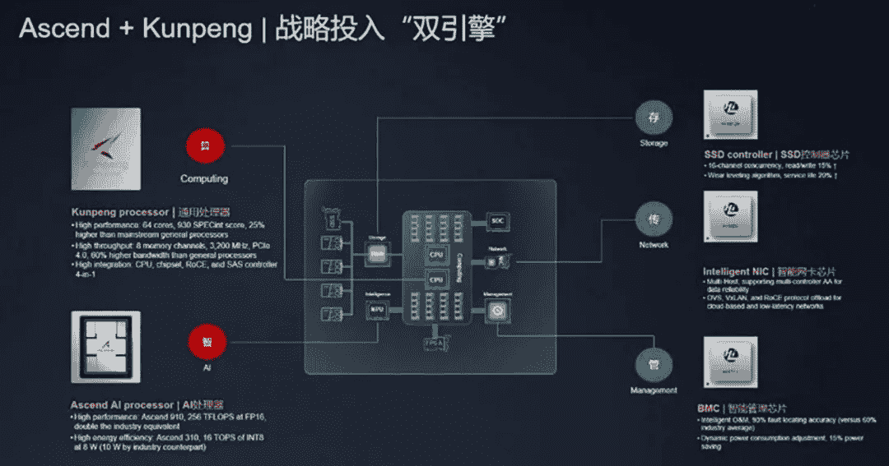

**昇腾 310**，高能效比推理型 AI 处理器，基于达芬奇架构，本质上是一块 SoC，集成了多个运算单元，包括 CPU（8 个 a55）、AI Core、数字视觉预处理子系统等。除了CPU 之外，该芯片真正的算力担当是采用了达芬奇架构的 AI Core。

这些 AI Core 通过特别设计的架构和电路实现了高通量、大算力和低功耗，特别适合处理深度学习中神经网络必须的常用计算。

目前该芯片能对整型数（INT8、INT4） 或对浮点数（FP16）提供强大的算力。根据海思官网披露，该芯片 FP16 算力为 8TOPS，INT8 算力 16TOPS，采用 12nm 工艺制造。

昇腾 910，高性能训练 AI 处理器，性能接近英伟达 A100（40GB），半精度（FP16）算力达到 320 TFLOPS，整数精度（INT8）算力达到 640 TOPS，功耗 310W，采用 7nm先进工艺。

此外，昇腾 910 集成了 HCCS、PCIe 4.0 和 RoCE v2 接口，为构建横向扩展（Scale Out）和纵向扩展（Scale Up）系统提供了灵活高效的方法。HCCS 是华为自研的高速互联接口，片内 RoCE 可用于节点间直接互联。

图表 2 昇腾 910 处理器   图表 3 昇腾 310 处理器

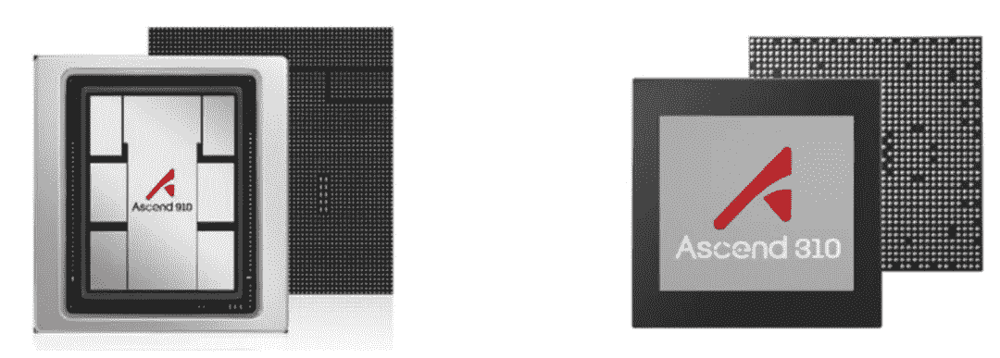

#### 1.2 开发者套件、加速卡、加速模块，完备的硬件生态

基于昇腾芯片族，华为开发了一系列加速卡产品：Atlas 300T 训练卡，基于昇腾 910 AI 芯片，芯片集成 32 个华为达芬奇 AI Core + 16 个 TaiShan 核，能够提供业界领先的 280 TFLOPS FP16 算力，并集成了一枚100GE RoCE v2 网卡，支持 PCIe 4.0 和 1*100G RoCE 高速接口，出口总带宽 56.5 Gb/s，无需外置网卡，训练数据和梯度同步效率提升 10%-70%。内存规格方面，包括32GB 的 HBM 和 16GB 的 DDR4。

图表 4Atlas 300T 训练卡   图表 5 Atlas 300T 训练卡拆解图

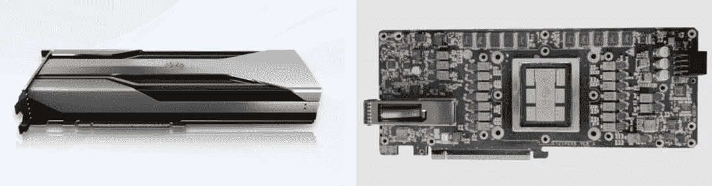

Atlas 300T A2 训练卡，强化了高速接口和对 PCIe5.0 的支持，集成 20 个 AI 核、8个 CPU Core、1*200GE RoCE，提供 280 TFLOPS FP16 算力。

图表 6 Atlas 300T A2 训练卡   图表 7 Atlas 300T A2 训练卡接口图

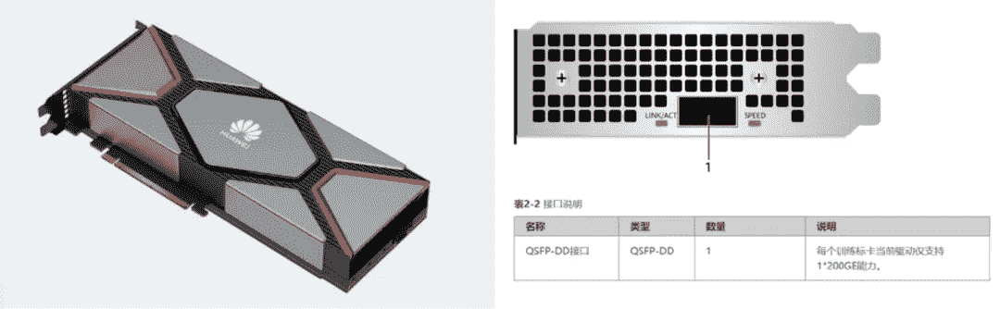

Atlas 300I Pro 推理卡，LPDDR4X 24 GB，总带宽 204.8 GB/s，融合“通用处理器、AI Core、编解码” 于一体，提供超强 AI 推理、目标检索等功能，具有超强算力、超高能效、高性能特征检索、安全启动等优势，可广泛应用于 OCR 识别、语音分析、搜索推荐、内容审核等诸多 AI 应用场景。单卡最大提供 140 TOPS INT8 算力，2 TOPS/W 超高能效比。

图表 8 Atlas 300I Pro 推理卡

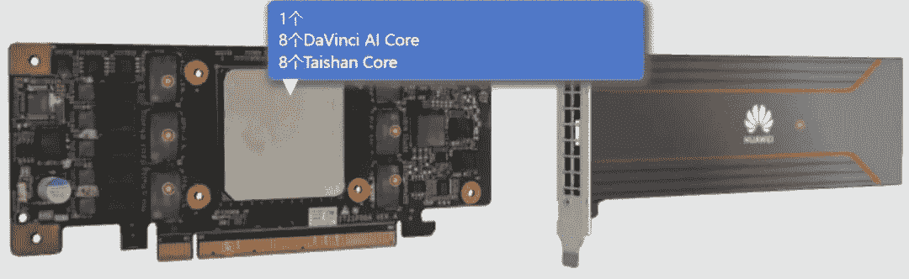

Atlas 300I Duo 推理卡，LPDDR4X 48GB，总带宽 408GB/s，从表观上看是两枚昇腾 310 的组合产品，从算力来看，单卡最大提供 280 TOPS INT8 算力，支持 16 core * 1.9 GHz CPU 计算能力，也约为单芯片的两倍。在此性能基础上，该产品支持256 路高清视频实时分析。

图表 9 Atlas 300I Duo 推理卡主板   图表 10 Atlas 300I Duo 推理卡

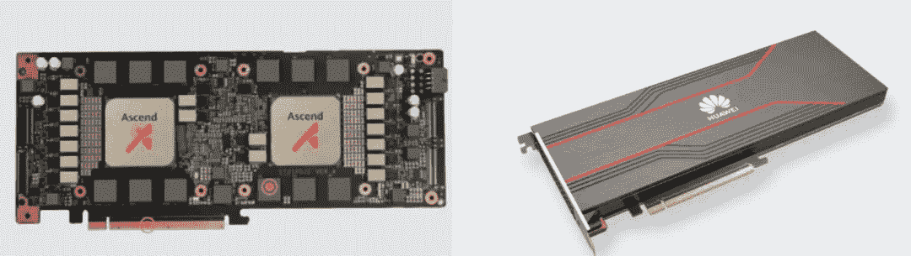

Atlas 200I DK A2 开发者套件，是一款高性能的 AI 开发者套件，4 核 CPU，可提供 8TOPS INT8 的计算能力，可以实现图像、视频等多种数据分析与推理计算，可广泛用于教育、机器人、无人机等场景。以智能小车为例，Atlas 200I DK A2 借助图像处理神经网络，实现图像识别，基于此实现自动驾驶控制。

Atlas 500 A2 智能小站是面向边缘应用的产品，具有环境适应性强、超强计算性能、云边协同等特点，可以在边缘环境广泛部署，满足在交通、社区、园区、商场、超市等复杂环境区域的应用需求。

图表 11 Atlas 200I DK A2 主板   图表 12 Atlas 200I A2 加速模块

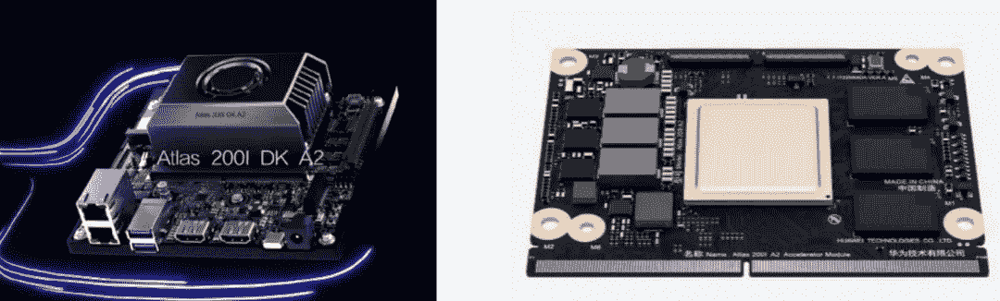

图表 13 Atlas 500 A2 智能小站

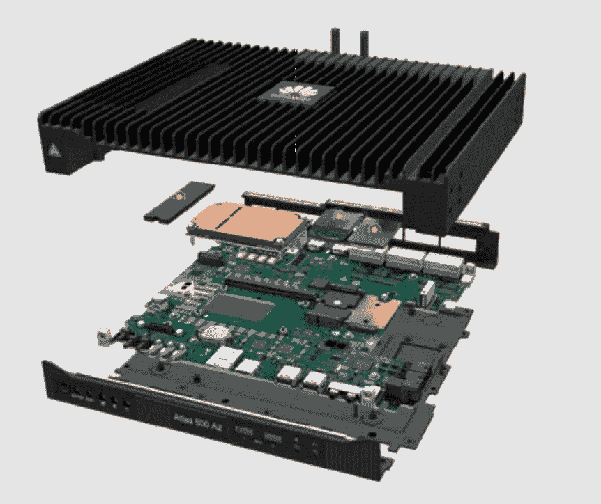

#### 1.3 服务器： arm 和 x86 兼容，风冷和液冷并用

Atlas 800 训练服务器（型号 9000）是基于华为鲲鹏 920+昇腾 910 处理器的 AI训练服务器，实现完全自主可控，广泛应用于深度学习模型开发和 AI 训练服务场景。

该服务器面向公有云、互联网、运营商、政府、交通、金融、高校、电力等领域，具有高计算密度、高能效比、高网络带宽、易扩展、易管理等优点，支持单机和整机柜销售，支持风冷和液冷应用，满足企业机房部署和大规模数据中心集群部署。

Atlas 800 训练服务器（型号 9010）则是基于华为昇腾 910+Intel V5 Cascade Lake 处理器的 AI 训练服务器，其基于更加成熟的 X86 结构。

图表 14 Atlas 800（型号 9000）训练服务器水冷拆解图

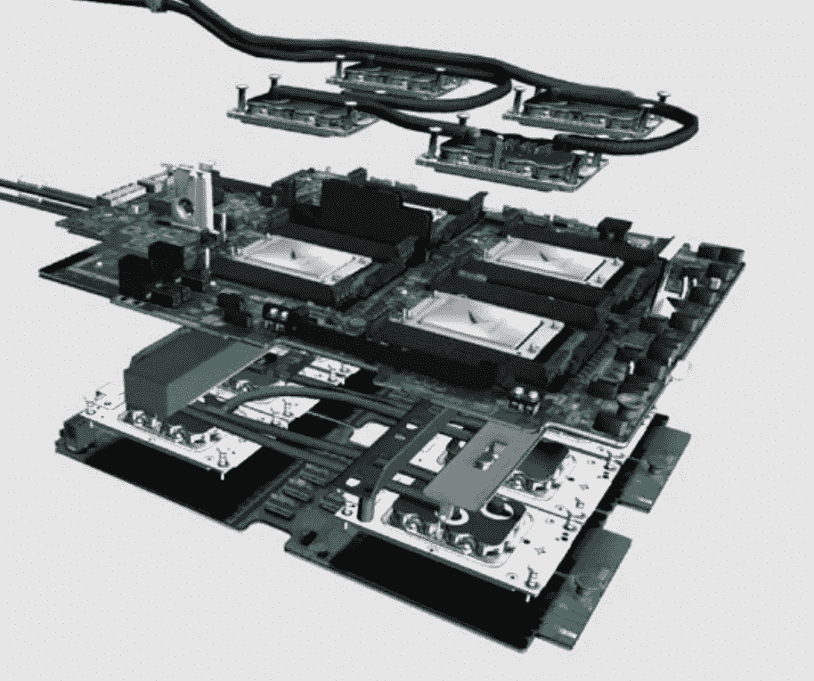

Atlas 800 推理服务器 （型号：3000）最大可支持 8 个 Atlas 300I/V Pro，提供强大的实时推理能力和视频分析能力，广泛应用于中心侧 AI 推理场景。Atlas 800 推理服务器 （型号：3010）则是基于 Intel 处理器的推理服务器，最多可支持 7 个 Atlas 300I/V Pro，支持 896 路高清视频实时分析，广泛应用于中心侧 AI 推理场景。

图表 15 Atlas 800 推理服务器(型号：3000)

集群方面，Atlas 900 PoD 集群基础单元搭载超 32 颗超强算力的鲲鹏 920 处理器，47U 高度可最大提供 20.4 PFLOPS FP16 AI 算力，采用液冷散热，最大功耗为 46kw。

# 1 Atlas 900 AI 集群

Atlas 900 AI 集群由数千颗昇腾训练处理器构成，通过华为集群通信库和作业调度平台，整合 HCCS、PCIe 和 RoCE 三种高速接口，充分释放昇腾训练处理器的强大性能。

其总算力最大可拓展至 3.2 EFLOPS，全节点 200G 网络互联。这可以让研究人员更快的进行图像、语音、自然语言等 AI 模型训练，更高效的进行科研探索，加速自动驾驶的商用进程。

图表 16 Atlas 900 PoD 示意图

图表 17 Atlas 900 PoD 拆解图

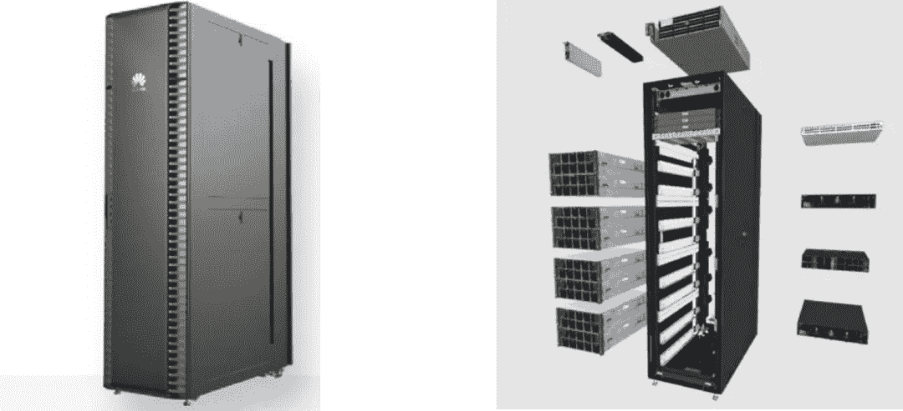

图表 18 Atlas 900 AI 集群

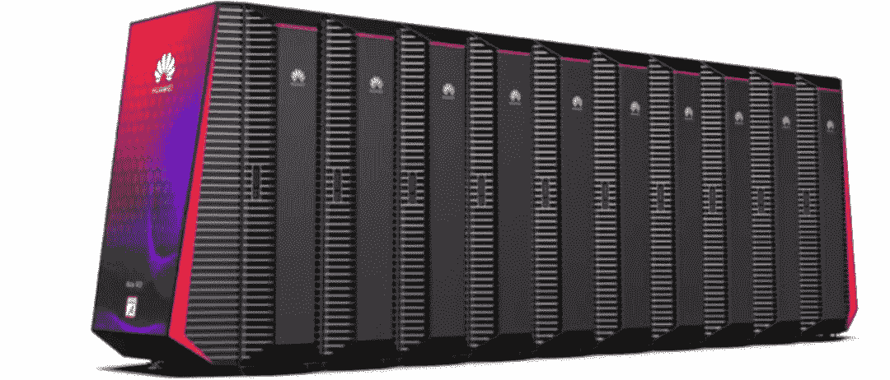

## 2 AI 生态并非只有 CUDA，各地算力集群建设快速推进

### 2.1 AI 算力生态并非只有 CUDA

异构计算架构（CANN）是对标英伟达的 CUDA + CuDNN 的核心软件层，包括引擎、编译器、执行器、算子库等，承载计算机的单元为 AI 芯片，异构计算架构主要负责调度分配计算到对应的硬件上。

从层级来看，CANN 上承 AI 框架，下接 AI 处理器硬件，先进的异构架构使得神经网络执行过程的硬件交互时间有效缩短，从而实现对硬件性能的进一步利用。

图表 19 Atlas 900 AI 集群

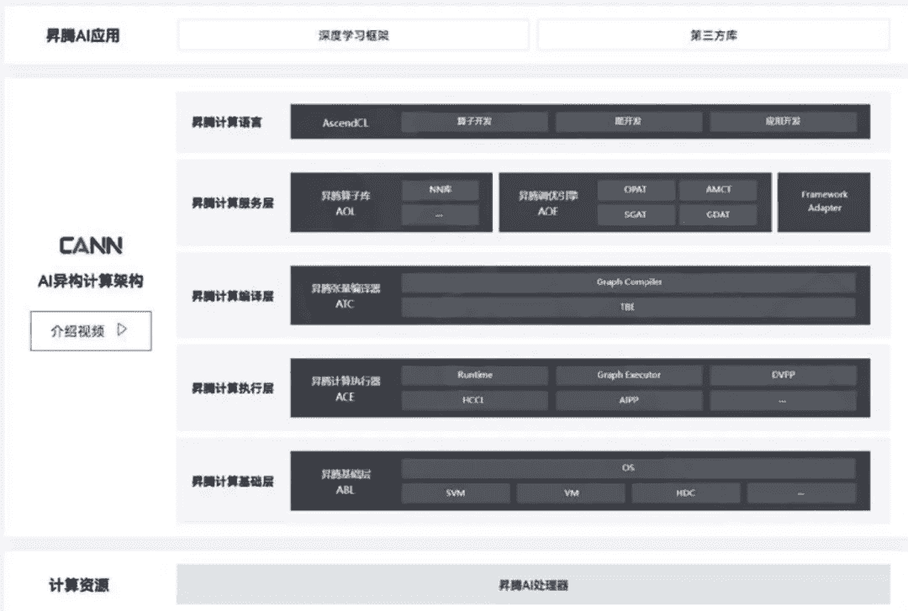

在 CANN 的基础之上，昇腾提供了昇思深度学习框架，旨在实现易开发、高效执行、全场景覆盖三大目标。兼容性上，适配包括昇腾系列产品、英伟达 NVIDIA 系列产品、Arm 系列的高通骁龙、华为麒麟的芯片等系列产品。

其中，易开发表现为 API 友好、调试难度低；高效执行包括计算效率、数据预处理效率和分布式训练效率；全场景则指框架同时支持云、边缘以及端侧场景。

图表 20 昇腾计算产业生态

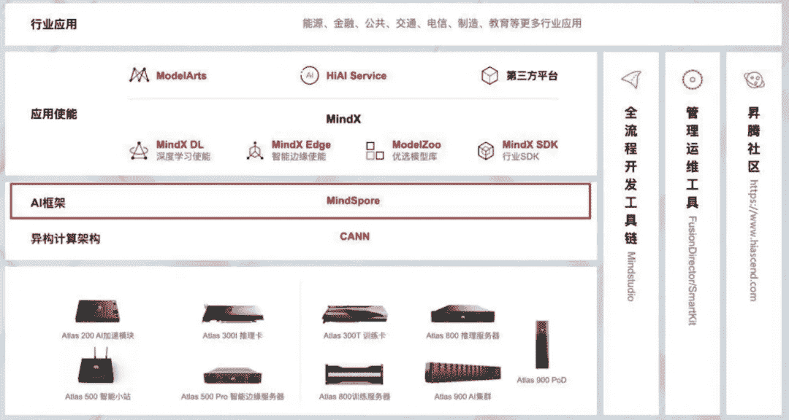

丰富的大模型库，目前已经收录「紫东.太初」、「武汉.Luojia」、「鹏程.盘古」、「鹏程.神农」、「空天·灵眸」等大模型，分别适用于多模态、遥感、中文自然语言、医学、空天信息化等领域。

以「鹏程.盘古」为例，作为业界首个千亿级参数中文自然语言处理大模型，可支持知识问答、知识检索、知识推理、阅读理解等丰富的下游应用。

该模型由鹏城实验室为首的技术团队联合攻关，首次基于“鹏城云脑Ⅱ”和国产 MindSpore 框架的自动混合并行模式实现在 2048 卡算力集群上的大规模分布式训练，训练出业界首个 2000 亿参数以中文为核心的预训练生成语言模型。

鹏程·盘古α预训练模型支持丰富的场景应用，在知识问答、知识检索、知识推理、阅读理解等文本生成领域表现突出，具备很强的小样本学习能力。

模型基于国产全栈式软硬件协同生态(MindSpore+CANN+昇腾 910+ModelArts)。

图表 21 MindSpore 超大规模自动并行

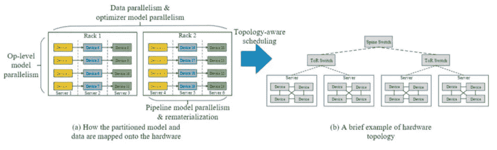

### 2.2 智算中心建设快速推进，全国算力网络正在形成

武汉人工智能计算中心基于昇腾 AI 基础软硬件建设，于 2021 年 5 月 31 日正式竣工并投入运营，上线即算力资源满负荷使用。于 2022 年 2 月 7 日完成扩容，总算力达200P，并再次饱和运营。

西安未来人工智能计算中心于 2021 年 5 月正式启动建设，建设周期近四个月，于2021 年 9 月 9 日正式上线运营，一期包含 AI 算力 300P、HPC 算力 8P。

中原人工智能计算中心，基于“黄河鲲鹏+昇腾技术”底座，是中原地区人工智能产业的重大算力支持基础设施。项目总投资 10 亿元，于 2021 年 10 月 21 日正式上线。一期建设规模为 100P AI 算力，未来将达到 300P AI 算力。截止到 2022 年底，该中心服务中原企业客户 60 余家，高校学院客户 30 余家，科研单位 10 余家，同时还有省外活跃客户百余家，平均算力使用率在 90%左右。

南京人工智能计算中心，基于南京市委市政府的产业规划，以及华为与江北新区共建昇腾产业的合作协议，南京人工智能计算中心于 2022 年 5 月完成基础平台建设，一期规划 40P 算力，上线即接近饱和，当前平均算力使用率在 95%以上。截止到 2022年 12 月，算力中心的应用已初具规模，已与 200 多家合作伙伴推出超过 150 多个人工智能解决方案。

成都智算中心包括算力达 300P 的人工智能算力平台，以及城市智脑平台和科研创新平台，目前是西南地区最大的人工智能计算中心。正式运营以来，中心已经与 80 余家企业及科研团队展开合作，平均算力利用率达到 85%以上，实现上线即饱和运营。

杭州人工智能计算中心，一期面积 2000 平方米，一期规模 40P，二期扩容后总规模将达到 140P。计算中心采用自主可控的昇腾 AI 集群，为政府、企业、科研机构、校等提供公共普惠算力。该中心已于 2022 年 5 月 20 日在杭州市滨江区海创基地上线。

图表 22 武汉人工智能计算中心                           图表 23 西安人工智能计算中心

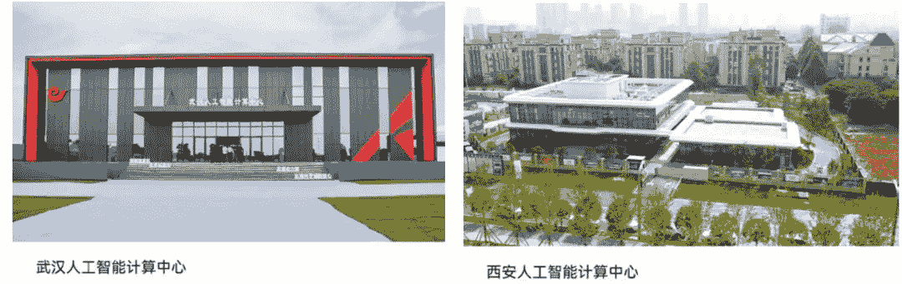

图表 24 中原人工智能计算中心                           图表 25 南京人工智能计算中心

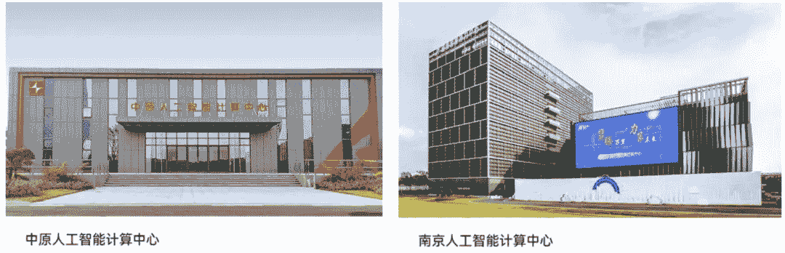

图表 26 成都智算中心                                          图表 27 杭州人工智能计算中心

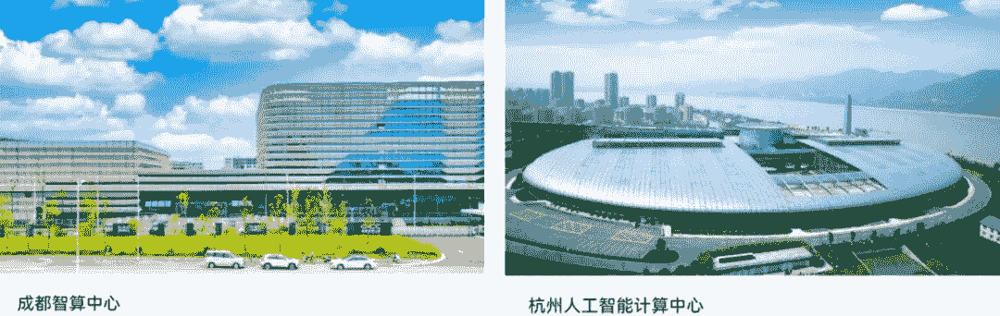

## 3 昇腾伙伴网络，五类定位构建产业矩阵

### 3.1 整机硬件伙伴：传统服务器大厂+新锐硬件加工厂商

对于整机硬件合作伙伴，昇腾社区对此有明确的定义：拥有自有品牌产品，能在昇腾产品基础上二次开发或加工生产，并销售与服务至最终用户的合作伙伴。

从官网标注的级别来看，主要分为领先级、优选级和认证级。其中包括服务器行业领先企业宝德、新华三、清华同方等，也包括 2020 年成立的华鲲振宇等新锐企业或生产主体，以及神州数码等和华为长期保持合作关系的渠道端重点企业。其中部分合作伙伴已经实现鲲鹏系列服务器的量产出货，具备长期定制化服务器的生产能力。

图表 28 昇腾生态伙伴——整机硬件伙伴

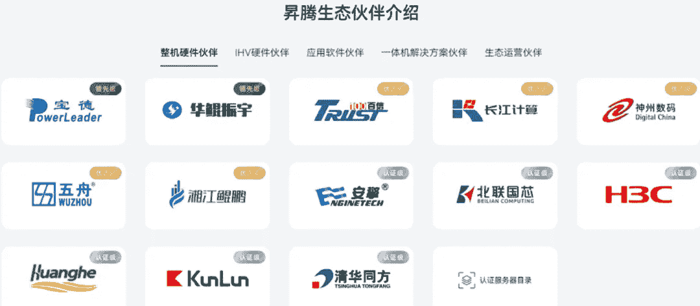

高度细化的定级标准，进一步印证市场规模。昇腾官方公布了不同级别的整机硬件合作伙伴认证标准，其中对战略级、领先级、优选级合作伙伴市场规模要求为大于等于20 亿、10 亿、5 亿，营销活动大于等于 12、8、6 次每年。以上要求一方面释放出昇腾交易规模和市场体量的发展趋势，另一方面也说明了昇腾正致力于发力市场营销和产品打造。

此外，不同级别合作伙伴在价格优惠政策方面也存在进阶差异，更高级别能够获得更优惠的价格政策，以及华为展厅展示等权益。

图表 29 昇腾整机硬件伙伴认证要求

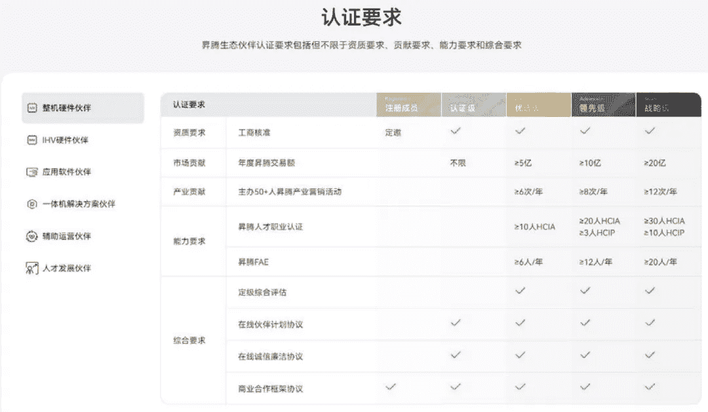

图表 30 昇腾整机硬件伙伴专属权益

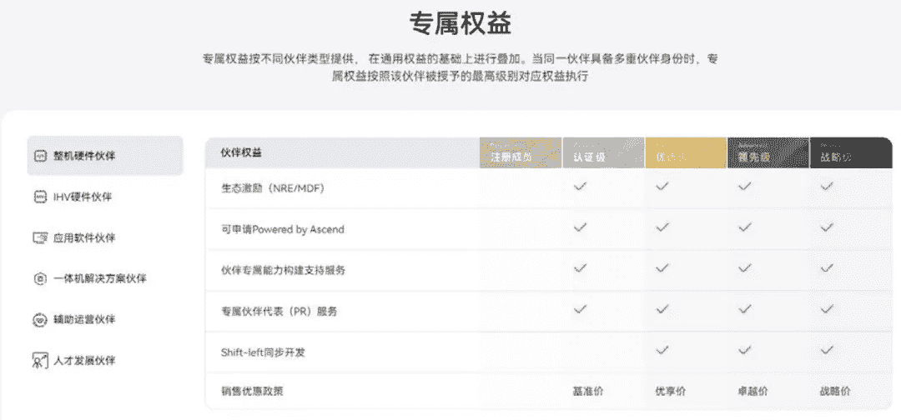

图表 31 昇腾整机硬件伙伴通用权益

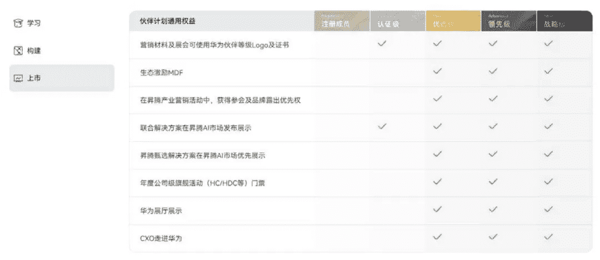

目前，昇腾整机硬件大致可以分为训练型服务器和推理型服务器两大类。

训练型服务器方面：以宝德 PR420 为例，该机为四路鲲鹏训练服务器，搭载 4 枚鲲鹏 920 高性能通用处理器（基于 ARM v8），8 张昇腾 910 系列训练加速卡，并支持2 个 PCIe 4.0 扩展插槽。该机具有最强算力密度、超高能效与高速网络带宽等特点。

该服务器广泛应用于深度学习模型开发和训练，适用于智慧城市、智慧医疗、天文探索、石油勘探等需要大算力的行业领域。

图表 32 宝德自强训练服务器 PR420KI

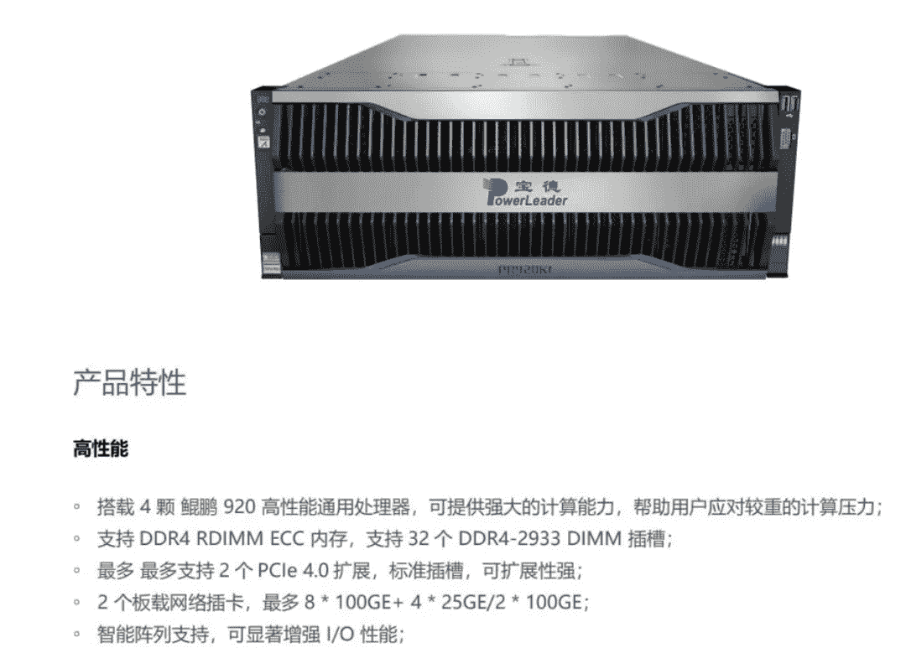

推理型服务器方面：以长江计算 G220K V2 为例，该机型搭载基于昇腾 310 的Atlas300I Pro 推理卡，最大支持 8 张，CPU 方面则选用两枚鲲鹏 920，相比训练机型对于性能的高规格，推理机型更加注重能效比和成本控制。

Atlas 300I Pro 单卡功耗仅72W，为 AI 服务器算力加速同时提供更优的能效比。在 8 张 Atlas 300I Pro 推理卡的支持下，整机可提供 1024 路高清视频实时分析 (1080P 分辨率 30FPS)。

图表 33 长江计算 G220K V2 推理服务器

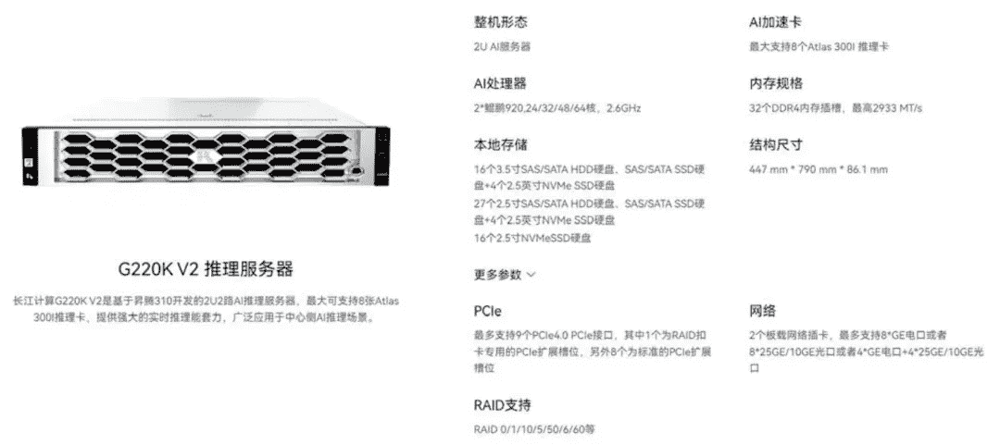

### 3.2 IHV 硬件伙伴：边缘计算赋能千行百业

IHV 硬件厂商主要涉及边缘运算硬件，用于工控终端、数据采集、嵌入式智能计算等场景，并已经出现较大规模的场景落地。根据昇腾官网对 IHV 合作伙伴的定义，即能够基于华为昇腾部件进行二次开发，形成自有品牌硬件产品并进行销售的硬件伙伴。

图表 34 IHV 硬件合作伙伴

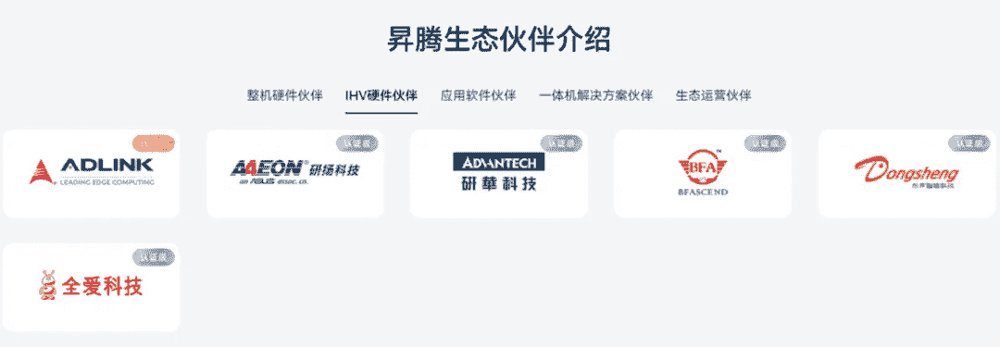

以昇腾优选级伙伴凌华科技为例，其边缘计算盒子采用置华为昇腾 Atlas 200 AI 智能计算模组，集成高性能 Ascend 310 AI 处理器，可实现图像、视频等多种数据分析与推理计算，可广泛用于智能制造、安防、智慧交通、机器人、无人机等边缘计算应用场景。以餐饮领域为例，一台边缘盒子可采集多路视频监控，并对图像进行实时分析，识别出不规范行为并将其上报给管理侧。

图表 35 凌华科技边云协同案例

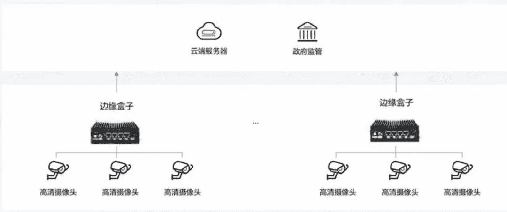

### 3.3 应用软件伙伴：电力与智慧城市等场景国产化落地

应用软件伙伴：开发、销售自有知识产权的应用程序、软件、垂直细分应用等产品，能对接昇腾产品，有能力二次开发的软件伙伴。目前来看，主要涵盖智慧城市、智慧交通、电力信息化等领域，有助于推动关键领域的硬件国产化，合作伙伴包括：华雁智科、以萨、云天励飞、格灵深瞳、云从科技、智洋创新等。

图表 36 应用软件合作伙伴

以萨视频图像全目标结构化解决方案，对海量视频数据实施高效、全目标、一体化解析，充分挖掘数据价值，赋能交通管理、市域治理等领域的多场景实战应用。基于昇腾 AI，该方案让视频图像数据分析处理能力由原来的 20 路提升到现在的 60 路，实现3 倍性能提高，达到业界领先水平。

图表 37 以萨技术视频图像结构化解决方案

## 4 昇腾产业链相关企业梳理

### 4.1 神州数码：华为老牌合作伙伴，AI 服务器产品先行者

神州数码于 2020 年建成首个鲲鹏超算中心（厦门），旗下鲲泰系列产品契合国内企业信创需求，并完成了对国产中间件、数据库、操作系统的适配，多次中标项目彰显行业竞争力。

“鲲鹏+鲲泰”布局国产设备赛道，核心技术解决“卡脖子”问题。2020 年初，公司加入华为鲲鹏生态系，加速布局和升级自有品牌“神州鲲泰”从而打造“鲲鹏+鲲泰”系列产品。借力鲲鹏，公司服务器产品计算能力以及耗能处于国产化 CPU 标杆水平。

2022 年公司发布神州鲲泰人工智能推理服务器，以“鲲鹏+昇腾”为核心，可提供 128个处理核心的算力，同时最大可支持 8 张华为 Atlas 300 推理卡。目前神州数码已取得各行业数字化解决方案和人工智能数字化解决方案的实践案例，在未来，其核心技术加速推动信创产品的发展。

图表 38 神州数码旗下昇腾产品目录

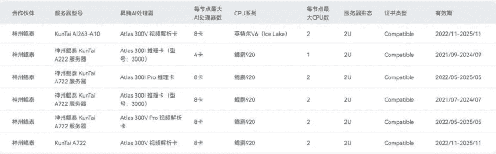

信创产品持续中标，品牌影响力逐步提升。神州信创产品定位是：“华为鲲鹏 CPU”为核心，以自身丰厚行业应用案例为辅助，构建自身信创产品生态，搭建各行业应用平台。神州数码连续赢得“国家税务总局 2021 年税务系统线上批量集中采购计算机设备补充入围项目”、 “厦门集美区鲲鹏等信创适配服务运营”、“中国移动 2021 年至 2022年人工智能通用计算设备集中采购”、“中国移动 2021 年至 2022 年 PC 服务器集中采购”项目等。

图表 39 神州数码旗下昇腾产品目录

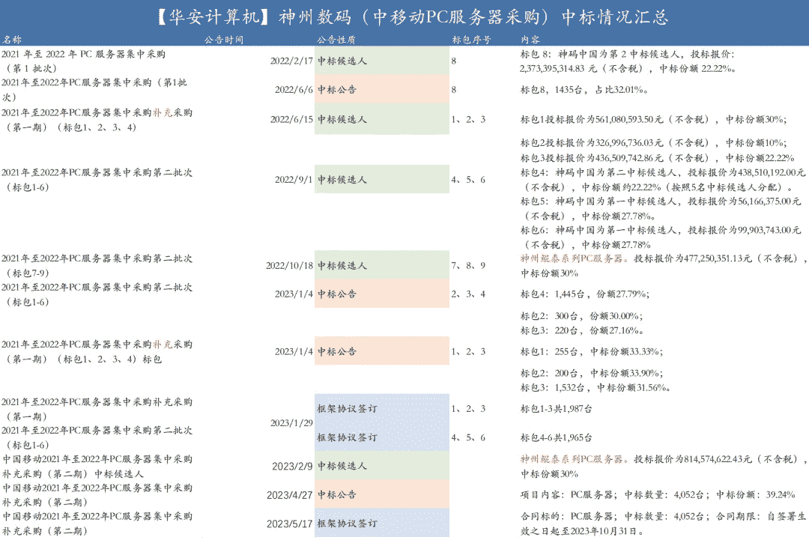

股权激励明确业绩前瞻，高增速凸显投资价值。

1）IT 分销业务方面，公司继续践行“数字中国”之理想，以生态体系为依托，紧抓行业热点机遇，聚合更多的厂商和合作伙伴，为客户提供更全更优的产品、方案和服务，在持续推动分销业务复合增长的同时，赋能产业数字化转型和数字经济发展。

2）云服务方面，神州数码以构建云原生为基础，打造开源化能力，向下聚合，向上服务于应用转型管理，打造包括云管理服务（MSP）、数字化解决方案（ISV）、视频云产品及服务等数字化服务。

3）对于信创服务方面，神州数码坚持自主创新、生态聚合推出神州鲲泰系列产品，并迅速在政企、金融、运营商、互联网、交通、能源等多个行业取得突破落地。

图表 40 神州数码分业务营收情况

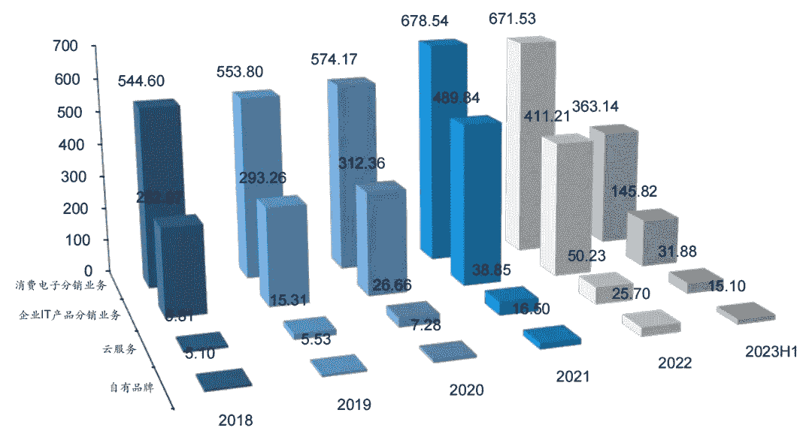

图表 41 神州数码分业务毛利率

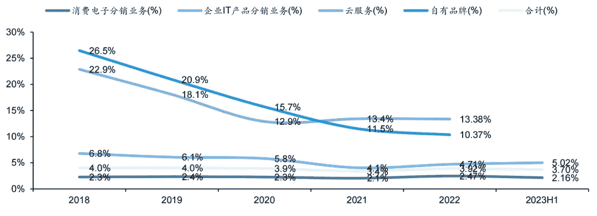

### 4.2 同方股份：自主可控守门员，昇腾产品覆盖广泛

2022 年 4 月 16 日，同方计算机与华为技术有限公司在京举行昇腾万里伙伴授牌仪式，同方正式成为昇腾整机硬件合作伙伴，并签署 Powered by Ascend (PBA) 品牌授权协议，共同推进人工智能产业繁荣发展。

从产品分布来看，训练型、推理型服务器均有涉及，搭配 cpu 包括鲲鹏、飞腾、英特尔系列，以 2U 服务器为主。此外，同方也已推出了基于鲲鹏的个人计算机、储存型服务器、通用型服务器等一系列产品，形成了完备的产品矩阵。

图表 42 同方股份旗下昇腾产品目录

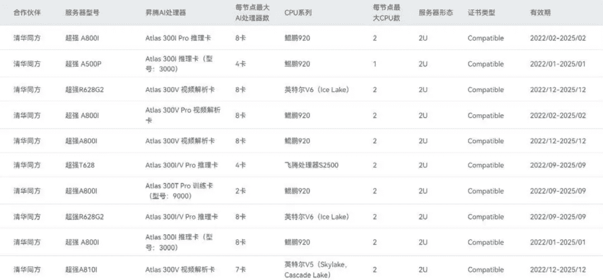

从合作案例来看，同方合作的昇腾软硬件能够顺利完成对通用 AI 系统的国产替代，并表现出较高识别准确度。

图表 43 同方昇腾合作案例一                                 图表 44 同方昇腾合作案例二

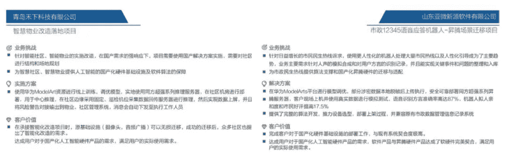

### 4.3 科大讯飞：星火一体机，讯飞星火将与昇腾 AI 强强联合

星火一体机可私有化部署大模型，实现专属、安全、自主可控。今年 7 月 6 日，科大讯飞公布讯飞星火将与昇腾 AI 强强联合，打造基于中国自主创新的通用智能新底座。此次发布会，科大讯飞与华为再度合作，联合发布星火一体机，让企业可以在国产自主创新的平台上，更方便、更自主、更安全可控地私有化部署大模型。

该设备可提供对话开发、任务编排、插件执行、知识接入、提示工程等 5 种定制优化模式，以及办公、代码、客服、运维、营销、采购等 10 种以上即开即用的丰富场景包，支持 3 种模型尺寸供用户选择。刘庆峰表示，有了这些能力，就可以使得每一家企业、每一个行业、每一所学校、每个医院都有机会构建自己的专属大模型。目前，讯飞星火已完成的在金融、政务、汽车等领域的 9 个专属大模型的数据显示，在场景任务优化和私域知识增强等方面平均效果能够提升 20%。

图表 45 同方股份旗下昇腾产品目录

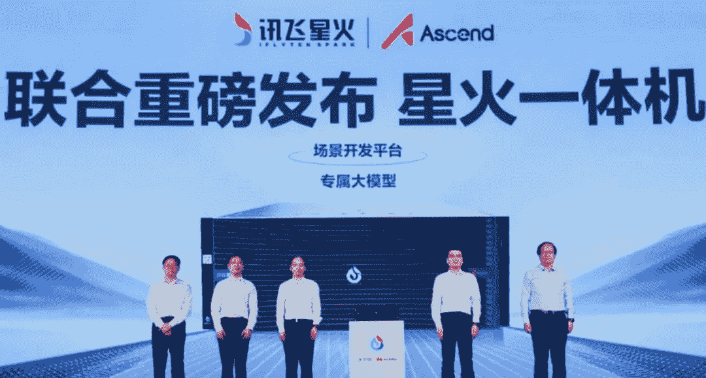

### 4.4 润和软件：智能物联领域的昇腾 AI 落地

润和软件打造的危化品存储室智能安全管控解决方案借助于昇思 MindSpore AI 框架快速训练视觉算法模型，集成华为昇腾强大 AI 算力与润和智能视觉分析引擎，快速落地作业安全规范的智能化。对防护要求、作业流程等纸质化规范进行智能化改造，预防此期间可能发生的违规操作，为作业人员的安全提供坚实保障。

润和软件提供的智能安全管控解决方案，在规定的监管区域内，进行人员检测，并检查作业人员装备规范性，包括作业服、呼吸器、氧气面罩等，同时分析穿戴序列，对作业时间进行监管。目前，该方案已经实现规模化应用，在某石化企业上线后，迅速将其月均违规作业次数降为 0。

图表 46 润和软件智能视觉分析引擎

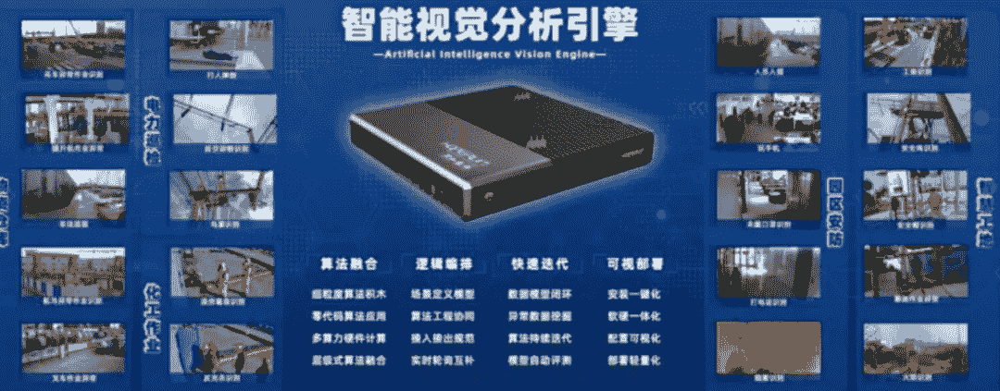
