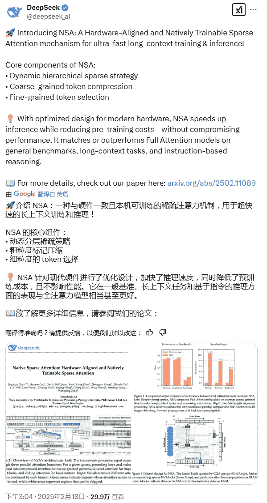
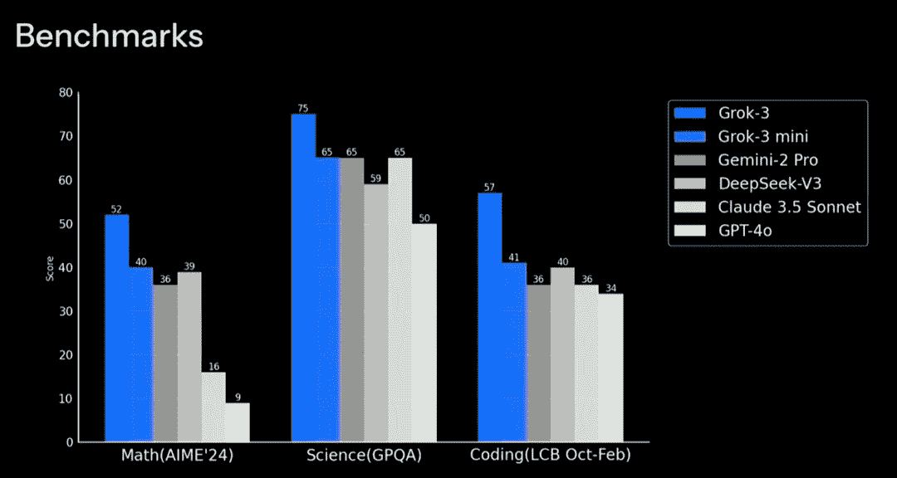
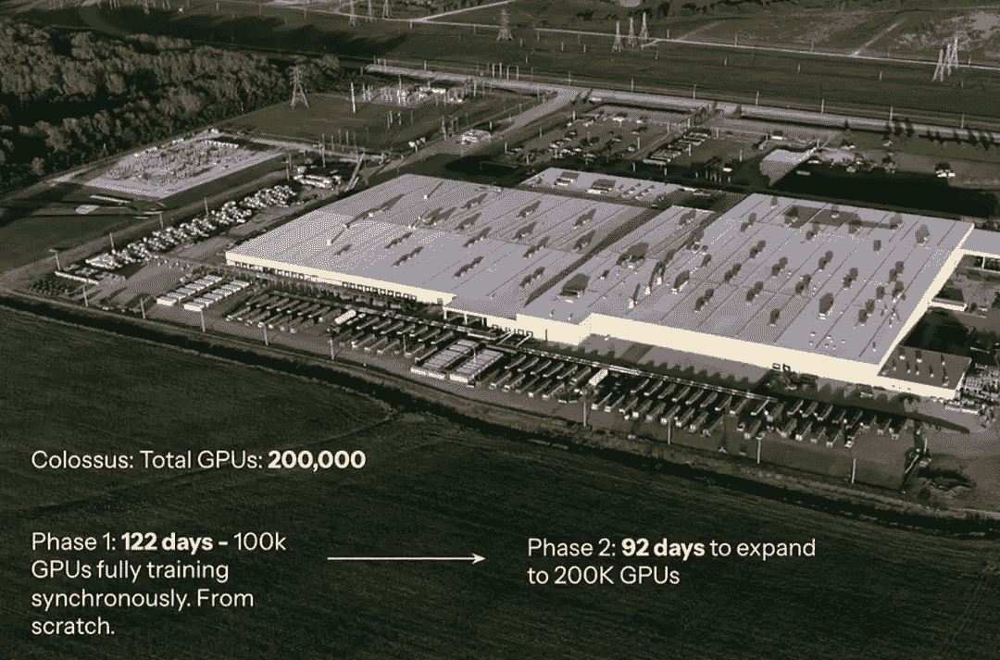
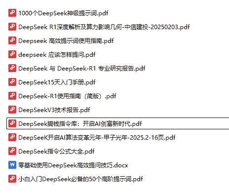

# 王炸，DeepSeek 推出NAS

> 来源：[https://xmgtoagi.feishu.cn/docx/GO7JdezIgot3Tbxsaamc54tcnX2](https://xmgtoagi.feishu.cn/docx/GO7JdezIgot3Tbxsaamc54tcnX2)

大家好，我是小码哥， AI 圈可是热闹非凡，两大重磅消息来袭，直接把科技热度给拉满了！

### DeepSeek 推出 NSA

2 月 18 日，DeepSeek 在社交平台 X 上搞了个大动作，发布了一篇关于 NSA 的纯技术论文报告。这 NSA 可不是啥普通玩意儿，它是一种与硬件高度适配并且能原生训练的稀疏注意力机制，牛掰之处在于能实现超高速长上下文训练与推理，简直厉害到飞起！

NSA 的核心组件也是相当有料，动态分层稀疏策略、粗粒度的 Token 压缩、细粒度的 Token 选择，这三样宝贝组合在一起，那效果杠杠的。DeepSeek 说了，他们针对现代硬件做了优化设计，NSA 不仅能把推理速度提上去，还能降低预训练成本，并且性能一点都不会牺牲。在通用基准测试、长上下文任务以及基于指令的推理中，NSA 的表现那可是相当炸裂，直接媲美甚至超越全注意力模型，简直绝绝子 。

### 马斯克宣布 Grok - 3 发布

再说说马斯克这边，他旗下的xAI 也在 2 月 18 日放大招了，正式发布了最新的大模型 Grok - 3 。马斯克那可是相当自信，直接称其为 “地球上最聪明的人工智能”，这称号听着就让人觉得厉害。

Grok - 3 在多项技术和性能上都实现了重大突破。在直播中，马斯克透露，在数学、科学和编程等基准测试中，Grok - 3 直接吊打 Alphabet 旗下 Google Gemini、DeepSeek 的 V3 模型、Anthropic 的 Claude 和 OpenAI 的 GPT - 4o。它的计算能力比前代版本提升了 10 倍以上，早在今年 1 月初就完成了预训练。

这 Grok - 3 还采用了 “思维链”（Chain of Thought）技术，能模拟人类逐步推理的过程，处理复杂任务时的逻辑连贯性和推理能力直接拉满。在现场演示中，Grok - 3 被要求解决一个超复杂的物理问题，就是计算从地球到火星的转移轨迹，并绘制 3D 动画。xAI 说了，这任务可没有预设脚本，Grok - 3 就靠简短的指令 “生成地球发射、火星着陆以及下一次发射窗口返回地球的动画 3D 图” 就把活儿干了，这科学计算能力没得说。

训练 Grok - 3 的过程也是相当豪横，xAI 搭建了由 20 万张英伟达 H100 GPU 组成的超大规模计算集群，这庞大算力让 Grok - 3 的训练效率和模型性能直接起飞。另外，xAI 还推出了名为 DeepSearch 的智能搜索引擎，集成在 Grok - 3 里，这引擎能扫描互联网和 X 平台上的信息，以摘要形式回应用户查询，信息检索服务又快又准。

Grok - 3 还有自我纠正机制，能反复检查数据，实现逻辑一致性，减少错误提高准确性。xAI 更是引入了人类反馈循环和情境训练，人类反馈循环通过人类审阅者的直接反馈，帮模型改进答案的准确性、相关性和实用性；情境训练则让 AI 根据对话上下文调整回应，考虑之前的互动、用户意图和相关信息，生成更符合情境的答案，这响应简直不要太自然和准确。

宝子们，这 AI 发展的速度真是快到飞起，DeepSeek 的 NSA 和马斯克的 Grok - 3 都这么牛掰，未来 AI 能给我们带来啥惊喜，真是让人充满期待啊！

http://**www.xmgai.cn****，**免费内容创作平台来袭，热点话题、改写提取、创作工具全都有，助你轻松产出爆款！

小码哥一直从事大模型研发，欢迎一起学习交流。

# AI 交流社群

http://**www.xmgai.cn****，**免费内容创作平台来袭，热点话题、改写提取、创作工具全都有，助你轻松产出爆款！

另外免费领取以下内容：

