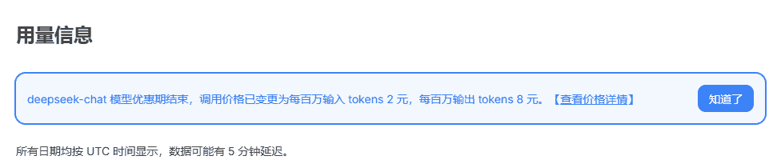
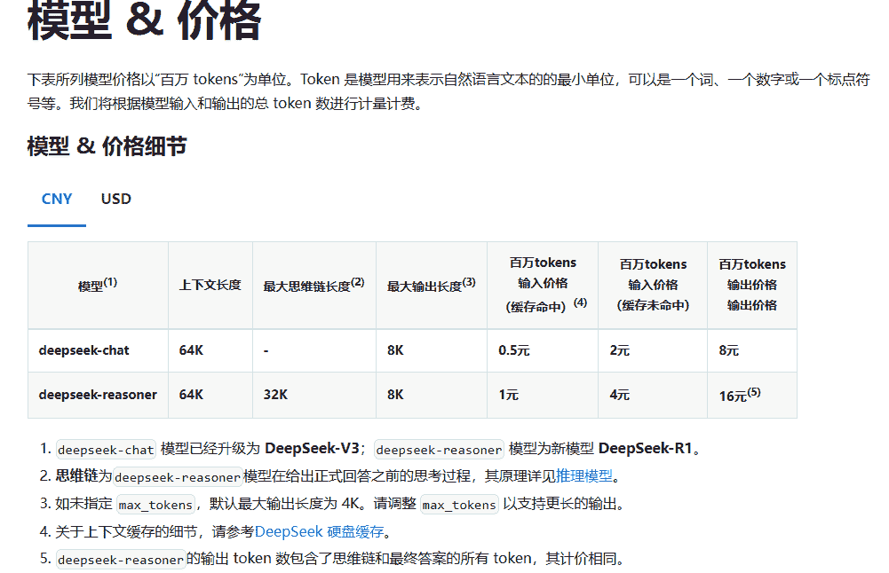
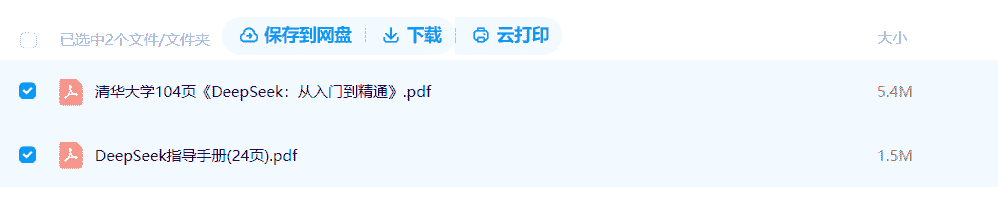

# 惊爆！DeepSeek 涨价了

> 来源：[https://xmgtoagi.feishu.cn/docx/ZQEIdTp9woR0UPxYYH7cneBenxb](https://xmgtoagi.feishu.cn/docx/ZQEIdTp9woR0UPxYYH7cneBenxb)

大家好，我是小码哥，炸裂消息来袭！那个超火的国产 AI 大模型 DeepSeek 涨价啦！

还记得之前咱能超优惠体验的 DeepSeek - V3 API 服务嘛？从 2 月 9 日起，价格大变样咯。以前优惠期的时候，输入 tokens 费用缓存命中每百万才 0.1 元，没命中也才 1 元；输出 tokens 每百万 2 元，多划算呀。可现在，输入 tokens 不管缓存是否命中，每百万直接飙到 2 元，缓存没命中时价格直接翻倍，涨幅高达 100%；输出 tokens 更夸张，涨到每百万 8 元，涨幅 300%，这价格变化就像坐火箭似的。

为啥会这样呢？优惠体验期就是 DeepSeek 官方搞的市场推广小策略啦，目的就是让咱这些用户都去试试水，感受下它的强大，这不，用户基础和口碑都积累得差不多了，优惠期一过，价格就恢复 “原形” 啦。不过，除了这个，还有些其他原因哦。

随着 DeepSeek 的火爆出圈，访问量那是相当的大，服务器压力山大，经常出现 “服务器繁忙，请稍后再试” 的情况。而且，DeepSeek 还成了黑客攻击的目标，面临着大规模的网络攻击。这些都导致了运营成本的增加，所以涨价也是无奈之举啊。

有专家分析，DeepSeek 这一涨价，公有云价格竞争压力瞬间小了不少。而且 API 性价比下降后，反而对企业本地化部署是大大的利好。毕竟之前 DeepSeek - V3 优惠期的价格对比云厂商那可是香得不行，现在价格恢复，云厂商们可就不那么 “卷” 了。另外，API 价格相比优惠期上调了 2 - 4 倍，估计有不少企业会更倾向于本地化部署，这样一来，企业侧算力需求和容灾备份需求就迎来好时机啦。

小码哥一直从事大模型研发，欢迎一起学习交流，免费领取以下资料。

# AI 学习交流社群

## 私信免费获取以下资源

**免费使用****www.xmgai.cn****，一键改写爆款长文。**

