# 全球AI 大模型全栈技术研究报告 2024

> 来源：[https://xmgtoagi.feishu.cn/docx/E3CVdwcnmoTmAAxmqwHcW1tcnye](https://xmgtoagi.feishu.cn/docx/E3CVdwcnmoTmAAxmqwHcW1tcnye)

> 作者：Alsoar

> 原文：`https://mp.weixin.qq.com/s/nYhM_5pCo_LnBzFBwht-RQ`

经过大规模预训练的大模型，能够在各种任务中达到更高的准确性、降低应用的开发门槛、增强模型泛化能力等，是`AI`领域的一项重大进步。大模型最早的关注度源于`NLP`领域，随着多模态能力的演进，`CV`领域及多模态通用大模型也逐渐成为市场发展主流。政企的极大关注带动了行业领域大模型的高速发展，逐渐形成了多模态基模型为底座的领域大模型和行业大模型共同发展的局面。

伴随基于大模型发展的各类应用的爆发，尤其是生成式`AI`，为用户提供突破性的创新机会，打破了创造和艺术是人类专属领域的局面。`AI`不再仅仅是“分类”，而且开始进行“生成”，促使大模型带来的价值进一步升级到人类生产力工具的颠覆式革新。同时，数据规模和参数规模的有机提升，让大模型拥有了不断学习和成长的基因，开始具备涌现能力（`Emergent Ability`），逐渐拉开了通用人工智能（`AGI`）的发展序幕。

过去几年，国内外的`AI`厂商均在大模型领域有所布局。`OpenAI`在2019年发布了`GPT-2`大模型，国内互联网科技厂商也集中在2020-2022三年期间相继发布了自己的大模型。`ChatGPT`的发布，掀起一波发展热潮，原有厂商基于自身大模型开始推出一系列生成式`AI`应用，并对外提供`API`接口。更多的创业公司、科研机构和新的科技厂商涌入该市场，发布相关的产品服务。

过去几年，国内外的`AI`厂商均在大模型领域有所布局。`OpenAI`在2019年发布了`GPT-2`大模型，国内互联网科技厂商也集中在2020-2022三年期间相继发布了自己的大模型。`ChatGPT`的发布，掀起了一波发展热潮，原有厂商基于自身大模型开始推出一系列生成式`AI`应用，并对外提供`API`接口。更多的创业公司、科研机构和新的科技厂商涌入该市场，发布相关的产品服务。

大模型人气高涨，吸引了用户的关注，不仅是`CIO`、`CTO`等技术决策人员，`CEO`、`CFO`等业务决策人员也同样希望发挥此类模型在业务用例中的潜力。用户关注度的跃升成为对厂商自身能力的考验，前期已具备全栈大模型构建能力的厂商开始显现积累优势。为帮助用户了解国内大模型市场的发展情况、厂商格局和竞争地位，我们研究团队通过详实的访谈调研，对中国市场提供大模型产品服务的厂商进行了深入的分析和评估。

## 全球知名大模型发布时间节点

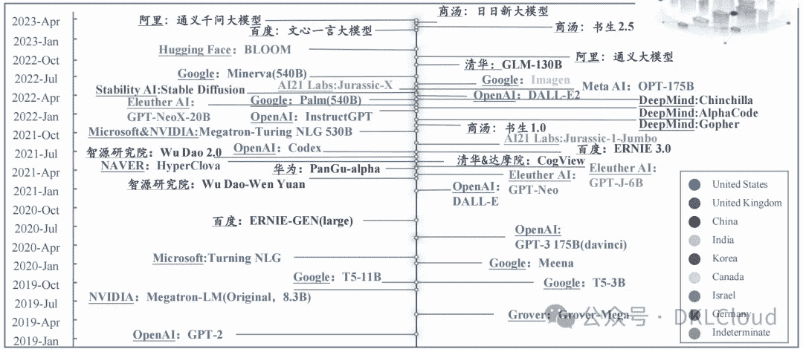

## 关键发现点

`AI`大模型的高速发展离不开底层技术支持和应用场景迭代。大模型作为`AGI`时代的曙光，相关厂商也将迎来广阔的发展空间。本报告将呈现从发展现状、驱动因素洞察`AI`大模型厂商竞争与发展关键点，并推演竞争格局的逻辑分析过程：

### 前瞻洞察：通向`AGI`的技术路径

通向`AGI`的技术路径具有多元性，目前大模型是最佳实现方式。大模型具有强大的泛化性、通用性和实用性，能够降低`AI`开发门槛、提高模型精度和泛化能力，提高内容生成质量和效率等多种价值，实现了对传统`AI`技术的突破，并成为`AGI`的重要起点。进而将`AI`发展由数据飞轮升级到智慧飞轮,最终迈向人机共智。大模型和人类反馈的强化学习（`RLHF`）的结合，进一步重构了`AI`开发范式，进入大模型主导的软件2.0时代。另一方面，`AI`开发则形成新的“二八定律”，开发者的生产力将得到极大释放。

### 驱动因素

大模型“基础设施 - 底层技术 - 基础通用 - 垂直应用”发展路线逐渐清晰，国内各厂商加速战略布局，加大资金和技术投入，迎头赶上全球大模型产业化浪潮，本土化大模型迎来发展新机遇。整体上，行业驱动因素主要包含三个层面:

**（1）政策端：**政策环境持续优化，赋能`AI`大模型市场高速发展。

**（2）供给端：**下一代`AI`基础设施等快速发展，助力大模型应用落地。

**（3）需求端：**`AI`市场高景气，大模型下游行业需求旺盛。

### 行业观点

大模型未来发展将趋于通用化与专用化并行、平台化与简易化并进。同时，`MaaS`模式将成为`AI`应用的全新形式且快速发展，重构`AI`产业的商业化结构生态，激发新的产业链分工和商业模式。未来，大模型将深入应用于用户生活和企业生产模式，释放创造力和生产力，活跃创造思维、重塑工作模式，助力企业的组织变革和经营效率，赋能产业变革。

### 关键成功因素

大模型面临算力需求大、训练和推理成本高、数据质量不佳等挑战。一个可对外商业化输出的大模型的成功，要求其厂商拥有全栈大模型训练与研发能力、业务场景落地经验、`AI`安全治理举措、以及生态开放性4大核心优势，才能保证其在竞争中突出重围。其中，全栈大模型训练与研发能力还包括数据管理经验，`AI`基础设施建设与运营，以及大模型系统和算法设计3个关键要素。

### 竞争格局

在竞争格局渐趋明晰的过程中，相关厂商需跨越技术、人才、资金等壁垒，在产品技术能力、战略愿景能力、生态开放能力三大维度上展开角逐。通过遴选，报告选择了5家大模型厂商，分别为商汤、百度、阿里巴巴、华为、腾讯，评价模型包含15个一级指标、56个二级指标，对厂商大模型的各个能力进行评估。

### 用户建议

通过此报告能够了解大模型厂商的竞争态势，关注领先厂商，内部创建大模型战略文件，明确其优势、带来的风险和机遇，以及部署路线图，针对具体的用例，权衡模型的优势和风险，并选择合适场景试点、评估大模型的应用价值。

## 章节一 AI 大模型掀起时代浪潮，加速通用人工智能（AGI）时代的来临

### 关键发现

• 以`ChatGPT`的发布为里程碑事件，`AI`的发展进入到了继突破工业红线之后的，以`AGI`为发展目标的全新通用智能时代。

• 大模型是通向`AGI`时代的最佳技术路径，并开始在以自动驾驶为代表的场景下所体现。同时，大模型也带来了全新的`AI`开发范式，基模型+人工反馈闭环的模式给开发者带来了新的“二八定律”。

• 生成式`AI`成为大模型能力应用的爆发点，以文生文、文生图等内容生成为代表的大模型应用快速增长，并逐渐成为日益完善的生产力工具。

### AI 大模型是人工智能预训练大模型的简称

`AI`大模型包含了“预训练”和“大模型”两层含义，二者结合产生了新的人工智能模式，即模型在大规模数据集上完成预训练后，仅需少量数据的微调甚至无需微调，就能直接支撑各类应用。这些模型通常具有多层神经网络结构，并使用高级的优化算法和计算资源进行训练，具有强大的泛化性、通用性和实用性，可以在自然语言处理、计算机视觉、智能语音等多个领域实现突破性性能提升。

`AI`大模型是人工智能迈向通用人工智能的里程碑技术。以目前热门的`ChatGPT`为例，`ChatGPT`的最大贡献在于基本实现了理想`LLM`的接口层，能够使`LLM`自主适配人的习惯命令表达方式，由此增加了`LLM`的易用性，提升了用户体验。`InstructGPT`/`ChatGPT`首先意识到这个问题，并给出了相应解决方案，较之前`fewshot prompting`方案更符合人类表达习惯。

### AI 大模型的内涵与特征

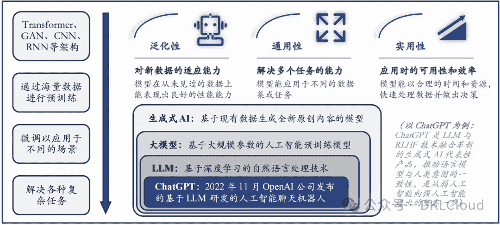

人工智能发展进入以`AGI`为代表的新里程碑阶段

人工智能近年来高速发展，现已经进入了以`AGI`为代表的新里程碑阶段。随着`AI`基础设施逐步完善，深度学习技术不断进步，人工智能应用场景逐渐增多，过去模型参数规模和数据量也实现了大幅度增长，为`NLP`、`CV`等领域带来更强大的表达能力和性能。人工智能发展历程中主要有两大里程碑：

### 里程碑一：2012 年 `CNN` 获得 `ImageNet` 第一

2012年`CNN`获得`ImageNet`第一，标志着机器视觉识别能力开始逐渐超越人眼识别准确率，开启了人工智能革命。随着深度学习技术不断突破，诞生了一批“`AI`＋场景应用”的专属模型，但是整体研发成本比较高、研发时间比较长。

### 里程碑二：2022 年 `ChatGPT` 的出现

2022年`ChatGPT`的出现，掀起了又一波人工智能发展热潮，以大模型+`RLHF`为核心的技术落地意味着人工智能开启`AI`新范式。人工智能相关产业开始基于强大的基模型进行发展，通过人类反馈和强化学习不断解锁基模型的能力，以解决海量开放式任务，带来了新的研究范式。

### 人工智能的发展历程

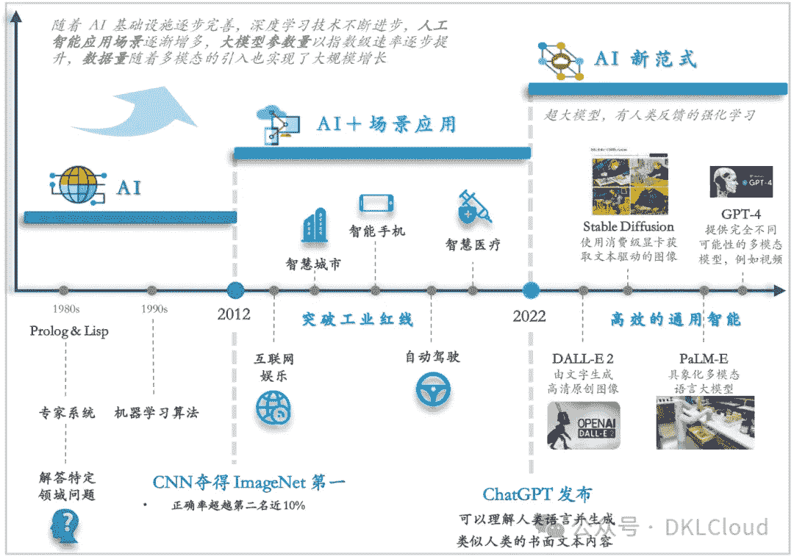

### 通往 AGI 的技术路径多元，目前大模型是最佳实现方式（1/2）

`AGI`技术能够精准识别人类情绪意图、理解人类语言、学习人类知识并进行类脑推理与创造。`OpenAI`的CEO山姆（Sam Altman）对`AGI`的定义相当明确：如果`AI`模型具有一个“普通人”学习解决问题的综合技能，能够在任何领域变得优秀，那就拥有了`AGI`。

大模型是目前通往`AGI`的最佳实现方式。以`ChatGPT`为代表的人工智能技术已经具备`AGI`的核心技术和特征，能够自动化地学习任何可以符号化的知识及信息，不断自我优化，充分理解和流畅表达人类语言，同时逻辑推理能力强，实现了具备一般人类智慧的机器智能。

相较于过去`AI`应用与部署难以全面覆盖产业的短板，大模型能覆盖全产业流程的每个环节。以自动驾驶场景为例，在输入层，大模型能全链条覆盖感知环境，并生成大量实景图片。在输出层，解码器负责重构3D环境、预测路径规划、解释自动驾驶的动机等。大模型能实现自动驾驶感知决策一体化集成，更接近人的驾驶行为预判断，助于提升自动驾驶的安全性、可靠性和可解释性。

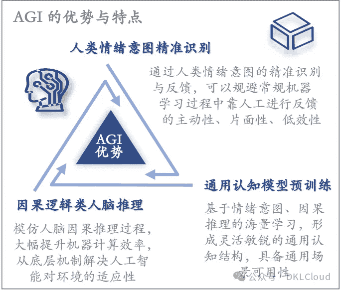

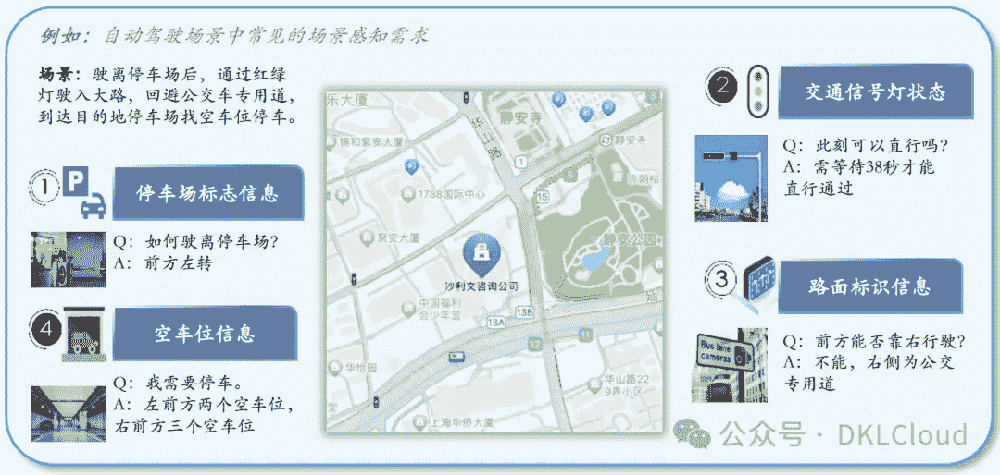

### 通往 AGI 的技术路径多元，目前大模型是最佳实现方式（2/2）

### 大模型的缩放法则（`Scaling Law`）和涌现性（`Emergent Ability`）

大模型的缩放法则和涌现性与`AGI`的发展息息相关。缩放法则是指随着模型规模逐步放大，任务的表现越来越好（如图a所示）；涌现性是指随着模型的规模增长，当规模跨过一定阈值，对某类任务的效果会出现突然的性能增长，涌现出新的能力（如图b所示）。当全部人类的知识被存储在大模型中，这些知识被动态连接起来时，其所具有的智能远超人们预期。

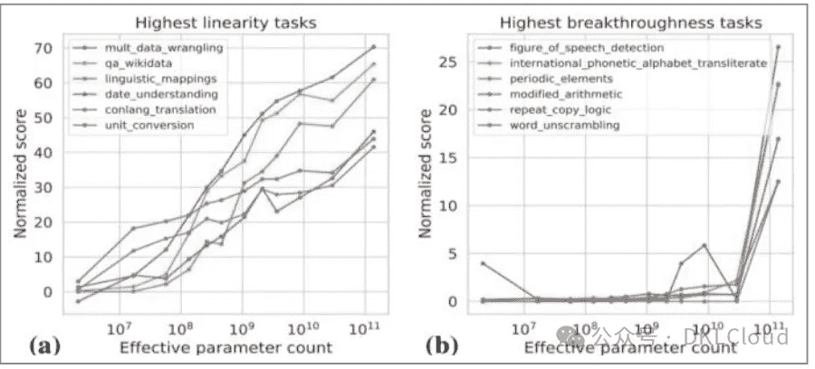

`AGI`将实现从“数据飞轮”到“智慧飞轮”的演进，最终迈向人机共智。现有`AI`体系主要基于数据飞轮，`AGI`催生了新的研究范式——智慧飞轮，通过强化学习和人类反馈不断解锁基模型新的能力，以更高效地解决海量的开放式任务。

 **数据飞轮：**现有`AI`体系主要从前端获取大量数据并进行人工标注，通过更新后的模型反馈到前端，以获取高质量数据，但是研发时间长和成本高。

 **智慧飞轮：**`AGI`体系则将实现人与模型的互动，基模型将不断理解人的意图以解锁更多技能，并能实现自动化标注，成本约`AI`体系的1%，有助于推动数据进行快速迭代与优化，以输出更高质量的智慧内容。

大模型将由数据飞轮向智慧飞轮升级演进

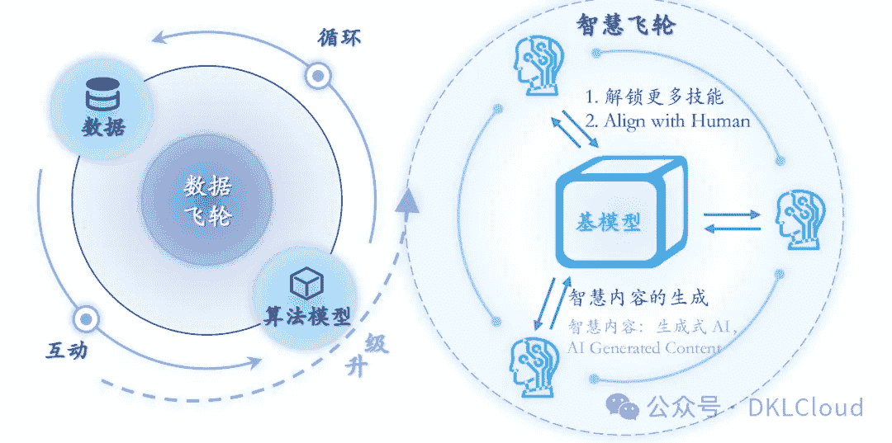

### 人工智能生产范式发生转变，新的“二八定律”形成（1/2）

大模型的出现，将重构人工智能生产范式。传统的软件开发模式是通过任务/业务数据集形成专属模型，小模型不断迭代，开发人员用明确的代码去表达程序执行的逻辑，而随着业务场景从通用场景发展到长尾、碎片场景，该模式则逐渐显现出开发成本高，精确度不佳等一系列挑战。

在大模型的加持下，逐渐形成围绕大模型结合人工反馈强化学习为核心的软件开发新范式，通过模型微调的手段，可以基于超大规模基模型，打造出领域大模型或者行业大模型，进而覆盖更多行业场景。

与此同时，通过提示工程，只需用示例向计算机表达预期目标，计算机将通过神经网络自行找出达到目标的方法。

传统软件开发时期，解决单一问题的深度学习方法与工业化小模型生产工具逐步成熟，现阶段在一些垂直领域仍会应用，如医疗影像、工业检测等。未来软件开发新范式将是`AI`大模型驱动的商业模式与产品设计的基础。

人工智能的小模型时代下，解决单一问题的深度学习方法与工业化小模型生产工具逐步成熟。在大模型时代，在`AI`原生基础设施上，大模型即服务（`Model as a Service`）结合数据反馈闭环是未来人工智能大模型驱动的商业模式与产品设计的基础，在此前景下，新范式将会更加注重基础设施成本、算力与数据规模、以及实时用户大数据的反馈和迭代。

### AI 软件开发进入全新范式

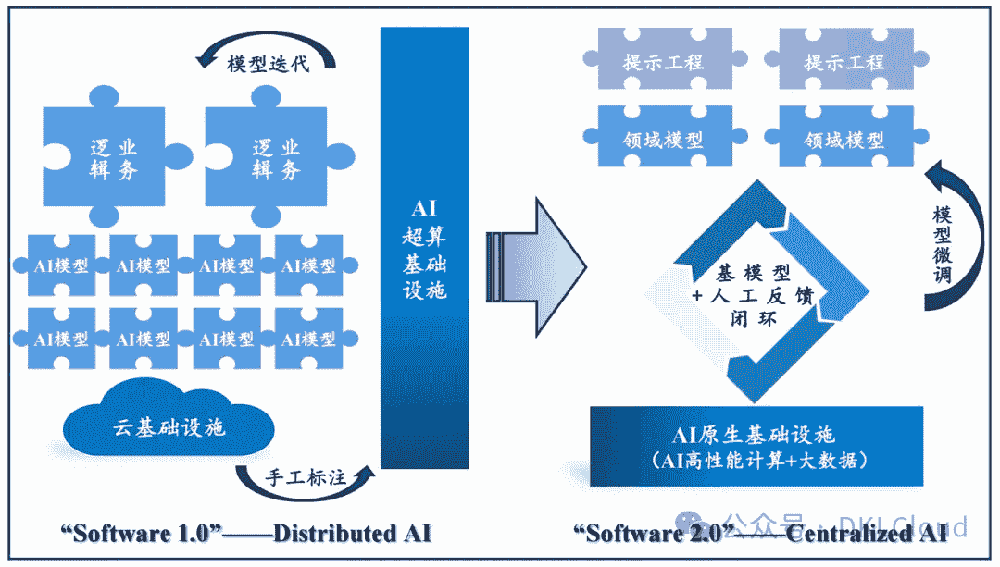

### 人工智能生产范式发生转变，新的“二八定律”形成（2/2）

新的“二八定律”形成，`AI`大模型将释放开发者的生产力。在传统软件时代，100%的计算机代码由程序员编写程序逻辑，计算机中约20%的指令承担了80%的工作。到小模型时代，`AI`模型可以替换20%的人工代码逻辑，但手工开发的业务逻辑仍占到80%。进入大模型时代，未来软件80%的价值将由`AI`大模型提供，剩余20%会由提示工程和传统业务开发组成，新的“二八定律”由此形成。

大模型通过机器学习训练代码，直接生成满足需求的程序代码。原特斯拉`AI`总监Andrej Karpathy曾表示自己现在80%的代码由`AI`完成，而商汤内部实测日日新大模型提升代码编写效率约62%。大模型不仅能生成代码，补全必要的代码块，还能够保证一定的准确率。

`DeepMind`的`AlphaCode`在`Codeforces`上托管的10个竞赛中总体排名前54%，清华大学开发的多编程语言代码生成预训练模型在`HumanEval-X`代码生成任务上取得47%~60%求解率。基于大模型的高精度代码生成，能够提高软件开发的效率，标志着人工智能向`AGI`更进一步。

### AI for AI 释放软件开发生产力

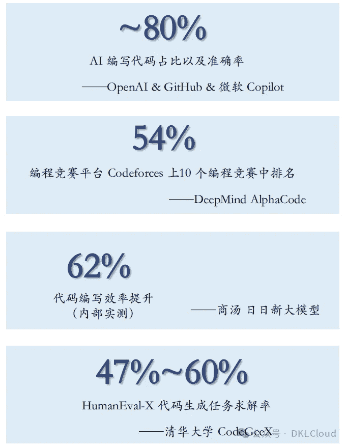

### 基于大模型的代码生成（以 `DeepMind AlphaCode` 为例）

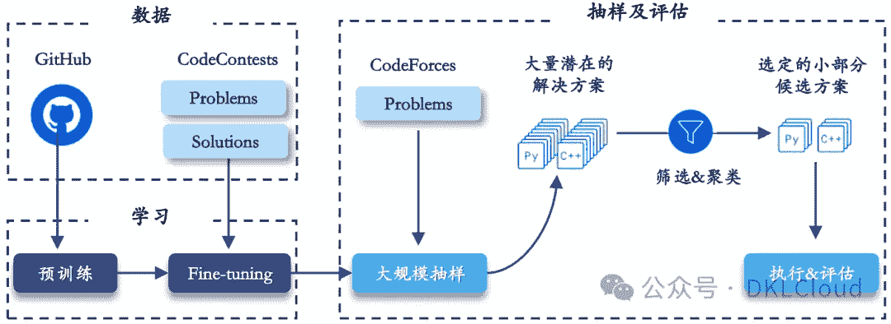

### AI 大模型技术创新，助推生成式 `AI` 应用场景加速落地

伴随`AI`技术升级和大模型成熟，`AI`绘画与`ChatGPT`的成功破圈，生成式`AI`技术迎来发展拐点，行业关注度大幅提升。生成式`AI`是指基于大模型、生成对抗网络`GAN`等人工智能技术，通过已有数据寻找规律，并通过适当的泛化能力生成相关内容的技术，可生成如图像、文本、音频、视频等原创内容变体。

例如，以`ChatGPT`、`Midjourney`、`文心一格`、`商汤商量`、`Codex`为代表的生成式`AI`应用拥有文本语言理解能力、涌现能力以及思维链推理能力，能够完成文学创作、新闻写作、数理逻辑推算、代码生成、图片生成等多项任务。目前，国内电商、游戏、文娱、设计等行业正在积极使用相关的生成式`AI`应用来提高自身工作效率，尤其以文生图应用为主。

生成式`AI`不仅能够增强并加速下游多领域的设计，而且有潜力“发明”人类可能错过的新设计、新对象。生成式`AI`有生成大规模、高质量、低成本内容优势，在算力和算法支持下生成大量内容，生成的内容质量将持续超过`UGC`与`PGC`。未来有望为各行业提供内容支持并促进其内容繁荣，最大化释放内容生产力。

文字生成属于发展成熟、易于跨界转化的赛道，而跨模态生成赛道的发展潜力最高。生成式`AI`应用根据模态划分为文字生成、音频生成、图像生成、视频生成、跨模态生成。语音合成、文本生成、图像属性编辑等技术应用目前较为成熟，跨模态生成、策略生成是高增长潜力的应用场景，在自动驾驶、机器人控制等领域有极高应用价值，随着未来技术不断发展成熟，预计3-5年可实现稳定落地。

大模型发展及相关应用实现落地时间表

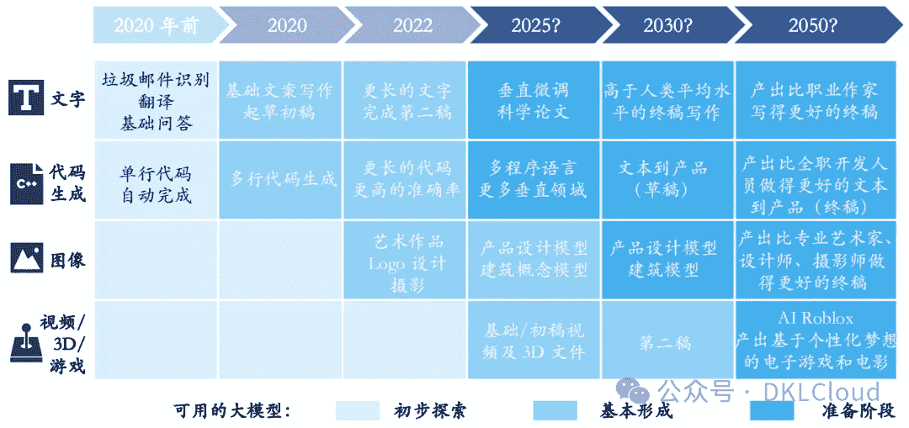

## 章节二 大模型迎来发展新机遇，未来前景可期

### 关键发现

• 人工智能的政策引导逐渐覆盖到大模型生态，并开始出台相应的生成式`AI`监管建议，进一步支撑大模型生态的有序发展；

• 大模型的神经网络架构和训练大模型的`AI`基础设施，均逐渐发展成熟，推动大模型的生产更加系统化和工程化；

• 下游企业用户的`AI`部署需求进一步规模化发展，急需在上游大模型支撑下，获得`AI`应用开发门槛降低，部署精度提高等基础价值，进而降低`AI`规模化部署的成本；

• 大模型的发展趋于通用化与专用化并进，平台化与简易化并进；

• 依托`Model as a Service`，大模型建立起面向政企、消费者群体等差异化的商业模式，并逐渐形成基模型、领域、行业大模型一体的商业化架构。

在“基础设施支撑 + 顶层设计优化 + 下游需求旺盛”三轮驱动下，`AI`大模型迎来了良好的发展契机。

通过数据交互和任务反馈，优秀的大模型能够赋能各行各业开放任务，满足对未来`AI`应用的期待。展望未来，大模型“训练基础设施 – 底层技术 – 基础应用 – 垂直应用”发展路线逐渐清晰，随着底层技术逐步革新，基模型和领域大模型持续完善，大模型应用边界不断拓宽，将加速赋能交通、医疗、金融等各个行业和领域，引发一场以强人工智能和通用人工智能为代表的新一轮智能革命浪潮，大幅提高生产和生活效率，带来深刻的经济、社会和产业变革。

优秀的大模型能够赋能各行各业开放任务

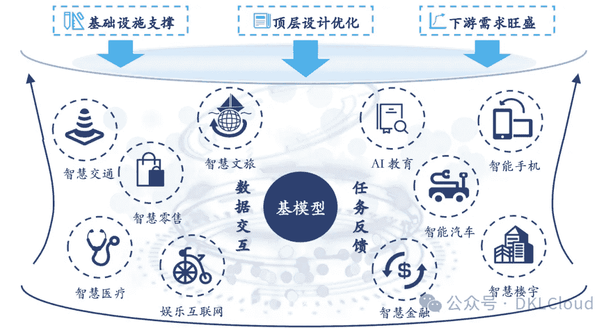

政策环境持续优化，助力`AI`大模型市场高速发展

# 人工智能大模型发展现状与趋势

## 国家政策与产业规划

从“十二五”到“十四五”规划，国家从宏观层面上对人工智能新技术、新产业给予巨大支持，顶层设计从方向性引导到强调落地应用与场景创新，进一步细化、深化。地方政府积极响应国家战略，加快规划人工智能产业建设，如北京市经济和信息化局发布《2022 年北京人工智能产业发展白皮书》，支持头部企业打造对标 ChatGPT 的大模型，着力构建开源框架和通用大模型的应用生态。国家重视人工智能产业的安全可信和伦理秩序，两会期间科技部部长十天两提 ChatGPT，强调规范科技伦理，趋利避害。国家近日出台人工智能相关管理条例，如《生成式人工智能服务管理办法（征求意见稿）》，进一步促进 AI 技术的规范应用和产业整体的高质量发展。

“十二五”至“十四五”期间部分人工智能相关政策

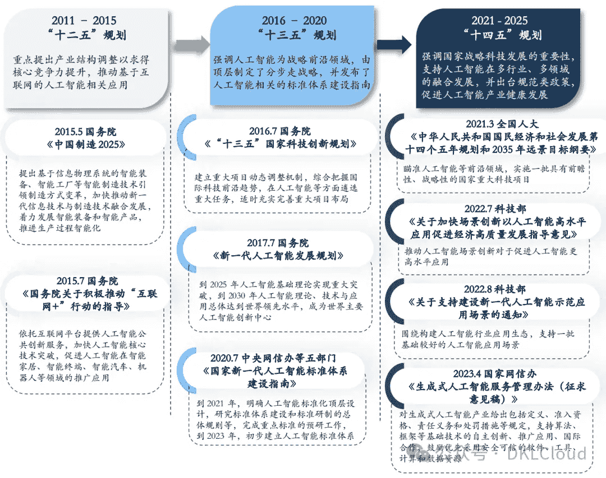

## AI 基础架构及基础设施发展

AI 基础架构及基础设施快速发展，助推大模型应用落地。

### Transformer 架构与演进

**从基础架构来看，Transformer 是 AI 大模型演进的基础。** Transformer 由论文《Attention is All You Need》提出，是一个新的简单网络架构，遵循 Encoder-Decoder 架构流程来实现结果，完全基于注意力机制，摒弃了循环和卷积。

Transformer 模型结构与基于 RNN 模型结构相比，不仅提升了自然语言处理任务的精度和质量，而且可并行化程度更高，所需的训练时间明显减少，能够提升计算效率和资源利用率。目前 Transformer 已逐步取代 LSTM 等 RNN 模型，成为 NLP 问题的首选模型，并有逐步统一图像处理等领域的趋势。可以说，Transformer 促成了 GPT 和 BERT 两大 LLM 模型主流技术的出现。

BERT 使用掩码语言模型，可以双向处理输入序列，适用于理解类或某个场景的具体任务。GPT 使用自回归模型进行语言建模，适合生成类以及多任务场景。

AI 基础设施架构图

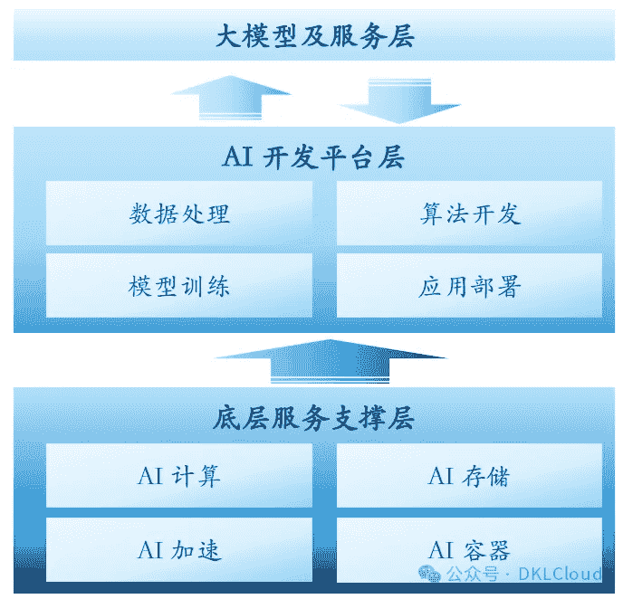

LLM 应该具备自主学习能力，理解人类的命令，执行并完成尽可能多类型的任务，而生成模型更容易做好 zeroshot/few shot prompting 方式的任务，因此当前几乎所有参数规模超过千亿的 LLM 模型都采用了 GPT 路线。

LLM 研究的发展路径

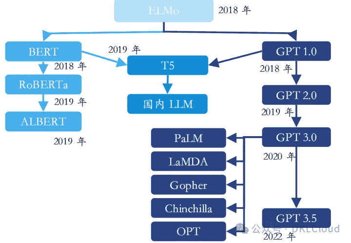

高效率、低成本、规模化的 AI 基础设施成长迅速，帮助夯实大模型基础。底层服务支撑层包含 AI 计算、存储、加速、容器核心套件，能够提供高性价比的算力，承载海量数据的处理、超大模型的训练和推理。

AI 开发平台层集成数据处理、模型开发、部署运行、资产管控等功能工具，能够围绕 AI 模型/算法的生命周期提供工具，连接不同层次开发者对 AI 模型设计、训练、部署等活动。

大模型及服务层能够提供基础大模型，应用于下游多个场景中，且能够通过数据反馈实现模型的持续优化迭代。如商汤 AI 大装置、百度 AI 大底座、腾讯云新一代 HCC 高性能计算集群、字节-火山引擎发布的高速训练引擎等，能够提供大算力和大数据，实现高性能的模型开发应用。

## 核心技术层协同发展

核心技术层协同发展，共同赋能 AI 大模型生态。

**AI 大模型的技术架构通常涉及多个层次，可以分为基础层、技术层、能力层、应用层、终端层五大板块，其中核心技术层涵盖 AI 技术群和大模型的融合创新，为各行业深度赋能。**

### 基础层

**基础层**：AI 大模型的基础层涉及硬件基础设施和数据、算力、算法模型三大核心要素。随着 AI 大模型规模的不断扩大，对计算资源的需求也在增加。因此，高性能的硬件设备、海量场景数据、强大的算力基础和升级迭代的算法模型成为了支持 AI 大模型发展的关键。深度学习模型的不断升级和迭代，增强了 AI 算法的学习能力；同时，开源模式将使 AI 大模型成为海量应用、网络和服务的基础。

### 技术层

**技术层**：AI 大模型的技术层主要涉及模型构建。目前，Transformer 架构在 AI 大模型领域占据主导地位，如 BERT、GPT 系列等。AI 大模型包括 NLP 大模型、CV 大模型、多模态大模型等。这些模型采用预训练和微调的策略，先在大量无标注数据上学习语言或图像的基本表示，然后针对特定任务进行微调。

### 能力层、应用层及用户层

**能力层、应用层及用户层**：在基础层和技术层的支持下，AI 大模型拥有了文字、音频、图像、视频、代码、策略、多模态生成能力等，具体应用于金融、电商、传媒、教育、游戏、医疗、工业、政务等多个领域，为企业级用户、政府机构用户、大众消费者用户提供产品和服务。

AI 大模型的技术架构

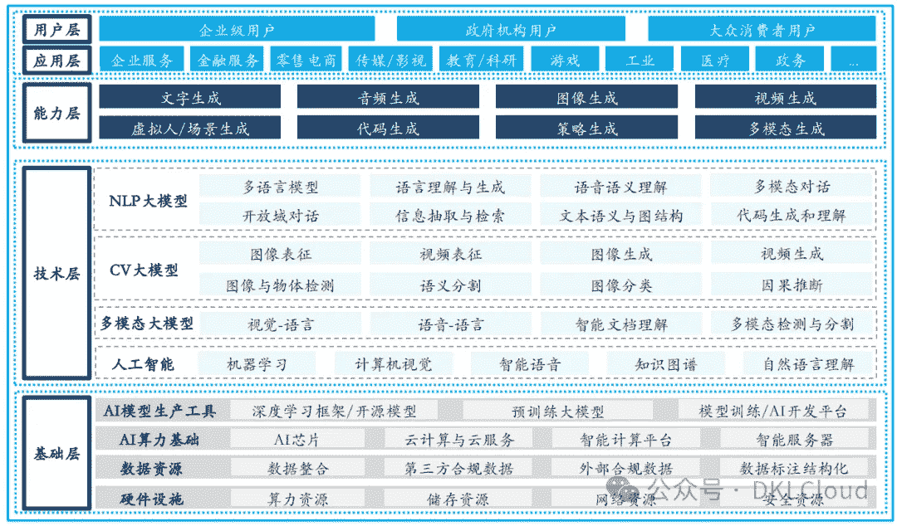

## 市场需求与下游行业

AI 市场高景气，大模型下游行业需求旺盛。

**人工智能能够赋能经济社会发展各领域，下游各个领域的产业升级对大模型的需求持续走高。** 例如，在泛交通领域，人工智能能够在自动驾驶、智能座舱、运行管理优化等多个方面为汽车行业创造价值；在医疗方面，人工智能可以提高疾病检测的效率以及医学影像领域的智能化分析。据测算，2022 年中国人工智能行业市场规模为 3,716 亿人民币，预计 2027 年将达到 15,372 亿人民币，有望在下游制造、交通、金融、医疗等多领域不断渗透，实现大规模落地应用。

**下游行业对人工智能需求呈现出碎片化、多样化的特点，**从开发、精调、优化、迭代到应用都需要投入巨大的人力和财力，成本极高。而大模型能够向外赋能，包括通过开放 API 的形式，降低 AI 应用开发门槛，提高落地部署效率和精度等，进而降低 AI 规模化部署的成本，满足各行业场景的应用需求，进一步推动人工智能进入工业化发展阶段。

AI 大模型应用场景丰富

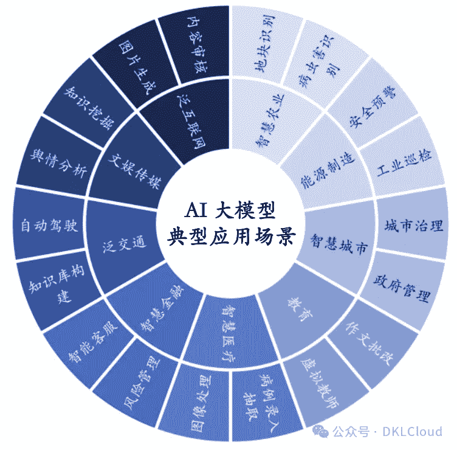

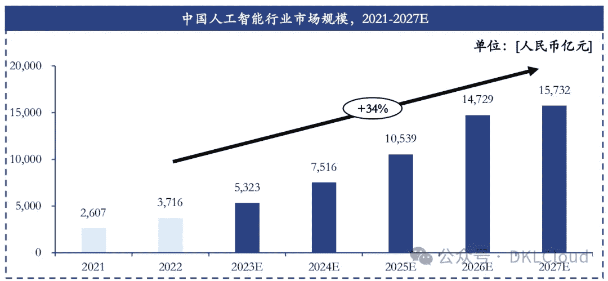

## 大模型价值

大模型的多种价值，将加速人工智能的技术进步和规模化应用。

**AI 大模型具有降低开发门槛、提高模型精度和泛化能力、提高内容生成质量和效率等多种价值，实现了对传统 AI 技术的突破。**

一方面，大模型可以帮助降低机器学习和自然语言处理应用的开发门槛，能够对复杂的模式和规律进行更准确的建模，通过不断地学习和更新自己的参数来提高其性能和准确度，提高模型的精度，更好地泛化到新的数据集和任务中。

另一方面，大模型通常能够更好地泛化到新的数据集和任务中，可以提高内容生成质量和效率，例如生成对话、摘要、翻译等。除此之外，大模型的开源性和可复制性可以促进学术研究的发展和技术的普及，增强生态繁荣度，从而加速人工智能技术的进步和应用。

大模型的五大基本价值

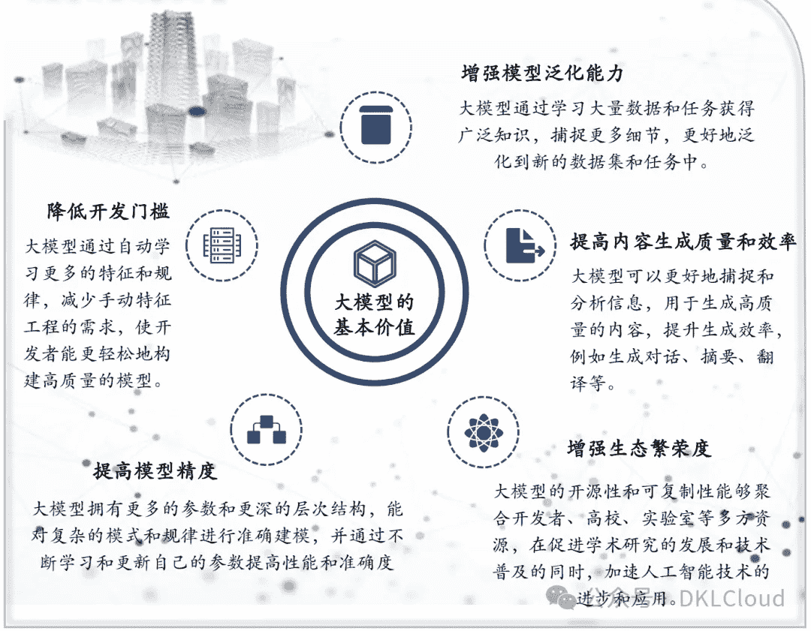

## 大模型发展趋势

### 通用化与专用化并行

大模型将趋于“通用化”与“专用化”并行。AI 大模型未来发展将趋于通用化与专用化并行。通用化是指模型能够适用于多个领域和任务，而专用化则是指模型被设计用于特定领域或任务。

**AI 大模型将逐渐实现在多个领域和任务中的通用性和灵活性，**未来会有更多模型被设计和优化用于特定的任务和领域。

受制于数据规模和模型表达能力的约束，传统模型往往只能有针对性地支持一个或者一类模态，而无法支持其他任务。相比之下，AI 大模型得益于其“大规模预训练＋微调”的范式，可以很好地适应不同下游任务，展现出强大的通用性。

通用大模型即为多模态基模型，偏重统一架构、统一知识表达、统一任务。通用大模型能够使用统一的模型框架，并采用相同的学习模式，构建可适用于多种模态的通用词表，将所有任务统一成序列到序列任务。例如，GPT 系列模型在自然语言处理领域的多个任务中都取得了非常好的表现，包括文本生成、问答、摘要、翻译等任务。同样，BERT 模型也被证明可应用于多种自然语言处理任务中，包括文本分类、命名实体识别、问答等。

专用大模型则通过通用预训练和专用预训练实现业务场景应用。专用大模型包括领域大模型（如 NLP、CV 等）和行业大模型（如金融、能源等）。例如，近期彭博社发布了专门为金融领域打造的大型语言模型（LLM）——BloombergGPT。BloombergGPT 是专门为金融领域开发的一种语言模型，可以更好地处理金融领域的数据和任务。

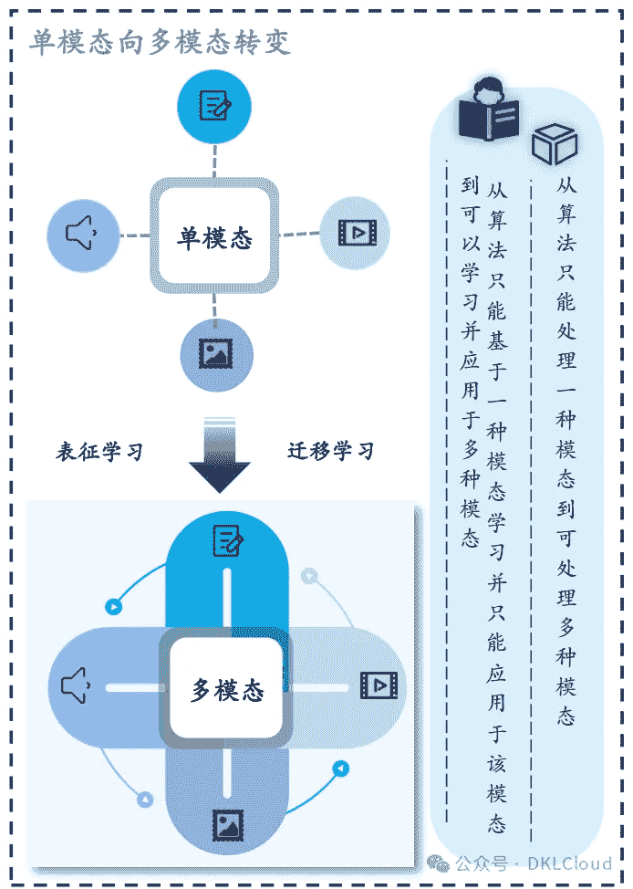

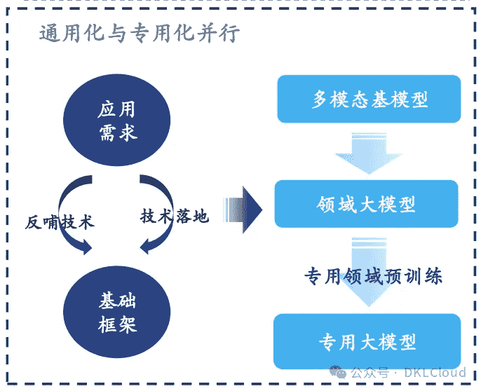

### 平台化与简易化并进

大模型将趋于“平台化”与“简易化”并进。

**基于模型开发、场景适配和推理部署，AI 大模型未来将趋于平台化与简易化并进，将形成全能简易开发服务平台。**

大模型发展趋于平台化，主要是指提供 AI 模型开发和应用的完整解决方案。例如 OpenAI 的 GPT-3 Playground，为开发者和研究者提供了在线使用 GPT-3 模型的平台。

在 AI 加持下，GPT 内部插件带来的用户体验优于直接使用外部的原生应用，用户的使用场景得以迁移到 GPT 模型内部。目前插件商店内部的应用主要由 OpenAI 邀请的第三方开发，包括办公协作、电商、旅游等。随着外部成熟应用的交互圈层扩大，GPT 与用户日常生活将结合得更加紧密，参考移动互联网时代的端转手趋势，主流应用即将展开向 AI 平台的迁移，即迅速适应并布局 GPT 内的 AI 插件，探索 AI 加持下自身应用的新场景。这些应用可以依赖 GPT 的 AI 技术提高用户体验，而 GPT 则借助这些应用吸引更多用户，网络效应进一步加强了这种相互促进的趋势，从而提升 GPT 平台的生态价值。

大模型的简易化则指使模型的使用更加简单易懂。AI 大模型突破传统 AI 适用性弱的局限，传统的 AI 模型通常只针对性的针对一个或者一类任务，而 AI 大模型中大规模的参数量可以提升模型的表达能力，更好的建模海量训练数据中包含的通用知识，通过“预训练+微调”，AI 大模型已经具有强大的通用性，例如，ChatGPT3.0 通过 prompt-tuning 免去微调步骤，为开发者和用户提供了更加便捷的 AI 技术应用方式。

大模型平台化与简易化并进

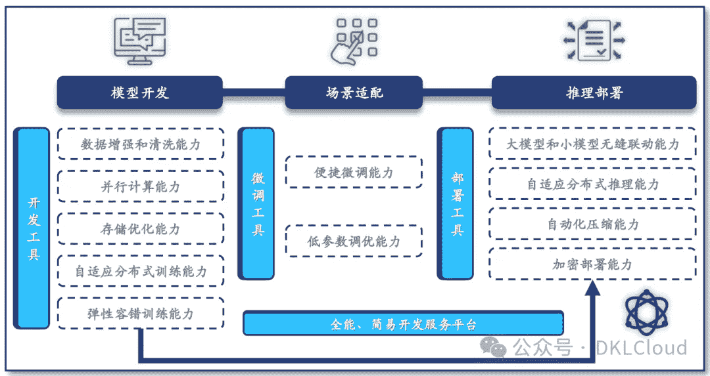

## MaaS 重构商业化生态

### 大模型发展路线逐渐清晰（1/3）

大模型发展路线逐渐清晰，MaaS 将重构商业化生态（1/3）。

大模型“训练基础设施–底层技术–基础应用–垂直应用”发展路线逐渐清晰。

大模型以训练基础设施及底层技术构成的技术底座为基点，在海量通用数据上进行预训练，集成多样化的 AI 核心技术，构建具有泛化能力的多模态基大模型以及领域大模型，如 CV 大模型、NLP 大模型、多模态大模型等。随着多模态能力的演进，CV 领域及多模态通用大模型将逐渐成为市场发展主流。

领域大模型能够结合垂直场景及应用行业需求进行模型微调和应用适配，结合ToC 端用户交互数据或 ToB/ToG 端行业专业知识，为下游 C 端业务场景和B/G 端商业生态进行技术赋能，助力大模型不断向上生长。

国内大模型商业应用大幕徐徐拉开，厂商加速战略布局，加大资金和技术投入，持续打磨大模型，迎头赶上全球大模型产业化浪潮。

大模型发展应用路线逐渐清晰

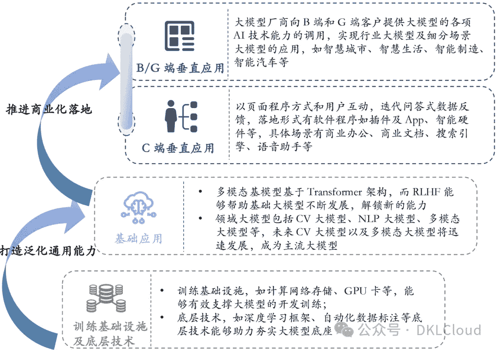

### 大模型发展路线逐渐清晰（2/3）

大模型发展路线逐渐清晰，MaaS 将重构商业化生态（2/3）。

**MaaS**，即 Model as a Service，能够降低 AI 应用开发门槛，重构 AI 产业的商业化结构生态，激发新的产业链分工和商业模式不断涌现。MaaS 将可能成为未来大模型的主流商业模式。

MaaS 模式将由基础层、中间层以及应用层三部分组成：

• 基础层将提供多模态基模型以及 CV、NLP、多模态等领域大模型，输出泛化能力，对外开放大模型的调用接口；

• 中间层将付费使用接口，直接调用基础模型，基于行业特色数据与知识进行精调开发行业大模型，精准适配 AI 具体应用需求，如汽车领域的自动驾驶、医疗领域的蛋白质解析等，以及企业私有模型；

• 应用层上将进行多样化的 SaaS 应用以及新一代智能硬件的开发，杀手级应用、现象级产品未来将有望出现。

**基础层需要具备大算力、大数据、强算法等核心技术能力**，是科技巨头以及部分科研机构高校的竞赛。基础层以上，包括中间层和应用层，将存在巨大的商业机遇，不仅限于科技巨头，各类公司都将有机会拿到入场券。创业公司更多的机会也在基础层以上，在大模型精调、应用开发、边缘模型部署等领域参与到 MaaS 商业化生态，例如基于 Stable Diffusion 设计的 Riffusion 音乐创作工具等 AI-enabled 的各类软件。能够实现最后一公里商业化落地的公司更有望脱颖而出。

MaaS 产业一体化架构

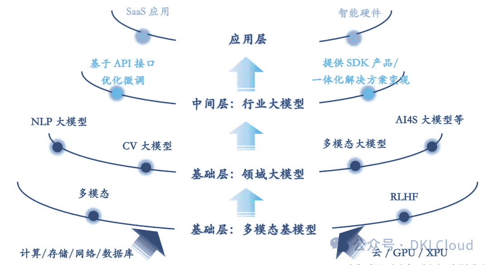

### 大模型发展路线逐渐清晰（3/3）

大模型发展路线逐渐清晰，MaaS 将重构商业化生态（3/3）。

MaaS 模式在 B/G 端和 C 端的商业化落地有所区别。

• **C 端用户量巨大，工具使用门槛较低，落地以及未来成长速度更快，**“应用商店”等创新商业模式不断涌现。通过“对话+插件”形式将大模型单点工具接入厂商自有或第三方应用，将打造新的用户交互界面和入口。目前 Chat-4 已应用于微软必应搜索引擎，ChatGPT 接入第三方网上购物及机票预订等平台、阿里巴巴“通义千问”大模型将连接旗下所有产品。插件形式将覆盖用户生活的方方面面，打造完整的生态系统。而随着 Adept 等无需 App 交互，自动执行操作响应用户需求的产品出现，未来 MaaS 模式下 C 端商业化落地形式将不断创新，颠覆传统，具有广阔的想象空间。

• **B/G 端需要针对行业领域和业务场景进行大量工程工作，**尤其是传统行业的知识获取和积累需要较长时间，即使是同一个行业下，细分场景的痛点不同，AI 大模型渗透率也有明显差异。应用场景碎片化的特点导致低成本、易用、泛化能力较强的能力平台构建需较长周期，但 B/G 端客户付费能力更强，未来盈利空间及成长空间广阔。据分析，从美国市场看，目前 ToB 应用的数量大于 ToC 应用，通用工具数量大于具体场景应用数量主要集中于市场销售、客服/CRM/CEM、企业内部生产力工具等。

**未来 B/G 端市场，MaaS 落地的主流商业模式**将按照数据请求量和实际计算量计算。通过对外开放大模型的 API 调用接口，让开发者灵活地使用基模型服务，典型案例是 GPT 基于对外 API 的收费模型。基于此，垂直行业厂商可以提供 SDK 产品或一体化落地解决方案变现。大模型厂商也可以通过推出 ToB/ToG 的单点工具，按文本、图像或语音等不同形式的内容量收费，如 DALL·E 可以根据每张图片的分辨率和请求计算量计费。

**未来 C 端市场，MaaS 落地的主流商业模式**为软件订阅费用，以及第三方 App 的推广和订阅分成费用。基础层大模型厂商可以基于大模型推出类似 ChatGPT 的单点工具，以月度或年度订阅费提供产品功能使用，为用户提供灵活和便捷的购买方式。未来盈利模式也将可能向 App Store 式靠拢，通过排行榜、广告位等收取费用。

ToC 方向大模型将成为“操作系统+应用超市”

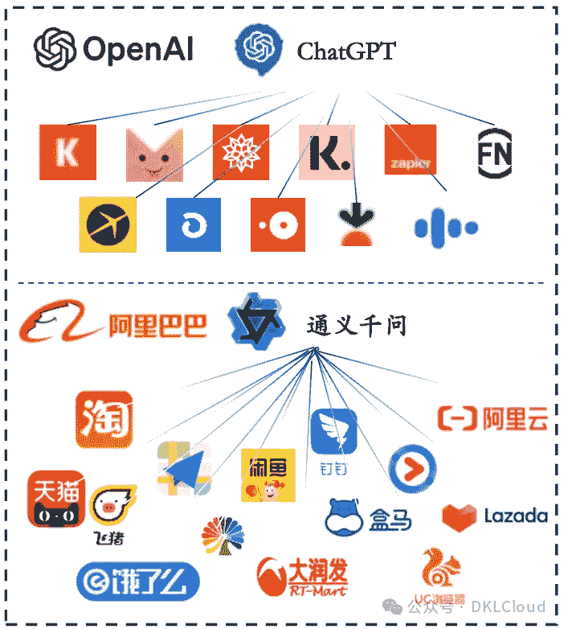

## 章节三：挑战与应对

### AI 大模型挑战犹在，企业发展仍需迎难而上

关键发现

• AI 大模型面临算力需求大、训练和推理成本高、数据质量不佳、隐私和安全问题等挑战；

• 大模型考验全栈大模型训练与研发能力，如数据管理经验、算力基础设施工程化运营能力、底层系统优化和算法设计能力等，而厂商过往技术积累的 know-how 能够成为关键优势；

• AI 大模型厂商积极探索大模型的商业化应用，在实践中积累海量多元数据以及业务场景落地经验，能够帮助大模型加速走向产业；

• 大模型厂商构建数据安全等 AI 安全治理举措，能够保证 AI 大模型进入市场并商业化应用的可靠、可信，推动 AI 技术可持续发展；

• 生态开放性的高低程度决定了大模型厂商能否成功打造“技术-商业”闭环。

**技术和安全伦理等层面的多重挑战**，成为大模型发展和应用道路上的阻碍，考验大模型厂商的技术和 AI 治理能力。

大模型厂商在**数据管理、AI 基础设施建设与运营、模型系统和算法设计**等全栈大模型训练与研发能力的积累对于大模型的开发落地不可或缺。

基于**繁荣的开源生态**，厂商近年来**业务场景落地经验的沉淀**，能够孵化迭代更优秀的技术产品。在先进且持续的 AI 安全治理举措的加持下，AI 大模型厂商能够规避 AI 技术对伦理秩序的破坏，推动大模型的商业化落地。掌握关键成功因素，大模型厂商将构筑竞争优势，在市场上展开角逐。

**大模型厂商需在技术、生态、AI 治理等方面应对 AI 大模型发展的多重挑战**

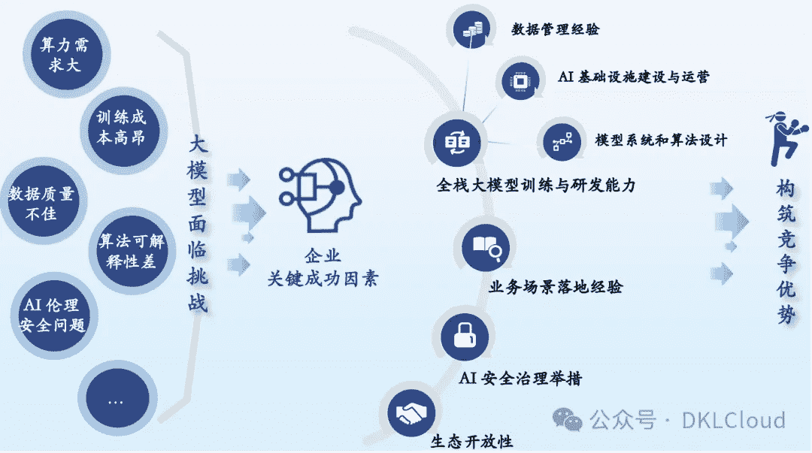

**AI 大模型发展面临多重挑战**

“算力刚需+成本高企”拔高行业进入门槛。大模型的训练成本包括 GPU 等算力芯片成本、服务器成本、标准机柜成本、训练时长内的电力消耗费用、人力投入费用等。以 ChatGPT 为例，ChatGPT 每日处理 1300 万独立访问量，需要 3 万+片 NVIDIA A100 GPU 以庞大的计算和存储资源支持，初期投入高达 8 亿美元。而据估算，1750 亿参数的 GPT-3 的总训练成本高达 1200 万美元。

“优数据+强算法”为大模型开发训练的

**两大关键点。** From Big Data to Good Data，以数据为中心的 AI 对数据质量、数据隐私和安全提出更高的要求。大模型的输入数据通常有重复、文本格式多样化、非文本内容多等噪声问题，容易对大模型的训练及模型质量造成不良影响。而除公开训练文本数据集外，其他输入侧的数据需要数据主体的授权，且大模型过度依赖训练数据，在数据输入层面可能会存在舆论操控、虚假信息、隐私泄露等风险。此外，算法能力的持续优化、算法的可解释性都将对厂商的技术能力和 AI 治理能力产生更大的考验。

高稳定性需求考验厂商实操经验及系统工程能力。训练过程中易出现不稳定现象，如训练不收敛、调试困难等。训练时大模型还常遇到“梯度爆炸”或者硬件故障造成机器过载迭机，以前迭机频率是 10 分钟一次，会牵连整个系统受到影响，成为厂商技术经验的挑战之一。

# 数据质量对大模型的训练效果影响较大

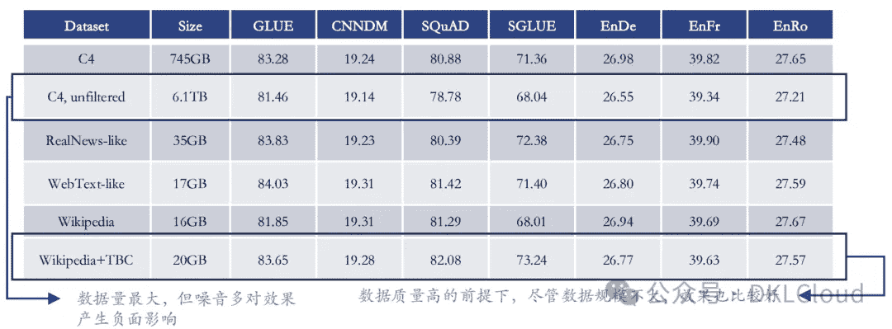

## 全栈大模型训练与研发能力成为厂商关键优势之一

超大规模模型全栈大模型训练与研发能力，如数据管理经验、AI 基础设施建设与运营、大模型系统和算法设计等，而厂商过往技术积累的 know-how 能够成为关键优势。

厂商过往大量的实验研究和经验积累，能够在大模型数据的标注、评测、调优，数据训练时的先后顺序以及选择性上起到重要作用，并基于此训练出优秀的大模型。厂商的充足基础计算资源储备将成为大模型的强力底层支柱。

大模型的基础条件是算力资源，模型训练往往需要几千甚至上万张卡来完成，而 A100 等海外芯片的储备、国产芯片供应把控、自研算力基础建设等，能够有效支撑厂商训练开发大模型。

厂商在大规模分布式训练的运行和调度的工程经验，能够帮助提升模型训练的速度和精度。AI 计算能力不仅仅依赖于算力堆叠，随着数据量的不断增加，超大模型训练需要提升训练速度，减少训练时间，因此需要将数据和计算负载切分到不同设备上，降低设备间通信所需的代价，在多张卡上实现超大规模并行计算。在模型并行、流水并行、数据并行等分布式训练的基础上，还需要考虑计算、存储、网络以及上层的框架等各个环节全面协调配合，考验的是厂商全栈全流程的综合能力。

厂商过往的技术以及工程经验积累能够在通讯、计算、调优等方面起到关键作用。厂商优秀的系统架构和高性能网络架构设计能够高效连接 GPU，保证多卡并联的计算效率，而硬件集群管理和软件框架设计能够提高硬件的可靠性和软件的容错度。

例如，商汤在底层训练系统优化、模型设计、模型训练、模型优化、模型服务等方面均储备了技术能力和经验知识，目前在千卡级能够达到 90% 以上的线性度，并且可以做到七天以上的不间断稳定训练；腾讯新一代 HCC 高性能计算集群基于自研的星脉高性能计算网络、存储架构、TACO 训练加速引擎等，能够带来 3.2T超高互联带宽 TB 级吞吐能力和千万级IOPS。

## 大模型训练的目标公式

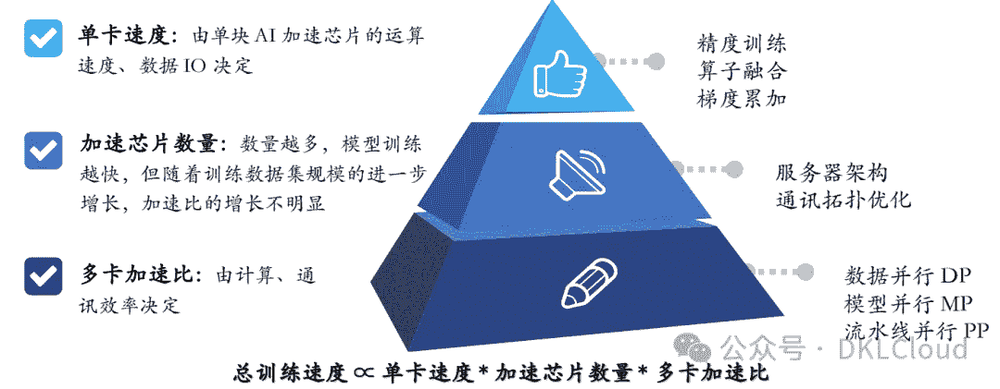

## 业务场景落地经验为大模型应用打下商业基础

AI 大模型厂商积极探索大模型的商业化应用，在实践中积累业务场景落地经验和海量多元数据，能够帮助大模型加速走向产业。

在 ChatGPT 掀起大模型浪潮前，国内 AI大模型厂商已有各自的预训练模型，基于深耕的业务场景探索大模型的商业化落地应用。百度 2019 年发布自研的中文预训练语言大模型 ERINE 1.0 以及 ERINE 2.0，能够直接在度小满的风控识别等性能不敏感的场景中直接使用，也可以应用于其搜索引擎业务，在搜索问答 Query 识别和 QP 匹配场景中，赋予召回系统强大的语义匹配能力，提升召回率约 7%。而阿里达摩院在 2021 年发布超大规模多模态预训练模型 M6，结合自身电商背景，通过 M6 大模型优异的文生图能力，将其落地于天猫虚拟主播、服饰设计等 40 多个创造相关场景，应用于支付宝、淘宝、犀牛等平台，参与跨模态搜索、文案撰写、图片设计等工作。

厂商前期的业务实践能够积累多元化的海量数据，不断训练迭代大模型，推进大模型的商业化落地。数据一方面来源于公开训练集，另一方面则源于原有业务沉淀的私有数据，如百度的搜索引擎数据、百度智能云的行业数据，商汤的自动驾驶图像数据等。厂商的业务积累能够储备业务场景相关的数据，在数据量和丰富度上掌握优势，实现对大模型更进一步的专业训练，满足特定领域对准确度等方面的要求，推动大模型在行业级、产业级中的应用赋能。

## 百度 ERNIE 模型蒸馏案例——搜索问答 Query 识别和 QP 匹配

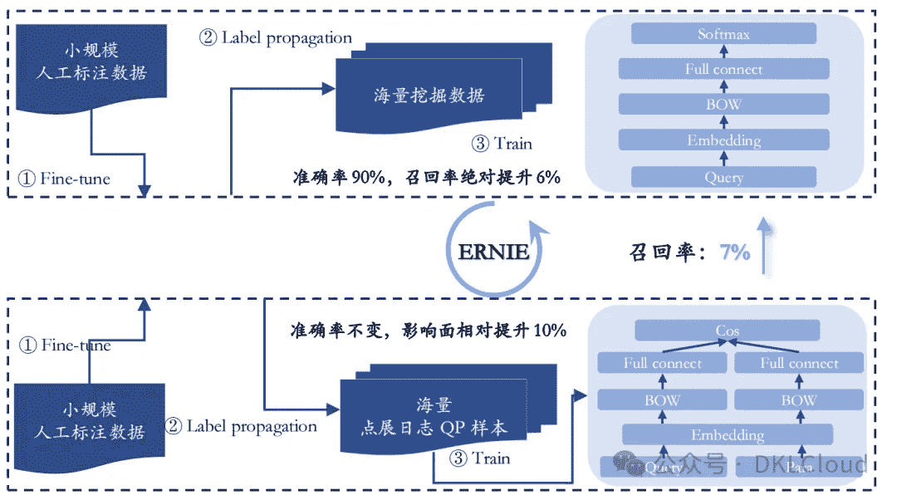

## AI 安全治理举措规范大模型商业化落地

大模型厂商构建 AI 安全治理举措，有助于 AI 技术的可靠、可信以及可持续发展。

厂商在推出大模型前充分的 AI 安全治理的思考和持续性的洞察输出，能够保证在大模型推向市场时，即将其纳入原有的规范流程中，以实际行动践行并不断更新理念，进而构筑治理闭环。

企业在人工智能领域具备覆盖全生命周期的数据安全能力是应对数据风险的基础。大模型厂商在数据采集、数据分析、数据处理、数据资产管理等环节建立相应的责任和评估机制，防止数据滥用、恶意入侵等风险，进一步实现数据的高质量利用，促进大模型的准确度以及可信性。

厂商 AI 伦理研究和敏捷治理工作能够促进 AI 大模型健康发展。由于 AI 技术发展迅速，而法律制度的建立需要更加谨慎的考量，往往政策出台落地需要较长的时间，因此企业需要自我规制，承担更大的社会责任感，通过加强制度建设、伦理联合研究、伦理风险审查及风险控制机制设立等措施，统筹推进伦理治理工作体系建设，并与政府、学术研究院等多方合作建立治理框架，系统性应对数据、算法及应用等不同层面的人工智能伦理风险，推动 AI 大模型及 AI 行业可持续发展。

## 阿里数据安全成熟度模型

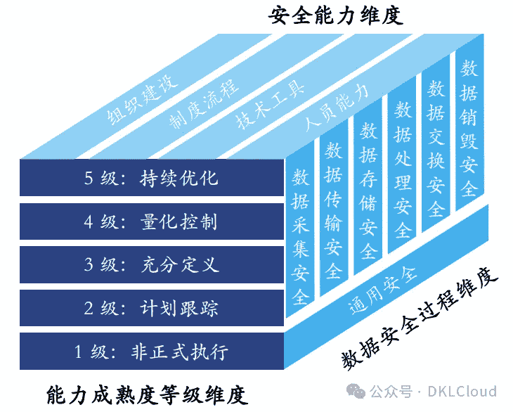

## 商汤 AI 治理理念

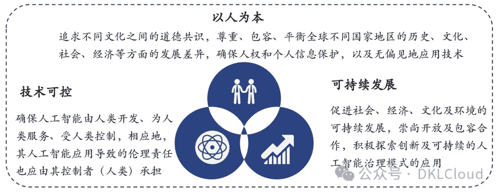

## 生态开放性帮助大模型厂商打造“技术-商业”闭环

大模型的生态开放性高低程度决定了大模型厂商能否成功打造“技术-商业”闭环。所谓的开放性能够体现在大模型的开源、生态圈的打造等方面。

一方面，大模型的全面开源和基础设施能力的开放能够孵化更强的技术产品，加速商业化落地。大模型厂商通过投入自有研发资源，主动拥抱开源体系，接受监督，升级为开源社区的引领者，而庞大的开发者群体能够以贡献源代码的方式为大模型注入创新动力，完善大模型底层架构的同时，提高大模型架构的拓展性，满足多生态的互相调用。如智源研究院建立 FlagOpen 大模型技术开源体系、已在通用视觉开源平台OpenGVLab 开源的商汤的“书生 2.5”多模态通用大模型、阿里巴巴达摩院推出的中文模型开源社区“魔搭”（ModelScope）等，均致力于以开源的形式加速大模型的发展迭代，推动通用AI 技术的规模化应用。

另一方面，大模型生态圈的建立能够提高产品兼容性，并以数据反哺模型加强迭代。从产业链来看，大模型和上游合作能够提高大模型的对软硬件适配性，大模型和下游的生态合作能够拓展 C 端和 B/G 端的应用，以更多的用户需求反馈规划基础模型和行业模型的迭代方向，增强用户和客户持续使用的信心，帮助大模型厂商构筑竞争壁垒。长期广泛地适配各种类型的场景，开发者、高校、国家实验室、算力联盟机构等生态的汇聚，能够改善模型能力，提升 AI 大模型的价值和意义。

## 非营利研究机构北京智源人工智能研究院 FlagOpen 飞智大模型技术开源体系

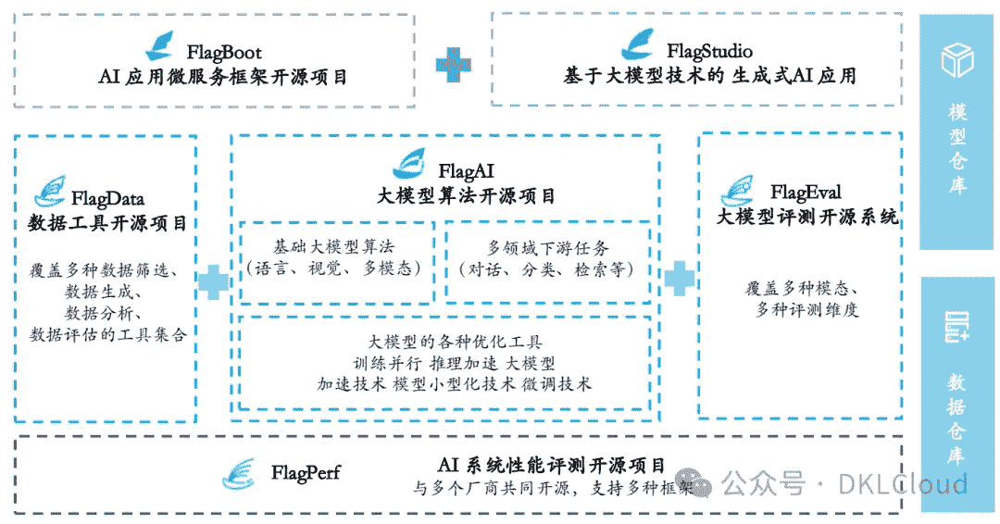
