# 国内主流AI 大模型架构及应用场景深度分析 2024

> 来源：[https://xmgtoagi.feishu.cn/docx/DN4td9GUhouEFkxpzO3clsl2nIg](https://xmgtoagi.feishu.cn/docx/DN4td9GUhouEFkxpzO3clsl2nIg)

作者：Alsoar

原文：https://mp.weixin.qq.com/s/kmK_otdOAEIHSsc1Yms0TQ

中国 AI 大模型主要厂商竞争力评价

**厂商总览**

**评价门槛**

本次评估模型设立“中国市场落地”“全栈能力”“商业基础”、“产品市场”、四项基线，同时满足这五项基线要求的大模型厂商，将入围竞争力评估。

**中国市场落地**：截止目前，海外大模型厂商尚未在中国落地，其产品服务和生态圈打造等关键能力在中国市场均有缺失，而非官方渠道使用相关服务的企业将面临高风险。例如，OpenAI 尚未向中国用户开放 ChatGPT 及 GPT-4 服务，类似的情况同样出现在谷歌、Meta 等大模型厂商提供的相应服务上。相较而言，接入国产及自主研发的大模型更加现实、稳定且具有可控性。

**全栈能力：**大模型服务考核厂商从算力基础设施、深度学习框架到算法设计优化的全栈大模型解决方案能力，以及相应的工程化和运营经验与水平。因此，入围的厂商应具备相关全栈能力，如应有自建且自运营的算力基础设施、领先的算法设计等能力。

**商业基础：**大模型厂商在技术层保持投入的同时，还应拥有大模型商业输出能力的积累，将大模型技术赋能现有业务之中，积累行业 know-how 和应用认知，应对大模型市场的爆发性增长和颠覆式创新时具备稳定性。

**产品市场：**在行业赛道日趋拥挤的情况下，厂商目前需已有成形的大模型和商业化产品，入场竞争博弈，保持先发优势，后续以获取的用户和行业数据不断迭代优化大模型。

**综合竞争力评价的四大基线**

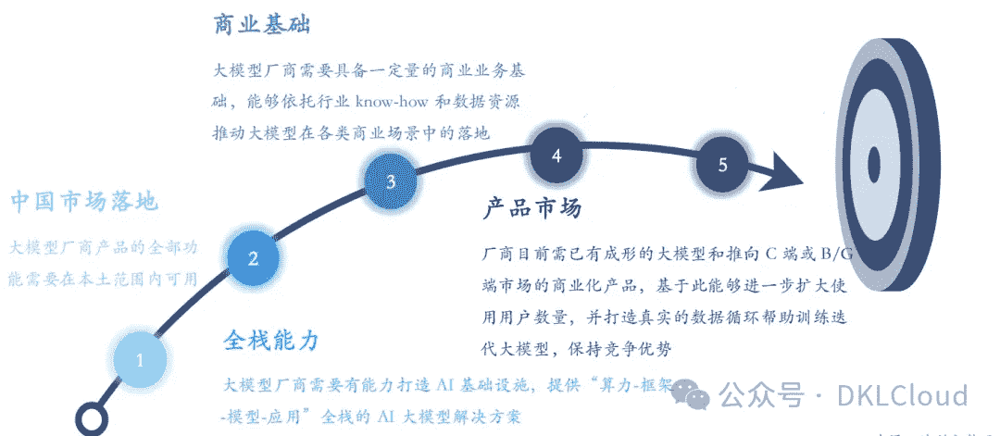

**评价模型及指标体系**

**三方维度诠释主要厂商综合竞争力**

• **产品技术能力：**训练数据、算力支撑模型开发等多个维度决定了 AI 大模型的性能效果和应用表现。产品能力越强，则证明该厂商大模型的底层技术越坚实可靠、应用服务表现越好。

• **战略愿景能力：**主要从风险缓解措施、市场认知与理解等多个评价指标衡量大模型厂商的战略愿景。此维度得分越高，代表厂商战略愿景完整性越高。

• **生态开放能力：**主要从生态开放性、生态体系建设、联合创新这三个维度来评价大模型厂商的生态能力。生态能力越强，则证明该厂商大模型的开放性程度越高、产业协作能力越强。

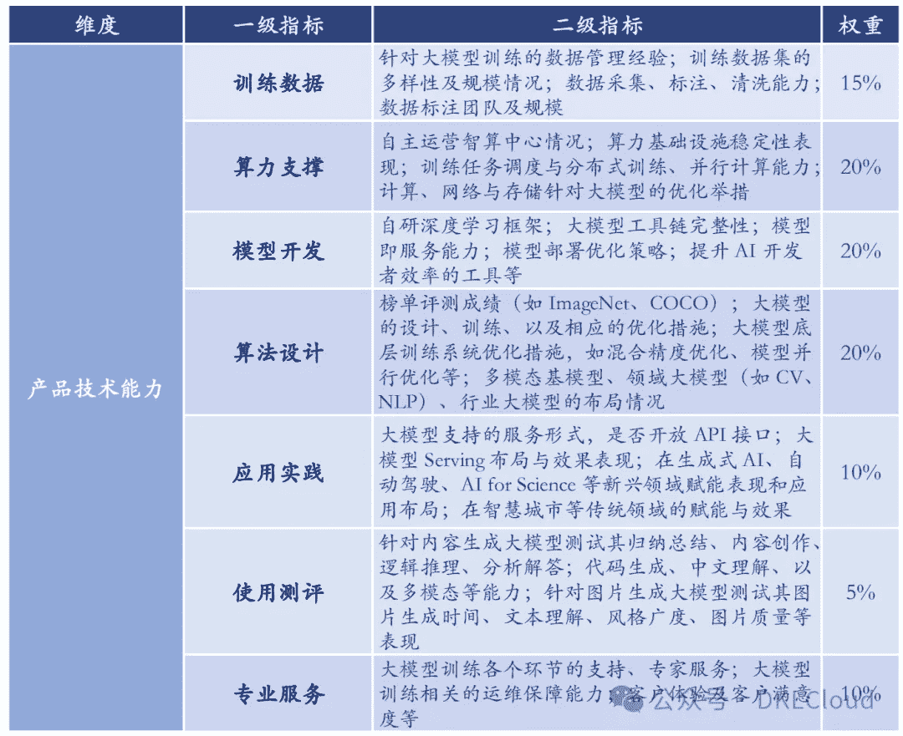

**评价模型及指标体系**

**三方维度诠释主要厂商综合竞争力**

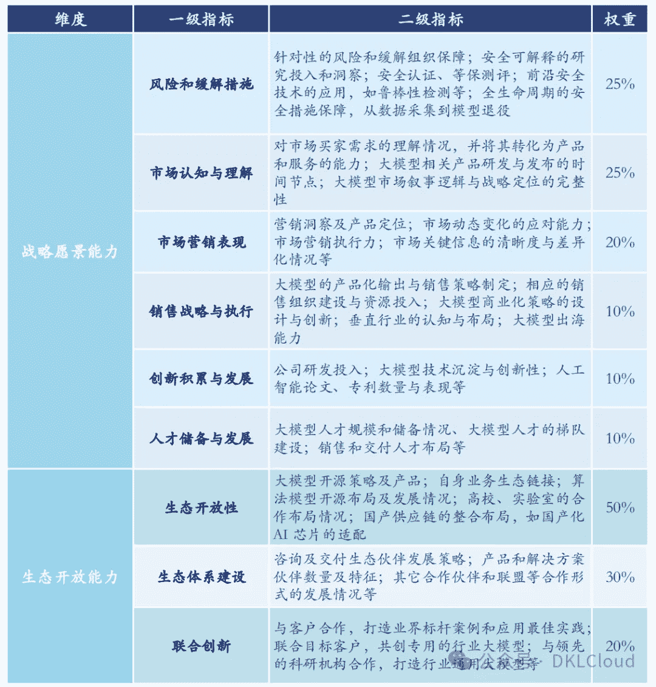

**评价模型及指标体系**

**部分指标中的厂商基本情况**

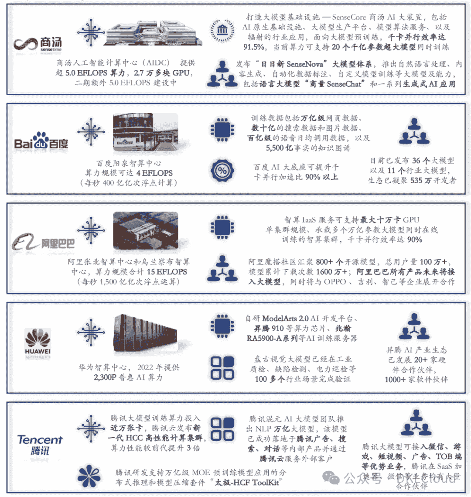

综合竞争力表现

**• 本报告将根据最终评价的 AI 大模型在产品技术能力、战略愿景**能力、生态开放能力三个维度的综合表现对比相关厂商在 AI 大模型领域的综合竞争力

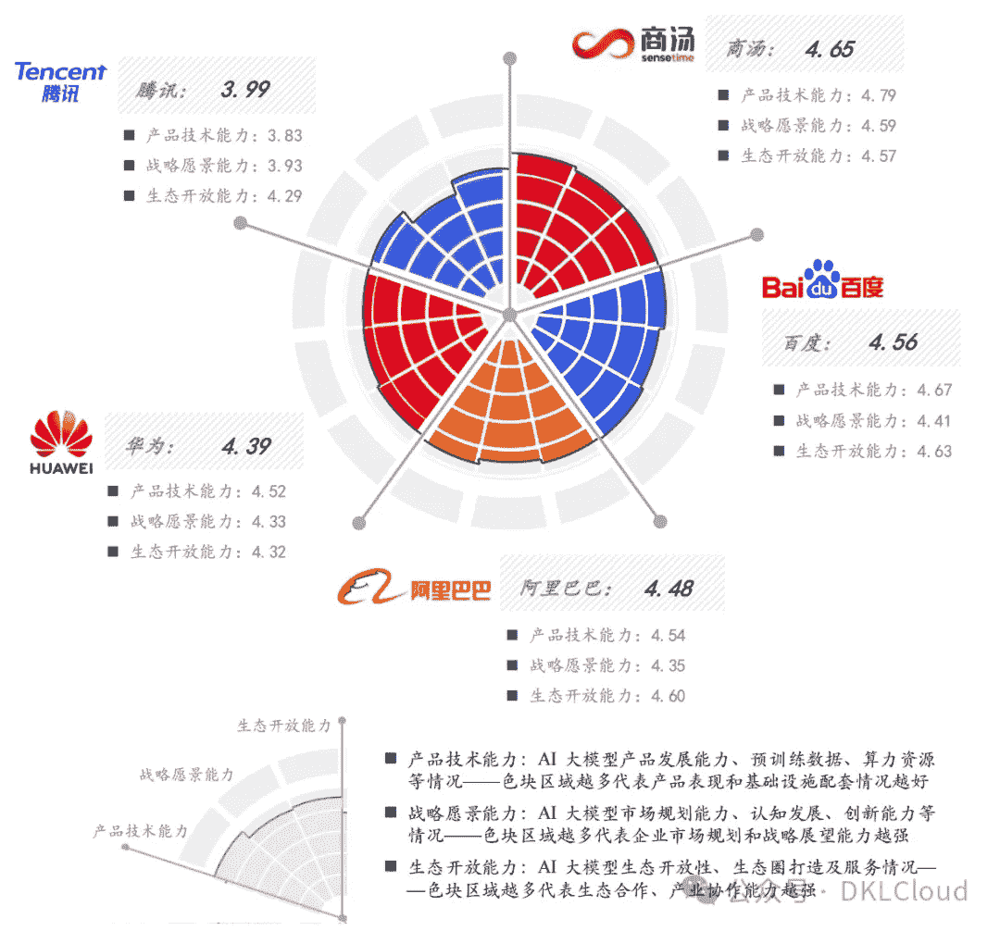

**中国主要 AI 大模型厂商介绍**

**商汤：SenseCore 商汤 AI 大装置 + **商汤日日新 SenseNova大模型体系

◼ 从基础设施到模型研发的全栈能力

**基**于“大模型+大装置”的技术路径，商汤推进 AGI 为核心的发展战略。

商汤领先发布“日日新 SenseNova”大模型体系，提供自然语言、内容生成、自动化数据标注、自定义模型训练等多种大模型以及能力，结合决策智能大模型，为 AGI 实现提供重要起点。除语言大模型“商 量 SenseChat”外,“如 影SenseAvatar”、“琼宇 SenseSpace”、“格物SenseThings”、“秒画 SenseMirage”一系列生成式 AI 模型，能够在文生图创作、2D/3D数字人生成、大场景/小物体生成实现应用。

**历时五年，商汤建设了 AI 大装置，成为国内稀缺大模型建设基础**设施，并以此作为打造AGI 时代的底座。基于大装置，商汤拥有了大模型生产的核心平台，不仅对内支持打造了日日新大模型体系，同时具备对外提供大模型训练赋能的服务，包括从工程开发到生产部署，截止目前，已经服务 8 家大型客户。

**◼ 具有前瞻性的开放生态**

商汤开源多模态多任务大模型“书生 2.5”，具有 30 亿参数，全球开源模型中 ImageNet准确度最高、规模最大，同时也是物体检测标杆数据集 COCO 中唯一超过 65.0mAP 大模型 。 商 汤 构 建 了 包 括OpenMMLab、OpenDILab、OpenXRLab、OpenPPL 在内的开源算法框架体系，与业界共享创新成果。

商汤积极助力国产芯片厂商，提高 GPU的训练能力，并合作上线大模型推理服务，攻关千卡国产训练集群，大装置已完成 58 款国产芯片的适配与应用。

**商汤大模型发展关键事件时间点**

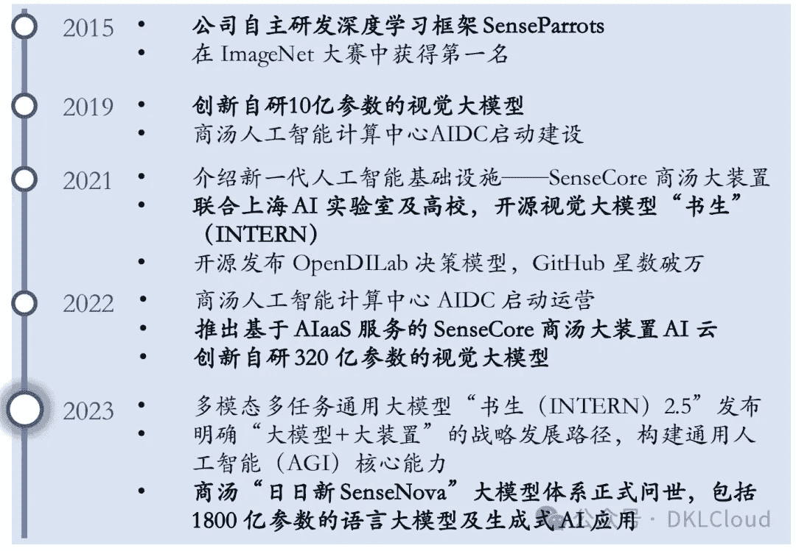

**商汤日日新自研大模型体系**

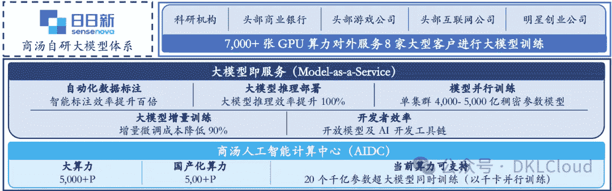

中国主要 AI 大模型厂商介绍

**商汤：SenseCore 商汤 AI 大装置 + 商**汤日日新 SenseNova 大模型体系

◼ 体系化研发能力下产业应用积累

商汤构建了从底层训练系统到算法设计优化的体系化大模型研发能力，如兼容解码建模Uni-Perceiver，将不同模态数据编码到统一表示空间，统一不同任务范式，从而以相同架构和共享的模型参数同时处理各种模态和任务；采用更先进的大模型结构设计与大 batch训练优化算法，使得“秒画 SenseMirage”模型参数量为 Stable Diffusion 数倍，且具备更优的文本理解泛化性、图像生成风格广度以及图像高质量生成细节。

**商汤通过 API 对外提供大模型服务，同时**也将其作为自身业务创景创新提效的发动机。“商量 SenseChat”具备多轮对话和超长文本的理解能力，并支持编程助手，可帮助开发者更高效地编写和调试代码等一系列创新应用。另外，商汤将大模型的能力全面赋能自身的业务体系，围绕智慧商业、智慧城市、智慧生活和智能汽车四大关键领域，构建AGI 核心能力。目前商汤超大模型已经覆盖公司核心业务，有 20+落地场景大模型交付，5+ 个项目生产 Serving 交付。

商汤大模型产业布局与应用场景积累

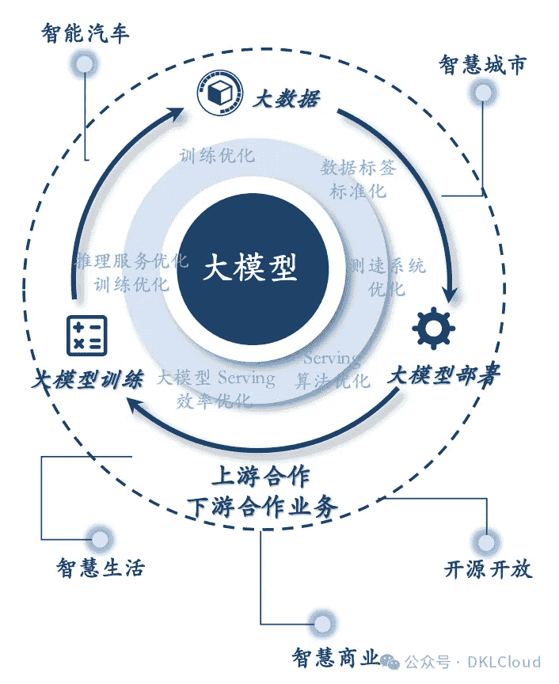

**商汤大模型的体系化研发能力**

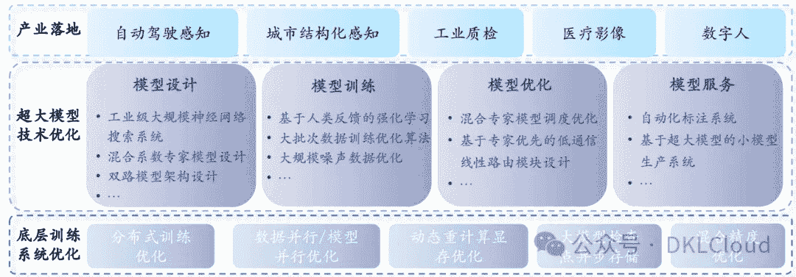

**百度：AI 大底座+文心大模型**

◼ 产业级知识增强大模型，夫嫩行业大模型发展

百度文心大模型源于产业、服务于产业，是产业级知识增强大模型。百度通过大模型与国产深度学习框架融合发展，打造了自主创新的 AI 底座，大幅降低了 AI 开发和应用门槛。文心大模型一大特色是“知识增强”，百度自研的多源异构知识图谱拥有超过 5,500 亿条知识，被融入到文心大模型的预训练中。文心大模型凭借海量数据和大规模知识的融合学习，能实现更高的效率、更好的效果、更强的可解释性。

◼ 大模型架构分三层体系

百度文心构建了文心大模型层、工具与平台层、产品与社区三层体系：建设更适配场景需求的基础、任务、行业三层大模型体系，提供全流程支持应用落地的工具和方法，孵化基于大模型的任务系统与创新产品。目前文心大模型已经建设了 36 个大模型。文心 API 和提供全流程开箱即用大模型能力的 EasyDL 和 BML 开发平台，全方位降低应用门槛；新增产品与社区层，包括“文心一格”、“文心百中”和旸谷社区，让更多人零距离感受到先进的 AI大模型技术带来的新体验。

百度文心大模型全景图

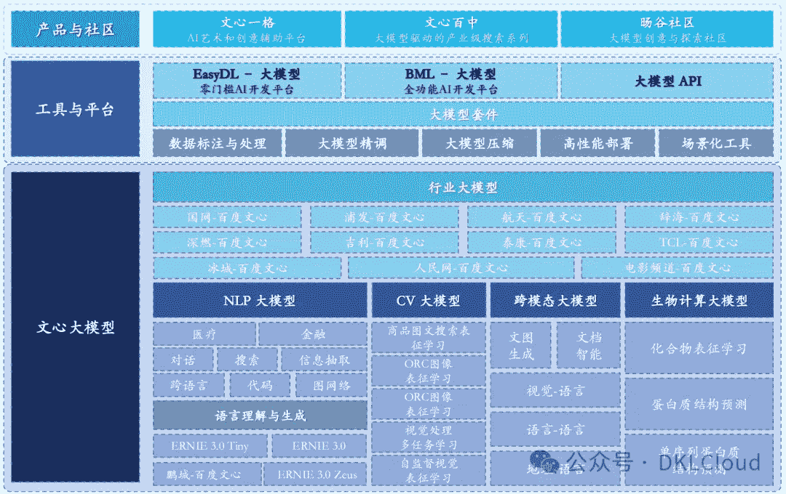

百度： AI 大底座+文心大模型

**◼ 飞桨平台助力大模型落地**

预训练大模型市场正处于高速发展阶段，需要解决差异化水平下开发者和企业的应用需求。百度飞桨深度学习平台向下适配各种硬件，支持文心大模型的开发、高性能训练、模型压缩、服务部署的各种能力，贯通 AI 全产业链，串联起全栈化的产业生态体系。文心大模型+飞桨深度学习平台生态共享，在市场生态方面持续发力以百度飞桨为代表的国产开发框架已经逐步与产业融合，在社区生态建设上持续发力。文心大模型是飞桨模型库的重要组成部分，与飞桨共享生态，包含产业级知识增强大模型体系，以及工具平台、API 和创意社

文心大模型与飞桨深度学习平台的关系

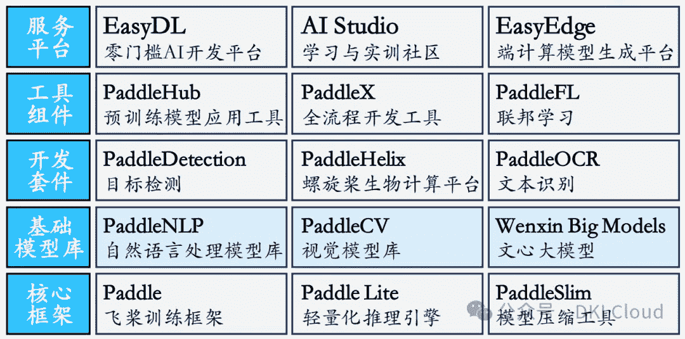

区助力大模型的高效应用。飞桨深度学习平台能助力解决大模型研发和部署的各类问题，大模型使得 AI 模型的研发门槛更低、效果更好、流程更加标准化，硬件厂商、开发者以及模型应用企业在文心+飞桨生态中，紧密链接、相互促进，形成共聚、共研、共创的健康生态。

**百度大模型发展历史**

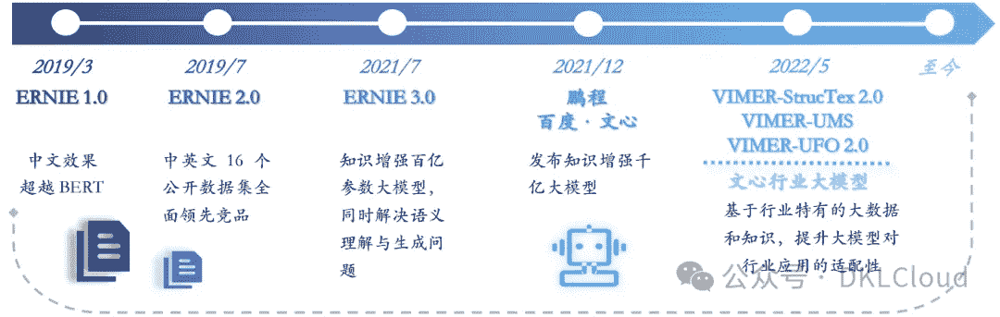

**◼ 拓展产业链生态，赋能大模型**

百度聚焦生态的打造，积极拓展生态伙伴，协力推动行业发展。百度文心联合深圳燃气、吉利、泰康保险、TCL、上海辞书出版社等各领域的企业发布了行业大模型，覆盖电力、燃气、金融、航天、传媒、城市、影视、制造、社科等领域，加速推动

行业的智能化转型升级。目前生态已凝聚535 万开发者，服务 20 万家企事业单位，与 12 家硬件伙伴联合发布飞桨生态发行版，推动深度学习平台与更多硬件适配；还与国内科研院所、实验室以及高校强强联手，一同攻克 AI 技术难关，目前已赋能 389 所高校，服务 747 名教师，学分课培养 10 万余名 AI 学子 。

阿里：M6-OFA +“通义”大模型系列

◼ 统一底座为基础，构建层次化的模型体系

阿里巴巴通义大模型以统一底座为基础，构建了层次化的模型体系，其中通用模型层覆盖自然语言处理、多模态、计算机视觉，专业模型层深入电商、医疗、法律、金融、娱乐等行业。通用与专业领域大小模型协同，让通义大模型系列可兼顾性能最优化与低成本落地。

自 2020 年起阿里先后发布多个版本的多模态及语言大模型，在超大模型、低碳训练技术、平台化服务、落地应用等方面实现突破。通义大模型系列已在超 200 个场景中提供服务，实现了 2%～10% 的应用效果提升。为加快大模型规模化应用，达摩院还研发了超大模型落地关键技术 S4框架，百亿参数大模型在压缩率达 99%的情况下多任务精度可接近无损。

**通义千问 发展历程**

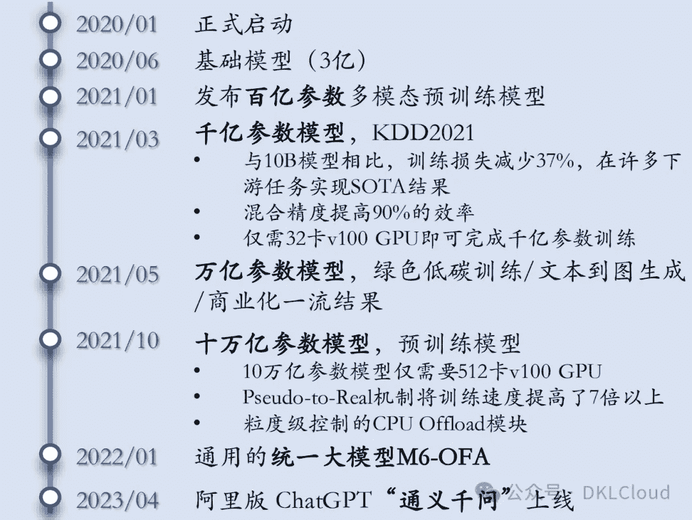

**◼ 关键技术开源，丰富合作生态**

通义大模型系列中语言大模型 AliceMind PLUG 、 多 模 态 理 解 与 生 成 统 一 模 型AliceMind-mPLUG、多模态统一底座模型M6-OFA、超大模型落地关键技术 S4 框架等核心模型及能力已面向全球开发者开源。

**阿里通义大模型架构**

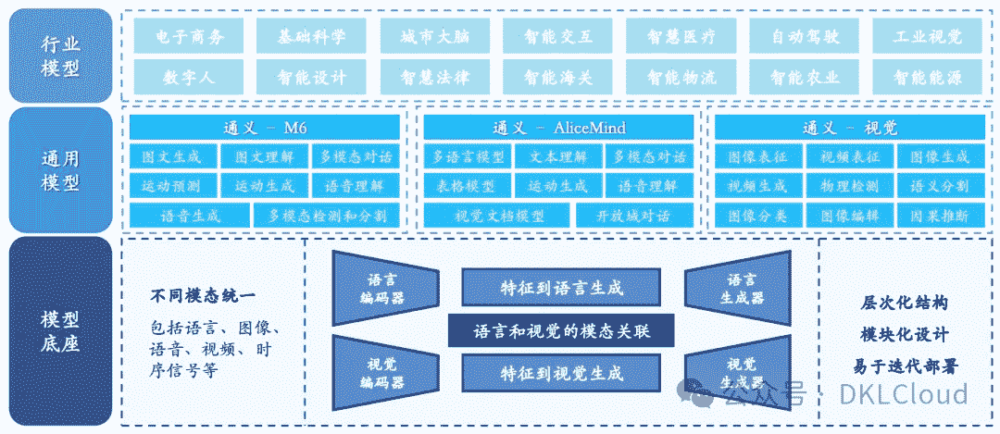

华为：ModelArts + 盘古大模型

**◼ 全栈式 AI 解决方案助力 AI for Indus**try & AI for Science

华为云于 2020 年内部立项 AI 大模型，并于 2021 年 4 月正式对外发布盘古预训练大模型，强调模型数据、网络结构、泛化能力三大核心设计。华为云规划“L0 基础大模型-L1 行业大模型-L2 细分场景大模型”的发展路径。L0 阶段的盘古大模型由 NLP 大模型，CV 大模型、语音大模型、多模态大模型、科学计算大模型等组成，其中 CV 大模型超 30 亿参数，预训练时输入 10 亿级图像数据，兼顾图像判别与生成能力；NLP 大模型具备领先的中文语言理解和模型生成能力。L1 阶段，基于已有的行业基础，华为云推出盘古气象大模型、盘古矿山大模型、盘古 OCR大模型等行业大模型，能够在 L2 阶段的煤矿场景下的瓦斯浓度的超前预警、气象领域的天气预报等多个细分场景实现落地。

华为云聚焦全栈式 AI 解决方案，大模型与昇腾 （ Ascend ） / 鲲 鹏 芯 片 、 昇 思（MindSpore）语言、ModelArts 平台深度结合，以算力底座、服务器、全场景深度学习框架及开发平台共同助力大模型发展。

**◼ 拓展产业链生态，赋能大模型**

华为云积极拓展产业链上下游生态，通过鲲鹏凌云等合作伙伴计划，在算力、软硬件等方面建立生态伙伴网络，为 AI 大模型持续赋能，同时华为云与下游厂商联合发布行业解决方案，推动 AI 大模型商业化落地。

**华为云盘古预训练大模型架构**

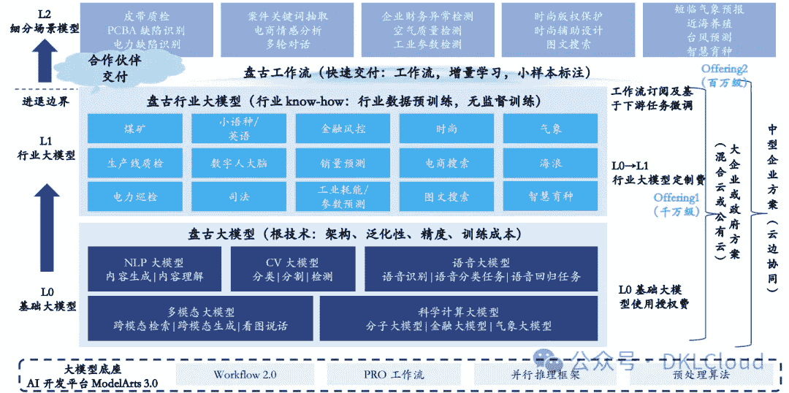

腾讯：HCC 高性能计算集群+混元大模型

◼ 新一代 HCC 高性能计算集群为大模型提供底层支持

2022 年 4 月，腾讯首次对外披露混元 AI大模型，协同了腾讯预训练研发力量，以统一的平台实现技术复用和业务降本，支持更多的场景和应用。当前，混元 AI 大模型完整覆盖 NLP 大模型、CV 大模型、多模态大模型、文生图大模型及众多行业与领域任务模型 ， 先后在 MSR-VTT、MSVD 等五大权威数据集榜单中登顶，实现跨模态领域的大满贯。目前，HunYuan NLP 1T 大模型已在腾讯多个核心业务场景落地，并带来了显著的效果提升。近日腾讯正式发布全新的 AI 智能创作助手“腾讯智影”，推出了智影数字人、文本配音、文章转视频等 AI 创作工具。

2023 年 4 月，腾讯云发布的新一代 HCC高性能计算集群将为混元大模型提供底层支撑。新一代集群基于自研星脉高性能计算网络及存储架构，集成了腾讯云自研的TACO 训练加速引擎，大幅缩短训练时间，节约训练调优和算力成本。腾讯太极机器学习平台自研的训练框架 AngelPTM，也已通过腾讯云TACO 提供服务，帮助企业加速大模型落地。

**◼ 用户生态繁荣，促进模型迭代**

腾讯在社交、阅读、游戏等领域拥有庞大用户群体与强大生态，具有丰富的语料资源、数据积累和场景优势。腾讯高级执行副 总 裁 汤 道 生 表 示，腾 讯 正 在 研 发 类ChatGPT 聊天机器人，将集成到 QQ、微信上。目前在智能写作、AI 绘图、游戏场景生成等方面都有新产品发布或迭代升级，有望助力其大模型在自有生态中快速迭代成长。

腾讯 HunYuan 大模型全景图

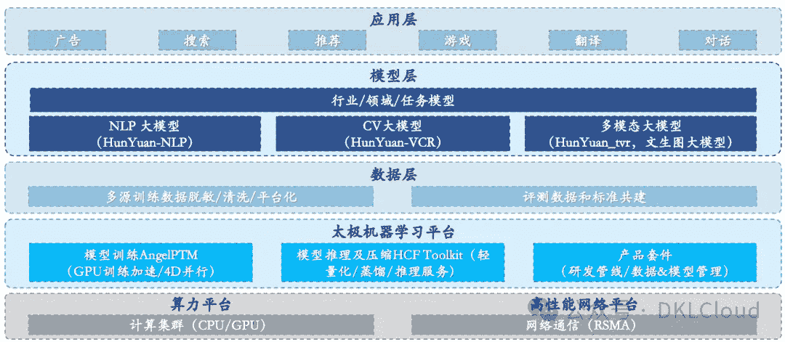

名词解释

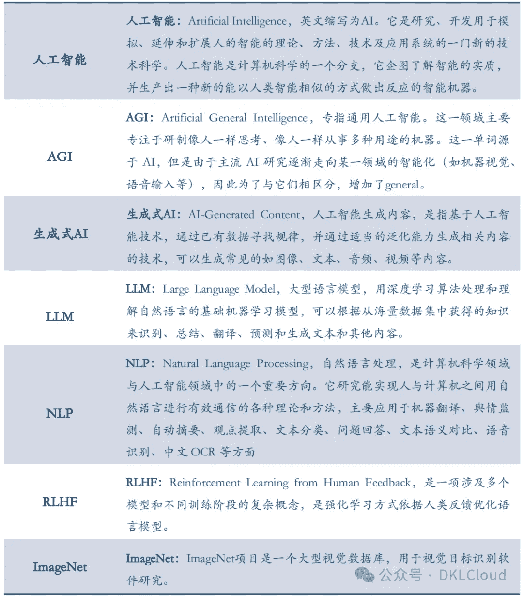