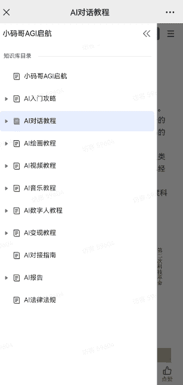

# 小码哥AGI启航

> 来源：[https://xmgtoagi.feishu.cn/docx/AWrfd7qekopGVDxI3mqcR0OsnDb](https://xmgtoagi.feishu.cn/docx/AWrfd7qekopGVDxI3mqcR0OsnDb)

# 🎯  愿景和目标

> 愿景：AI学习基地，让人人都知道AI、会用AI、变现AI。

> 目标：帮助100W人学习、应用AI

# ⛳️  简介

欢迎来到小码哥AGI启航，一个专注于人工智能知识分享的社区。这里提供全面的AI对话模型、AI视频、AI绘画、AI音乐、AI数字人、AI变现等教程，带你从认识AI、会用AI，领略AI技术在生活中、工作中带来的巨大变革，欢迎一起探索虚拟与现实的交融，也加入我们，共同开启AI学习之旅，探索智能科技的无限可能。

# ⭐️  常用文档和链接

[小码哥AI平台](https://xmgtoagi.feishu.cn/wiki/FNcgwRywfitcO8kVzclchkRanJb)

[AI入门攻略](https://a1kcrdt23gb.feishu.cn/wiki/CF7Cw5W69iVNDpk77q4cJbuXnIh)

[AI对话教程](https://xmgtoagi.feishu.cn/wiki/JyTFwDoTOiWqBPkfSYScbGDjnBh)

[AI绘画教程](https://xmgtoagi.feishu.cn/wiki/D4DBwQffEislrekh6cJcoTkKnCd)

[AI视频教程](https://xmgtoagi.feishu.cn/wiki/SW7zwx2cLia37Dky3tdcfCWpn6d)

[AI音乐教程](https://xmgtoagi.feishu.cn/wiki/ZPsHwh1poi3viYkex9TcfrURnjd)

[AI数字人教程](https://xmgtoagi.feishu.cn/wiki/FE34wuKdoivGn0kHS3Nc9GE1nof)

[AI变现教程](https://xmgtoagi.feishu.cn/wiki/X9HTwX6RxiAJyEkmTDfcfE1onHe)

[AI报告](https://xmgtoagi.feishu.cn/wiki/TGQZwRTPQiCEbKkwV1OcFe4nnre)

同时左上角也可以查看所有目录

# 💡  内容与版权声明

小码哥AGI启航有小码哥团队精心打造，主要致力于公益学习，为广大学习者提供宝贵的资源。我们特此提醒从事AI培训的朋友们，如发现任何大规模复制、抄袭或贩卖本知识库内容的行为，我们将保留追究法律责任的权利。同时，本知识库的内容也涉及整合自其他来源的信息，如有不适合放入的内容，非常欢迎联系负责人小码哥，我们将积极配合进行删除及其他一切合理要求，以确保知识库的准确性和适宜性。期待与您共同维护一个健康、有益的学习环境。

# ⭐️更新日志

[如何用AI一键创作热榜文章](https://xmgtoagi.feishu.cn/wiki/ZGrSwQmtOicT8LkNXm4cj1G4nE5)

[惊！患者自带 DeepSeek 看病，医生直呼“压力山大”](https://xmgtoagi.feishu.cn/wiki/CjrJwWyhni7uirki7glccIwunCg)

[DeepSeek 开源周：FlashMLA 与 DeepEP 的突破与影响](https://xmgtoagi.feishu.cn/wiki/Oe3BwiQzBiHwGskPMMGcpCsonMN)

[部署 DeepSeek-R1，配置、价格与并发量全攻略！](https://xmgtoagi.feishu.cn/wiki/JhkowpfKRinQwakYYmLco6iRn6d)

[王炸，DeepSeek 推出NAS](https://xmgtoagi.feishu.cn/wiki/RkyqwWtHLiuOHqku5sYcTiHTnob)

[DeepSeek R1：AI界的新星，为何让英伟达市值蒸发2000亿？](https://xmgtoagi.feishu.cn/wiki/DSjiwRsGQiBLBdkrGS9cX1tnnHd)

[《清华大学出手！104页DeepSeek手册，AI小白的逆袭秘籍！（附下载）》](https://xmgtoagi.feishu.cn/wiki/GHWNw08z1i5nFakn3d0ccInbngd)

[惊爆！DeepSeek 涨价了](https://xmgtoagi.feishu.cn/wiki/C9eIwj5DAiG8NtkIMkBcYJbPnpd)

[DeepSeek R1 蒸馏法：大模型“瘦身”不“降智”](https://xmgtoagi.feishu.cn/wiki/DCPqwmsXlijfAfk03RbcriOknwc)

[Deepseek 学习手册（持续更新 ing...) ](https://xmgtoagi.feishu.cn/wiki/MGtTwu7o1iRGtmkKv2YcXPyunLe)

[普通人如何借助 DeepSeek 实现财富增长？](https://xmgtoagi.feishu.cn/wiki/Wc4owi22LiOSWPkETiUcCbuQnJb)

[个性化设计百家姓](https://xmgtoagi.feishu.cn/wiki/ZkLMwByrriYL64kiCgFcdIeGnAb)

[（全网最全）国内大模型盘点](https://xmgtoagi.feishu.cn/wiki/IOQOwZOv7isbYfkth8ecKWWQngg)

[搞了3个月决定开源了，AI搞钱项目源码](https://xmgtoagi.feishu.cn/wiki/SNkewBYGYiRJQmktbz2cscO7n7b)

[AI头像——皮克斯风格](https://xmgtoagi.feishu.cn/wiki/TmNGwhAtni74ktk2y6JcjaBNnue)

[AI头像——NIJI风格](https://xmgtoagi.feishu.cn/wiki/EURewXPzniBwyPkBB8jcJDDBn8f)

[AI头像制作-迪尼斯风格](https://xmgtoagi.feishu.cn/wiki/TYUpwMjcVihYlhkM6nsceW2enTg)

[6大副业实测，收益几何？](https://xmgtoagi.feishu.cn/wiki/Lxm8wG9UOiYnqqk8e0NclG7Anch)

[创意AI绘画](https://xmgtoagi.feishu.cn/wiki/UqJBwKZc7iZu1Ikn1icc2wv0n4e)

[AI绘画成果20240926](https://xmgtoagi.feishu.cn/wiki/K4LhwJ7mRioj6gknxmycHOxBnPc)

[小码哥AI平台](https://xmgtoagi.feishu.cn/wiki/FNcgwRywfitcO8kVzclchkRanJb)

[AI换脸副业项目拆解](https://xmgtoagi.feishu.cn/wiki/WNYJwxb7BibsP8kMVe0c1XIEnke)

[高质量AI艺术二维码如何生成](https://xmgtoagi.feishu.cn/wiki/BJzOwOwxOiaz4Vkgyo0cH3s4nre)

[AI工具箱](https://xmgtoagi.feishu.cn/wiki/NCLCwlO73ipuV6kROAccBNNfnTb)

[本地搭建大模型知识库Ollama+AnythingLLM（保姆级）](https://xmgtoagi.feishu.cn/wiki/AnFMwnY2linfHAkeBVbcagvqn1b)

[小七姐：一文讲透 prompt 变现和职业化](https://xmgtoagi.feishu.cn/wiki/LPXBwL833ivSkKkLGyzcwGPwn4c)

[文心一言4.0、智谱清言、MoonshotAI 小样本测评](https://xmgtoagi.feishu.cn/wiki/FsepwcRr4iONHIkQa0Rc9OFnnld)

[全球AI大模型盘点（全网首发）](https://xmgtoagi.feishu.cn/wiki/VCtOwND6Di1e0nkukzhc2iGmnrh)

[2024华为AI芯片生态全栈深度分析](https://xmgtoagi.feishu.cn/wiki/TkyuwbsohiVFAvk9hEtcgplqnOj)

[李彦宏演讲实录：从今天起，人人都是AI开发者](https://xmgtoagi.feishu.cn/wiki/MNipwQKWGimFzQkGa2xcJtTBnFg)

[Kimi+Midjourney 制作图文小故事](https://xmgtoagi.feishu.cn/wiki/KL3PwAj4uiH9kPk5i6ocTjaUnDd)

[Kimi 高效使用技巧](https://xmgtoagi.feishu.cn/wiki/OBBzwabryiBWJik31SdczDPwnOQ)

[AI绘画商业变现全攻略](https://xmgtoagi.feishu.cn/wiki/Ofs7wpMi4iE9L9ko8nmcam8gnye)

[AIGC变现！小白跑通赛博机车项目，完整复盘及保姆级实操手册](https://xmgtoagi.feishu.cn/wiki/WY1hwrJ32ihW3akWTNJcQzvdnEg)

[利用ChatGPT完成数据分析](https://xmgtoagi.feishu.cn/wiki/T6BawzwLxi6ryfkaz0RcGRDKnub)

[Midjourney提示词大全](https://xmgtoagi.feishu.cn/wiki/FKT7wbxOXiKk8jk5XsXcO1nMnVg)

[ChatGPT提示词大全](https://xmgtoagi.feishu.cn/wiki/SthLwiwWQid1bek0SkjcVlpGnIh)

[Midjourney｜头像壁纸定制项目详细拆解](https://xmgtoagi.feishu.cn/wiki/OSCIwSHAyidMq9kZPHTcQDjKnef)

[Midjourney绘画进阶教程—让生成的图片更加可控](https://xmgtoagi.feishu.cn/wiki/ISTuwP6L4iQregkcx7ncgASQnGd)

[全网最详细的Midjourney基础教程](https://xmgtoagi.feishu.cn/wiki/DTxDw1WGJiW7jPk75z8cp0jMnUd)

[Midjourney 教学（附超多实战案例）](https://xmgtoagi.feishu.cn/wiki/VXO8w5fL8if3wtkUL4JccObFnVb)

[高手总结了这份 DALL-E 3 人物连续性公式（上）](https://xmgtoagi.feishu.cn/wiki/E8PgwpNnRiZQqJkLp5OcSjwLnwh)

[高手总结了这份 DALL-E 3 人物连续性公式（下）](https://xmgtoagi.feishu.cn/wiki/VejuwCgxdiCwnwkPCc2cN1agnef)

[5种效果超好的 Midjourney 优质提示词](https://xmgtoagi.feishu.cn/wiki/LT8pwDaDbi6HREk8kTPckEH1n5b)

[6个技巧帮你提升控图质量！](https://xmgtoagi.feishu.cn/wiki/UwiLwa4nji3Cujk2M4Cc1U92nlc)

[9 组优质 Midjourney 提示词助你快速完成设计](https://xmgtoagi.feishu.cn/wiki/IGXmw1QmdiQWHvkcbDdcaqhVnfd)

[15 组高质量春节主题 Midjourney 提示词！](https://xmgtoagi.feishu.cn/wiki/BFW6wbs7MiD3vOkJQUfcxD0nnHc)

[55个值得收藏的 Midjourney 生成图片关键词](https://xmgtoagi.feishu.cn/wiki/LROJw2jLuifJF7kJOUTcTzdQn6c)

[7000字干货全面解析Midjourney参数和指令](https://xmgtoagi.feishu.cn/wiki/JOXQwQQMSijhxOklUxJczzZwnsc)

[AI 绘画神器 Midjourney 进阶使用技巧总结](https://xmgtoagi.feishu.cn/wiki/YjLqwSw5siVxhdkbmMxczCDAnje)

[Midjourney v6 三大要点](https://xmgtoagi.feishu.cn/wiki/FL2ZwzaBviiQOlkJEVZc8NzPn9c)

[AIGC实战变现案例](https://xmgtoagi.feishu.cn/wiki/KIhqwYDnIisYTnkAWzGc72FonEd)

# ⭐️欢迎投稿

我们鼓励并欢迎每一位对AI充满热情的专家、爱好者在我们的平台上分享您的见解和创作。无论是深入的技术分析、实用的项目教程，还是独到的行业洞察，只要是高质量的内容，我们都热切期待您的投稿。

投稿请联系小码哥，我们的编辑团队将会对稿件进行审核。审核通过后，您的内容将会发布在新视界知识库中，供广大社区成员阅读和学习。

# 🎯  AI知识交流群

扫码备注“AI”，进群

