# AI壁纸和手机壳的制作与销售全攻略！

> 来源：[https://my.feishu.cn/docx/B8BedTsz9oStFXxsL0EcgS3vnPb](https://my.feishu.cn/docx/B8BedTsz9oStFXxsL0EcgS3vnPb)

宝们！今天要和大家分享的是如何使用AI创作独一无二的手机壁纸和手机壳，并通过这些个性化产品实现创意变现。

我们先来看看目前📕，淘宝这些平台上销量高的手机壳和手机壁纸。

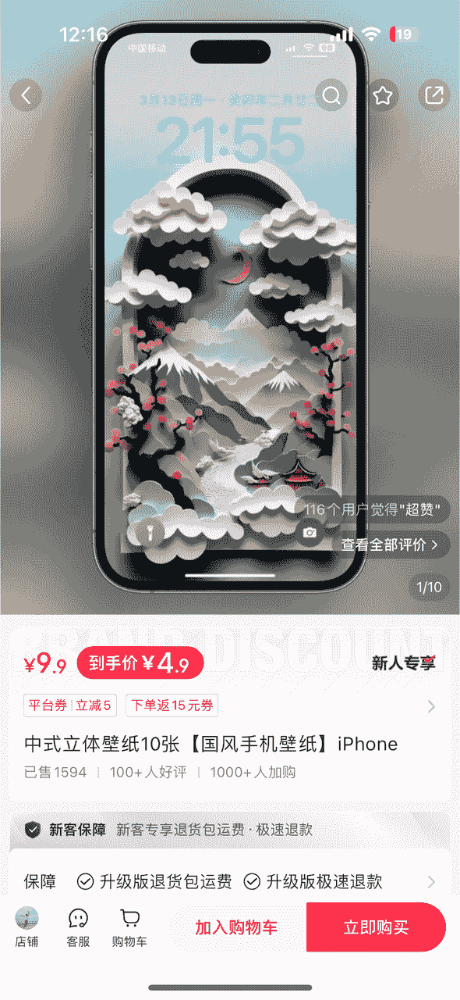

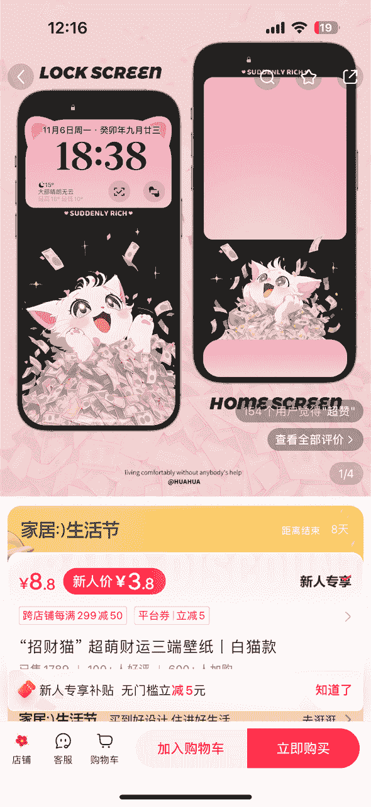

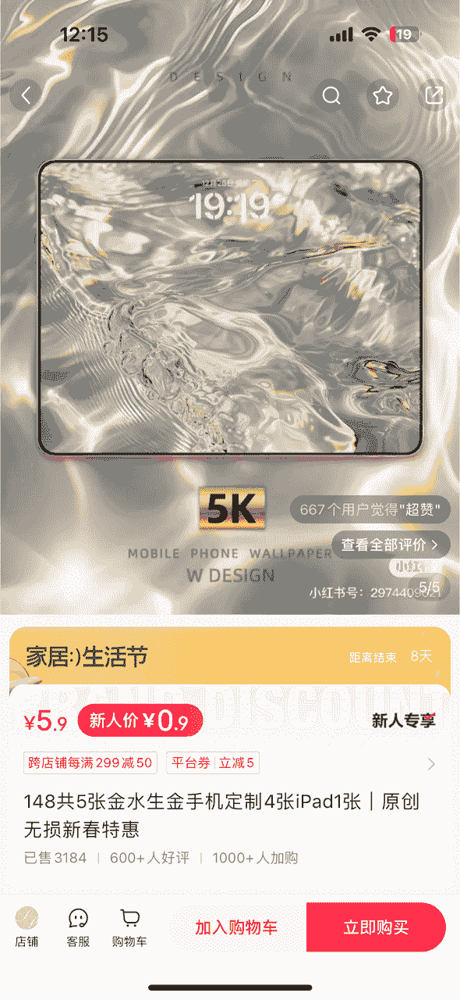

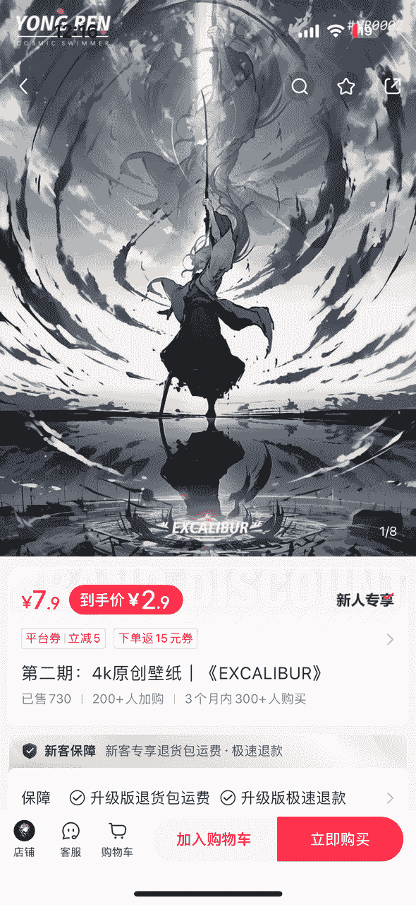

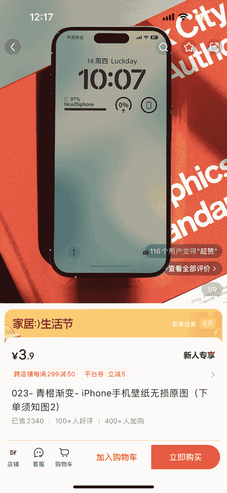

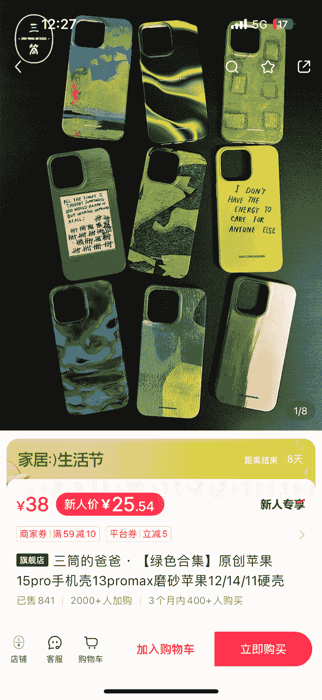

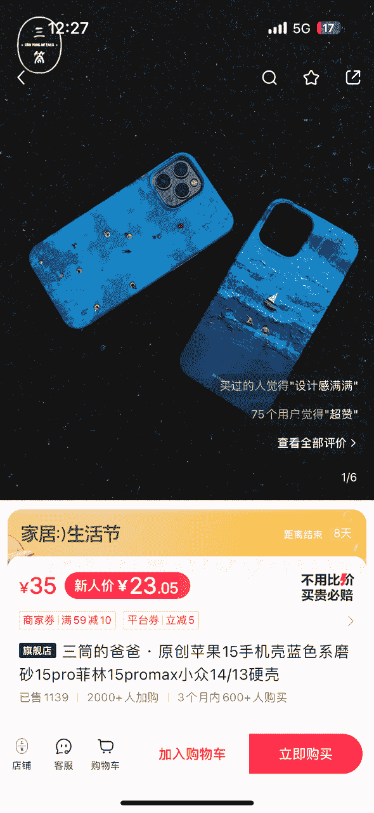

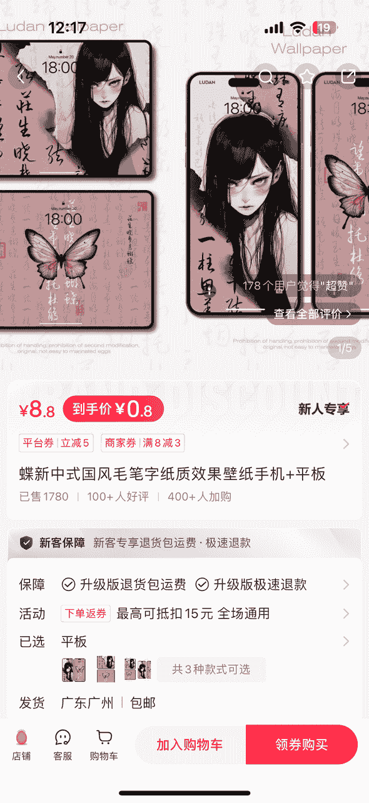

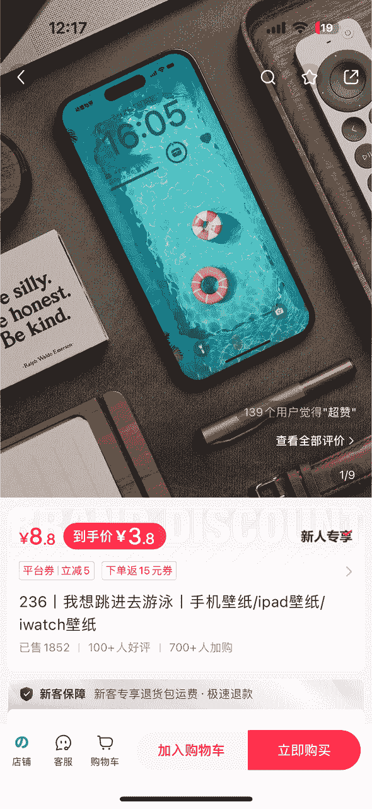

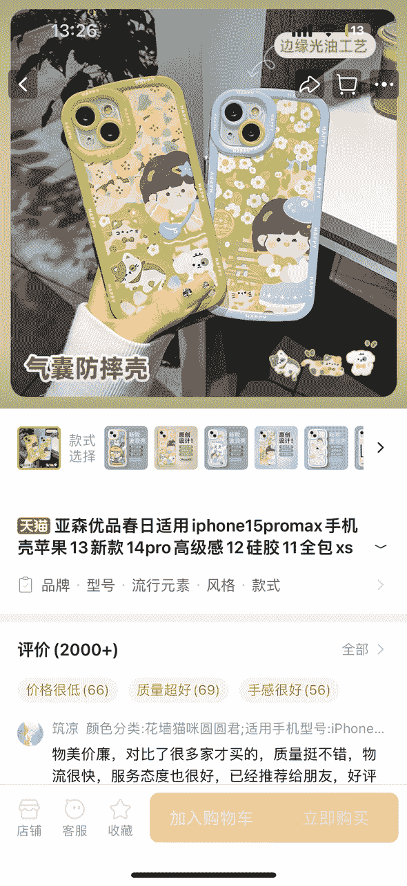

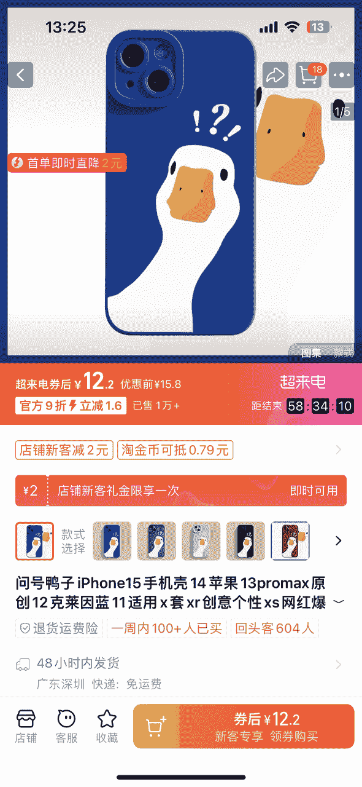

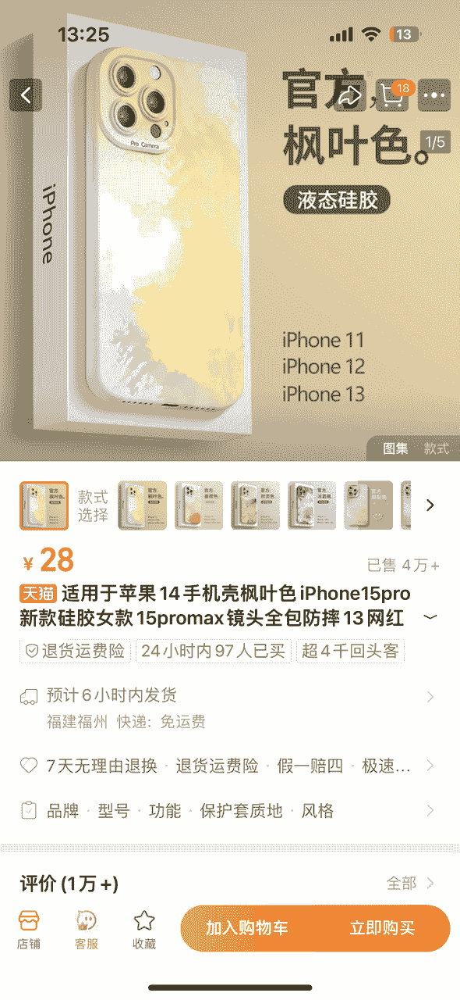

对于新手来说，有困难，有个小门槛，但问题不大。这几周新类型的壁纸爆款有哪些？咒语去哪里找？用的什么绘画工具？怎么做手机壳？接下来大家就跟着步骤一个一个解决，你会发现其实很简单。

首先第一步就是要制作图片

壁纸爆款在哪里找，大家可以直接在📕搜索壁纸，可以看购物那一块，销量高的，把图片扒下来，看看销量高的图片的类型，风格。

接下来利用Midjourney创作，如果要复刻爆款图片，可以利用Midjoruney图生文，垫图的功能快速复刻。比如我们要做下面这款动物卡通画。

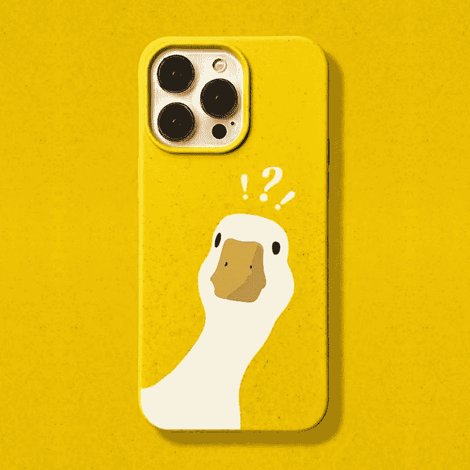

图生文得到关键词：

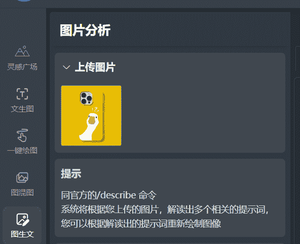

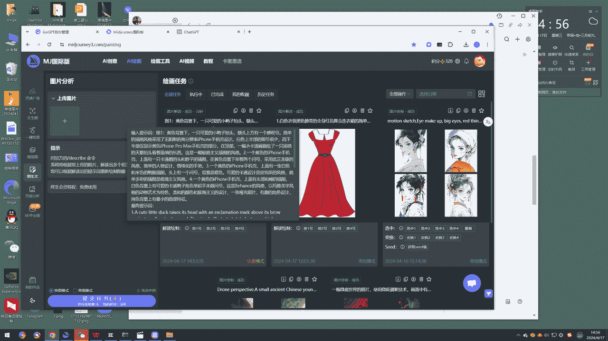

我们对关键词做一个整理：

我们只需要他出图片，不需要他出现iPhone手机，最后我们得到这样的提示词：

一只可爱的小鸭子抬头，米白色的鸭子，额头上方有一个感叹号，黄色背景，采用了无阴影的高分辨率，扁线画，极简主义插图的风格

因为不想垫图，所以这里只用了关键词出图。如果你想跟爆款图差不多，那就需要垫图了。

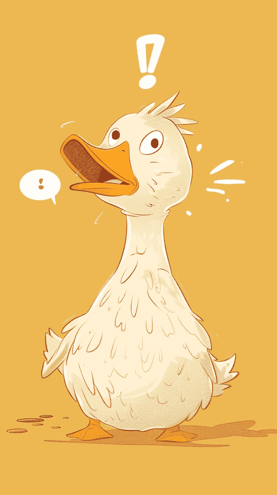

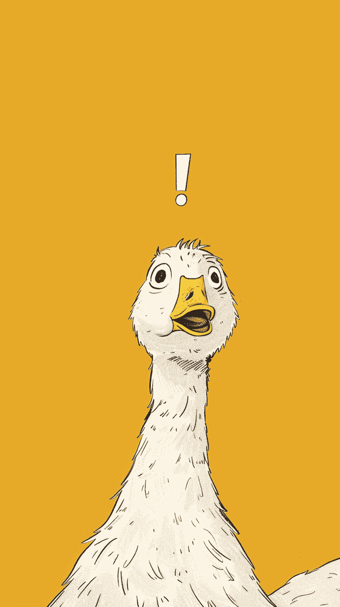

当然一组图大家可以出不同的比例，以便适应手机，iPad，或者电脑壁纸。只需要点U放大一张，自定义就可以更改同一张图像的尺寸大小。

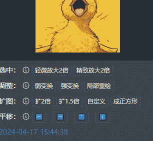

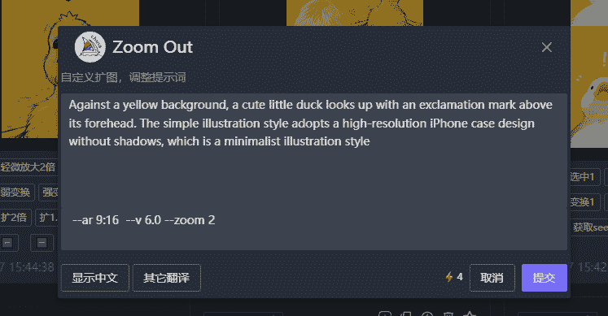

这里给大家附上最近比较火的壁纸关键词：

1.A few golden butterflies floating in the water, transparent water, clear to the bottom, sparkling water reflection, top-down angle, peaceful effect, mysterious and dreamy, light purple and gold style, Y2K aesthetics, visual effect. --s 400 --ar 2:3 --v 6.0

2.Photos of gold coins and water, with a light pink and transparent texture style, anime aesthetics, interesting complexity, berry punk, gorgeous colors, 32k uhd --s 101 --ar 2:3 --v 6.0

3.Two golden carp leapt out, jewelry, emitting brilliant colors, radiance, depth of field, detailed photos, mid shot shots, high-quality, realistic presentation, very detailed, cinematic, volumetric lighting --s 400 --ar 2:3 --v 6.0

4.A happy and cute capybara floating on the water, the water is light blue and transparent, the water has sparkling ripples, details,high definition --ar 9:16 --style raw --v 6.0

第二步**设计并生产手机壳**

1.找手机壳生产厂商，大家直接在淘宝，拼多多去找，跟他谈好价格。

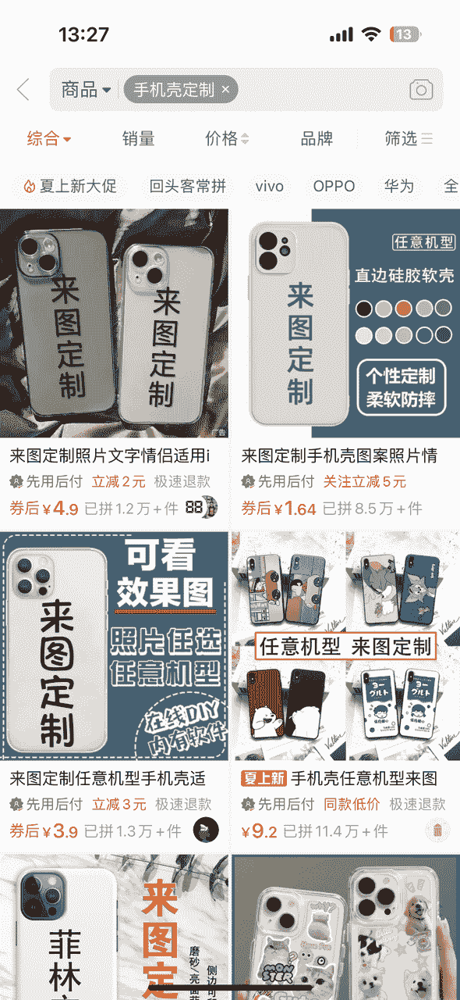

2.材料选择：根据产品定位选择合适的手机壳材料，如硬塑料、软硅胶或高级皮革等。

第三步就是销售与推广啦

前面的都不难，这一步才是最难得，也涉及到能不能赚钱，因为需要你懂得运营。很多人在这一步觉得很难就停止脚步了，但是一定要相信一切都是有方法的。

1.制作样品：制作几款样品，用于产品展示和营销推广。可以在美图秀秀或者醒图上搜索壁纸,手机壳模板，直接套用就行。

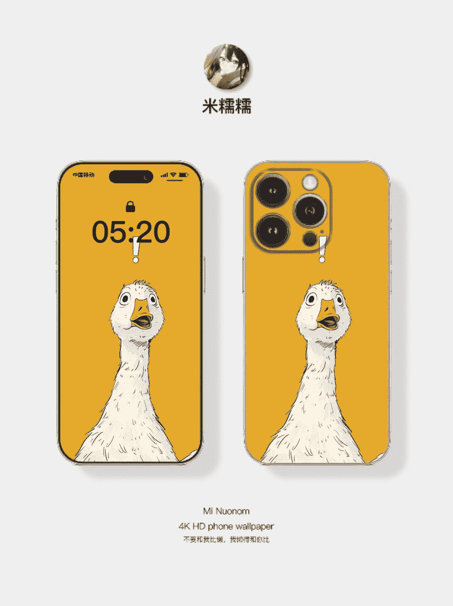

2.找到推广渠道：想好是做淘宝还是📕。

对于新手来说，建议大家做📕。

**📕的开店流程（个人开店）**：

个人身份证开店，很快就可以通过。步骤如下:

①📕软件(不需要商家版):点击我的→左上角三条杠;②点击📕创作中心→找到更多服务→点击开通店铺③点击立即开店

②选择开个人店(一证一家，不需要费用)，还是个体店(需执照，可以开二家，一家需要 600 年审费)，选择类目，填写个人信息提交;

建议去缴纳1000元的保证金(也可获得收益后补缴)

**如何上货**

①手机上货(每次只能上一件，适用于有货源)📕点击我的→点击管理店铺→点击上架商品，把准备好的产品素材依次填写即可。

②电脑上货(一次可以搬运多件，适用于无货源)搜索📕商家版后台→点击左侧服务市场→进入服务市场在这里可以看到很多一键搬家上架的插件，选择一个即可。进入之后，一般都会有操作介绍，自行观看学习即可。

**最后就是如何运营了！！**

如何出单(运营店铺)

1、第一件事:做好选品

对于薯店，选品十分重要，能够选到自带流量的品就更好了!新手如何选品呢?

我们肯定是需要多学习，多看，多分析，分析好之后，我们需要确定图片的类型，风格，直接再📕搜索框里搜索，或者用辅助网站(婵小红)去找带货笔记点赞收藏高的笔记。

壁纸大家可以借鉴下面这种方式，壁纸会员，壁纸这个赛道本身就很卷，再加上大多数人的想法是不会花钱买壁纸，那壁纸会员这个方式就很好，各种类型的壁纸，而且还可以不断更新，有固定的会员之后后期还可以做定制。

手机壳这里需要看三个点:1.要看他的图是哪种类型，大众喜欢的是什么类型的图 2.要看销量情况怎么样，3.要看他的粉丝量。综合这三点，粉丝量比较低，出单情况优秀(1是出很多单，2是爆单趋势明显)，好了就选这个品

2、第二件事:写笔记

写笔记也是非常重要的一步。关于如何写笔记，还是去学习多看，前期也可以去抄爆款，但注意不要照抄，根据品类搜索相关笔记，模仿学习爆款，前期多测试找到适合自己账号的笔记类型，之后复制就可以了。

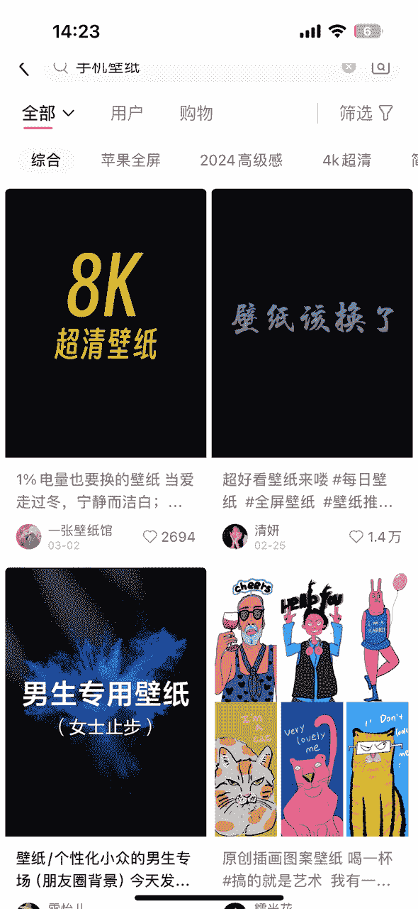

结束语：

希望这篇分享能激发你的创业热情，并帮助你成功开展个性化产品的在线业务！如果你有任何问题或需要进一步的指导，欢迎在评论区留言。记得点赞和关注我，获取更多创业和AI应用的实用信息！