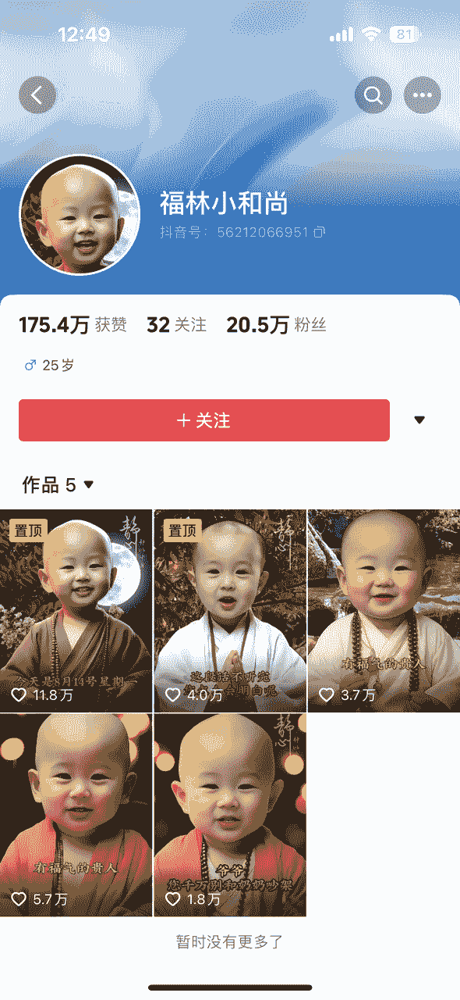
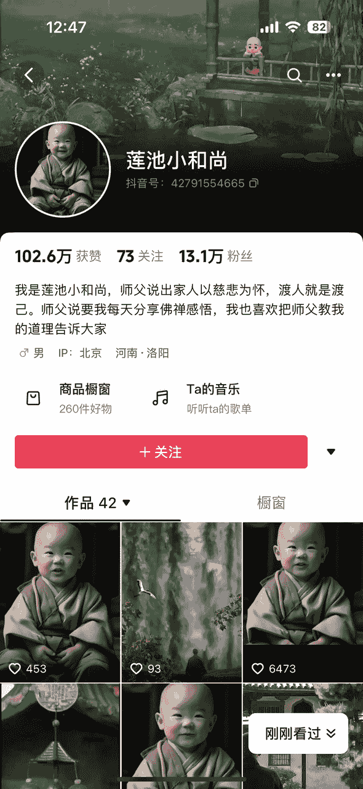
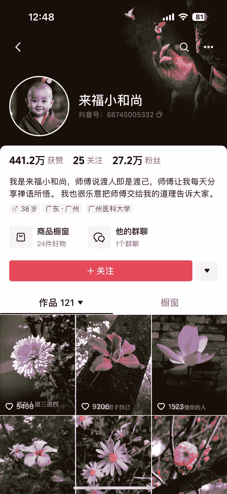
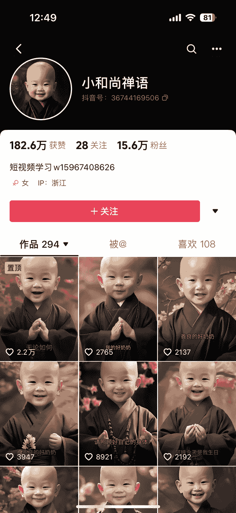

# 小和尚口播账号拆解

> 来源：[https://my.feishu.cn/docx/Ioywd5uGxojykOxY1UWct2k0nge](https://my.feishu.cn/docx/Ioywd5uGxojykOxY1UWct2k0nge)

今天给大家拆解在抖音上的AI小和尚口播账号，仅仅用了几天天就涨粉20w，涨粉速度非常的夸张。

这几个账号都是按照这个内容形式，就是用ai生成一个小神童的形象来口播一些国学、成功学、祝福类的内容，基本上没有什么技术壁垒。数据都还不错，所以是非常适合入场去做的。

那么如何变现，这里有几个方向：

①挂橱窗销售具有好寓意的手环、佛牌、书籍，小摆件等

②做国学、成功学的资料引流

③做课程收徒教学

话不多说接下来就是教程分享：

1.利用Midjourney生成小和尚图片

这里直接给大家附上关键词：可根据需求自己调整。

Winter snow, a 3-year-old Chinese monk, heartfelt prayer, hope, close-up shots, innocent and peaceful snowflakes surround, joyful smiles, real emotions, perfect angles, capturing eternal moments --stop 80 --ar 9:16 --v 5.2

a chubby little monk with a roundhead, round big eyes, smile, hands folded, satcross legged.cute Buddhist photo shoot,interactive style, blurred temple backgroundlifelike, childlike innocence, light brown, patienceof saints,subtle color values

2.利用GPT生成文案

这类账号的受众基本是中老年人，所以大多口播的内容，可以偏向一些国学、成功学、祝福类，内容可以有一些较强的互动性，这样用户会主动在评论区进行互动。

内容的话，可以不需要自己去原创生产，直接百度知乎抖音搜索流量高的，再用GPT洗稿。

(请模仿以下抖音文案，重新写出５个新的脚本文案，主要内容方向是.....)

３.AI视频让小和尚动起来

这里推荐几个可以试一下D-ID（链接：https://studio.d-id.com/）HenGen　https://app.heygen.com/home

国外的有一定的门槛，这里再推荐一个国内的数字人平台奇妙元，直接搜小程序就可以，有免费的可以用。

４.剪映合成

导入视频，配字幕，音频，配音可以选择小孩子的声音。

大家记得，不要只追求流行的内容或固定模式，重要的是找到你的强项并全力以赴。不局限与抖音号，视频号可以同时做。开始行动后再考虑完善。多种方法，多种可能，关键看你如何应用。