# 每个做潮牌创业的朋友们，一定要利用AI

> 来源：[https://my.feishu.cn/docx/Y39KdJQqnog8GqxmkYicWJH5nPf](https://my.feishu.cn/docx/Y39KdJQqnog8GqxmkYicWJH5nPf)

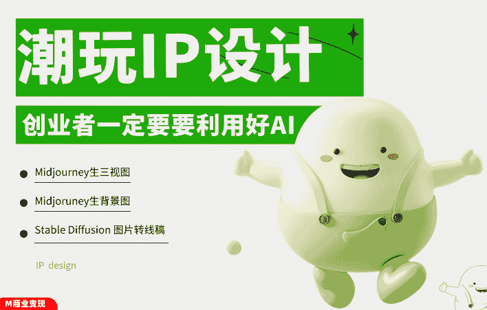

近几年潮玩和品牌 IP 化正在国内疯狂扩张，前两年天猫的《95 后玩家剁手力榜单》也显示，潮玩手办的烧钱指数位列第一，增幅巨大，

发现没有？无论是潮玩、品牌 IP 化还是 NFT，这股掘金热的背后，都有 IP 设计的身影。如果你有留意，就会发现这两年，越来越多的企业都开始注重 IP 打造了。

阿里动物园、冬奥会冰墩墩，大家都意识到，一个可爱的 IP 形象是出圈利器，比起广告投放效果好太多了，而且 IP 形象的吸金能力更让很多人跃跃欲试，无论是手办还是 NFT 都是当下的大热领域。

所以做潮牌创业的朋友们，变现机会太多了，可以接私单，为企业单独定制形象，也可以创造独立 IP，再授权给手办公司，实现躺赚的小目标。亦或是转让整个 IP 版权，赚一笔大的。

那现在在AIGC的加持下，对潮牌创业的朋友们来说，一定会又是一次绝佳的变现机会。一

#### 一.接到需求(以下面的案例为例)

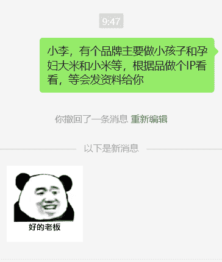

接到需求之后，我们首先进行了深度的行业调研，了解了当前大米和小米市场的状况，特别是针对小孩子和孕妇的产品，再确定角色的定位，角色的作用，也可以建立关于这个角色的故事。

#### 二、确定设计方案

理出设计思路

**形象设定原因**：通过可爱、友善和智慧的形象来吸引孩子和孕妇的注意。

**亲和力塑造**：设计“小米宝宝”时，采用柔和的颜色和圆润的线条，增加亲和力。

**适用更多场景**：设计成可以适应多个场景的形象，如故事书、教育视频、包装等。

针对上述思路，我们制定了以下设计方案：

+   采用明亮、柔和的颜色，主要以黄色和绿色为主色调，象征健康和自然。

+   设计圆润的五官和肢体，使“小米宝宝”看起来更友善和可爱。

+   设定多个表情和动作，以适应不同的应用场景。

+   **关键图形**：提取大米和小米的形状，融合到“小米宝宝”的设计中

#### 三、AI绘图软件出图（Midjourney和SD出图）

MJ直接出IP图：一个可爱的圆滚滚卡通人物，中国古代玉壳形身体轮廓，胳膊和腿快乐地奔跑着，穿着浅绿色和浅黄色背带短裤，盲盒玩具设计，吉祥物IP设计，使用浅黄色和浅绿色，泡泡玛特风格，皮克斯动画风格，三维立体，明亮的色彩，c4d渲染风格，高清细节，最佳质量，高分辨率

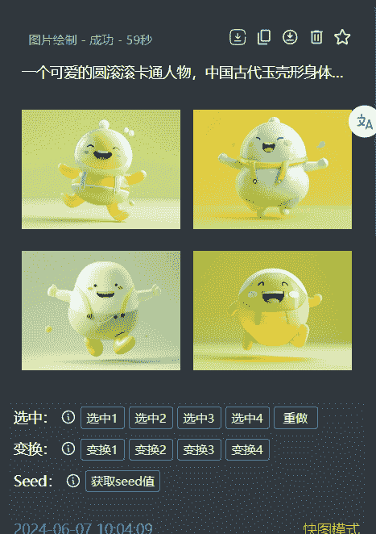

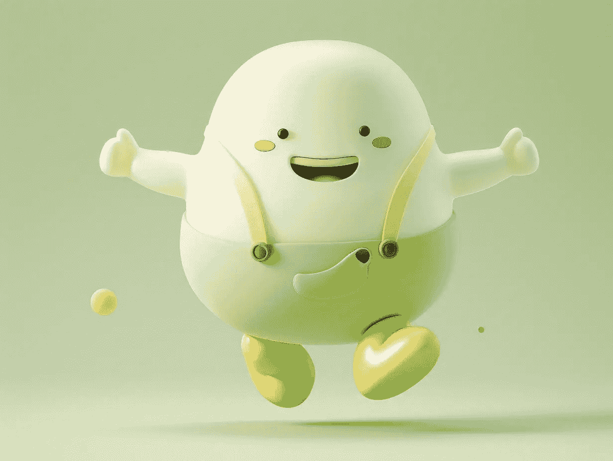

SD图片转线稿：

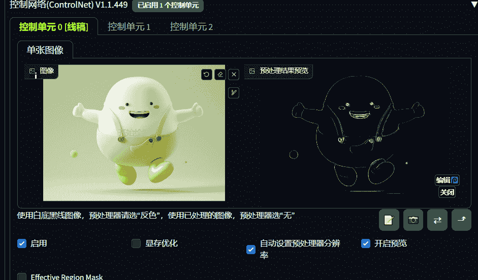

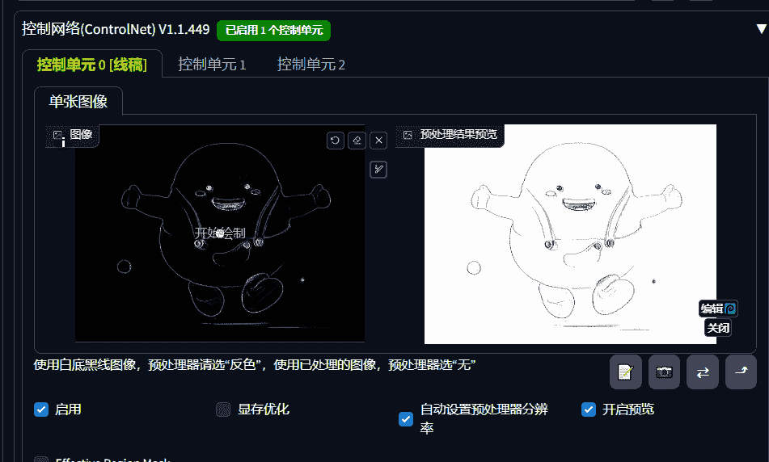

MJ出同一人物的不同动作表情：

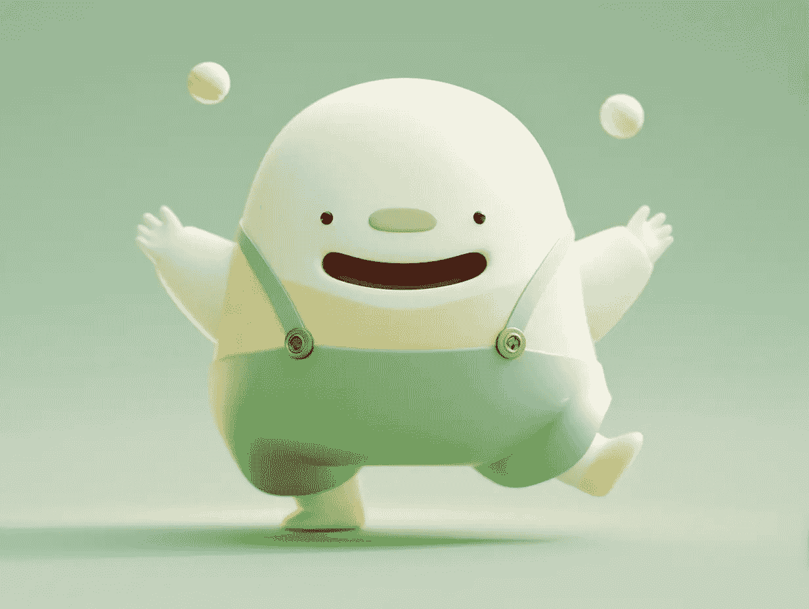

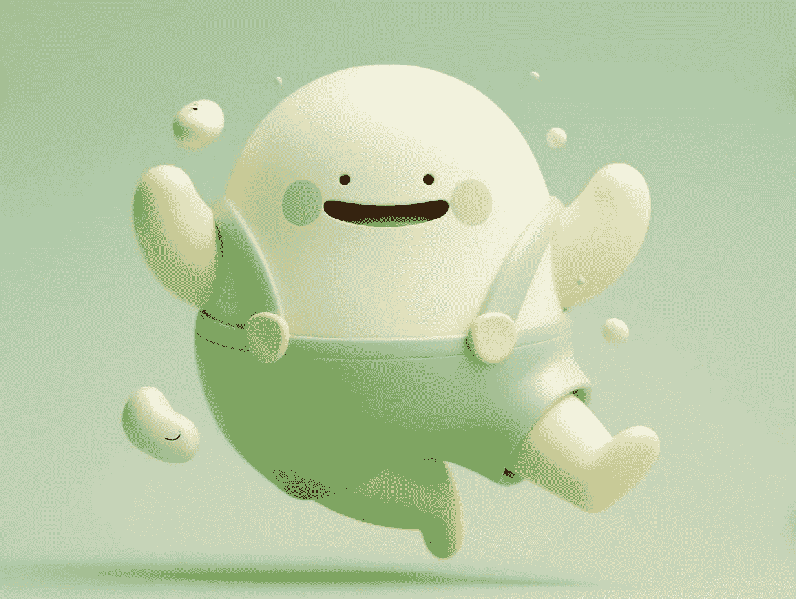

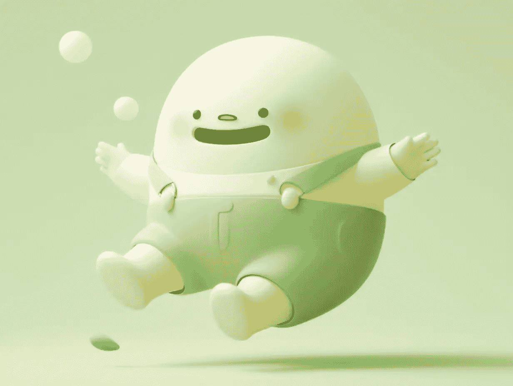

MJ直接出三视图：

全身照，一个超可爱的娃娃盲盒玩具，穿着浅绿色工装短裤,淡黄色衣服，简单的3D模型，三视图绘图，生成三个视图，即视图，侧视图和背视图，白色背景，使用Blender渲染，高分辨率，工作室灯

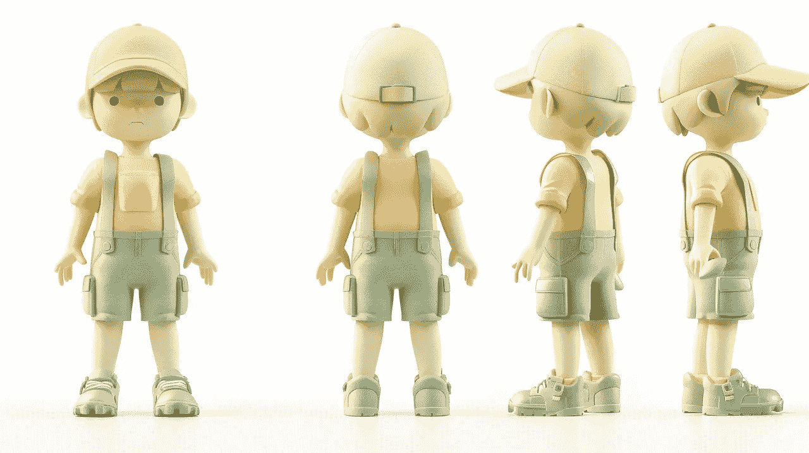

MJ直接出草图：全身照，一个超可爱的大米娃娃盲盒玩具，穿着工装短裤，迷你，黑白线稿，三视图绘图，生成三个视图，即视图，侧视图和背视图，白色背景，

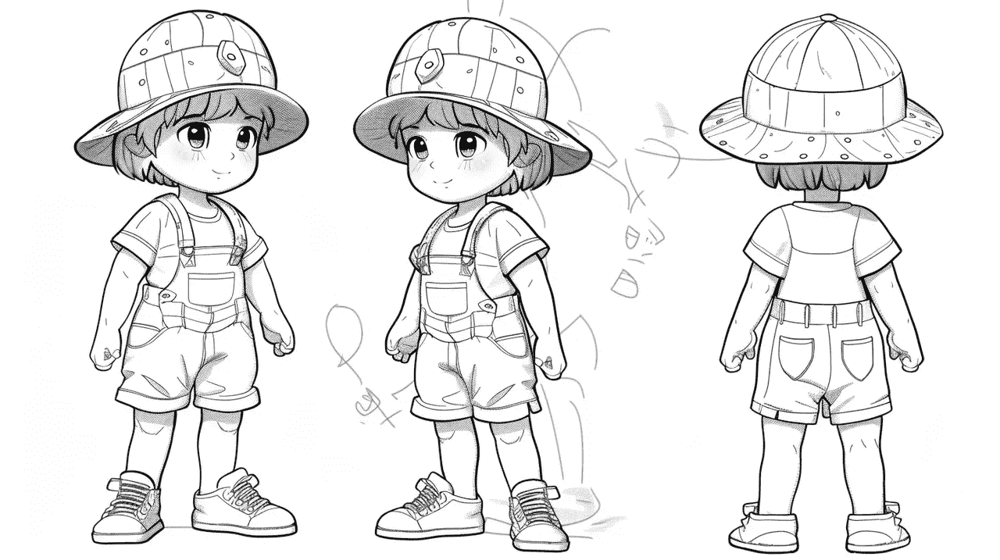

出背景图：

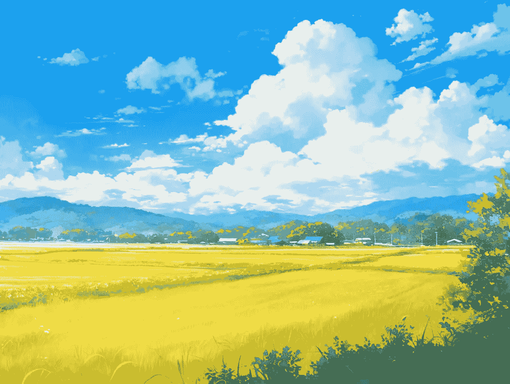

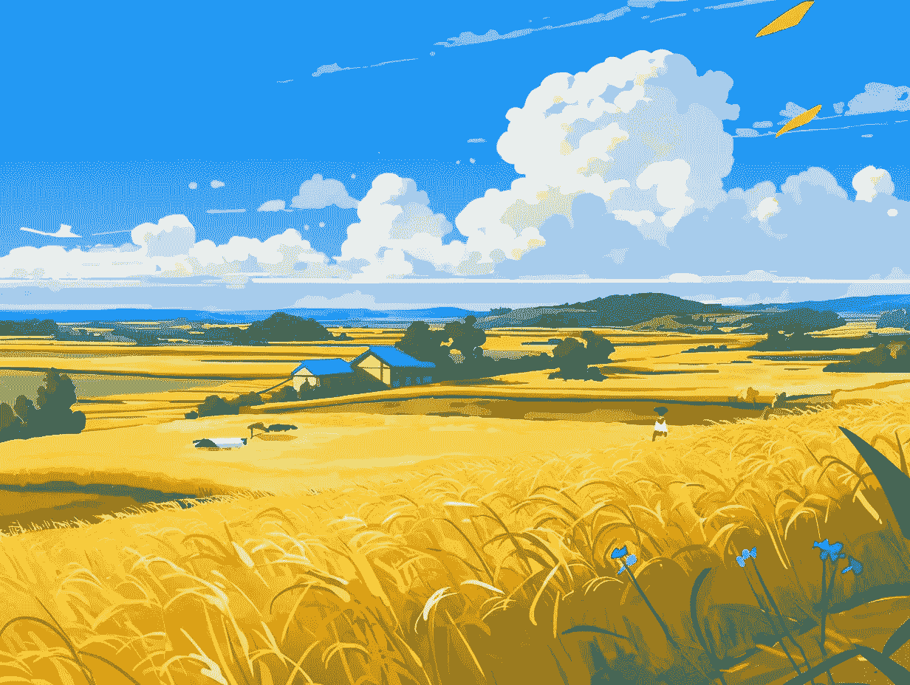

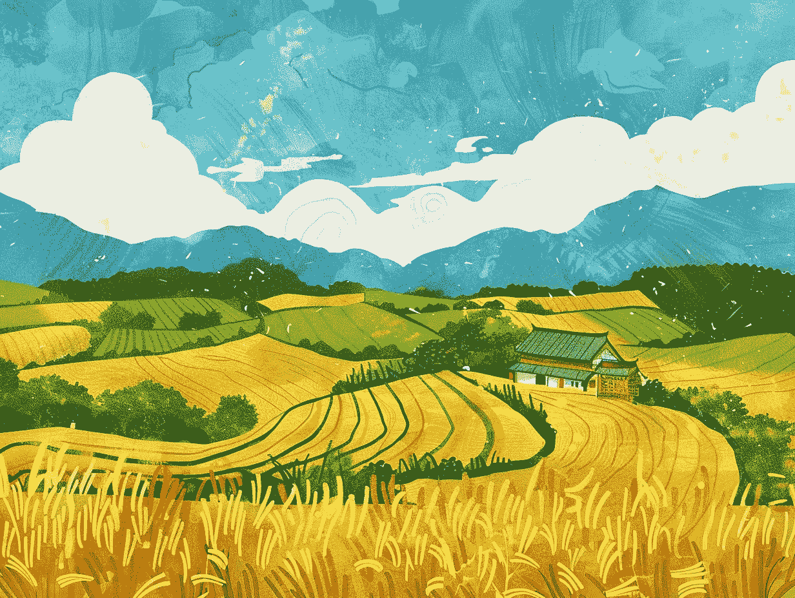

用AI出图之前，我们要考虑到IP的应用场景最终给客户的作品展示方式，用AI绘图软件可以出哪些我们能够用到的图，比如我们要设计海报或者包装设计，MJ可以出一些背景素材

#### 四.后期

Midjourney出图是不会一次性就能选到满意的图片，要经过不断地调整提示词，抽卡最后得到相对满意的，但是也总会有一些手，脚不协调，或者多出来的一些东西，那这就需要设计师后期调整一下了。

（这里就不展示调整之后了）

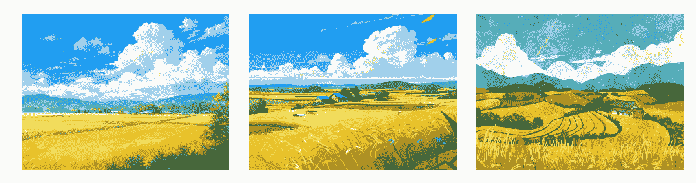