# 用midjourney轻松搞定微信红包封面！！！

> 来源：[https://my.feishu.cn/docx/S7FsdAe6soLqbixebJAcT2pJnbc](https://my.feishu.cn/docx/S7FsdAe6soLqbixebJAcT2pJnbc)

大家还记得每年春节前夕，在各大公众号抢红包封面吗？

现在AI技术的融入对于不会画画的，不会设计的普通人，现在利用AI也能自己做，当然也为设计师们带来了前所未有的便利极大地拓宽了创意的边界，不仅能够有效地帮助设计师节省大量的时间和精力，还能激发他们的创造力。今天将给大家分享如何利用Midjoruney制作属于自己的红包封面，

话不多说，我们赶快开始吧！

##### 一.开通视频号或者公众号

要自己定制设计一款红包封面，首先需要注册平台账号。

注意：微信红包封面平台目前面向中国大陆境内的以下用户开放：

1、完成企业认证的微信公众号用户

2、粉丝数达100个的公众号个人用户

3、满足以下任一条件的视频号个人用户：

(1）粉丝数达100个

(2）视频号绑定的微信表情开放平台账号专辑下载量达500次

认证入口：

公众号：https://mp.weixin.qq.com/

视频号：https://kf.qq.com/touch/faq/200813eeymye200813AV7jEj.html?platform=14&lang=

##### 二.了解平台规范

先来看看我们需要做哪些图?

+   封面图：封面图是封面样式的关键组成部分，会同时应用至发红包页、红包气泡、拆红包页、红包详情页。除了支持图片素材外，平台现已全面支持上传动态素材作为封面图。

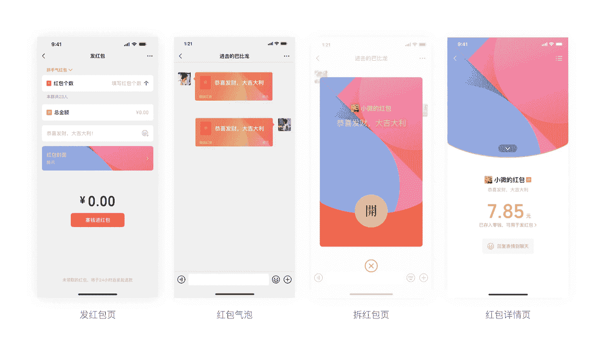

动态素材应用效果：

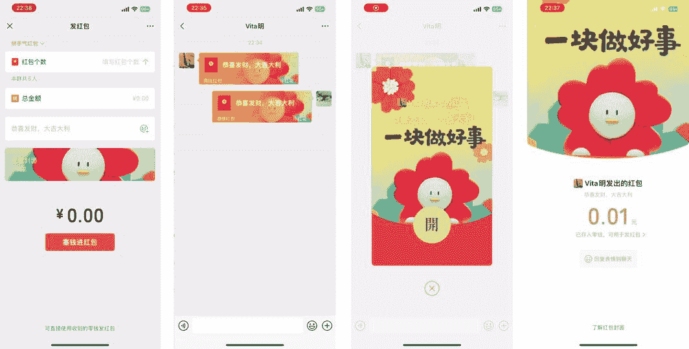

[dtsc.mp4](https://internal-api-drive-stream.feishu.cn/space/api/box/stream/download/all/XQr1bN3Wpoz00Qx5dapc0aehnvf)

+   **封面挂件（选填）**

封面挂件会和封面图一起展示在拆红包页。除了支持图片素材外，平台也支持上传动态素材作为封面挂件。

图片素材应用效果：

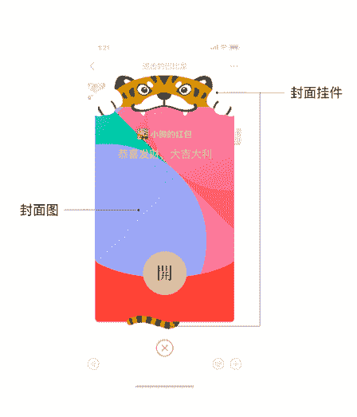

动态素材应用效果：

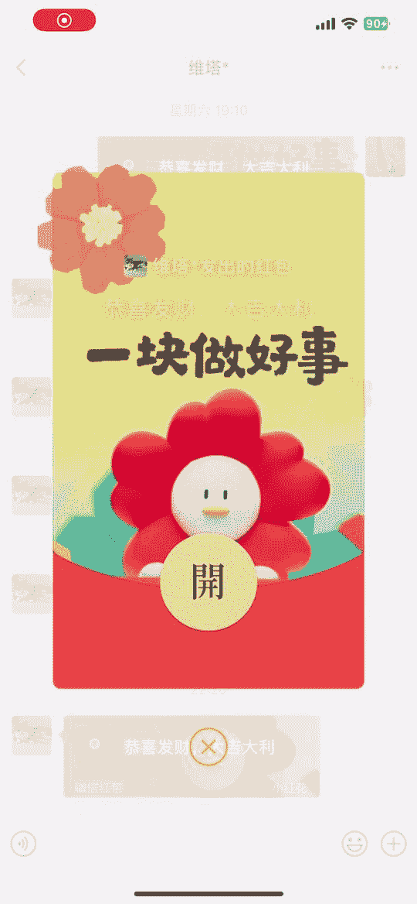

[dtgj.mp4](https://internal-api-drive-stream.feishu.cn/space/api/box/stream/download/all/LH16btsXIo0f7qxRjj7cSRp7n5T)

+   **气泡挂件（选填）**

气泡挂件会和封面图一起展示在红包气泡上。气泡挂件为图片格式。

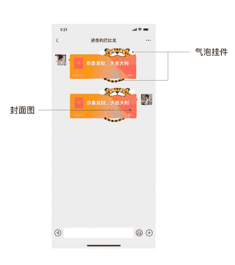

图片制作规范

封面图（必填）

封面图可以是图片、视频或者PNG序列帧。素材制作规范如下：

封面挂件（选填）

封面挂件可以是图片或者PNG序列帧，素材制作规范如下：

气泡挂件（选填）

+   格式：PNG

+   宽高：480x384像素

+   文件大小：不超过300KB

+   色彩空间配置：建议使用sRGB

关于第一第二部分更多规则可以看官方文档：

https://cover.weixin.qq.com/cgi-bin/mmcover-bin/readtemplate?t=page/index.html#/doc?page=introduce

##### 三.红包封面设计思路和售卖路径

如果没有任何制作经验，那么你可以多看看其他人优秀的作品。

比如微信红包平台就有一些非常不错的案例。

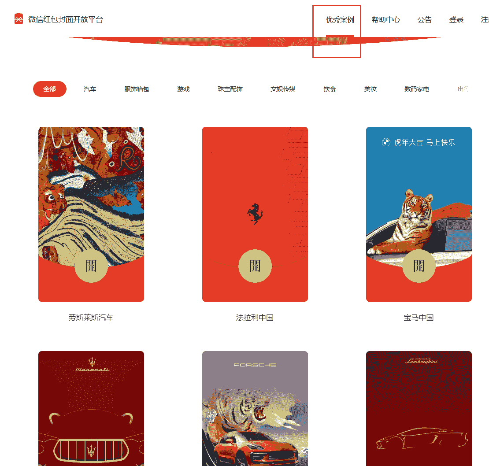

还可看看一些大品牌的红包封面：

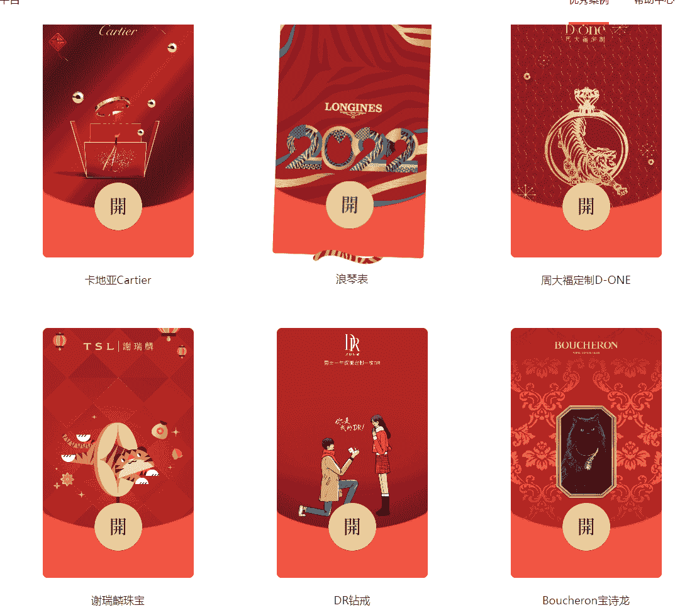

设计师可以接定制的单，那么普通人又如何通过微信红包封面赚钱呢。先看看红包封面再各个平台售卖的情况。

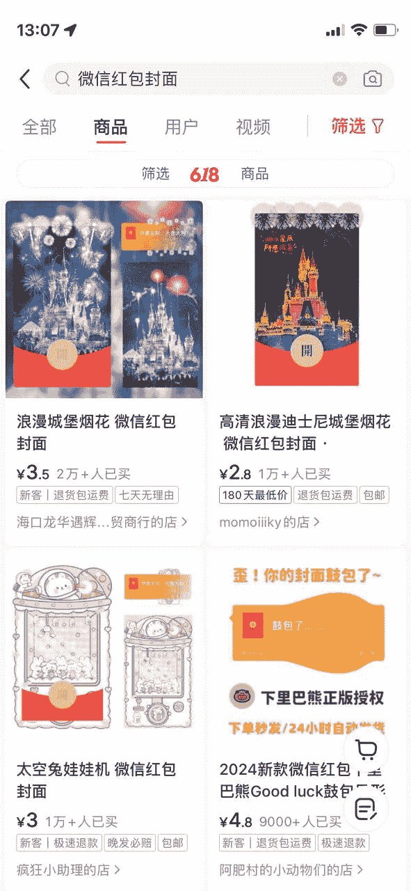

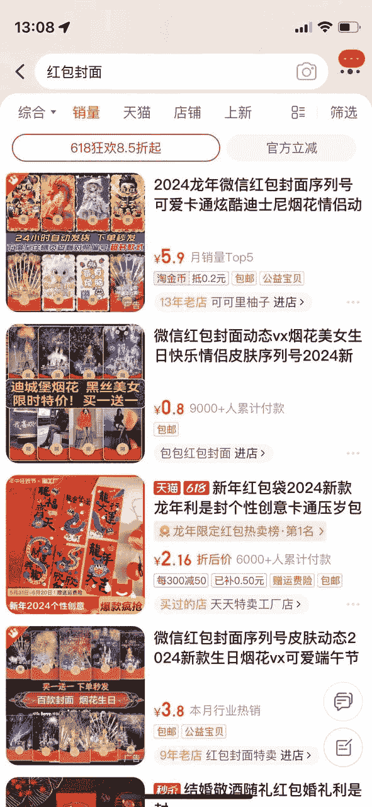

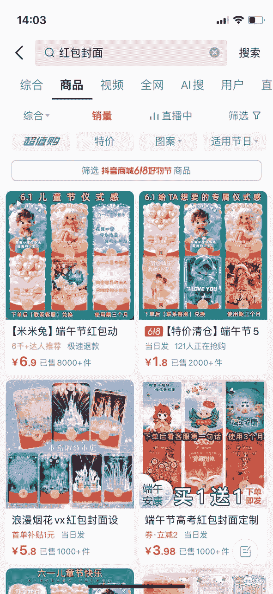

小红书和淘宝上的售卖情况还是非常不错的。作为普通人也是可以选择这两个平台。

##### 四.Midjourney 出图

+   如果你有了想法，那我们就可以根据关键词出图。如果不知道关键词怎么写可以按照下面的提示词结构填充:

> 主题+媒介+ 环境+灯光+颜色+情绪+构图

关于更多提示词的注意事项以及写法可以去看关于Midjourney提示词的教程。

+     如果你没有想法，不知道画什么，你可以结合以下几个方面：节日，萌宠，12生肖，情侣，儿童。

##### 五.后期优化合成

1.出图后可以通过 Photoshop 在对所选照片进行精心优化和合成。比如亮度、对比度和饱和度的微调，以确保图片能展现出最佳视觉效果。从而打造出一个和谐而富有层次感的最终封面图。

2.如果要加入气泡挂件封面挂件可以下载官方给的设计模板，到PS里加工

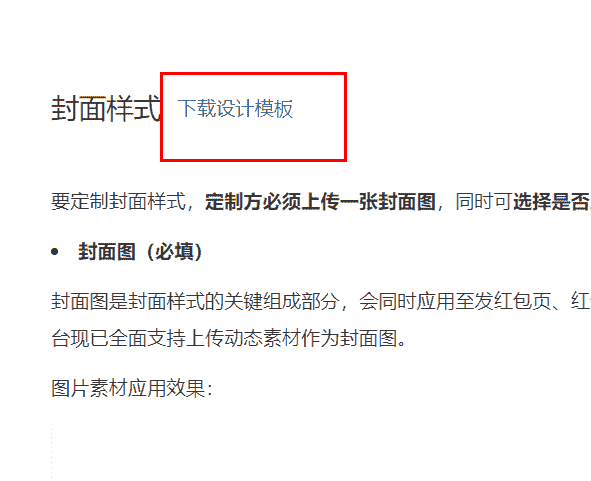

还可以利用AI视频和剪映制作动态视频，AI视频生成的视频只有4秒，如果需要循环的播放，可以把生成的视频放在剪映里，复制一份，然后点击倒放，这样把这两段视频拼在一起，就可以实现循环播放了，视频长度也长了一倍。

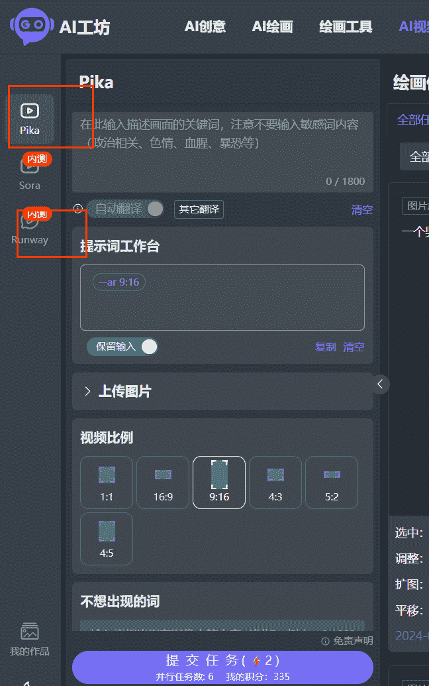

六.上传审核，等待结果

在提交前，建议先使用手机预览整体效果，包括所有已上传内容在接收红包过程中的真实体验效果。如果扫描后出现二维码无效等情况，建议先升级手机微信版本。

普通红包的证明材料比较简单，准备好AI绘画网站生成图的截图和PSD源文件

如果涉及到封面简称、品牌logo、封面样式、封面故事则需提供相关材料证明权利归属。

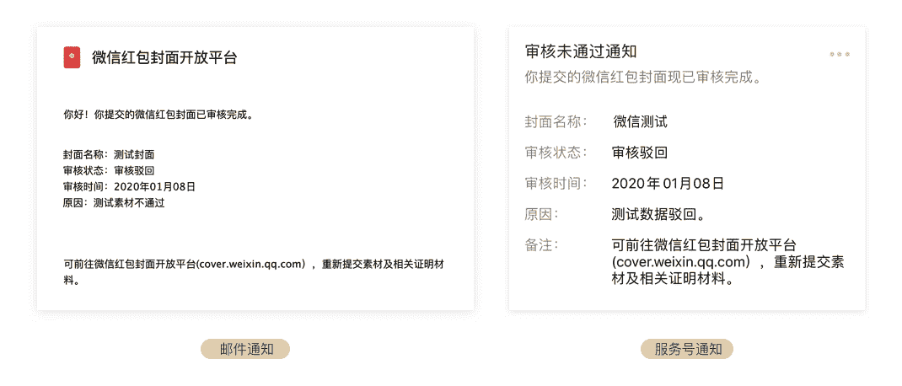