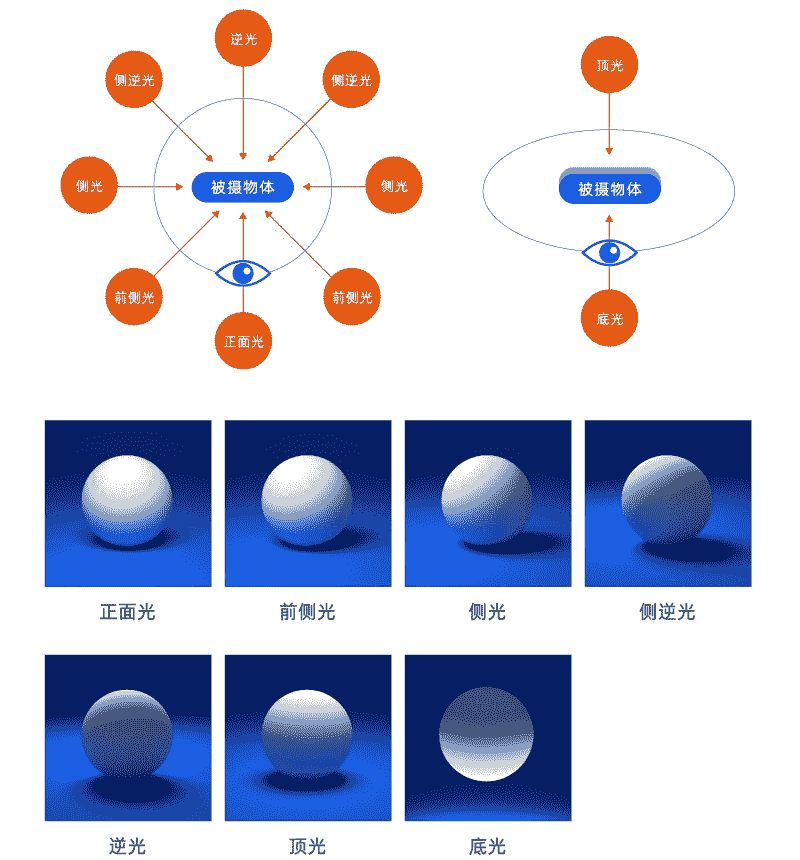
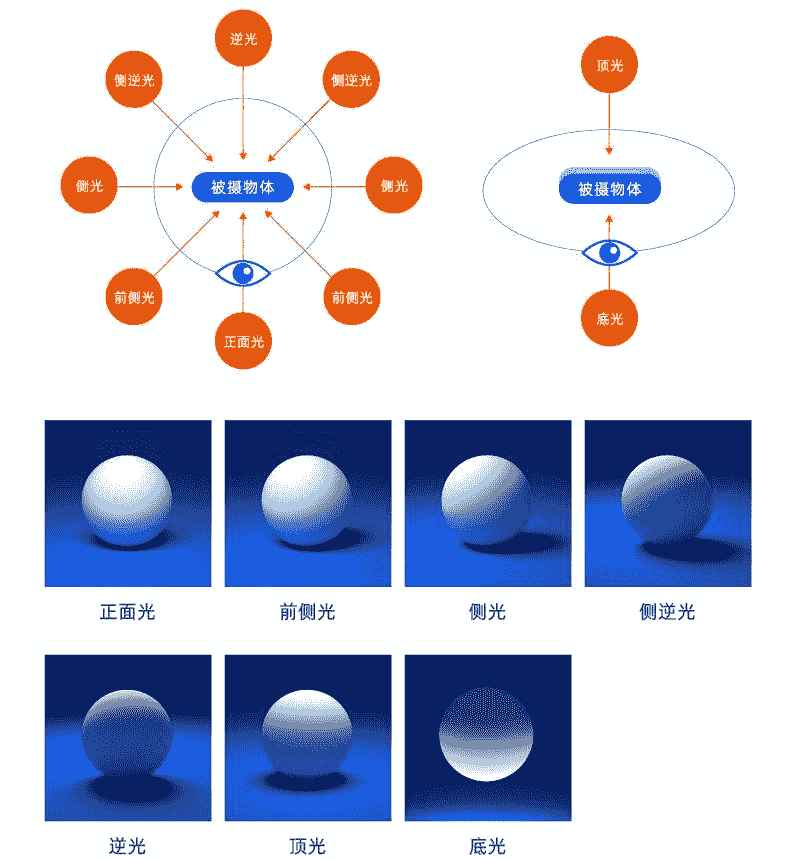
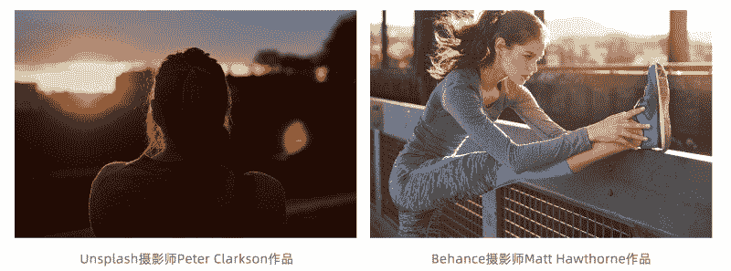
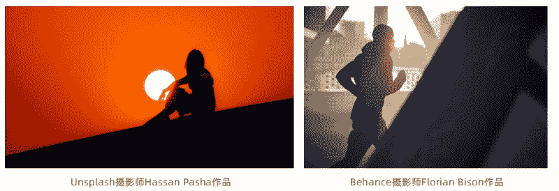
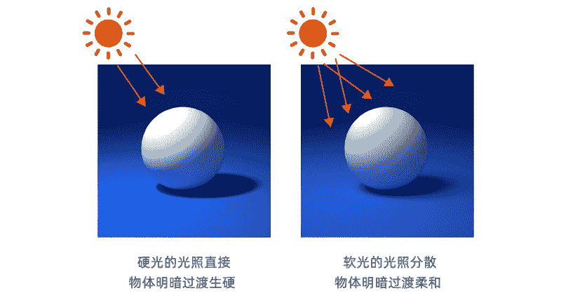
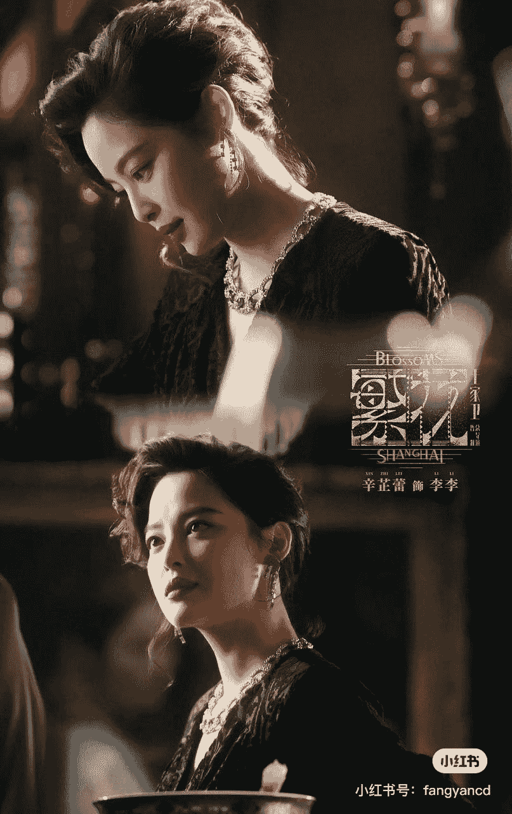
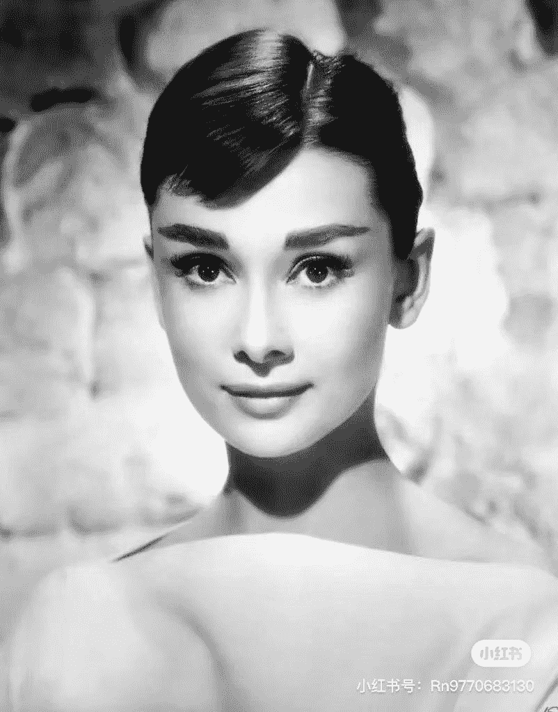
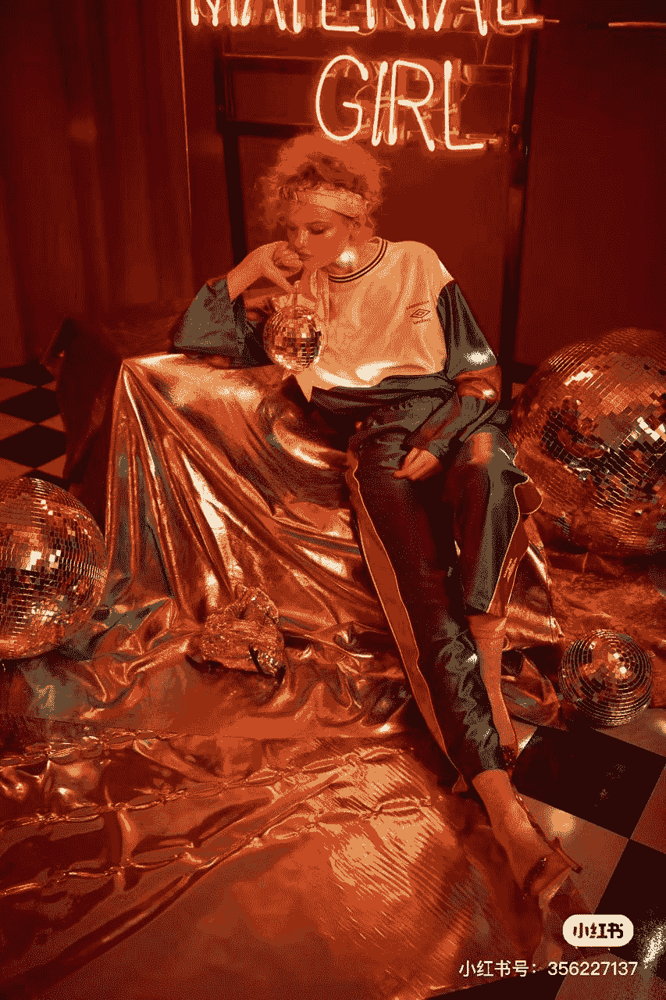
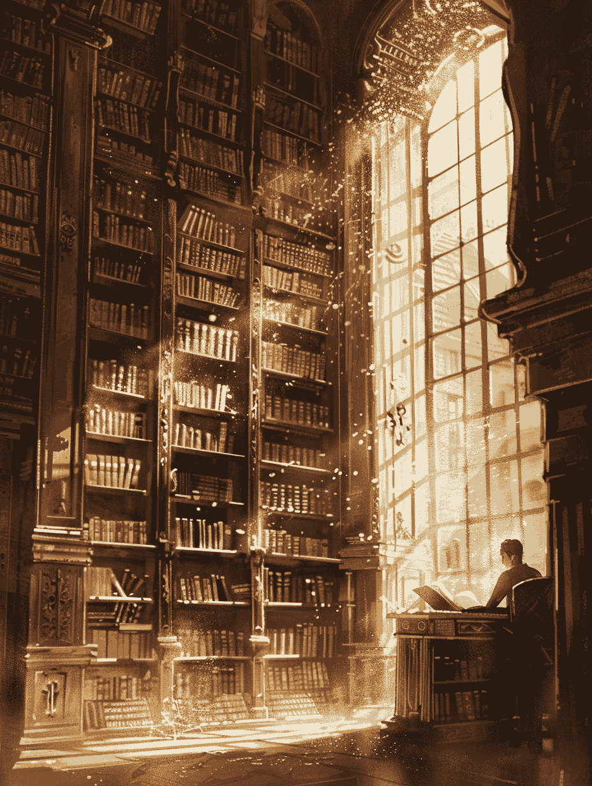

# ✨不可错过的Midjourney秘籍：光影艺术的探索之旅

> 来源：[https://my.feishu.cn/docx/YnfkdwnJoo2i4cxYtT8coNEbnkg](https://my.feishu.cn/docx/YnfkdwnJoo2i4cxYtT8coNEbnkg)

**AI绘**画中，运用光来创作画面对于AI画师来说是十分关键的问题，光影不仅是基础元素，更是艺术性和表现力提升的关键，当绘画拥有了光影，作品会更吸引眼球，也会更完整！本文将探讨光影在AI绘画中的基础知识，重要性，以及实用技巧以及案例分析，旨在提供一个科普与实战相结合的深入分析。

大家用Midjourney的时候是否常常碰到这样的问题！！！

+   1.难以准确表达光影效果

+   2.画面氛围与情感表达不一致

+   3.阴影的位置和强度不自然

+   4.材质和质感表达不准确

我们看到的万物色彩，都是物体表面的反射光，是光创造了色彩，同时也创造了影，只有经过光照才会出现明暗，才有所谓的「光影」，所以我们先来说说一切的源头——光。发光的地方就是光源，当我们对画面添加光影时，一定要先留意光源在哪，只有清楚位置，光影统一才有了依据。

我们先来看光源的种类类型：

1、自然光源

室外或室内没有人工干预的光源都是自然光源。自然光源下的物体明暗变化丰富，层次多样，对比协调。

2、人造光源

人造光是摄影中常用的光源，它具有使用方便、灵活的特点，其光源强度、照明方向、照明高度、照明距离、光线色温等都可以由摄影者控。 人造光是根据自然光的照明特点发展而来的，它能模拟和再现自标光，创造和渲染环境气氛，同时它又具有浓厚的感情色彩。

每个光源形成的光影是不同的，那接下来我们看看光影类型有哪些？

**光源方向：**

1.  **正面光**：灯光从物体的正面直射，也叫顺光。受光均匀，色彩真实还原。缺点：缺乏立体感和空间感，不适合人像和建筑。

1.  **前侧光/侧光:**当光源的照射方向和视线方向成30°-60°夹角时称为前侧光；而当夹角成90°时则为侧光。如图所示，前侧光一般明多暗少；侧光则是明暗对半。前侧光及侧光是电商设计中最常用的布光方式，这样不管人物还是产品，明暗比例都比较适中，既能保证物体的亮度，也能很好的凸显物体形态和质感，所以大量Banner的主体展示都会采用这种布光方式。

**                            **

**                      前侧光                **                                                            侧光

1.  **侧逆光/逆光:**当光源的照射方向和视线方向成120°-150°夹角时称为侧逆光；而当夹角成180°时则为逆光。如图所示，侧逆光和前侧光刚好相反，物体是明少暗多；而逆光时的物体则几乎全是暗面。总体来说，不管侧逆光还是逆光，物体都以暗调为主，和前测光/侧光主要凸显物体的立体感不同，侧逆光及逆光主要是营造独特的场景氛围。侧光下的景物会有明显的受光面和阴影，画面明暗对比强烈，层次丰富，有利于表现被拍摄对象的质感和立体感。特别是用侧光拍摄浮雕、石刻、水纹、沙漠以及各种表面结构粗糙的景物时，能够凸显景物的质感。用侧光拍摄花卉和树叶时，也会让其色彩更加鲜艳。

**4.轮廓光**：当光照强烈、光质偏硬时，物体边缘就会出现一圈非常明显的高光，高光颜色和光源颜色一致，这就是「轮廓光」。光照强度越大、光质越硬，轮廓光就越明显。轮廓光一直都是摄影师的最爱之一，它能勾出人物轮廓，进而分离人物和背景，让影调富有变化，提升画面层次和细节。

**

5.剪影**：剪影也颇有艺术感，如果物体完全背光，这时背景偏亮而物体正面又无光时，就会形成剪影效果。在摄影中这是一种很有趣的拍摄方式。同时在电商设计中，剪影同样以表现人物或产品轮廓为主，突出整体造型。

**6.顶光/底光：**

Top Light 顶光：光线从上方直接照射被摄对象，使物体表面产生明亮区域和阴影

地光：光源位于物体下方，形成非正常的视觉效果，也称为“鬼光”，明暗对比强，用于制造恐怖氛围。

7.**硬光/软光****：**是指光的性质变化，分成硬光和软光。一般直射光属于硬光，而散射光和漫射光则属软光。光源软硬会影响物体的明暗过渡，硬光的光照直接，会让物体的明暗过渡更为生硬，有明显的阴影轮廓，突出表面结构和质感；而软光的光照柔和，能让物体的明暗过渡更为自然，无明显的阴影轮廓，突出表面层次和细节。

在设计中，硬光常用来表现人物的强劲、硬朗和力量，常用于男性、运动、健身等类目，另外也能凸显产品的结构和造型，提升质感和立体感。软光则侧重表现人物的柔美、清新和娇嫩，常用于少女、儿童等类目，而用于产品则会让其表面的层次细腻而丰富，更接近生活里的真实呈现。

8.Rembrandt Lighting 伦勃朗光：源于一个叫伦勃朗的画家在其肖像画作中的布光，指的是灯光从人物前侧方45度位置打下来，可使人物五官更立体，用于人像摄影。

9.Butterfly Lighting 蝴蝶光：鼻子下面会有类似蝴蝶的阴影，让人看起来更瘦更亮。

10.neon light 霓虹光：利用霓虹灯或类似的光源，创造出鲜艳、明亮的彩色光线，营造出特殊氛围。可应用于城市的标志性建筑、商业广告牌、霓虹灯艺术装置，人像摄影等。

在了解这些基础知识之后，我们该如何应用呢？

1. **明确光源**

+   描述光源的位置、强度、颜色和类型。例如：“柔和的日光”或“锐利的聚光灯，“在夕阳的温暖光线下”或“在明亮的月光照射下”。

+   如果场景中有多个光源，指明它们各自的特点。比如：“室内由柔和的壁灯和中央吊灯共同照亮”。

2. **具体化光影效果**

+   描述光影如何营造空间感和深度，例如：“阴影在墙壁上拉长，营造出空间的深度”。“阴影在小巷里拉长，增添了神秘感”。

+   使用光影效果来强调特定元素，比如：“高光点在湖面上闪烁，吸引视线”，“远处山脉在夕阳的照耀下，层层叠叠，渐进地变得模糊”。

+   利用光影创造焦点：明确指出作品的焦点，并描述它是如何被光线照亮的。比如，“一束阳光穿过树林，照亮了一只树干上安静休息的鸟”。

3. **细节化材质与光线的交互**

+   针对不同材质，描述它们在光照下的表现。比如：“光滑的石面在阳光下反射出耀眼的光芒”或“厚重的绒布在灯光下显示出温暖的质感”。

+   利用光影来展示物体的质地，如“皱折的纸张在侧光照射下呈现出丰富的纹理”。“阳光下，老木桌的纹理清晰可见，显示出岁月的痕迹”。

4. **营造氛围**

+   通过光影描述来设置画面的情绪或氛围，例如：“冷月光洒在空旷的街道上，营造出一种神秘的氛围”。

+   使用色温来表达时间和情感，比如：“黄昏的金色阳光给古老城堡染上一层温暖的色调”。

5. **动态与静态的光影**

+   如果场景中包含动态元素，描述光影如何随之变化。例如：“随风摇曳的树叶在地面上投下斑驳的光影”，“冬日清晨，一缕温暖的阳光照进冰霜覆盖的房间”。

+   对于静态场景，突出光影给空间带来的稳定感，如“书房内，穿过窗帘的斜阳静静地铺在旧书上”。

6. **利用对比和重复**

+   通过光暗对比强化视觉冲击力，如“明亮的天空与阴暗的建筑形成鲜明对比”。

+   利用重复的光影模式来增强视觉节奏，比如“顶灯下桌子和椅子投下规律的阴影，形成节奏感”。

7. 模拟自然光的变化以增添真实感

+   在文本提示中模拟自然光的变化，如日出、日落、全日照或多云环境下的光线效果，以反映时间的流逝。例如，“日落时分，天空呈现出橙红色，海面反射出太阳的余晖”。

8.. 探索不同光源的组合

结合自然光和人造光源的效果，创造复杂而有层次的光影效果。比如，“室内灯光与窗外残余的日光共同营造了一个温馨而舒适的阅读角落”。

最后我们通过一个案例来看看具体是如何应用：

分析AI绘画中光影运用的案例，我们可以从一幅具体的AI生成的艺术作品开始。设想这样一幅画：一个古老的图书馆内部，阳光通过大窗户斜射进来，灰尘在光线中舞动。书架上排列着各式各样的书籍，而一位正在阅读的人静静坐在窗边。这个场景不仅展示了丰富的光影效果，还能反映出AI如何理解和执行光影运用的指令。

**光源描述**

在这个假设的案例中，描述光源是首要步骤。文本提示可能指定“阳光从大窗户斜射进古老图书馆的内部”，明确了光源的性质（阳光）和方向（斜射，从窗户进来）。这样的描述帮助AI构建出一种自然光照的场景，光线强度和方向对整个画面的构成至关重要。

**光影交互**

接下来，文本提示需要描述光线如何与环境互动。例如，“灰尘在斜射的阳光中舞动”不仅增加了场景的动态美，还体现了光线在空间中的传播路径。此外，“书架上的书籍在阳光下形成长长的阴影”展示了物体如何根据光线位置产生阴影，加深了空间的层次感和立体感。

**材质与光线**

AI在处理“书架的木质纹理在阳光下更加明显”的提示时，会考虑到不同材质对光的反应。木质的温暖质感和纹理在阳光的照射下会被强调，与周围环境形成对比，提升视觉效果的丰富性。

**角色与光影**

描述中的人物“静静坐在窗边，阳光照亮了他的一侧脸庞”，这样的细节指令帮助AI捕捉到光影在人物塑造中的作用。光线不仅描绘出人物的轮廓和立体感，还营造出一种宁静阅读的氛围。

**结合色彩和情绪**

最后，光影不仅是视觉元素，也是传达情绪的重要手段。在这个场景中，阳光的暖色调与图书馆的古老氛围相结合，传递出一种温馨和平静的感觉，这是通过文本提示中对光线色温和环境氛围的描述实现的。

通过分析这个案例，我们可以看到，在绘画中运用光影不仅需要详细描述光源和阴影，还需要考虑光线如何与场景中的物体、材质和人物交互，以及它们如何共同作用于整体的色彩和情绪表达上。

