# 10 分钟制作节日贺卡

> 来源：[https://my.feishu.cn/docx/CyPHd83fZoDMFTxUMYVcTbtlno5](https://my.feishu.cn/docx/CyPHd83fZoDMFTxUMYVcTbtlno5)

现在有了 Midjourney 和很多酷炫的图像编辑器！利用它们，你可以创造奇迹，尤其是在制作 3 月 8 日的节日贺卡或海报时。想象一下，所有这些只需要 10 分钟就可以完成！是的，就是这么快，你可以迅速创造出一些精彩的作品，还有可能赚点小钱。

谁可以成为你的客户？

首先，是那些想要为朋友或亲戚找到特别的祝贺品的个人。

其次，是企业客户。他们经常寻找时尚的贺卡来祝贺他们的员工或客户。

第三个类别是礼品和纪念品店的店主。他们对扩展独特商品的品种感兴趣，这些商品可以吸引顾客的注意。

当然，还有那些在社交媒的人。

首先：

1.  打开 素材网，比如花瓣网，Pinterest 或 Behance。使用关键词，如“3月8日设计”，“国际妇女节海报”，“春季贺卡”等。

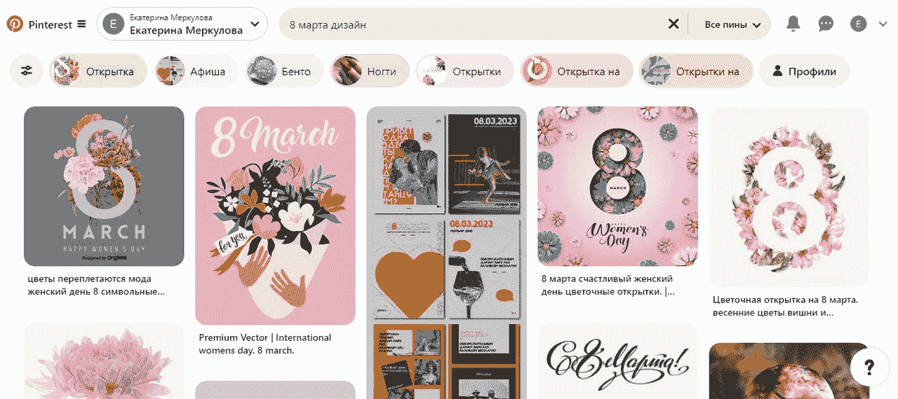

1.  选择一些你喜欢或给你带来灵感的设计。

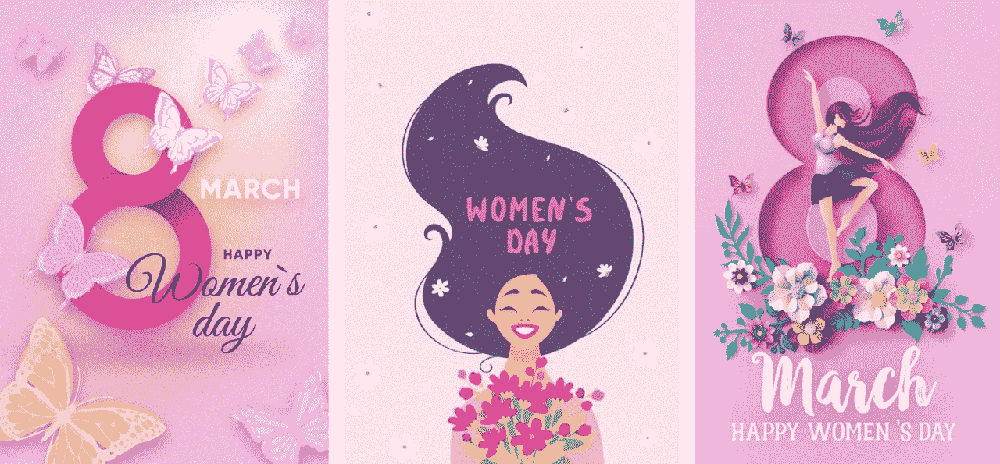

使用 Midjourney 创建设计

1.  使用 /describe 命令也就是图生文来描述图像并获取现成的提示。

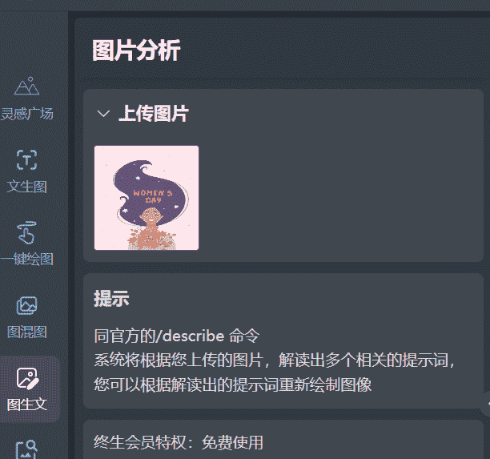

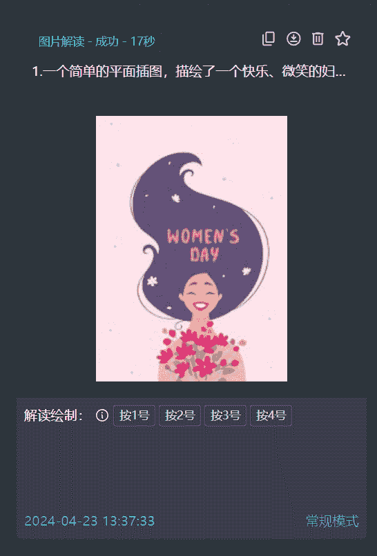

1.  整合提炼提示词：上传图片得到四组关键词，把不合适的关键词去掉，可以的关键词就保留原样。

关键词：一个简单的平面插图，描绘了一个快乐、微笑的妇女在妇女节，一个大头发的美女手里拿着一束鲜花，粉红色背景上的文字“妇女节”，呈大头发和花束的风格，矢量插图，平面设计，没有阴影或细节，极简主义设计

A simple graphic illustration depicting a happy and smiling woman on Women's Day, with a beautiful woman with big hair holding a bouquet of flowers. The text on a pink background reads "Women's Day" in the style of big hair and bouquets. Vector illustration, graphic design, no shadows or details, minimalist design --ar 9:16 --niji 6

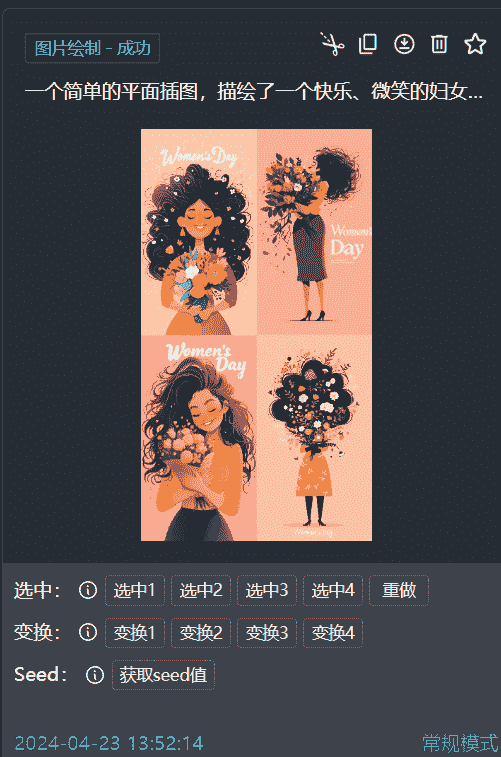

有喜欢的图就算已经快完成了，点U放大一张

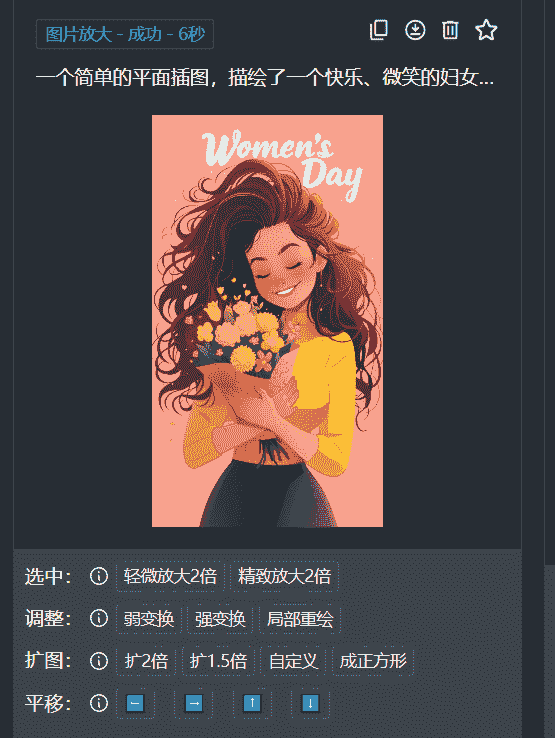

1.  如果对一些细节不满意，点击“Vary Region”按钮，然后在图像上选择要修改的区域，在提示中输入修改的文本。

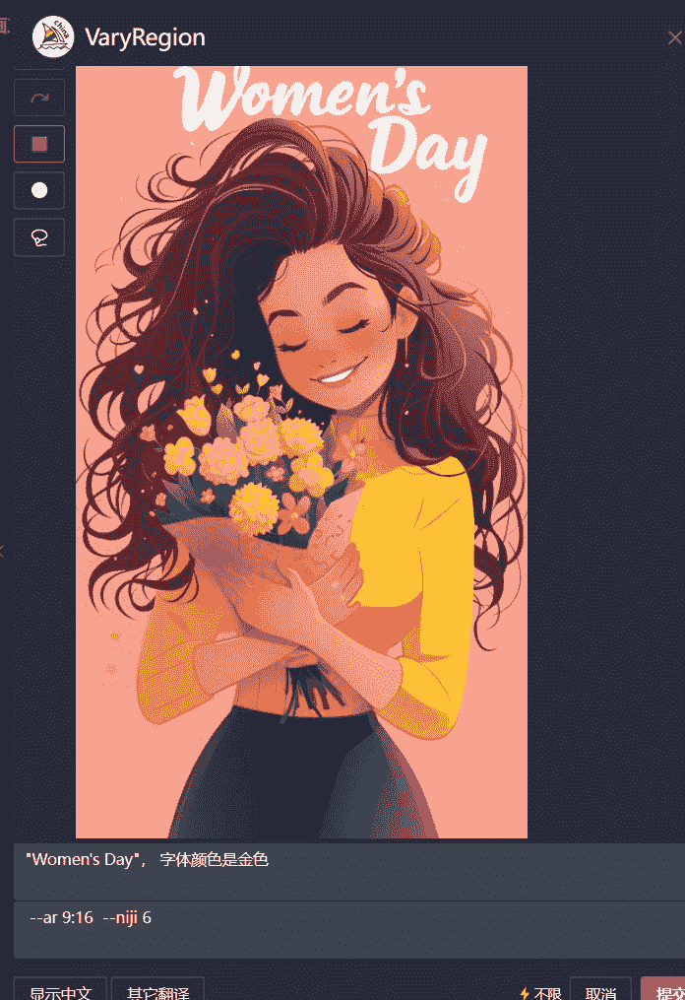

瞬间完成！贺卡就准备好了。

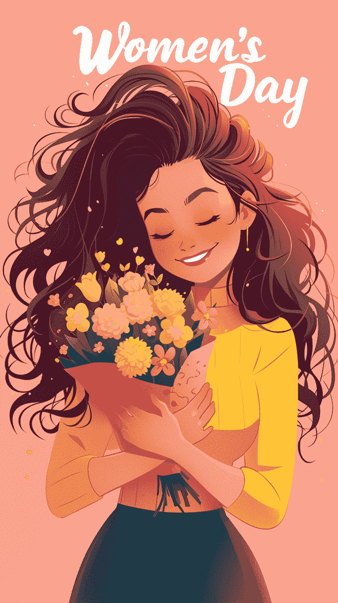

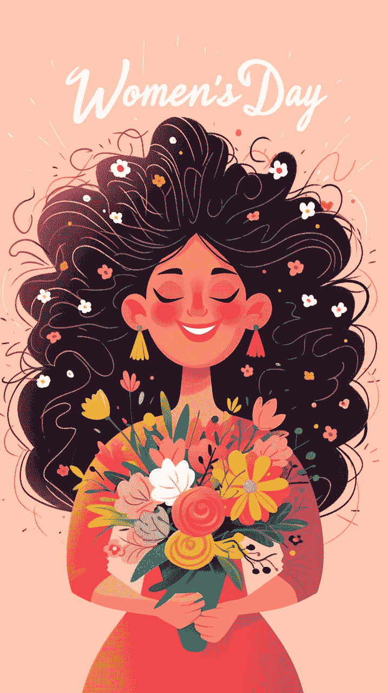

如果需要用中文输入文本，但 Midjourney 的机器人不支持中文，该怎么办？

1.  首先需要删除图片上的文本。可以用绘画工具中的魔法抹除功能

1.  上传图片，点击笔刷选择需要删除的文本

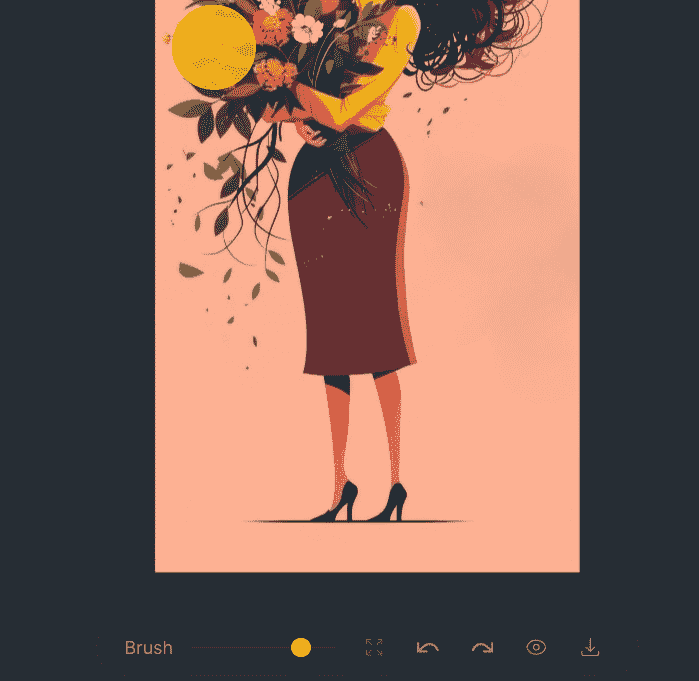

1.  删除文本后保存图片。

1.  打开任何图形编辑器，例如 Figma 或 Canva，PS，手机上就用美图秀秀，醒图等。

1.  使用文本工具添加与3月8日相关的祝贺词或引语。尝试不同的字体和排版，以确保文本与整体设计和谐地融合。

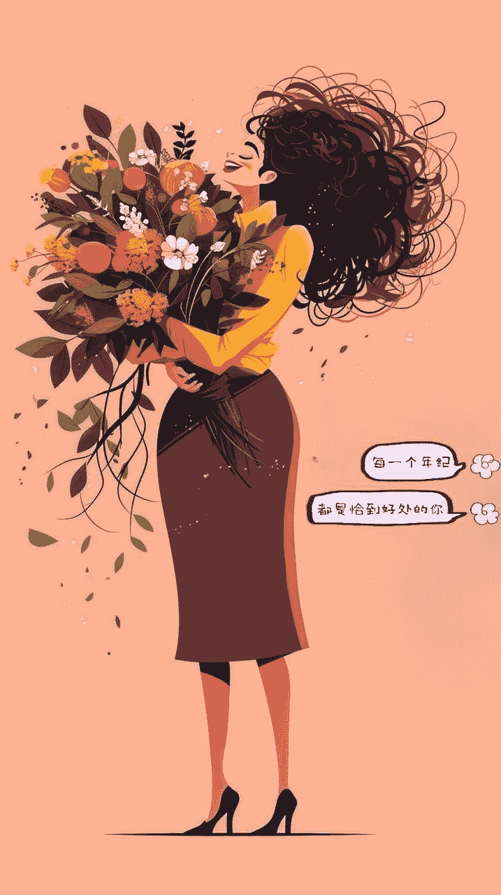

按照这些简单的指南，您将能够独立为任何场合制作贺卡。