# 如何使用MJ的新功能：风格一致？

> 来源：[https://my.feishu.cn/docx/BKgCduJWnoeG9xxEZayctsMunGb](https://my.feishu.cn/docx/BKgCduJWnoeG9xxEZayctsMunGb)

风格一致是一个功能，允许您在请求中引入作为风格样本的图片。这意味着在创建新图像时，您可以指定一个或多个图像，其风格将在生成过程中被考虑。

首先，您需要在 风格一致性这个地方直接点击+上传图片。

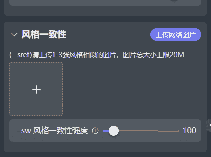

在文本输入框中写上您想要创建的描述。

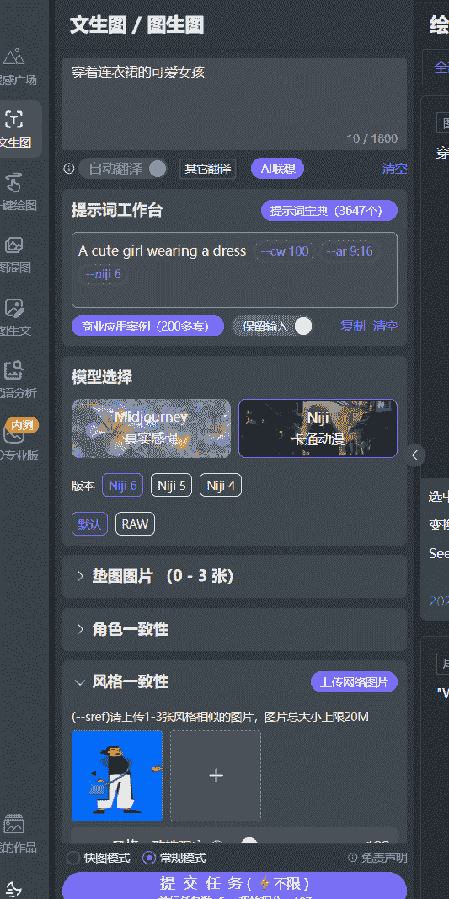

当您在 Midjourney 中使用 风格一致时，Midjourney 不会复制原图像的每一个细节。相反，它借鉴整体氛围或情绪，也就是说可以通过参考图设定最终图像的总体基调或风格方向。

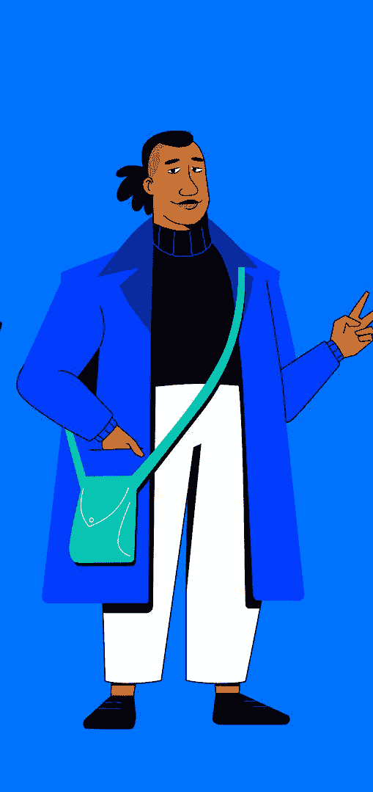

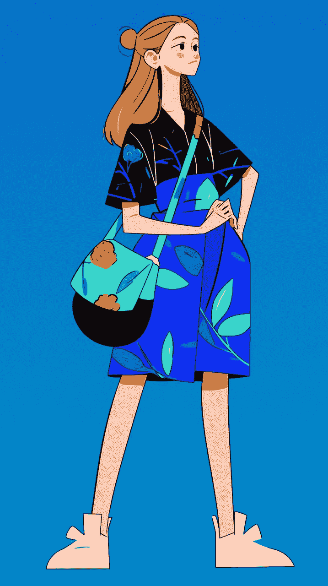

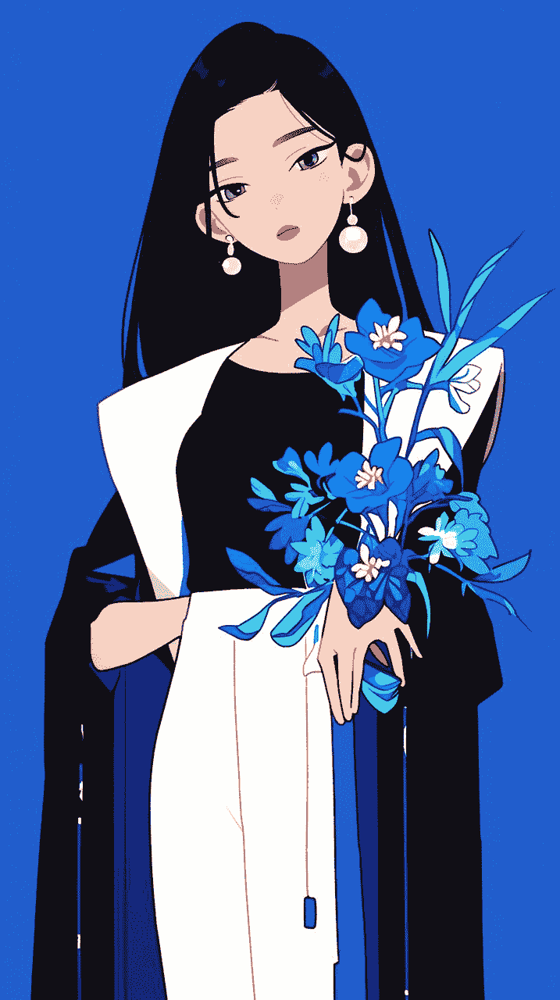

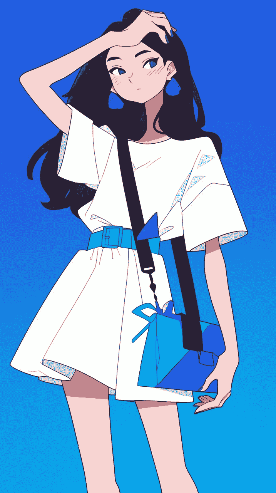

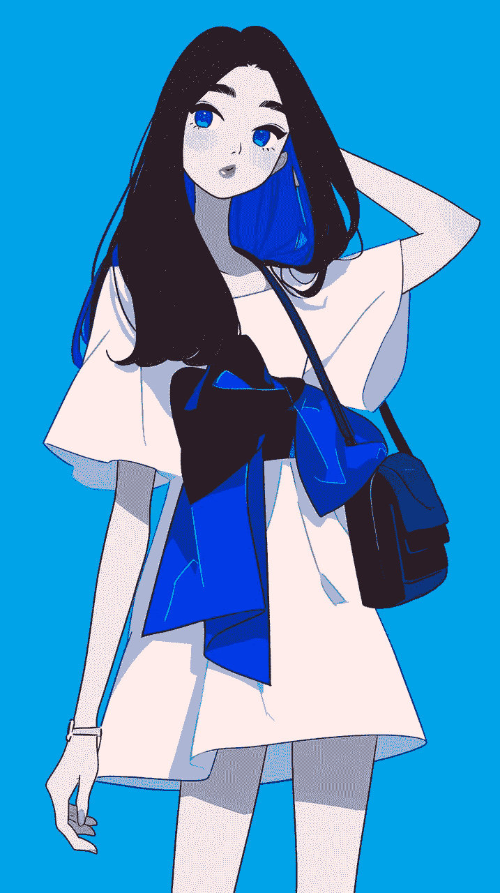

您还可以使用多个图像作为风格参考，只需要在风格一致性这里上传多个图像。

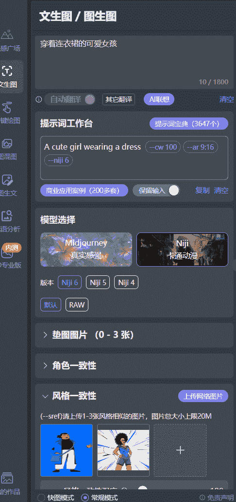

还可以使用 --sw（风格权重）参数精确调整您选择的风格对生成图像的影响程度。这个参数范围是从 0 到 1000 ，可以通过这个值操纵风格元素对最终图像的影响程度。

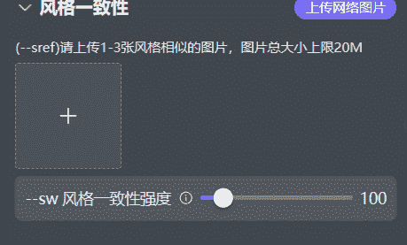

> --sw 100 表示正常的、标准的风格影响级别。如果您没有明确指定 --sw 参数，将应用这一基本设置。

> 设置 --sw 0 实际上会关闭您选择作为样本的风格的影响。这意味着在生成图像的过程中不会考虑风格特征。

> 设置 --sw 1000 允许达到风格对图像的最大影响。

如果您希望更精确地控制每个风格样本对最终结果的影响，您可以通过在每个 URL 后添加双冒号和数字来添加样式权重。您指定的数字将表示影响力：数字越大，相应风格的影响就越明显。

/imagine prompt: A cute girl wearing a dress --sref

https://s.mj.run/1CWkD529Cr::2 https://s.mj.run/Tf2Ey-mvwB0::3 --ar 9:16 --niji 6

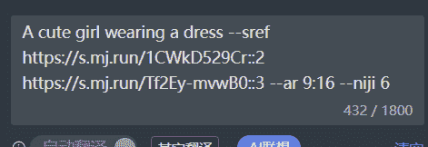

图片链接可以直接复制前面生成的链接，注意格式：不要<> ,链接之间要空格，双冒号格式要正确。如果显示链接无效就说明链接格式不对！！！

案例：

参考图：

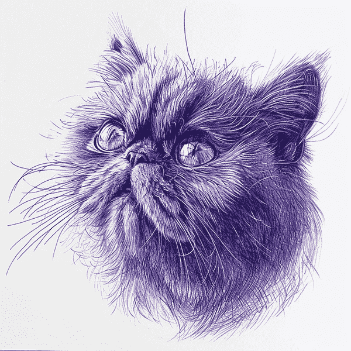

**Prompt: a cat                               **                           a cat --sref https://url.com/CatSketch.png

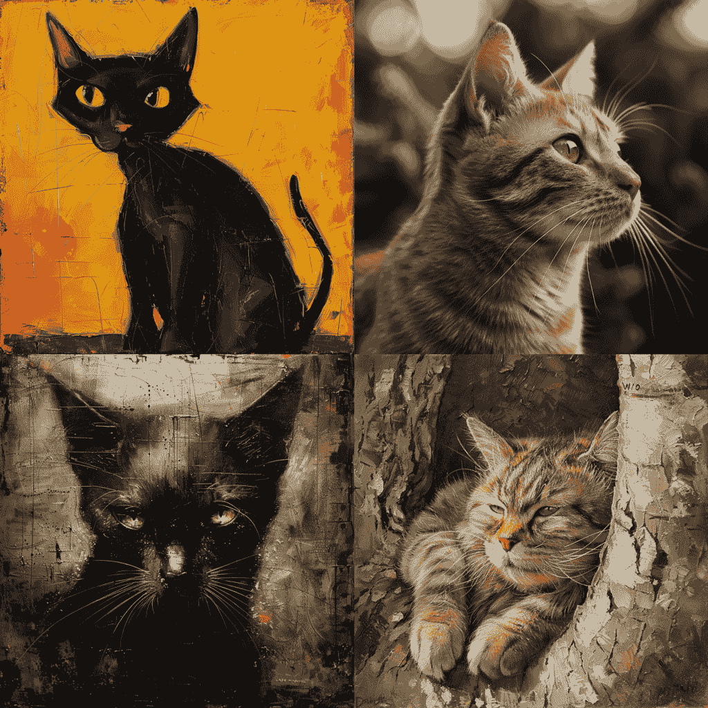

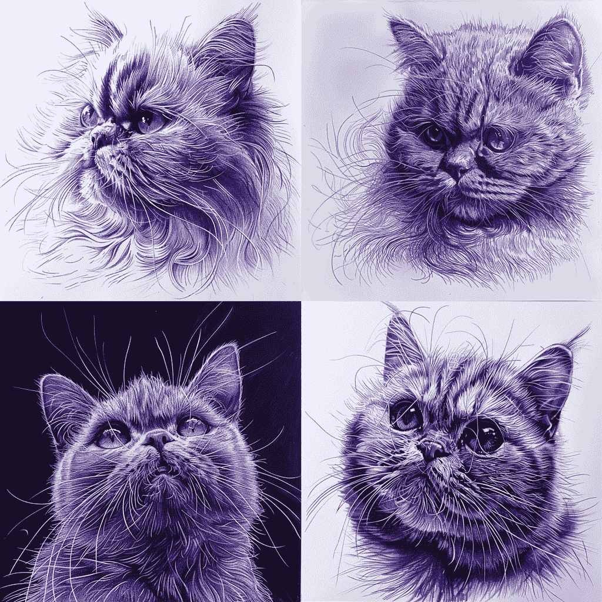