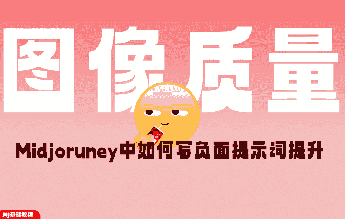

# 如何运用--No参数提升Midjoruney出图质量

> 来源：[https://my.feishu.cn/docx/ZYa2dUrAMo3dkpxVSVUcrGaNnse](https://my.feishu.cn/docx/ZYa2dUrAMo3dkpxVSVUcrGaNnse)

Midjourney 中的负面提示是向神经网络发出的指令，即某些元素或特征不应出现在生成的图像中。

**在 Mi**djourney 中使用否定提示的一种方法是使用--no选项，后跟要排除的组件的名称。

**--nougly**：排除可能使图像缺乏吸引力的元素。

**--no tiling：**防止纹理中可能出现的重复图案。

--no disfigured：避免图像扭曲，使物体看起来不规则或扭曲。

**--no deformed：**防止形状或物体变形。

--no low quality：提高图像清晰度和细节。

**--no Pixelated：**去除明显的像素以使图像更平滑。

**--no blurry：**提高图像焦点和清晰度。

**--no grains：**减少图像中可见的颗粒或噪点。

**--nograiny**：同上，目的是减少噪音。

**--no text：**从图像中排除不需要的文本。

**--no watermark:**删除任何水印提示。

**--no signature：**防止出现随机签名。

--no out of frame：所有重要元素都在框架内。

--no disproportioned：注重正确的比例。

--no bad proportions：专注于正确的比例。

--no gross proportions：避免特别令人讨厌的比例扭曲。

--no bad anatomy：提高解剖图像的准确性。

--no body out of frame：确保物体的主体完全在框架内。

**--no duplicate：**避免重复元素。

**--nocropped**：完整显示对象而不裁剪边缘。

**--no cut off：**消除不必要的元素剪切。

**--no draft:**避免未完成或粗糙的外观。

--no extra hands: 去除不必要的多余肢体。

--no extra arms: 与上面的手臂相同。

--no extra legs: 消除多余的腿。

--no extra fingers:防止出现多余的手指。

--no extra limbs:去掉任何不需要的肢体。

**--no long neck:**纠正不自然的长脖子。

**--no mutation:**防止突变扭曲。

**--no mutilated：**消除损坏或残缺的身体部位。

--no mutated hands: 消除手部异常变化。

--no poorly drawn face: 提高脸部绘制的质量。

--no poorly drawn feet: 提高脚绘图的质量。

--no poorly drawn hands:：改进绘手的质量。

--no missing hands: ：防止出现缺手。

--no missing arms: 防止出现缺失的手臂。

--no missing legs:防止出现缺腿。

--no missing fingers:防止出现缺失手指。

--no unnatural pose: 调整姿势使它们看起来更自然。

--no low resolution:提高图像分辨率。

**--no morbid:**避免黑暗或病态的动机。

--no blank background:向空白背景添加细节。

--no boring background：丰富背景以增加兴趣。

--no saturated: 调整颜色饱和度以避免颜色过多。

--no unrealistic shadows: 纠正阴影以匹配光源和视角。

--no conflicting styles:协调图像中的样式以实现视觉一致性。

注意，一次里面最多出现3个No的参数，太多了可能会不起作用！