# Midjourney35种艺术风格和动作

> 来源：[https://my.feishu.cn/docx/WHODdxJr8ouqH2xVS4ocLZ4Ansc](https://my.feishu.cn/docx/WHODdxJr8ouqH2xVS4ocLZ4Ansc)

+   **概念艺术**——一种艺术运动，其中作品的想法或概念比其视觉执行更重要。

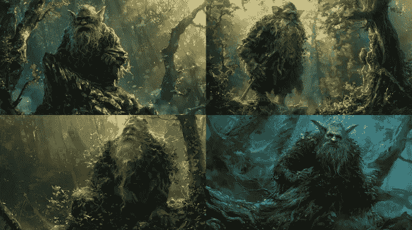

/想象提示：森林矮人，观念艺术--v 6.0 --ar 16:9

+   **超现实主义：**一种艺术和文学运动，旨在通过梦幻或奇异的图像探索潜意识。

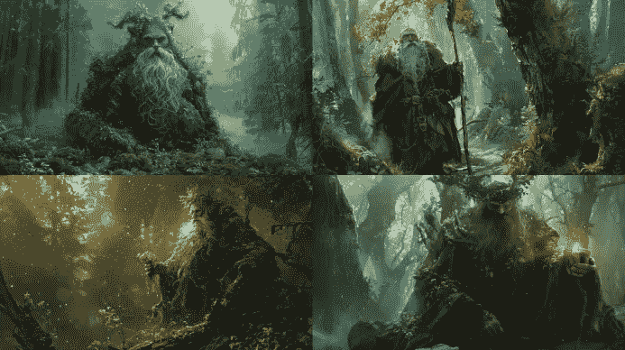

/想象提示：森林矮人，超现实主义--v 6.0 --ar 16:9

+   **史前艺术**人类创造的早期艺术形式，包括洞穴绘画和雕塑。

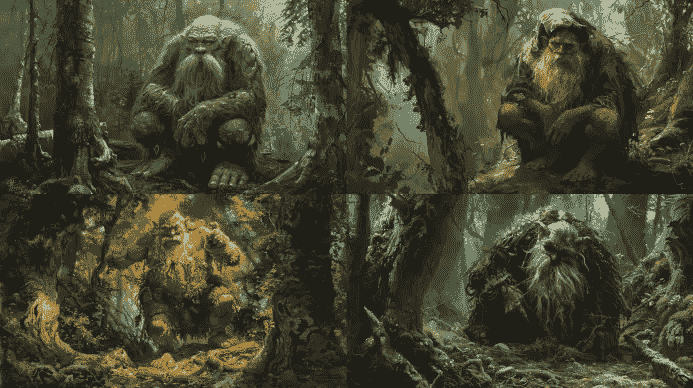

/想象提示：森林矮人，史前艺术--v 6.0 --ar 16:9

+   **波普艺术**——兴起于 20 世纪 50 年代和 60 年代的运动，其特点是使用明亮的色彩、大胆的造型以及对流行文化元素的描绘。

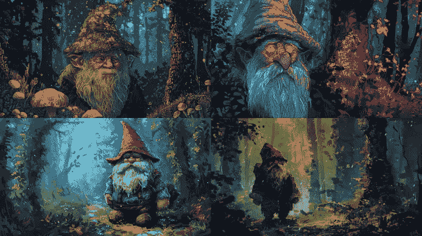

/想象提示：森林矮人，波普艺术--v 6.0 --ar 16:9

+   **街头艺术**一场艺术运动，涵盖涂鸦、壁画和装置等各种形式的公共艺术，艺术家包括班克斯 (Banksy) 和基思·哈林 (Keith Haring)。

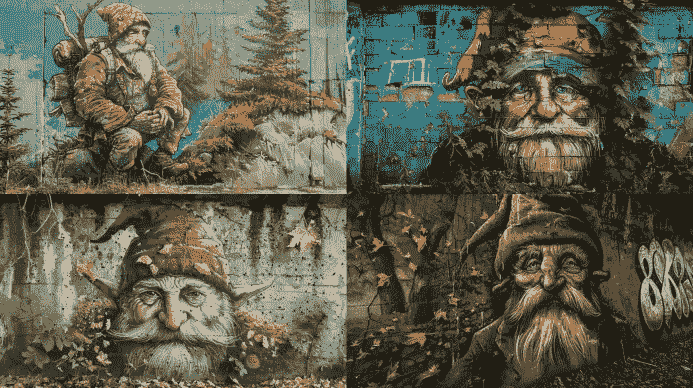

/想象提示：森林矮人，街头艺术--v 6.0 --ar 16:9

+   **野兽派**一场短暂的运动，以明亮、饱和的色彩和富有表现力的绘画为特征，艺术家包括亨利·马蒂斯和安德烈·德兰。

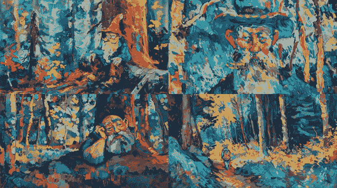

/想象提示：森林矮人，野兽派--v 6.0 --ar 16:9

+   **抽象表现主义**第二次世界大战后的一场运动，专注于抽象和非具象主义，艺术家包括杰克逊·波洛克和马克·罗斯科。

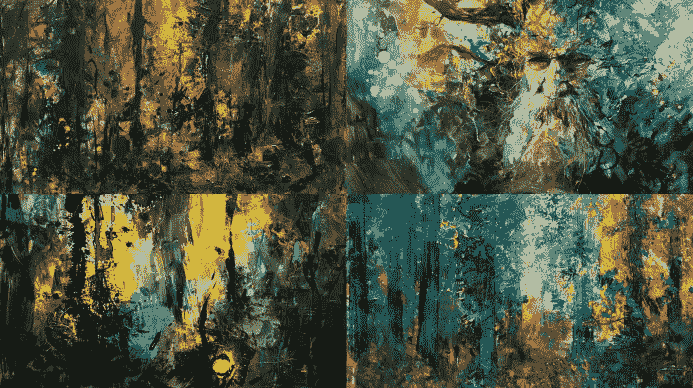

/imagine 提示：森林矮人，抽象表现主义 --v 6.0 --ar 16 : 9

+   **新表现主义**20 世纪末出现的一场运动，其特点是回归具象绘画和富有表现力的笔触笔触，艺术家包括让-米歇尔·巴斯奎特 (Jean-Michel Basquiat) 和朱利安·施纳贝尔 (Julian Schnabel)。

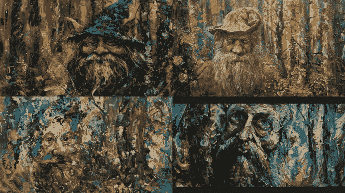

/想象提示：森林矮人，新表现主义--v 6.0 --ar 16:9

+   **摘要**——一种不试图描绘现实，而是利用颜色、形状和纹理来创造独特视觉体验的艺术风格。

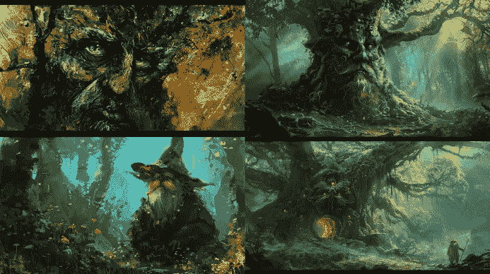

/imagine 提示：森林矮人，摘要--v 6.0 --ar 16 : 9

+   **怀旧**——一种体现对过去的渴望并使用复古元素的运动。

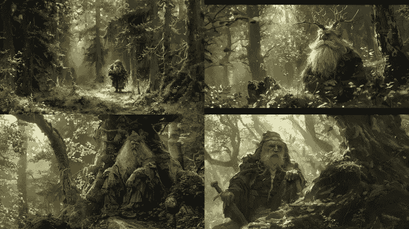

/想象提示：森林矮人，怀旧--v 6.0 --ar 16:9

+   **质朴**受乡村生活和自然启发的艺术。

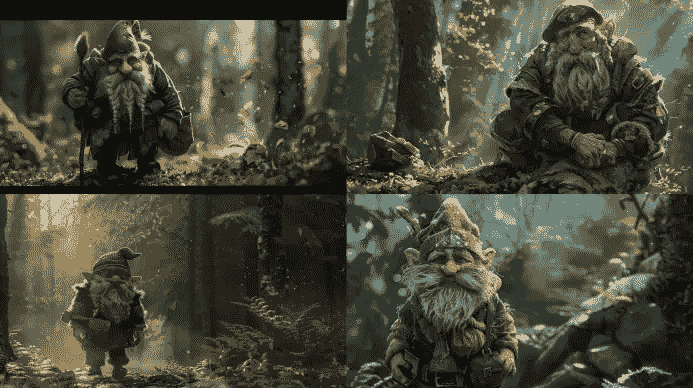

/想象提示：森林矮人，质朴--v 6.0 --ar 16:9

+   **空灵**一种以轻盈和通风为特征的风格。

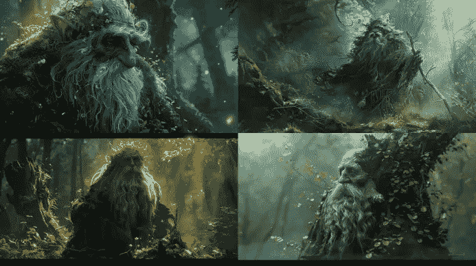

/想象提示：森林矮人，空灵--v 6.0 --ar 16:9

+   **浪漫主义**艺术注重情感和个人主义。

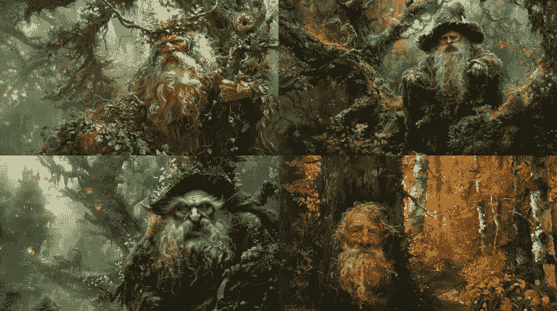

/想象提示：森林矮人，浪漫主义--v 6.0 --ar 16:9

+   **文艺复兴时期**——文艺复兴时期人们对艺术、科学和文学的兴趣复兴。

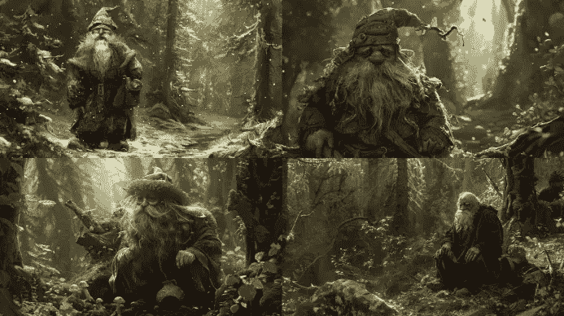

/想象提示：森林矮人，文艺复兴--v 6.0 --ar 16:9

+   **幻想**文学或电影中存在魔法和奇异生物的地方。

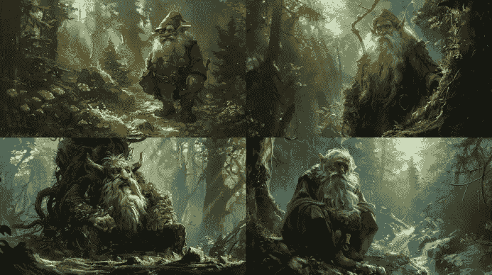

/想象提示：森林矮人，幻想--v 6.0 --ar 16:9

+   **后现代主义**——拒绝现代主义理想、支持讽刺和自我反思的运动。

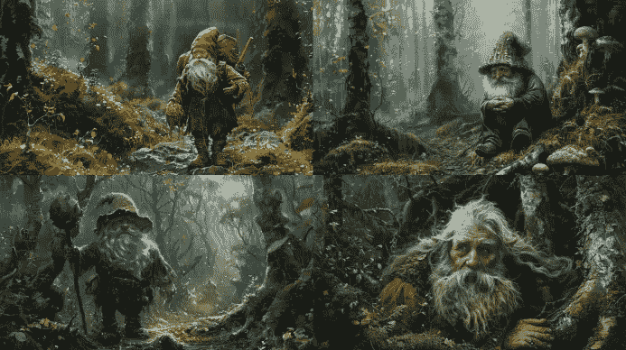

/想象提示：森林矮人，后现代主义--v 6.0 --ar 16:9

+   **现代主义**19 世纪和 20 世纪变革时代出现的创新哲学和艺术。

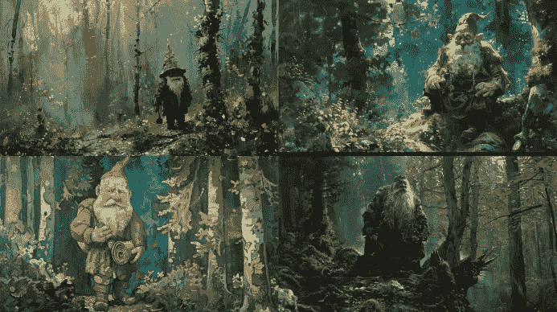

/想象提示：森林矮人，现代主义--v 6.0 --ar 16:9

+   **低俗艺术**结合流行文化、超现实主义和漫画的艺术运动。

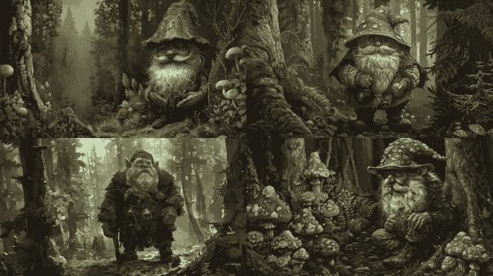

/想象提示：森林矮人，低俗艺术--v 6.0 --ar 16:9

+   **巴洛克**——一个以戏剧性、丰富的色彩和细节为特征的时代。

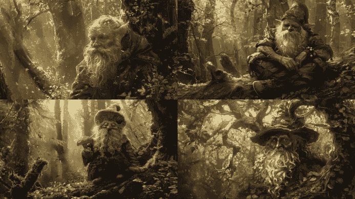

/想象提示：森林矮人，巴洛克风格--v 6.0 --ar 16:9

+   **新古典主义**受古代古典理想启发的艺术。

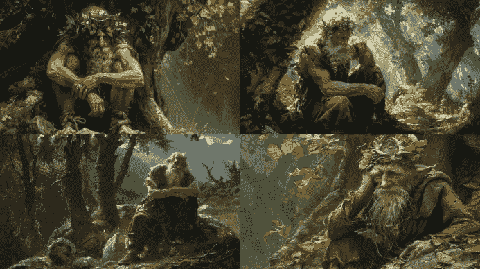

/想象提示：森林矮人，新古典主义--v 6.0 --ar 16:9

+   **立体主义**一种具有碎片化和几何改变形状的艺术运动。

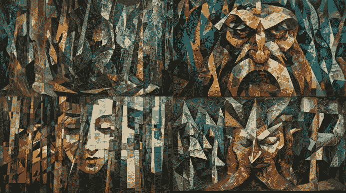

/想象提示：森林矮人，立体派--v 6.0 --ar 16:9

+   **古埃及壁画**反映古埃及文化和宗教的艺术。

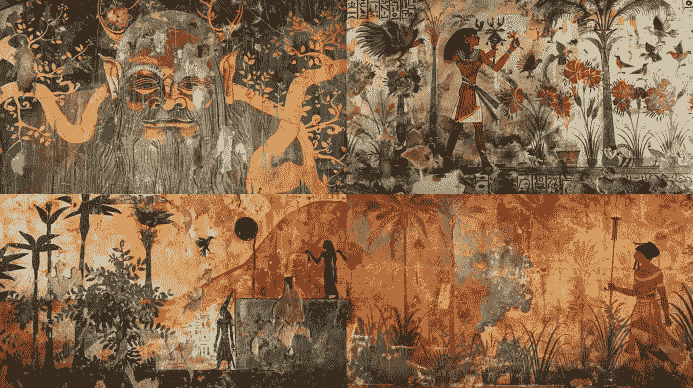

/想象提示：森林矮人，古埃及壁画--v 6.0 --ar 16:9

+   **极简主义**——基于形式和材料的简单性的艺术。

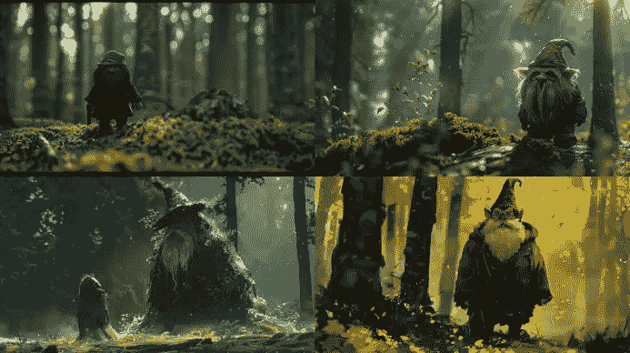

/想象提示：森林矮人，极简主义--v 6.0 --ar 16:9

+   **赛博朋克**一种科幻小说类型，重点关注先进技术与社会规范崩溃共存的反乌托邦未来。

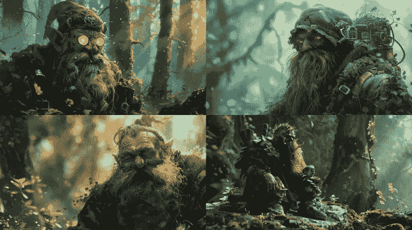

/想象提示：森林矮人，赛博朋克--v 6.0 --ar 16:9

+   **超现实主义**一种绘画或雕塑流派，旨在尽可能准确地再现现实。

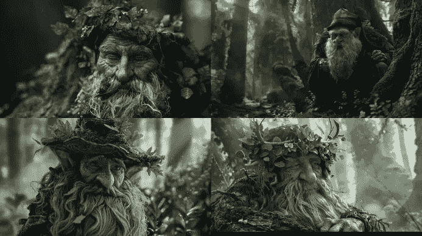

/想象提示：森林矮人，超现实主义--v 6.0 --ar 16:9

+   **照片写实主义**一种专注于创作看起来像照片的高度详细的绘画的风格。

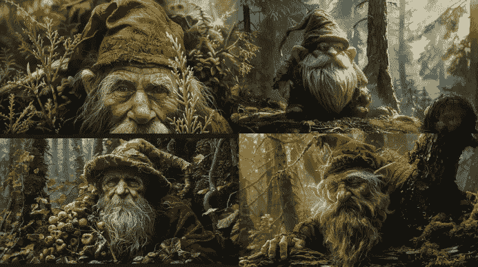

/想象提示：森林矮人，真实感--v 6.0 --ar 16:9

+   **表现主义**一种强调所描绘事物的情感和心理方面的艺术运动，通常使用明亮的色彩和扭曲的形式。

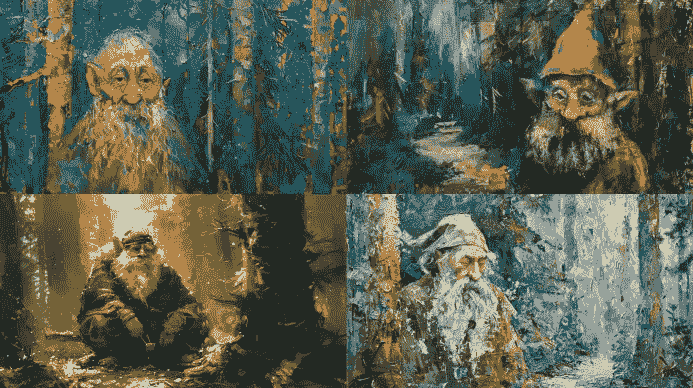

/想象提示：森林矮人，表现主义--v 6.0 --ar 16:9

+   **后印象派**从印象派发展而来的艺术运动，融合了新的技术和风格。

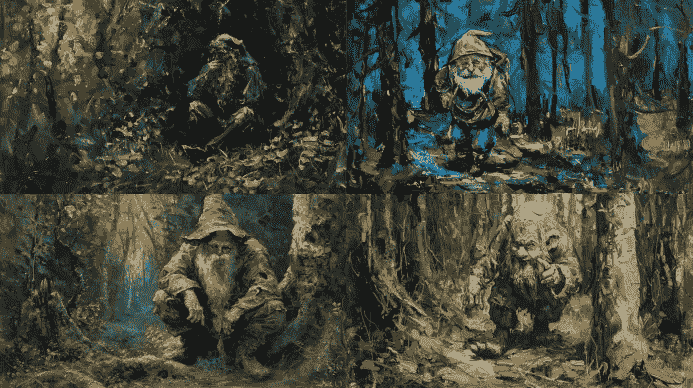

/想象提示：森林矮人，后印象派--v 6.0 --ar 16:9

+   **印象派**一种 19 世纪的艺术运动，其特点是使用可见的笔触、光线和色彩来捕捉场景的本质。

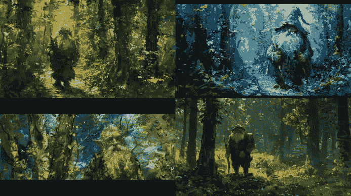

/想象提示：森林矮人，印象派--v 6.0 --ar 16:9

+   **洛可可**一种 18 世纪风格，以其华丽的装饰、柔和的色彩和俏皮的主题而闻名。

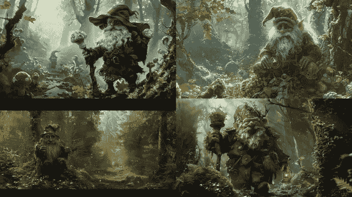

/想象提示：森林矮人，洛可可--v 6.0 --ar 16:9

+   **达达主义**——一种拒绝传统艺术惯例并宣扬荒诞的艺术运动。

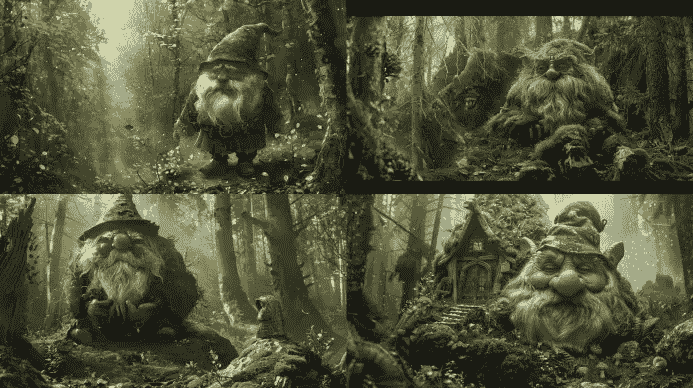

/想象提示：森林矮人，达达--v 6.0 --ar 16:9

+   **非物质**-一种以强调无形或抽象概念为特征的风格，通常使用最少或短暂的材料。

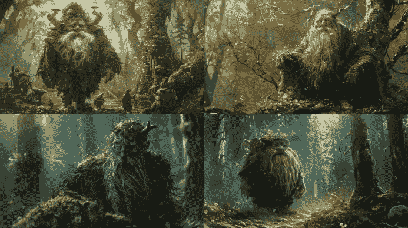

/想象提示：森林矮人，无形--v 6.0 --ar 16:9

+   **梦幻**——一种以超现实或空灵品质为特征的风格，通常受到梦想或潜意识的启发。

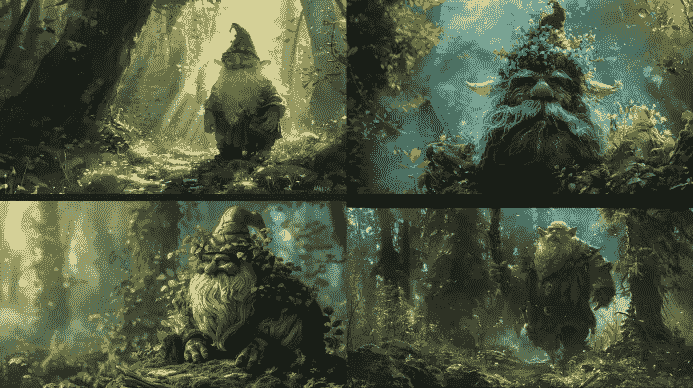

/想象提示：森林矮人，梦幻--v 6.0 --ar 16:9

+   **象征主义**——一种使用符号和隐喻来表达情感或精神主题的艺术运动。

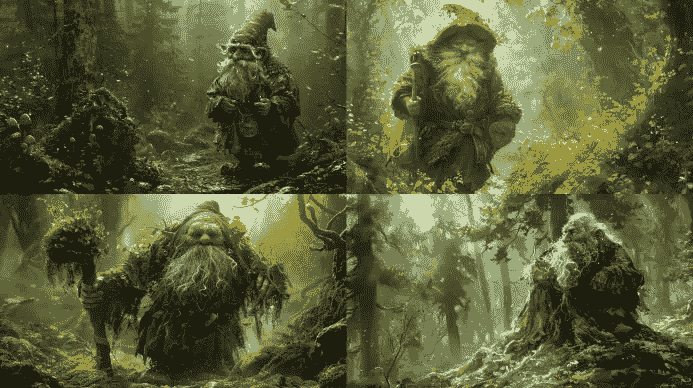

/想象提示：森林矮人，象征主义--v 6.0 --ar 16:9

+   **超凡脱俗**——一种以与另一个世界或维度的关系感为特征的风格。

/想象提示：森林矮人，超凡脱俗--v 6.0 --ar 16:9