# 30 多个具有独特艺术技巧的中途提示

> 来源：[https://my.feishu.cn/docx/G5uKdkqf2oEv2uxbimycqxTYncc](https://my.feishu.cn/docx/G5uKdkqf2oEv2uxbimycqxTYncc)

您准备好将您的 AI 创作提升到新的水平了吗？

在本文中，我将分享 30 种技巧，帮助您创建非凡的提示。了解如何使用关键词、特定风格、情感等将您的想法转化为数字艺术作品。

以下是一些提示：

1.  **请明确点**。不要只写“风景”。详细描述您需要什么样的景观：“山地景观，清澈见底的湖泊和日落时深蓝色的天空。”

1.  **使用关键词**。使用能够唤起情感、质感和感觉的词语。例如，“一个穿着鲜艳红色连衣裙的女人在倾盆大雨中跳舞”。

1.  **尝试各种风格**。尝试使用不同的艺术风格，例如“印象派风格”、“赛博朋克风格”或“漫画风格”。

1.  **发挥视角**。改变图像的视角。您可以使用“第一人称视图”、“鸟瞰图”或“天顶视图”。

1.  **添加超现实元素**。在提示中加入意想不到的奇幻元素。例如，“一头大象飞过一座废墟城市”。

1.  **使用视觉参考**。寻找能够激发您灵感的图像，并用自己的语言描述您所看到的内容。

1.  **利用灯光发挥创意**。尝试不同类型的照明，例如“昏暗而神秘的光”、“明亮的阳光”或“霓虹灯”。

1.  **使用运动**。描述提示中创建动态图像的动作或动作。

1.  **简短明了**。简短而结构良好的提示比长而复杂的提示更有效。

1.  **修改和编辑**。不要对第一个结果感到满意。检查并编辑您的提示以获得最佳图像。

1.  **向别人学习**。观看其他用户使用的提示并从中学习。

1.  **分享您的创作**。在社交网络上分享您的图像并加入人工智能艺术家社区。

1.  **尝试不同的工具**。尝试不同的人工智能工具，找到最适合您风格的工具。

1.  **不放弃**。人工智能是一个强大的工具，但需要练习和耐心才能掌握它。

1.  **享受**。最重要的是享受创作过程，探索人工智能的无限可能。

我们将使用相同的提示来查看变化。只需在提示的开头包含艺术，后跟逗号即可。

让我们通过示例来看一下

> 魔女、成人、肌肉、漂亮、独特、细心、正义、情绪起伏迅速判断、现实

## 黑光漆Blacklight paint

# 浮雕Anaglyph

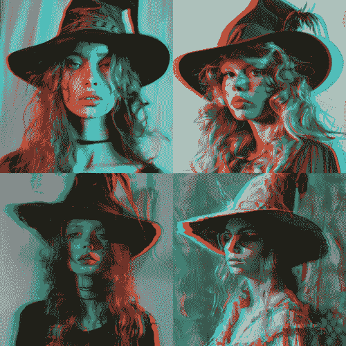

# 钩编Crocheted

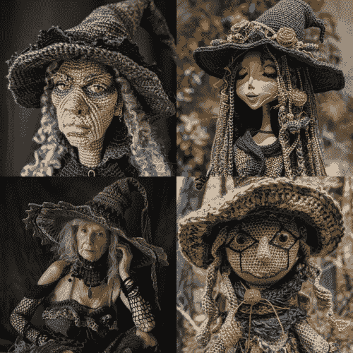

# 电磁Electromagnetic

# 双重接触Double exposure

# 熔融玻璃Fused glass

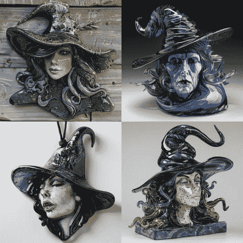

# 频谱图Spectrogram

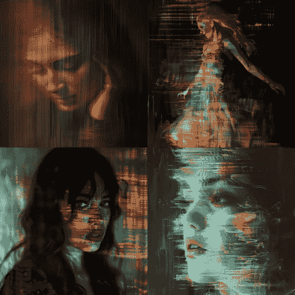

# 扎染Tie-dye

## 金箔Gold leafing

## 雏娃娃Hina doll

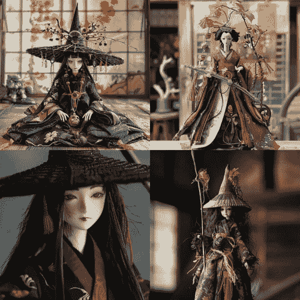

## 象牙雕刻Ivory carving

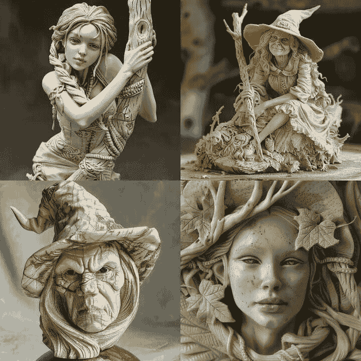

## 日本复古Japanese vintage

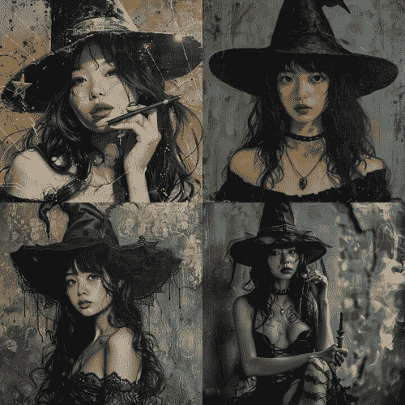

## 高调High key

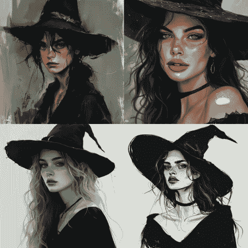

## 雾神Kirigami

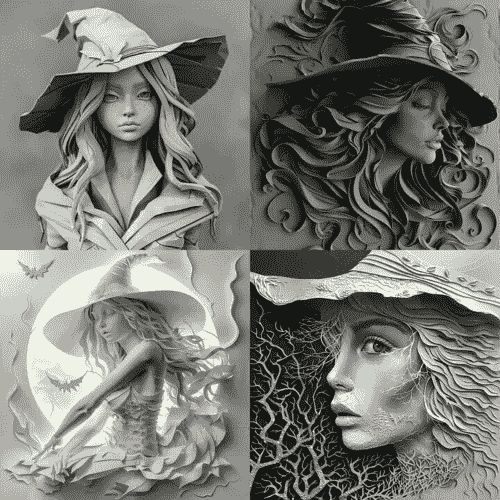

## 精简版英国艺术Lite Brite art

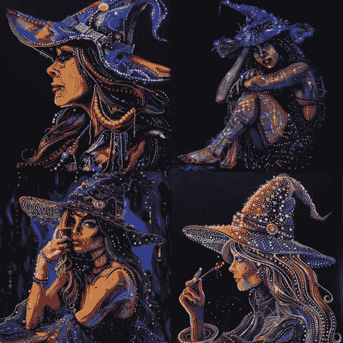

## 马赛克Mosaic

## 绗缝Quilted

## 转描动画Rotoscope animation

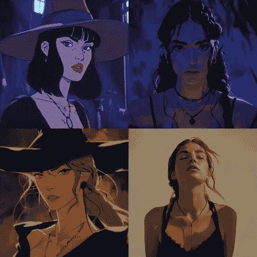

## 衍纸Paper quilling

## 卵石艺术Pebble art

## 折纸Origami

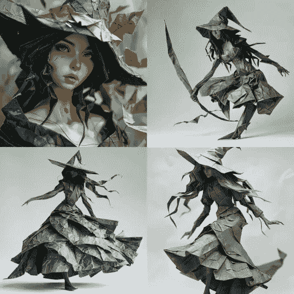

## 针尖Needlepoint

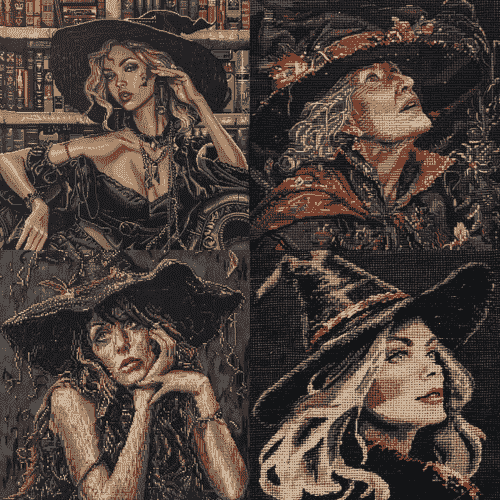

## 千花玻璃Millefiori glass

## 翠绿挂毯Verdure tapestry

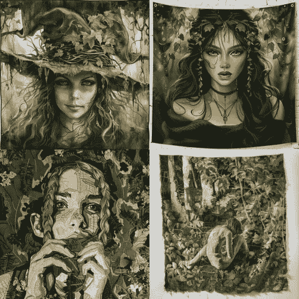

## 紫外线摄影Ultraviolet photography

## 用墨水笔水彩画轮廓Watercolor with ink pen outline

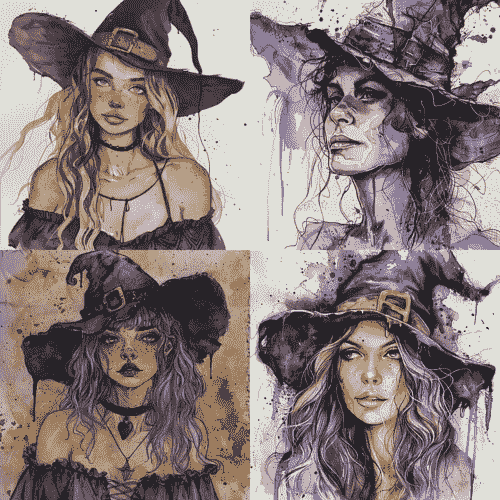

## 编织Weaving

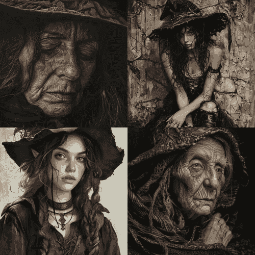

## 友禅Yuzen

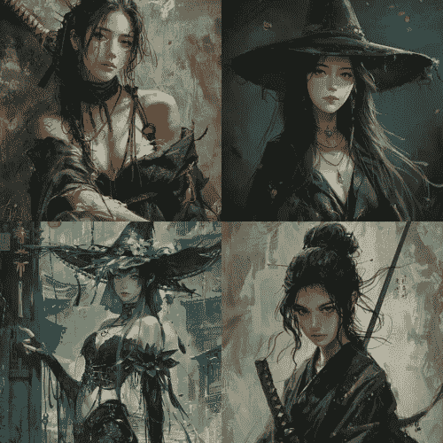

## 禅宗书法Zen calligraphy

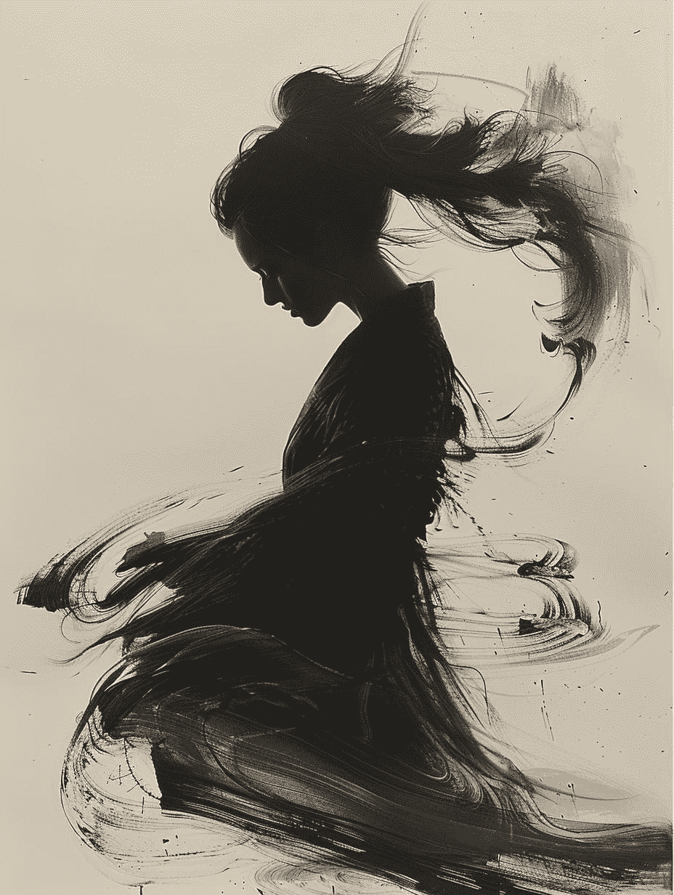

## 静电复印Xerography

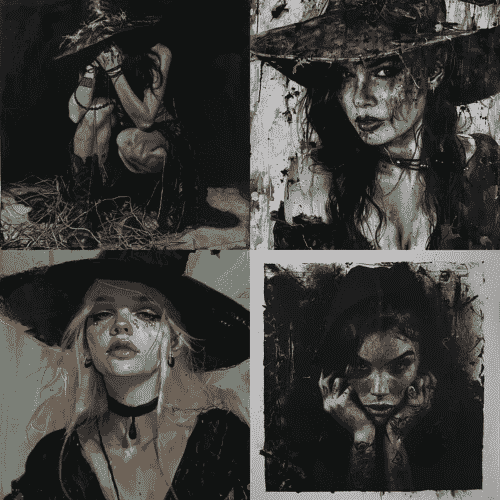

## 千花玻璃Millefiori glass

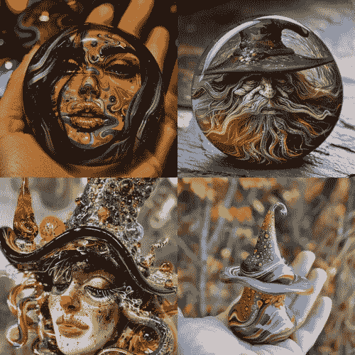

掌握这30个技巧，你也能成为提示大师！