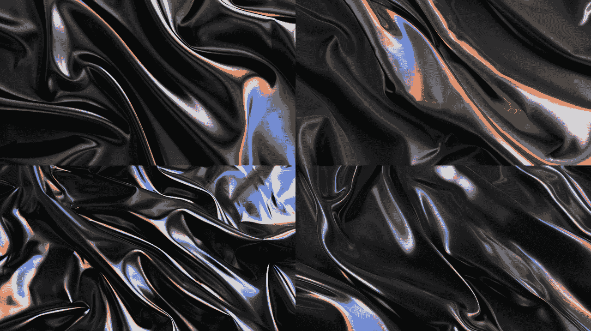
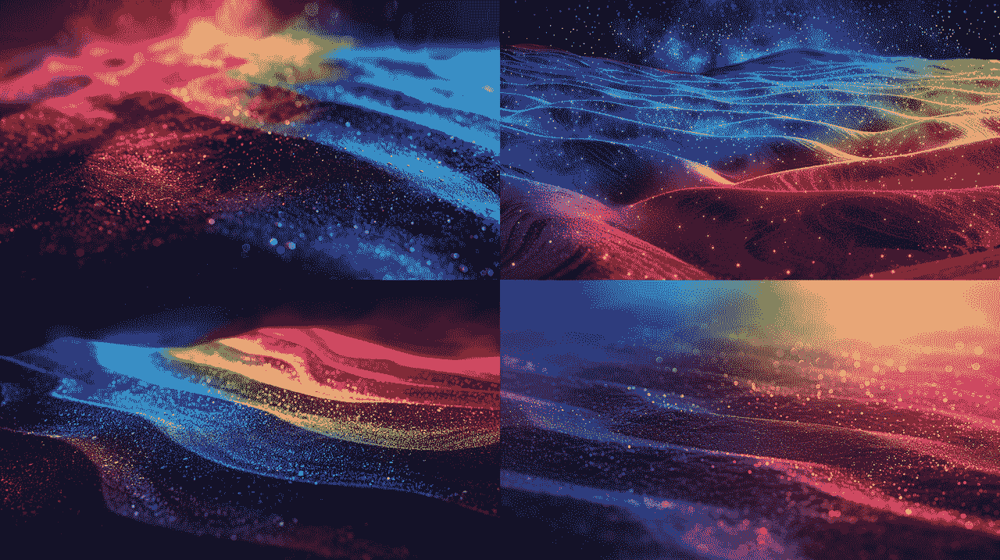
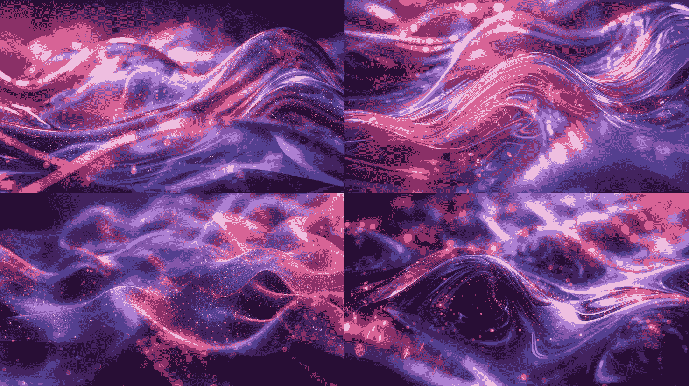
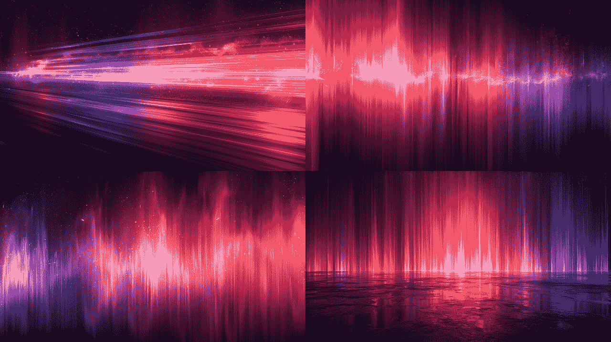
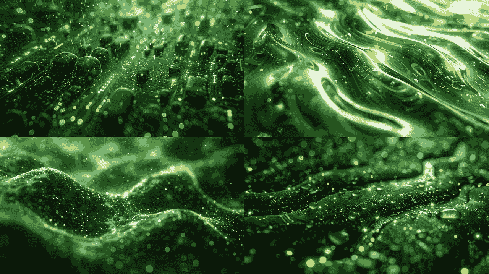
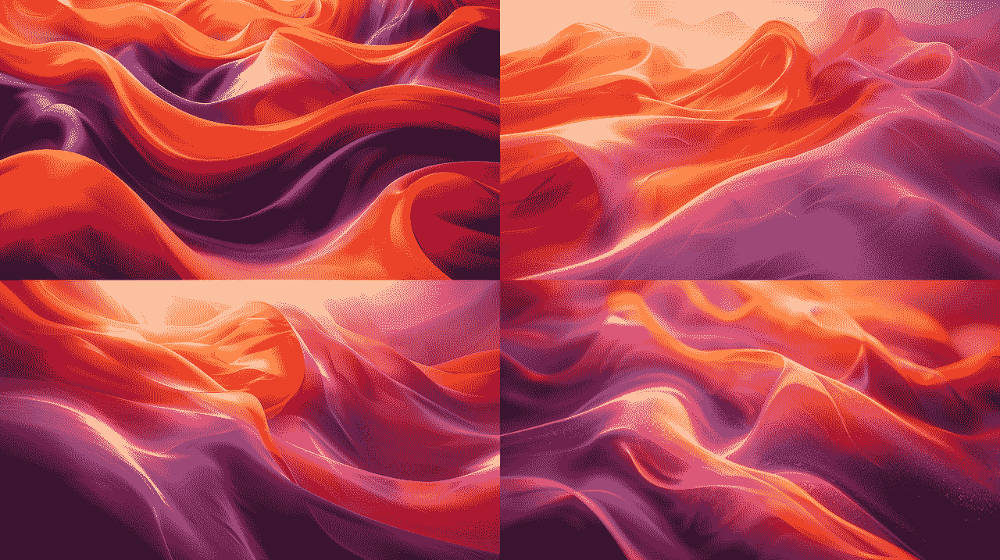
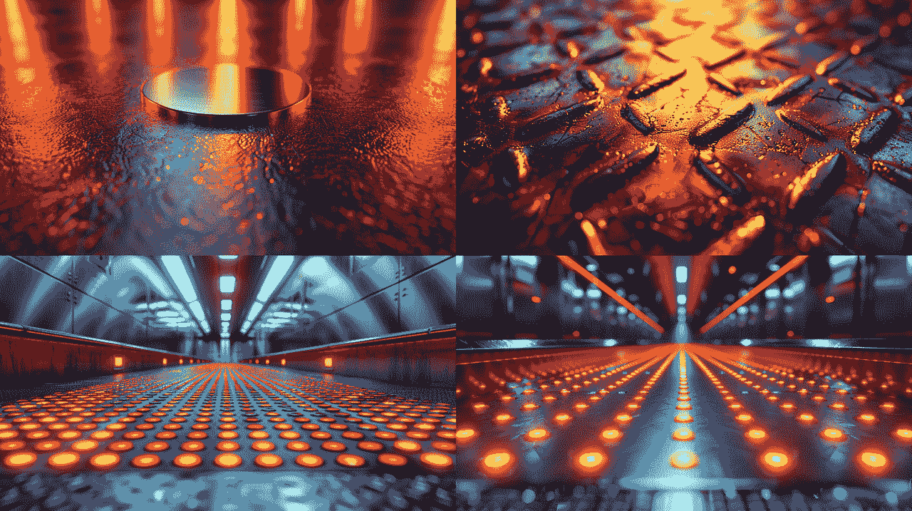
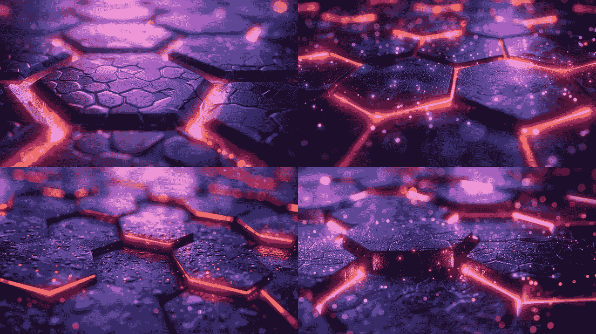
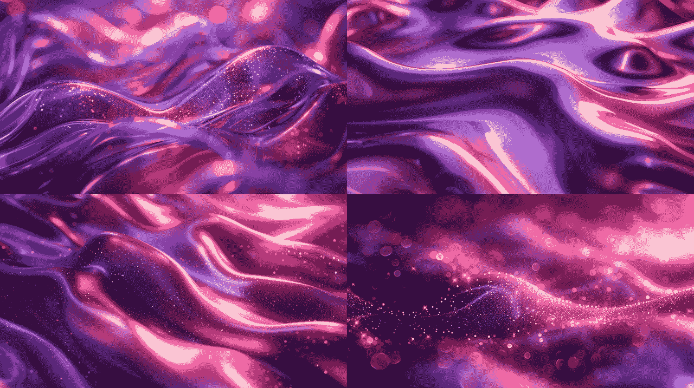
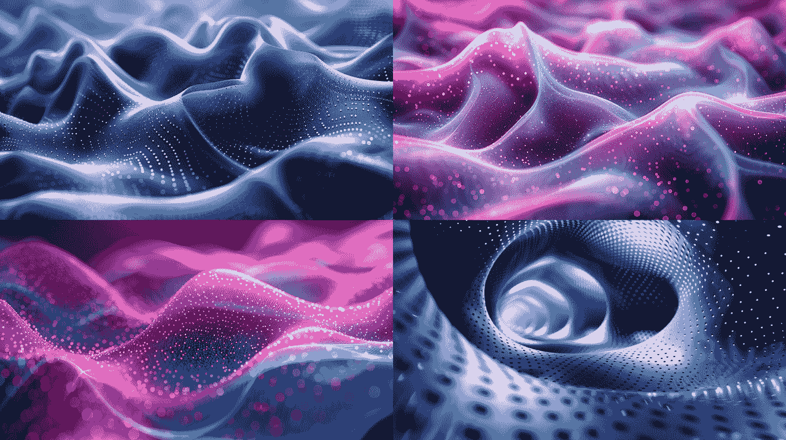

# 提示各种纹理

> 来源：[https://my.feishu.cn/docx/MOYodPVmPolF9txuNDtcniv9nVh](https://my.feishu.cn/docx/MOYodPVmPolF9txuNDtcniv9nVh)

1.深色和黑色丝绸的黑色 3D 渲染，以黑色抽象背景风格显示白色虹彩全息箔 --style raw

black 3d render of dark and black silk displaying white iridescent holographic foil in style of black abstract background --style raw

2.虹彩沙子背景抽象，黑暗场景，月光下，锐利和聚焦 --s 600 --w 25 -- ar 16:9

iridescent sand background abstract, dark scene, moonlit, sharp and focused --s 600 --w 25 --ar 16:9

3.抽象玻璃纳米碳纤维蓝色、紫色、对称精密8k分辨率、逼真照明、开放形式、透明半透明、焦点、暗色调 --ar 16:9 --s 750 --style raw

abstract glass nano carbon fiber blue, purple, symmetrical precision 8k resolution, realistic lighting, open form, transparent and translucent, focus, dark tonalities --ar 16:9 --s 750 --style raw

4.背景中的灯光条纹，紫色和紫色的生动色调，黑色，简约设计，高细节，8k 分辨率 --ar 16:9 --s 750 --style raw

lights streaks in the background, vivid tones of purple and violet, black, minimalistic design, high detail, 8k resolution --ar 16:9 --s 750 --style raw

5.网络机器失真，未来酸绿色液体抽象背景铬背光，特写 --ar 16:9 --s 1000 --w 40 --style raw

cyber machine distortion, futuristic acid green liquid abstract background chrome backlit, close up --ar 16:9 --s 1000 --w 40 --style raw

6.抽象，交叉的光弧，生动的橙色、黑色色调，背景是旋转的粉彩，丝滑光滑的表面，简约设计，高细节，8k 分辨率 --ar 16:9 --s 750

abstract, intersecting arcs of light, vivid tones of orange, black, on a backdrop of swirling pastels, silky and smooth surface, minimalistic design, high detail, 8k resolution --ar 16:9 --s 750

7.金属质感，明亮的霓虹橙色，未来派，金属合金，昏暗的灯光，宽敞的最小软阴影锐利焦点 --ar 16:9 --s 1000 --c 15 --style raw

metallic texture, bright neon orange, futuristic, metal alloy, dim lighting, spacious minimal soft shadows sharp focus --ar 16:9 --s 1000 --c 15 --style raw

8.未来六边形背景，生动的紫色和蓝色，浮动六边形，霓虹灯发光，反射表面，高对比度，高清晰度，干净锐利的焦点，商业摄影，超详细，8k，深度场，逼真，高度详细，超详细，复杂的细节 --ar 16:9 --s 750 --style raw

futuristic hexagonal background, vivid purple and blue colors, floating hexagons, neon glow, reflective surfaces, high contrast, high definition, clean sharp focus, commercial photography, ultra detailed, 8k, depth of field, photorealistic, highly detailed, super detailed, intricate details --ar 16:9 --s 750 --style raw

9.3d 纳米金属纤维背景，深色和紫色，透明和半透明，焦点，高细节，8k 分辨率 - -ar 16:9 --s 750 --style raw

3d nano metal fiber background, dark and violet, transparent and translucent, focus, high detail, 8k resolution --ar 16:9 --s 750 --style raw

10.点状抽象网格和图案、屡获殊荣的工作室摄影、专业色彩分级、柔和阴影、干净清晰的焦点、焦点堆叠、数码摄影、8k --ar 16:9 --原始风格

dotted abstract grids and patterns, award winning studio photography, professional color grading, soft shadows, clean sharp focus, focus stacking, digital photography, 8k --ar 16:9 --style raw

