# 13种中途拍摄方式

> 来源：[https://my.feishu.cn/docx/TbfrdUatDo4vrUx4GNVcAvsjn4c](https://my.feishu.cn/docx/TbfrdUatDo4vrUx4GNVcAvsjn4c)

今天我们将深入探讨拍摄的类型，即制定构图计划。构图中的平面概念是电影空间的条件划分系统。拍摄类型描述了拍摄对象在照片或场景中的显示方式，主要受相机与其距离的远近影响。此选择将帮助您更好地驾驭构图类型：中景、长景、特写。

提示：（图像类型） 一位年轻的俄罗斯女子 --ar 3:2

示例：一位年轻俄罗斯女性的特写镜头 --ar 3:2

#### 1.中景

这张照片展示了拍摄对象的胸部以上。

注意：中景的实际定义是从腰部到顶部的拍摄，但中景对其的解释有所不同。

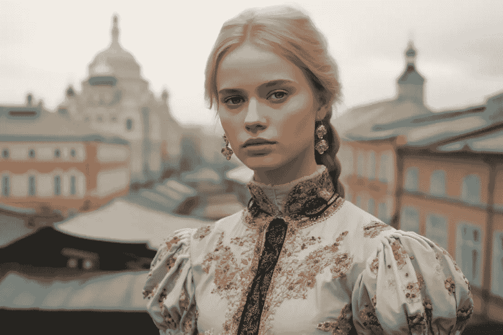

#### 2.特写镜头

在这张照片中，拍摄对象的焦距非常近。颈部以下的所有部分都被切除。

注意：添加更多细节和面部表情可以使照片看起来非常令人印象深刻。

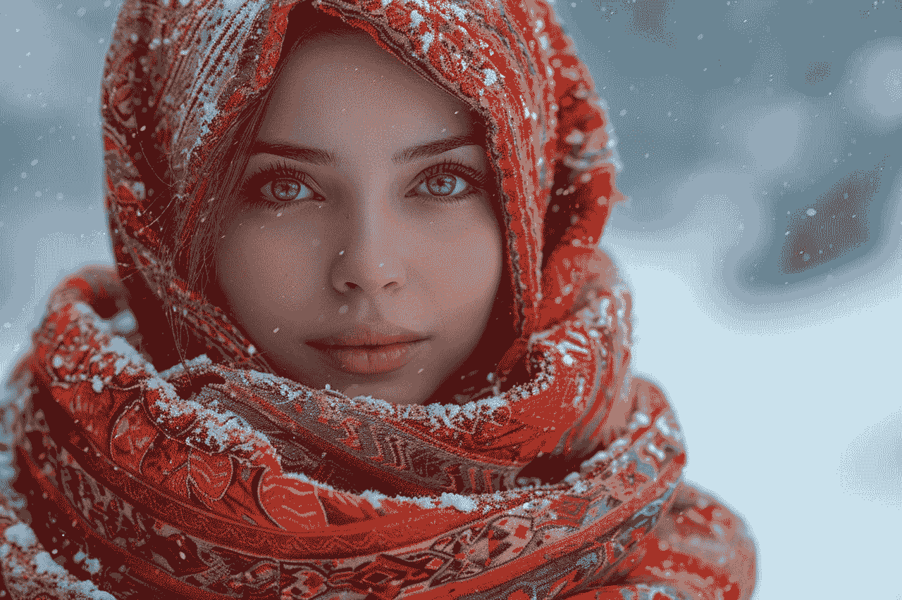

#### 3.极端特写镜头

这张照片将整个图像充满了主题，因此您只能看到被头发框住的脸部。

注意：这张照片不仅对人有用，对物体也有用。

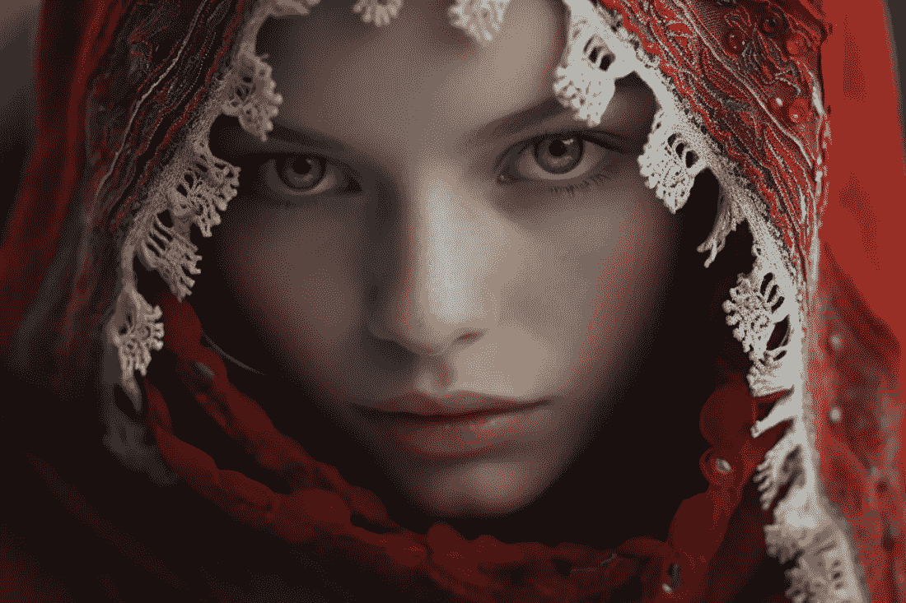

#### 4.广角镜头

这张照片显示了周围地区的更广阔的视野。

注意：如果不指定环境，mj会根据提示得出结论。

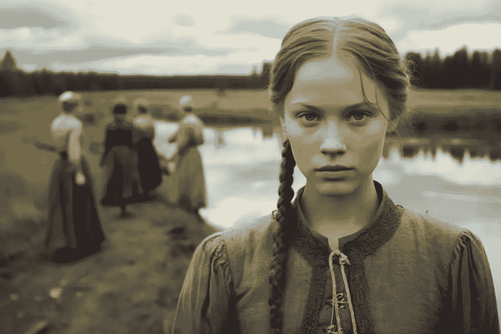

#### 5. 超广角镜头

这张照片展示了拍摄对象对周围区域更广阔的视野，通常是为了突出一个地点或风景。

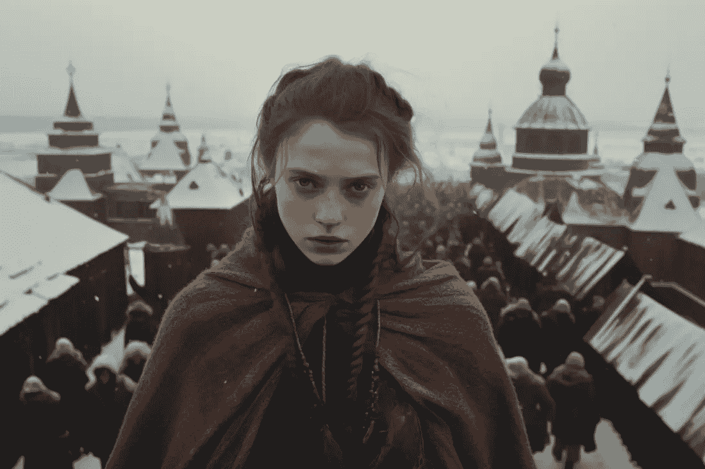

#### 6.低角度拍摄

这张照片从下方观察拍摄对象，使其显得更大或更突出。

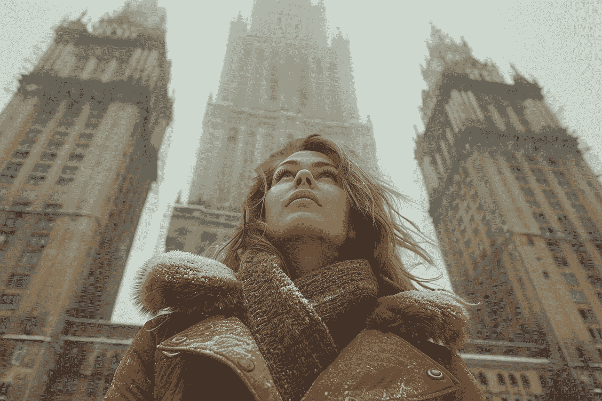

#### 7. 高角度拍摄

这张照片从上方观察拍摄对象，使其显得更小或不那么重要。

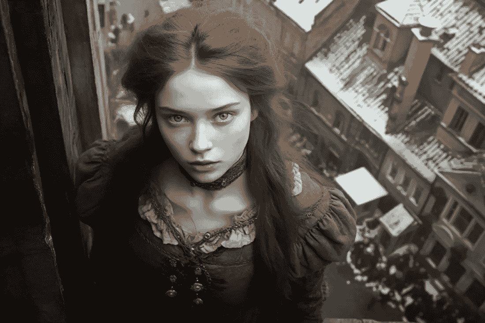

#### 8.眼睛水平拍摄

这张照片是在拍摄对象的眼睛水平处拍摄的，以达到中性效果。

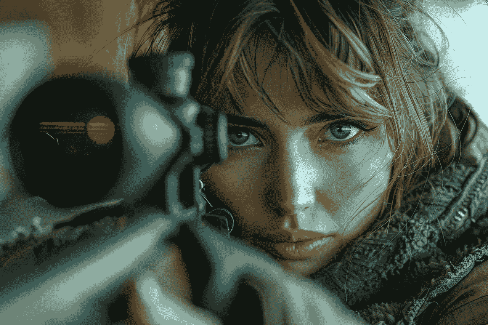

#### 9.荷兰角度射门

在这张照片中，相机倾斜以产生令人不安的效果。

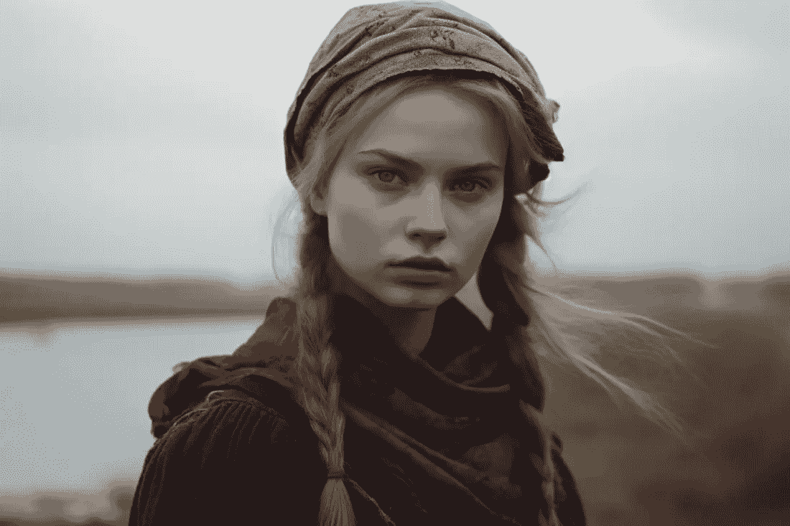

#### 10.偷拍

当拍摄对象不可见时，自然拍摄。由于他们没有摆姿势，所以照片看起来更自然。

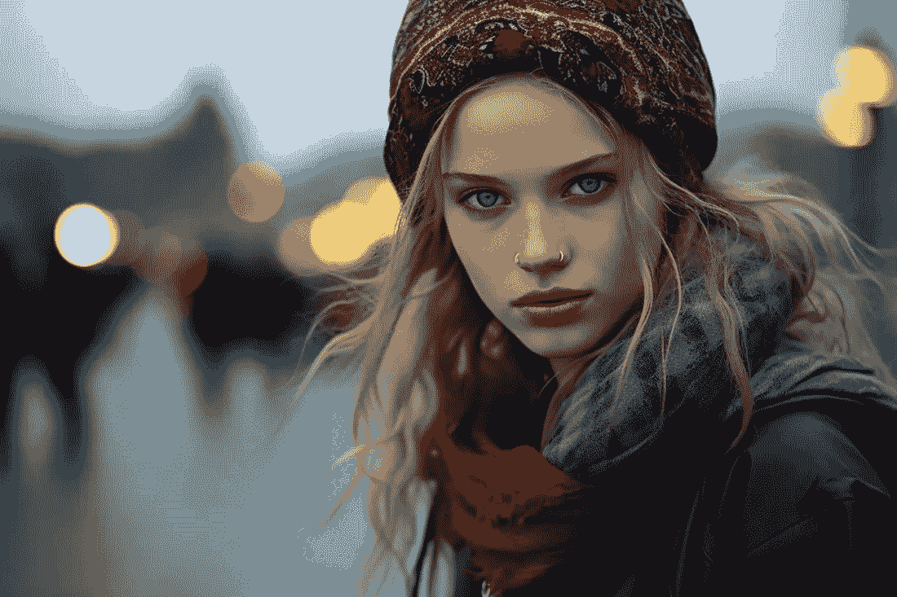

#### 11.三分法则拍摄

三分法是一种构图规则，将图像分为 3 条水平线和 3 条垂直线。主体沿着这些线或它们的交叉点定位。

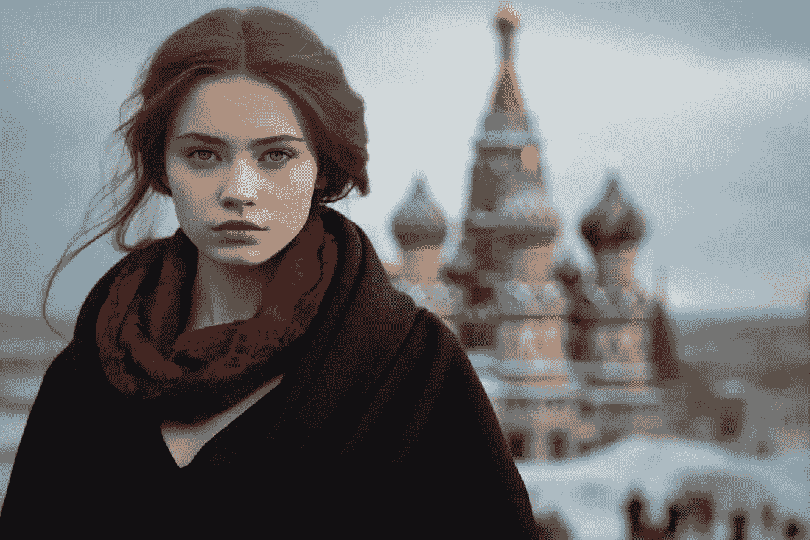

#### 12. 鸟瞰图

这张照片显示了鸟儿从上方看到的场景。

注：《中途旅程》对于其主题所发生的事情似乎很有创意。

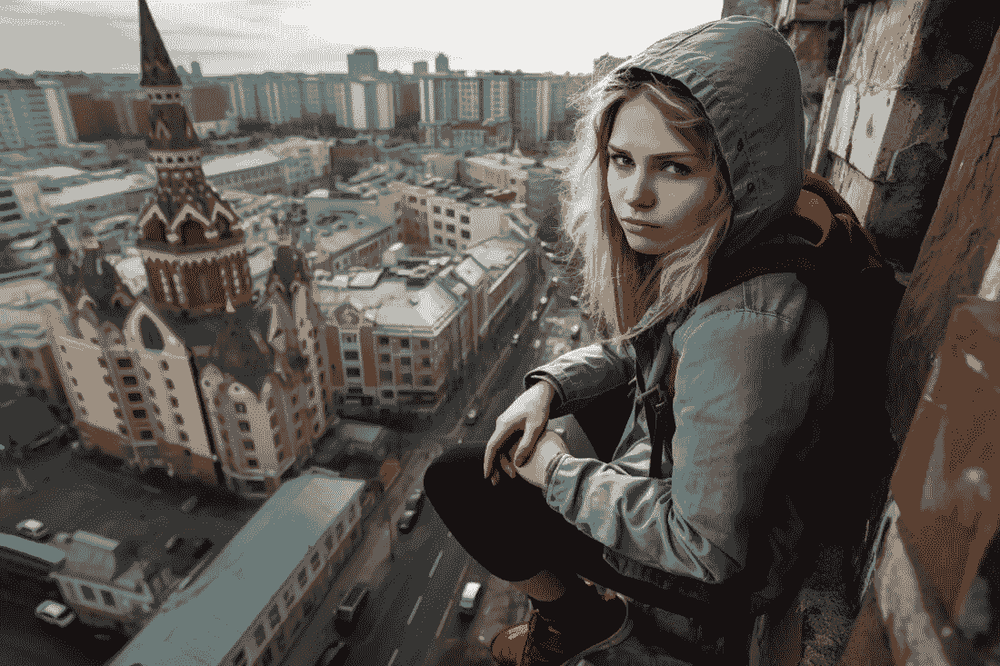

#### 13.无人机拍摄

这个镜头与之前的类型类似。但这个物体似乎更小。

注意：有时无人机会进入画面。

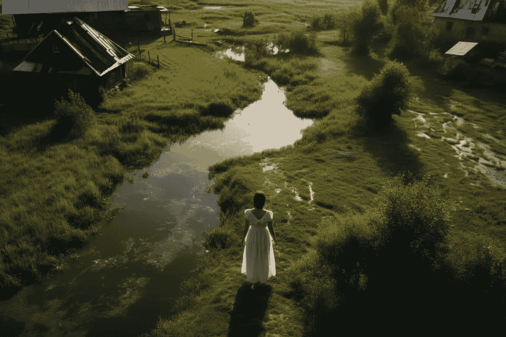