# Midjourney30 位漫画艺术家

> 来源：[https://my.feishu.cn/docx/BNZldC3xvoGhcmxft79cmpR6nah](https://my.feishu.cn/docx/BNZldC3xvoGhcmxft79cmpR6nah)

鸟山明Akira Toriyama

因《龙珠》系列而闻名。明亮、动感的风格，动漫和可爱的角色。

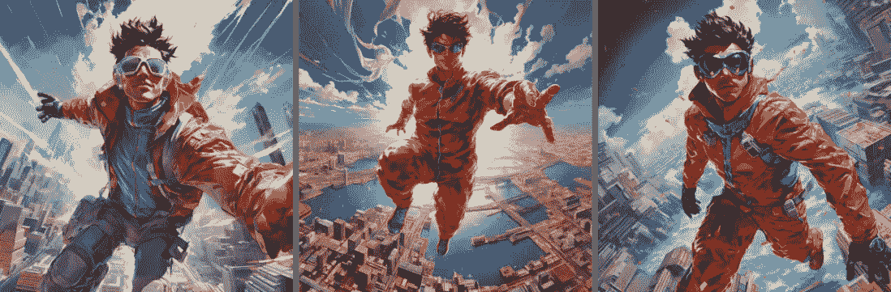

提示：翱翔天空的超级英雄，以未来城市为背景，作者：Akira Toriyama --s 250

阿曼达·康纳Amanda Conner

明亮、细致的风格，以哈莉·奎茵漫画中的作品而闻名。

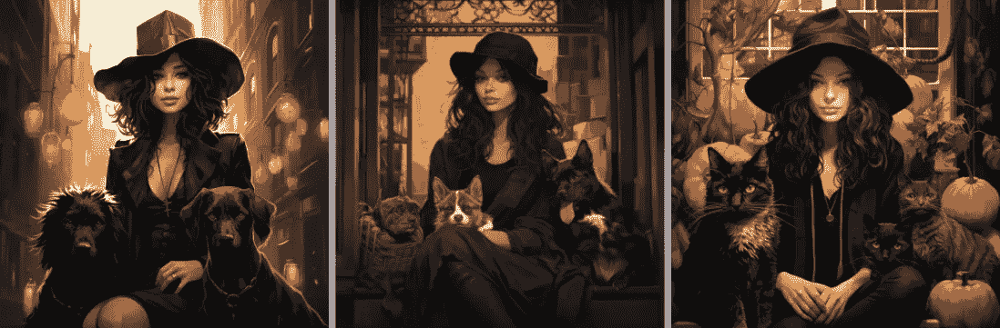

提示：纽约市的现代女巫和她的魔法宠物，作者：阿曼达·康纳。 --s 250

阿瑟·亚当斯Arthur Adams

细节细腻，人物生动。

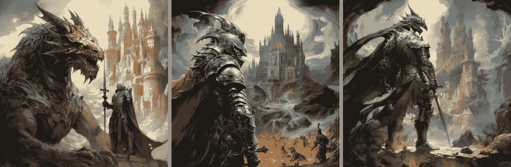

提示：在详细的奇幻场景中，一位骑士保卫城堡免受龙的攻击，作者：亚瑟·亚当斯 --s 250

比尔·显克维奇Bill Sienkiewicz

一种富有表现力、近乎抽象的风格，强调纹理。

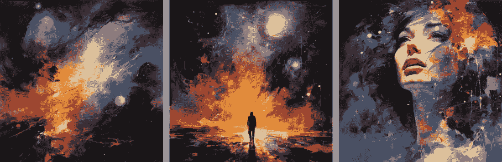

提示：对宇宙及其奥秘的抽象描绘，作者：比尔·显克维奇 --s 250

布赖恩·博兰Brian Bolland

干净、细致的风格，以《特警判官》和《致命玩笑》中的作品而闻名。

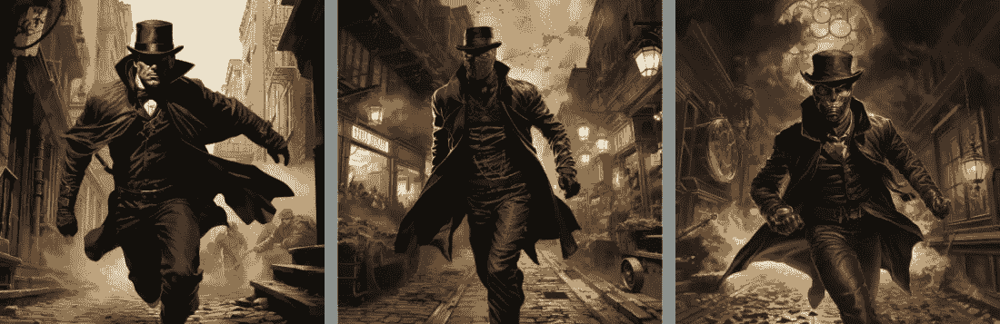

提示：维多利亚时代伦敦的蒸汽朋克侦探追捕怪盗，作者：Brian Bolland --s 250

卡尔·班克斯Carl Banks

许多守财奴麦克老鸭故事的创作者，经典迪士尼风格。

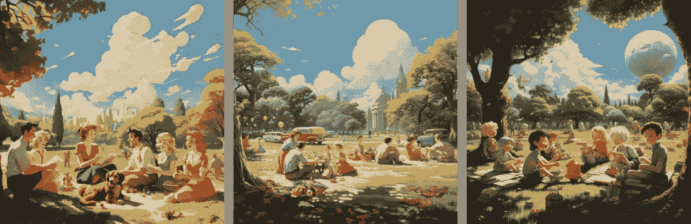

提示：在阳光明媚的公园里野餐的经典卡通人物，卡尔·班克斯 (Carl Banks) --s 250

克里斯·巴查洛Chris Bachalo

风格略显怪诞，透视扭曲。

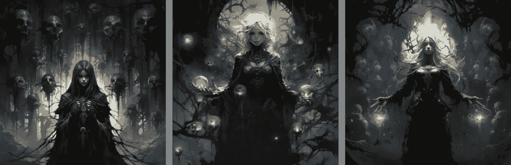

提示：一位神秘的女巫在黑暗的森林中召唤灵魂，作者：Chris Bachalo --s 250

戴夫·吉本斯Dave Gibbons

因《守望者》的作品而闻名，风格干净直白。

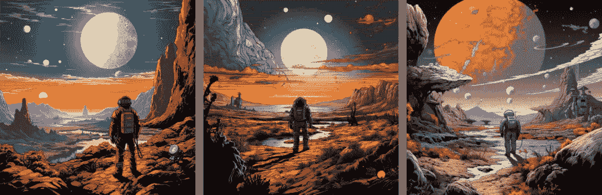

提示：戴夫·吉本斯 (Dave Gibbons) 描绘的复古风格宇航员探索外星球。 --s 250

**大卫·阿贾David Aja**

简约、风格化的设计，经常使用特写镜头。

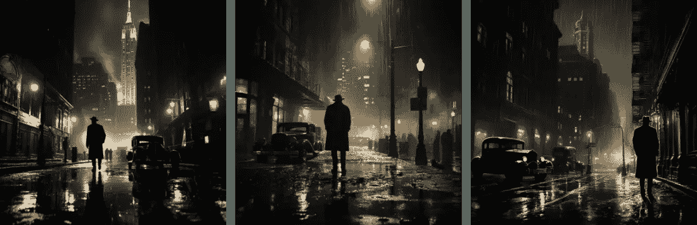

提示：20 世纪 30 年代纽约多雨的黑色侦探场景，作者：大卫·阿贾 (David Aja)。 --s 250

埃里克·拉森Erik Larsen

风格明快、动感，影像漫画创始人之一。

提示：街头超级英雄在小巷中与歹徒作战，作者：Erik Larsen --s 250

**吉尔·凯恩Gil Kane**

DC 和 Marvel 的白银时代顶尖艺术家之一。

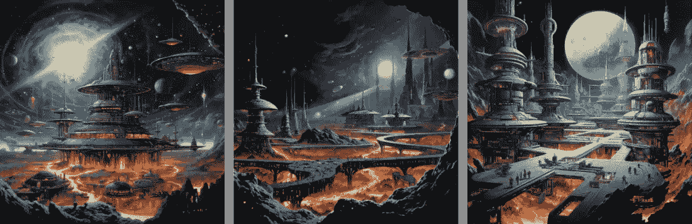

提示：吉尔·凯恩创作的太空歌剧场景，其中有星际飞船和外星帝国。 --s 250

哈维·库兹曼Harvey Kurtzman

《MAD杂志》创办人，漫画风格，表现力强。

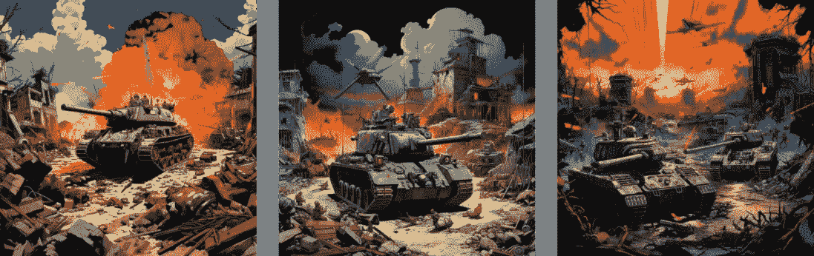

提示：哈维·库兹曼（Harvey Kurtzman）的经典战争故事，有士兵和坦克。 --s 250

**杰克·科比Jack Kirby**

这位“漫画之王”创造了许多漫威角色，以动作场面和“星之卡比点”而闻名。

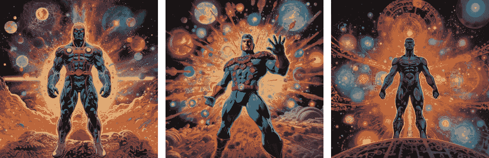

提示：杰克·柯比在太空中挥舞着巨大力量的宇宙超级英雄。 --s 250

**吉姆·杜兰Jim Duran**

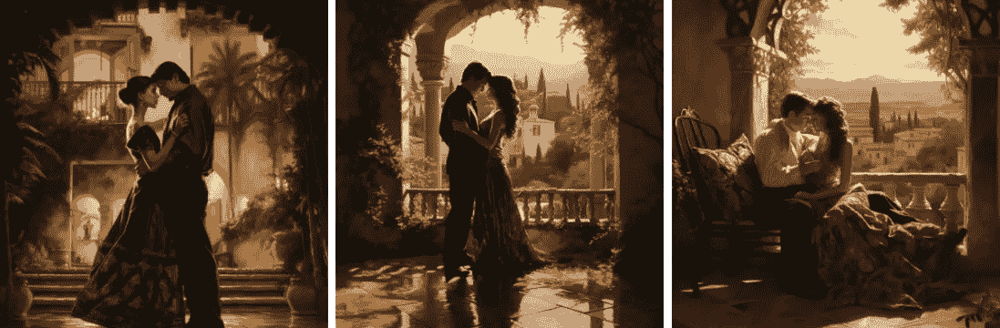

提示：西班牙别墅中的浪漫场景，吉姆·杜兰 (Jim Duran) 创作。 --s 250

吉姆·斯特兰科Jim Steranko

一位融合波普艺术和迷幻艺术的创新艺术家和漫画作家。

提示：由吉姆·斯特兰科 (Jim Steranko) 执导的充满动感的间谍任务，其中包括小玩意和汽车追逐。 --s 250

**约翰·伯恩John Byrne**

他是 20 世纪 80 年代的重要艺术家之一，曾创作过《X 战警》和《神奇四侠》。

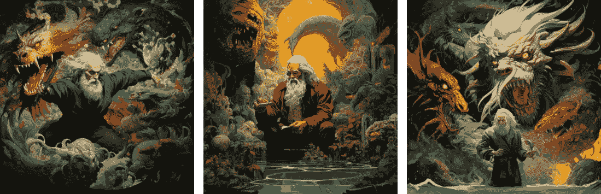

提示：约翰·伯恩所著的有关神灵和怪物的神话故事。 --s 250

**乔·库伯特Joe Kubert**

他因《摇滚军士》和《人猿泰山》而闻名，具有明显的粗犷风格。

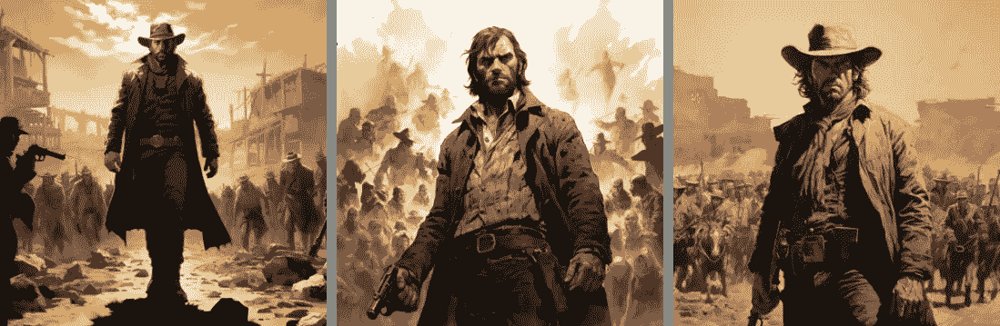

提示：一个粗犷的牛仔在狂野的西部对抗亡命之徒，作者：乔·库伯特。 --s 250

约翰·卡萨迪John Cassaday

干净的电影风格，以《惊人的 X 战警》中的作品而闻名。

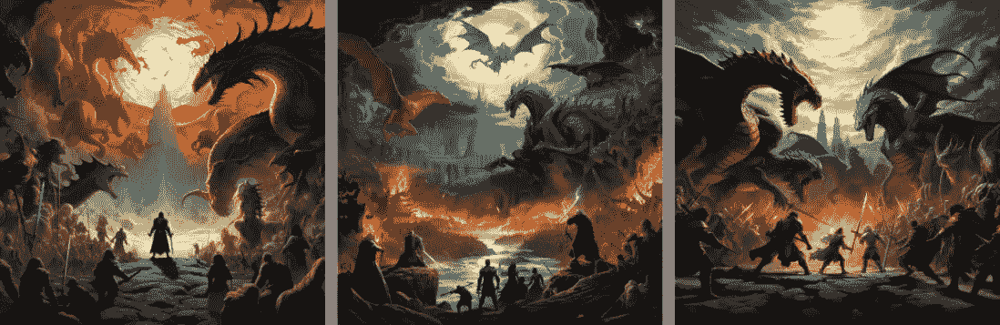

提示：约翰·卡萨迪创作的骑士和魔法生物的史诗般的战斗场景。 --s 250

马克·巴格利Mark Bagley

经典漫画风格，因《终极蜘蛛侠》而闻名。

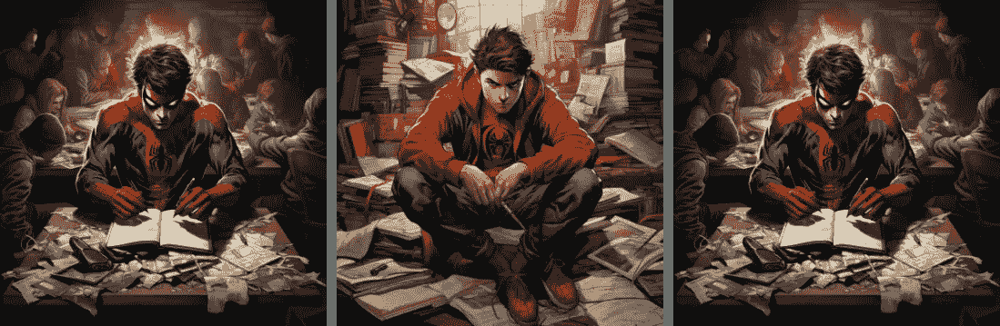

提示：马克·巴格利（Mark Bagley）讲述了一位青少年超级英雄与学校和恶棍打交道的故事。 --s 250

**卢法恩Lou Fine**

黄金时代最伟大的漫画艺术家之一，风格细致。

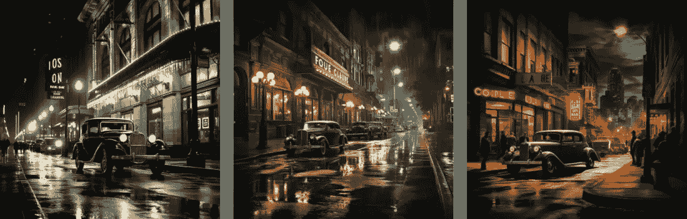

提示：以 20 年代芝加哥为背景的黑色场景，有黑帮和爵士俱乐部，由 Lou Fine 创作。 --s 250

马克·西尔维斯特里Marc Silvestri

风格动感，细节细腻，影像漫画创始人之一。

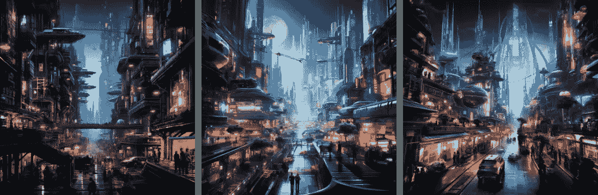

提示：一座充满赛博朋克氛围和霓虹灯的未来城市，作者：Marc Silvestri。 --s 250

迈克·米格诺拉Mike Mignola

《地狱男爵》的创作者，风格化、强烈对比的风格，带有黑暗的氛围。

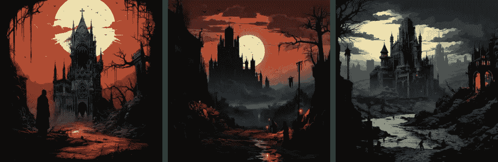

提示：迈克·米格诺拉 (Mike Mignola) 讲述的一个关于吸血鬼和古城堡的哥特式故事。 --s 250

尼尔·亚当斯Neal Adams

以其现实主义风格和蝙蝠侠作品而闻名。

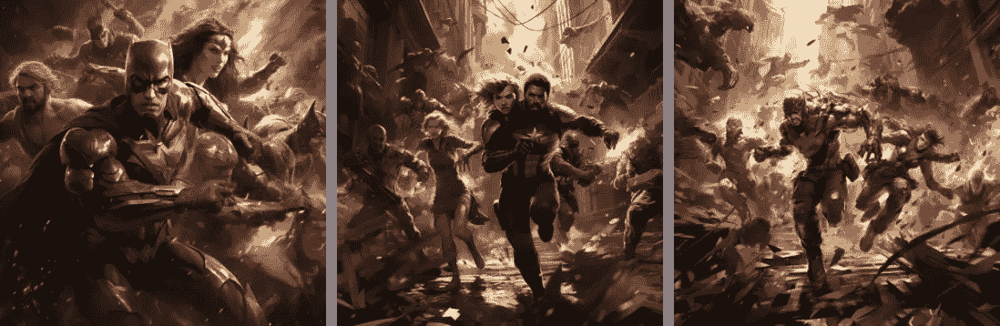

提示：由尼尔·亚当斯 (Neal Adams) 创作的超级英雄团队的动态动作场景。 --s 250

手冢治虫Osamu Tezuka

“漫画之神”，创造了“铁臂阿童木”，经典日式风格。

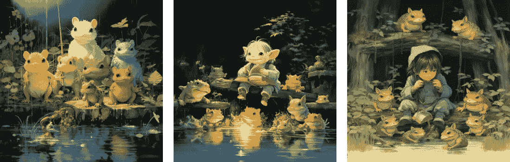

提示：手冢治虫创作的一个关于会说话的动物及其冒险的异想天开的故事。 --s 250

拉斯·布劳恩Russ Braun

写实风格，曾参与《男孩们》等项目。

提示：古罗马的历史场景，有角斗士和竞技场，拉斯·布劳恩 (Russ Braun) 创作。 --s 250

史蒂夫·狄龙Steve Dillon

干净、现实的风格，以《传道者与惩罚者》中的作品而闻名。

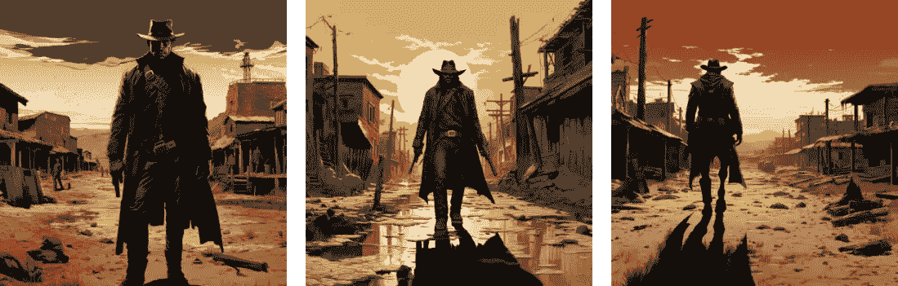

提示：一个坚韧的西部场景，一个孤独的枪手面对他的过去，由史蒂夫·狄龙创作。 --s 250

史蒂夫·迪特科Steve Ditko

富有表现力的风格，曾出演《蜘蛛侠》和《奇异博士》。

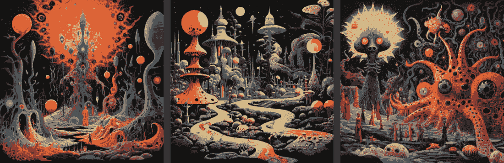

提示：由史蒂夫·迪特科（Steve Ditko）创作的具有超凡脱俗的生物和维度的迷幻场景。 --s 250

斯图尔特·伊莫宁Stuart Immonen

因《超人》和《X战警》而闻名，风格干净、动感。

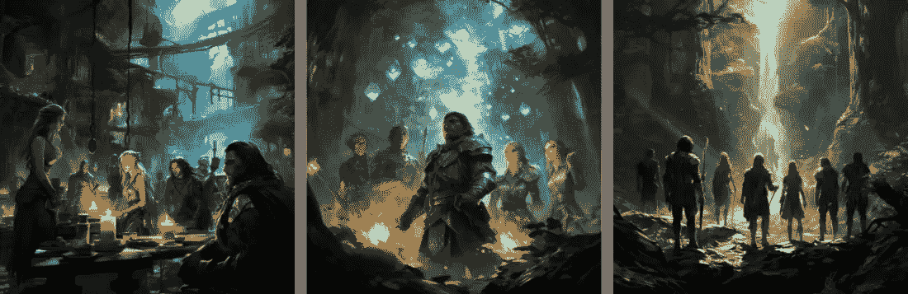

提示：由斯图尔特·伊莫宁 (Stuart Immonen) 创作的充满精灵、矮人和史诗任务的奇幻场景。 --s 250

特里·多德森Terry Dodson

以其女性化的角色和简洁的线条而闻名。

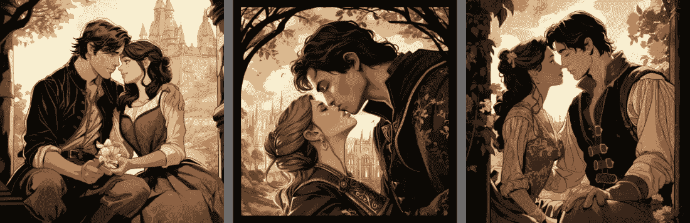

提示：特里·多德森 (Terry Dodson) 所著的魔法王国里的浪漫童话故事。 --s 250

威尔·艾斯纳Will Eisner

漫画传奇人物、《The Spirit》的创造者、漫画结构和故事讲述的创新者。

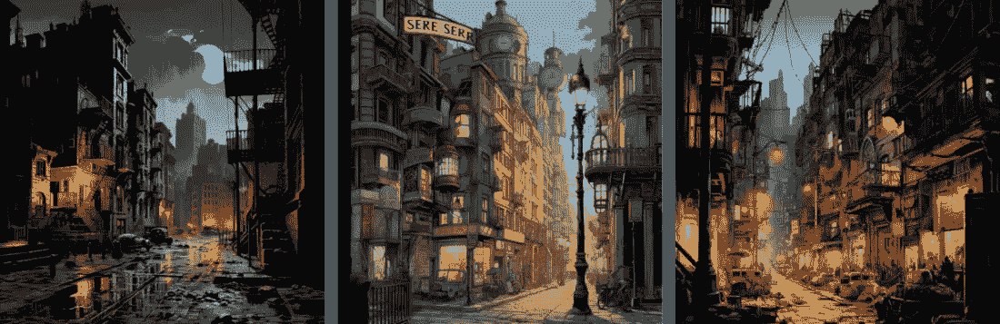

提示：威尔·艾斯纳 (Will Eisner) 创作的一个以城市为背景的永恒故事，捕捉了这座城市的日常生活和故事。 --s 250

斯科特·科林斯 Scott Kolins

充满活力、富有表现力的风格，以《闪电侠》中的作品而闻名。

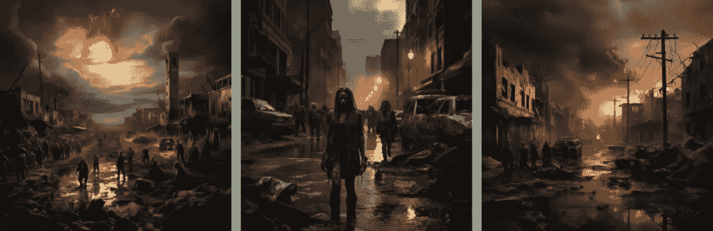

提示：斯科特·科林斯（Scott Kolins）在后世界末日城市中描绘了僵尸和幸存者的恐怖场景。 --s 250