# 35种形状和图案来创建图案--tile

> 来源：[https://my.feishu.cn/docx/P36BdimOUohVISxrTdicTYrwnah](https://my.feishu.cn/docx/P36BdimOUohVISxrTdicTYrwnah)

+   **重叠圆圈**互相重叠的圆圈

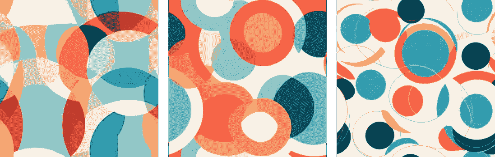

提示：重叠圆圈--tile

+   **棋盘格**棋盘格，经典的方块交替。

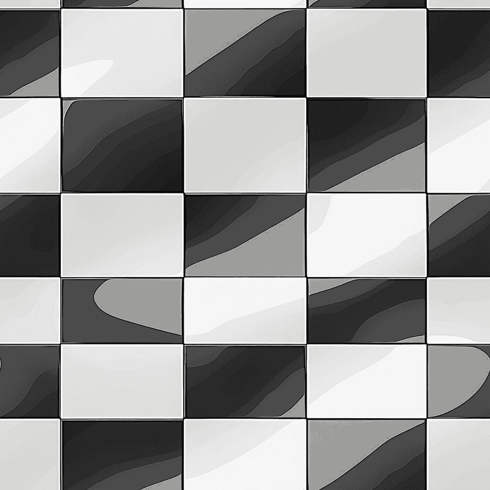

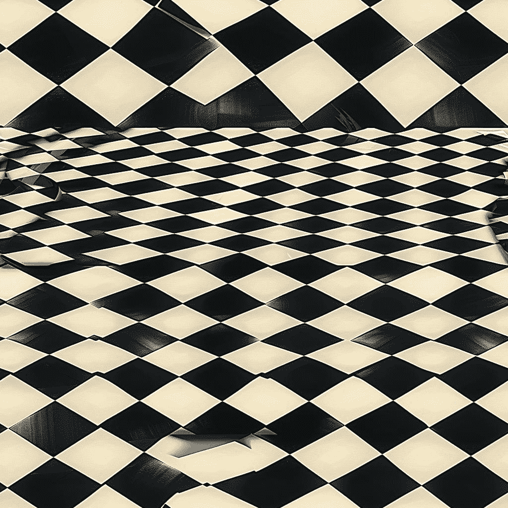

提示：棋盘 --til

+   **人字形图案**常用于纺织品和瓷砖的千鸟格图案。

提示：人字形图案--tile

+   **正方形马赛克**各种颜色或色调的正方形马赛克。

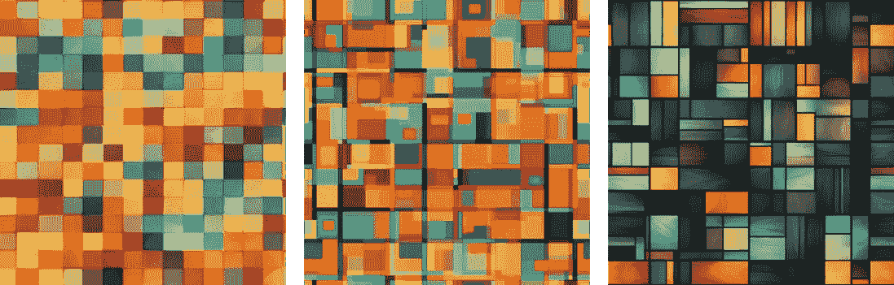

提示：人字形图案--tile

+   **三角形的重复图案**形成几何对称的三角形的重复图案。

提示：三角形的重复图案 --tile

+   **渐变条纹**渐变条纹，从深色到浅色平滑过渡，反之亦然。

提示：渐变色条纹 --tile

+   **圆点爆炸**圆点爆炸，许多彩色圆圈混乱地散布在背景上。

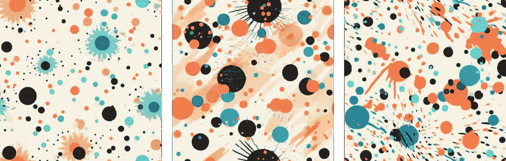

提示：圆点爆炸--tile

+   **星星螺旋**星星螺旋围绕中心点旋转，产生运动的错觉。

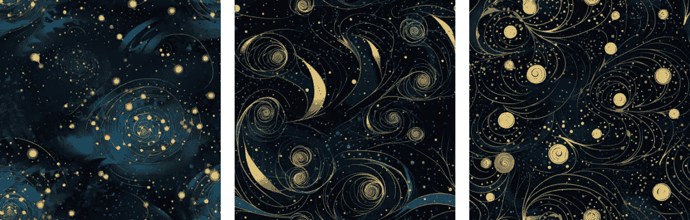

**提示：星星螺旋--tile**

+   **六边形网格**六边形网格彼此紧密相邻，形成蜂窝。

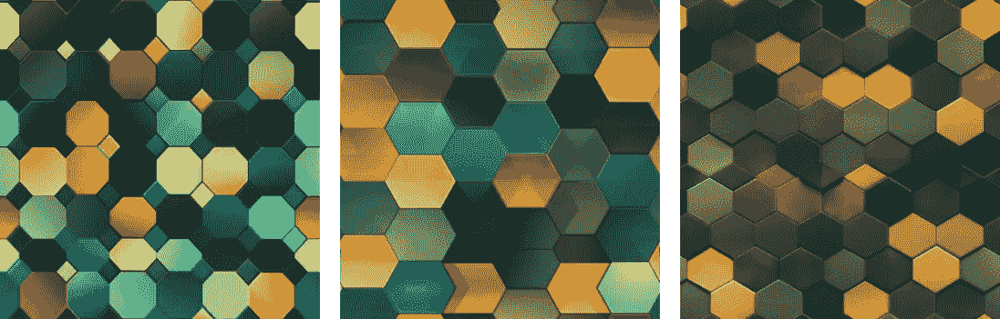

提示：六边形网格 --tile

+   **迷宫**迷宫，一条有许多分支和死胡同的小路。

**提示：迷宫--tile**

+   **钻石镶嵌**紧密排列在一起的钻石马赛克。

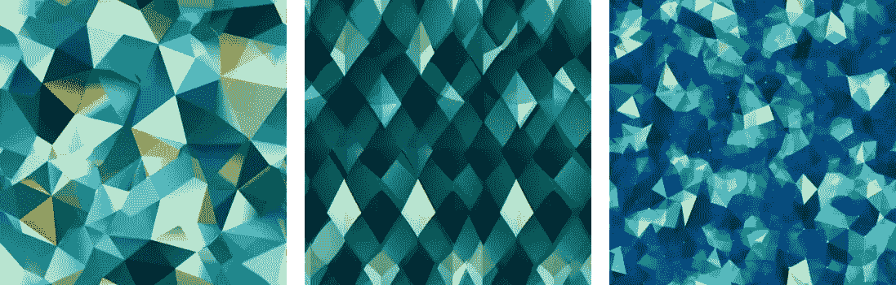

提示：钻石镶嵌——tile

+   **不同大小的矩形拼贴画**形成抽象图案的不同大小的矩形拼贴画。

提示：不同大小的矩形拼贴画--tile

+   **连锁心形图案**连锁心形图案。

**提示：连锁心形图案--tile**

**14.**一系列同心圆

提示：一系列同心圆--tile

+   **格子图案**苏格兰短裙的传统格子图案。

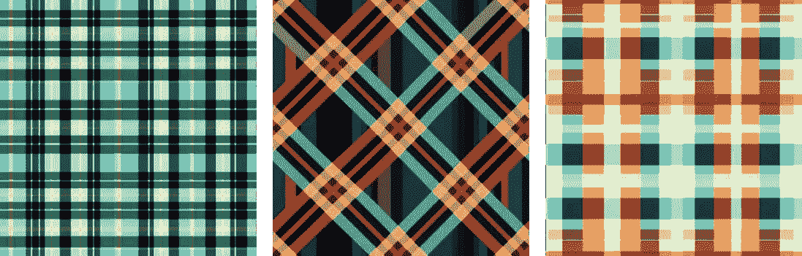

提示：格子图案--tile

+   **几何花**几何花，其各部分从中心对称分布。

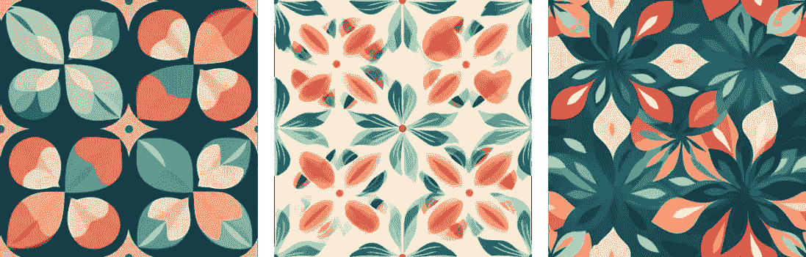

提示：几何花--tile

+   **重叠叶子的图案**重叠叶子的图案，产生茂密的植物覆盖效果。

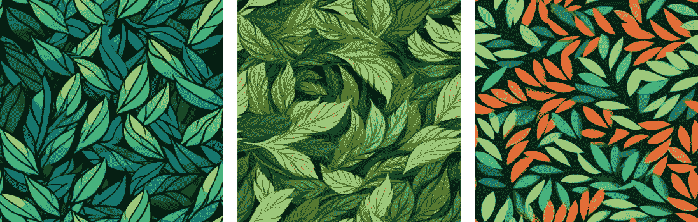

提示：叶子重叠的图案--tile

+   **视错觉**视错觉。

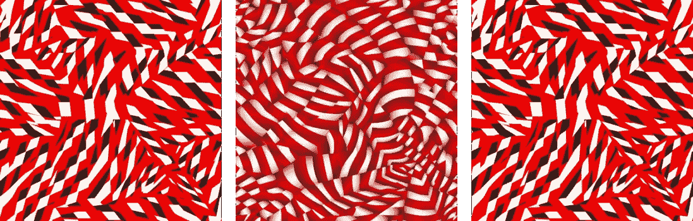

**提示：视错觉——tile**

+   **线条的径向爆发**从一点发出并向各个方向发散的线条爆发。

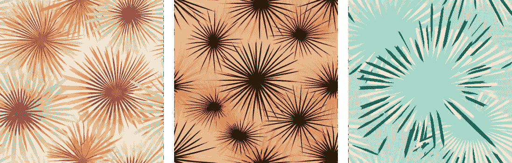

提示：径向爆发的线条 --tile

+   **彩色玻璃设计**由多色玻璃组成的彩色玻璃图案。

提示：彩色玻璃设计——瓷砖

+   **一连串的波浪**一连串的波浪。

+   **相交拱门**相交拱门形成一系列重复的图案。

**提示：相交拱门 --tile**

+   **锯齿形区域**锯齿形区域，折线依次交替，形成动态图案。

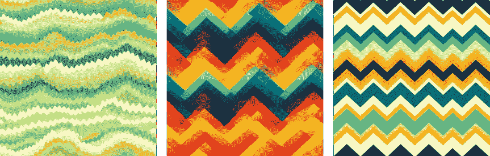

提示：锯齿形区域 --tile

+   **编织法**一种将条带编织在一起的编织技术，类似于传统的纤维产品。

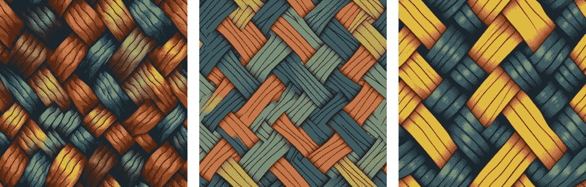

提示：编织辫子——瓷砖

+   **点之海**点之海，小点状元素以无特定顺序填充空间。

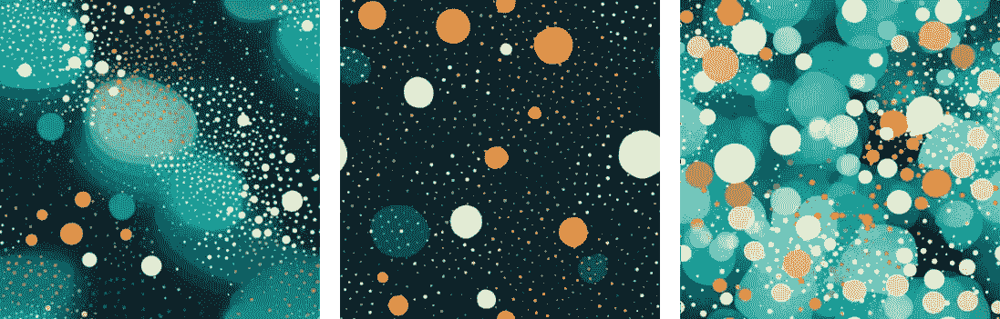

提示：点之海——tile

+   **循环格子**循环格子，呈现针织网或蕾丝的外观。

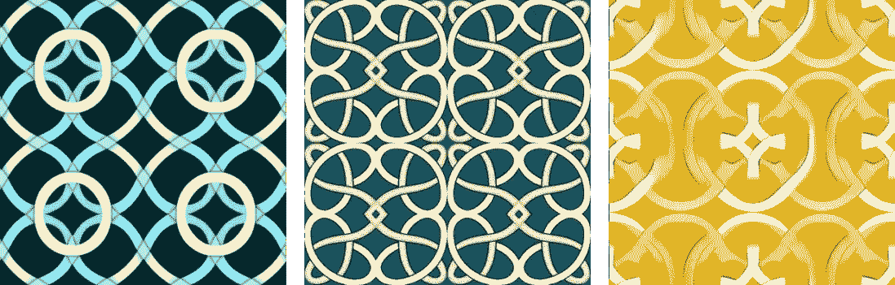

提示：循环格子 --tile

+   **交织螺旋**螺旋合并成无尽的图案。

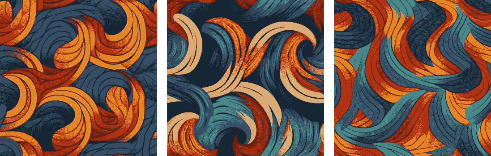

提示：交织的螺旋——瓷砖

+   **钻石链**钻石链，每个元素相互连接，形成线性图案。

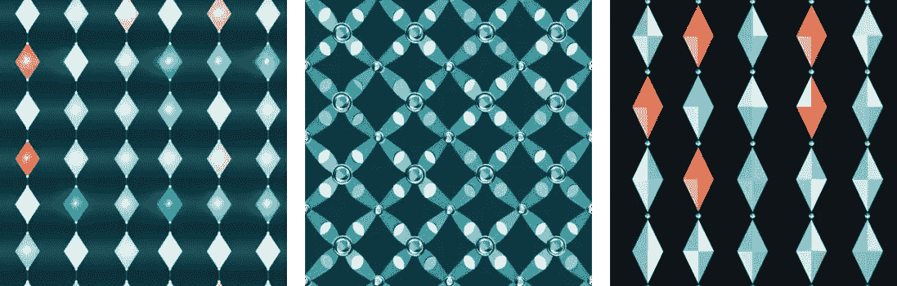

提示：钻石链--tile

+   **佩斯利漩涡**传统的水滴图案旋转成抽象图案。

提示：佩斯利涡旋——tile

+   **几何花园**创造花卉图案的几何形状。

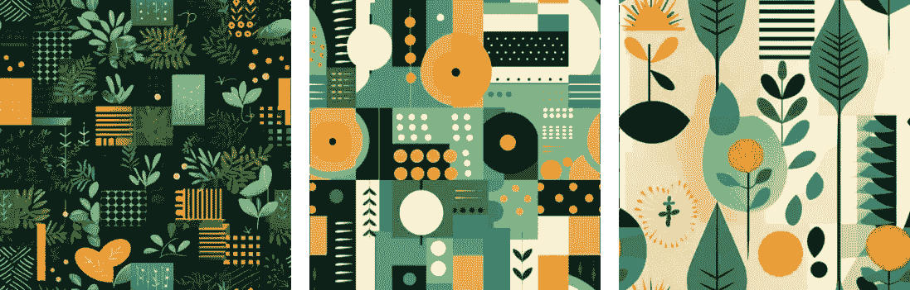

提示：几何花园——tile

+   **像素棱镜**由许多小形状组成的图案，让人想起数字图像。

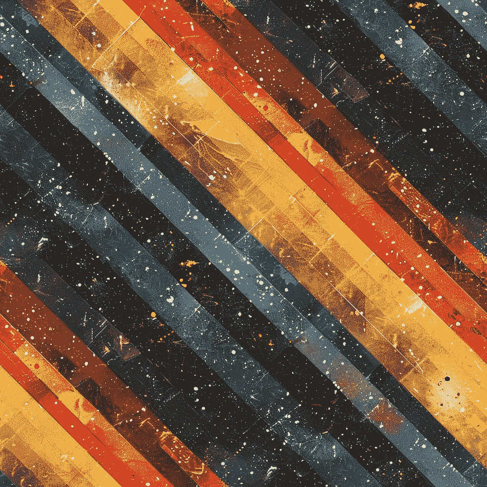

提示：像素棱镜--tile

+   **线矩阵**形成网格的水平线和垂直线的交叉点。

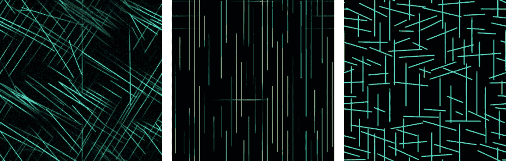

提示：线矩阵--tile

+   **光波迷宫**模拟光波的明线和暗线交织。

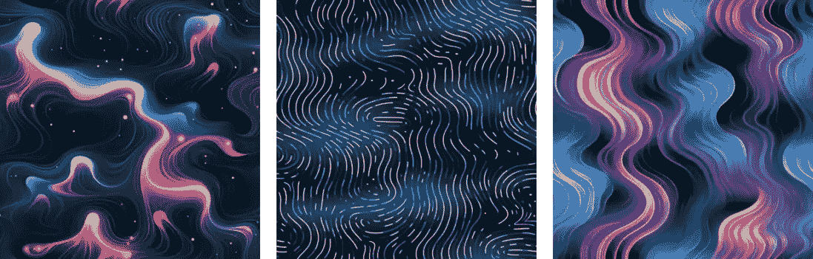

提示：光波迷宫--tile

+   **无限幻象**交织的图案创造出无限空间的感觉。

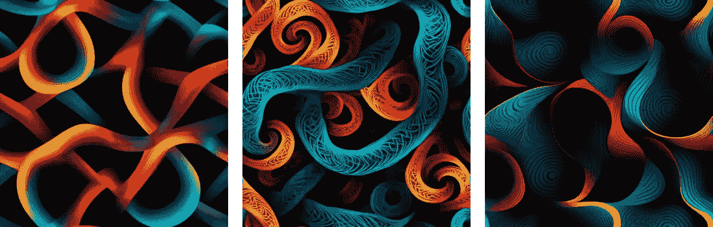

提示：无限的幻象——tile