# 90 多个中途提示为市场生成产品和商品的照片

> 来源：[https://my.feishu.cn/docx/D9qnd7T01oJFYKxiaWrcgxRGnSg](https://my.feishu.cn/docx/D9qnd7T01oJFYKxiaWrcgxRGnSg)

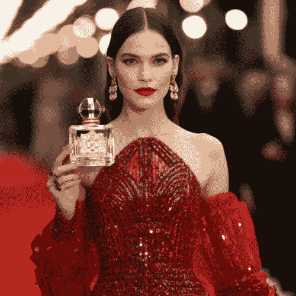

在数字时代，我们如何展示我们的产品至关重要。进入 Midjourney：一款创新的人工智能图像生成器，可将您的想法转化为迷人的视觉效果。您想要一件引人注目的艺术品、迷人的构图，还是令人难忘的背景？

让我们看看如何使用中途提示为您的产品创建独特的形象。一切都在细节中：从风格、构图到背景——每个元素都可以成为亮点。我收集了 90 多个带有图像的提示，可以激发您的创造力。

## 风格

借助 Midjourney，您可以通过选择不同的视角、风格和技术，让您的产品栩栩如生。它们的种类无穷无尽，每种都有其独特的魅力和应用可能性。让我们看看这些样式如何增强您产品的吸引力！

**高调**

High Key 风格的关键在于亮度。它营造出一种积极、清晰的氛围，并通常在白色背景下突出产品的形状和细微差别。想尝试吗？使用此模板：[产品] 的高调产品摄影。

> 提示：时尚简约台式电脑的高调产品摄影 – ar 16:9

> 提示：高端浓缩咖啡机的高调产品摄影、流畅的线条、金属光泽

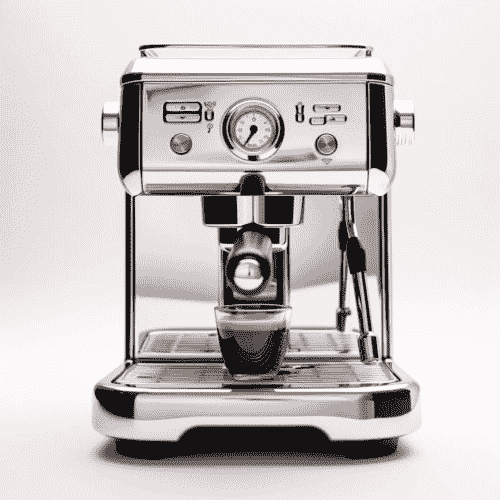

> 提示：一组手工陶瓷花瓶的高调产品摄影，复杂的细节，鲜艳的色彩 – ar 16:9

**低调**

这里的关键是对比度，尤其是明暗区域之间的对比度。这一切都与情绪和戏剧有关。您产品的细节将在深色背景下脱颖而出。要开始使用，请使用此提示：[产品] 的低调产品摄影。

> 提示：高端音响系统的低调产品摄影 – ar 16:9

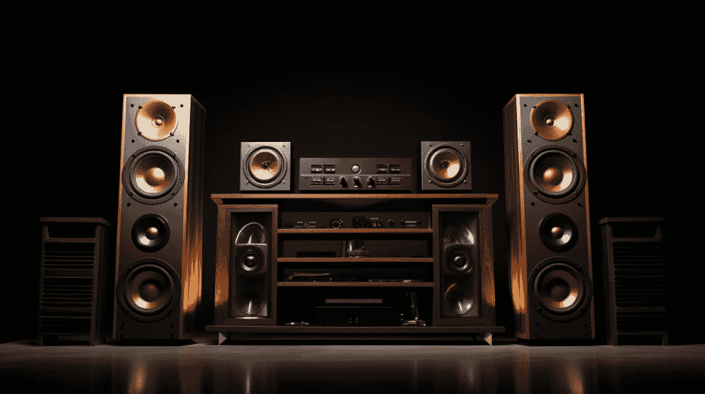

> 提示：高端香水瓶的低调产品摄影，突出了复杂的玻璃细节和深琥珀色的液体

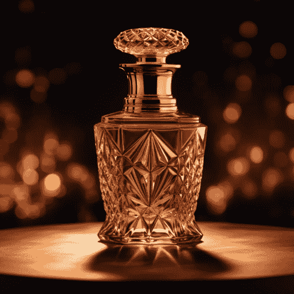

> 提示：美味黑巧克力棒的低调产品摄影、光滑的表面、精美的包装 - ar 16:9

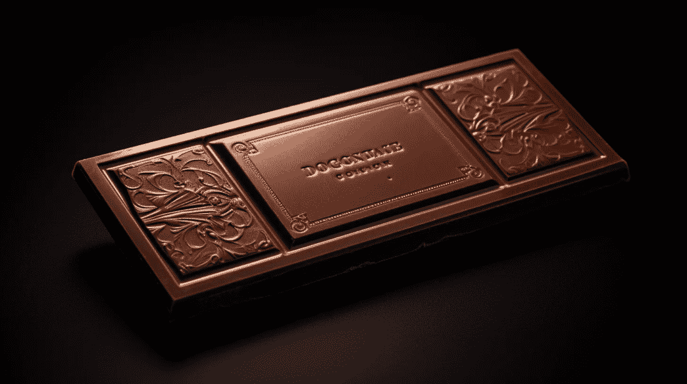

**极简主义**

保持简单，让产品闪闪发光。极简主义方法专注于产品设计，消除干扰。

> 提示：现代镀铬厨房水龙头的简约产品摄影，线条简洁

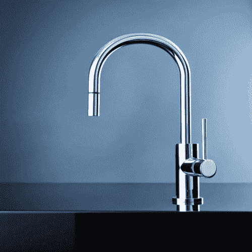

> 提示：时尚不锈钢滤水罐的简约产品摄影

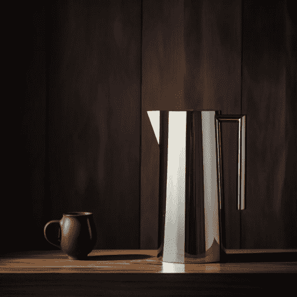

> 提示：一副木制耳机的简约产品摄影，耳罩干净、朴素

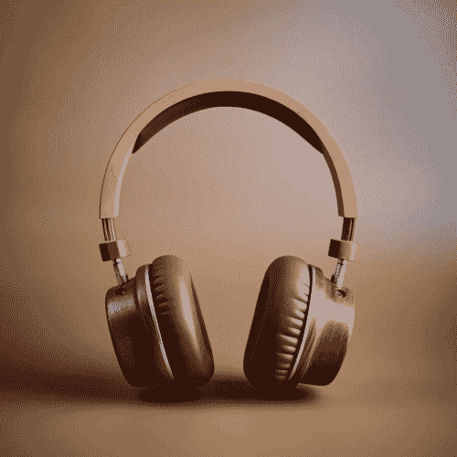

**真实条件**

我们正在谈论产品的使用。在现实生活中展示您的产品，说明其日常实用性。使用此提示模板：室内/室外环境中[人]拿着[产品]的特写镜头。

> 提示：游戏玩家在游戏室中手持视频游戏控制器的特写镜头

> 提示：摄影工作室中专业摄影师手持单反相机的特写镜头

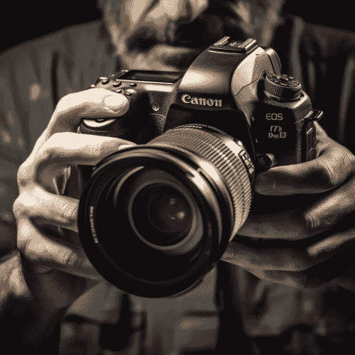

> 提示：高端精品店中时尚女性手持奢华手袋的特写镜头

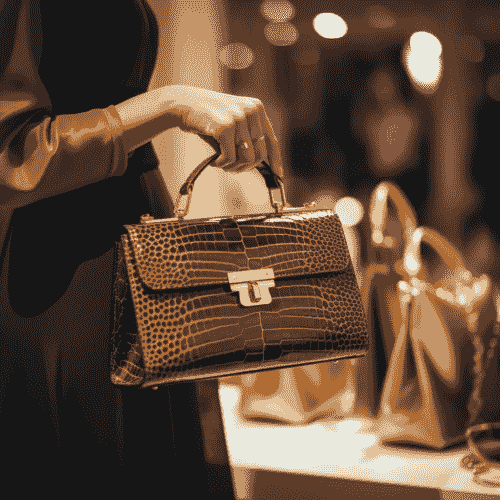

> 提示：户外音乐节上一群朋友拿着便携式扬声器的特写镜头

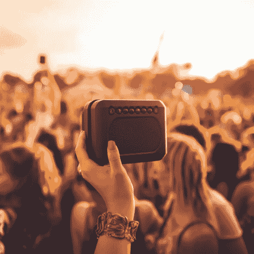

> 提示：红地毯上一位迷人的女演员拿着香奈儿香水瓶的特写镜头

> 提示：私人飞机机舱内飞行员手持手表的特写镜头

**微距摄影**

放大并揭示看不见的东西。通过这种方法，您可以看到肉眼看不见的细节。

> 提示：露水的啤酒瓶、饮料微距、户外环境、清凉灯光、商业风格

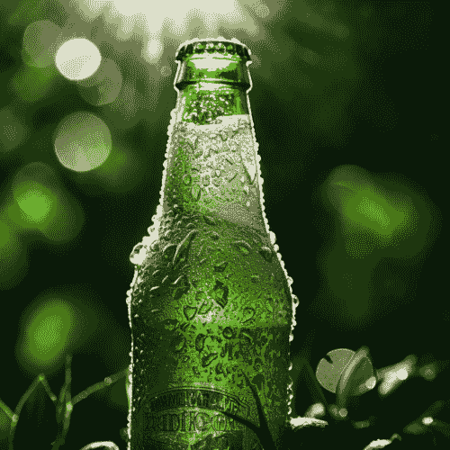

> 提示：精致银项链的特写镜头，柔和的自然光，优雅，简约，柔和的色彩

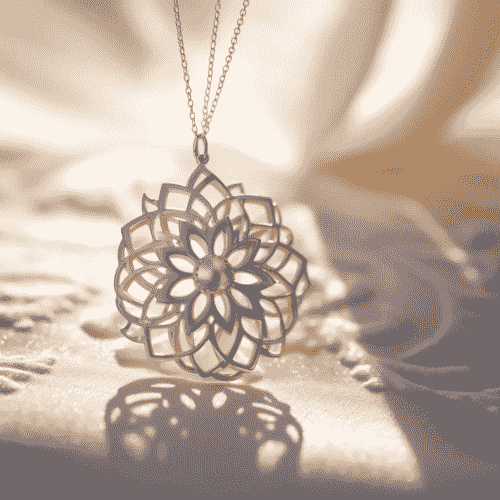

> 提示：未来派智能手表的极端特写镜头、高科技工作室照明、时尚和金属色彩、未来派

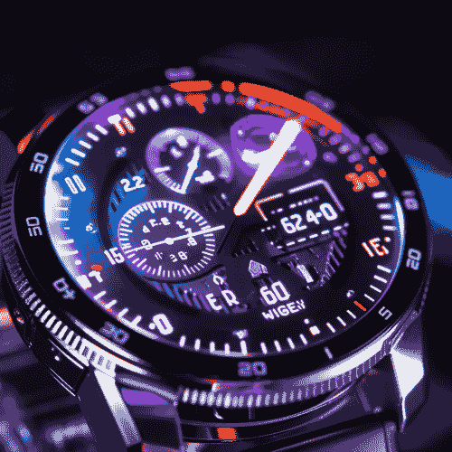

**在平面上显示**

产品的俯视图，通常位于平面上，突出显示产品之间的集合或关系。

> 提示：各种色彩缤纷的化妆产品的平铺摄影，柔和的漫射光，俏皮和少女气息，柔和的调色板 - ar 16:9

> 提示：热带鸡尾酒品种的平躺摄影，极简主义

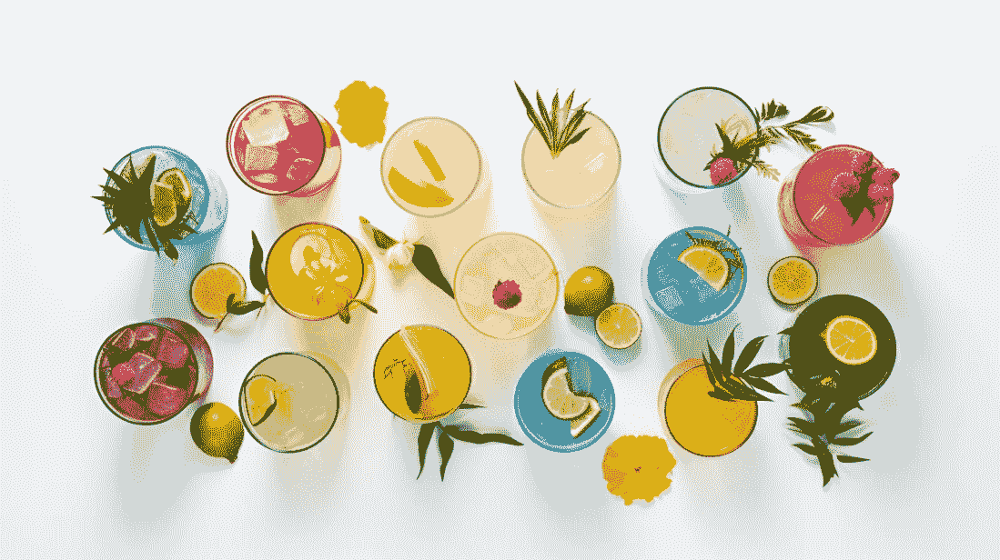

> 提示：一系列工匠陶器的平铺摄影，漫射自然光 — ar 16:9

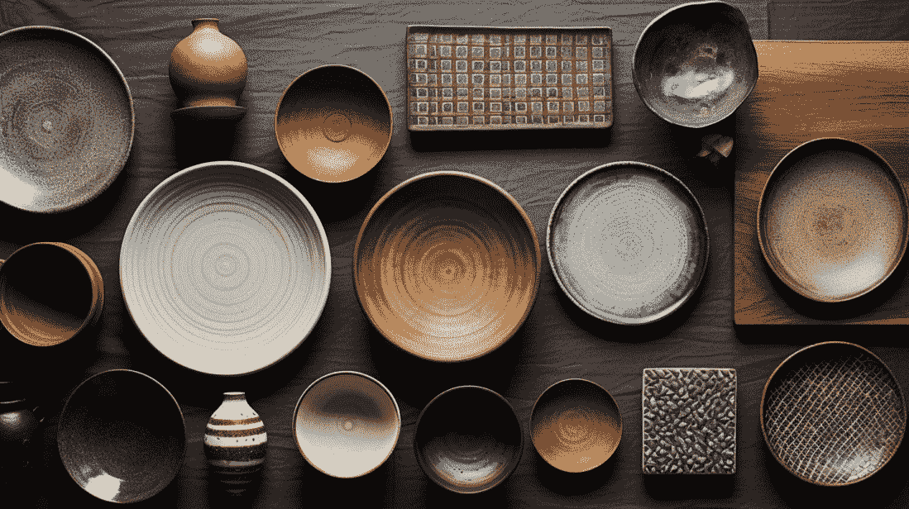

**运动模糊**

捕捉运动中的产品。这是为了展示活力和视觉吸引力。

> 提示：在旋转的指尖陀螺中捕捉速度和动作、工作室设置、霓虹灯颜色、令人兴奋和有趣、自上而下的视角、长时间曝光

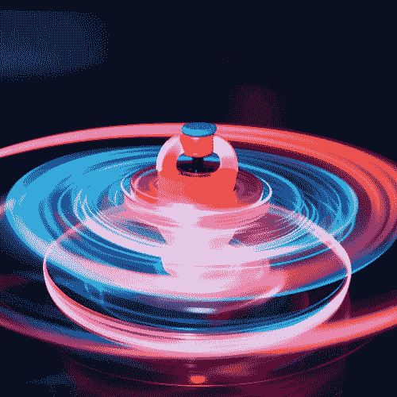

> 提示：动感十足的遥控赛车、户外赛道、黄金时段灯光、充满活力和竞争性、平移运动模糊 - ar 16:9

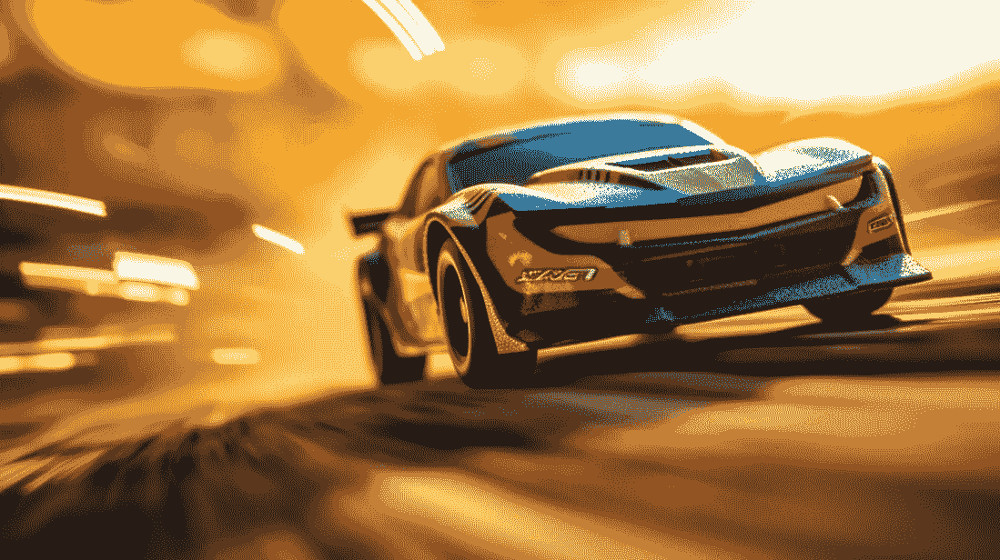

> 提示：运动模糊、繁华城市背景、霓虹灯城市灯光、未来派和高科技、特写镜头、速度和运动的时尚智能手机

> 提示：动态且动感十足的健身追踪器，包括运动模糊、健身房环境、积极的生活方式、健康和保健、特写镜头、速度和运动

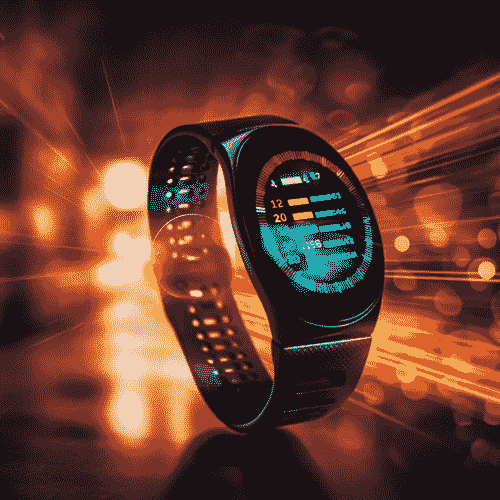

> 提示：运动模糊中机械游戏椅的速度线、游戏设置背景、人体工学设计、沉浸式游戏体验、特写镜头

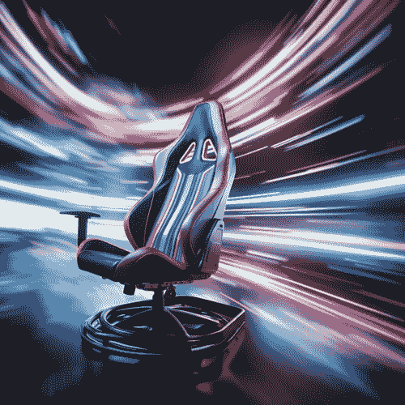

**剪影**

该产品采用背光设计，突出形状而不是细节，增加戏剧性和吸引力。

> 提示：Scooter 时尚轮廓的特写镜头优雅地滑过古老、饱经风霜的鹅卵石街道，被怀旧的金色夕阳柔软温暖的拥抱所亲吻，尼康 d850 — ar 16:9

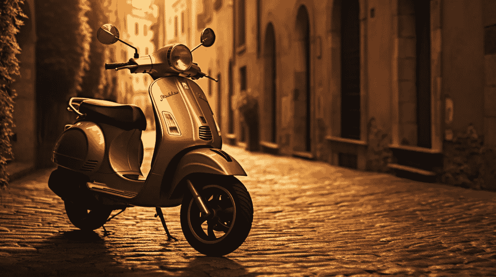

> 提示：特写镜头，备受好评的游戏机轮廓，带有动态 LED 装饰，背景为未来派背景 — ar 16:9

> 提示：火热夕阳下的时尚跑车剪影，突出其空气动力学曲线、激情和力量、低角度拍摄、戏剧性灯光、温暖的调色板，尼康 d 850 – ar 16:9

**微型**

使用微型雕像进行透视，[以微型形式](https://vc.ru/midjourney/914401-odno-volshebnoe-slovo-v-prompte-dlya-midjourney-pomozhet-vam-sozdat-ochen-kreativnye-izobrazheniya)展示您的产品。

> 提示：微型厨师攀爬巨大的充满活力的红辣椒的宏观产品摄影

> 提示：微型时尚达靠在巨型设计师手提包上的宏观产品摄影

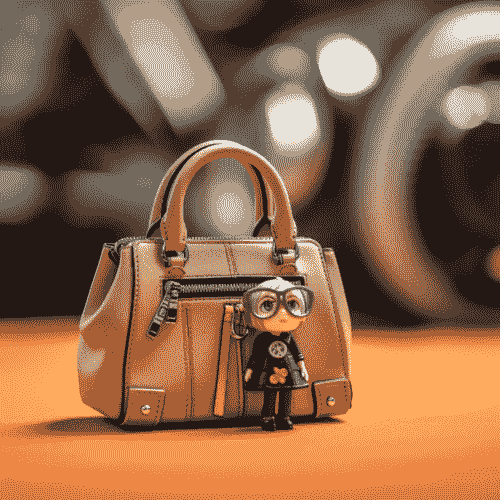

> 提示：微小尺寸的孩子爬上粉红色甜甜圈的宏观产品摄影

**飞溅**

捕捉您的产品与液体相互作用的瞬间。考虑新鲜或防水。

> 提示：光滑的银色跑车轮胎浸入水坑中，动态水滴冻结在半空中

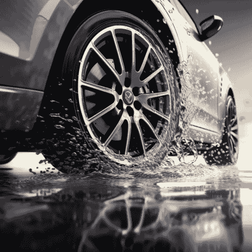

> 提示：特写拍摄一瓶优质橄榄油，金色的飞溅露出压碎的橄榄

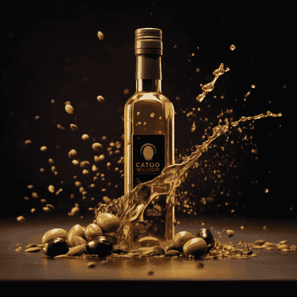

> 提示：一瓶冰凉的可乐打开，清爽的可乐爆炸声四溅而出

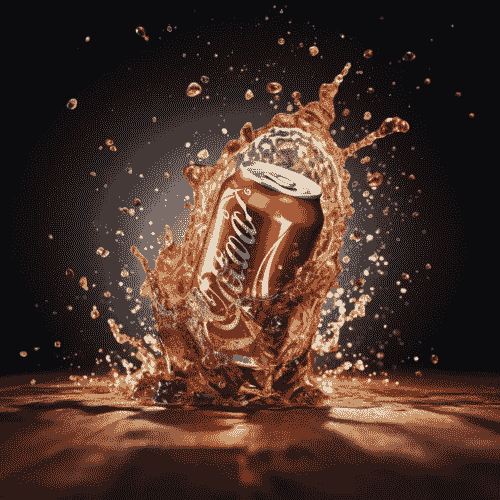

> 提示：跑鞋接触水坑，撞击时溅起水花

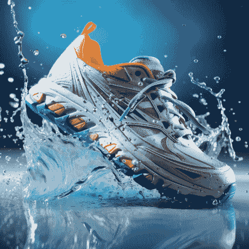

**悬浮**

让您的产品抵抗重力。这是为了创造一种失重或神奇的感觉。

> 提示：一双时尚运动鞋悬浮在半空中的特写镜头，轻轻地盘旋在翻腾、充满活力的五彩粉末云之上，梦幻般、空灵的灯光

> 提示：一副高级降噪耳机优雅地悬浮在声波之中，身临其境宁静，柔和的环境灯光，特写镜头

> 提示：悬浮在半空中的视频游戏机特写镜头，周围环绕着数字图形，游戏天堂，高速同步

**烟雾**

在提示中引入烟雾可以为其增添戏剧性和神秘感。这不仅仅是一个视觉图像——它可以象征产品的温暖、新鲜或丰富等属性。

> 提示：发光烟雾包裹着优质透明龙舌兰酒瓶

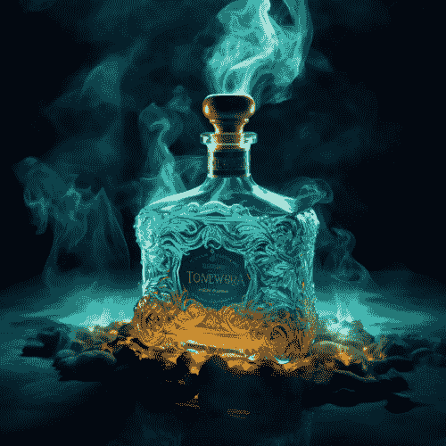

> 提示：烟雾在空中舞动，时尚的运动鞋，充满活力和超现实，霓虹灯

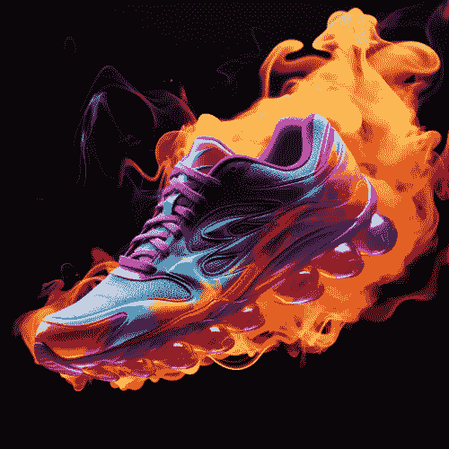

> 提示：滚滚的薄荷绿烟雾凸显出奢华护肤品的魅力

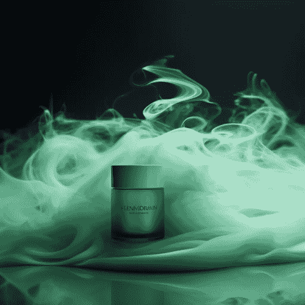

## 作品

不仅产品的外观很重要，而且它的历史也很重要。通过使用不同的成分，我们可以呈现产品的不同方面。让我们看看 Midjourney 提供的一些技巧。

**反思**

它们可以增加深度并使图像看起来生动且令人兴奋。

> 提示：带有夜光标记的时尚银色腕表，在下方投射出原始的反射光

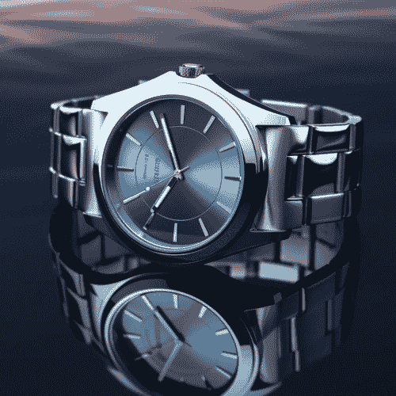

> 提示：带有弧形玻璃屏幕的时尚黑色智能手机，其反射反映了背景中的城市景观

> 提示：带有背光键盘的时尚银色笔记本电脑，其反射捕捉到了简约办公室的现代感

> 提示：一副带镜面镜片的时尚太阳镜，捕捉热带海滩场景的鲜艳色彩

> 提示：一排装在优雅玻璃瓶中的手工香水，它们的倒影展示了复杂的标签

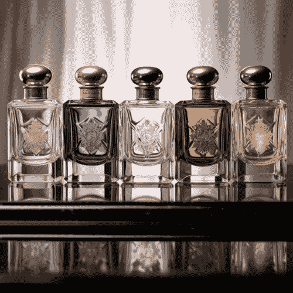

> 提示：带有广角镜头的时尚单反相机，其倒影展现出令人惊叹的山景

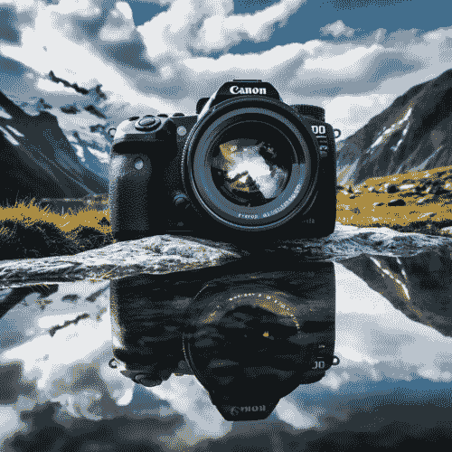

**在水下**

事实上，水下拍摄需要防水相机。但在中途，一个简单的提示就足够了。

用它来展示产品的防水性能或唤起一种平静、好奇或沉浸的感觉。

尝试这种模式：[产品]投入[水]中。

只是警告：这可能并不适合所有产品。所以想一想 - 您的哪些产品确实需要在水下？

> 提示：一瓶啤酒投入清澈的蓝色水中，复杂的标签

> 提示：防水运动相机潜入深蓝色的大海

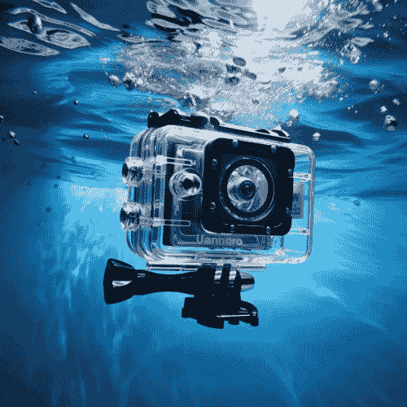

> 提示：一瓶奢华香水投入深蓝色的大海，复杂的标签

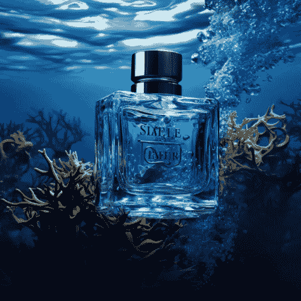

> 提示：Garmin 运动手表投入结晶水中

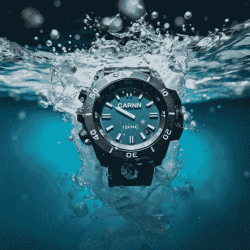

**在屏幕上**

在数字领域，在屏幕上显示产品可以让您为其创建一个有吸引力的虚拟空间。为此，请尝试使用此提示：笔记本电脑屏幕前视图显示 [产品] 的高分辨率产品图像，简约。

> 提示：笔记本电脑屏幕的前视图显示奢华香水的高分辨率产品图像，极简主义 — ar 16:9

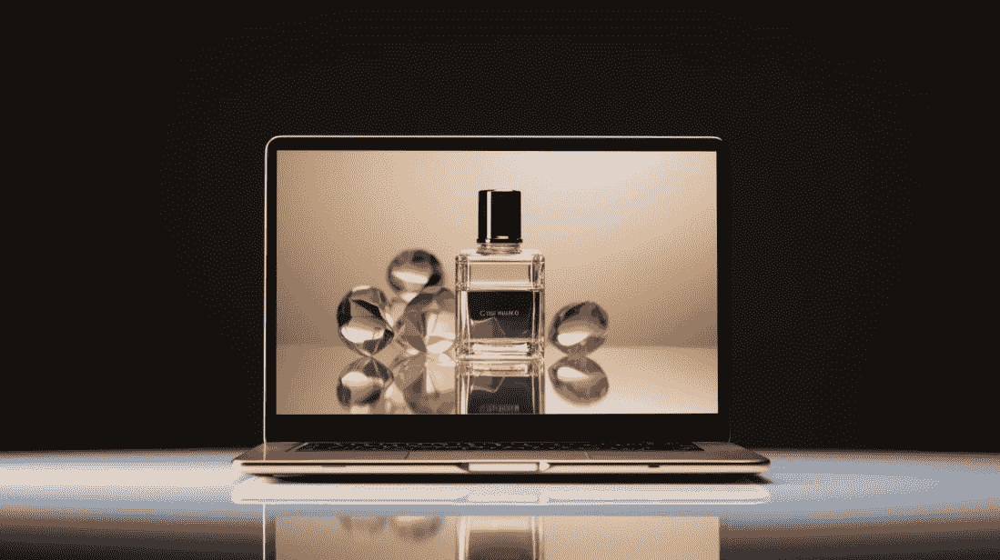

> 提示：笔记本电脑屏幕前视图显示精美瓷器餐具的高分辨率产品图像 – ar 16:9

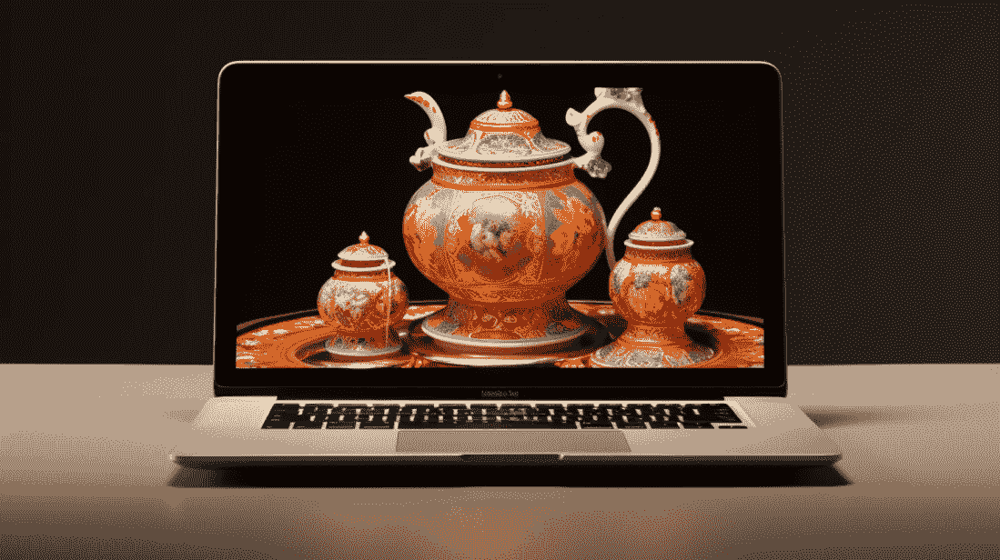

> 提示：笔记本电脑屏幕前视图:: 限量版吉他的高分辨率产品图片:: — ar 16:9

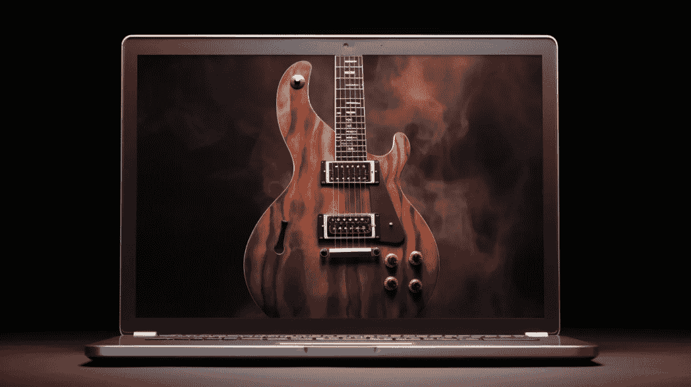

**几何排列**

将您的物品整理成几何图案，让它们看起来漂亮、井井有条。

提示：高档手表的鸟瞰图整齐地排列在光滑的黑色玻璃背景上，带有网格状的几何图案，柔和的漫射灯光，简约而现代，对称的构图

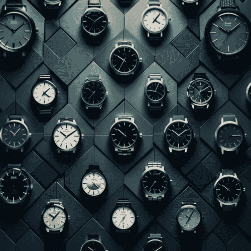

> 提示：鸟瞰彩色马卡龙，整齐地排列在圆形布局的质朴木桌上，温暖的黄金时段灯光，平躺透视，柔和的调色板

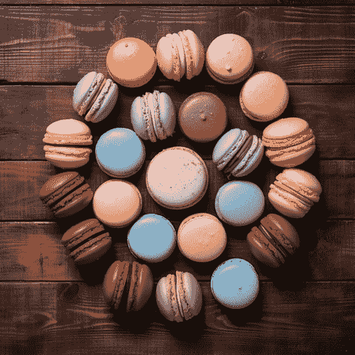

> 提示：鸟瞰手工制作的皮革钱包，整齐地排列在复古地图上，呈线性排列

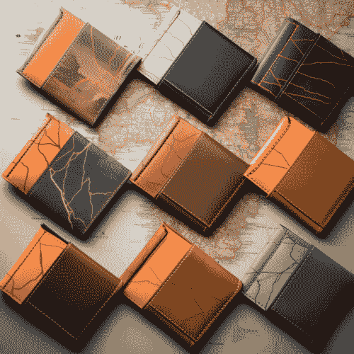

> 提示：鸟瞰寿司卷，整齐地排列在黑色石板盘上，呈同心圆布局

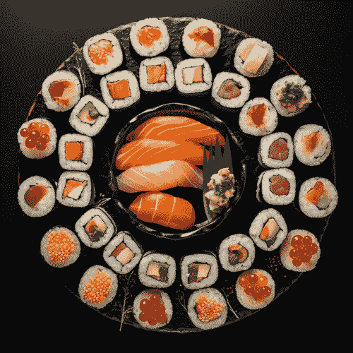

**Knolling**

Knolling 将产品精美地布置在平坦的表面上，创造出具有视觉吸引力的布局。在《中途》中，关键词“敲响”有着神奇的含义。将其应用到一件作品上，您可能会发现其复杂的细节。或者用它来和谐地排列一系列产品或其组件。

> 提示：质朴的木桌上的 knolling 文具系列 – ar 16:9

> 提示：以狗为中心的敲击宠物美容必需品，漫射窗光 — ar 16:9

## 背景

背景不仅仅是产品背后的地方。它们增强了品牌的特色，引导观看者的目光，甚至可以成为品牌的象征。

查看下面的一些背景。每一种都有自己的风味和功能，为您的产品创造合适的氛围。

**产品讲台**

将产品放在T台上确实可以凸显其重要性。以下提示旨在创建完美的跑道图像。

之后，只需将您的产品叠加到这些背景上即可。另一个好处是：我使用中途着色的魔力通过产品演示增强了图像。

> 提示：带有木质纹理平台的产品讲台，极简主义 – ar 16:9

> 提示：温暖的黄色背景和产品讲台 — ar 16:9

> 提示：无缝蓝色背景下孤立的薄石产品讲台 — ar 16:9

> 提示：光滑的木质表面可容纳产品，背景是熙熙攘攘的现代工作空间的柔和模糊 — ar 16:9

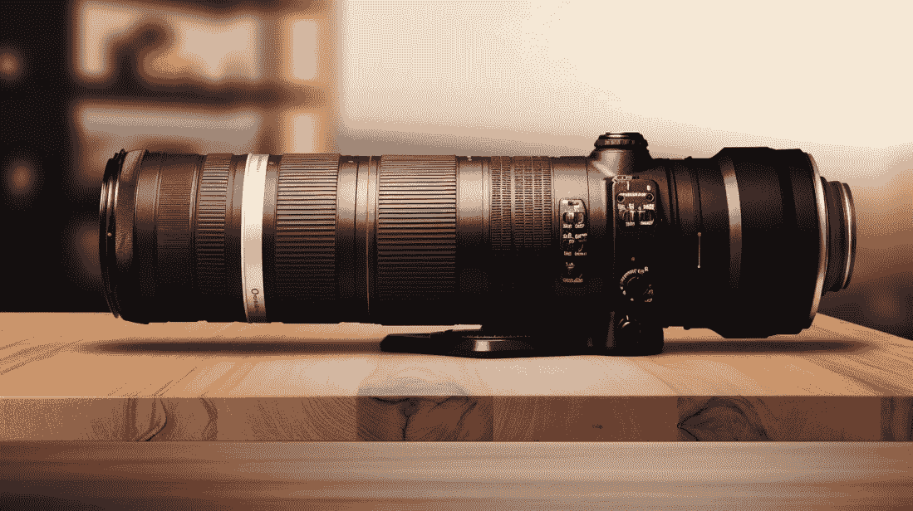

> 提示：带有霓虹灯光环的光滑金属讲台，以深蓝色到紫色的渐变为背景 — ar 16:9

> 提示：柔和的粉色渐变背景下发光的圆形讲台 — ar 16:9

> 提示：极简主义的淡黄色设置，带有柔和的灰色拱门，构成白色圆形讲台 — ar 16:9

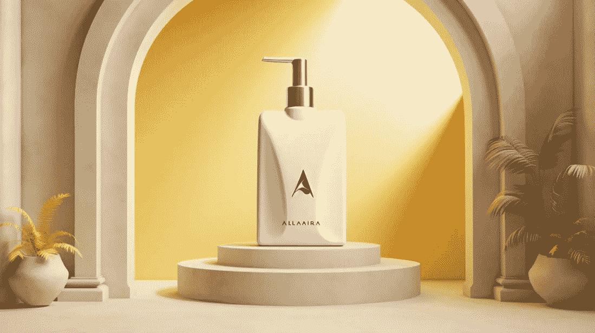

## 镜头光晕

当杂散光进入镜头并从相机传感器反射，形成光条纹或圆圈时，就会发生镜头眩光。使用镜头光晕可以给图像带来戏剧性、温暖或复古的感觉。尝试使用此模板创建镜头光晕：[产品]、带有镜头光晕的[颜色]背景。

> 提示：天鹅绒垫上闪闪发光的钻石戒指，宝蓝色背景和镜头光晕

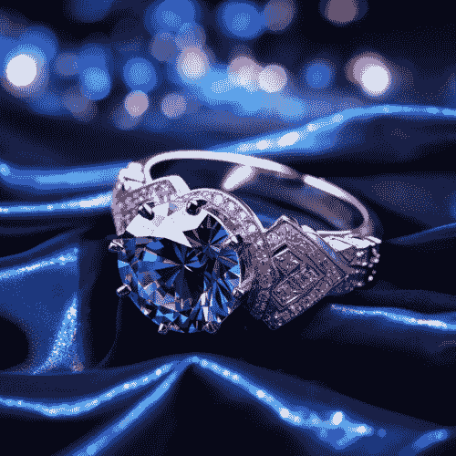

> 提示：一组美味巧克力装在装饰盒中，温暖的棕色背景和镜头光晕 — ar 16:9

> 提示：时尚现代的台式电脑、带镜头光晕的家庭办公室背景 – ar 16:9

> 提示：闪闪发光的银项链，配有心形吊坠、天体背景和镜头光晕

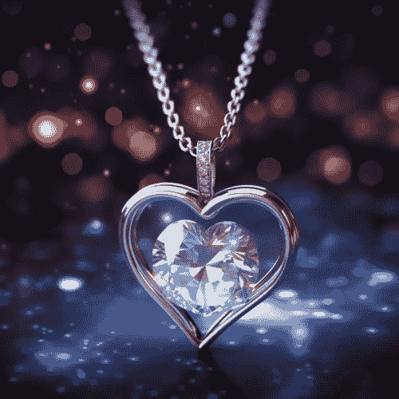

**渐变柔和**

寻找散发着平静、现代感或只是甜美的背景？渐变柔和的背景就是您的答案。它很现代而且绝对令人惊叹。试试这个模板：[产品]在渐变柔和的背景下。

> 提示：一副时尚的太阳镜，透明镜片，现代镜框，渐变柔和的背景 - ar 16:9

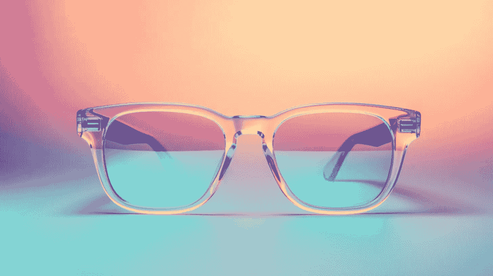

> 提示：闪亮的新型银色智能手机，反光表面，时尚的设计，渐变柔和的背景

**大理石的纹理**

散发着精致和优雅的气息。

> 提示：奢华腕表，带有旭日纹图案的复杂表盘，皮革表带，大理石纹理

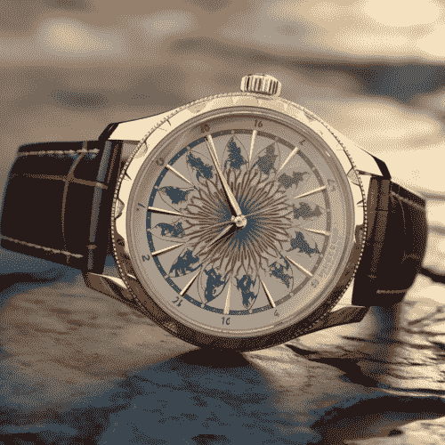

> 提示：晶莹剔透的威士忌醒酒器、雕花玻璃、陈年威士忌、大理石纹理背景、柔和的灯光

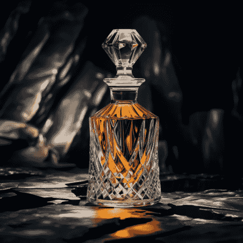

**空灵的散景**

在这个美妙的背景下将您的产品变成神奇的东西。

> 提示：手工吹制的玻璃花瓶、柔和的漫射日光、半透明的柔和色调、空灵的散景背景

> 提示：精致的瓷茶杯、花园环境、柔和的色彩、梦幻般的空灵散景背景

**激光表演**

强调技术设备或添加充满活力的音符。

> 提示：跑车时尚的镀铬格栅在激光表演中闪闪发光 — ar 16:9

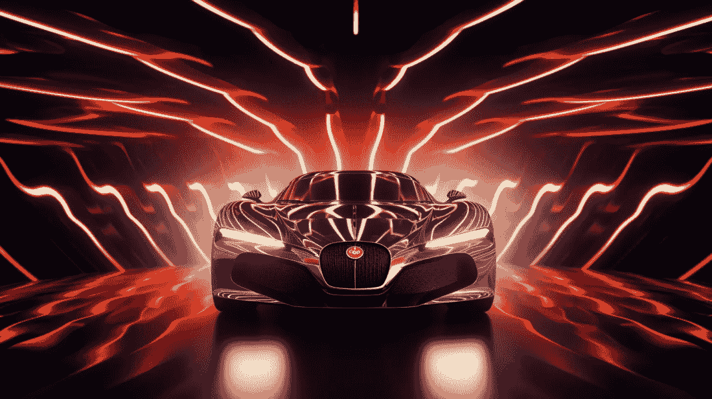

> 提示：沐浴在动态激光灯下的高端自行车车架 – ar 16:9

> 提示：时尚的 VR 耳机在激光表演的混乱色彩中闪闪发光

**霓虹灯网**

霓虹灯与网格图案搭配。

> 提示：闪亮的镀铬复古麦克风，优雅地放置在无缝霓虹灯网格背景上，特写

> 提示：一系列优质家庭音响扬声器，每个都有其独特的设计，在无缝的霓虹灯网格背景下 — ar 16:9

**梦幻云景**

想象一下您的产品处于蓬松、梦幻的云朵中。

> 提示：一双优雅的高跟鞋，优雅地放置在异想天开的云景中，柔和浪漫的灯光下

> 提示：充满活力的红色唇膏管，异想天开的云景背景

