# 中途提示：控制视角

> 来源：[https://my.feishu.cn/docx/KsTzd5OnXol06exb6v4caG6snWf](https://my.feishu.cn/docx/KsTzd5OnXol06exb6v4caG6snWf)

**1.远景**

成像中的长镜头技术是一种从远距离拍摄物体或场景以覆盖广阔区域或风景的技术。这种技术可以让您展示周围环境中的物体，创造空间感并传达场景的背景。

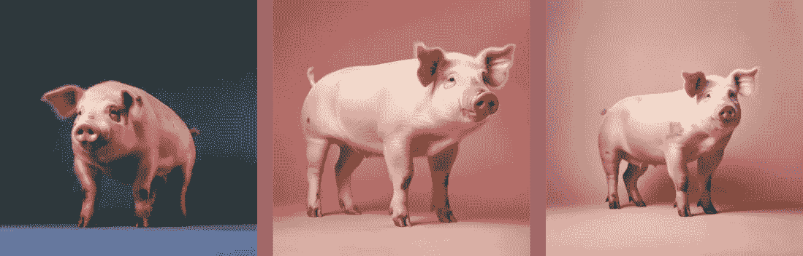

提示：猪的工作室照片，远景

**2.中景**

摄影中的中景技术是一种在一定距离处拍摄物体或场景的技术，使画面从腰部或臀部到头部充满。这种技术可以让你更详细地传达拍摄对象的面部表情、手势和面部表情。

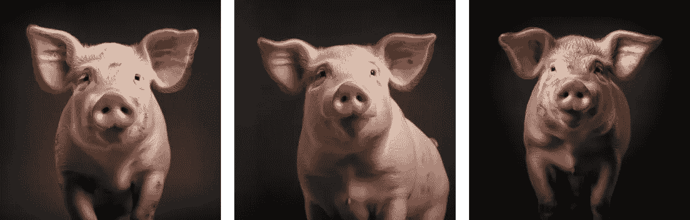

提示：猪的工作室照片，中景

**3.特写**

特写技术用于以放大的比例捕捉物体或场景，但不像极端变焦技术那样极端。

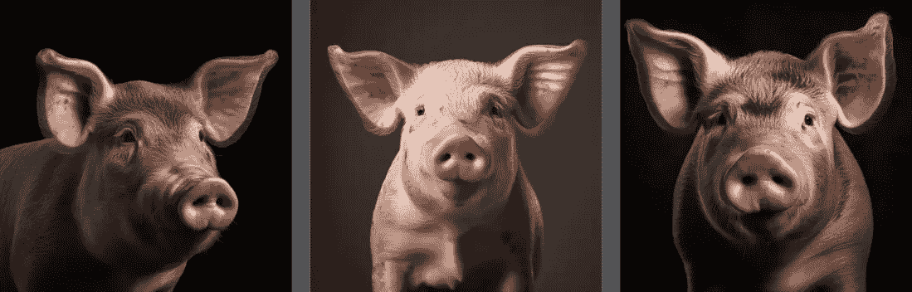

提示：猪的工作室照片，

**4.中景特写**

摄影中的中特写技术涉及拍摄从胸部到头部或从头部到肩膀充满画面的物体或场景。

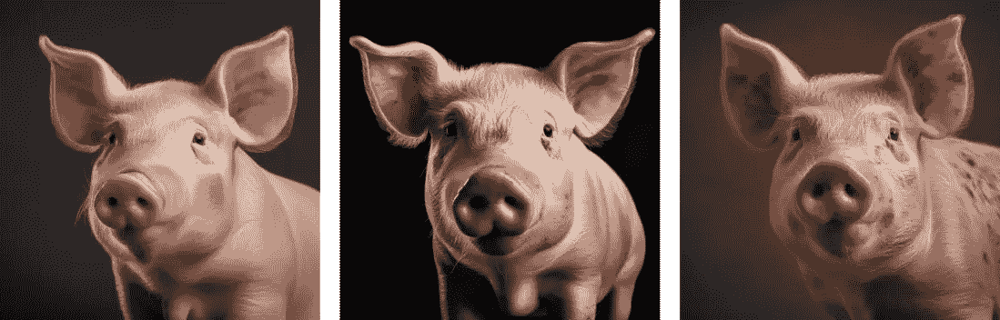

提示：猪的工作室照片，中特写

5.**极端特写**

图像中的超特写技术可以让您拍摄物体的距离如此之近，以至于您可以看到普通眼睛无法看到的细节。这使您可以突出显示最小的元素和纹理。

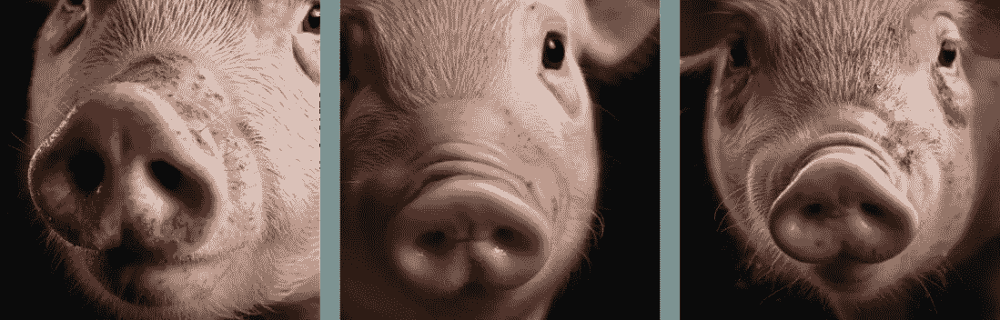

提示：猪的工作室照片，极端特写

**6.中远景**

中长镜头摄影是一种从远处拍摄物体或场景以捕捉周围环境并创造背景的技术。这种技术可以让您显示周围环境中的物体，建立比例和比例，并传达场景的氛围。

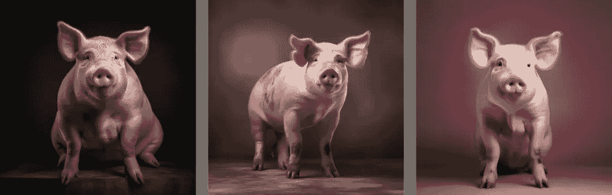

提示：猪的工作室照片，中远景

**7.低角度拍摄**

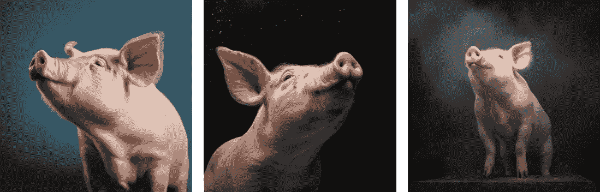

提示：猪的工作室照片，低角度拍摄

摄影中的低角度拍摄是一种摄影师从低于视线水平的低点捕捉物体或场景的技术。

8.**鸟瞰图**

捕捉大部分场景的帧，通常包括多个对象或元素。广角镜头通常用于创建场景、背景并展示场景中人物和物体之间的空间关系。

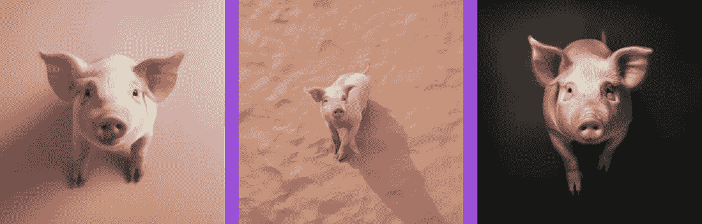

提示：猪的工作室照片，鸟瞰图

**9.广角镜头**

广角摄影是一种从远处拍摄场景或风景以捕捉广阔区域并传达整体背景的技术。该技术用于显示空间、比例以及对象之间的关系。

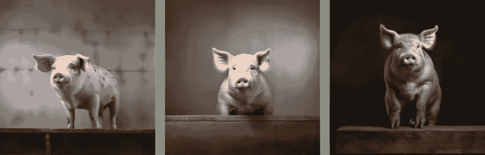

提示：猪的工作室照片，

**10.荷兰角**

相机倾斜，导致地平线成一定角度的镜头。这种类型的摄影通常用来制造一种迷失方向或紧张的感觉，以及强调人物的情绪状态。

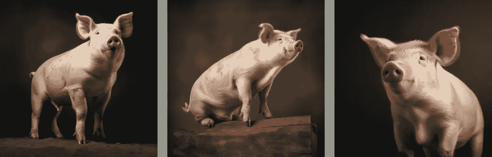

提示：一头猪的工作室照片，荷兰角

**11.后视图**

一种构图技术，可让您从后面聚焦于物体或主体来拍照。这种技术可用于各种类型的摄影，例如街头摄影、新闻摄影、肖像摄影和时尚摄影。

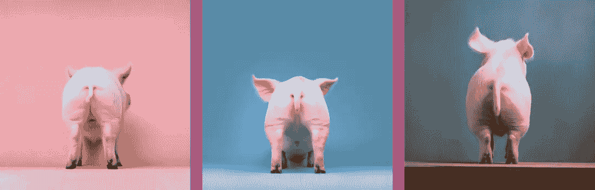

提示：猪的工作室照片，后视图

12.**侧视图**

横向角度技术或侧视图是另一种有趣的构图技术，可用于各种摄影类型。这种技术允许您从侧面捕捉物体或主题，创造独特的视觉效果和有趣的角度。

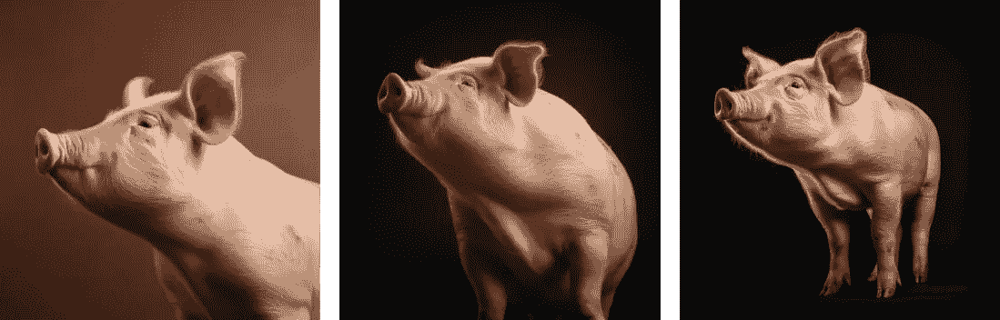

提示：猪的工作室照片，侧视图

**13.水平角**

水平透视是一种用于插图和视觉艺术的技术，以水平透视呈现物体和场景。在这种技术中，眼睛或观察者的水平线与物体对齐，创造出一种稳定和平衡的感觉。

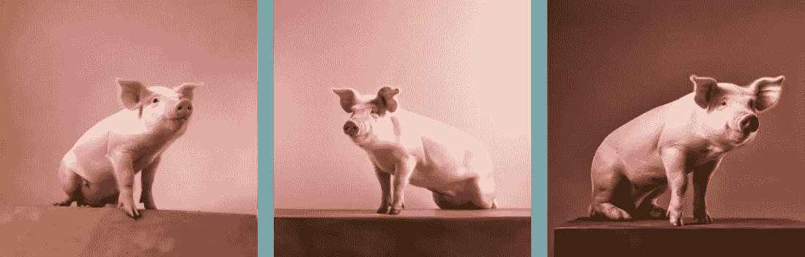

提示：猪的工作室照片，水平角度

14.**左视图**

左透视是一种用于插图和视觉艺术的技术，从左侧描绘物体和场景。该技术侧重于从左视角呈现物体和视角。

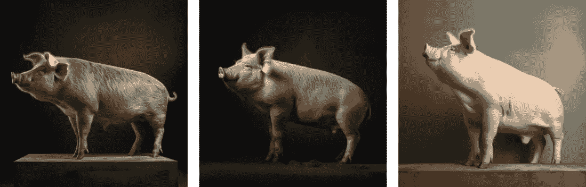

提示：猪的工作室照片，左视图

15.**右视图**

右透视是一种用于插图和视觉艺术的技术，其中物体和场景是从右侧描绘的。该技术侧重于从正确的角度呈现物体和视角。

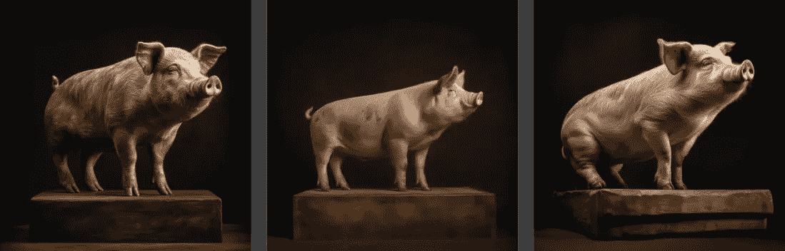

提示：猪的工作室照片，右视图