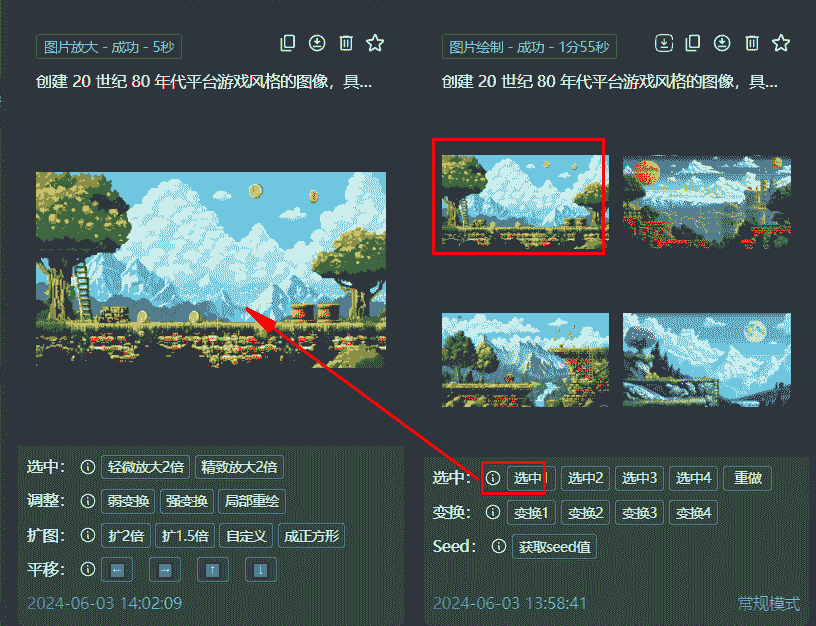
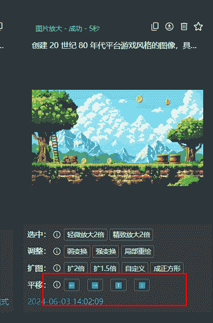
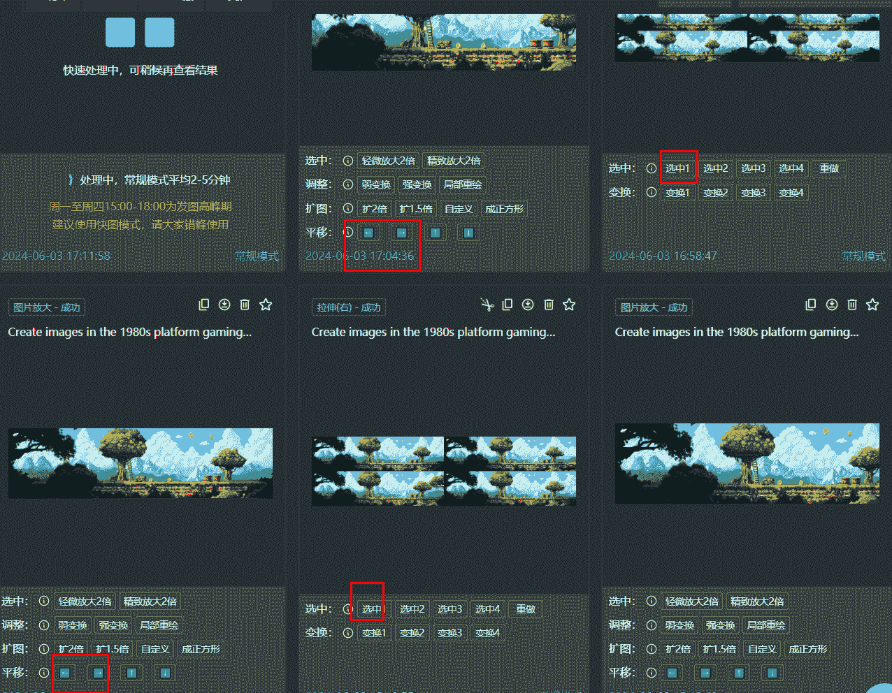
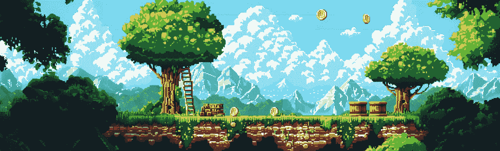
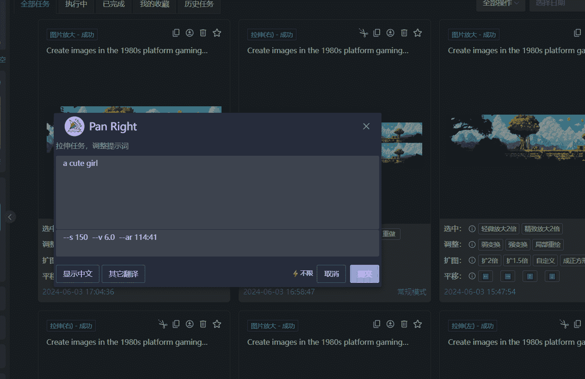

# 如何设计中途的游戏地点？

> 来源：[https://my.feishu.cn/docx/Lebzdlf3Ioo73pxHKywcrjVanQh](https://my.feishu.cn/docx/Lebzdlf3Ioo73pxHKywcrjVanQh)

使用 Midjourney 在游戏中创建地点是一件非常酷的事情。想象一下，作为一名开发人员，您可以快速将您的想法转化为视觉概念，而无需花费大量时间和资源。这在开发的早期阶段尤其酷。

为了创建游戏地点，您需要做的第一件事就是弄清楚它是什么样的地方。例如，一些废弃的城镇或神秘的森林，或者可能是一些完全奇妙的东西，比如未来的大都市。这里最重要的是考虑所有细节。例如，这个地方的风格是什么？它可以是蒸汽朋克、赛博朋克或经典奇幻风格的东西。

例如，我将使用提示：

**创建** 20 世纪 80 年代平台游戏风格的图像，具有横向卷轴景观、像素化艺术、鲜艳的色彩以及🪜、硬币和敌人等经典平台元素。 --ar 16:9 --v 6.0 --s 150 --风格原始

1.首先生成图像后并使用按钮选中1，2，3，4放大一张喜欢的

2.按您想要扩展图像的方向选择**平移**按钮。它可以向左、向右、向上或向下。平移按钮可让您沿所需方向平移图像。

生成图像后，使用选中1,2,3,4 按钮再次选择合适的图像。

重复这些步骤，根据需要重新定位图像。您可以连续无限次地进行放大、缩小、平移和重复操作，以任意方向放大和缩小图像中的对象。

您还可以通过添加提示来添加想要的元素。

创建图像后，可以在图形编辑器中对其进行修改，以实现所需的格式和附加效果。