# Midjourney创作真实摄影如何写提示词

> 来源：[https://my.feishu.cn/docx/GVzfdCoy6oNzIvxDeuicopzKnxc](https://my.feishu.cn/docx/GVzfdCoy6oNzIvxDeuicopzKnxc)

## 👉🏻 M在简短而准确的提示下效果最佳。

如果您还不知道，如果您使用简短而精确的提示，尤其是在处理逼真的图像时，最新版本的 Midjourney（V5.1 和 V5.2 及以上版本）实际上会工作得更好，事实上要好得多。我今天要讲的就是告诉你。

根据中途团队的说法，

> 带有不必要的单词、冗长的描述和诗意短语的长提示可能会导致图像中出现意想不到的元素。

## 💡 获取逼真图像的提示词公式

> 摄影主题/风格 + 图像内容描述 + 图像角度 + 图像焦点 + 灯光 + 天气/一天中的时间 + 相机/胶片类型 + 真实感描述 + 长宽比完整指南 + 我的秘密奖励提示 图像内容 + 图像角度 + 图像焦点 + 照明 + 天气/一天中的时间 + 相机/胶片类型 + 现实主义描述 + 长宽比终极指南 + 我的秘密奖励技巧）

根据这个公式，我将编写提示的关键字分为以下几类：

📌 摄影主题/风格（本文介绍）

📌 图像角度（本文中讨论）

📌 聚焦图像（本文中介绍）

📌 照明

📌 天气/一天中的时间

📌相机/胶卷类型

📌 现实主义描述

📌 纵横比完整指南

✨ 额外提示：Midjourney 的具体参

在这篇文章中，我将讨论以下关键字：

+   **摄影主题/风格+图像角度+图像**焦点

## 第一部分：📌摄影主题/风格

+   **魅力镜头**最大限度地展现拍摄对象之美的肖像。化妆、服装选择和优雅的姿势都会被用到。

Instagram 模特的魅力镜头，海洋垃圾风格 --ar 4:3

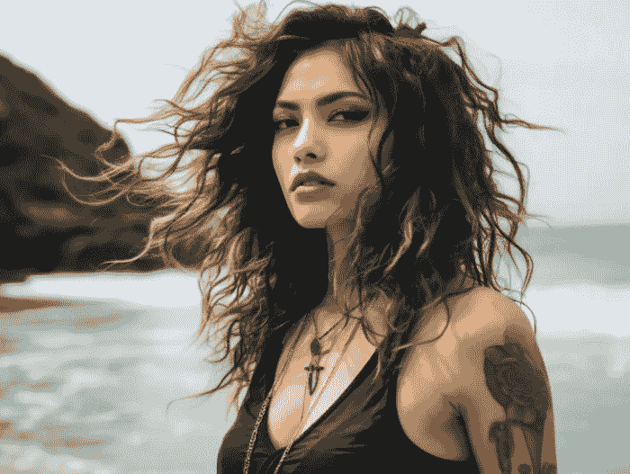

**街头风格摄影**

街头风格摄影，一个黑发、大胡子的土耳其男子，走在百老汇的人行道上，肩上扛着皮革笔记本电脑包，穿着宝蓝色西装外套，日落灯光，超现实主义

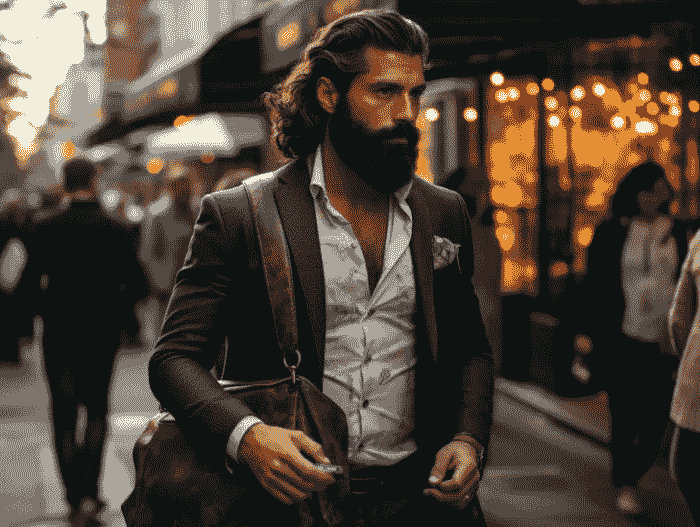

**肖像**

> 一位法国老妇人的肖像，皱纹很深，笑容温暖，薄荷绿亚麻围巾，逼真的图像 --ar 3:4

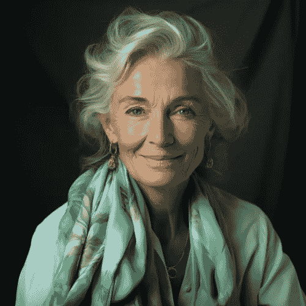

**抓拍照片**未经事先摆姿势而拍摄的照片。

玉米田中年轻女子的肖像摄影，抓拍照片，梦幻般的灯光，阳光照进她的头发，85mm，f 1.2，--ar 4:3

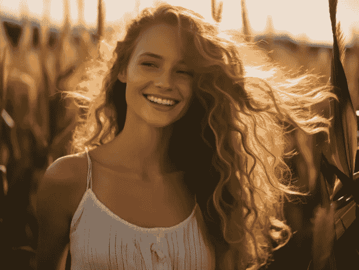

**微距摄影**

一只蜜蜂在带有水滴的向日葵花瓣上的显微摄影，超详细 --ar 16:9

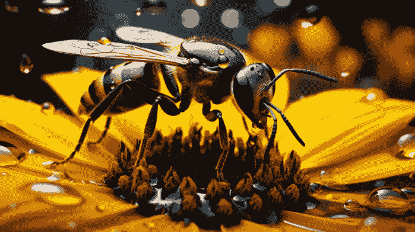

**水下摄影**

一位身穿白裙的红发女子的超现实水下摄影 --ar 16:9

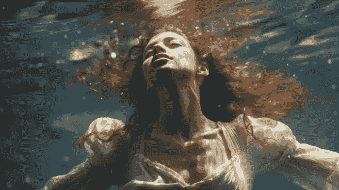

**野生动物摄影**

> 狮子和她儿子的野生动物摄影，超现实 --ar 16:9

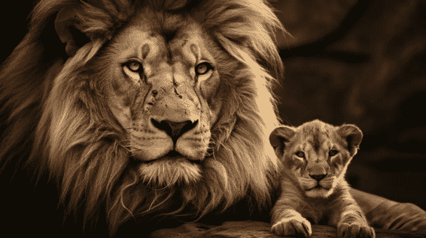

**自然摄影**

罗卡角自然摄影，日落时间，数码单反相机，真实感 --ar 16:9

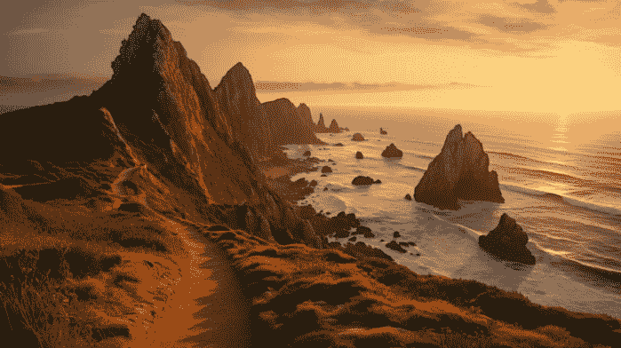

生活方式摄影（Lifestyle Photography）是在自然环境中拍摄人们，它让他们感到更加自然和轻松）

> 一位妈妈和她的两个孩子的生活方式摄影，真实的图像 --ar 16:9

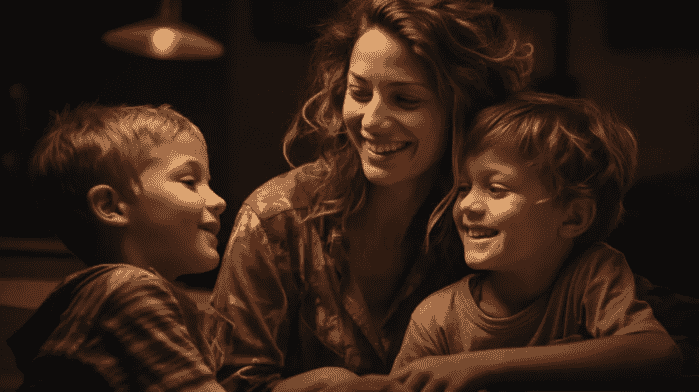

**聚光灯摄影**。聚光灯 - 将光源反射到拍摄对象的眼睛中，以增强他的外观并赋予他更真实的外观。

> 金发女郎的特写肖像，聚光灯摄影，数码单反相机，电影，作者：Richard Avedon --ar 3:2

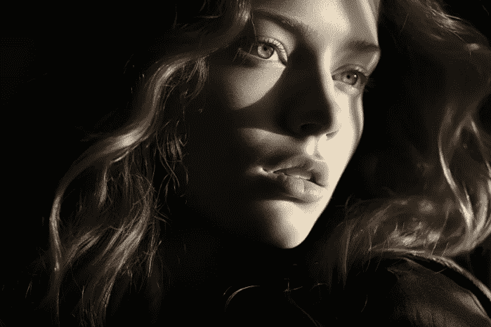

**产品摄影**

咖啡豆从麻袋中倾泻而出的产品摄影，质朴的外观，超现实 --ar 16:9

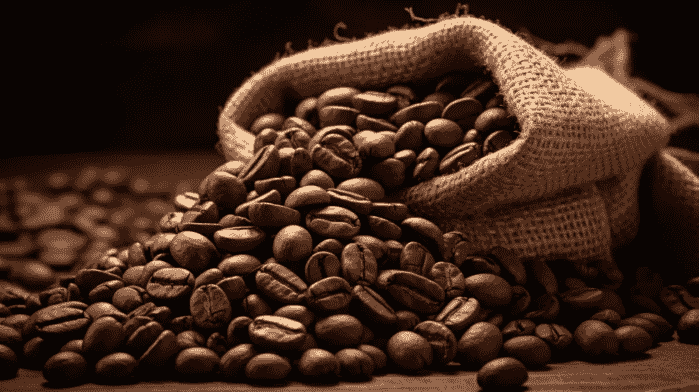

**新闻摄影/美联社摄影**（Photojournalism/Associated Press Photography）——用摄影来报道事件

> 挪威渔妇的新闻摄影，严酷的冬季环境，粗犷的服装，生动的细节，低光 --ar 3:2

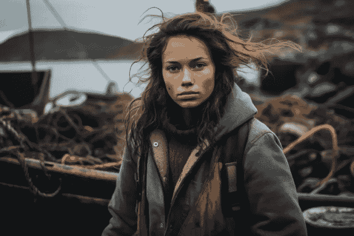

**目录摄影**

聚光灯下闪闪发光的钻石戒指的目录摄影，反光背景，超详细

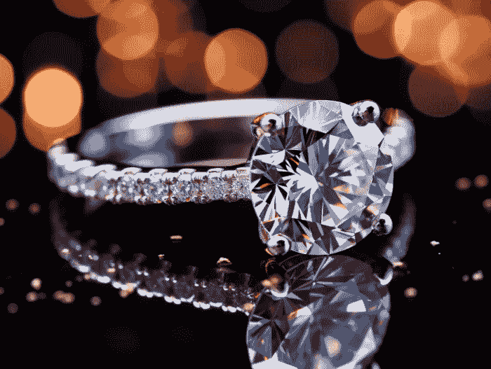

**纪实摄影**是对人物、地点、物体和事件进行简单而准确的描述的摄影。

> 巴黎集会纪实摄影，广角写实拍摄 --ar 4:3

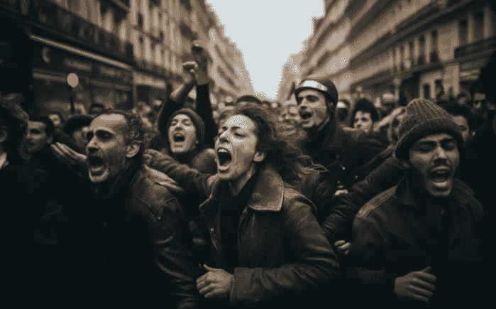

**移轴摄影**相机的控制方式使真人大小的物体或物体显示为微型模型。

> 香港建筑物的移轴摄影，空中角度 --ar 16:9

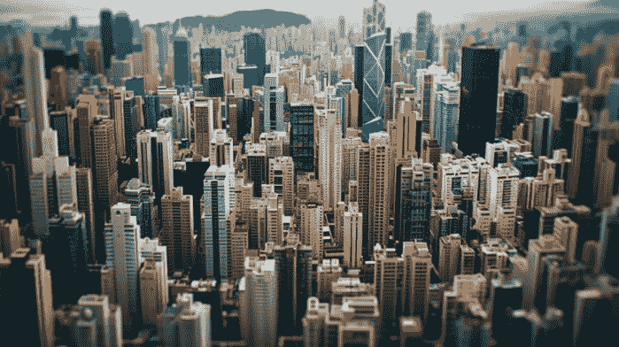

**食物摄影**

枫糖浆淋在一堆松软的煎饼、蓝莓上的美食摄影，奢华的米其林厨房风格 --ar 16:9 --s 400

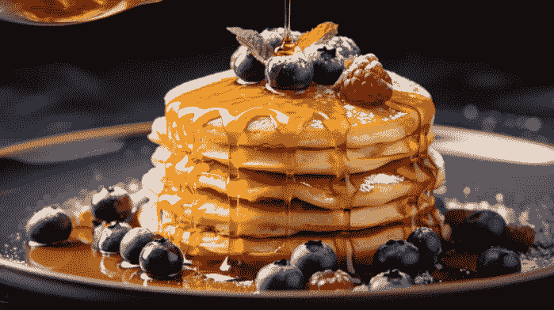

**黑白摄影**

黑白摄影，一男一女坐在 1969 年巴黎的路边咖啡馆里，60 年代法式时尚风格，电影灯光，写实 --ar 16:9

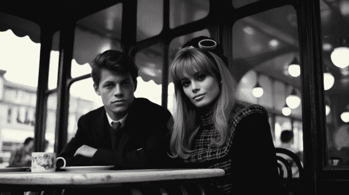

**国家地理摄影**

国家地理摄影，泥中跳跃的猎豹，超详细照片，1/500 快门速度，DSLR --style raw --s 400

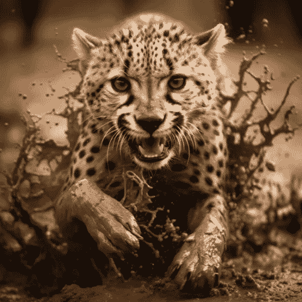

Unsplash Photography（一个图库摄影网站，具有电影般的逼真外观，特别适合具象美学）

Unsplash 摄影，一名女子撑着雨伞在空中跳跃，极简背景，色彩缤纷的街头壁画，黄色和黑色，超高清图像 --ar 16:9

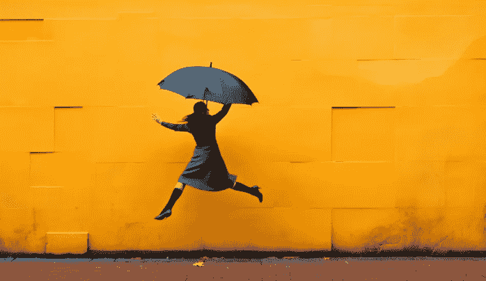

**胶片颗粒摄影**是指图像中的小颗粒或“颗粒”，它们是产生静态和动态图像的模拟技术的结果。

1940 年代美国男性农民，在质朴的谷仓前，褪色的牛仔工作服，陈旧的徕卡 M3，棕褐色调，胶片颗粒，复古风格 --ar 3:2

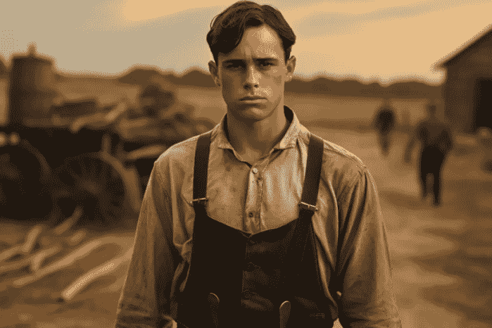

**延时摄影**延时摄影用于捕捉长时间内发生的变化或运动。

香港交通繁忙的道路延时摄影，夜间，超高清图像，高对比度，--ar 16:9

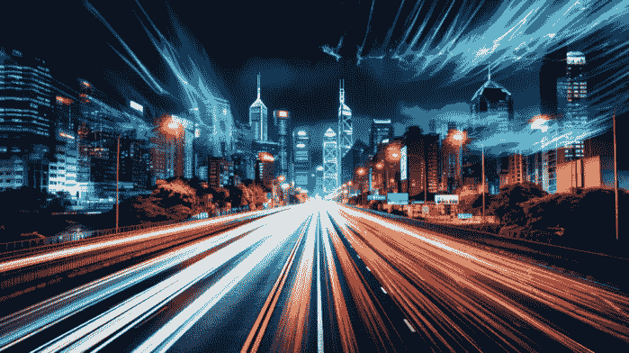

**动态摄影**（显示人/物体运动的摄影）

萨摩亚火舞者的动态摄影，动态姿势，纹身身体，火焰轨迹，数码单反相机，长时间曝光，强大对比度，HDR 图像 --ar 3:2

**高速摄影：**一门用相机捕捉肉眼无法看到的快速现象的艺术。

菠萝落入水中的高速摄影，黑色背景，超高清图像 --ar 4:3

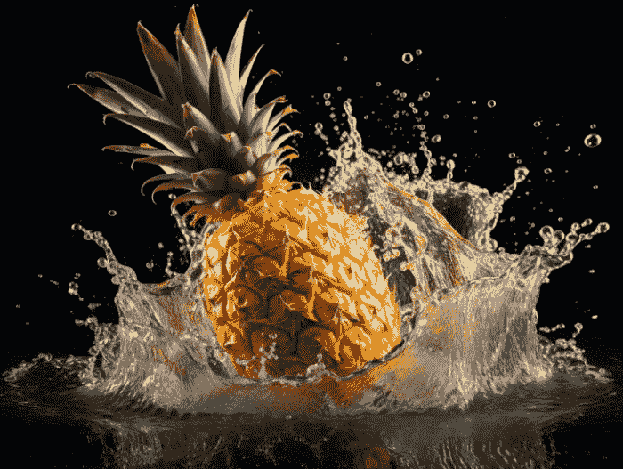

**针孔摄影**使用相机创建，相机只不过是一个带有小孔的遮光盒子，图像通过该小孔投射到胶片上，赋予其独特的美感。

针孔摄影，雾森林内，泥泞，梦幻般的灯光，黑白 --ar 4:3

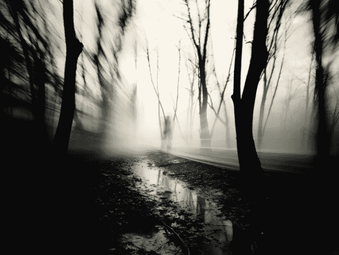

**定格动画摄影**（一种通过拍摄一系列静止图像并快速连续播放来创造运动幻觉的技术）。

一位即将跑步的女性黑人跑步者的定格动画摄影，侧面轮廓角度，视线水平，超高清图像 --ar 4:3

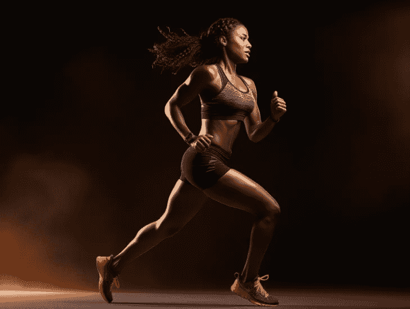

**动作场景摄影**

激烈的动作场景摄影，两个戴着牛仔帽的男人在田野里持枪奔跑，尘土飞扬的一堆堆，逼真的图像--ar 4:3

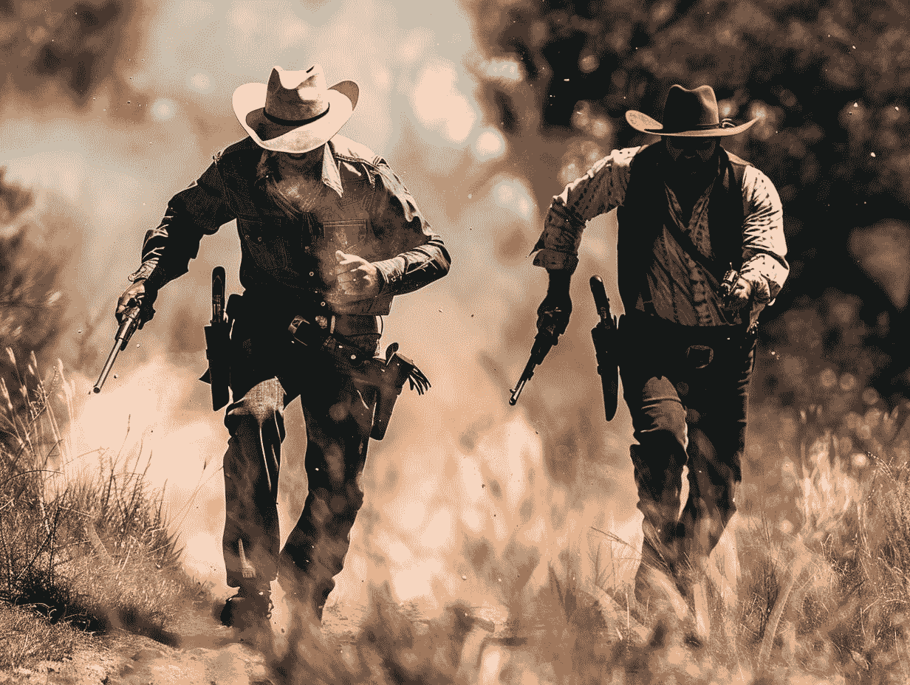

## 第二部分:📌 拍摄角度

**特写**

特写镜头，来自撒哈拉沙漠的图阿雷格人的肖像，身着传统蓝色服装，高对比度，超高清图像 --ar 3:2

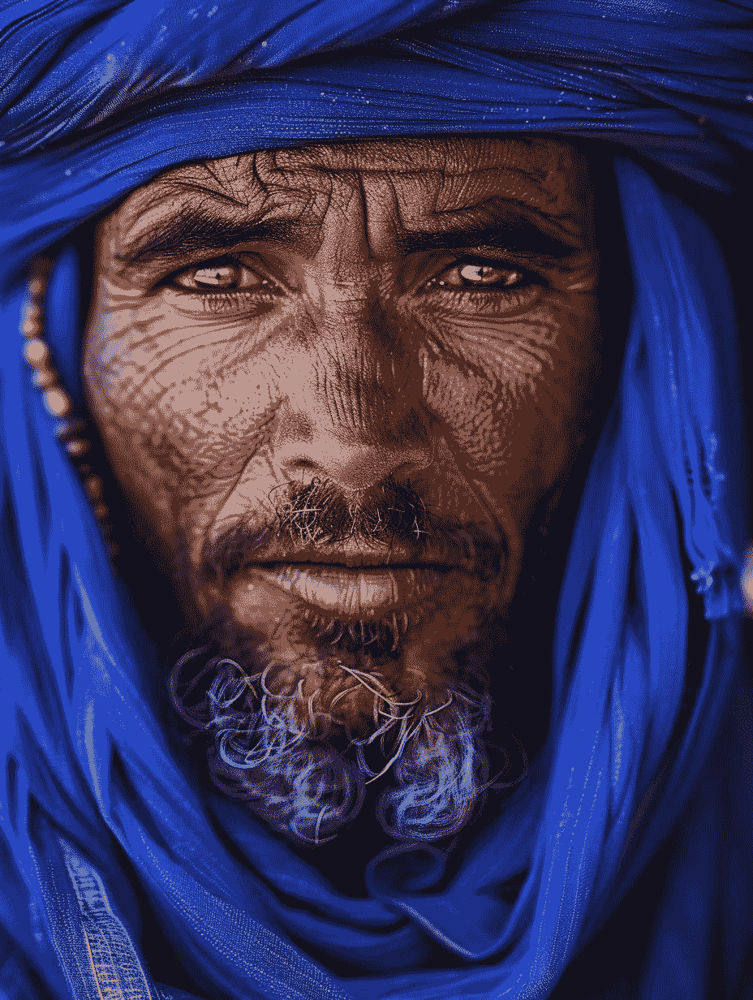

**3/4 镜头（3/4 镜头）**

3/4 侧面镜头，菲律宾吉普尼司机，脸部饱经风霜的中年男子，浅景深，高对比度 --ar 3:2

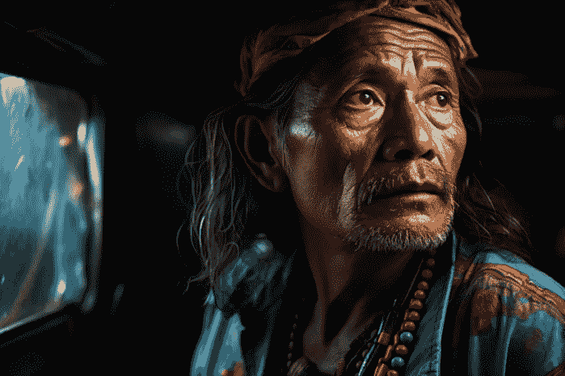

**侧面轮廓**

侧面肖像，瑞典少女，单色，动态阴影，强烈对比，黄昏，电影--ar 3:2

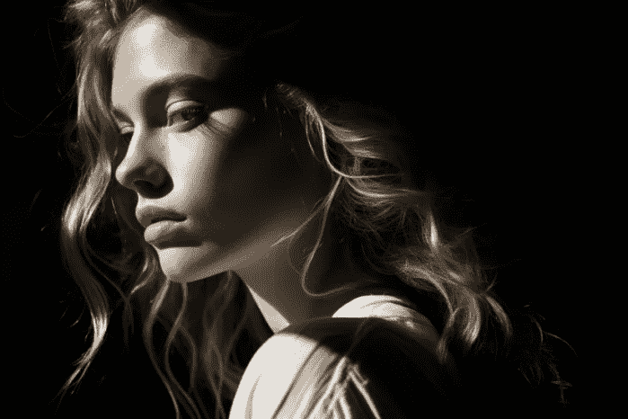

**后视角**

一对夫妇在海滩上散步的后视角，全身拍摄，逼真，黄金时刻 --ar 3:2

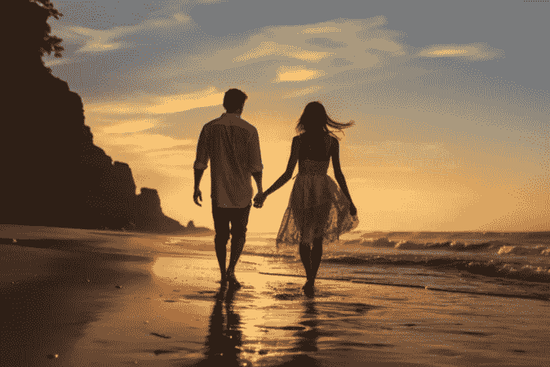

**广角**

香港一栋高楼顶上一个十几岁男孩的广角镜头，鸟眼角度，胶片颗粒 --ar 16:9

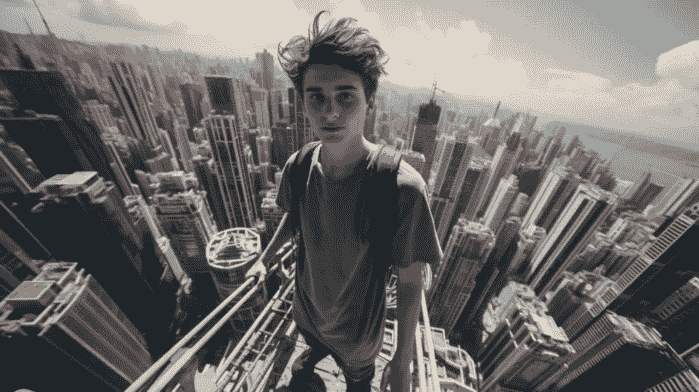

**鱼眼角度/鱼眼摄影**

鱼眼角度，一名年轻人俯瞰工业现场，俯瞰天空，超高清 --ar 3:2

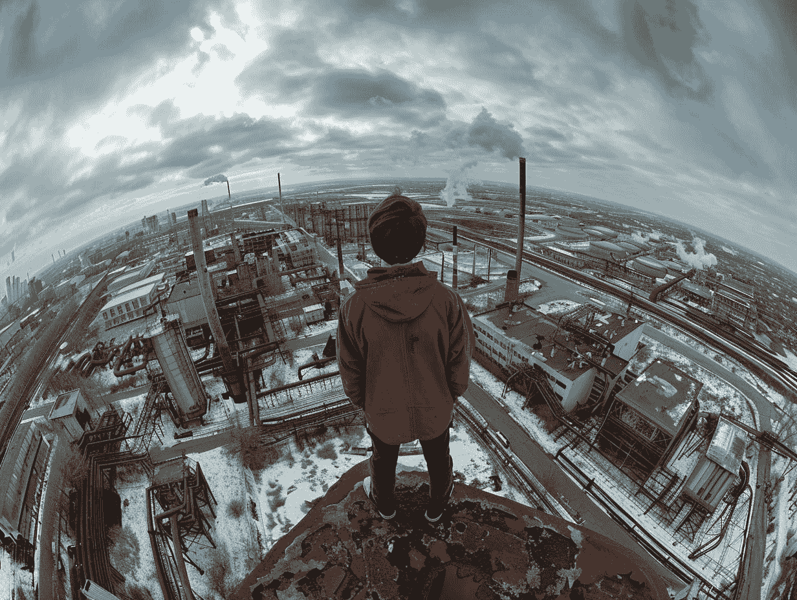

**眼睛水平拍摄**拍摄对象处于眼睛水平。在视线水平拍摄可以实现中立的视角，因为它模仿了我们在现实生活中看待事物的方式。

一位在曼谷当地市场卖水果的亚洲老妇人的视线水平镜头，鲜艳的色彩，高对比度，超现实，自然光 --ar 3:2

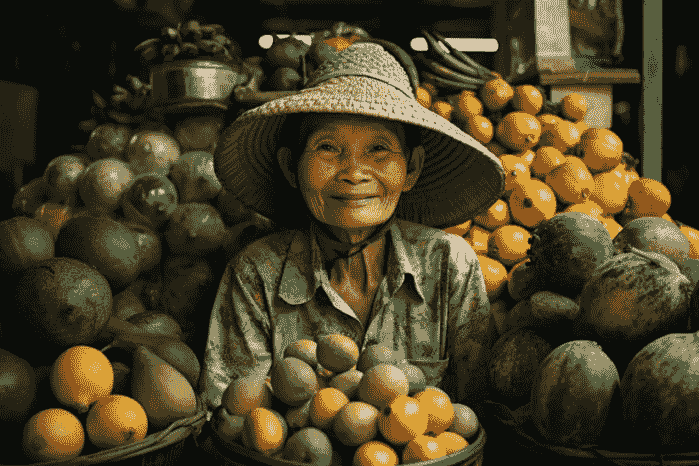

**低角度拍摄/低相机角度**（在拍摄对象视线下方拍摄）

一个微笑的 2 岁男孩的低角度拍摄。单反相机，非常逼真，晨光透过他的头发闪耀 --ar 3:2

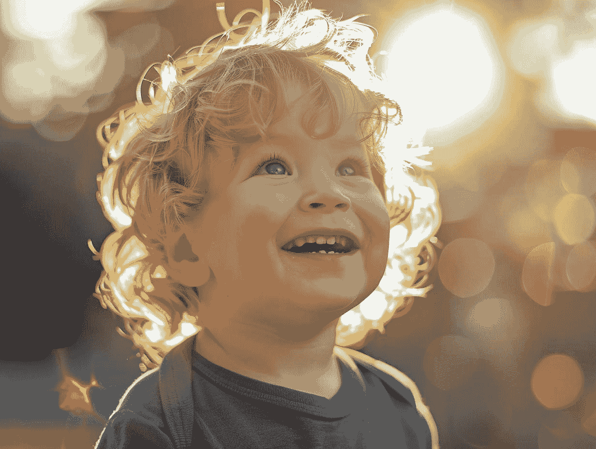

**高角度拍摄/高摄像机角度**（在拍摄对象视线上方拍摄）

复古风格的黑人女性高角度拍摄，使用 Fujifilm Pro 400H 拍摄，早晨柔和的灯光 --ar 16:9

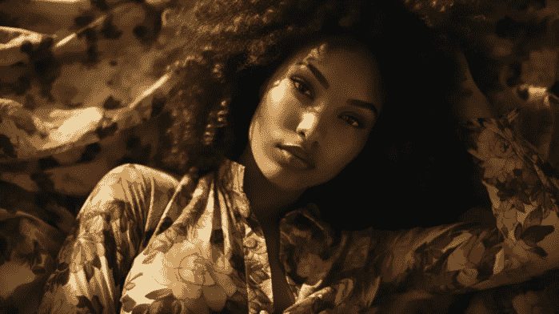

俯视摄影/Knolling（顶视图）

传统韩国拌饭的俯视摄影，逼真 --ar 16:9

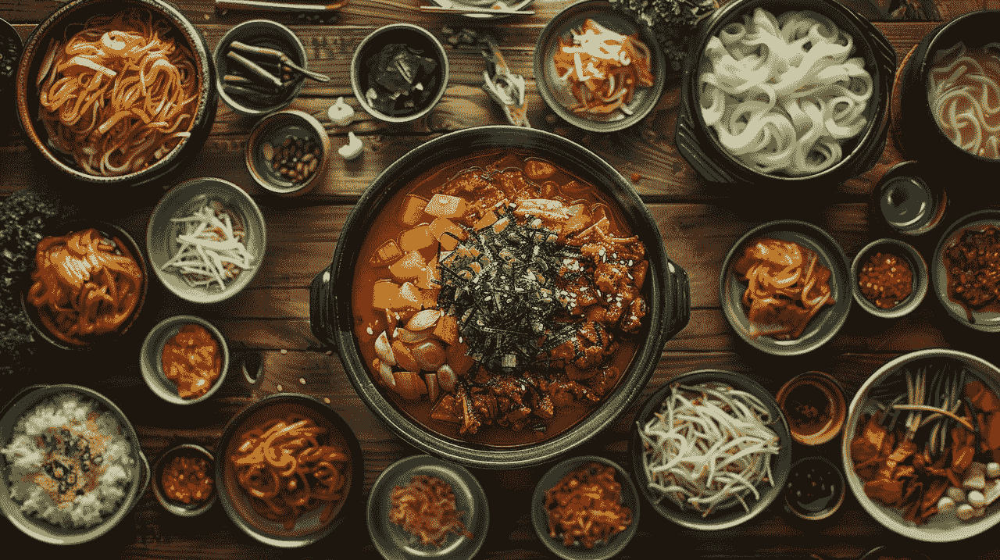

**无人机拍摄/空中拍摄/鸟瞰**

一名男子从瀑布悬崖上跳下的鸟瞰照片，Lomography Color Negative 800，超写实 --ar 3:2

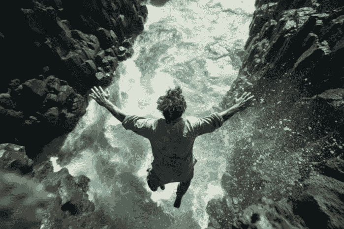

**卫星角度**

葡萄牙海岸线的卫星角度摄影，非常逼真 --ar 21:9

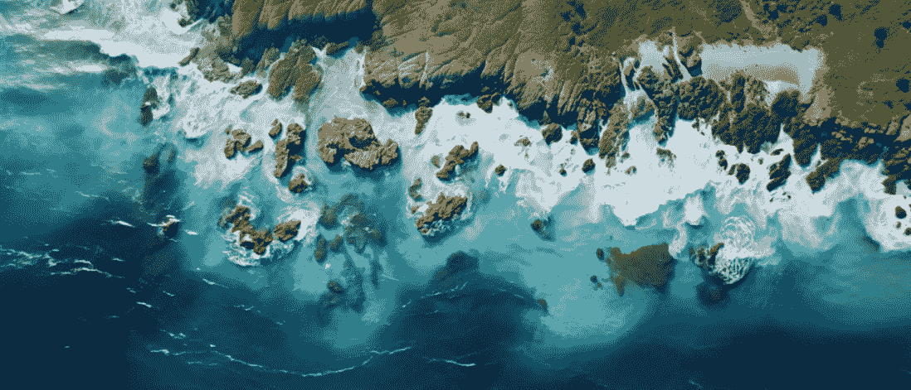

## 第三部分：📌 图像焦点

**浅景深/浅焦点**（模糊背景并聚焦于拍摄对象）

一个穿着连帽衫的男孩的肖像，风格受城市垃圾摇滚和嘻哈影响，叛逆的表情，坚韧的纹理，浅景深 --ar 4:3

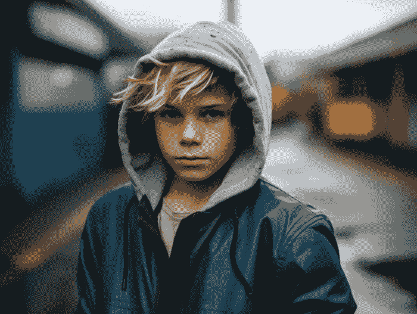

+   **深景深**/深焦点 - 前景、中景和背景都清晰对焦。

洪水过后的餐厅内，深景深，背景清晰 --ar 1:1

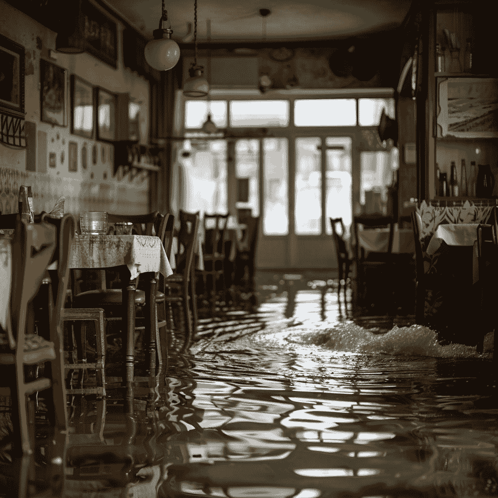

**散焦/失焦**

雨夜灯光失焦摄影 --ar 16:9

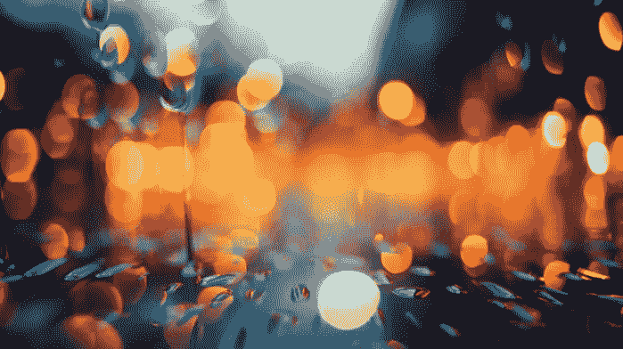

**机架聚焦**（一种涉及将焦点从一个对象转移到另一个对象的技术）

印度户外市场，鲜艳的色彩，机架焦点照片，黄金时段，超高清 --ar 16:9

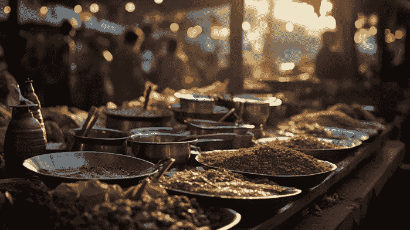

**柔焦**（图像边缘不太清晰锐利）

80 年代金发时装模特的柔焦摄影 --ar 4:3

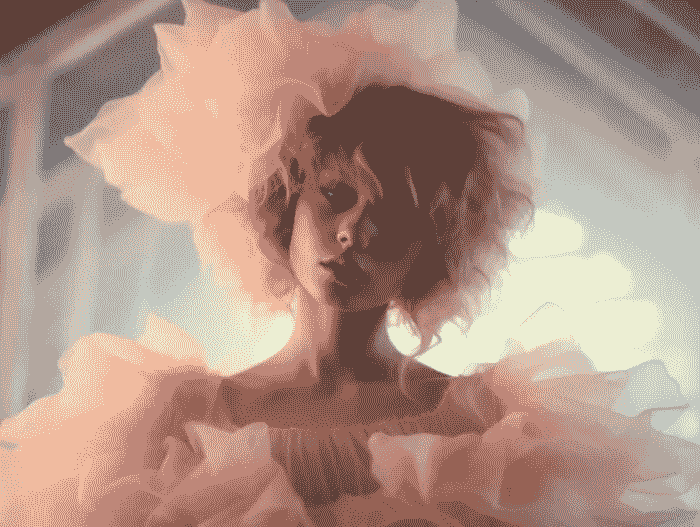

## 第四部分：🔦 照明

**电影剧照/电影照明**（“电影”摄影就像电影的剧照。它涉及受控的照明和构图、镜头选择和拍摄对象的定位）

复古风格好莱坞电影的电影静态摄影，男人和女人，戏剧性的光线 --ar 16:9

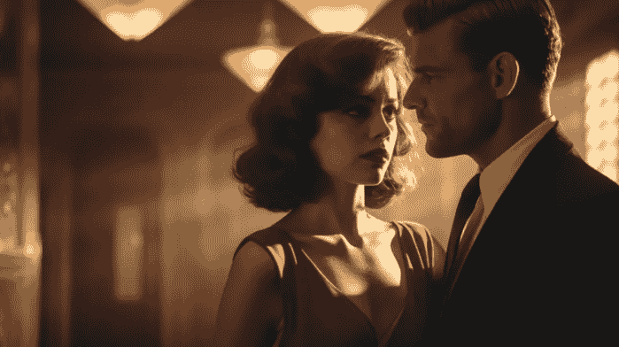

**工作室照明**摄影师使用人造光源来补充现有照明或完全照亮拍摄对象）

一袋小猫零食的产品摄影，旁边有一只虎斑小猫，工作室灯光，黄色和粉色背景 --ar 16:9

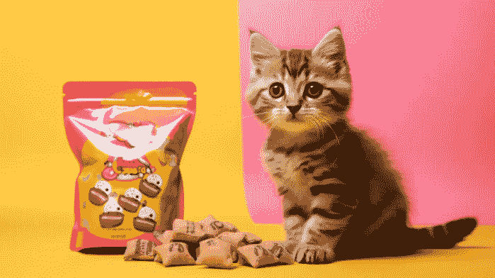

**背光/背光**（背光是指光线从后面照射到拍摄对象上，将其与背景分开。这使拍摄对象更具形状和深度，并增加戏剧性）

一个穿着白色连衣裙的女人站在烟雾前，头发凌乱，背光，以坚韧不拔的好莱坞魅力风格，电影剧照 --ar 16:9

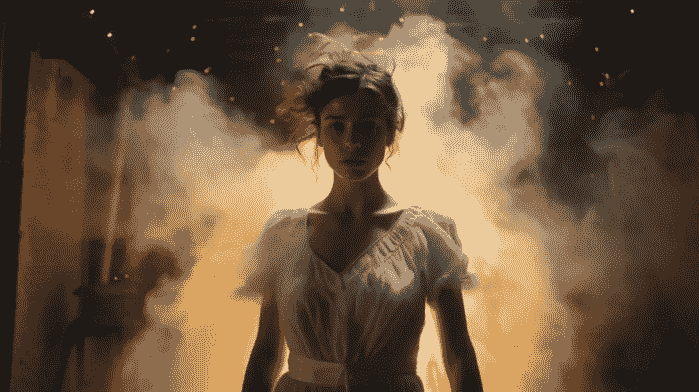

**边缘照明**（边缘光是专门安装的背光，用于沿着拍摄对象的轮廓边缘产生眩光）

边缘照明摄影，亚洲女性的侧面轮廓，特写 --ar 16:9

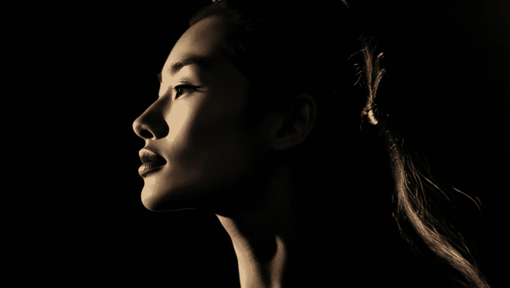

**剪影**（逆光照射你的拍摄对象，在较亮的背景下创造出一个黑暗、清晰的拍摄对象。这可以创造一种神秘感、戏剧感，或强调拍摄对象的形状。）

日落，一对老夫妇在码头上行走的剪影 --ar 16:9

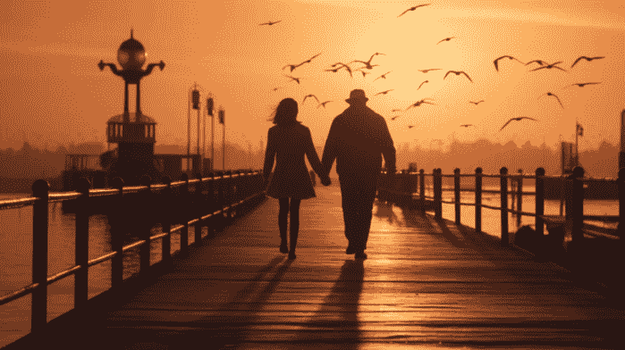

**温暖的灯光**（温暖的灯光，营造舒适和放松的感觉）

卧室里有一只虎斑白猫，窗边有书籍、植物，温暖的午后阳光照耀着，高对比度、超现实的照片 --ar 16:9

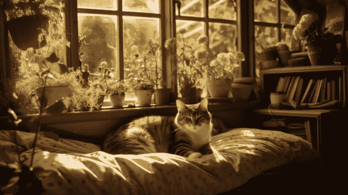

**霓虹灯**（霓虹灯由明亮发光的带电玻璃管或含有稀薄氖气或其他气体的灯组成）

东京一位年轻女子的街头风格摄影，霓虹灯，寒冷的冬日 --ar 3:2

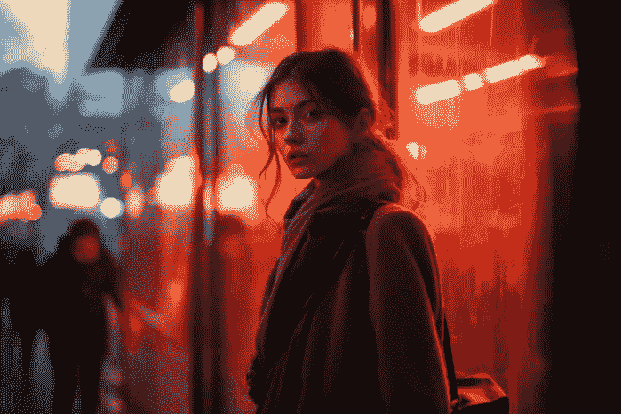

**黑色电影**（使用低光营造怪异气氛。鲜明的对比和强烈的黑色阴影）

阿兰·德龙 (Alain Delon) 类似，黑色电影风格，戏剧性灯光 --ar 16:9

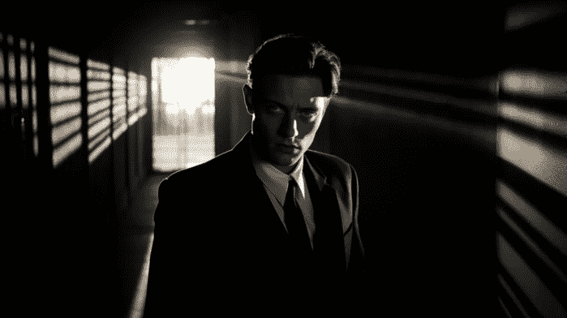

**阳光流/阳光/光线**（在晴天穿过森林时会看到的光流）

阳光透过窗户照射进来，午后的阳光，美丽的卧室，种满了植物 --ar 16:9

**滤色镜照明/彩色凝胶照明**（彩色凝胶是聚碳酸酯或聚酯薄膜，当放置在照明装置前时会投射颜色，使照片呈现独特的外观）

绿色凝胶灯光，照在黑人男模特身上，脸上有水滴，极近摄影--ar 16:9

**漫射光**（漫射光是柔和的光线，既没有直射光的强度，也没有眩光。光线被漫射，消除了刺眼的阴影，使图像看起来更柔和、更温暖）

少女偷拍、漫射灯光、白色窗帘、凌乱的头发、自然姿势 --ar 16:9

**聚光灯**（将窄而强的光束直接投射到物体或人上的光源，通常用于舞台表演）

> 古典剧院中，芭蕾舞女演员穿着飘逸的芭蕾舞短裙，聚光灯照在她身上。戏剧性的灯光，在黑暗的背景下突出舞者。 --ar 16:9

**散景**（散景是一种柔和的失焦背景，也被定义为“镜头描绘失焦光点的方式”）

旧金山市中心一名无家可归者的散景摄影，雨天寒冷，夜间

**朦胧照明**（由于空气中悬浮的粒子对光的散射而降低场景的明显对比度，导致物体显得模糊、失焦，产生梦幻和大气的效果）

年轻女子的复古风格摄影，朦胧的灯光，天使般的 --ar 16:9

**浪漫灯光**（暖色温、昏暗灯光营造浪漫情调）

为情侣布置餐桌，浪漫的灯光 --ar 16:9

**伦勃朗照明**（以著名艺术家的名字命名，伦勃朗照明是放置光源，使拍摄对象的眼睛下方、脸部阴影一侧有一个小三角形高光。这种照明给人一种戏剧性和经典的外观）

黑屏上的金发男子、凌乱的头发、伦勃朗灯光摄影、超高清图像、强烈而戏剧性的灯光 --ar 16:9

**长时间曝光**（相机传感器长时间收集光线时的长时间曝光。因此，照片在场景的黑暗区域显示更多细节，并且任何运动都变得模糊）

街头摄影，纽约海滨，长时间曝光，蓝色时刻，索尼 A7III，24mm f4 镜头，iso 100，真实感 --ar 3:2

**短曝光**（短快门速度，相机传感器仅在很短的时间内收集光线。此技术通常用于体育摄影或自然摄影，让您可以冻结任何运动而不会产生不必要的模糊）

男人脚踩水的特写摄影，水溅，短曝光，浅景深 --ar 16:9

**双重**曝光是一种将两种不同的曝光或图像叠加在一起的技术。使用这些关键词你可以非常有创意）

一位短发亚洲女性在玉米地和高楼上的双重曝光摄影，雨天 --ar 16:9

## 第五部分：🌦 天气/时间

**阴天/阴天/阴天**（阴天/阴天/多云）

太子港的海地男孩，坚韧的外表，贫民窟背景，阴沉的天气，美联社摄影 --ar 3:2

**有雾**

一名瑞士女徒步旅行者在森林里徒步旅行。大雾天。全身照。广角。单反相机 --ar 16:9

**阳光明媚**

20 世纪 70 年代，一家三口在中央公园野餐。晴天。笑声。格子毯子。摩天大楼和池塘。广角拍摄，全身。色彩鲜艳，细节非常丰富。 --ar 16:9

**小雨**

一只老虎在泥泞的田野里休息。小雨。国家地理摄影。 --ar 16:9

**倾盆大雨**

一对青少年夫妇在大雨中互相拥抱，在越南街头，半身拍摄，戏剧性的色彩 --ar 16:9

**下雪**

身着传统服装的西伯利亚萨满，面部纹身，下雪，戏剧性的阴影，高对比度，空灵的光芒 --ar 3:2

**黎明**（日出前不久，天空中首次出现光线时）

亚洲夫妇在北京天坛公园练习太极拳。黎明。全身照。 --ar 16:9

**日出**

街道清洁工正在清扫街道。日出。巴黎的冬天。广角，全身拍摄。使用 Nikon FM2、Agfa Vista 200 胶片拍摄 --ar 16:9

**上午**（上午 9 点至 10 点左右）

上午十点左右，露天食品市场热闹非凡。曼谷。早晨的阳光明媚。现实的纪实照片。色彩鲜艳。单反相机 --ar 16:9

**正午/正午**（正午/正午）

街头风格摄影、意大利老年妇女、正午灯光、数码单反相机、高对比度、鲜艳的色彩、正宗的意大利生活方式 --ar 4:3

**下午晚些时候**（通常指下午 4 点至 6 点）

穿着毕业礼服的少女，笑容灿烂，流苏飞舞。下午晚些时候，背景是其他毕业生和校舍。低角度拍摄。 --ar 16:9

**日落/黄金时段**

一位大胡子渔夫修补渔网的纪实摄影。风化的皮肤。黄金时段。高对比度。 --ar 16:9

**蓝色时刻/黄昏**（日出前和日落后约 20-30 分钟，光线呈现蓝色）

三个十几岁的男孩在蓝色时刻观看海浪。广角镜头，后角，全身。高饱和度。 --ar 16:9

**黄昏**（黄昏最黑暗的阶段）

黄昏时的老城小巷照片，温暖的橙色和赭色，浪漫的欧洲氛围--ar 16:9

**夜间**

晚上五个朋友一起吃饭。很多笑声和谈话。印度街头小吃。繁忙的市场，摊贩云集。中角度拍摄，上半身。摊位发出温暖的灯光。 --ar 16:9

**星夜**

六名登山者登上瑞士阿尔卑斯山的山顶。星夜。广角拍摄，全身。高对比度。 --ar 16:9

