# 85 中途插画技巧和风格

> 来源：[https://my.feishu.cn/docx/CGsHdTJOAoTN3exiFZgcjWccnBc](https://my.feishu.cn/docx/CGsHdTJOAoTN3exiFZgcjWccnBc)

## 1、童书插画风格

童书插图风格是一种专为童书设计的艺术方法，集活力、趣味性和清晰度于一体。

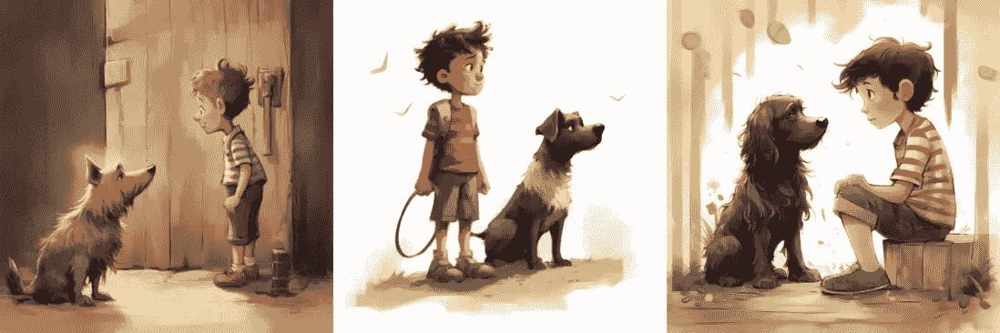

提示：[物体]，童书插图风格

## 2.现代艺术风格的插图

当代艺术插图以使用现代技术和概念创作的创意和原创图像为特色。

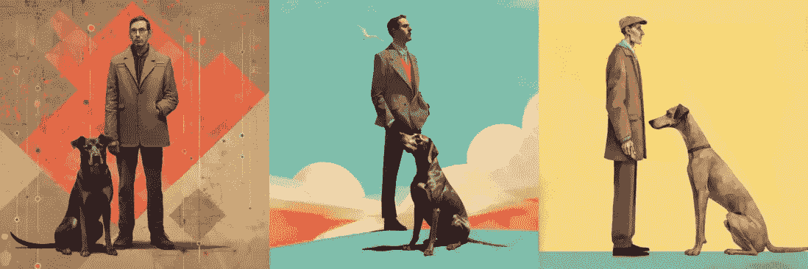

提示：[物体]，当代艺术插图

## 3.奇幻神话风格的插画

奇幻神话插图以受神话、传说和民间传说启发的神奇和奇幻图像为特色。

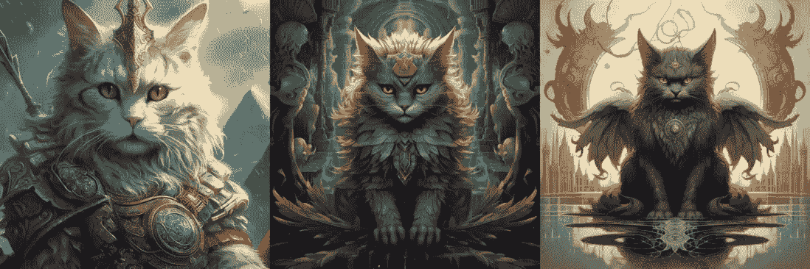

提示：猫，奇幻神话风格的插图

中[途指南 - ](https://merkulova.site/)从初学者到图像制作大师。无论您的经验如何，您都可以在这里找到将您的想法变成现实的工具和知识。每个阶段和方法的详细描述可在此处找到。

## 4. 科学电影海报设计风格

非虚构电影海报设计风格提供了结合科学和流行元素的独特而突出的视觉表达。

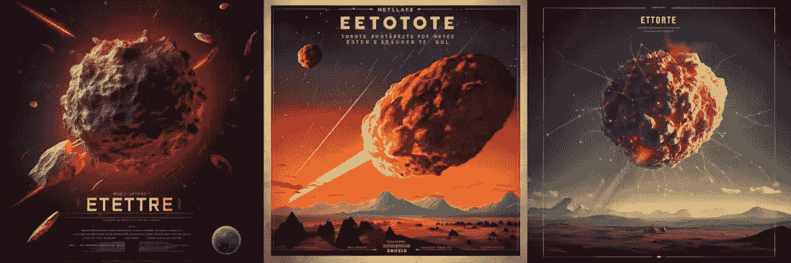

提示：陨石、科普片海报设计风格

## 5、漫画肖像画风格

漫画肖像绘画风格是一种增强和突出面部或人物特征以创造漫画或可识别图像的艺术方法。

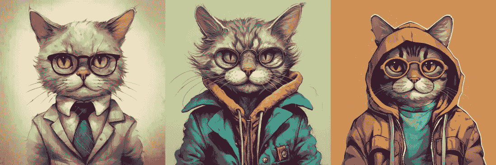

提示：猫，卡通肖像画风格

## 6.未来建筑风格的插图

未来主义建筑风格的插图提供了未来城市景观和建筑概念的视觉呈现。

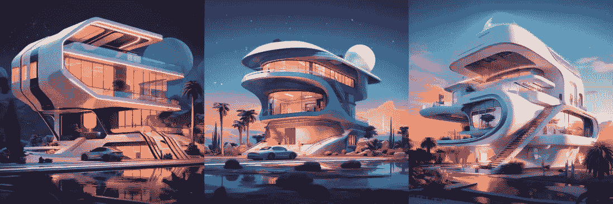

提示：房子，未来派建筑风格的插图

## 7. 天然材料拼贴

插图中的天然材料拼贴是一种使用各种天然材料（例如树叶、花朵、树枝、沙子或岩石）来创建图像的艺术方法。

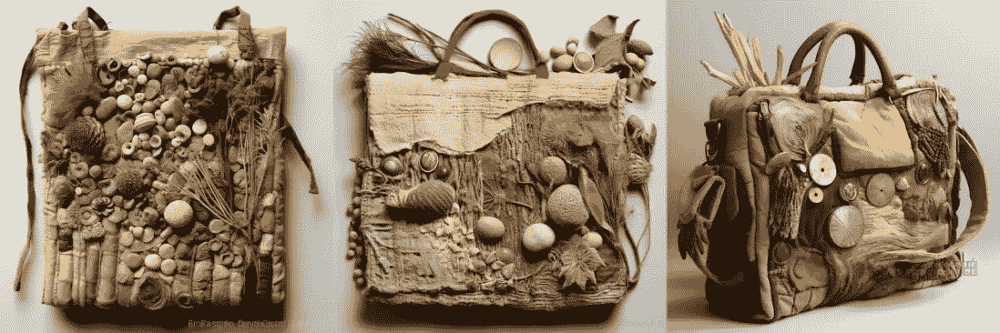

提示：[物体]，当代艺术插图

## 8.漫画风格

漫画风格是一种用于创作漫画和图形故事的艺术方法。

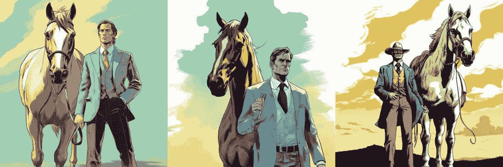

提示：人与马，漫画风格

## 9.立体主义

立体主义是20世纪初发展起来的一种插图和绘画风格。立体主义的一个特征是将物体分解为几何形状，例如立方体、圆锥体和圆柱体

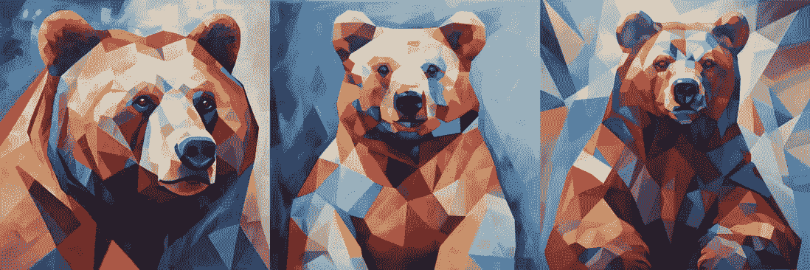

提示：熊、立体主义

## 10.矢量图形

插图中的矢量图形是一种基于数学基元（例如直线、曲线和多边形）的图像创建风格。

提示：桥梁，矢量图形

## 11.网站平面设计风格

网站图形设计风格是一种用于创建网站视觉外观和界面的艺术方法。

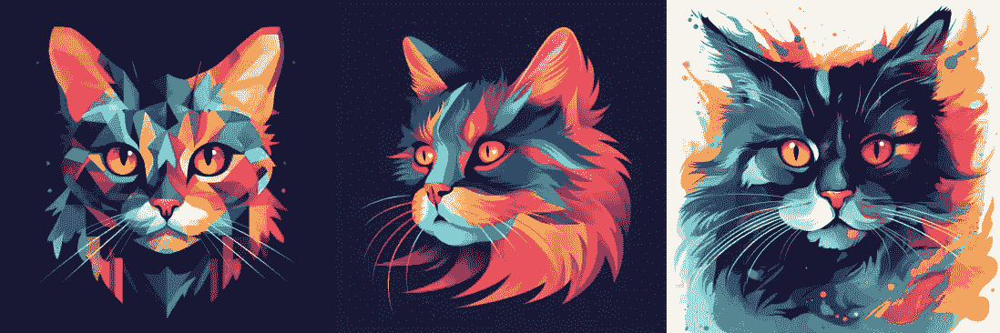

提示：猫，网站平面设计风格

## 12.时尚插画

时尚插画是一种注重时尚和风格的插画风格。这种风格的插图通常描绘时尚人物、模特、服装和配饰。

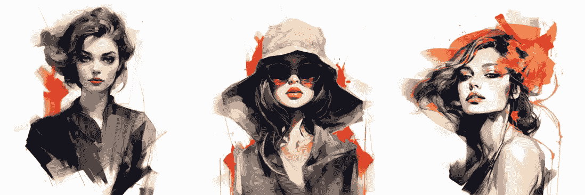

提示：女性、时尚插画风格

## 13.太空科幻风格的插图

太空科幻风格的插图提供了宇宙世界、旅行和奇妙生物的视觉表现。

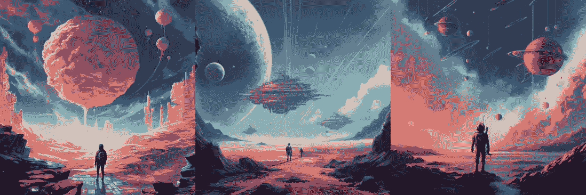

提示：天空、太空小说插图

## 14.赛博朋克图形风格的插图

赛博朋克插画反映了赛博朋克的美学，赛博朋克是一种结合了技术进步、控制论和朋克文化元素的科幻小说流派。

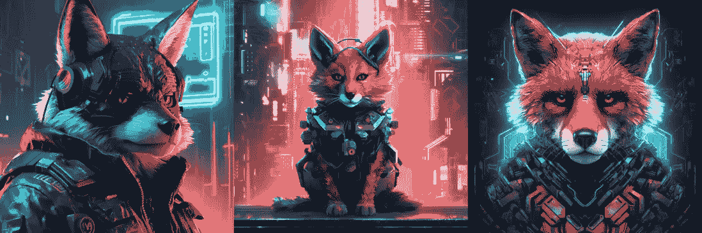

提示：狐狸、赛博朋克图形插图

## 15、玻璃瓶绘画技术

这种技术通常用于装饰玻璃瓶、花瓶、玻璃杯和其他玻璃制品。

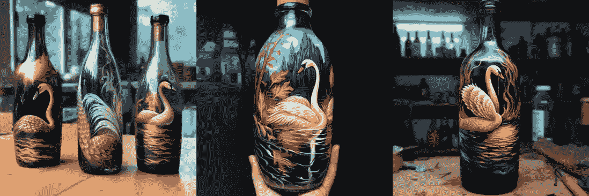

提示：天鹅，玻璃瓶上的绘画技巧

## 16.漫画绘画风格

漫画风格的漫画绘画是一种受日本漫画启发的艺术方法。它的特点是大眼睛、表情丰富、情感表达、动态姿势以及使用粗线条勾勒人物和物体等特征。

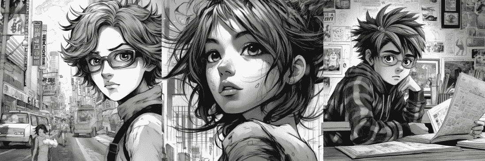

提示：[对象]，漫画风格的绘画漫画

## 17.软泥雕塑技术

软陶插画技术是一种使用软陶在插图中创建三维元素和细节的方法。聚合物粘土是一种柔性材料，加热后会变硬并能抵抗各种影响。

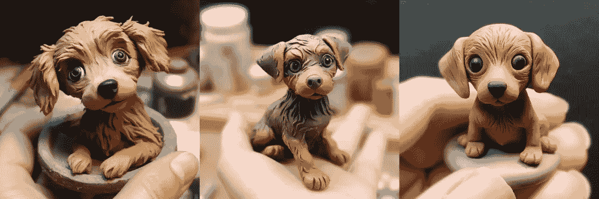

提示：狗、聚合物粘土成型技术

## 18.**纸编织技术**

插图中的纸织技术是通过扭曲和折叠窄纸条来创建图像的过程。

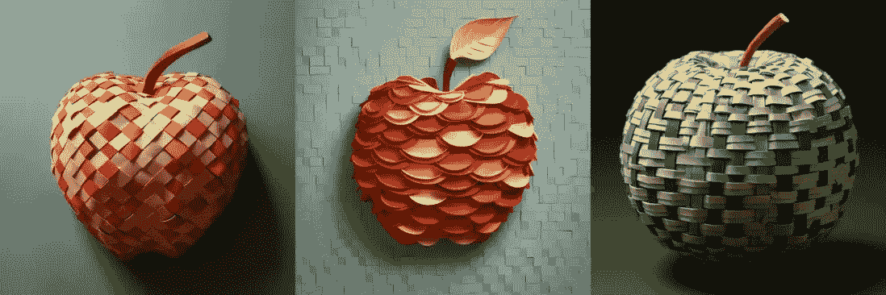

宣传：苹果、造纸技术

## 19.书法书写技巧

书法插画是使用特殊工具和技术创造美丽优雅的字体和文字的艺术。

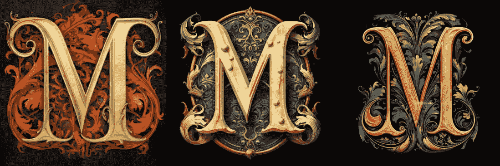

提示：字母、m、书法书写技巧

## 20.抽象表现主义风格

抽象表现主义插画风格是一种通过抽象和表现形式表达情感、情绪和内心状态的艺术方法。

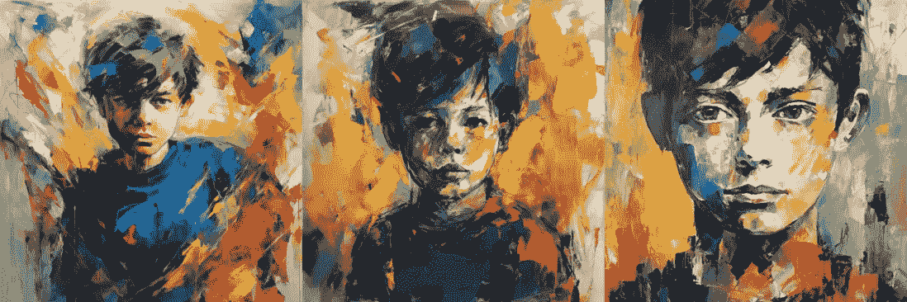

提示：男孩，抽象表现主义风格

## 21.建筑模型的绘制风格

在这种风格中，重点是建筑元素的视觉表现，例如建筑物、构筑物、景观元素和周围环境。

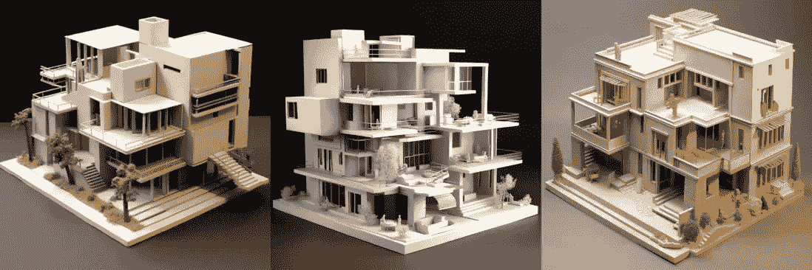

提示：房子，建筑模型的绘制风格

## 22.超现实诗歌风格的插图

超现实诗歌风格的插图结合了幻想、梦想和意想不到的组合元素，创造出唤起一种不真实和神秘感的视觉图像。

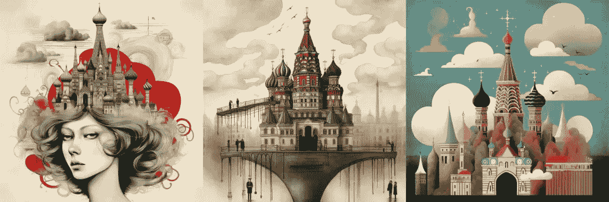

提示：莫斯科，超现实主义诗歌插图

## 23.民间艺术插图

民间艺术风格的插画反映了各民族、各民族的传统文化特征。

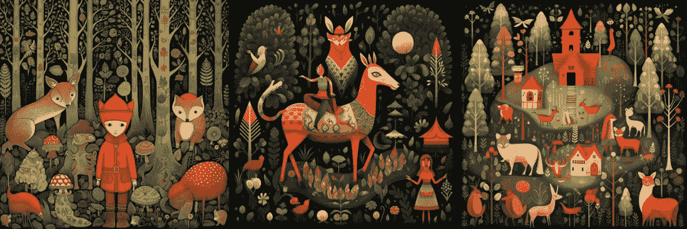

提示：森林、民间艺术风格插图

## 24.几何风格

几何风格是一种基于使用几何形状、线条和图案来创作插图的艺术方法。

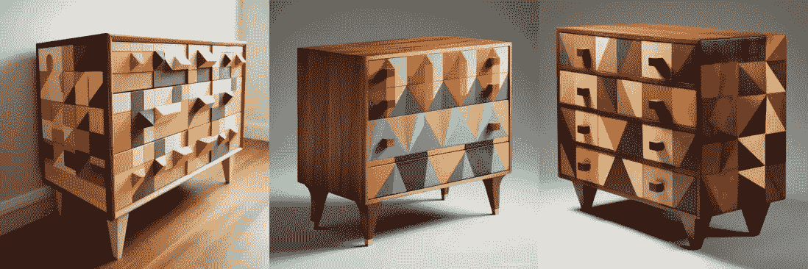

提示：抽屉柜，几何风格

## 25.黑色漫画风格

黑色喜剧风格是指黑色电影类型，其特点是黑暗、阴郁、怪诞的情绪。黑色漫画风格的插图以深色阴影、对比灯光和深色调过渡为主。

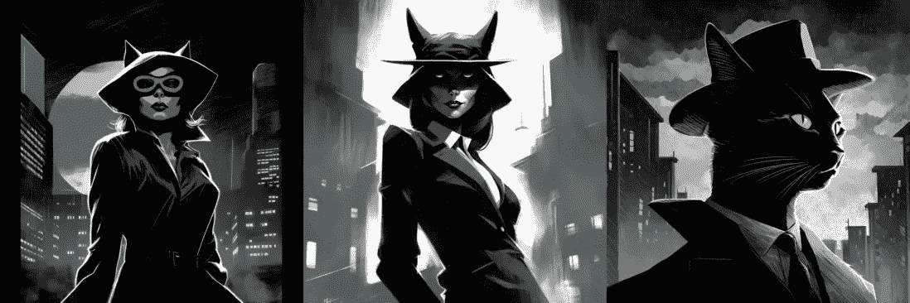

提示：猫，漫画风格的黑色

## 26.纹身风格

的颜色，模仿霓虹灯的发光效果。这种风格使用对比色组合，通常搭配明亮的色调来创建引人注目的插图。

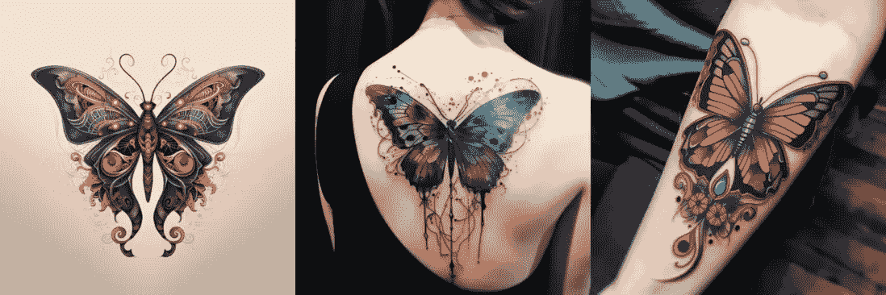

提示：情侣相爱，霓虹灯风格

## 27.轮廓技术

插图中的轮廓技术的特点是使用清晰且富有表现力的线条勾勒出物体、图形和形状的轮廓。在这种技术中，特别关注轮廓，它成为创建图形构图的基础。

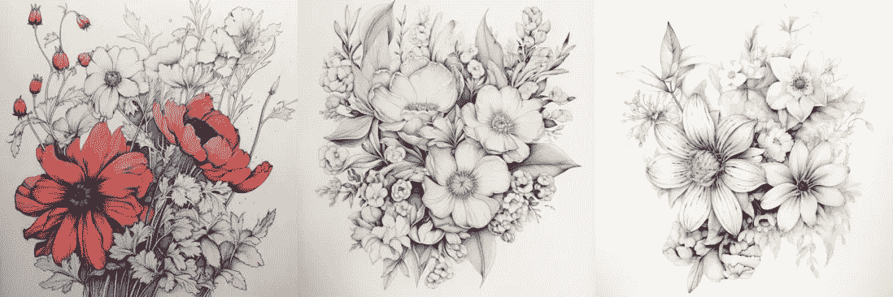

提示：花朵、轮廓技术

## 28.**霓虹灯风格**

霓虹灯风格的插图的特点是明亮、饱和的颜色，模仿霓虹灯的发光效果。这种风格使用对比色组合，通常搭配明亮的色调来创建引人注目的插图。

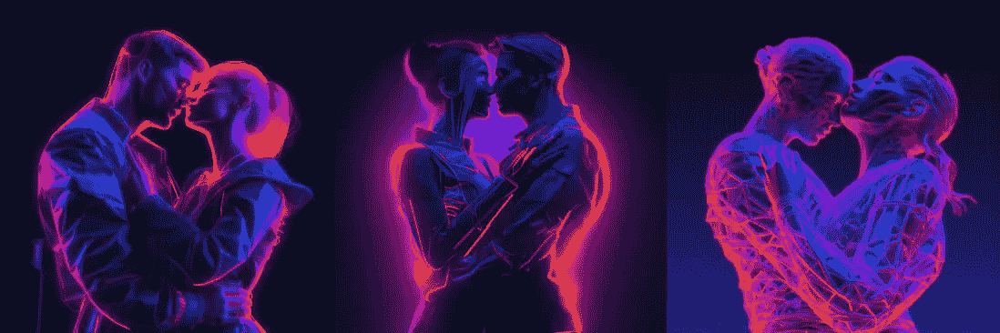

提示：情侣相爱，霓虹灯风格

## 29.玻璃马赛克风格

玻璃马赛克风格的插图是一种使用各种颜色和形状的小玻璃片创建图像或构图的技术。

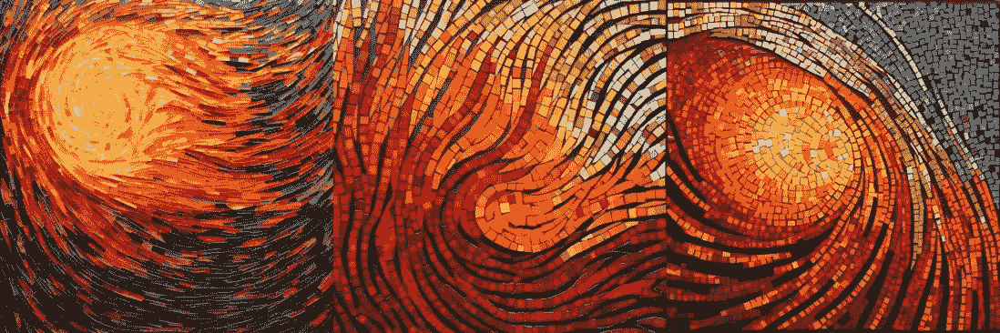

提示：防火、玻璃马赛克风格

## 30.卡通风格

卡通风格的插画特点是造型夸张、色彩鲜艳、俏皮自然。它的灵感来自卡通和漫画，用于创作漫画和类似漫画的图像。

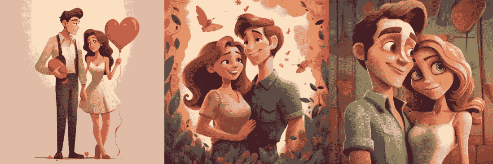

提示：热恋中的情侣，卡通风格

## 31.闪光和亮片

闪光和亮片是为插图增添闪闪发光和虹彩效果的元素。

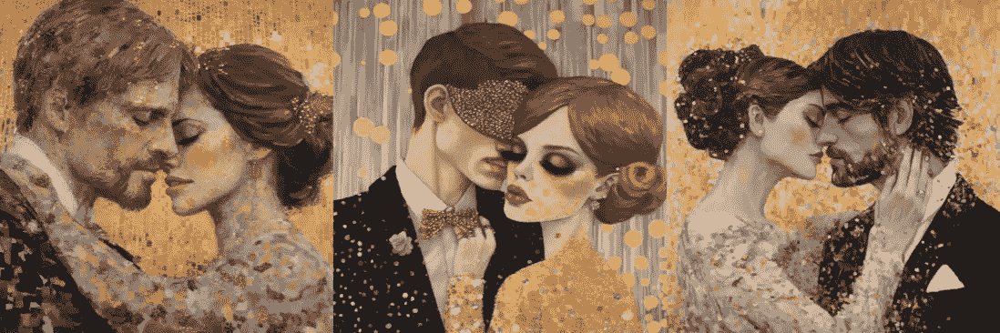

提示：一对相爱的情侣，闪光和亮片

## 32.波普艺术

波普艺术是20世纪50年代中期出现的一种插画风格，其特点是使用明亮饱和的色彩、批量生产的图像和流行文化元素。

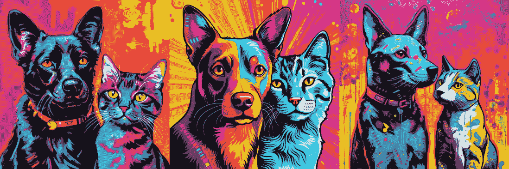

提示：猫和狗，波普艺术

## 33.极简主义

插画中的极简主义是一种以简单的形状、最少的细节和简化的构图为特征的风格。这种风格使用简洁的线条、扁平的流行色彩和极简的元素。

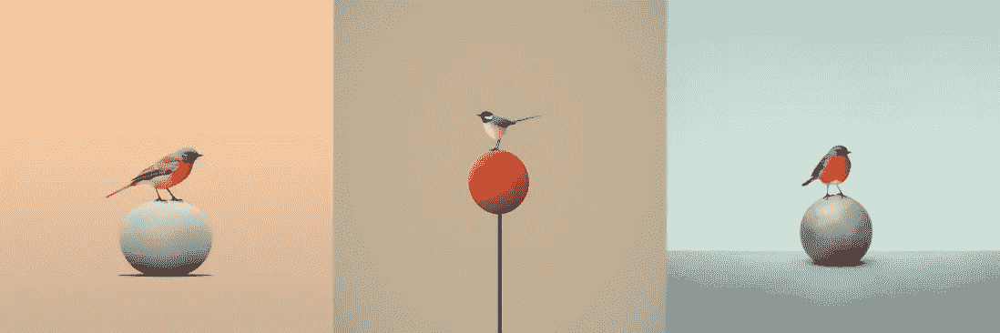

提示：鸟、极简主义

## 34. 混合材料技术

混合媒体插图是一种结合不同材料和技术来创作独特插图的风格。

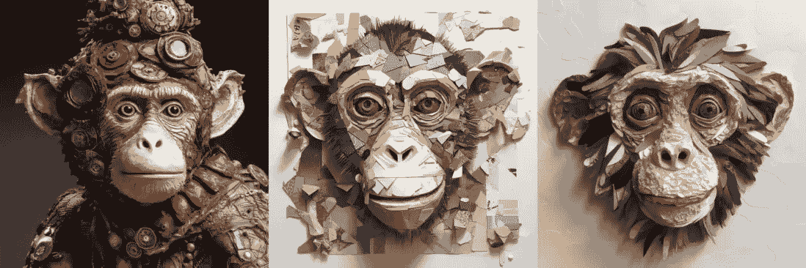

提示：猴子、混合材料技术

## 35.**壁画风格**

插画壁画风格是一种将图案转移到墙壁上的艺术表现形式。

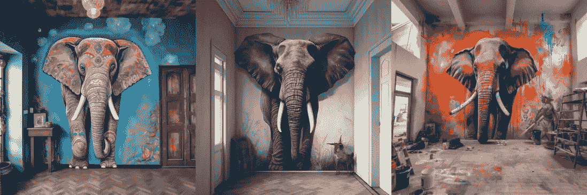

提示：大象，壁画风格

## 36.迷幻绘画风格的插图

迷幻绘画风格的插图是充满活力、抽象且富有表现力的作品，通常与 20 世纪 60 年代的迷幻艺术联系在一起。

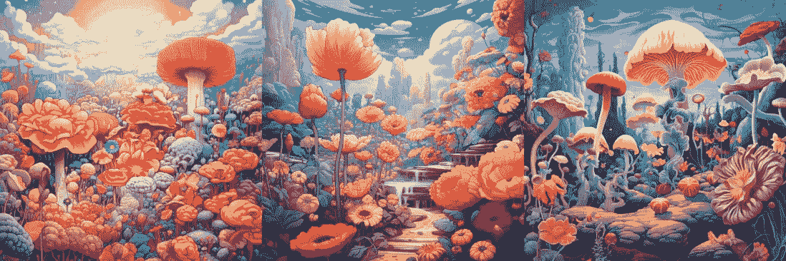

提示：盛开的花园，迷幻绘画风格的插图

## 37.维多利亚时代的插图

该风格的特点是细节、优雅和审美丰富。这种风格的插图经常出现在当时的版画、石版画和书籍中。

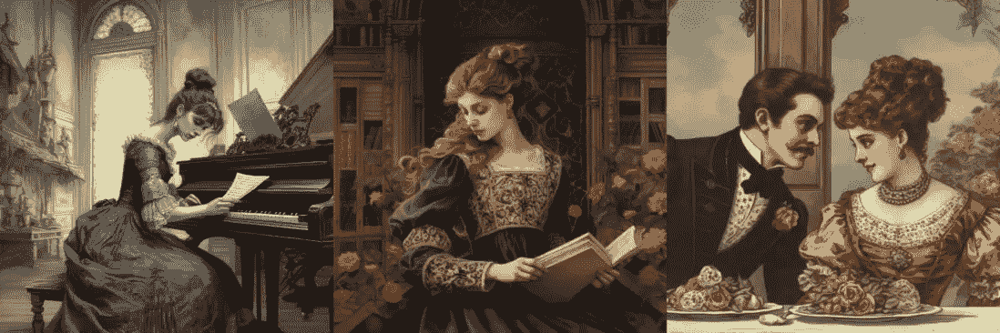

提示：乐谱、维多利亚时代的插图

## 38.恐怖片风格的插图

恐怖电影风格的插图捕捉了该类型特有的恐惧、神秘和惊喜的氛围。他们经常使用深色、深阴影和对比。

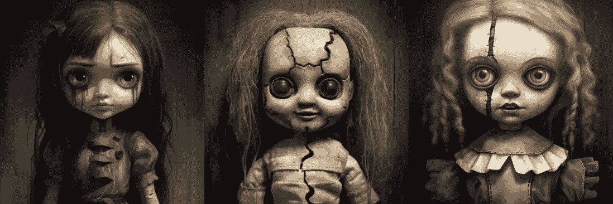

提示：娃娃、恐怖电影插图

## 38.后现代主义风格的插图

后现代风格的插图反映了与后现代方法相关的艺术理念。

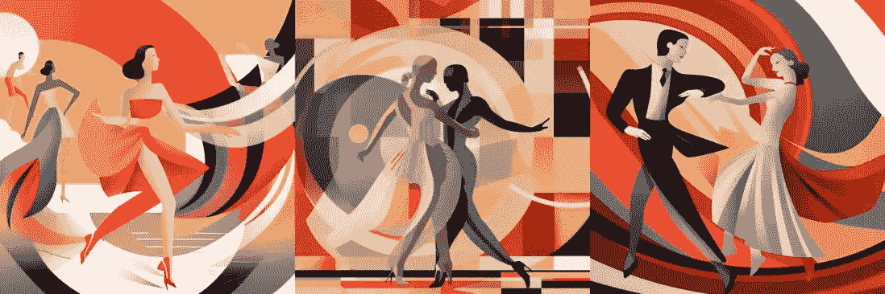

提示：舞蹈、后现代主义插图

## 39.**钢丝编织技术**

插图中的钢丝编织技术是一种使用柔性金属线创建图像的方法。

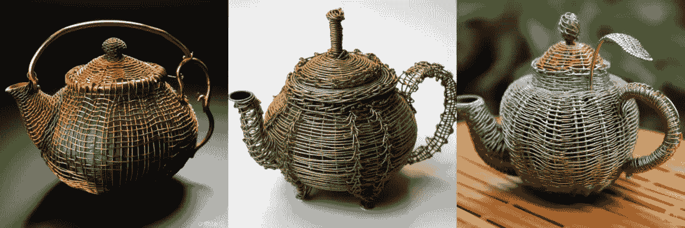

提示：茶壶、铁丝编织技术

## 40.折纸技术

插图中的折纸技术是通过折叠纸张来创造三维形状和构图的艺术。

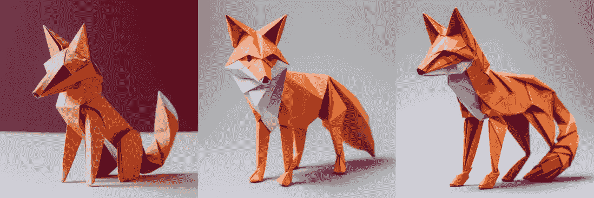

提示：狐狸、折纸技术

## 1.  **刺绣技法**

插图中的刺绣技术是使用针和线穿透材料的底部，形成各种接缝和图案来创建图像的过程。

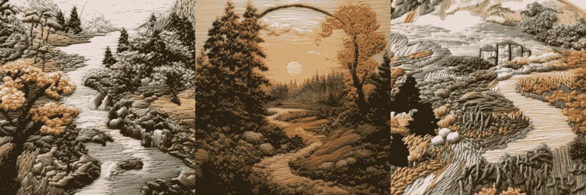

提示：风景、刺绣技法

## 42.立体未来主义风格的插图

立体未来主义插图结合了立体主义和未来主义这两种 20 世纪初出现的艺术运动的元素。

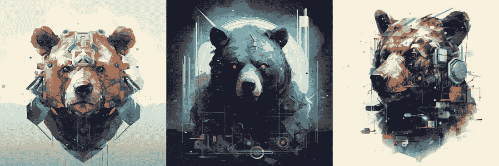

提示：熊，立方体未来主义插图

## 43.后世界末日风格的插图

后世界末日风格的插图显示了代表全球灾难或毁灭性事件后世界的图像和场景。

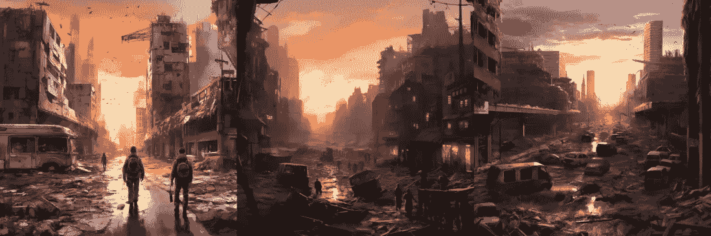

提示：城市、后世界末日世界插图

## 44.标志图形设计技术

插图中徽标的图形设计技术包括用于创建独特且令人难忘的徽标的各种技术和方法。

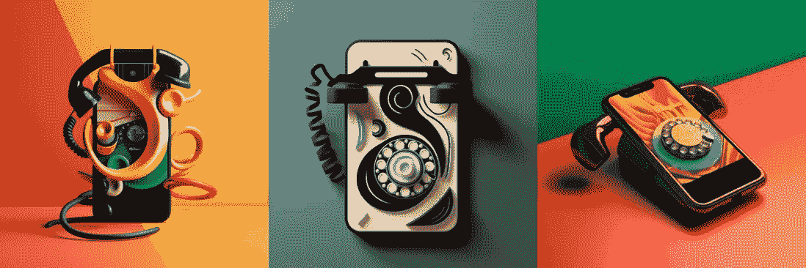

提示：电话、徽标图形设计技术

## 45.黑色电影风格的插图

黑色电影风格的插图具有受经典黑色电影美学启发的艺术渲染效果。

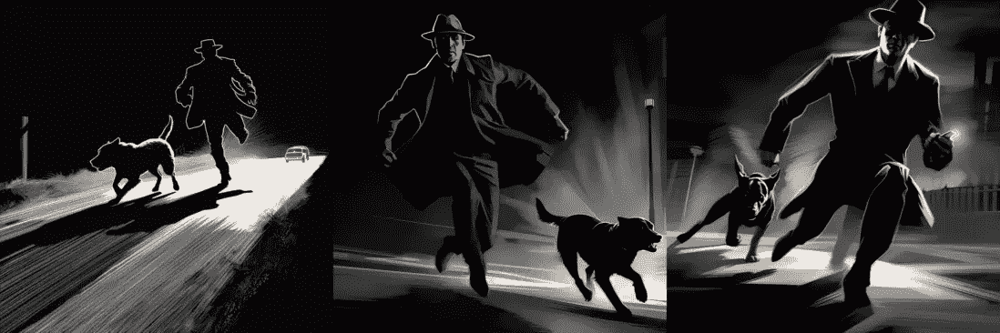

提示：走狗，黑色电影风格插图

## 46.剪纸风格

插图的剪纸风格是一种将各种材料的图像和元素粘贴到表面上以创建构图的技术。

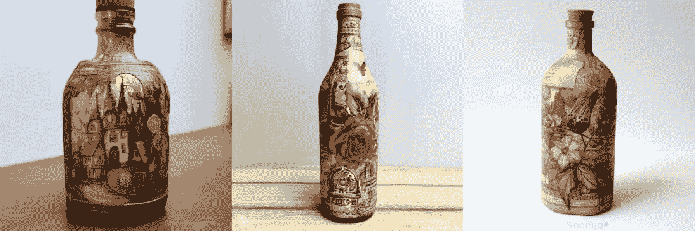

提示：瓶子，剪纸风格

## 47.泥塑技法

插图中的泥塑技术是用粘土创造三维图像和人物的过程。

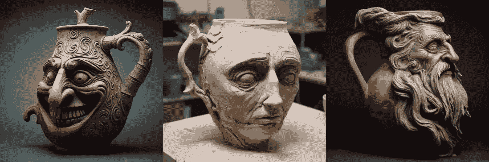

提示：壶、泥塑技艺

## 48.**串珠编织技术**

插图中的珠饰技术是使用小珠子创建图像和构图的过程。

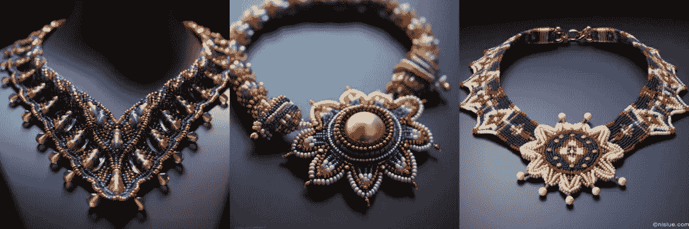

提示：项链、串珠编织技术

## 49.迪士尼风格的插图

风格灵感源自华特迪士尼工作室创作的动画电影和角色。

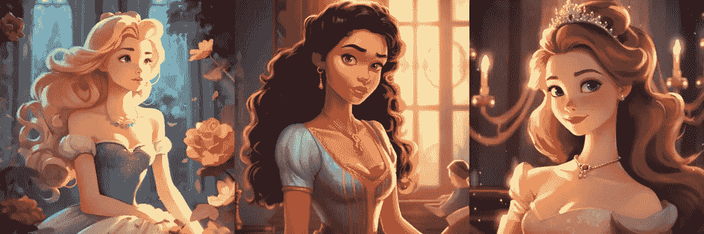

提示：公主、迪士尼风格的插图

## 50.柳条编织技术

插图中的柳条编织技术是利用灵活柔韧的藤蔓创造图像的过程。

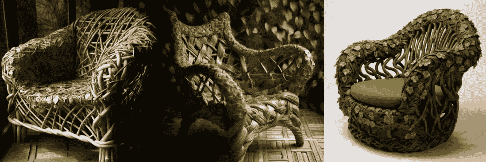

宣传：扶手椅、藤蔓编织技术

## 51.**水彩技法**

插图中的水彩技术使用涂在表面的水溶性颜料。

提示：猫，缅因猫，水彩

## 52.**印象派**

插图中的印象派是一种受印象派绘画运动启发的风格。他努力通过光、色彩和氛围来传达即时的印象和情感。

提示：人与马，印象派

## 53.表现主义

插图中的表现主义是一种试图通过扭曲的形状、明亮的色彩和戏剧性的构图来传达强烈的情感、内心体验和强度的风格。

提示：暴雪、表现主义

## 54.赛博哥特风格的插图

赛博哥特插画是赛博朋克和哥特风格的结合，营造出科技未来的氛围，混合着黑暗和浪漫的哥特元素。

提示：鲜花、赛博哥特式插图

## 55.超现实主义

插画中的超现实主义是一种通过物体、隐喻和荒诞情境的意想不到的组合来探索潜意识世界和不寻常的奇幻世界的风格。

提示：春天、超现实主义

## 56.**未来主义**

插画中的未来主义是一种在其作品中探索和表现未来技术、进步和活力的风格。

主题：自然、未来主义

## 57.现实主义

插画中的现实主义是一种力求图像最大程度的真实性和自然保真度的风格。

提示：花瓶，现实主义

## 58.自然主义

插画中的自然主义是一种努力尽可能准确、真实地再现自然和我们周围世界的风格。

提示：森林、自然主义

## 59.**点画法**

插图中的“点画法”绘画技术是一种使用许多彼此相邻的小点来创建图像的技术。

提示：火焰、点画法

## 60.信息图形

信息图形是一种用于可视化信息和数据的艺术和设计风格。它结合了图形、插图和设计的元素。

提示：图表、信息图形

## 70.**皂雕技法**

插图中的肥皂雕塑技术是使用肥皂橡皮泥创作三维图像。

促销：花束、肥皂雕塑

## 71.**羽毛笔**

衍纸风格的插图是一种使用细纸条卷起并粘成各种形状和图案来创建图像的技术。

提示：女人，羽毛笔

## 72.**食物插图**

食物插画是一种艺术风格，专门描绘食物、菜肴以及与烹饪相关的任何事物。

提示：立方体、食品艺术

## 73.**餐巾纸上的草图和插图**

餐巾纸素描和插图是一种独特且不寻常的艺术技术，其中设计是在小餐巾纸上创作的。

提示：鲜花、在餐巾纸上创作草图和插图

## 1.  **象形图艺术**

象形图艺术（或象形图艺术）是一种插图风格，使用简化的图形符号或象形文字来传达信息或想法。

提示：冰淇淋、象形图艺术

## 1. 色域绘画

色域绘画是当代艺术的一种风格和方法，非常强调在画布平面上使用大而均匀的颜色区域。

提示：色域绘画

## 1. 冰雕

冰雕是一种利用冰来创作雕塑插图的插画风格。

提示：鲜花、冰雕

## 77. 贡画

贡德绘画技术是由印度中部贡德部落发展起来的传统绘画风格。这种独特的艺术形式表达了与该地区的自然、神话和灵性的深厚联系。

提示：家，贡德画

## 78. 数字插图

数字插画是使用计算机工具和程序创建图像的过程。

提示：茶壶、数码插图

## 79. 故事书插图

故事书插图是一种用于直观地表现童话故事和儿童书籍的插图风格。

提示：汽车、故事书插图

## 80. 等距 3D

等距3D插画是一种利用等角投影在平面上创建三维效果的插画风格。

提示：香蕉，等距 3D

## 81. 3D 渲染

一种数字插图技术，使用计算机软件创建具有逼真或风格化外观的三维图像。

提示：男孩，3D 渲染

## 82. 低聚艺术

低多边形数字插画是一种使用少量几何形状来创建简约设计的风格。

提示：玻璃、低聚艺术

## 83. 扁平化风格

平面风格（或称“平面插画风格”）是一种现代流行的插画风格，其特点是形状简化、轮廓清晰、色彩填充平坦。

提示：一杯咖啡，扁平风格

## 84. 水墨插图

水墨插图是一种使用墨水的绘画风格，通常使用钢笔、画笔或其他工具来绘制干净的线条和充满活力的形状。

提示：狼，水墨插图

## 85. 2D 插图

2D 插图是一种在二维平面上创建的艺术表现形式。

