# 中途提示：中途“拍摄”的20种方法

> 来源：[https://my.feishu.cn/docx/W3mxdIi2FoHvFQxIblNc1JCcnng](https://my.feishu.cn/docx/W3mxdIi2FoHvFQxIblNc1JCcnng)

1.黄金时段Golden Hour

日出和日落前后的一段时间，光线变得更柔和、更温暖、更黄。

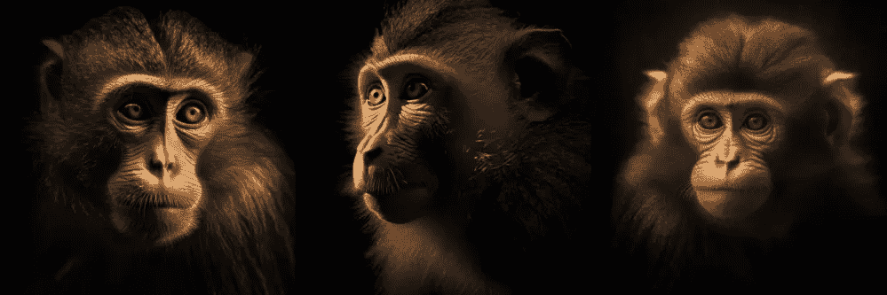

提示：[对象]，黄金时刻

2.分割调色 Split Toning

一种照片处理工具，可创建有色阴影和高光。

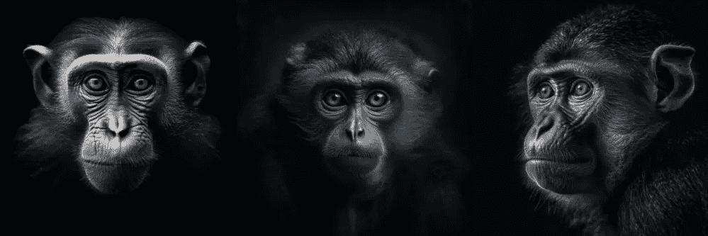

提示：[对象]，分割色调

3.高对比度High-contrast

放大图像最亮和最暗区域之间的差异的效果。

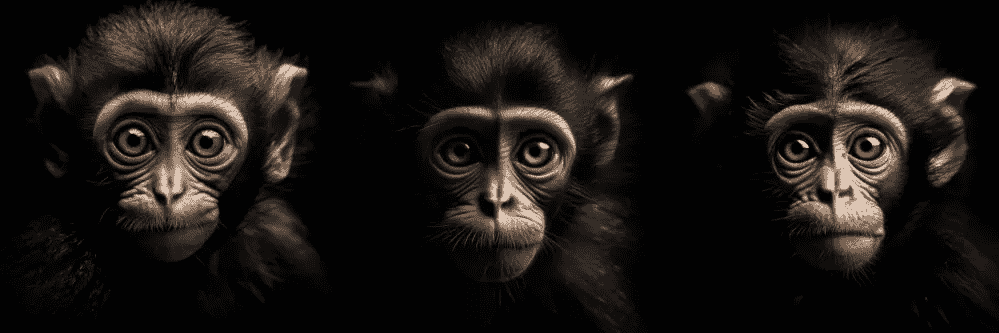

提示：[对象]，高对比度

4.坚韧的城市 Gritty Urban

为城市形象增添粗犷感和个性的效果。它增强了纹理，增加了颗粒感和对比度，使照片更具原始和坚韧的美感。

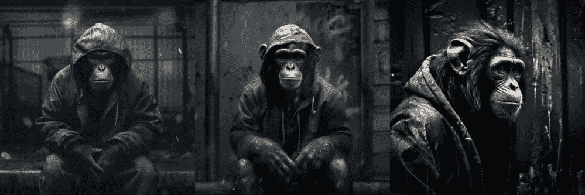

提示：[物体]，Gritty Urban

5.昼夜交替Day-for-night

一种摄影编辑风格，模拟夜间拍摄的场景，即使照片实际上是在白天拍摄的。

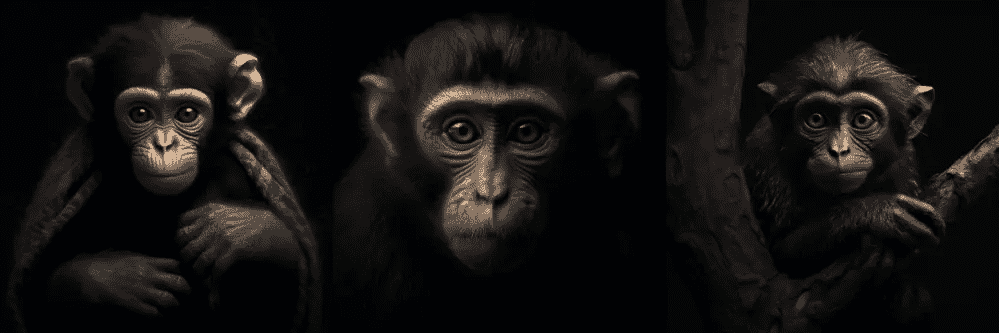

提示：[对象]，昼夜交替

6.**电影Cinematic**

模仿电影美学的风格。他努力再现电影典型的视觉风格，以传达特殊的氛围和情绪。

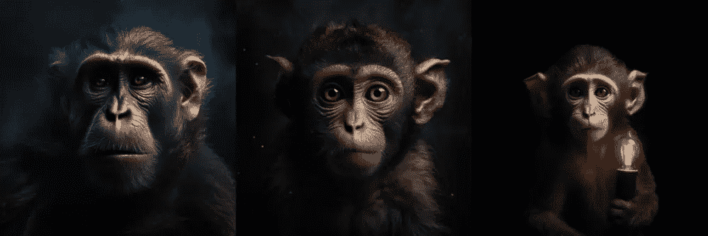

提示：[对象]，电影

7.黑白 Black and white

一种照片处理工具，图像是单色的，仅由灰色阴影组成。

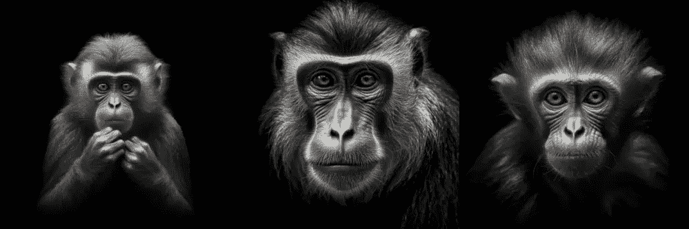

提示：[物体]，黑白

8.**去饱和Desaturated**

一种降低色彩饱和度的样式，使图像显得不那么明亮和强烈。当您应用“去饱和”滤镜时，照片的调色板会变得更加柔和且饱和度降低。

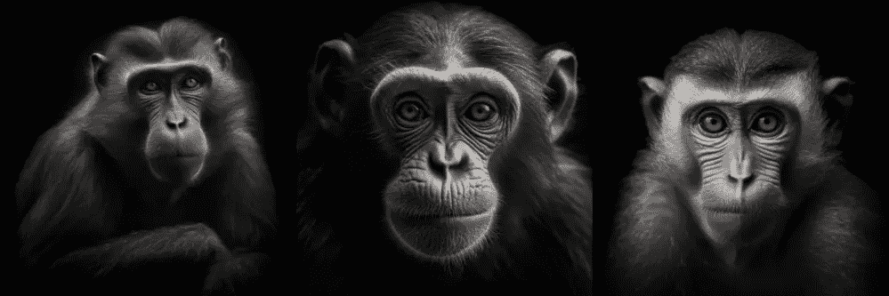

提示：[对象]，去饱和

9.单色Monochromatic

将图像转换为单一色调或单色调色板的样式。

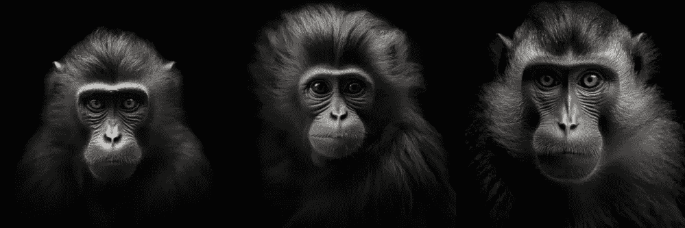

提示：[对象]，单色

10.**Noir黑色**

受经典黑色电影类型启发的照片编辑风格。他创造了 20 世纪 40 年代和 1950 年代黑白电影的典型效果。

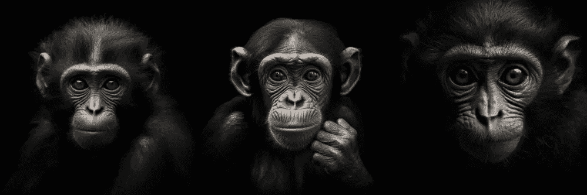

提示：[物体]，黑色

**11.双色调 Duotone**

将两种对比色应用于图像，一种代表高光，另一种代表阴影。

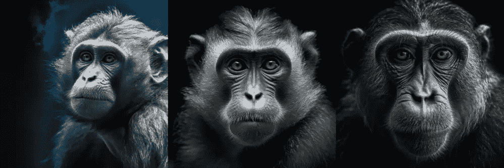

提示：[对象]，双色调

**12.复古Vintage**

一种照片编辑风格，模仿旧照片的美学和外观。

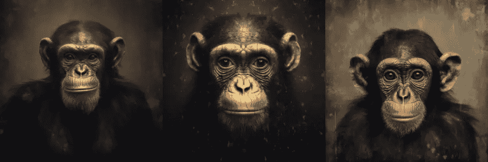

提示：[物体]，复古

**13.Lomography**

一种基于 Lomo 相机使用的风格，其特点是不可预测、色彩鲜艳、饱和度和明显的复古效果。

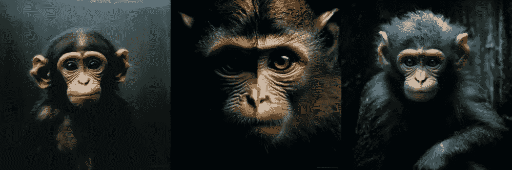

提示：[对象]，Lomography

14.**粉彩 Pastel**

这种风格的特点是使用精致、柔和和柔和的色调。它的灵感来自柔和的色彩，旨在营造浪漫、梦幻和温柔的氛围。

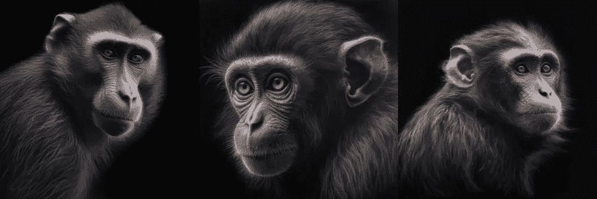

提示：[对象]，粉彩

**15. 朴实Earthy**

一种力求传达自然、朴实氛围的风格。它的特点是使用温暖、柔和的色调和自然的色彩，给照片带来自然和有机的感觉。

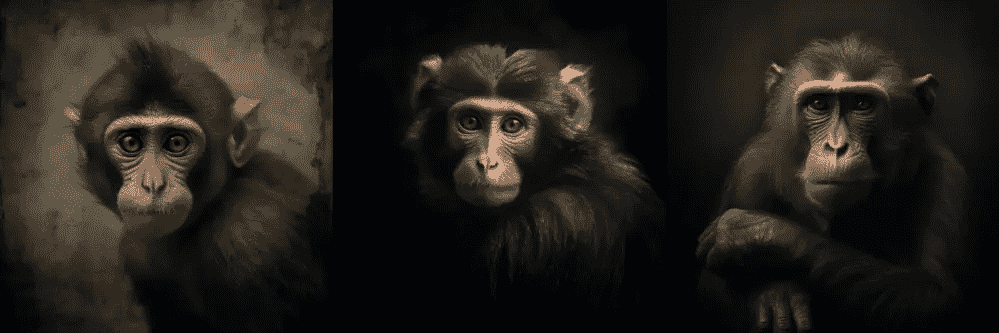

提示：[物体]，土质

16.**红外线 Infrared**

红外摄影是一种使用红外光来创建图像的方式。与传统摄影不同，红外摄影可检测可见光谱之外物体的热辐射。

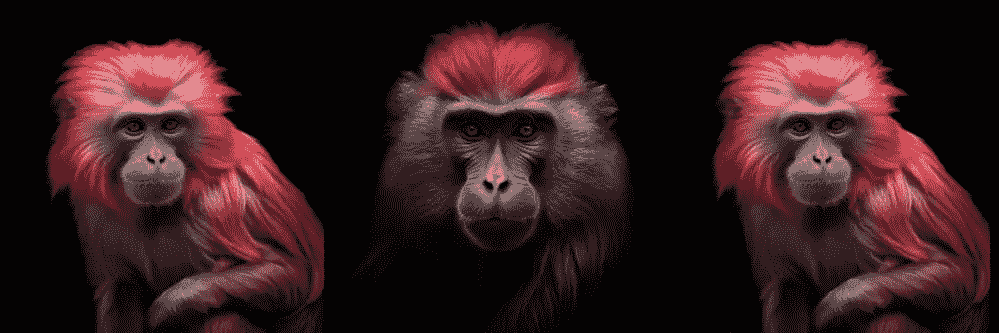

提示：[物体]，红外线

**17.霓虹灯 Neon**

这种风格的灵感来自明亮的霓虹灯和城市夜生活的活力。它的特点是明亮、丰富的色彩、对比度和发光效果。

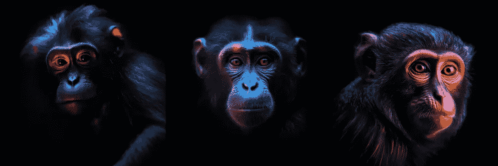

提示：[物体]，霓虹灯

18.交叉处理Crossprocessing

该风格通过不正确地结合色彩和负片处理过程来创造充满活力和不寻常的色彩效果。

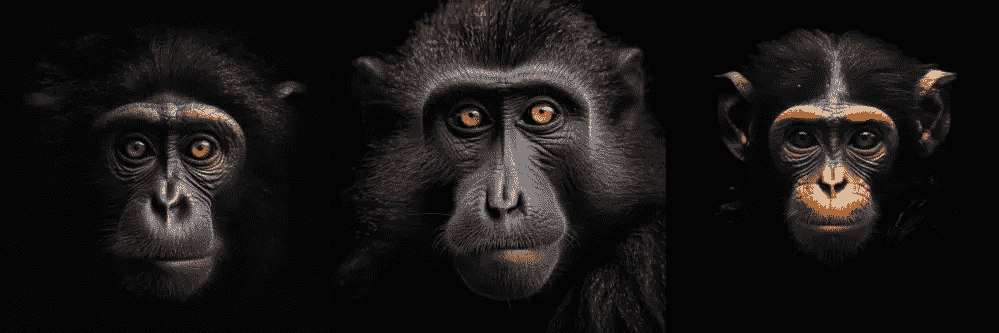

提示：[对象]，交叉处理

19.奥顿效应Orton Effect

结合了模糊和锐化的滤镜，可创造出柔和梦幻的效果。

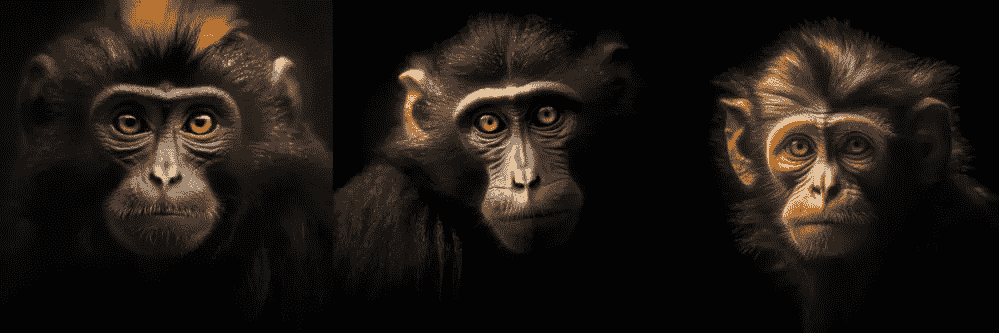

提示：[物体]，奥顿效应

**20.柔焦Soft Focus**

该滤镜可创建柔和的模糊效果，为您的照片带来浪漫的外观。

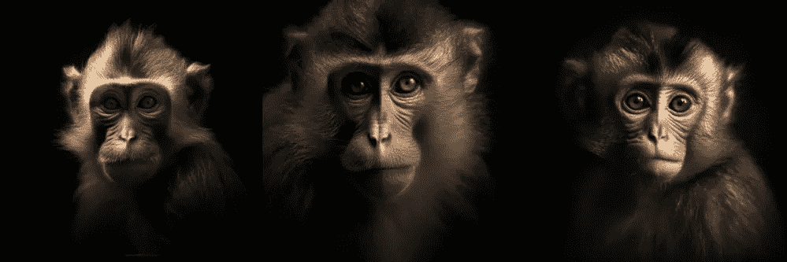

提示：[物体]、柔焦