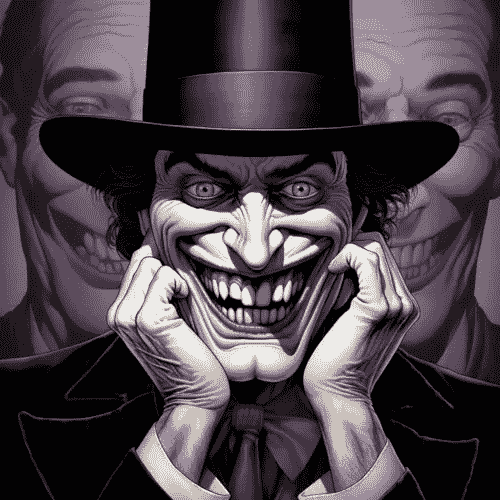
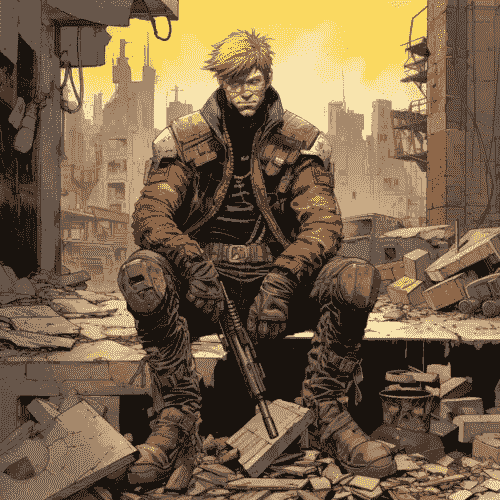
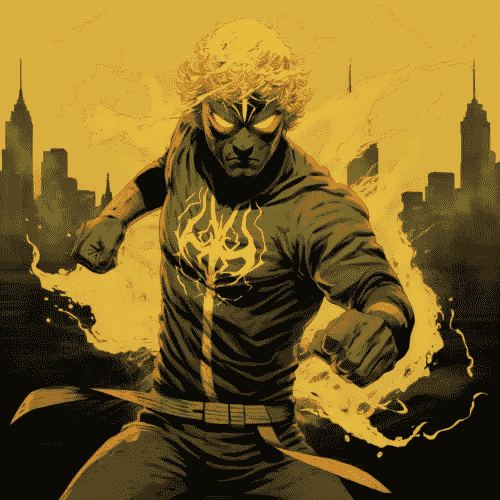
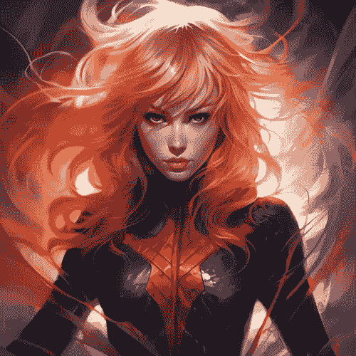
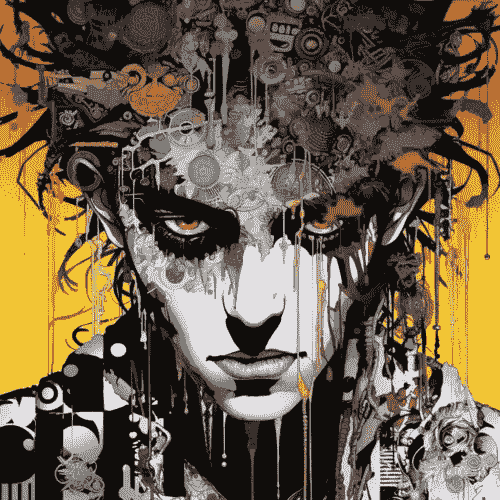
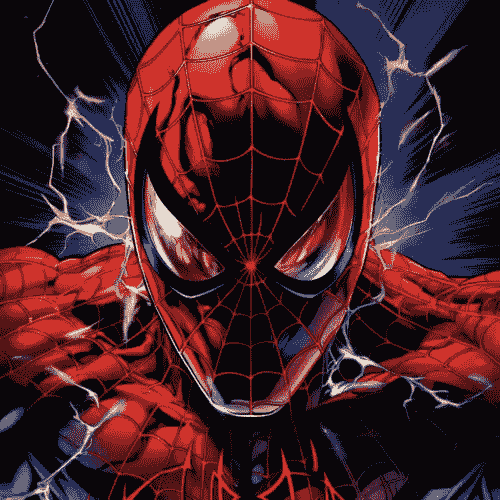
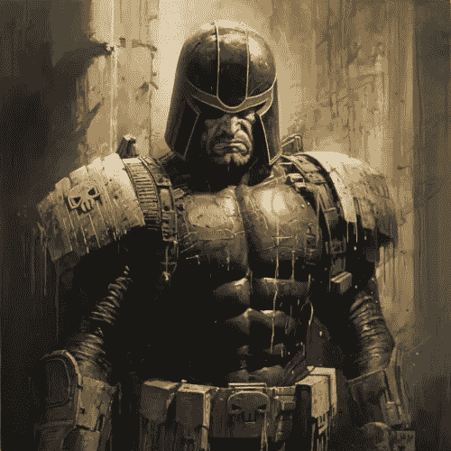
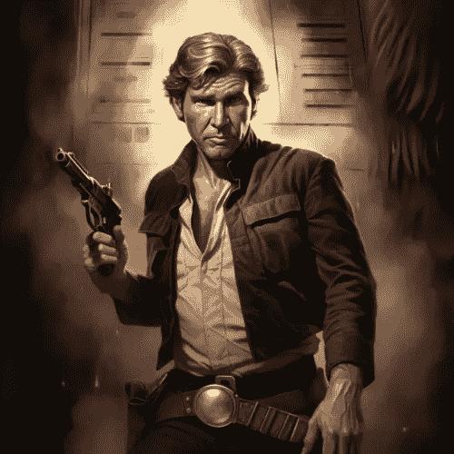
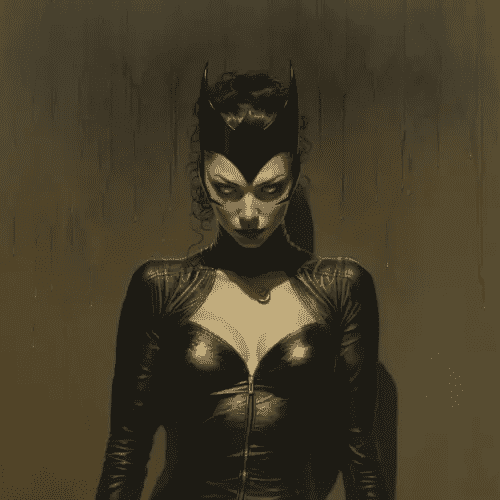
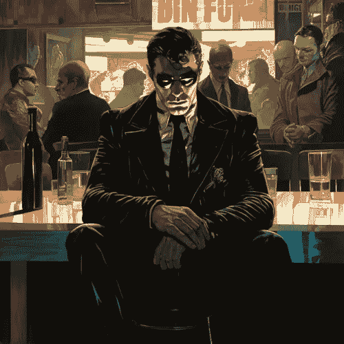

# Midjourney 的漫画家

> 来源：[https://my.feishu.cn/docx/AGZbdYhYLoUYycxQtIqcXdcwnQc](https://my.feishu.cn/docx/AGZbdYhYLoUYycxQtIqcXdcwnQc)

大家好，我这里有一个新话题！ 💥

第一期我为大家准备了10位超酷的漫画家。

## 布赖恩·博兰Brian Bolland

英国艺术家和插画家，以其漫画、概念艺术和玩具设计领域的作品而闻名。他最著名的作品之一是图画小说《蝙蝠侠》。杀人的笑话。”

## 阿瑟·亚当斯 Arthur Adams

美国漫画家和作家。 1985年，他凭借漫威漫画的迷你剧《Longshot》首次进入美国漫画界。

## 大卫·阿贾 David Aja

西班牙漫画家，以其不朽的铁拳和鹰眼作品而闻名。

## 刘斯坦利“Artgerm”     Stanley 'Artgerm' Lau

插画家、设计师、概念艺术家、Imaginary Friends Studios 的联合创始人，Imaginary Friends Studios 是一家数字艺术工作室，为 Capcom、DC Comics、Square Enix 等娱乐和游戏行业巨头创作作品。

## 克里斯·巴查洛Chris Bachalo

他是一位加拿大漫画插画家，以其异想天开的卡通风格而闻名。他因 DC 漫画的《Shade》、《Changing Man》和尼尔·盖曼的《两次死亡》系列作品而广为人知。

## 马克·巴格利Mark Bagley

他是一位美国漫画家。他曾为漫威漫画制作《超凡蜘蛛侠》、《风暴破坏者》、《新武士》、《毒液》和《蜘蛛侠》等作品，也为 DC 漫画制作《美国正义联盟》、《蝙蝠侠》和《三位一体》。

## 西蒙·比斯利Simon Bisley

英国漫画家和调色师。他以《路博》漫画、《特警判官》和《蝙蝠侠》中的作品而闻名，他的影响力受到弗兰克·弗雷泽塔的影响。

## 马克·布鲁克斯Travis Charest

他是一位美国漫画家。 2014 年，他因其封面获得 Inkpot 奖。他为 Sideshow Collectibles 的漫威动作玩偶系列进行了设计，并参与了多部漫威漫画的创作。

## 特拉维斯·查雷斯特Travis Charest

加拿大漫画艺术家、墨水家和画家，以其《Darkstars》、《WildC.ATs》、《Grifter/Shi》、《WildC.ATs/X-Men: The Golden Age》等书籍的作品而闻名。他为《蝙蝠侠》和《猫女》这本书制作封面。他的许多画作都是科幻风格的。

## 霍华德·柴金Howard Chaykin

他是一位美国漫画艺术家和作家。柴金的影响包括他的前雇主兼导师 Gil Kane，以及 20 世纪中叶的插画家 Robert Fawcett 和 Al Parker。

