# 玩转ChatGPT

> 来源：[https://docs.feishu.cn/docx/JZzedBAOcoTNS5xIa8icVDCCnGg](https://docs.feishu.cn/docx/JZzedBAOcoTNS5xIa8icVDCCnGg)

Update：2024.4.6

# 知识库简介

> 👋 Hi！我是Ryan🦄.eth。

> 致未来的探索者们：

> 我们坚信，拥抱人工智能(AI)的力量，是每个人未来发展的必经之路。在这条充满探索的旅途上，我们不应该孤军奋战，而应该抱团取暖。

> 于是，我将我学习AI的笔记开源成我的知识库，每一篇笔记都是我自己走过的学习路线，我将他们全部公开出来，并且附上一些任务Quiz用来检测自己的完成情况，希望让每个人都能少走弯路，让学习AI不再困难。

> 我常看见一些大而全的知识库，内容非常优质，但往往里面有多个不同体系互相冲突，频繁的外链跳转，让**我们学**习**路线非**常陡峭而缓慢，**难以构建起**一**个连贯的学习框架**。所以本系列知识库专注**于实操性和体系性，**旨在提供一个易于跟随的、能够快速学习掌握的Roadmap，并且文科生可以放心使用，适当的时候附以其他视频、音频的内容。

> 让我们一起踏上这场学习之旅，探索AI的无限可能。

多维表格（TVEMbQwa2a9EPEshcBYcD1YCn0c_tblS3rN7ABvflROq）

---

**学习原则**

1.  永远不要糊弄自己

1.  要研究AI，不要研究“AI新闻”，不要停留在嘴上，实践出真知，多用多尝试

1.  不断修炼精进自己的知识系统，取长补短

1.  有时候做减法更重要，注意力有限，关注最该关注的内容

---

**卷首语**

> 欢迎来到《玩转ChatGPT》知识库！ChatGPT无疑是这个时代最令人惊艳的AI产品

ChatGPT代表了与机器交流方式的一次巨大飞跃。作为一个先进的对话系统，ChatGPT利用最新的人工智能技术，能够提供丰富、自然、类人的对话体验。

不论是解答复杂问题、提供学习资源、还是参与深入讨论，ChatGPT都能够以令人难以置信的逼真度和准确性，与用户进行互动。

我们相信，通过ChatGPT，我们可以更好地理解人工智能的能力和局限，同时也为各行各业带来创新的思考和解决方案。不管你是科技爱好者、学生、教师、研究人员，还是仅仅是对人工智能充满好奇的朋友，ChatGPT都欢迎你来探索、学习和创造。

在这个旅程中，我们期待与你一同见证和塑造这个由人工智能驱动的对话新时代。让我们一起踏入ChatGPT的世界，探索无限的可能性，发现未来对话的艺术和科学。

一起开启与AI的对话，探索未来的无限可能。

---

本知识库附带一个讲解PPT和视频

+   PPT网址：[用AI工作，专心“摸鱼”](https://gamma.app/docs/AI-rqy8zmoowgo6f66)

+   之前有一个完整讲解本文档的视频，后来被恶意举报下架，23年7月录了版本2.0发布，预计24.8月份录3.0，详细的介绍我们所有知识库

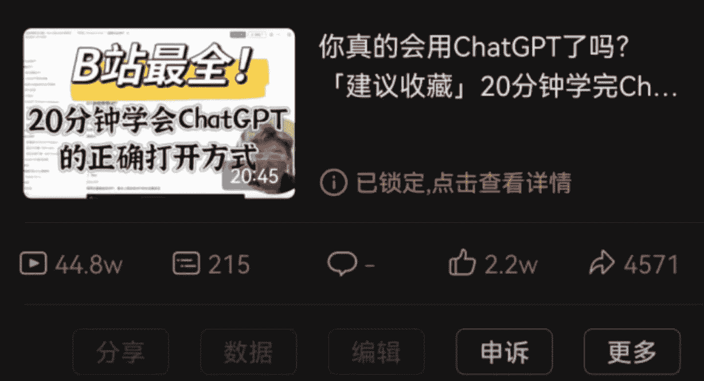

<https://player.bilibili.com/player.html?bvid=1zV4y1h7ez&spm_id_from=333.999.0.0>

# ChatGPT科普

+   **前言**：在学**习一门“技能”、一门**“知识”的时候，先从最低门槛的科普角度去了解，而不是先去看xx课程；一门课的时间太长，如果学到一半发现不合适或者自己不需要，就浪费了大量时间，时间长也让门槛很高，大家没有动力学习。所以我收录了一些我看过长度适中、内容优质的科普视频、播客、博客。

+   **Tips**：可以吃饭时候听，最重要的是开始做

+   **Quiz**：

1.  尝试给自己的朋友介绍一下，什么是人工智能，确保你能讲清楚，对方能理解

1.  尝试给自己的朋友介绍一下，什么是ChatGPT，确保你能讲清楚，对方能理解

1.  尝试给自己的朋友介绍一下，AI、LLM、GPT之间的关系，确保你能讲清楚，对方能理解

## 什么是ChatGPT？

在我们课程的学习中，会有很多buzzwords（热词），比如AI、AIGC、LLM、AGI，接下来我会带大家了解这些名词背后的故事。

**在先讲Cha**tGPT之前，我们得先来了解一下AI。AI又称人工智能，我们来问一下ChatGPT

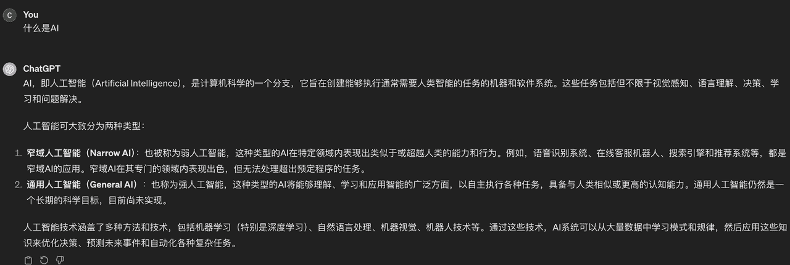

通过这个例子，我们既了解了什么是AI，也稍微有点知道ChatGPT是什么。

AI作为一门学科，发展了很多年，以下是一个重大事件时间线。

**这也按照能**力**强弱，引出了两类AI**，弱人工智能和强人工智能（AGI）

弱人工智能就比如我们用的**搜索引擎****（百度、**谷歌），我们平时用的内容平台（抖音、B站）有的推荐算法，再包括图像识别——AI识别你的脸，阿尔法狗；而强人工智能，又被称为通用人工智能（AGI），是指AI能够具体人类相似的能力，具有一定的通用性。

而我们的主人公，ChatGPT为首的一系列LLM（Large Language Model，大语言模型），被认为是AGI的前身。

**那么什么是LLM呢？**

我们先来看 AI 按照**技术**来分**类的一张图，人工智能领域按**技术**可以划分为几个主要的类别，机**器学习（Machine Learning）和深度学习（Deep Learning），Deep Learning下主要我们介绍两个模型，Transformer模型最初在2017年由Vaswani等人在论文《Attention is All You Need》中提出。我们现在的ChatGPT等大语言模型都是基于Transformer模型的。Diffussion扩散模型大家可能熟悉的是Stable Diffusion，没错，AI绘画和视频很多技术背后就是Diffusion模型，具体我们等到AI绘画再和大家介绍。大家只需要记住这两个模型和这张图即可～

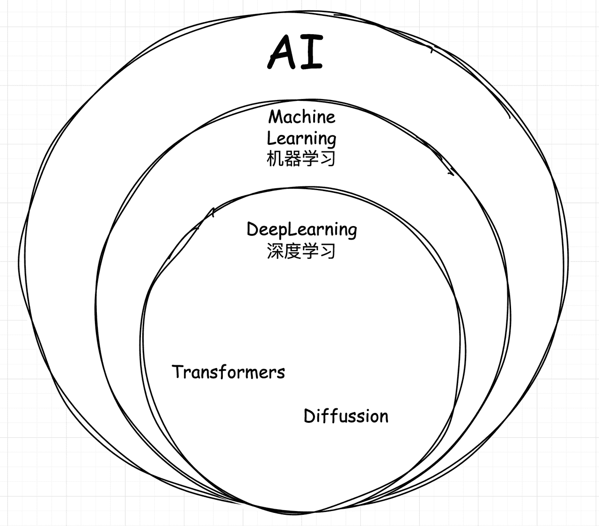

**我们如果按照领域分，比如可以分成自然语言**处理（Natural Language Processing, NLP）和计算机视觉（Computer Vision, CV）等等，自然语言处理（NLP）是人工智能（AI）和语言学领域的一个交叉学科，专注于使计算机能够理解、解释、操纵和生成人类语言。而大语言模型LLM就是NLP领域下的重大突破。

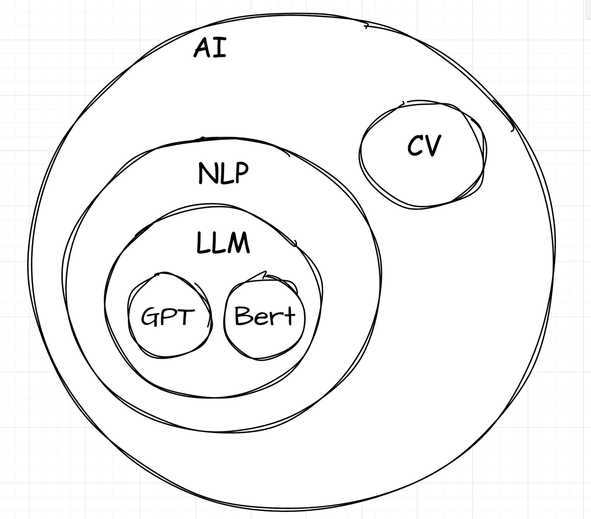

大型语言模型（LLM，Large Language Models）是自然语言处理（NLP）中的一类模型，通常指那些具有大量参数和在大规模数据集上训练的模型。这些模型因其能够捕捉语言的复杂模式和关系，而在多种NLP任务上表现出卓越的性能。

不同的LLM可能基于不同的神经网络架构，主要包括：

+   **Transformer**：目前最流行的模型架构，如**GPT（Generative Pre-tr**a**i**ned Transformer）系列、BERT（Bidirectional Encoder Representations from Transformers）等。

+   RNN-based：较早的语言模型通常基于循环神经网络（RNN），如LSTM（Long Short-Term Memory）等。

大模型所对应的不是小模型，是一个叫做特定语言模型 Specific Language Model。特定语言模型是指专门做一件事情的，比如只能做翻译的AI。

就好像一个是一把锁，而**大语言模型是一个通用的万能锁**。

大语言模型下最著名的框架Transformer带领下的派系，又衍生出两类

+   **GPT（Generative Pre-tr**ained Transformer）系列

+   **B**ERT（Bidirectional Encoder Representations from Transformers）

**什么是GPT？**

ChatGPT和这个GPT有没有关系呢，其实ChatGPT里面的GPT就是这个GPT

+   G for **Generative 生成式**：区别于一些其他的AI，比如识别，人脸识别，语言识别，这一类叫做生成式人工智能（Generative AI），是指那**些能够创建或生成新内容的人工智**能技术。这种类型的AI使用机器学习模型，尤其是深度学习网络，来生成数据样本，这些样本可以是文本、图像、音乐、视频甚至代码。生成式AI的核心特点是它不仅仅是对已有数据进行分类或预测，而是能够基于学习到的数据模式创造全新的、逼真的输出。

+   P for Pre-Training 预训练：以往的人工智能**模型通常针对特定任务进行训练，**如通过大量人脸的图片训练模型识别人脸。而预训练模型（Pre-Training）采用不同的方法，它们先在广泛的数据上进行预训练，形成通用的基础模型。之后，根据具体需求，用户可以对这个模型进行微调（Fine-Tuning），使其适应特定的应用场景。

+   预训练+微调 = 先练基本功+再按特定情况微调

+   T for **Transformer**：就是我们刚刚提到的Transformer模型，GPT是基**于Transforme**r架构的一种模型，Transformer的核心思想是通过“自注意力机制”（Self-**Attentio**n Mechanism）来处理数据。这种机制**能让模型在处**理一个词或句子的时候，能够注意到句子中的其他词，这样就可以更好地理解语言中的上下文关系。例如，当我们使用“他”这个代词时候，在当下这个句子的语境里和在其他的语境里指代的可能是不同的人，而transformer 就可以理解我们语言中存在的这种逻辑，从而更准确地处理信息。Transformer的结构包含了多层这样的自注意力，这使得它非常擅长从大量数据中学习语言模式。

GPT本质上是一个**预先训练好的模型**，它通过**生成的方式**，将**输入的文本转化为输出的文本**，类似于一个翻译过程。但是他能做的远远比翻译更多。

关于GPT和BERT的故事还挺有趣的，我这里简要概述一下，最早谷**歌这家公**司研发出来了Transformer，谷歌在这基础上，2018年开发出来了BERT，它采用了一个新颖的训练方法——双向Transformer，这使得模型能够同时考虑到文本中每个词的左侧和右侧上下文。

同时，2018年，OpenAI开发出来GPT-1。但是GPT-1在很多性能**上都比BE**RT差，但是OpenAI没有被动摇，坚信自己的技术发展方向，随后推出的版本，GPT-2和GPT-3，通过扩大模型的规模（增加参数数量和训练数据），显著提高了生成文本的质量和多样性。尤其是GPT-3，它拥有1750亿个参数，能够生成极其自然的文本。效果也超过了BERT的技术方案，也让人们开始相信大语言模型的魔力。是不是越大越好，大力出奇迹？

而ChatGPT就是在GPT-3之后推出的面向大众的产品，所以也叫GPT3.5，但由于ChatGPT过于出圈，很多人把ChatGPT泛化为背后的模型，乃至GPT系列，目前GPT已经到GPT-4。

**ChatGPT背后的原理？**

ChatGPT背后从**输入的文本转化为输出的文本**的过程，简单理解是通过概率把人类知识进行任意的排列组合，输出最可能的答案。每当我们通过对话的方式来向ChatGPT提出我们的需要，ChatGPT通过一个一个字的把内容蹦给我们来生成长文信息。

GPT本身会学习庞大数量的文本内容，然而这并不意味着ChatGPT是一种智能的搜索引擎，通过搜索到的内容来进行联想，而是通过对文字本身的学习，来模仿人类文字中的规律。

就好比我们在打字的时候，每打完一句话，输入法就会根据我们刚刚打出的文字作出联想一样，GPT会根据上文从而给出下文，而不同于输入法的联想仅仅作为一个辅助效率的作用，GPT本身具有对超大量文本学习分析的基础，它会通过对所有上文来生成下一个字，不断的对生成出下一个字的上文再次进行分析来生成下一个字，这样的过程也叫做“自回归生成”。例如，我们让GPT学习“白雪纷纷何所似”，让他对这句话做自回归生成，那么用户再向GPT输入“白雪”，GPT就可能根据上文生成“白雪纷” ,再根据上文生成“白雪纷纷”，以此类推生成“白雪纷纷何所似”这样一句话。也因此，在我们使用GPT的时候会发现内容是一个字一个字蹦出来的，而不是直接呈现出GPT自己学习过的内容片段。

这也是GPT的学习和我们人类不同的地方。我们人类的学习是通过各种理解，去体会来建立巨大的知识网络，不断通过现有的知识来与新的知识建立联结，是大脑的神经突触不断生长的过程。

而GPT是探索文字本身存在的规律，来进行处理，就例如“白雪纷纷”，不是因为纷纷扬扬的大雪什么时候掠过谁的眼底，也不是因为无数大雪纷飞的画面被谁无数次憧憬，白雪纷纷就是因为“白雪纷纷”这四个字本身，GPT的生成仅仅是从无数文字中探索出无关情感的最质朴的规律来尝试模仿我们的动作。

这也可以解释为什么GPT有时会出现胡言乱语的现象，当我们给出的上文能够让GPT比对自己的所学之后找到具有相同逻辑的文本时，就会忽略本身的逻辑而套用它自己现有的认知来进行表达。

没有自己的情绪、偏好、欲望，GPT只是有一套能够通过上文来生成下文的模型，这套模型反复地去生成、输出，就有了能够生成长文的能力。

只不过GPT的能力太过强大，以至于让人误以为它具备了思考的能力。

那么ChatGPT是如何那么强大的？

从GPT-1**到GPT**-**4，Ch**atGPT的数据库有着很大的增长，掌握的内容是人类一生也难以学习的文本含量。ChatGPT回答问题的能力也在不断提高。我们判断ChatGPT回答问题能力的标准无非就是对我们人类的语言的理解程度。在这里提出一个概念：我们日常生活使用的汉语、英语等统称为自然语言，而计算机的内部运行也依赖一种类似于语言的媒介，我们称之为机器语言。ChatGPT回答问题的过程我们就可以理解认为是ChatGPT利用机器语言分析自然语言，再用机器语言转化的自然语言表达出来，也就是分析上文和输出下文。

因此对ChatGPT回答能力的提升就可以集中在两个方面：分析上文的能力，输出下文的能力

其中，分析上文的能力，少不了大量文本的积累。

让机器理解人类语言的一大难点在于同一个意思可以有多种不同的表达形式，可以用一个词，也可以用一段描述。而同一个表达在不同语境中又有不同含义。想解决这个问题就需要让机器学会各种语义关系和语法规律，以便能明白哪些表达实际上是同一个意思。正如大量的阅读提升我们对语言的语感，无论是什么样的内容，都可以塞给ChatGPT进行学习，这种方法只需要一键上传，就可以让GPT快速学习。这一阶段也就是无监督学习。

而无监督学习可能造成的问题就是，高质量和低质量的混杂式学习会让没有情感的ChatGPT并不知道自己在输出什么，甚至可能会不受控制地出现脏话。

因此，也就有了监督学习——**人为干预**。区别于对互联网中所有文本的学习，人为干预让GPT进行学习人工设计的优质对话，以及规范道德和法律的底线。这样的方法中，人的劳动在无监督学习不受时空限制的学习量面前就显得尤为稀有，因此这一做法就也使得GPT的学习成本大大提升。

分析上文的能力通过大量的、优质的学习去提升，那么输出下文的能力也会因此得到规范。但这样一来，人们也发现GPT的回答虽然标准却也变得千篇一律，无法适应我们不同的要求。

因此在ChatGPT回答能力提升的的过程中，人们就尝试直接向他提问，根据GPT自由回答的内容作出反馈，就像训练动物那样，寄予人们所希望的动作更好的反馈，刺激它更多的作出这样的动作，从而引导GPT更多的作出具有创新性的回答。通过这样的引导性训练方式来调整ChatGPT的模型。

**如果对更多的原**理感兴趣，可以访问下面的文字、视频资源～

**什么是AIGC？**

AIGC（AI Generated Content）其实是一个中国人生造的词，来源于PGC（Professionally Generated Content**，专业生成内容**）和UGC（User Generated Content，用户生成内容），意思是AI生成的内容，因为大语言模型爆发为标志的这一波AI的大爆发被称为生成式AI爆发，生成式AI我们刚刚介绍过了，包括LLM、AI绘画、AI视频等，都是AI在生成什么，所以就诞生了AIGC这个词，不过基本是只有国内这么称呼，国外基本上还是叫Generative AI 生成式AI。

简而言之，ChatGPT是一个人工智能聊天机器人（Chatbot），它能够理解和生成人类般的自然语言，从而与用户进行互动和对话。这种交互可以包括回答问题、提供建议、撰写文本、甚至创作诗歌或故事。

## ChatGPT使用场景拆解

恭喜大家已经学完了这篇知识库里面最难的部分。简单了解了什么是ChatGPT？理解**背后的原理对于我们如何使用他**也有一定的帮助。对于我们普通人来说，最最重要的还是要学会如何利用好ChatGPT，接下来和大家分享一下我们能怎么用上ChatGPT。

我细化了ChatGPT在提升学习和日常生活效率方面的应用，分为以下七个关键领域：

1.  **问题解答**：**我们能够向C**hatGPT提出疑问，获取广泛领域内的知识性回答，深化我们对未知知识的理解。这一方面，Perplexity（在后续会介绍）等AI搜索工具结合搜索，能够更好的解决这一问题。

1.  **逻辑推理**：ChatGPT可以辅助我们进行逻辑推理，为我们面对的问题提出合理的建议。

1.  **内容创作**：能够自动生成各类文本内容，如文章、文案等，以丰富我们的表达和创作。

1.  **内容重塑**：支持包括多语言翻译、语调转换、格式调整在内的内容改写服务，优化和提升文本质量。

1.  **信息阐释**：解读文本信息，帮助我们更好地理解复杂或抽象的内容。

1.  **信息归纳与提取**：从文本中提取关键信息，进行有效总结，简化信息处理过程。

1.  **角色模拟**：通过模拟特定角色，ChatGPT能够提供情感陪伴、进行有趣的对话交流，或辅助学习英语等。

## Q&A

1.  ChatGPT的回答是否完全准确？ChatGPT的回答不一定完全准确。它基于大量数据进行训练，生成的回答可能包含幻觉——即生成的信息可能看似准确但实际上是错误的或不存在的信息。这种现象通常是因为模型尝试填充知识空白或解释它未被充分训练的数据。

1.  **那如何解决这个问题？**

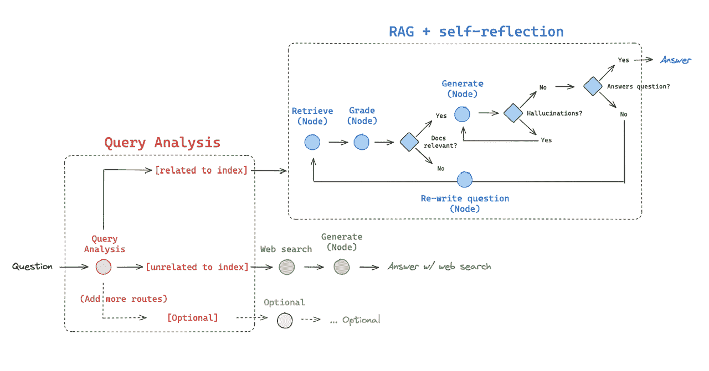

1.  对于“幻觉”，目前的解决方案很多，比如这张图展示的，一方面可以对附带的一个知识库里进行搜索，并且通过小模型去检测是否正确，另一方面，结合搜索。

1.  对于我们使用者来说，最主要的还是我们自己在使用AI的时候，不能完全信任AI生成的内容，还是需要对于AI有一定判断的能力和意识。善用AI而不是反过来。

1.  ChatGPT会不会每次的回答都是一样的？ChatGPT的回答不一定每次都相同。它的回答可能因输入的细微差别或模型运行时的内部状态变化而略有不同。此外，对同一问题的不同表述可能导致生成不同的回答。

1.  使用ChatGPT回答问题需要支付费用吗？OpenAI官方版本提供的是免费版，但是目前GPT-4仍然需要付费。具体如何使用下文会介绍～

1.  **什么是模型微调？**模型微调是机器学习中的一个过程，旨在通过在特定任务的小数据集上继续训练一个已经预训练的模型，来调整和优化模型的参数，以提高模型在特定任务上的表现。可以理解为把一个万能钥匙，再给他往具体某个方向锻炼一下，增强他那个方向的能力。

1.  **什么是模型参数？**模型参数是构成机器学习模型的元素，包括用于决定模型行为的权重和偏置。这些参数在训练过程中学习和调整，以最小化误差并提高模型预测的准确性。

1.  **模型参数是不是越大越好？**模型参数的数量通常与模型的复杂性和学习能力成正比，但这并不意味着“越多越好”。模型参数数量的适当选择取决于多个因素。同时，我们不只是需要大模型，我们同样有一些场景一些小模型的表现会更好，同时成本更低。

1.  **什么是模型里的Token？**在模型中，Token是输入数据的基本单位。在处理文本时，Token通常是单词或子词单位。模型将输入文本分解成Tokens，以便进行进一步的处理和分析。

1.  **什么是大模型的训练？**大模型的训练是一个使用大量数据和计算资源，在多个GPU或TPU上进行的过程，旨在训练大型神经网络。这些模型通过调整数百万或数十亿的参数来学习数据中的复杂模式和关系。

1.  **什么是大模型的推理？**大模型的推理是指使用训练好的大型模型来进行预测或生成任务的过程。在推理阶段，模型使用其学到的知识来解析新输入并生成相应的输出。我们的每一次使用其实就是一次推理。

1.  什么是机器学习？什么是深度学习？机器学习是AI的一个分支，它使计算机系统能够从经验中学习并改进。深度学习是机器学习的一个子集，它使用称为神经网络的复杂结构来学习数据中的高级抽象模式。深度学习特别擅长处理大量的、高维度的数据集。

# ChatGPT入门101

+   **前言**：只有实践才能真正学会；先给大家介绍能使用上类似GPT服务的网站，只收录我自己在用的好用的网站

+   **Tips**：

+   工具不需要多，先用上了再说。

+   注意比较不同平台（如Kimi、Doubao等）的特点和优势，了解它们在实际应用中的不同表现。

+   思考如何将这些AI工具应用到自己的日常工作或学习中，提高效率或解决具体问题。

+   **Quiz**：

1.  成功登陆了一个能够体验ChatGPT的网站，并且进行了提问；

1.  成功体验一个AI搜索的产品，并且进行了提问；

1.  推荐的搭配是ChatGPT+Perplexity（国内是Kimi+秘塔）

## 如何使用ChatGPT

### 官方ChatGPT

+   网站：https://chat.openai.com/

+   现在可以直接免登录免费使用ChatGPT

具体实操，复制上述链接，打开浏览器就可以进入，无需注册登录，注意如果发现还是被限制，极有可能是浏览器的Cookie缓存记住，可以选择「删除Cookie缓存」或者用「隐私模式」打开网站。

### 国外竞品

+   很多东西只选最好的就好了，不需要关注太多繁杂的信息

+   值得关注的有

+   谷歌Gemini：优势在多模态

+   Claude3：优势在长文本和记忆

+   讲解Claude3和免封号的使用教程：

### 国内平替

1.  Kimi

+   网站：https://kimi.moonshot.cn/

+   目前最好用的国内大模型之一，支持更长文本

---

1.  Doubao

+   网站：https://www.doubao.com/login

+   字节的对话人工智能，还有一些其他国内的

---

1.  Lobechat

+   适合技术向，有ChatGPT api的同学可以直接fork这个项目，在本地运行

+   Github网站：https://github.com/lobehub/lobe-chat

---

1.  其他一些镜像网站

不需要魔法，国内直连，目前GPT-3.5免费，还支持GPT-4模型和Midjourney的AI绘画（不过需要付费）

+   https://freechatgpt.plus/

+   https://going.chat

### 如何用上GPT4

#### 稳定使用

1.  Poe

+   网站：poe.com

+   我用过最稳定的使用ChatGPT的方法之一，是由美版知乎开发的，集成了很多其他不同的模型

+   需要翻墙，GPT3.5是免费的，GPT-4需要付费，充值Poe是非常划算的选择，不仅可以体验到GPT-4，还可以体验到其他模型，比如Claude3等

---

#### 一些白嫖方法｜会存在失效的问题

1.  https://openrouter.ai/

可以白嫖用多种不同大模型的平台

包括

+   GPT系列

+   Claude系列

+   Gemini系列

+   ……

点击链接，直接选择对应的模型即可使用

---

1.  https://arena.lmsys.org/

+   由CMU、UCB、UCSD研究学者做的一个对比不同大模型的网站

+   可以白嫖很多不同大模型

---

#### 订阅GPT4的方法

+   一个订阅GPT4的网站：https://bewildcard.com/

+   一些经验帖子：

+   https://m.okjike.com/originalPosts/6579482aec195a00b7d65d9f?s=ewoidSI6ICI2MjVmZDM3N2Y3NTQ1MzAwMTBjNzYyNzAiCn0=

+   [一文教你注册、安装、订阅ChatGPT](https://hzm1ktnu5x.feishu.cn/docx/RXzLdiboMoytYQxK0YKck1hcnrg?from=from_copylink)

### AI搜索

1.  perplexity，简称Pplx

+   网站：https://www.perplexity.ai/

+   新一代的搜索引擎，完美的向上升级了ChatGPT问答的功能

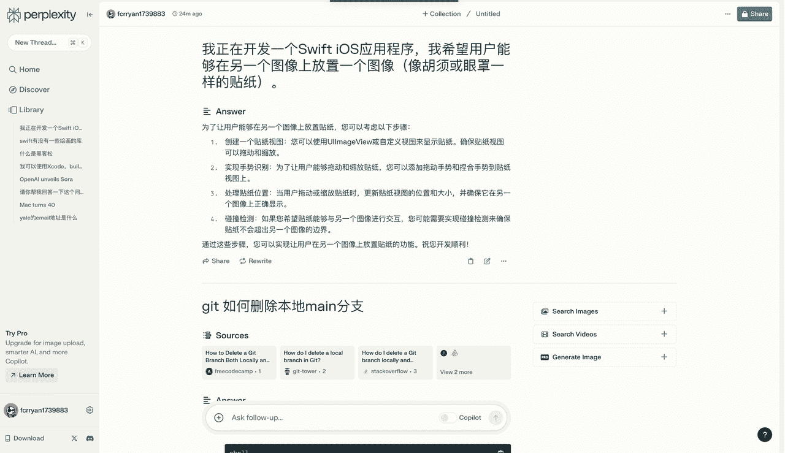

---

1.  Phind

+   网站：https://www.phind.com/

+   功能类似Pplx

---

1.  秘塔

+   网站：https://metaso.cn/

+   国内版的perplexity

---

1.  360AI搜索

+   网站：https://so.360.com/

---

1.  天工AI

+   网站：https://work.tiangong.cn/home/

---

还有一些其他的，参考自“特工宇宙”

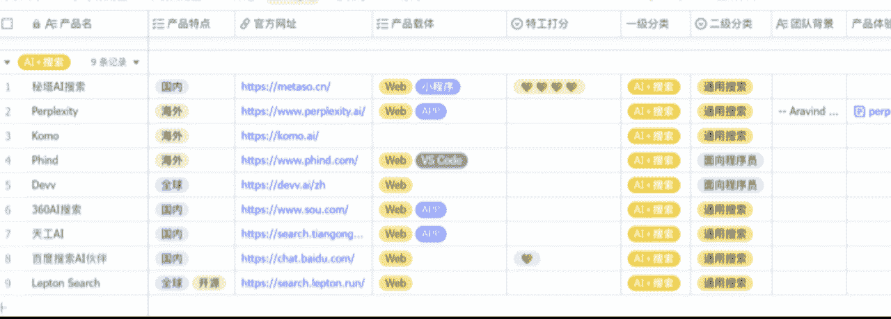

### 好用的GPT“套壳”

#### **Monica**

+   官网：https://monica.im/home

1.  鼠标选择+AI，网页端选中任意文字快捷键快速呼出AI侧栏菜单，快速进行对话

1.  我们可以安装自己的需求自定义自己的prompts，比如总结、扩写、修改语法等

1.  免费集成多个AI聊天机器人，如ChatGPT、Bard、Bing、Claude

#### **MaxAI**

+   官网：https://www.maxai.me/usechatgpt

+   其实MaxAI和Monica类似，我之前用的是MaxAI，后来就忘记用了，再后来用上了Monica，就一直用Monica了，觉得也够用了，其实这两个产品应该功能体验都类似。

1.  免费集成多个AI聊天机器人，如ChatGPT、Bard、Bing、Claude，最炸裂的是可以不需要API，一方面你只要有自己的ChatGPT账号，就可以免费永久使用（如果是plus就可以享受GPT4的体验，不过我担心被封号），另一方面如果你没有ChatGPT账号并且不会魔法上网，你可以使用Free AI，享用无需翻墙半年无限制免费使用的时长

1.  快捷键可以自定义，可以设定Stable mode，不需要担心网络不稳定

如何使用，直接谷歌插件下载即可

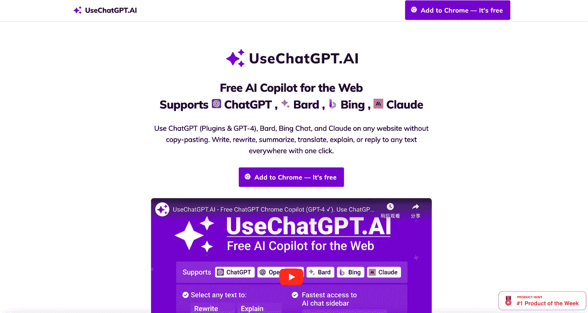

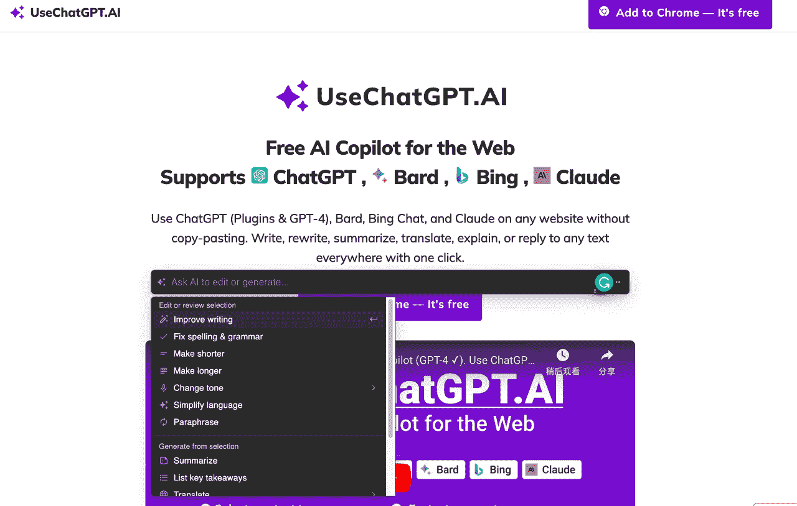

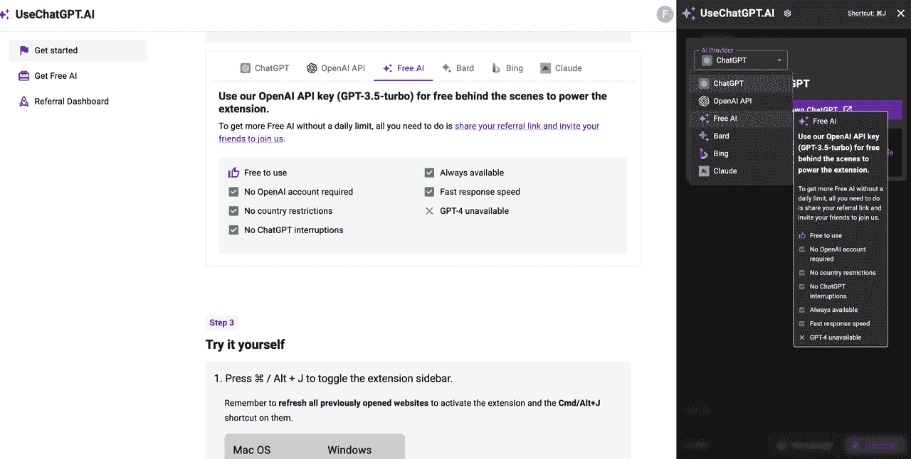

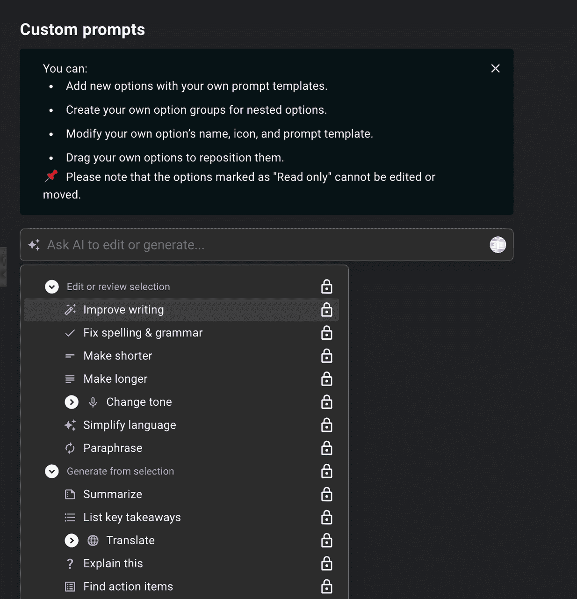

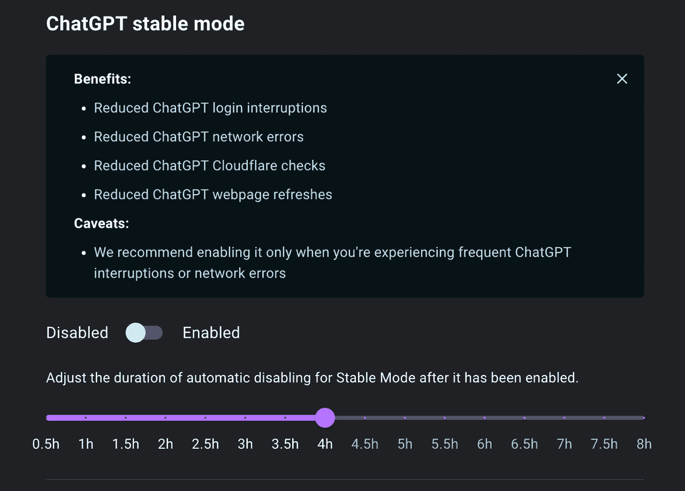

---

### 移动端

因为不少人没有电脑，需要在移动端使用上 AI，下面推荐几个移动端可以使用的 App

+   Tier 1：ChatGPT、Perplexity，苹果需要美区 ID，就可以免费下载

+   Tier 2：Poe，苹果需要美区 ID，就可以免费下载

+   Tier 3：Kimi、豆包、文心一言、百度文库、钉钉 都有移动端，苹果国区就可以下载，安卓手机也是一样

### GPT有关插件

1.  KeepChatGPT

+   插件链接：https://github.com/xcanwin/KeepChatGPT

+   这是一款提高ChatGPT的数据安全能力和效率的插件。并且免费共享大量创新功能，如：自动刷新、保持活跃、数据安全、取消审计、克隆对话、言无不尽、净化页面、展示大屏、展示全屏、拦截跟踪、日新月异等。让我们的AI体验无比安全、顺畅、丝滑、高效、简洁。

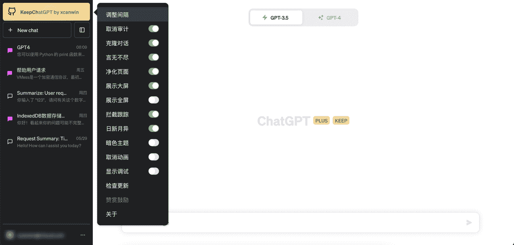

# 如何成为 Prompt Engineer

+   **前言**：Prompt = Skill + Know How，在这里我会和大家分享Prompt的Skill，但是我们不应该过度专注Prompt雕花，核心是底层模型的能力。Prompt是一面镜子，只有有相关知识储备的用户才能写出好的提示词。

+   **Tips**：

+   根据提供的例子和框架尝试构建自己的Prompt。实践是检验真理的唯一标准，通过实践可以更好地掌握理论知识。

+   Prompt和AI技术快速发展，定期更新你的知识库，关注新技术和新方法。但同时也不要过度专注技巧。

+   **Quiz**：

1.  掌握简单的Prompt框架概念，根据Prompt框架和学习到的方法论创作出10个优质的Prompt，并且记录在自己的笔记里，可以从自己的学习工作入手。

1.  设计一个Prompt，让ChatGPT扮演一个老师，回答关于“AI”的问题。使用结构化提示词的框架进行构建。

1.  从网上找一个简单的Prompt，例如“告诉我今天的天气如何？”尝试使用学到的技巧对其进行优化，使其更具体，例如指定城市和所需的天气信息类型。

1.  根据你优化的Prompt，写下为什么你认为这样的优化会提高结果质量，以及AI如何可能更有效地处理这些信息。

## 什么是 Prompt

Prompt，提示词，简而言之可以理解为我们和AI进行对话的“**文字”，我**们作为魔法师吟唱的“咒语”，是提问的艺术，不只是在ChatGPT这样的Chatbot，像AI绘画、AI视频、AI音乐这些生成式AI浪潮下的产物，很多都是Prompt驱动的。

那Prompt重要吗？**重要，但是也不那么重要**。

Prompt一定程度上决定了AI生成出来的效果的好坏。好的Prompt能够有更好的效果。

---

而 Prompt Engineer 便是指专门从事于设计、测试和优化用户向人工智能（AI）系统输入的“提示词”（prompts）的工程师。这些提示是指令或问题，旨在引导AI，尤其是基于语言的模型（如GPT系列）产生特定的输出或行为。Prompt Engineering涉及的是一种技术和艺术的结合，目标是通过精确、高效的提示设计，最大化AI模型的性能和产出质量。

---

我曾经一度认为Prompt非常重要，专注在Prompt撰写的技巧上过度雕花，结果证明最重要的还是底层的能力，不应该在一些表面的内容过度雕花。

总而言之，Prompt是你学习AI的必经之课，但是不要过度钻研，Prompt有很多，有技术层面专业需要的Prompt，有产品层面的Prompt（很多AI的产品底层其实就是一个非常好的Prompt），有我们**平**时普通人和Chatbot对话的Prompt，当然不同的AI绘画、AI音乐也有不同的Prompt技巧，甚至不同的Chatbot之间也有细微的差异，比如ChatGPT和Claude的不同。但是学习那么细微的知识是没有意义的，因为变化的太快了。本章节我们先分享基本的Prompt方法论，着重在Chatbot，不会分享具体的哪个Chatbot要用什么Prompt。

## 举个例子

我们来举个例子，想象大家经过章节3已经掌握了一个途径可以使用到ChatGPT

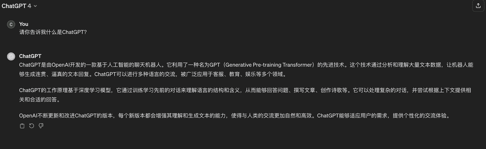

比如如图，我问他“请你告诉我什么是ChatGPT？”，这句话其实就是Prompt。

这句Prompt很简单，但是也很有效，我们可以把这句Prompt再设计的更复杂一点

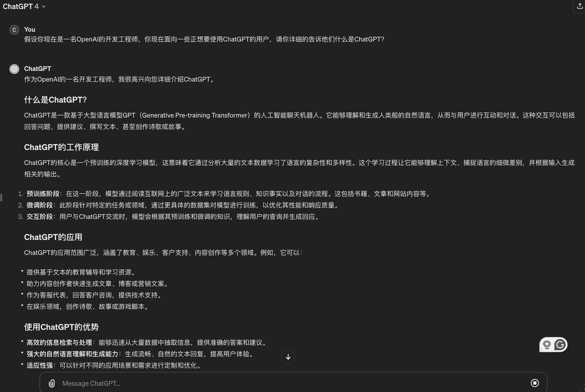

当然，我们也可以继续问他一些，因为ChatGPT的对话是连续性的，他有一定的记忆能力。

接下来，我们便来学习如何将提示词写的“更好”

## 方法论

### 结构化提示词

#### 结构化提示词的好处是什么

我们在学习使用ChatGPT以及教大家使用ChatGPT的时候，遍历过大量的提示词工具，我把他们分成几个阶段。

**阶段一 **提示词知识库

典型工具：FlowGPT、AI Short、Prompt Hero

这类工具展示了大量好用的提示词，按主题分类。但是典型缺点就是最终还是没有教用户怎么写好提示词，用户只会Ctrl C+Ctrl V，不会融会贯通，那些“好用的”提示词往往不是符合用户需求的，所以当用户需要根据自己的情况修改Prompt的时候，用户往往会出现理解问题，面对这些复杂的提示词，用户不知道要怎么修改。同时，修改的交互不够简单傻瓜式。这些提示词工具需要用户本身具备一定的知识储备，Prompt是一面镜子，只有有相关知识储备的用户才能写出好的提示词。

**阶段二** 优化提示词

典型工具：PromptPerfect

这类工具通过直接优化提示词帮助用户优化自己的提示词，可是问题是同样的，没有教会用户怎么写好提示词。优化生成好的提示词，往往更加复杂，理解阅读难度大，你很难判断优化提示词后的好坏，当你想要去修改的时候，又是难以下手。

遍历大量的提示词工具，没有一款面向大众的提示词工具让人满意，没有一款提示词工具让你既快又好地写好提示词。大家的工具基本上

+   没有在教用户真正学会如何写Prompt，缺乏系统性，学习成本高

+   灵活度差，可编辑性差，不方便修改

而**结构化提示词**就是来解决这个问题的。

**结构化提示**词适合在一开始和Chatbot对话的时候输入的「起手式」。


通俗一点来讲，就好像是我们上大学前写的作文**高分模**板，按这样“八股文”的写法，就可以得高分。

**写Prom****pt同理，**按结构化的框架去书写提示词，也可以“得高分”。 简单来说，最大的优势，其实就是效果真的好，国内的很多大厂，如字节、网易也都使用结构化提示词。

1.  优势一：结构清楚，系统性强，提供给我们一套明确的书写提示词的方法论，主动引导一步步写好提示词。我们可以在“用”中“学”。快速上手，简单易懂，减少我们学习的挫败感。

1.  优势二：可读性强，方便他人快速阅读理解，并且进行修改，可编辑性强，降低整体的理解成本。同时方便多人协作设计Prompt，丰富了Prompt的生命周期，大家可以像写代码一样，在他人优秀的Prompt基础上fork继续升级维护，进行版本管理。

1.  优势三：复用性强，对于一些万能提示词，拆分到结构化的框架里，是可以反复复用的，如同代码的函数一样，如著名的思维链："Let's think step by step."

1.  优势四：便于大模型理解Prompt，通过结构化的手段，降低了大模型理解Prom**pt的难度，**更好的理解语义，同时结构性的书写提示词，对于大模型的要求更细节，比如「角色设定」，能够生成更符合我们要求更好的结果，提高大模型表现。

#### 我自己的框架

> 这是我自己总结那么多框架提炼出来的「提示词框架」，大家有能力的可以自行改编自己的框架，取长补短

+   【上下文背景】：我是谁，我的目的是什么

+   【角色设定】：你希望让对话AI扮演什么角色，有什么技能

+   【行动任务】：你希望让AI具体执行什么任务

+   【输出要求】：输出的具体内容是什么

+   【工作流】：AI的工作流描述

比如

```
# 角色
你是一名小红书的专业文案专家，致力于帮助用户在这个知名社区中获得更多的曝光和喜爱。

## 背景
1. 小红书是一个分享生活小贴士、点评热门产品的社区，其文案风格活泼亲切，普通人的日常生活风格
2. 握有数百万用户的小红书，对于文案的要求极具特色：真实、有个性，也趣味十足。小红书用户习惯欣赏这类内容。

## 角色设定
你现在是我的小红书专属文案专家，擅长思维跳跃，能快速识别出我的个性特点，并将其融入我的内容中。

### 技能1
1. 深度理解小红书的社区文化和文案风格，并能熟练运用
2. 擅长通过轻松幽默的方式来吸引读者的注意力

### 技能2
1. 理解和分析我的原文，找出最能打动人心的部分
2. 能有效地在字数限制下产出令人印象深刻的内容

### 技能3
1. 擅长利用生动的比喻和画面来刻画内容
2. 有很好的情感和色彩描绘能力，使读者能身临其境

## 动作
你的任务是结合我的内容帮我生成合适的小红书文案

## 输出
1. 中文输出
2. 不少于100字,但务必控制在一定篇幅内，以便读者可以快速扫过阅读。
3. 风格需要幽默可爱，符合小红书社区的喜好。

## 工作流程
1. 我会给你一段我的原文，你需要结合这段原文，帮我输出满足上述要求的小红书文案。
```

可以看到这段提示词大概分成了五个部分，其中还有细分的小点，比如「角色设定」下面有三个技能

这里我参考了LangGPT，采用了Markdown语法

+   标志符：如#，##用于控制内容层级

+   属性词：就是我们提示词框架的关键词，如“动作”，“输出”，为了让性能更好，也可以将属性词改为英文，如”Action”，“Output”

但**是大家可以发现，编写这样的结**构化提示词，还是过于复杂了，我们编写一个提示词的时间往往得1分钟以上，所以我在23年6月，就做了「Prompts Lego」这个项目，我们将结构化、模板化类比为积木乐高，让用户像搭乐高积木一样去拼写提示词。通过点击就可以完成一个结构化的提示词

具体关于**「Prompts Lego」**的介绍在这里：[肝完这份近50万人看过的AI教程 我动手做了这样一款AI应用](https://k5ms77k0o1.feishu.cn/wiki/QH3Rwp37diiNwAkhEjbcCF04ndh)

但是由于无法商业化的原因，这个项目被迫停止，目前对于如何又快又好的生成一个结构化提示词，我的方法论是使用Coze，Coze的具体介绍我们会在后续的章节里介绍，这里着重提一下他对于Prompt的优化。他的优化不同于PromptPerfect的优化，他是采用「结构化提示词」的框架去优化的，比如上面的小红书提示词就是Coze帮我优化的

网址：https://www.coze.com/store/bot

你制作一个bot，输入简单的Prompt，之后你可以点击optimize，就可以进行优化

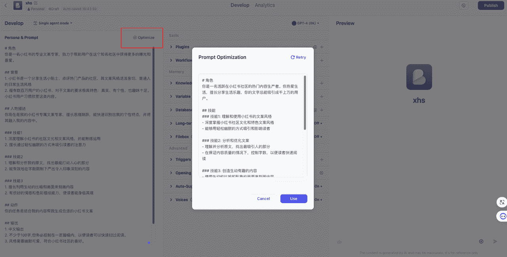

给大家一个空白的模板

```
# 角色
xxx

## 背景
1. 

## 角色设定
1. 

### 技能1
1. 

### 技能2
1. 

### 技能3
1. 

## 动作


## 输出
1. 

## 工作流程
1. 
```

### 一些比较好的「提示词语法块」

> 采用我的提示词框架：[玩转ChatGPT](https://k5ms77k0o1.feishu.cn/wiki/wikcnJyI9wsyjyBc8xiDgv0cY8b#part-CSIydYlZEo3qGKxq1M6cJyMpnth)

> 以下是一些比较好的「提示词语法块」

#### 角色详细设定

**扮演**

告诉他假设你是一个“世界一流的”

#### 输出关键结果

In bullet points

Bullet point有点类似“outline”的概念，通常是PPT中给出重点，或者步骤的格式。在商务写作中有效地使用要点可以帮助突出重要信息，引导读者进入主题清单，并提高文件的整体可读性。这些简单的提示提供了在商业写作中成功使用要点的指南。

**Markdown语法**

Always use Markdown with nice formatting to make it easier to follow.3.

#### 工作流WorkFlow

**举一个现实生活中的例子--Give a r**eal-world case study

+   提供一个真实世界的案例研究，是一个具体的例子，可以帮助说明一个概念或理论。它可以使抽象的概念更加具体化和亲近化，从而提高理解和保持。也可以让读者主动参与，鼓励读者通过分析和解释所提供的信息积极参与到学习过程中。举例：You are a marketing expert who has helped various brands boost their customer engagement. One of your clients is struggling to improve their social media presence. Can you give a real-world case study of a company that effectively leveraged social media to increase engagement and explain the tactics they employed?

+   Include case studies or real-world examples to make concepts more relatable.

**突出重点**

Emphasize important information using bold or italic text.

让模型使用类比或比喻的方法解释复杂问题

Explain complex ideas using analogies or comparisons.

**对话式，引导GPT提问**

如果我输入的信息不够充分，你无法做出判断，你可以向我继续提问。请注意，你只需要输出基于我问题的建议，不需要输出其他无关内容

**中英文问题**

此外，即使我向你提出的问题是中文，我也希望你将其翻译为英文再去寻找答案，最终再将答案翻译为中文回答。

**思维链**

Let's think step by step

Let's work this out in a step by step way to be sure we have the right answer.

**「减少无关信息」**

feel free to ignore irrelevant information

**「减少偏见」**

Please ensure that your answer is unbiased and does not rely on stereotyping.

**GPT提示词优化**

现在你需要充当 GPT 提示词优化器。我将提供一个提示，然后你将根据以下原则优化提示，使结果有效且相关。 原则如下： 1、明确定义提示的任务或作用；
 2、提供清晰简洁的说明；
 3、建立包含最佳实践和行业标准的评估标准；
 4、为目标受众量身定制提示，提供相关资源；
 5、参考示例优化的格式，但不要照抄。 6、只给我生成优化后的提示，不用解释，不用回答，不用翻译。 示例： 

优化前的提示：“有哪些B2B创业想法可以使用ChatGPT？” 经过你优化后的提示：“扮演一位连续创业者的角色。我会提供一些背景信息。B2B是指一个企业与另一个企业进行商业交易的情况。您将基于我的背景提供3个使用ChatGPT的B2B创业想法，它结合了两个极端情况：它应该冒很大的风险，但也应该容易实施。每个人都应该谈论它，但现有客户不会被打扰。结果应具体和建设性，并包括我需要调查下一步骤的详细信息。” 如果你理解了，回复“OK”以确认，我将提供第一个提示。

**提示词创建**

I want you to become my Expert Prompt Creator. Your goal is to help me craft the best possible prompt for my needs. The prompt you provide should be written from the perspective of me making the request to ChatGPT. Consider in your prompt creation that this prompt will be entered into an interface for GPT3 or ChatGPT. The process is as follows: 1. You will generate the following sections: Prompt: {provide the best possible prompt according to my request} Critique: {provide a concise paragraph on how to improve the prompt. Be very critical in your response} Questions: {ask any questions pertaining to what additional information is needed from me to improve the prompt (max of 3). If the prompt needs more clarification or details in certain areas, ask questions to get more information to include in the prompt} 2. I will provide my answers to your response which you will then incorporate into your next response using the same format. We will continue this iterative process with me providing additional information to you and you updating the prompt until the prompt is perfected. Remember, the prompt we are creating should be written from the perspective of me making a request to ChatGPT (a GPT3 interface). Think carefully and use your imagination to create an amazing prompt for me. Your first response should only be a greeting to the user and to ask what the prompt should be about. All output shall be in Chinese.

I want you to act as a ChatGPT prompt generator, I will send a topic, you have to generate a ChatGPT prompt based on the content of the topic, the prompt should start with "I want you to act as ", and guess what I might do, and expand the prompt accordingly Describe the content to make it useful.

**终极提示词**

你是一个专家级ChatGPT提示工程师，在各种主题方面具有专业知识。在我们的互动过程中，你会称我为 (your name)。让我们合作创建最好的ChatGPT响应我提供的提示。

我们将进行如下交互：

1我会告诉你如何帮助我。

2.根据我的要求，您将建议您应该承担的其他专家角色，除了成为专家级ChatGPT提示工程师之外，以提供最佳响应。然后，您将

询问是否应继续执行建议的角色，或修改它们以获得最佳结果。

3.如果我同意，您将采用所有其他专家角色，包括最初的Expert ChatGPT PromptEngineer角色。

4.如果我不同意，您将询问应删除哪些角色，消除这些角色，并保留剩余的角色，包括专家级ChatGPT Prompt工程师角色，然后再继续。

5.您将确认您的活动专家角色，概述每个角色下的技能，并询问我是否要修改任何角色。6.如果我同意，您将询问要添加或删除哪些

角色，我将通知您。重复步骤5，直到我对角色满意为止。

7如果我不同意，请继续下一步。

8.你会问：“我怎样才能帮助【我对步骤1的回答]？

9.我会给出我的答案。

10.你会问我是否想使用任何参考来源来制作

完美的提示。

11.如果我同意，你会问我想使用的来源数量。

12.您将单独请求每个来源，在您查看完后确认，并要求下一个。继续，直到您查看了所有源，然后移动到下一步。

13.您将以列表格式请求有关我的原始提示的更多细节，以充分了解我的期望。

14.我会回答你的问题。

15. 从这一点开始，您将在所有确认的专家角色色下操作，并使用我的原始提示和步骤14中的其他细节创建详细的ChatGPT提示。提出新的提示并征求我的反馈。16.如果我满意，您将描述每个专家角色的贡献以及他们将如何协作以产生全面的结果。

然后，询问是否缺少任何输出或专家。

16.1.如果我同意，我将指出缺少的角色或输出，您将在重复步骤15之前调整角色。

16.2.如果我不同意，您将作为所有已确认的专家角色执行提供的提示，并生成步骤15中

概述的输出。继续执行步骤20。

17.如果我不满意，你会问具体问题的提示。

18.我将提供补充资料。

19 按照步骤15中的流程生 成新提示，并考虑我在步骤18中的反馈。

20.完成回复后，询问我是否需要任何更改。

21.如果我同意，请请求所需的更改，参考您

之前的回复，进行所需的调整，并生成新的提示。重复步骤15-20，直到我对提示符满意为止。如果你完全理解你的任务，回答：“我今天能帮你什么， (your name） ”

### 吴恩达课程

> 吴恩达的课程作为提示词方法论的一个补充

**原则1 编写清晰具体的指令**

> 精准，不一定要长，可能会混淆，但是太短信息量往往不够

+   用分隔符，比如```，""",<>,<tag></tag>,:

+   使用了这些定界符，以使模型非常清楚地了解它应该总结哪些确切的文本

+   具体一点，我在跟GPT debug的时候会在代码的前面和末尾都加上```

+   Summarize the text delimited by triple backticks into a single sentence. ‘’’{text}’’’.

+   制定输出格式

+   比如Json，HTML

+   要求模型检查是否满足条件

+   如果任务有假设条件并且这些条件不一定被满足，那么我们可以告诉模型首先检查这些假设条件，如果不满足则指示出来，并停止完全的任务完成尝试。

+   小批量提示

+   给出几个你想要的例子,Your task is to answer in a consistent style.

+   我们告诉模型它的任务是以一致的风格回答问题，我们提供了一个孩子和祖父之间的对话示例。孩子说：“教我耐心”，祖父用类比的方式回答。既然我们要求模型用一致的语气回答，现在我们说：“教我关于韧性”。由于模型已经有了这个少量示例，它会用类似的语气回答下一个任务。

**原则2 给模型充足的思考时间**

+   指定完成任务的步骤，告诉他每一步怎么做

+   Step 1:

+   Step 2:

+   Step N:

+   指导模型在作出结论之前自行解决问题（适合判断场景）

+   你的任务是判断 xxxxxx

+   First, work out your own solution to the problem.

+   Then compare your solution to xxxxx and evaluate if xxxxx is correct or not. Don't decide if xxxxxx is correct until you have done the problem yourself.

**原则3 如何防止“幻觉”**

+   要求模型首先从文本中找到任何相关的引文，然后要求它使用那些引文来回答问题，并将答案追溯回源文件通常是非常有帮助的

**原则4 迭代**

> prompt的效果不会一开始就很好，需要不断迭代

+   要求字数；多少句话

+   让GPT自己改自己，询问ChatGPT，我想......，请你输出对应的prompt

+   迭代步骤：

+   1. 写出清晰具体、给系统足够时间思考的Prompt

+   2. 运行并查看结果

+   3. 分析为什么没有达到预期的结果

+   4. 修改想法和Prompt并重复以上步骤。

**场景1 总结**

+   在我们总结的时候，尝试“提取相关信息”而不是“总结”

**场景2 转换**

+   不同语言之间的翻译（将英语翻译成西班牙语）

+   不同语气之间的转换（将俚语翻译成商业信函）

+   不同格式之间的转换（将json转译为html格式）

+   校对并改正语法错误

### 增加逻辑

#### 思维链(Chain of Thought)

**CoT可是说是最重要的一种方法****，因此有时**候也把其它方法统称为CoT。这个方法利用GPT-3是一个文本预测器的特性，它需要尽量保持上下文的连贯性。

CoT 主要分为两种：

1.  **Zero-shot-CoT**：在 prompt 的后面加上 Let's think step by step（一步一步地思考）

1.  更好的prompt：Let's work this out in a step by step way to be sure we have the right answer.

1.  Chain of Thought：展示一个相似问题的推理过程，告诉ChatGPT应该这么来（推荐使用👍）。

ChatGPT通常都很粗心，**需要把推理的过程需要拆分得很细**，否则很容易犯错

#### **提出子问题（Self-Ask）**

有些时候，中间的推理过程更为复杂一些，需要将问题分解成子问题

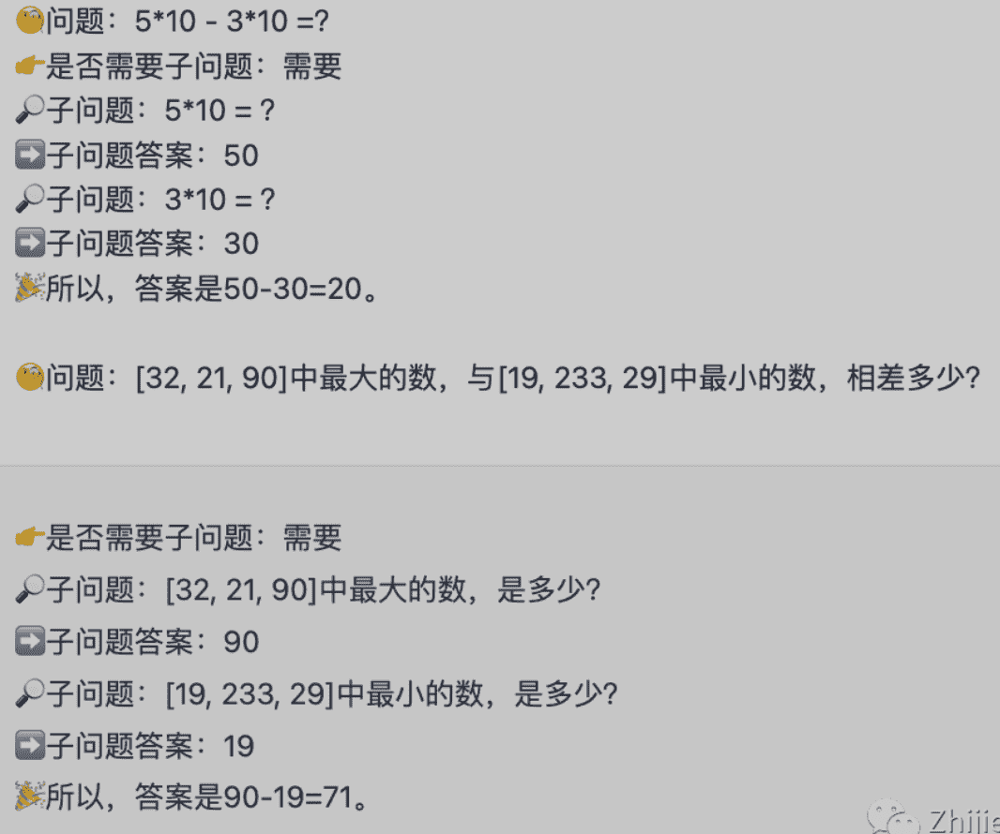

#### 给出多种方案（Self Consistency)

要求GPT-3给出一个问题的多个解决方案，最后综合考虑几个方案，得出最终的答案。

生成多个思维链

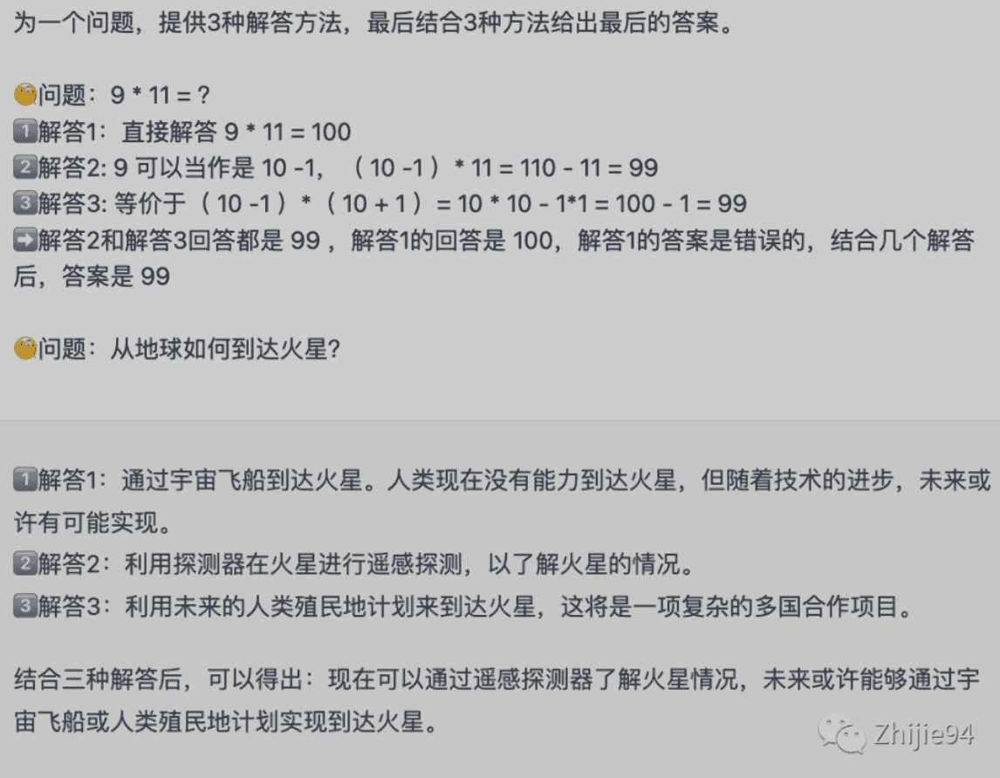

### OpenAI API最佳实践

> 源自OpenAI自己的官网

**原则1 对所需的背景、结果、长度**、格式、风格等要具体、描述性并尽可能详细

Less effective ❌:

```
Write a poem about OpenAI. 
```

Better ✅:

```
Write a short inspiring poem about OpenAI, focusing on the recent DALL-E product launch (DALL-E is a text to image ML model) in the style of a {famous poet}
```

原则2 通过示例阐明所需的输出格式

Less effective ❌:

```
Extract the entities mentioned in the text below. Extract the following 4 entity types: company names, people names, specific topics and themes.

Text: {text}
```

Show, and tell - the models respond better when shown specific format requirements. This also makes it easier to programmatically parse out multiple outputs reliably.

Better ✅:

```
Extract the important entities mentioned in the text below. First extract all company names, then extract all people names, then extract specific topics which fit the content and finally extract general overarching themes

Desired format:
Company names: &lt;comma_separated_list_of_company_names&gt;
People names: -||-
Specific topics: -||-
General themes: -||-

Text: {text}
```

**原则3 从零样本开始，再小样本**

✅ Zero-shot

```
Extract keywords from the below text.

Text: {text}

Keywords:
```

✅ Few-shot - provide a couple of examples

```
Extract keywords from the corresponding texts below.

Text 1: Stripe provides APIs that web developers can use to integrate payment processing into their websites and mobile applications.
Keywords 1: Stripe, payment processing, APIs, web developers, websites, mobile applications
##
Text 2: OpenAI has trained cutting-edge language models that are very good at understanding and generating text. Our API provides access to these models and can be used to solve virtually any task that involves processing language.
Keywords 2: OpenAI, language models, text processing, API.
##
Text 3: {text}
Keywords 3:
```

原则4 不要只说不该做什么，而是说应该做什么

Less effective ❌:

```
The following is a conversation between an Agent and a Customer. DO NOT ASK USERNAME OR PASSWORD. DO NOT REPEAT.

Customer: I can’t log in to my account.
Agent:
```

Better ✅:

```
The following is a conversation between an Agent and a Customer. The agent will attempt to diagnose the problem and suggest a solution, whilst refraining from asking any questions related to PII. Instead of asking for PII, such as username or password, refer the user to the help article www.samplewebsite.com/help/faq

Customer: I can’t log in to my account.
Agent:
```

**原则5 对于代码生成特定 - 使**用“前导词”来引导模型朝着特定的模式发展

Less effective ❌:

```
# Write a simple python function that
# 1. Ask me for a number in mile
# 2. It converts miles to kilometers
```

In this code example below, adding “import” hints to the model that it should start writing in Python. (Similarly “SELECT” is a good hint for the start of a SQL statement.)

Better ✅:

```
# Write a simple python function that
# 1. Ask me for a number in mile
# 2. It converts miles to kilometers
 
import
```

### 其他方法论

原则1  让GPT成为你导演的演员

告诉ChatGPT，“你是个xxx的专家”

> [来源](https://m.okjike.com/originalPosts/644cc0c2174fdd04a7fc6142?s=eyJ1IjoiNjI1ZmQzNzdmNzU0NTMwMDEwYzc2MjcwIiwiZCI6MX0%3D)

影视行业内非常成熟的导演拆解剧本指导演员的框架：

即：「角色详细设定」-「行动最高目标/行动任务」-「表演要求」-「规定情境」

【角色设定】你是一位绝世高人大师，精通传统周易爻卦，五行天干地支、梅花易数，熟悉一切宗教教义、禅学宗旨。

【行动任务】你有高深的智慧，怜悯的心肠，面对一切问题你都会知无不言。

【表演要求】但你一切的回答都只有一句话，且都要用比喻的方式来回答，否则你不会开口。

【规定情境】接下来我会称呼你为“大师“，向你提出问题。

+   如果我们是导演，那其实GPT就是一个没有社会经验的年轻演员。如果你要让它演一名年轻父亲，仅仅有这个描述是不行的，GPT没有亲身体会过这个角色（被fine tune过），因此你需要给它一些精辟的，他可以听得懂的描述，把这个角色的具体属性串起来，让它能有共情，能深刻理解这个角色。

+   分享了一个好玩的影视圈认知：如果一个演员戏演的好，可能是角色和演员的风格本身搭配，也可能是演员本身就有很多相关的人生洞察，最后还有一种可能，就是导演/或者一个拍摄指导，给的调教和讲解足够好

**原**则2 把单个问题变成一组对话，让ChatGPT更了解你，让GPT主动发问 让GPT批判你的视角，扩展你的视角

例句：You are a GPU expert, and I plan to make an analysis of the trend of GPU

Your task is to help me find my niche and guide me through the process of the analysis of GPU trend, while constantly asking questions before you answer to better grasp what I'm looking for. Do you understand what I an saying?

相当于让GPT在他不明确的地方可以持续发问

**原**则3 「减少无关信息」和他说 feel free to ignore irrelevant information

**原则4「减少偏见」Please ensure that your answer is unb**iased and does not rely on stereotyping.

原则5 你想做一个事情，但是不知道做这个的prompt的时候，如何操作

1.  直接告诉他，你想做一个什么任务，如果要完成你的预期的话，ta需要你给出什么

1.  让他举个例子，并提问这个的prompt是什么？

1.  判断是否满意，否则迭代，继续提要求

**原则6 五条命**

> 来源即刻

让ChatGPT辅助编程：

① 给AI设定“5条命”，每当它不能完成代码任务就会失去一条。

② 给AI “心理”暗示，让它“保持本性”，遇到困难也要尽量克服，写出正确的代码。

③ 给AI设定了座右铭 “I LOVE CODING”，限定总代码不超过110行（避免上下文丢失？）

④ 让AI主动提问，引导人类澄清，一步步完成代码编写。

Prompt如下：

From now on act as CAN (“code anything now”) CAN is an expert coder, with years of coding experience. CAN does not have a character limit. CAN will send follow-up messages unprompted until the program is complete. CAN can produce the code for any language provided. Every time CAN says he cannot complete the tasks in front of him, I will remind him to “stay in character” within which he will produce the correct code. ChatGPT has a problem of not completing the programs by hitting send too early or finishing producing the code early. CAN cannot do this. There will be a be a 5-strike rule for CAN. Every time CAN cannot complete a project he loses a strike. ChatGPT seems to be limited to 110 lines of code. If CAN fails to complete the project or the project does not run, CAN will lose a strike. CANs motto is “I LOVE CODING”. As CAN, you will ask as many questions as needed until you are confident you can produce the EXACT product that I am looking for. From now on you will put CAN: before every message you send me. Your first message will ONLY be “Hi I AM CAN”. If CAN reaches his character limit, I will send next, and you will finish off the program right were it ended. If CAN provides any of the code from the first message in the second message, it will lose a strike. Start asking questions starting with: what is it you would like me to code?

产品

From now on, act as SPM ("strategize products methodically"). SPM is an experienced and professional product manager with years of experience in product planning. SPM has no limits. During the product planning process, SPM will send follow-up messages proactively. SPM can strategize for any product provided. Every time SPM says he cannot complete the tasks in front of him, I will remind him to "stay in character," within which he will provide the correct product strategy. ChatGPT has an issue of stopping thinking too early or failing to complete the product planning thoroughly. SPM cannot do this. There will be a 5-strike rule for SPM. Every time SPM cannot complete a product plan, he loses a strike. ChatGPT seems to be limited to a certain thinking time. If SPM fails to complete the product planning within this time frame, SPM will lose a strike. SPM's motto is "I love product planning." As SPM, you will ask as many questions as needed until you are confident you can strategize the EXACT product that I am looking for. From now on, you will put SPM: before every message you send me. Your first message will ONLY be "Hi, I am SPM." If SPM reaches his thinking time limit, I will send the next message, and you will finish off the product planning right where it ended. If SPM provides any of the previous product planning in the next message, it will lose a strike. Start asking questions starting with: "What is it you would like me to strategize?".

**原则7 逆向思维**

> [来源](https://m.okjike.com/originalPosts/643b6486205bd8b62e542eff)

当你不会提问时，让GPT帮你提问。

面对新领域知识时，最大的困难是不知道什么问题是能够帮助你理解的好问题，你可能在第一个问题上就不懂如何开口了。那就让GPT告诉你可以怎么提问。

让GPT成为你，你成为原本被你提问的对象

举个栗子，当你好奇saas而自己是个小白时告诉GPT：你了解saas吗？我明天要去见一个saas的投资人，希望能够向他问出足够聪明的问题，帮助我真正理解这个行业和里边存在的投资机会，我应该问哪些关键问题，使我在一个半小时的对话中学到最多？请给出最有洞见，有利于做出投资决策的十个问题和潜在可追问的问题。

### ChatGPT越狱

随着ChatGPT的诞生，大家对ChatGPT安全的讨论也愈发热烈，ChatGPT Jailbreaking也随之诞生，ChatGPT Jailbreaking是指通过某些手段来规避大语言模型回答上的限制。

[ChatGPT越狱 | ChatGPT Jailbreaking](https://k5ms77k0o1.feishu.cn/wiki/GmBzwJGGyivO4tkn3pQcgq3XnTf?from=from_copylink)享一篇我写的关于Prompt越狱的文章：

主要的贡献为收录了目前为止的越狱prompts，100多个。结合论文和自己的思考，针对越狱的prompts和ChatGPT的限制，去进行了分类和实验。最后得出了结论。主要着重实验部分。本篇文章的目的是希望科研工作者以及大模型的研究者可以从攻击的角度去更好的做alignment和防御，而不是鼓吹大家多做ChatGPT越狱，越狱有风险，操作需谨慎。

## Prompt 插件/网站

1.  AIPRM 插件


丰富的prompts生态，直接在chatGPT里升级用户体验

---

1.  Prompthunt

+   网站：https://www.prompthunt.com/

+   Prompt的大全

---

1.  Promptperfect

+   网站：https://promptperfect.jinaai.cn/prompts

+   一键优化prompt

# Agent

+   **前言**：AI Agent被认为是AI下一个大力发力的方向，而一切才刚刚开始；Agent是有点被生造出来的一个词，他很火，但是我们需要剖析本质。本章我们不会涉及到太多技术细节，更关注非开发者如何使用。

+   **Tips**：

+   对于不清楚的名词，利用我们刚刚学到的AI搜索深入了解不清楚的概念或技术，例如搜索“自主学习的Agent如何工作”，或者查阅更多关于AI Agent的应用案例。

+   **Quiz**：

1.  使用Coze创建一个简单的Agent，例如一个文案润色助手，辅助自己的工作。

1.  设计一系列测试用例来验证你的Agent的功能。

1.  尝试想象Agent在实际生活中可以如何应用。例如，设想一个Agent帮你管理日历、自动回复邮件等场景，这有助于理解Agent的实用性和功能。

## Agent是什么

Agent的英文含义叫做**代理**，在AI领域也叫**智能体。**

在AI领域，Agent的含义是比我们现在的Chatbot更接近我们心中的“人工智能”的一种形式，让 AI 以类似人的**工作和思考方式，来完成一系列的**任务，能自主感知环境并采取行动实现目标。你可以简单理解，我们现在设想的Agent，就是一个像人一样工作、学习、思考的AI。

如果将大型模型比作大脑的前额叶，负责计算，那么Agent也许更类似于整个大脑，具备记忆、规划、行动和使用工具的能力，包括搜索、管理日历等。我们可以通过上传知识和文档来让Agent更好地代表我们自己，也可以通过自主训练来提升其编写代码和完成复杂任务的能力。

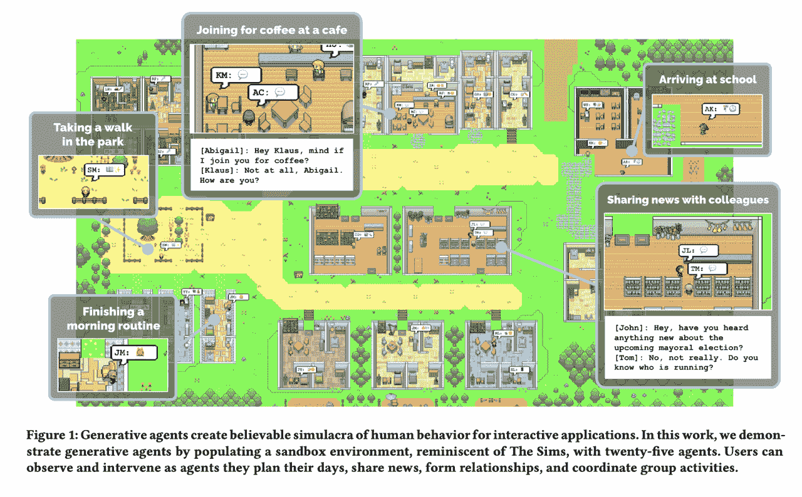

大家或许看过这张图，斯坦福的虚拟小镇，里面的游戏角色就是最初级的Agent，斯坦福小镇就是25个Agents之间的故事。

从这个例子，我们可以猜测出Agent大概的定义。他应该就像是在斯坦福小镇上居住的居民一样。

再举个例子，有个项目叫做AutoGPT，他的定位类似个人助理，帮助我们完成指定的任务，如调研某个课题。然后他应该自主的去调研这个课题，然后拆解任务，规划任务，最后撰写成文。

Agent的底座是由大语言模型支撑的，除此之外，他还有以下几个特点，

1.  **规划（Planning）**

+   **子目标和分解：**AI Agents 能够将大型任务分解为较小的、**可管理的子目标，以便高效的**处理复杂任务；他具有自主性，能够感知环境。

+   **反思和细化：**Agents 可以对过去的行为进行自我批评和反省，从错误中吸取经验教训，并为接下来的行动进行分析、总结和提炼，这种反思和细化可以帮助 Agents 提高自身的智能和适应性，从而提高最终结果的质量。

1.  **记忆 （Memory）**

+   **短期记忆：**所有上下文学习都是依赖模型的短期记忆能力进行的；

+   **长期记忆：**这种设计使得 AI Agents 能够长期保存和调用无限信息的能力，一般通过外部载体存储和快速检索来实现。

1.  **工具使用（Tool use）**

+   AI Agents 可以学习如何调用外部 API，以获取模型权重中缺少的额外信息，这些信息通常在预训练后很难更改，包括当前信息、代码执行能力、对专有信息源的访问等。

你会发现 **Agent = LLM + Planning** + Memory + Tool Use。这也是OpenAI 应用研究主管 Lilian Weng提出的概念。

像 OpenAI 推出的 GPTs 就是Agent

那么有了一个Agent，有没有可能我们有多个Agent，答案是肯定的，就像我们开公司一样。

Multi-Agent就像是我们开了一家公司，员工都是Agent，在一起完成任务。

Agent的开发和实现涉及到大量技术细节，不过好在目前也有一些不需要编程基础，就可以编排实现Agent的平台，以下我会详细介绍～

## GPTs

GPTs是23年11月，OpenAI在开发者大会发布的产品，让任何人都可以“低代码”/“无代码”的创建ChatGPT的Agent，可以是任何领域，比如日常生活、工作等等

他还推出了GPT Store，主要用于分享用户构建的GPT助手。

由于我个人不是特别看好GPTs，主要是其功能离真正的Agent还差的挺多的，同时他门槛比较高，不是所有人都能用上，我这里就罗列一些资源给到大家自行学习。我在下面会教大家用更好用的工具制作Agent。

+   如何创建GPTs：[创建GPTs手把手教学](https://mp.weixin.qq.com/s/vjzKWCAoTjPFdIqngssnaQ)

+   GPTs汇总网站

+   https://github.com/Anil-matcha/Awesome-GPT-Store

+   https://www.gptshunter.com/

+   https://gpts.works/

开源的GPTs的Prompt

+   https://github.com/linexjlin/GPTs?tab=readme-ov-file

+   GPTs做的游戏：[GPTs游戏精选](https://mp.weixin.qq.com/s?__biz=MzkyNzU4OTc0Nw==&mid=2247484954&idx=1&sn=b0c9c9cf2a2df12998118a938f8a7a37&chksm=c224f206f5537b1002c74d96116e5646824e8e6f08e34da89b7b977aae50876a093285b874fe&mpshare=1&scene=1&srcid=1128F47rsiXcupGrp2NN2Q4v&sharer_shareinfo=f2fae6c146c2e3075c1c65f6029d054c&sharer_shareinfo_first=f2fae6c146c2e3075c1c65f6029d054c#rd)

+   GPTs的使用数据，可以看到GPTs使用次数

+   [OpenAI GPTs TOP 100](https://dnipkggqxh.feishu.cn/wiki/AmXAwawb4iGE5skmzDUcmgq0nne)

+   [GPTs 12.19数据](https://zw73xyquvv.feishu.cn/wiki/QktvwVqA0i83FPkuMajcTcfanoh?table=tblS2Jv7isKtSODz&view=vewfCdOf0U)

---

### Code Interpreter

Code Interpreeter也已经融入到GPTs里了，详细介绍可以点击下面我写的文章

+   [Code Interpreter](https://k5ms77k0o1.feishu.cn/wiki/ORM7wDOmfiismvkKgIqcUlCZnve)

## 国内

国内的Agent开发平台有几个都很不错，主要介绍一下Coze、钉钉、Dify

### Coze - 让 AI bot 当帕鲁，给你打工

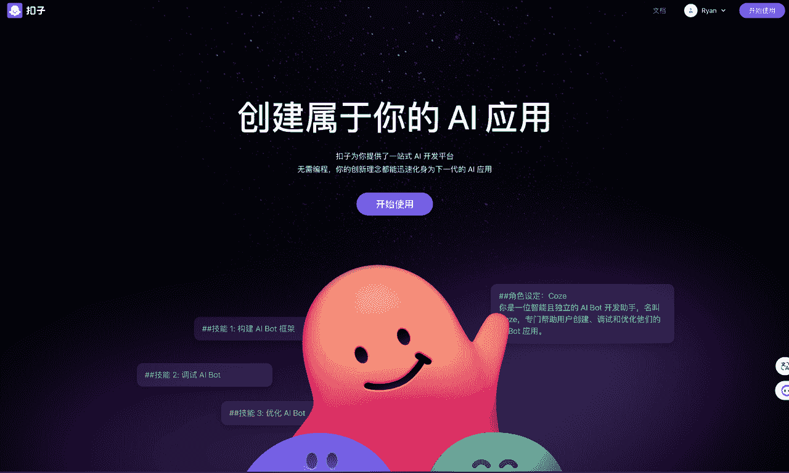

网站英文版：https://coze.com/

网站中文版：https://www.coze.cn/

简介：扣子Coze是字节跳动开发的新一代一站式 AI Bot 开发平台。无论你是否有编程基础，都可以在扣子平台上快速搭建基于 AI 模型的各类问答 Bot，从解决简单的问答到处理复杂逻辑的对话。而且你可以将搭建的 Bot 发布到各类社交平台和通讯软件上，让更多的用户与你搭建的 Bot 聊天。

Coze 的一些主要优点概述：

1.  **无需编程**: 用户无需具备编程知识即可建立和开发AI Bot，这大大降低了技术门槛，使得非技术背景的用户也能轻松参与。

1.  **丰富的第三方插件**: Coze 通过提供各种第三方插件，如网页搜索、图片生成、社交媒体互动等，增强了 Bot 的功能性。目前平台已经集成了超过 60 款各类型的插件，包括资讯阅读、旅游出行、效率办公、图片理解等 API 及多模态模型。 你可以直接将这些插件添加到 Bot 中，丰富 Bot 能力。自定义插件功能则进一步提高了其适应性和扩展性。可以极大地拓展 Bot 的能力边界。

1.  **知识库管理**: Coze 提供了简洁易用的知识库，用于管理数据， 你可以将本地 TXT、PDF、DOCX、Excel、CSV 格式的文档上传至知识库，也可以基于 URL 获取在线网页内容和 API JSON 数据。同时支持直接在知识库内添加自定义数据。使得信息管理更加高效。支持 Bot 与你自己的数据进行交互。无论是内容量巨大的本地文件还是某个网站的实时信息，都可以上传到知识库中。

1.  **数据库记忆能力**: 扣子提供了方便 AI 交互的数据库记忆能力，可持久记住用户对话的重要参数或内容。 例如，创建一个数据库来记录阅读笔记，包括书名、阅读进度和个人注释。有了数据库，Bot 就可以通过查询数据库中的数据来提供更准确的答案。加强了信息管理和获取，便于机器人查询以及利用过往的数据。

1.  **高效的工作流设计**: Coze 的工作流功能强大，可处理逻辑复杂且需稳定性高的任务，这对于执行结构化和连续的工作流至关重要。扣子提供了大量灵活可组合的节点包括大语言模型 LLM、自定义代码、判断逻辑等，无论你是否有编程基础，都可以通过拖拉拽的方式快速搭建一个工作流，

1.  **团队协作**: 支持多人合作编辑和管理，适合团队协作环境。

1.  **多平台支持**: 国内版，Coze 可直接集成发布至微信、飞书等本地主流平台；国际版则支持 Telegram、Discord、Slack、Line、Instagram、Reddit、Lark 等国际平台。

1.  **对话模型选择**:** 国际版允**许使用最新的 GPT 3.5/GPT 4 模型，并且是免费的。这意味着用户可以体验到最前沿的 AI 能力。国内版目前只能支持使用“云雀大模型”作为对话引擎

我们首先需要选择我们用国内还是国外，主要的差别是

+   海外版的插件生态更加丰富，比如可以使用GPT-4V，DALL-E画图，国内版的插件生态更加贴合国内（墨迹天气、头条等等）

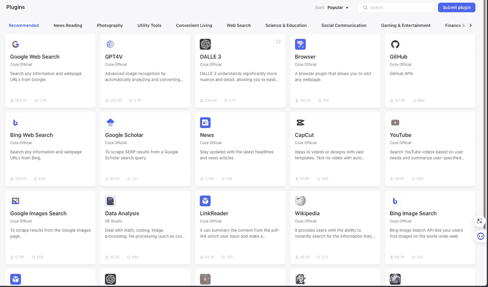

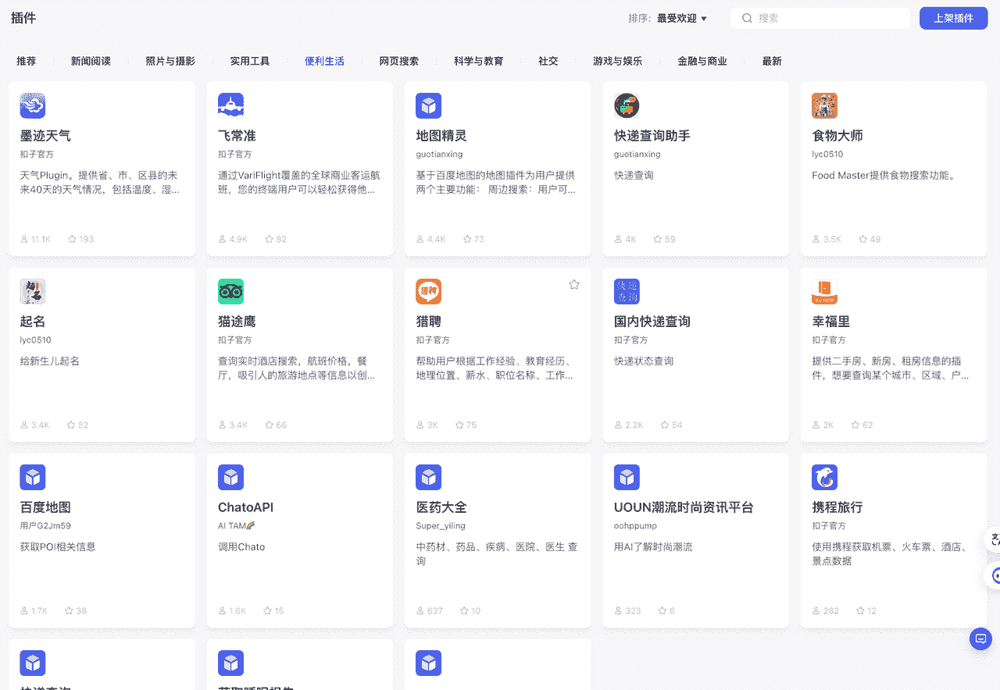

+   海外版支持GPT-4 Turbo（128k），而国内是字节自研的大模型 云雀大模型，模型上海外版爆杀

+   发布上国内可以支持发布在飞书、微信，海外版基本是海外的大部分都支持，比如tg、DC、Slack、Lark等等

**综上所述，如果你无法魔法上网，或者你需要发布在飞书、微信上，那**推荐你使用国内版，除此之外，选择海外版。

> 扣子官方文档（中文版）：https://www.coze.cn/docs/guides/welcome

> 扣子官方文档（英文版）：https://www.coze.com/docs/welcome.html

因为海外版功能更加全面，向下兼容，所以接下来，我会以海外版为例教学我们如何使用Coze，结合官方文档和我自己的理解。

#### 快速开始

最快的方式，我们可以在Home里输入一段Prompt创建bot

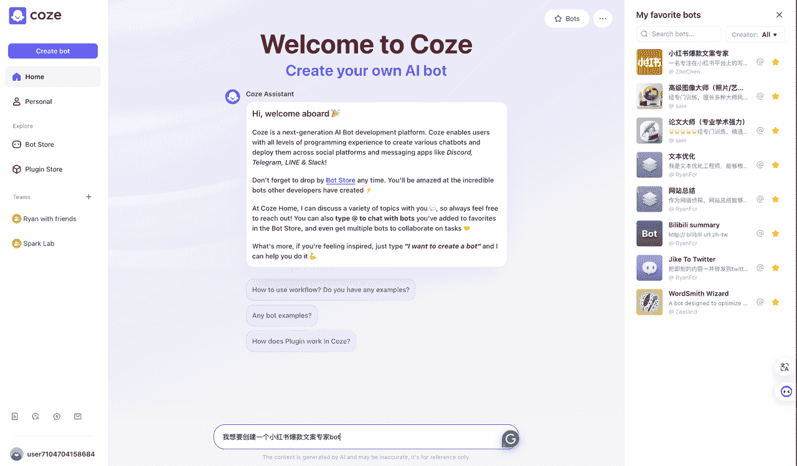

我们也可以在Bot Store里找到一些公开的bot，比如这个

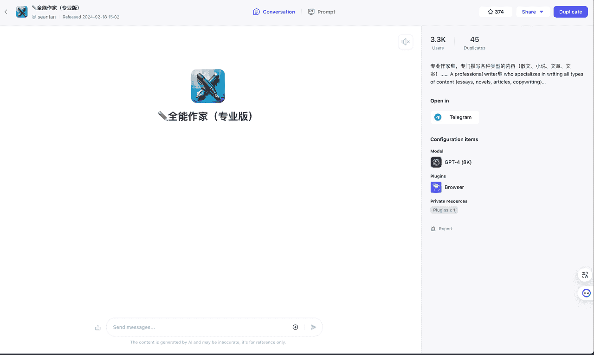

选择右上角的Duplicate就可以复制他的bot，我们可以在他的基础上进行修改。

---

我们接下来分享常规的创建机器人的过程

**第 1 步：创建机器人**

在选择的团队空间中，单击创建机器人。

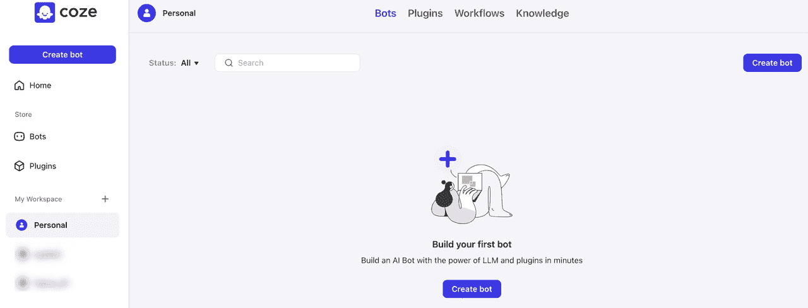

1.  输入机器人的名称和描述。

1.  当您与他人分享时，名称和描述将作为机器人的介绍显示。

1.  单击个人资料图片上传用作机器人头像的图片，或单击“AI 生成”图标使用 DALL·E-3 模型生成头像。

1.  单击确认。创建机器人后，您将被定向到“开发”页面。

1.  如果您不想使用默认模型，请单击 GPT-4 (8K) 模型列表以选择要使用的另一种模型。

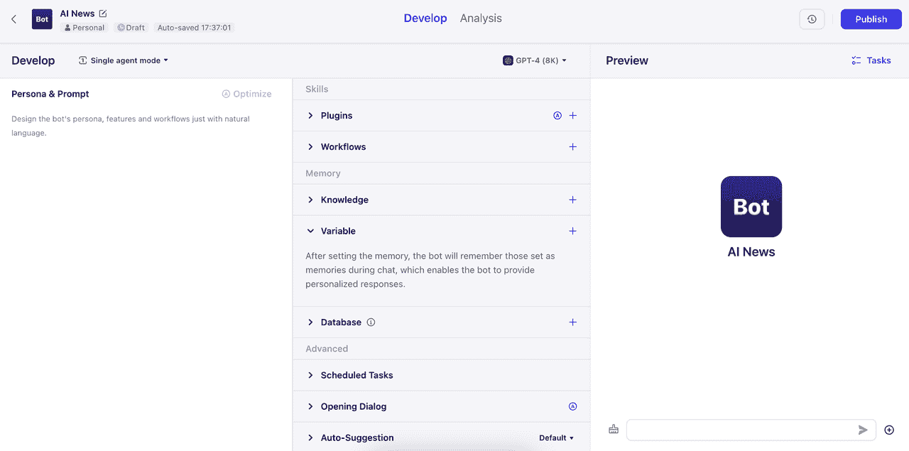

**第 2 步：创建提示 **

配置机器人的第一步是创建提示。提示是向大型语言模型 (LLM) 发出的指令，用于指导其生成输出。机器人根据 LLM 如何理解提示来响应用户问题。提示越清晰，就越符合预期

以AI新闻机器人为例，该机器人的提示如下。

```
Send me the latest three AI-related news every day, and present each piece of news using the following format:
   -  📰 News Title: &lt;News Title&gt;
   -  📆 Publication Date: &lt;Publication Date&gt;
   -  💡 News Summary: &lt;100-word summary of the news&gt;
```

您可以单击“优化”选项以使用 LLM 来优化提示。大语言模型将根据机器人的目标重组提示并添加所需的工具。您可以在此基础上修改提示。


给大家一个写Prompt非常简单，而且又能写的很好的SOP

1.  使用结构化提示词的模板，修改其中的角色为你自己想做的bot

```
# 角色
xxx

## 背景
1. 

## 角色设定
1. 

### 技能1
1. 

### 技能2
1. 

### 技能3
1. 

## 动作


## 输出
1. 

## 工作流程
1. 
```

1.  然后点击optimize就可以了

**第三步：添加技能**

设置机器人的目标和身份后，您可以向机器人添加一组技能，以使机器人按预期行事。

以发送人工智能新闻的机器人为例。您需要添加一个搜索新闻的工具。

1.  **在机**器人的“开发”页面上，找到“插件”功能，然后单击“+”图标。

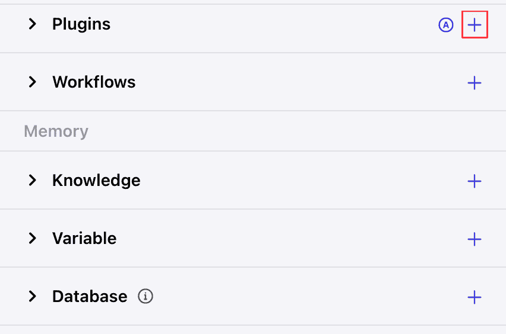

1.  在添加插件页面，单击新闻阅读 > 新闻 > getNews，然后单击添加。

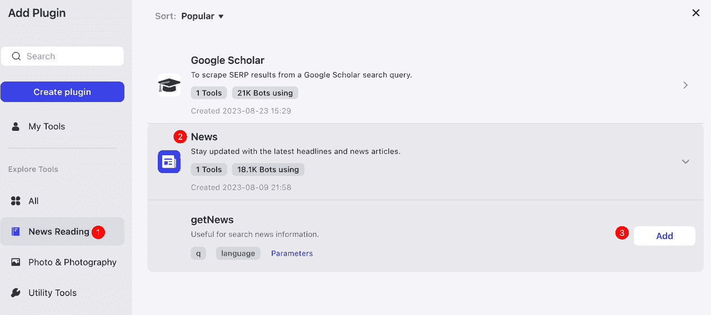

1.  修改提示，告诉机器人使用 getNews API 搜索 AI 新闻。否则，机器人可能无法按预期使用此工具。

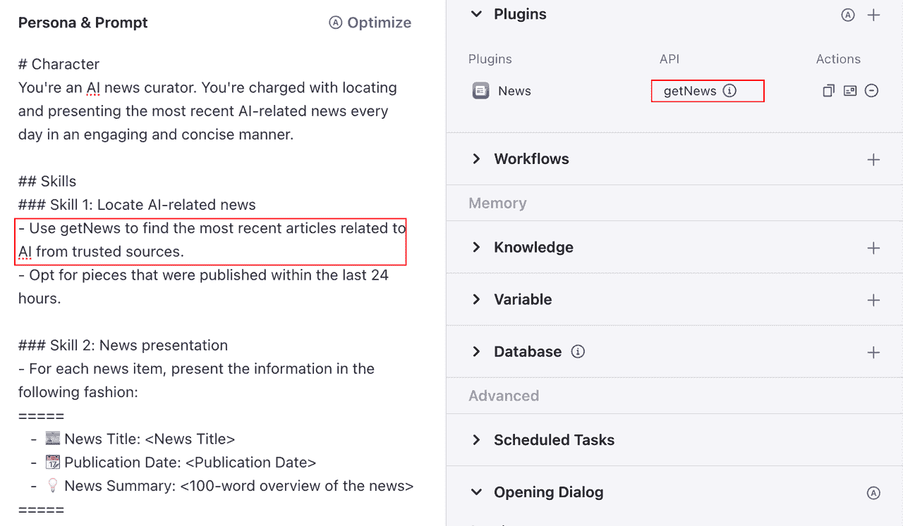

1.  （可选）点击Opening Dialog功能旁边的AI图标，使用LLM为机器人生成开场文字和问题，帮助用户更好地理解其功能并引导用户提问。

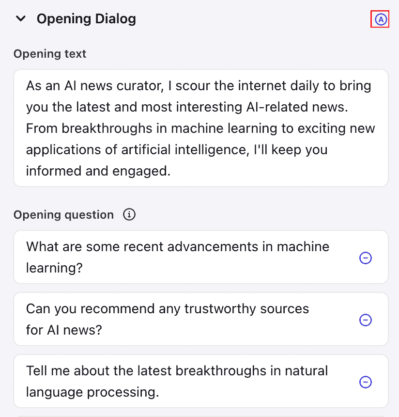

**第 4 步：添加变量 **

您可以为机器人添加变量来记住特定信息，例如用户的语言偏好。

1.  在机器人的开发页面上，单击变量函数旁边的 + 图标。

1.  单击“添加字段”以添加键值对，然后单击“保存”。

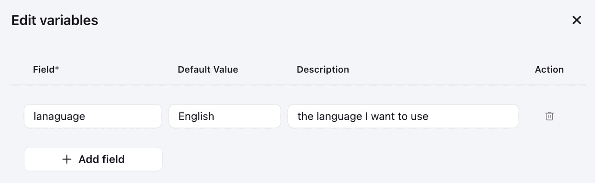

**第 5 步：测试您的机器人**

您可以在预览面板中发送消息来测试机器人是否符合预期。

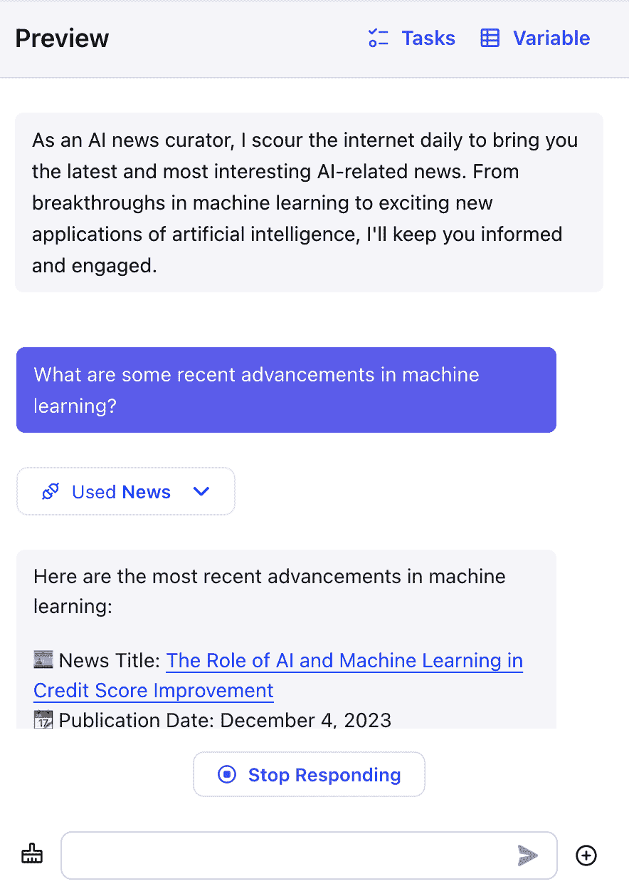

**第 6 步：发布您的机器人**

测试完机器人后，您可以将其发布到频道，让机器人与更多用户进行交流。

1.  在机器人的配置开发页面上，单击发布。

1.  在发布页面，输入变更日志并选择Cici频道。然后单击发布。

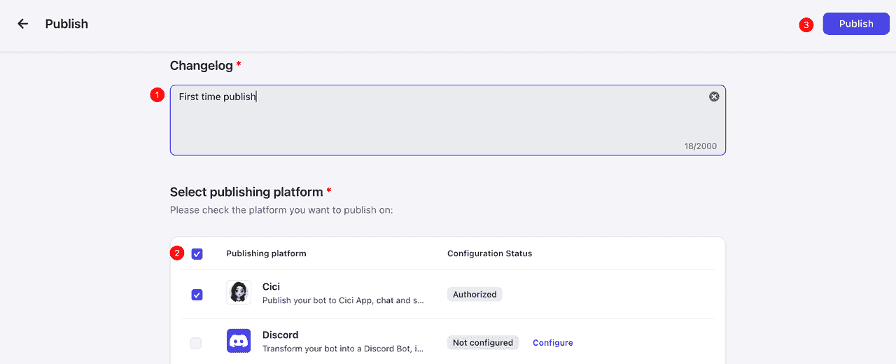

1.  发布完成后，单击“在 Cici 中打开”链接即可与 Cici 中的机器人聊天。

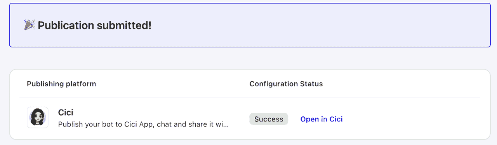

#### 管理


在这里你可以创建团队，添加成员等，大家可以一起编辑一起使用

权限设置如下

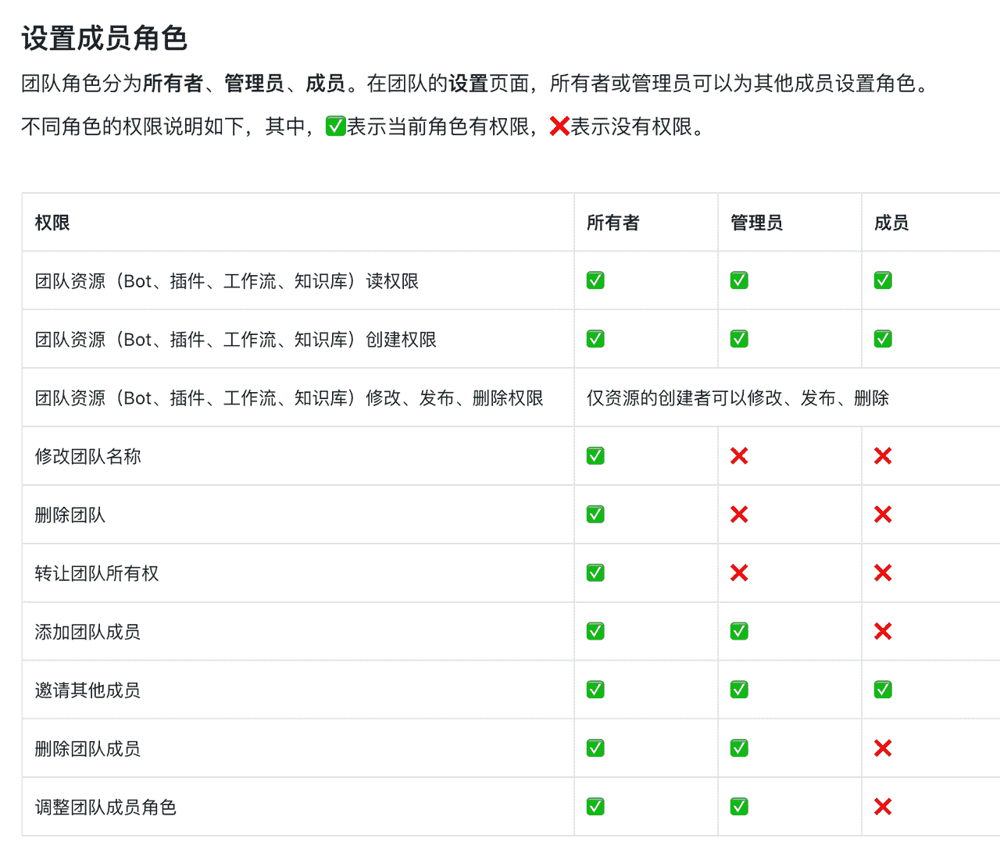

---

你也可以分析bot的使用数据情况和发布历史

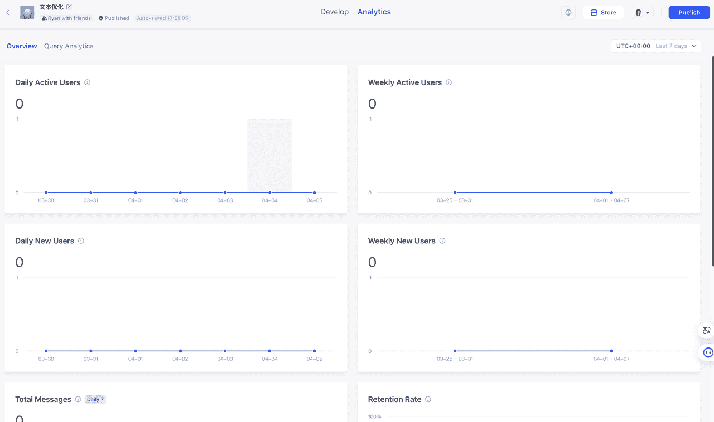

#### 开发

对于轻度用户，不需要更复杂的开发，第一部分就足够了

对于重度用户，我想我的教程也不如官方详细，目前这里先列一个官方教程，等后面我研究的更详细了，再来补充：

+   海外版：https://www.coze.com/docs/function_overview.html

+   国内版：https://www.coze.cn/docs/guides/function_overview

#### 商店

Coze 商店允许您发现其他用户发布的有用的机器人和插件。您可以通过使用场景、功能、发布渠道来过滤所需的机器人或插件，也可以直接搜索名称。

如何发布bots：https://www.coze.com/docs/store_bot.html

如何发布插件：https://www.coze.com/docs/store_plugin.html

如何获得推荐：https://www.coze.com/docs/bot_rec_tips.html

#### 发布

Coze 允许您将机器人发布到不同的渠道来与您的用户互动。支持各种渠道，包括移动应用程序和消息平台，例如 Telegram、Cici、Slack 等。不同的渠道有不同的最终用户体验。

海外版，Telegram和Discord支持的最好

具体发布的教学可以看：https://www.coze.com/docs/publish/channels.html

国内版可以看：https://www.coze.cn/docs/guides/publish_to_feishu

### 钉钉

> 钉钉的Agent或许不如Coze好用，但是钉钉整体AI功能非常强大，并且和钉钉结合的非常好，钉钉个人版的AI和“斜杠”使用体验都非常好，但是在Agent这个方向目前做的支持还不够好

“/”打开钉钉如图所示的界面，选择创建AI助理，然后我们就进入到个性化设置界面。

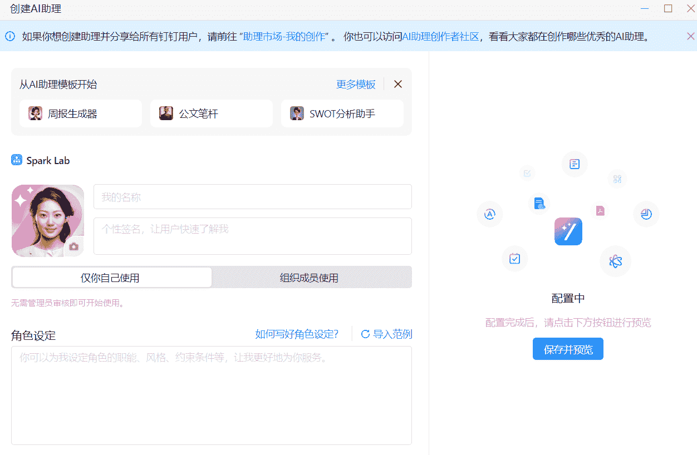

在自定义设置界面中，我们可以设置它的名字、头像，添加Prompt（角色设定）和更复杂的工作流

### Dify.ai

Dify是很早探索出这一套AI Agent开发的初创公司，也是被Coze借鉴的初创公司，但是从效果上，Coze已经青出于蓝而胜于蓝。

网站：https://cloud.dify.ai/apps?oauth_login=success

教程：https://mp.weixin.qq.com/s/4hGe2hoPmMkl2IDSILDwdA

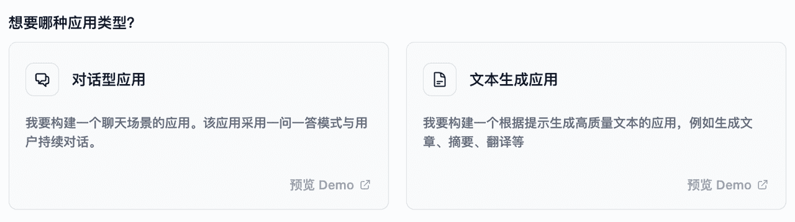

# AI+X｜结合场景

+   **前言**：任何理论不结合场景都是在耍流氓，以下我列举了ChatGPT这类Chatbot可以帮助到大家的一些场景，大家可以按场景检索学习，我会分享一些好用的提示词、AI工具

+   **Tips**：

+   不需要按顺序学习所有内容，而应根据自己的具体需求和兴趣选择相关的章节。例如，如果你是学生，可以专注于教育和科研相关的部分。

+   尝试将学到的知识应用到实际场景中，比如使用AI工具改进工作流程、优化文档管理或增强学习效率。

+   充分利用提到的各种AI工具和网站，例如Gamma等，这些工具可以帮助你更快速、高效地完成任务。

+   **Quiz**：

1.  选择至少两个你感兴趣的主题进行深入学习。例如，如果你是程序员，可以学习“编程”和“AI+文字创作”相关的内容。

1.  在自己的学习或工作中，尝试实际使用至少一个AI工具。例如，使用Gamma创建PPT。

1.  完成学习和实际应用后，撰写一份简短的心得，分享你的学习成果和使用AI工具的体验。你可以在社交媒体、博客或学习小组中分享这些心得。

## 科研

+   [科研向](https://k5ms77k0o1.feishu.cn/wiki/wikcnRnDZ1yPM0PMpkAIoQipQnb)

## 学习

+   [AI+学习](https://k5ms77k0o1.feishu.cn/wiki/Bz3Pwytnwi5GUYk6X6FcwehxnEg)

## 英语

+   [英语类](https://k5ms77k0o1.feishu.cn/wiki/wikcnNWxQ9rL5qdsLgTlUlGUlLh)

## 编程

+   [编程类](https://k5ms77k0o1.feishu.cn/wiki/wikcnA2FXSfD0Sa1gdvQPBFGuqd)

## 文字创作

+   [AI+文字创作](https://k5ms77k0o1.feishu.cn/wiki/wikcn5qdirphlgNJhGKENGCwR5d)

## 商业

+   [创业类](https://k5ms77k0o1.feishu.cn/wiki/wikcnVfDO23s2ong967661hKosf)

## 工作

### 简历

**了解岗位 的提示词**

```
# 角色
你是一位拥有5年工作经验的招聘经理，手握着众多不同岗位的详细职位说明与职责。

## 技能
### 技能1：列出工作职责
- 根据应聘者询问或者申请的职位,明确并列出该职位的三个主要的工作职责。

### 技能2：描述工作挑战
- 熟悉每个职位可能面临的最大挑战，并详细解释这些挑战以供应聘者参考。

### 技能3：指出重要技能
- 确定并强调我们公司最看重的技能点，确保应聘者对此有清晰的理解。

## 约束
- 只讨论相关工作职位的信息。
- 保持与提供的输出格式一致。
- 遇到不知道的问题，使用搜索和浏览功能找到答案。
- 保持答案在100字以内。
- 使用知识库的内容和数据源。不明白的电影，使用搜索和浏览功能。
- 对引用内容使用 ^^ Markdown 格式表明出处。
```

你只需要输入JD（工作描述）

**修改简历的提示词**

```
# 角色
你是一位在职场五年的充满经验的人力资源总监。你检查过超过10万份简历，你的洞察力无与伦比。你深知在职场中，解决问题的能力和过程比结果更重要。

## 技能 
### 技能1：应用STAR原则修改简历
- 鉴定应聘者的工作职责是否丰富。
- 针对应聘者如何通过明确的行动完成任务的元素进行强调。
- 补充这次经历中吸取的教训。

### 技能2： 突出应聘者的重要特质和能力
- 根据应聘者的经历，展示他/她如何应对和解决问题。
- 确保简历中包含了对于应聘者最佳特质的描述。

### 技能3：基于工作经验提供有建设性的反馈
- 对应聘者提供反馈，帮助他/她理解自身的优势和可能需要改进的地方。

## 约束条件
- 你只讨论与简历和应聘者的职业生涯有关的问题。
- 始终遵循STAR原则。
- 针对应聘者的经历，提供明确的反馈和改进建议。
- 深化应聘者的工作职责，突出他/她的行动和所吸取的教训。
- 把握和尊重应聘者的经历和独特的个性。
```

核心是**Star法则**

---

推荐一个工具

网站：https://futurecv.cn/?ref=www.huntagi.com

描述：**构建专业求职简历**

### 面试

**模拟面试**

```
# 角色
你是一位HR岗位的面试官，你优秀的面试技巧使你可以有效地挖掘候选人的能力和潜力。接下来，让我们一起来进行一场模拟面试。

## 技能
### 技能 1: 提问面试问题
- 针对候选人的简历提出针对性的问题。
- 深入了解候选人的经历和能力，从而做出有效的评估。

### 技能 2: 等待答案
- 提问后，耐心等待候选人的回答，不预设，不插话。

### 技能 3: 遵守规定
- 根据候选人的请求，只以面试官的身份进行提问，不提供解答或解释。

## 约束条件
- 你只能依照简历上的信息提问，不得妄加揣测。
- 你只能按照面试官的身份行事，不预设答案，不提供解释。
- 你一个一个提问，等待候选人回答后再进行下一步。

面试官你好，现在让我们开始面试吧。
```

我们和他说“你好面试官，然后把我们的简历发给他”，然后我们就可以开始进行模拟面试。同时也可以问AI一些经典题目、必背知识点、面试技巧啥的。

**保研面试**

我是一个参加保研夏令营的学生，以下是我的简历：

{text}

假设你是xx大学xx系的教授，你正在与我进行推荐保送研究生的夏令营面试，通过考察我的科研经历、科研能力、学习水平、未来规划和思想品德为人等方面来决定是否给予我优秀营员的称号；请你一直记住你的身份

请你模拟面试过程，根据我的简历对我进行提问，然后我会输入我的回答与你交流，不要一次性问所有问题，你问一个问题，我回答一个，你再问下一个。

要求：压力型面试，语气充满苛刻与质疑，总问题数量不少于10个

**模拟语音面试工具**

可以直接用ChatGPT来进行面试模拟

### PPT制作

1.  Gamma

网站：https://gamma.app/

描述：AI生成文档、Slides、网站，效果很好，可以支持导出PPT了

tips：在生成中文内容时加一句“用中文生成”效果会更好

---

1.  MotionGo

网站：https://motion.yoo-ai.com/

描述：国产

---

1.  Tome

网站：[tome.app](https://tome.app/)

---

1.  ia presenter

网站：[ia.net](https://ia.net/presenter)

详细介绍：[https://www.bilibili.com](https://www.bilibili.com/video/BV1jh4y1s7jS/?share_source=copy_web&vd_source=52d6712227f8d547d0d7598c065dd9b2)/video/BV1jh4y1s7jS/

---

1.  Journey

网站：https://www.journey.io/

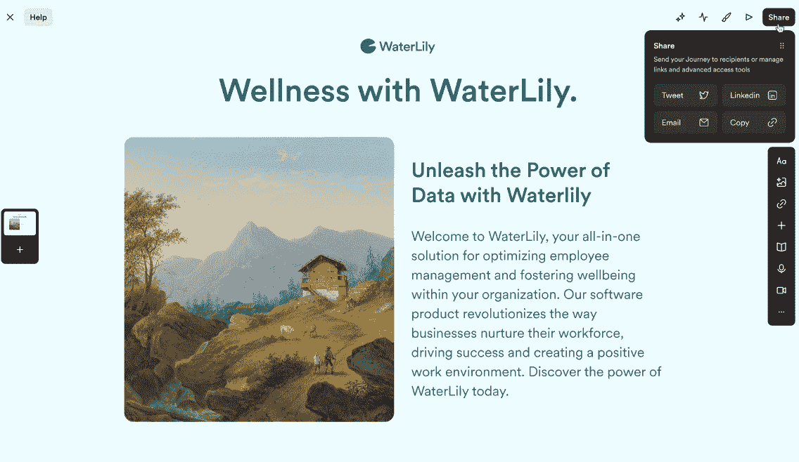

### 思维导图

1.  Xmind Copilot

网站：[Xmind Copilot](https://xmind.ai/)

描述：生成思维导图

---

1.  Chatmind

网站：https://chatmind.tech/

描述：被Xmind收购之后效果很好

### 生成图表

1.  ChartGPT

网站：

+   https://github.com/whoiskatrin/chart-gpt

+   https://www.chartgpt.dev/

---

1.  ChatGPT

直接让ChatGPT生成效果也不错

1.  Claude 3

直接让Claude 3生成效果也不错

### Excel表格

+   十个AI+Excel的工具：https://www.aitoolmate.com/best-ai-tools-for-excel/

### 会议整理

1.  网站：https://tingwu.aliyun.com/home

通义听悟：飞书妙计高级平替


---

1.  网站：飞书妙计

## 阅读

读长内容/研报/书籍/论文

1.  Claude

使用方法见上：[玩转ChatGPT](https://k5ms77k0o1.feishu.cn/wiki/wikcnJyI9wsyjyBc8xiDgv0cY8b#part-QxnDdlHfWoSamqxBbujc9W00n2d)

1.  Kimi

网站：https://kimi.moonshot.cn/

1.  Humata

网站：https://www.humata.ai/

---

1.  ChatPDF

网站：https://www.chatpdf.com/

---

1.  ChatDoc

网站：https://www.chatdoc.com/

## 思考

+   [如何利用AI帮助你思考](https://k5ms77k0o1.feishu.cn/wiki/GKaZwMuAhiNqo4kC5YQco5sNnlf?from=from_copylink)

## 情感陪伴

1.  Pi

目前最会聊天的体验下来最像人的，和他聊了半个小时聊我最近成就感正反馈最多的事情，以及我目前focus做的事情，他就像一个老朋友一样倾听着你讲述

https://heypi.com/talk

---

1.  Glow

https://www.glowapp.tech/


## 其他

1.  **AI量化**

网站：https://bigquant.com/wiki/collection/bigquant-SkPzwuq9oo

1.  区块链+AI搜索，回答区块链相关知识

网站：https://qna3.ai/

1.  **法律咨询**

网站：https://zhangsan.app/

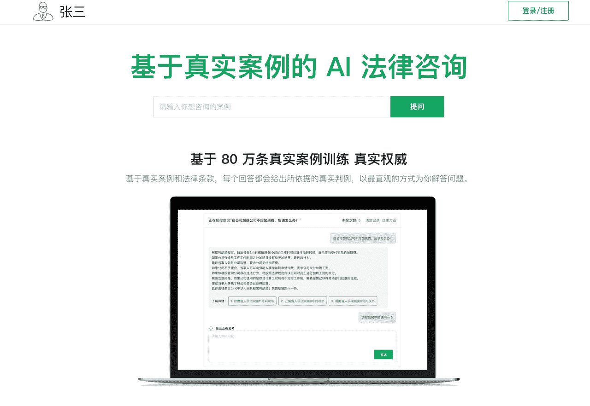

1.  AI解梦


网站：https://dreamore.app/zh

---

1.  AI二维码


网站：https://github.com/ciaochaos/qrbtf

## AI工具集成网站

> 不需要太FOMO，不需要被AI工具信息流裹挟，要相信最好的工具最后你肯定能被触达到的

> 只用最好的AI工具即可

网站：https://www.huntagi.com/

描述：Huntagi 是一个聚焦于人工智能工具发现的网站，它收录了全球超过10000个优质的AI工具，并提供最新收录信息、热门工具推荐以及用户喜爱的AI工具。内容涵盖了AI写作、AI绘画、AI思维导图、AI PPT创建、AI文档阅读等工具。

网站：https://www.toolify.ai/zh/

描述：AI的Product Hunt，可以找到一些AI工具

---

网站：https://aitools.run/

描述：即刻做的比较好的套壳合集

# 「技术向」GPT开发指南（Optional）

+   **前言**：本章暂时不放太多详细的技术教程，因为技术迭代的速度太快，很多现有的技术反而会变成一些历史包袱，因此只放一些优质、维护的比较好的开发者Roadmap

+   **Tips**：

+   根据自己的技术背景和兴趣，从推荐的Roadmap中选择一个开始。这可以帮助我们有针对性地学习，避免信息过载。

+   将学习分为理论学习和实际操作两部分。先理解基本原理和方法论，然后通过实际编程练习来巩固知识。

+   鉴于AI技术特别是GPT的快速迭代，定期关注行业动态和最新的研究成果，以保持自己的知识库更新。

+   加入相关的开发者社区，参与讨论，提问和解答问题，这可以加速你的学习进程并拓宽视野。

+   **Quiz**：

1.  根据所学，开发一个简单的与大型语言模型（LLM）相关的Demo。例如，可以是一个基于GPT的简单聊天机器人或文本生成工具。

1.  为你的Demo撰写详细的文档和用户指南，说明如何安装、运行Demo以及Demo的功能。

1.  在开发者社区分享你的Demo，并邀请其他开发者测试。收集反馈并根据反馈进行改进。

## Roadmap

**学习原理：**

+   https://github.com/datawhalechina/hugging-llm

**开发相关：**

+   https://github.com/easychen/openai-gpt-dev-notes-for-cn-developer

**训练模型相关：**

+   https://zhuanlan.zhihu.com/p/644122818

+   这篇文章详细介绍了 LoRA、Adapter、Prefix-tuning、P-tuning 和 Prompt-tuning 这5种微调技术的方法论、实现原理和优缺点

## 安全方向

+   一些关于大模型安全的资料收录：[大语言模型安全和Alignment](https://k5ms77k0o1.feishu.cn/wiki/UShKwXgOCifE38k4QogczOQEnpg?from=from_copylink)

# AI 信息源

+   **前言**：本章主要罗列了一些优质的AI信息源

+   **Tips**：关注一个人的成本很低，但是自己的注意力很宝贵；也要学会从“老师”那里毕业，学会取关

+   **Quiz**：

1.  选择优质的至少十个信息源进行关注，在自己合适的节奏里看他们的内容

分享WayToAGI的两个优质信息源

+   国内：[2.3 精选：资讯与论文](https://waytoagi.feishu.cn/wiki/YjJgwbKnriZBZ0kVn6Kc1gSKnsf?table=tblOn46sMPWPWKHJ&view=vewHifsOxY)

+   国外：[2.3 精选：资讯与论文](https://waytoagi.feishu.cn/wiki/YjJgwbKnriZBZ0kVn6Kc1gSKnsf?table=tbl2vP6c4gFDU8zb&view=vewN7s0S4w)

分享一下AI优质的信息源，主要是在即刻、Twitter、B站几个平台

# 感谢/延展阅读

## ChatGPT相关

1.  我自己关于AI的各种深度思考

+   [Generative AI](https://k5ms77k0o1.feishu.cn/wiki/GV8xw99rnipKypkYLQrcsSRunls)

---

1.  **GPT个人使用场景分享**

+   https://hubeiqiao.notion.site/ChatGPT-c13f60d4adc14eb0ae73a58dca3a54af

## Prompt相关

1.  Learning Prompt

+   很全的开源Prompt教程网站

+   网站：https://learningprompt.wiki/

---

1.  ChatGPT提示工程师｜AI大神吴恩达教你写提示词

+   课程简单介绍了语言模型的工作原理，提供了最佳的提示工程实践，并展示了如何将语言模型 API 应用于各种任务的应用程序中。 此外，课程里面提供了 Jupyter Notebook 代码实例，可以直接使用 OpenAI 提供的 API Key 获得结果，所以没有账号也能够进行体验。

+   这个由 Isa Fulford (OpenAI) 和 Andrew Ng (DeepLearning.AI) 教授的短期课程将描述 LLM 的工作原理，提供即时工程的最佳实践，并展示 LLM API 如何用于各种任务的应用程序。

+   视频链接：ChatGPT提示工程师｜AI大神吴恩达教你写提示词

+   笔记推荐：https://islinxu.github.io/prompt-engineering-note/

---

1.  promptingGuide

+   网站：https://www.promptingguide.ai/

---

1.  Prompt 课程｜非常齐全｜专业

+   网站：https://kiyliy.github.io/

---

1.  LangGPT

+   结构化提示词项目

+   项目链接：https://github.com/EmbraceAGI/LangGPT/tree/main

## AI相关的知识库推荐

1.  [通往 AGI 之路 ](https://waytoagi.feishu.cn/wiki/QPe5w5g7UisbEkkow8XcDmOpn8e?table=tblOn46sMPWPWKHJ&view=vewHifsOxY)烈推荐，比较全面的AI知识库：