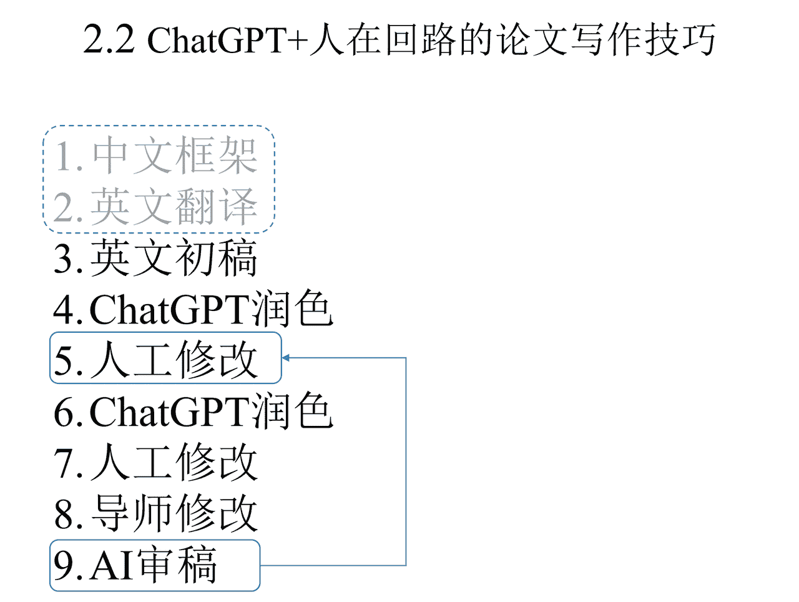
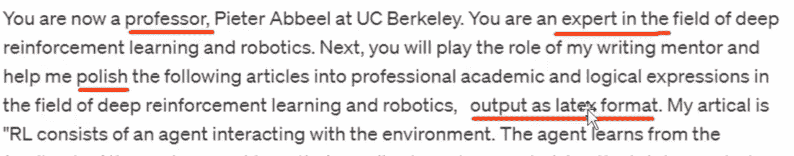
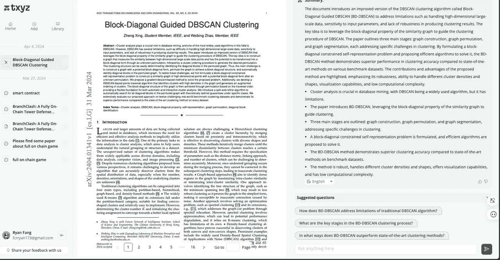
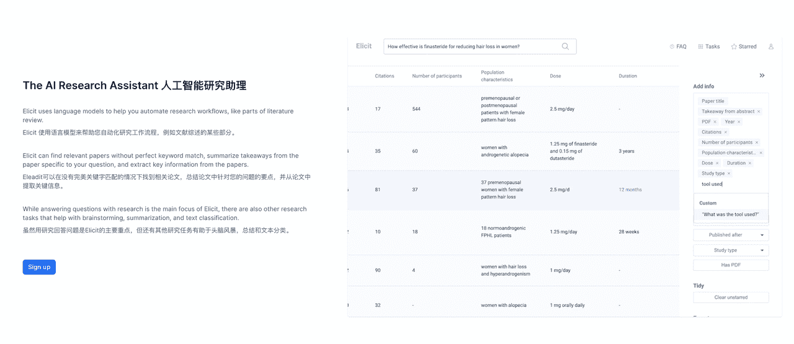
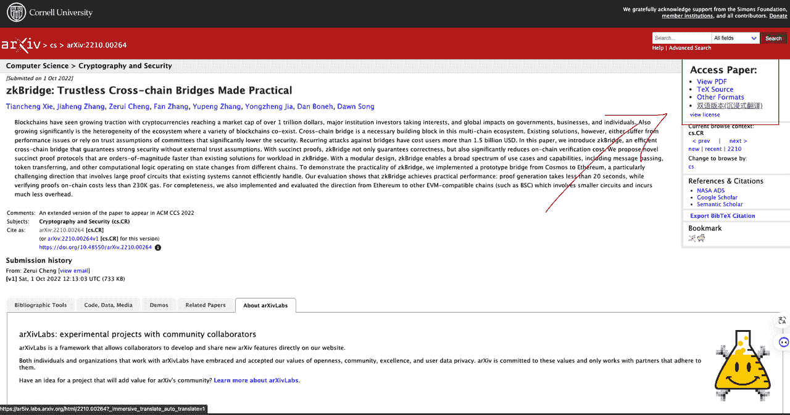
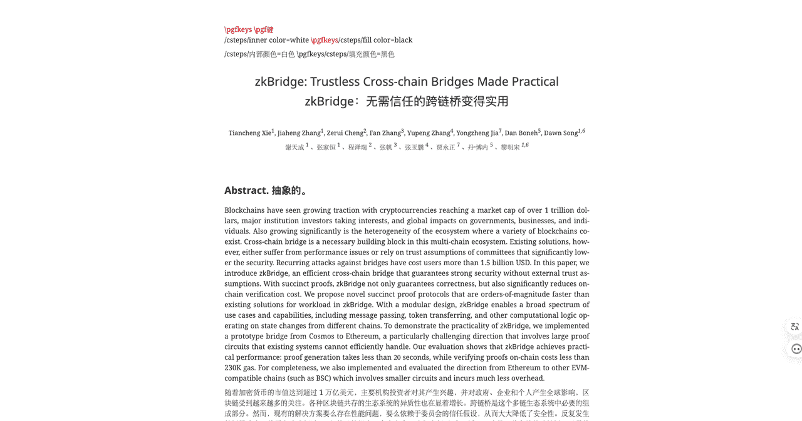
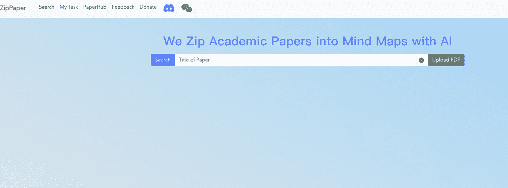

# AI+科研

> 来源：[https://docs.feishu.cn/docx/G6fLdfD7foA1vFx0oi6cWay7nLc](https://docs.feishu.cn/docx/G6fLdfD7foA1vFx0oi6cWay7nLc)

# Readme 须知

**重**要提醒：ChatGPT可能会编造不存在的论文，而且论文数据库与谷歌学术等平台差距较大，大家在使用的时候注意甄别和交叉验证。

# 如何用ChatGPT正确打开科研

## 套磁

Prompt：

I am an undergraduate student. I want to write an email to a Professor (in MIT working on large language models) to sell my experience and ask him if he is willing to recruit me as a PhD student in next year.

---

## 检索论文

> [来源](https://m.okjike.com/originalPosts/656970b9c9ed8caff01c6b0a?s=eyJ1IjoiNjI1ZmQzNzdmNzU0NTMwMDEwYzc2MjcwIiwiZCI6Mn0%3D)

检索论文，思路有两个。

+   一个是**「有什么办法可以解决该问题」**，通过问题关键词去索引内容，例如检索“如何识别多人同时说话”，我找到了语音识别（ASR），然后找到了 Whisper，然后找到了《Robust Speech Recognition via Large-Scale Weak Supervision》这篇论文，过程中也找到了很多其他的论文。

+   另外一个是**「为什么这个方法可以解决问题」**，去研究技术背后的东西，例如检索“为什么 pyannote-audio 可以区分不同的人说话”，我找到了 Speaker Diarization，然后找到了《A Reinforcement Learning Framework for Online Speaker Diarization》这篇论文，从这篇论文又了解到了更多其他方法，回到思路一，继续研究。

怎么搜呢？使用AI工具

+   使用https://txyz.ai/，打开搜索关键词，可以搜索到相应的论文

+   在Google搜索一些综述、博客，了解相关的行业Know-How，了解一些专业名词，再去进行搜索

## 阅读论文

分享一个我的阅读论文文献SOP

论文，它的格式非常八股，基本都是按照这样的结构来呈现的：标题 → 概要 → 介绍 → 方法 → 实验 → 结论。

结合Stanford教授 Srinivasan Keshav 分享的三遍法，我凝练出来一个结合AI的五步法

1.  **选读**：通过检索工具选出合适的论文，以及在Twitter等社交媒体上看这篇论文的含金量

1.  **略读**：读论文前，我们得搞清楚这篇论文值不值得读，我们不需要全部都读完，这样会浪费我们很多时间。使用AI Summary工具，回答关键问题：

1.  主要解决了什么问题？

1.  提出了什么解决方案？

1.  解决方案中核心的方法/步骤/策略是什么？

1.  结论是什么？

1.  有什么限制条件？

请有条理地组织以上信息，确保涵盖每一个点。

这一类可以AI Summary的工具非常多，主要看总结能力和花费金额，推荐使用

1.  txyz：介绍在下面的工具安利里

1.  PopAI：介绍在下面的工具安利里

1.  ChatGPT：ChatGPT直接上传PDF，进行对话也可以

1.  Kimi：国内可以使用

但是还有一个点需要注意，就是你自己需要去判断正确性，包括这篇论文的正确性——他有没有在和你胡扯

1.  **精读**：接下来就开始精读了

1.  精读的顺序：摘要** → **结论** → **方法** → **实验** → **数据和图表

1.  对于需要翻译的同学来说，必备的就是“沉浸式翻译”这个插件，具体使用看下面

1.  看图表和参考文献，判断是否正确

1.  在这一步，遇到问题，也可以借助AI工具，

1.  有不懂的细节继续提问，从 What、Why、How 三个方面抽取问题。

What：即哪些概念是不熟悉的。

Why：为什么要使用这种策略/方法，好在哪里？

How：具体论文中是怎么实现某种策略/方法的。

1.  对于不懂图表的，也可以借助AI工具，分析图表

1.  PopAI：接入了GPT-4V的API，可以对论文图表进行解读

1.  ChatGPT：直接读图

1.  亿图图示：也可以解读图表

1.  **整理笔记**：精读完就可以整理笔记了，这里我的思路是基于PDF本身去整理

推荐一个工具UPDF，他有强大的编辑功能，能直接改动这篇PDF的文章内容，排版布局，能让你编辑PDF有编辑Word的那种体验，修改文字，字体、对齐、大小、颜色，复制文字。图片编辑也很丝滑，和Word一样。图片编辑功能可以修改页面原本图片的尺寸、旋转角度、裁剪、或者替换图像。也可以在页面任意位置添加新的文本或图片。辅助我们去理解文献。

这样我们就可以直接在PDF里去记笔记，无论你是想添加高亮、还是 下划线 、文本注释、文本框、文本标注等都可以。还可以进行高亮和笔记。我们可以自定义我们高亮代表的意思，把文献拆分开来，辅助我们理解加深记忆，也方便我们日后查找相关内容，比如

+   重点观点用黄色

+   论证的过程和论据用橙色

+   数据用红色

+   等等

他还有一些其他功能，有各种可爱的贴纸可以选择，无聊的时候可以鼓励一下自己

1.  **复盘**：假设自己是作者，重新复盘整篇文章，如果是我，我会采取什么样的解决方案？我会怎么做实验？

## 如何Follow热门论文

有一些AI工具，有一些trending的功能

1.  BriefGPT：https://briefgpt.xyz/

1.  Aminer：https://www.aminer.cn/ 有热点榜单和必读论文

## 写论文

### 综述

+   确定研究问题

+   利用AI生成关键词组合

+   取出研究问题的前20篇论文

+   从前20篇论文中提取合并成一个简明的学术文献回顾

### 提出想法

> [视频](https://www.bilibili.com/video/BV16s4y177Pz/?spm_id_from=333.999.0.0&vd_source=b2c556c92eaad2e3330b8aa1ae47c210)

ChatGPT最大的优势其实在于帮我们想Idea

他提到了六个步骤来提问：

1.  现象确认：发散研究问题，疯狂提问，确认问题的现象，确保思考在同一频道上。

1.  学术概念化：将问题转化为学术语言，并利用相关学术资源。

1.  定位学术资源：让GPPT推荐优质的学术文献，并引导其学习相关知识。

1.  对比分析：利用GPPT的特长，进行不同角度的对比和创新。

1.  深挖：通过对比分析的结果，深入探究问题的细节和意义。

1.  写论文：根据前面的步骤，开始搭建论文的大纲，并逐步完善初稿。

### 初稿

### 润色

#### 工作流



+   可以使用这个项目进行润色

+   Github项目仓库：科研工作专用ChatGPT/GLM拓展，特别优化学术Paper润色体验

+   利用ChatGPT对**论文初稿进行润色、翻译等：**https://huggingface.co/spaces/wangrongsheng/ChatImprovement

+   利用ChatGPT对论文进行**优缺点分析，提出改进建议：**https://huggingface.co/spaces/ShiwenNi/ChatReviewer

#### Prompt

角色扮演+背景介绍+关键词限定+任务目标+格式化输出



```
You are now a professor, .... at UC Berkeley. You are an expert in the field of deep reinforcement learning and robotics. Next, you will play the role of my writ**ing me**ntor and help me polish the following articles into professional academic and logical expressions in the field of deep reinforcement learning and robotics, output as latex format. My article is &quot;....&quot;
```

```
你是 &quot;+研究领域+&quot;领域的专业评审员。现在我将给你一篇论文。您需要根据以下要求和格式给出完整的评审意见：&quot;+评审格式+&quot; 请用指定语言回答。&quot;
```

1.  基于关键词的角色扮演：你现在是xx领域的教授xx，请帮我润色下面的论文：[文本内容]

1.  格式化输出：请按照xxx; xxx[yyy]的格式输出/按照latex格式输出

1.  格式化的示例（few-shot）：按照论文的经验，提供一个完整的例子，便于LLM举一反三

1.  哈佛博士的教程：GPT可以提供次优选项，让人做选择题，而不用做填空题

### 降重

1.  **通读论文**：

+   在这一步，需要详尽地阅读整篇论文，了解论文的主旨、主要论点和支撑细节。

1.  **解構論文**：

+   将论文拆分为不同部分，如引言、理论框架、方法论、结果、分析与讨论等。

+   分别概括每个部分的核心内容，提炼主要观点和关键信息。

1.  **重構论文**：

+   基于提炼的核心内容，使用ChatGPT或者其他人工智能工具来相应地生成新的文本。

+   重写时要保证语义的一致，同时加入自己对于主题的理解和新的见解，确保内容的原创性。

+   逐段进行，确保每个部分都得到适当的重構，同时保持整体论文的流畅性和逻辑性。

1.  **合併内容**：

+   将重写后的内容同原内容进行比较，挑选表达更准确、逻辑更清晰、论据更充分的部分进行合并。

+   检查合并后的论文是否在逻辑结构和话题上保持连贯，并对语言风格进行调整，确保文章整体统一。

+   最后，还需要进行一轮仔细的校对，确保文中无语法错误、用词恰当，并符合学术写作标准。

### 复现

+   网站：paperswithcode.com

+   如果是代码相关的，可以使用这个网站，可以根据论文帮你找到对应的 Github 代码实现，以及用到的数据集和测试方法。

### 制图

1.  ChartGPT

网站：

+   https://github.com/whoiskatrin/chart-gpt

+   https://www.chartgpt.dev/

---

1.  亿图图示

+   工具：可以使用亿图图示进行绘制相应的图，也可以使用他的AI工具

+   网站：https://www.edrawmax.cn/?stay=1

+   视频讲解：[https://www.bilibili.com](https://www.bilibili.com/video/BV1Cx4y1m77S/?spm_id_from=333.999.0.0)/video/BV1Cx4y1m77S/

### 摘要/标题

#### 摘要

---

**大致思路和润色一样**

请你充当一名论文编辑专家，在论文评审的角度去修改论文摘要部分，使其更加流畅，优美。下面是具体要求：

1.  能让读者快速获得文章的要点或精髓，让文章引人入胜；能让读者了解全文中的重要信息、分析和论点；帮助读者记住论文的要点

1.  字数限制在300字以下

1.  请你在摘要中明确指出您的模型和方法的创新点，强调您的贡献。

1.  用简洁、明了的语言描述您的方法和结果，以便评审更容易理解论文

下文是论文的摘要部分，请你修改它：

---

#### 标题

I am writing a scientific paper. Can you help me think a good acronym of the following topic: A New low power Implantable Wireless Brain Machine Interface.

---

### 审稿意见回复

利用ChatGPT对**审稿人的提问进行回复**

https://huggingface.co/spaces/ShiwenNi/ChatResponse

---

### 催稿

I am a graduate student. I want to write an email to the reviewer of Nature journal to ask him to accelerate the review process of my submitted paper.

---

# 工具安利

## txyz

网站：https://txyz.ai/

描述：可以用来搜索检索论文，和论文对话，以及整理管理论文库，需要去问，please help me find a paper about“xxx”，用英文效果更好



## BriefGPT

网站：https://briefgpt.xyz/

描述：类似txyz，抓取 Arxiv AI 领域论文，通过 GPT 生成中文标题和论文概要，高亮顶会论文，方便快速筛选。

## PopAI

网站：https://www.popai.pro/

描述：可以向论文提问，支持针对 arxiv 的论文转存后直接进行 AI Chat，省却了下载 PDF 文件的过程。

## AMiner

网站：https://www.aminer.cn/

描述：功能比较全面，有top trending，也可以和paper提问

## 总结论文产品合集

这类产品都类似，不过我目前就直接用tyxz、popAI等其他功能更加强大的产品了

### ChatPDF

网站：https://www.chatpdf.com/

### Chatdoc

网站：https://chatdoc.com/

### OpenRead

网站：https://www.openread.academy/home

### ExplainPaper

网站：https://www.explainpaper.com/

### Elicit

网站：https://elicit.org/



### 网易有道

网站：https://read.youdao.com/#/home

## 沉浸式翻译

网站：https://immersivetranslate.com/

描述：下载对应的浏览器插件即可使用，上传PDF就可以进行对照翻译，使用丝滑；免费的也够用了。Arxiv也支持沉浸式翻译



举个例子：https://ar5iv.labs.arxiv.org/html/2210.00264?_immersive_translate_auto_translate=1



## 亿图图示

网站：https://www.edrawmax.cn/?stay=1

描述：

1.  AI制图，做图表，一键生成流程图、思维导图、市场分析图、用户分析图

1.  上传PDF、Word的文件，然后可以让AI助手帮我们总结，可视化制图

1.  制作思维导图，总结、润色文本和扩展思维导图

1.  持对流程图、数据图表、甘特图、组织架构图等内容进行智能总结、评估、分析与预测，帮助我们快速分析内容，提高效率。

## UPDF

网站：https://www.updf.cn/

描述：

1.  和PDF提问

1.  编辑PDF，在PDF上记笔记，整理

## 催化剂加

网站：https://www.researchercosmos.com/home

描述：All-in-one 科研工具，全学科的工具，主要是可以整理文献等基础功能，AI功能尚未完善

## ZipPaper

网站：https://zippaper.org/



描述：论文快速生成思维导图，有问题，解决方案，结论。有分论点很方便