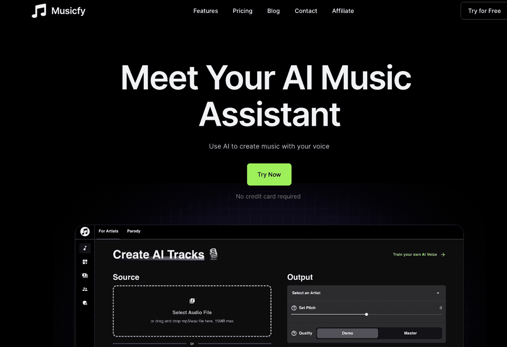

# AI电波派对

> 来源：[https://docs.feishu.cn/docx/VxBhd9p9Eoul8wxqDhLcPKKfnBW](https://docs.feishu.cn/docx/VxBhd9p9Eoul8wxqDhLcPKKfnBW)

Update：2024.3.29

# 知识库简介

> 👋 Hi！我是Ryan🦄.eth。

> 致未来的探索者们：

> 我们坚信，拥抱人工智能(AI)的力量，是每个人未来发展的必经之路。在这条充满探索的旅途上，我们不应该孤军奋战，而应该抱团取暖。

> 于是，我将我学习AI的笔记开源成我的知识库，每一篇笔记都是我自己走过的学习路线，我将他们全部公开出来，并且附上一些任务Quiz用来检测自己的完成情况，希望让每个人都能少走弯路，让学习AI不再困难。

> 我常**看见一**些**大而全**的知识库，内容**非常优质，**但**是由于是社区共创**，往往里面有多个不同体**系互相冲突，频繁的**外链跳转，让我们学习路线非常陡峭而缓慢，难以构建起一个连贯的学习框架。所以本系列知识库专注于实操性和体系性，旨在提供一个易于跟随的、能够快速学习掌握的Roadmap，并且文科生可以放心使用，适当的时候附以其他视频、音频的内容。

> 让我们一起踏上这场学习之旅，探索AI的无限可能。

多维表格（D8Qyb6m1ka7ZXqsR5WrceGKDnHd_tblNHj8AMsK4V2pW）

**学习原则**

1.  永远不要糊弄自己

1.  要研究AI，不要研究“AI新闻”，不要停留在嘴上，实践出真知，多用多尝试

1.  不断修炼精进自己的知识系统，取长补短

1.  有时候做减法更重要，注意力有限，关注最该关注的内容

---

**卷首语**

> 欢迎来到《AI电波派对》知识库！

# 工具安利

1.  Suno

https://app.suno.ai

1.  Udio

https://www.udio.com/

1.  Musicfy

Musicfy 帮助用户结合自己的声音创作喜欢风格的音乐

https://musicfy.lol/

