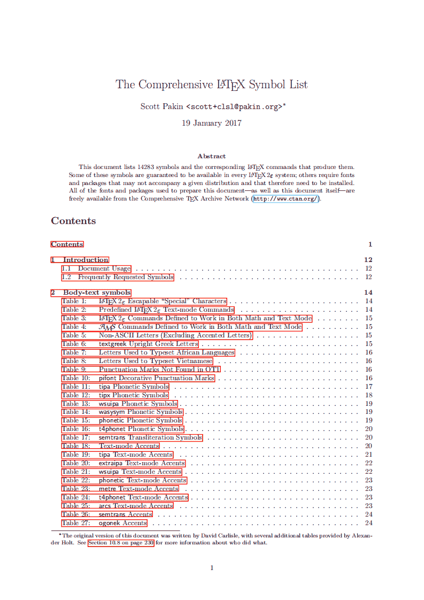
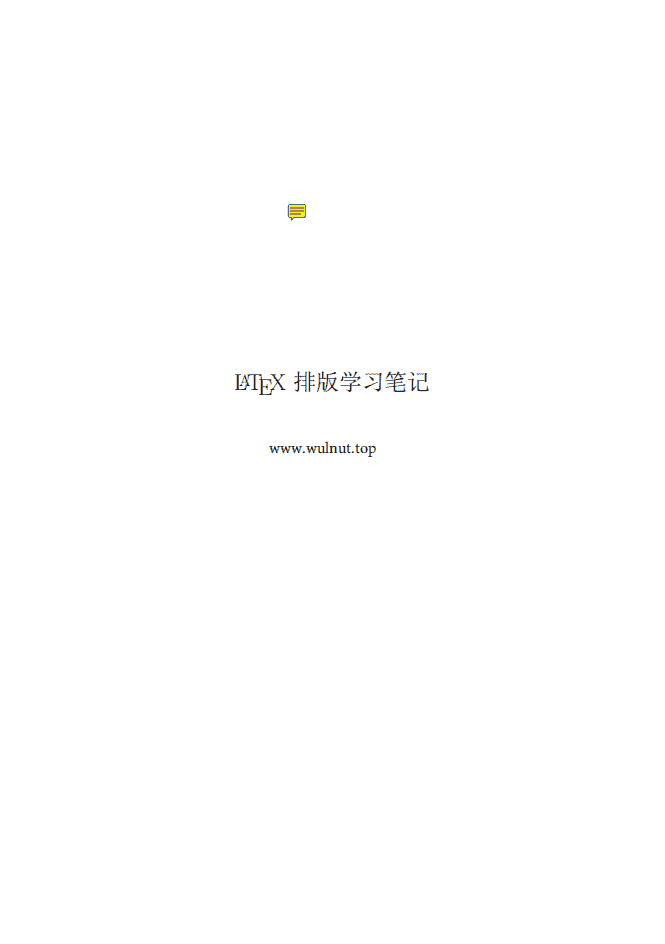
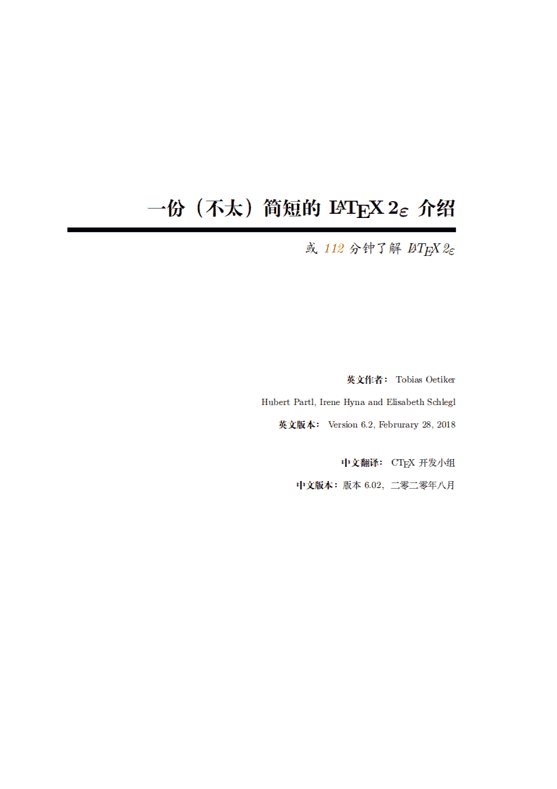

# 文本写作

> 来源：[https://docs.feishu.cn/docx/ZWSJdsyCVongffxenaccvTd4nwg](https://docs.feishu.cn/docx/ZWSJdsyCVongffxenaccvTd4nwg)

# grammarly

https://www.grammarly.com/

语法纠错

# Latex

[https://zhuanlan.](https://zhuanlan.zhihu.com/p/38178015)zhihu.com/p/38178015

用vsc编辑

[https://www.bilibili.co](https://www.bilibili.com/video/BV15x411j7k6)m/video/BV15x411j7k6

看两三集

下载tex，下载完之后在terminal里面输入texdoc lshort-cn就能打开



[Latex符号大全 (1).pdf](https://internal-api-drive-stream.feishu.cn/space/api/box/stream/download/all/boxcnZcwYvRFxV0pGnftviDazqe)



[latex排版学习笔记.pdf](https://internal-api-drive-stream.feishu.cn/space/api/box/stream/download/all/boxcnx6E4zADcaVTiQo7MO6fcnb)



[lshort-zh-cn.pdf](https://internal-api-drive-stream.feishu.cn/space/api/box/stream/download/all/boxcnEvT94EEUWItis3acgRHpRe)

## 如何打代码段

```
\usepackage{listings}
\lstset{
 columns=fixed,       
 numbers=left,                                        % 在左侧显示行号
 numberstyle=\tiny\color{gray},                       % 设定行号格式
 frame=none,                                          % 不显示背景边框
 backgroundcolor=\color[RGB]{245,245,244},            % 设定背景颜色
 keywordstyle=\color[RGB]{40,40,255},                 % 设定关键字颜色
 numberstyle=\footnotesize\color{darkgray},           
 commentstyle=\it\color[RGB]{0,96,96},                % 设置代码注释的格式
 stringstyle=\rmfamily\slshape\color[RGB]{128,0,0},   % 设置字符串格式
 showstringspaces=false,                              % 不显示字符串中的空格
 language=c++,                                        % 设置语言
}

\begin{lstlisting}
\end{lstlisting}
```

## 插入图片

```
\documentclass{article}
\usepackage{graphicx}
\begin{document}
\begin{figure}[htbp]
    \centering
    \includegraphics{1.eps}
    \caption{Elliptic Paraboloid}
    \end{figure} 
\end{document} 
```

代码说明：

\usepackage{graphicx} 为插入图片所需引入的宏包；

[htbp] 为调整图片排版位置选项，说明如下：

[h]当前位置。将图形放置在正文文本中给出该图形环境的地方。如果本页所剩的页面不够，这一参数将不起作用。

[t]顶部。将图形放置在页面的顶部。

[b]底部。将图形放置在页面的底部。

[p]浮动页。将图形放置在一只允许有浮动对象的页面上。

上一条中，图片位置为latex自动排版，如若我们一定要指定图片在当前位置，仅使用 [h] 命令是达不到效果的，此时方法如下：

a) 引入float宏包;

b) 将\begin{figure}[htbp]改为\begin{figure}[H]，注意是大写的H。

\centering 为图片居中命令；

\includegraphics{1.eps} 用于插入图片，可用 ‘’[ ]’’ 添加图片尺寸，例如\includegraphics[width=9.5cm,height=8cm]{1.eps}；花括号中为图片相对路径，通常应将图片放在与latex文档相同的路径下，图片格式采用.eps矢量格式会更清晰；

\caption命令用于插入图注，其应用在\includegraphics的下方即将图注插在图片下方，反之亦然。

## 伪代码

```
\usepackage{algorithm, algorithmic}

\begin{algorithm}
        \renewcommand{\algorithmicrequire}{\textbf{Input:}}
        \renewcommand{\algorithmicensure}{ \textbf{Output:}} 
        \caption{Minimum Enclosing Ball of the Intersection to Two Balls}\label{alg:thefirst}
        \begin{algorithmic} 
                \REQUIRE a ball centered at $x_{A}$ with radius $R_{A}$ and a ball centered at $x_{B}$ with radius $R_{B}$. 
                \IF {$\left|x_{A}-x_{B}\right|^{2} \geq\left|R_{A}^{2}-R_{B}^{2}\right|$ }
                \STATE $\mid c=\frac{1}{2}\left(x_{A}+x_{B}\right)-\frac{R_{A}^{2}-R_{B}^{2}}{2\left|x_{A}-x_{B}\right|^{2}}\left(x_{A}-X_{B}\right) . R^{2}=R_{B}^{2}-\frac{\left(\left|x_{A}-x_{B}\right|^{2}+R_{B}^{2}-R_{A}^{2}\right)^{2}}{4\left|x_{A}-x_{B}\right|^{2}}$ 
                \ELSIF{$\left|x_{A}-x_{B}\right|^{2}&lt;R_{A}^{2}-R_{B}^{2}$}
                \STATE   $c=x_{B} \cdot R=R_{B}$
                \ELSE
                \STATE $c=x_{A} \cdot R=R_{A} \cdot{ }^{a}$ 
                \ENDIF
                \ENSURE a ball centered at $c$ with radius $R$.
        \end{algorithmic}
\end{algorithm}
```

## 浙江大学学位论文 LaTeX 模板

https://github.com/TheNetAdmin/zjuthesis

## 全国大学生数学建模竞赛 LaTeX 论文模板

https://github.com/latexstudio/CUMCMThesis

# Typora 伪装 LaTeX 中文样式主题

https://github.com/Keldos-Li/typora-latex-theme

# 据意查句

https://wantquotes.net/

WantQuotes可以根据你输入描述的意思来查找相应的名言名句，例如输入“树立远大志向”，可以查到歌德的名言“人生之要事在于确立伟大的目标与实现这目标的决心”（现代类名句）、刘禹锡的诗句“少年负志气，信道不从时。”（古诗文类名句）、“人起心发，树起根发”（熟语类名句）等。

# 万磁王反向词典，搜近义词、反义词（中英文）

https://wantwords.net/

# 文字校对

https://www.ijiaodui.com/

# 中国历代人物

https://www.inindex.com/biog

# 搭建知识库/书

Create book from markdown files. Like Gitbook but implemented in Rust

https://github.com/rust-lang/mdBook

# PDF/截图 转换成Latex

https://snip.mathpix.com/fcrryan173/pdfs/b7508020-2860-4214-8c7f-bb4887cb1d9e/view

# 英语改写/论文润色

https://quillbot.com/

# bob+popclip

划词AI翻译

https://github.com/yetone/bob-plugin-openai-translator