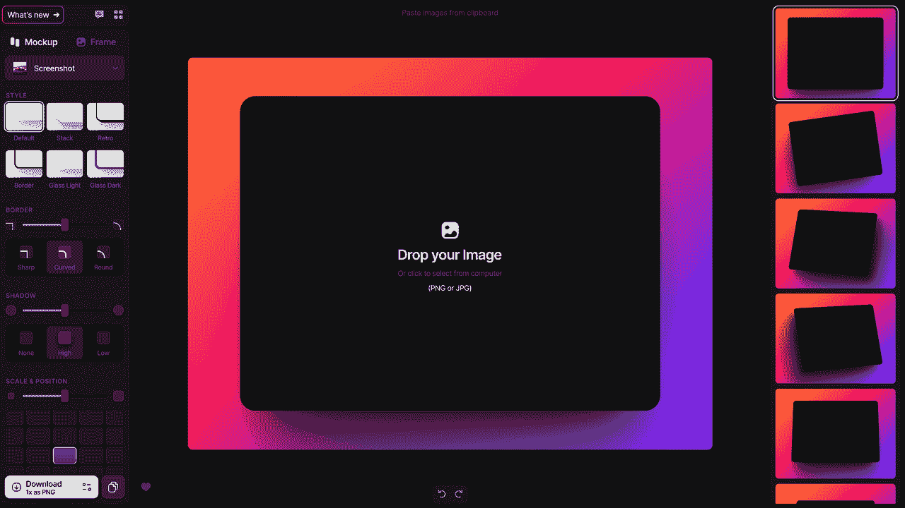

# 展示/图像/音乐处理

> 来源：[https://docs.feishu.cn/docx/G6zOdVAIso0AYQx0rQVc3HJInqc](https://docs.feishu.cn/docx/G6zOdVAIso0AYQx0rQVc3HJInqc)

# Slidev

> 做PPT

https://github.com/slidevjs/slidev

# Text2Music

https://mubert.com/

# 去水印

https://github.com/zuruoke/watermark-removal

# emoji库

https://github.com/twitter/twemoji

# 手绘风流程图

https://github.com/excalidraw/excalidraw

# Carbon

精美可视化代码

https://carbon.now.sh/

# shots.so

https://www.shots.so/

模具图

让展示图片不那么单调

# PDF

https://tools.pdf24.org/zh/

# 图片压缩

20M大图无损变100K：TinyPNG（在线网站）

地址：https://tinify.cn/