# 自媒体相关

> 来源：[https://docs.feishu.cn/docx/YvoYdkIa1oH64Ox0STxc8G90nse](https://docs.feishu.cn/docx/YvoYdkIa1oH64Ox0STxc8G90nse)

# **后裔采集器**

**帮你采集📕爆款标题**

**来说具体实操:**

1）下载软件，下面是官网链接， 下载后直接安装，不用注册 ：

https://www.houyicaiji.com/

2）在📕上选择一个你想采集的领域（即 tag），比如我的截图“商业思维”这个 tag，点击进去，会进入到这个 tag 的收录页

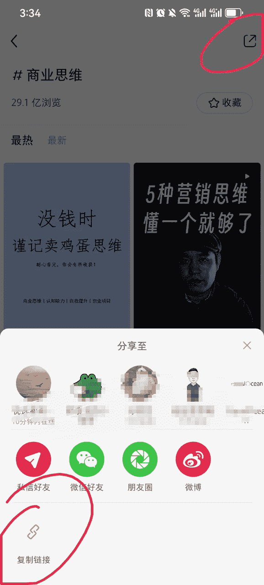

3）把这个收录页的链接整个复制下来，放到后裔采集器软件里，会看到一个预览页面

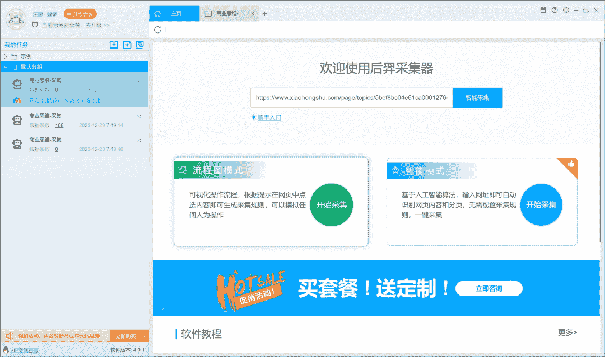

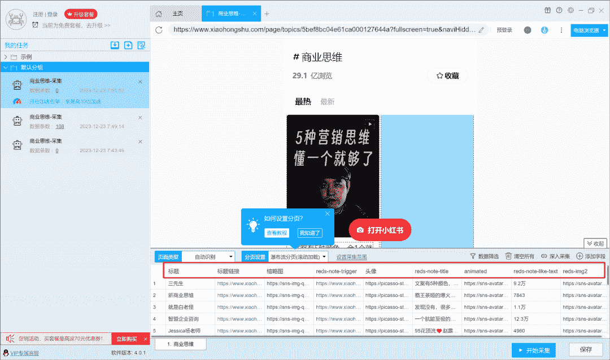

4）点击启动，差不多采集 100~200 条，就够我们参考的了，再点击“停止”

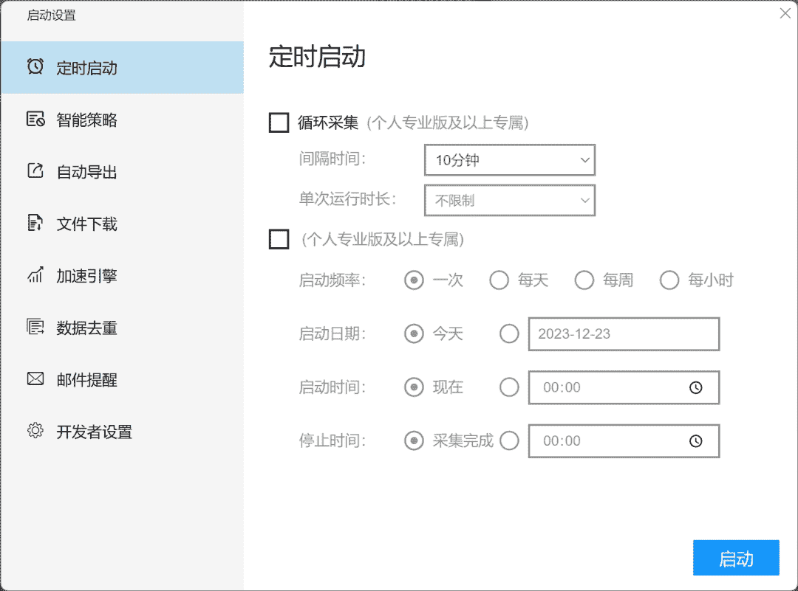

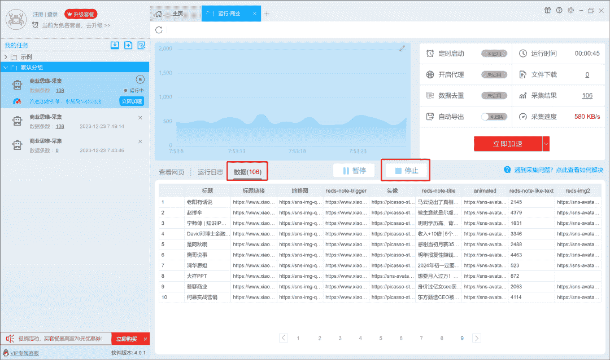

5）然后导出 Excel，打开表格后，我们按照标黄（点赞）进行数据排序，就可以看到你需要的某个领域的爆款标题啦

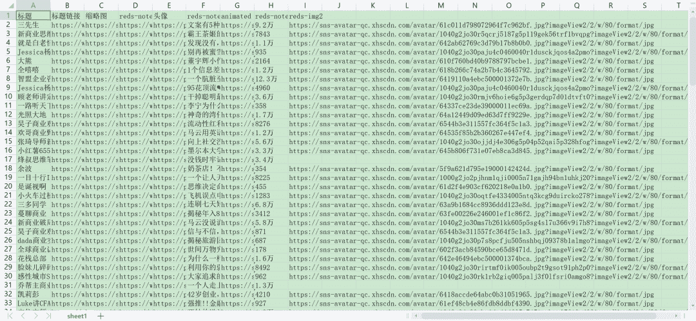

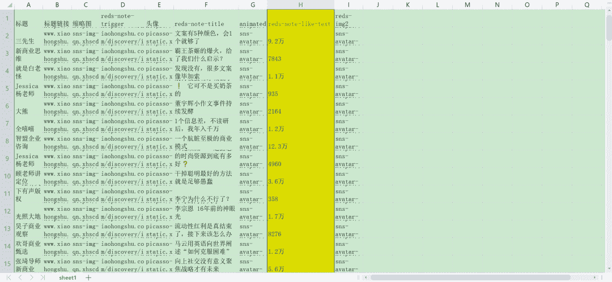

# 多种草 AI（小程序），📕文案神器

我们知道太多 AI 文案生成工具，但能对📕完美支持的并不多，而且目前越来越多的功能同质化严重，且并不具备参考价值，不能降低你生成📕文案的门槛，和为你的📕运营真正提效。

这两天发现了一个超好用的📕AI工具：多种草AI（小程序）！不仅合并了其他📕工具的功能：比如支持敏感词检测、📕文案生成、添加 emoji、特定赛道文案生成等常规功能。

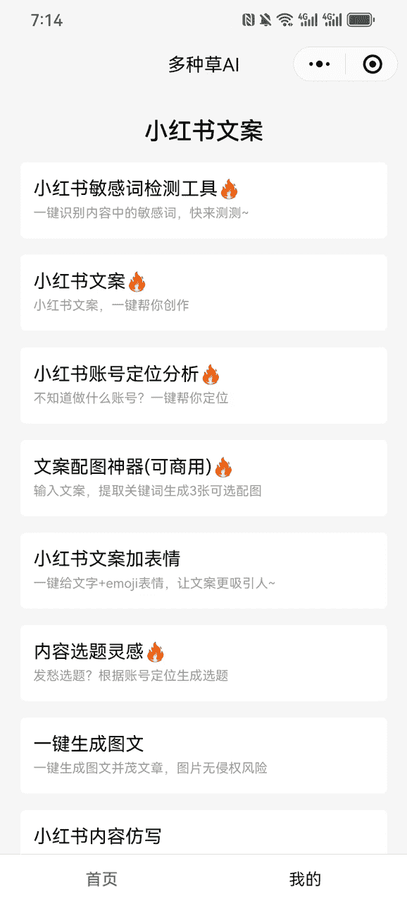

**最打动我的是以下 3 个功能：**

1）账号定位分析（帮助你定位）

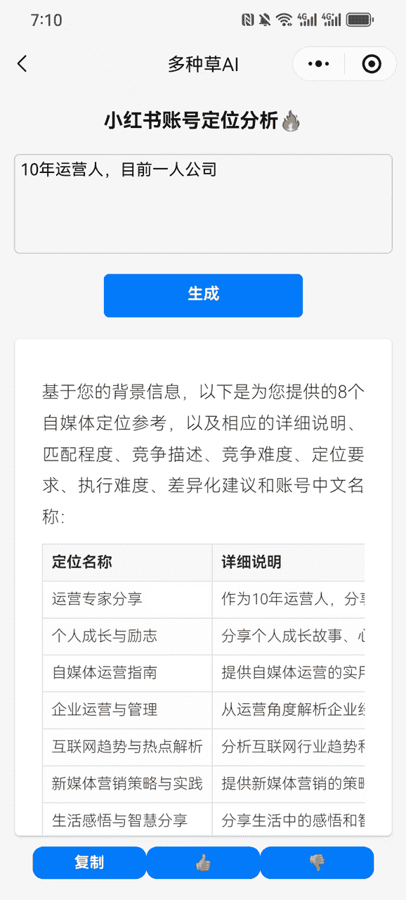

2）文案配图神器（帮助你找到全网的无版权图）

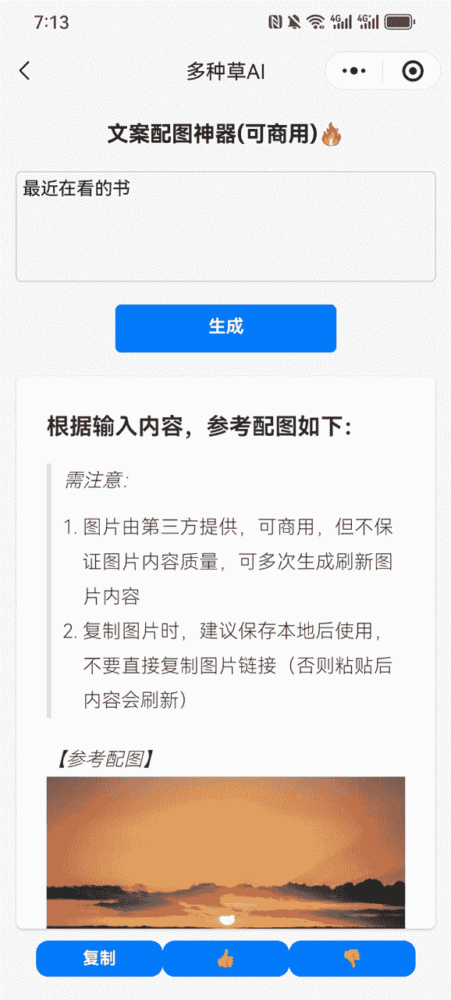

3）爆文内容仿写（比如，我输入了一个最近的爆款选题“养生赛道的，用 8 天时间春节把自己养回来”）

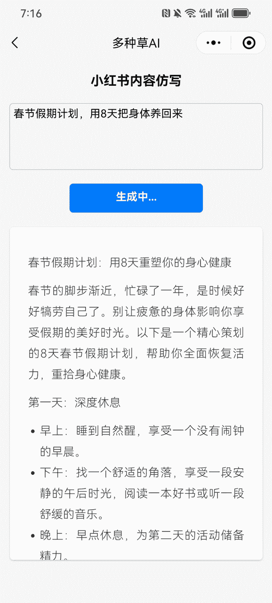