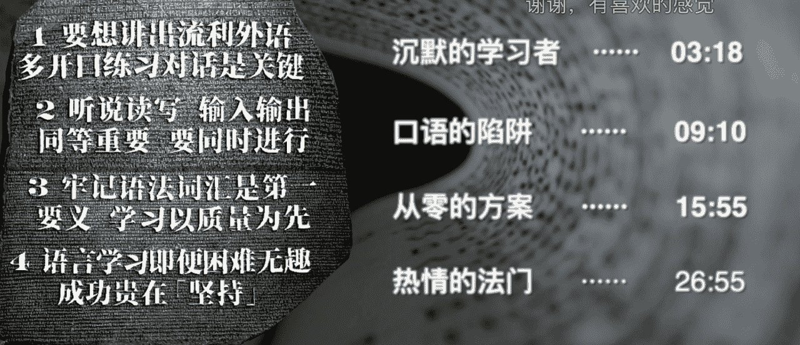
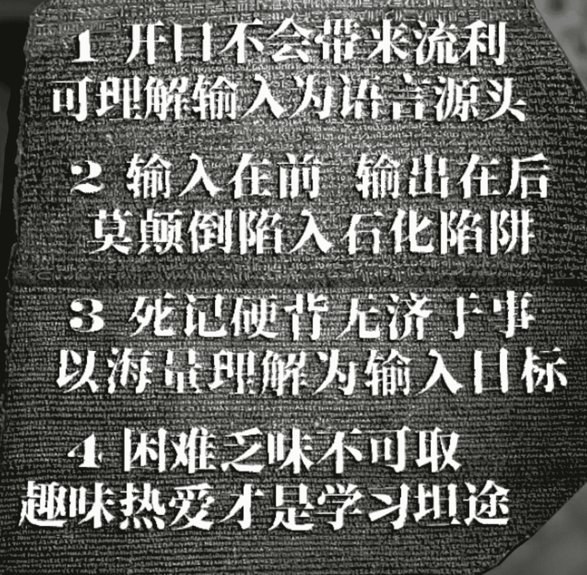

# 如何学习英语

> 来源：[https://docs.feishu.cn/docx/EUNgdtQicocTgFxPla0cnxiynjh](https://docs.feishu.cn/docx/EUNgdtQicocTgFxPla0cnxiynjh)

<https://player.bilibili.com/player.html?bvid=1ns4y1A7fj&spm_id_from=333.999.0.0>

**第一**章：三个**难题

* 任意符号难题****——记住单词如**同记住一个任意的名字，而纯背单词所得到的记忆脆弱易失

* 宽度难题——单词知识如海洋一般宽阔，纯背单词就像用木桶舀海般捉襟见肘

* 深度难题——单词知识如井水一般深邃，纯背单词只能触及单词知识的表层

第二章：语境的力量

* 词汇如丝线、文本如织品，我们在语境中才能感受词汇的生命

* 要用图像、声音、事件、情感将词汇符号固定在记忆中

* 如果每读/听一百个词只遇到2个或更少生词（可理解输入），我们便可以像拼拼图一样从语境中推测、学会生词的意义 98%

* 大部分的单词都需要我们在变化的语境中重复至少12次，才能被我们充分学会

幕间：**语言传奇

* **掌握15门外语的匈牙利翻译家Lomb Kato的秘密武器是读原著闲书

* “只有阅读才能带来（单词的）无限重复”

第三章：一百万词

* 罗肖尼的词频统计显示Sidney Sheldon的十本小说（总篇幅共一百万词左右）为大学英语六级词汇提供了90%以上覆盖率、平均26次重复

* 近四十年的语言学研究指出，消遣阅读可能是人们绝大部分母语和外语词汇量的来源

* 每天阅读半小时便可以让我们在一年内完成一百万词阅读量；但养成习惯需要从微小的种子开始，因此我们需要从每天阅读半页纸开始

后记：书籍的皱纹

“只有这一种阅读，才是真正的阅读”

<https://player.bilibili.com/player.html?bvid=1aD4y127GE&spm_id_from=333.999.0.0&vd_source=b2c556c92eaad2e3330b8aa1ae47c210>

一、语法的失败

1. 获得流利外语能力的唯一途径是大量的听读输入

2. 当我们理解外语信息时，语言习得将自然地发生

3. 传统语法学习知识并非流利运用语言的前提

二、输入的奥秘

1. 语言习得的关键是找到大量有趣、可理解（i+1）的输入材料

2. 漫画、小说、Podcast等故事性材料是最佳的输入类型

三、阅读的力量

1. 自由消遣阅读（读闲书）是提升语言能力最自主、最快乐的途径

2. 对于语言考试，读英文闲书带来的提升效率是参加培训班的2-3倍

<https://www.bilibili.com/read/cv7458154?spm_id_from=333.999.0.0>

<https://player.bilibili.com/player.html?bvid=1tf4y1s7NN&spm_id_from=333.999.0.0&vd_source=b2c556c92eaad2e3330b8aa1ae47c210>

视频内容提要

一、沉默的学习者 3:18

- 外语学习者必然会经历“静默期”而不能、也不应过早开口练习

- 流利外语来自于海量听读可理解的材料，而非进行对话练习

二、口语的陷阱 9:10

- 盲目开口不会带来进步，反而可能导致错误固化、进步停滞

- 时间七成在输入、三成在输出，莫颠倒顺序而陷入“石化”陷阱

三、从零的方案 15:55

- 寻找难度适中(i+1)、有趣、足量系列材料（有趣、足量、可理解）；故事书是最优选择

- 文字稿、难度分级**；有趣比质**量更重要，不需要完全听懂

- 不要迷信强制记忆语法和词汇，海量和理解才是输入的关键

四、热情的法门 26:55

- 用极为有趣的材料进入“心流”而忘记外语存在是最理想状态

- 有趣内容将让学习方法变得次要，主动寻找材料必要躬行

不要去学英语，而是用英语去学习你喜欢的东西

<https://www.bilibili.com/read/cv7695133?spm_id_from=333.999.0.0>