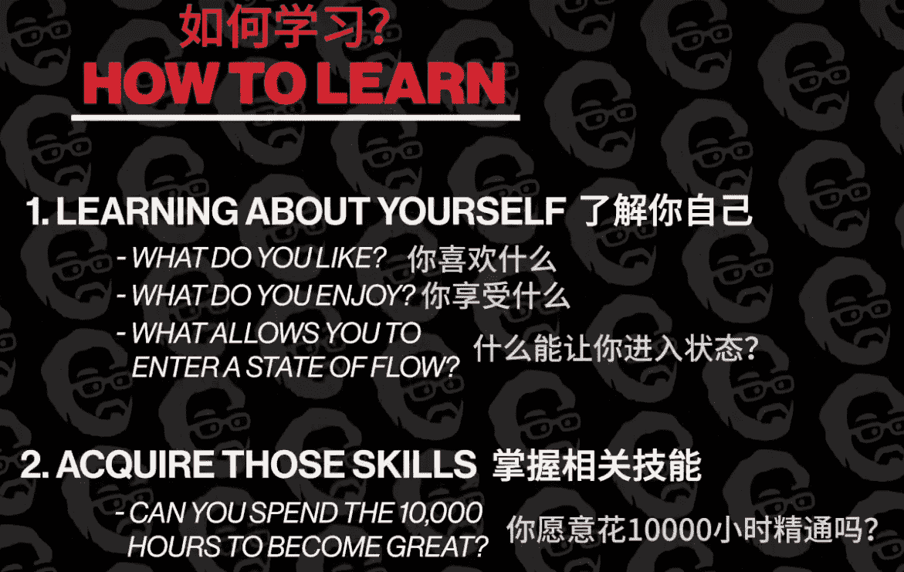
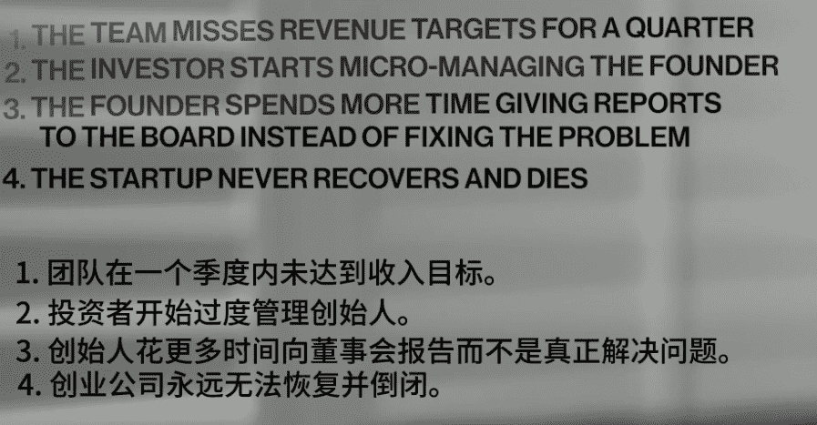

# 陈嘉兴Garry Youtube合集

> 来源：[https://docs.feishu.cn/docx/Okh0dZCi6oeEIoxxFquc8P0inHf](https://docs.feishu.cn/docx/Okh0dZCi6oeEIoxxFquc8P0inHf)

> 陈嘉兴Garry是YC现任CEO，在这里分享他Youtube的一些Takeaways

# How to get rich

> [如何变得更富有？](https://www.bilibili.com/video/BV1zx4y1X72K/?spm_id_from=333.999.0.0&vd_source=b2c556c92eaad2e3330b8aa1ae47c210)

> 和纳瓦尔宝典的内容类似

+   追寻wealth而不是rich

+   更重要的是创建、成为那个引擎

+   Economy energy

+   拥有独特技能的竞争力

+   创业前先培养自己的技能

+   寻求杠杆

+   You can be a creator instead of a consumer

+   让他人开心，制造产品，寻找杠杆，解决他们的问题

+   创建wealth machine

# 投资Coinbase的分享

> https://www.bilibili.com/video/BV1sM4y1H7Jm/?spm_id_from=333.999.0.0&vd_source=b2c556c92eaad2e3330b8aa1ae47c210

+   You already know your future co-founder. You both just don't know it yet.

+   当我在大多数人说“不”的时候说“是”

+   要成为持不同见解但正确的人；找到一些边缘但是正确的事情，证明自己疯狂的想法

+   Be a builder

+   勇敢reach out

# 如果你既没在学习又没在赚钱，你在干什么？

> https://www.bilibili.com/video/BV1Kp4y1V71Q/?spm_id_from=333.999.0.0&vd_source=b2c556c92eaad2e3330b8aa1ae47c210

How to learn

不要多想，先做

不要把时间花在没有成就感的事情上

Learning and earning

# 我因为选择打工,损失了2亿美元！！！

> https://www.bilibili.com/video/BV1R841127g8/?spm_id_from=333.999.0.0&vd_source=b2c556c92eaad2e3330b8aa1ae47c210

+   If you don't work on your dreams, someone will put you to work on theirs.

在大公司的好处

+   稳定，能向很多人宣传自己的产品

+   能学到很多

+   遇到很多聪明人，你们可以一起搞事情

缺点

+   不够灵活，受限

+   你需要有一些其他技能，politics；和being great technically, or great at building product不一样

明确你在年轻的时候你想做什么

在startup的好处

+   直接面向用户和问题；感同身受

# 如何成为风险投资家？了解风险投资的运作方式及资助亿万美元初创企业的条件

> https://www.bilibili.com/video/BV16841127t7/?spm_id_from=333.999.0.0&vd_source=b2c556c92eaad2e3330b8aa1ae47c210

+   Instacart

+   builder导向，build the future

+   创建一些truly great

+   那些drive以及never give up是非常powerful的

+   Tech can change the world fundamentally for the good.

+   通常那些buzzwords的组合都是错误的伪概念，炒作；思考那些结合是否是合理的

+   什么是你believe的但是其他人不believe

You can only help if you first do no harm.