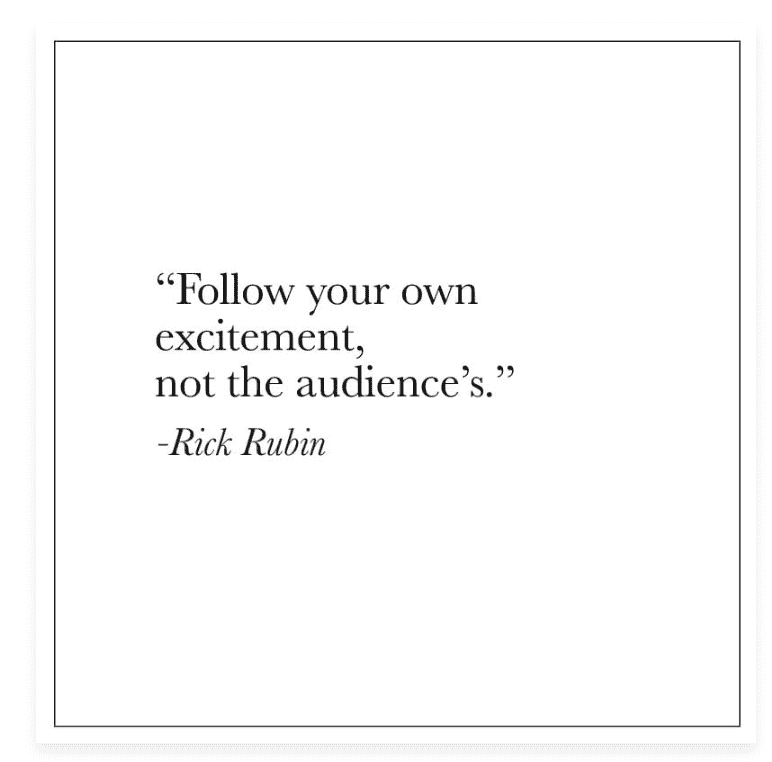

# It's okay to Make Something Nobody Wants

> 来源：[https://docs.feishu.cn/docx/QFfcdMRzZoiFvJxvmAYcRMENnDh](https://docs.feishu.cn/docx/QFfcdMRzZoiFvJxvmAYcRMENnDh)

@路遥：你做你觉得有意思的东西，然后别人才会觉得有意思。

在上海参加完活动那天，大概是咖啡喝多了，晚上睡不着。不知道为什么，这些东西出现在我的脑海里，一篇笔记越写越长。

后来发到 HackerNews，几乎是我第一次发，结果引发了许多共鸣。我收到了很多邮件，说谢谢我这篇文章，我想可能大家都感受到过一些相似的东西。

李阳问我周报推荐，我说这篇和 crypto 有关吗，他说有关啊。

我一想，对哦，如果中本聪关心的是主流、是别人、是商业，他还会做 Bitcoin 吗？

肯定不会。他会在 Google 流行时焦虑一次，Facebook 流行时焦虑一次，iPhone 流行时焦虑一次，然后随便做个什么互联网项目去争取融一大笔钱。

他在一个无人问津的小圈子里这么多年，研究一个无人问津的东西，只是因为它很有意思。

> https://zhangluyao.com/zh/blog/make-something-nobody-wants/

产品看起来是给用户用的，但我觉得这可能是一种假象，它实际上更像是一种自我表达。

许多表达被不同的人创造出来，经历了自然选择后，存活下来的那一个，是用户喜欢的那个。

我的意思是，这个过程是这么发生的：你做一个东西，不是“我觉得他们可能需要这个”而做，而是“我觉得这个有点意思”而做。然后，别人在使用你的产品时，感受到了与你相同的那种感受，这时他说：“我觉得这个有点意思”。

从这个角度来说，产品就像一种情绪的存储器，作者存进去，复制一千份，用户从产品中取出来。

你不能自己不含任何情感，却期望用户使用后带有情感。

---

我觉得即使做了个没人想要的东西，也没关系。你唯一需要做的是确保你已经完整呈现了你的情感。

但问题是大部分时候，大家都想的太多、在意得太多，以至于最后做了个连自己都不喜欢的东西。

如果每个人都去做他们真正喜欢的东西，那我们会拥有比现在更多的牛逼产品。

这个比它看起来要难，因为一旦你有了期望，就会开始担心、开始有压力，然后马上失去你的那种感觉。

或者说，人不能做一个自己不喜欢的东西，却指望别人喜欢它。

这可能也是为什么很多牛逼的产品都开始于业余项目。对于业余项目，大家通常没有太多预期，做它更多还是为了好玩、为了自己。

---

人类是一种只能理解自己的机器。我们通过理解自己来理解他人。我们真的不知道一朵花的感受，因为它没有脑袋和眼睛，而我们没有叶子。

所以，我不觉得任何“我不懂，但我知道你需要，所以我做出来给你”的方式会真的可行。

---

后来和女朋友聊起这事，我忽然更深刻地理解了乔布斯，以及其他像他这样的人。

乔布斯经常被人吐槽的一点是：当团队做好东西给他看，他会说“感觉不太对”，当团队询问应该怎么改进，他说”我不知道，你完善后再拿给我看，我才知道对不对“。

这让很多人感到困惑，他提出问题，却既不知道如何解决也不明确原因。

现在我完全能理解乔布斯的想法。

---

当我们做一个东西时，想让用户感受我们所感受的，那我们首先自己得深切感受到。乔布斯就是这种感受的“探测器”，这是真正的关键。

我觉得所谓产品的能力，可能不是一种名叫“做产品”的能力，而是一种感受自己细微情绪的能力。

乔布斯所感受到的东西，别人能不能感受到？我认为能，iPhone 发布后，大家都很喜欢，说明大家感受到了。

唯一的差别是，在开发这个情绪媒介的过程中，乔布斯能敏锐觉察到那些轻微的情绪，而大部分参与者由于种种原因未必能觉察到自己的这些情绪。

这也解释了，为什么减少期望并把注意力拉回现在，对于做产品很重要。因为这有助于你觉察那些微妙的情绪。如果你的心被外部混乱的东西填满，就会很难觉察到那些情绪。