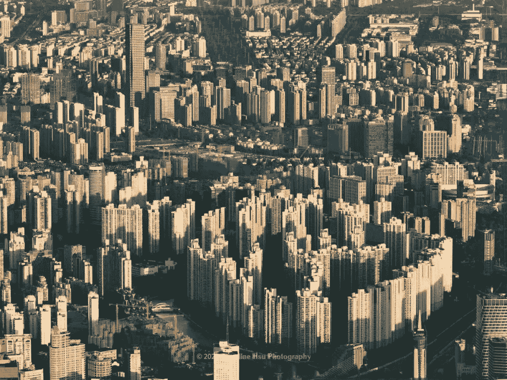

# 留学，不可取代的两大价值

> 来源：[https://docs.feishu.cn/docx/GlBcdOMaFoKbEFxU7a5c9dVFntg](https://docs.feishu.cn/docx/GlBcdOMaFoKbEFxU7a5c9dVFntg)

> 🔗 原文链接： h[ttps://mp.weixin.q](https://mp.weixin.qq.com/s?__biz=MzU0MDUwMDc1Mg==&mid=2247484460&idx=1&sn=bf398a541955eb11b3d3821b05bfaa61&chksm=fb397253cc4efb4514cb6cb347962111358a21c7665a23974d3c97eb83a7a360d61553563be3&mpshare=1&scene=1&srcid=1026TPA1IRJ4cfl0CecQig31&sharer_sharetime=1666756423763&sharer_shareid=53419fa24e911f32abc2fd25def030d6#rd)q.com/s?__biz=Mz...

凡事都有利弊，都是两面的。

当大家都觉得留学特别好的时候，我们有不少学员，在我们的支持下，在拿到了最好的国外学校录取后放弃了，走了更适合自己的路，留在了国内。当今天大**家普遍对留学开始怀疑，**在考虑放弃而去走所谓更安全更稳妥、或者不得已而走的路时，我们觉得我们应该站出来，以我们20多年的经验，好好说说留学它好的那一面。特别是， 留学它不可取代的价值 。

# 留学能让你有机会通过差异化竞争而打破你原有的格局。

**我们的典型困境**

先谈一个我们很多年轻人都面临的典型困境，甚至是一个死局。

我们大多数人可能都没有意识到，其实在我们还是青少年的时候， 一些重要的人生局面早已形成并固化了 。比方，在中学时，学生们就已经被成绩分成了三六九等，有的是学霸，有的是学渣，有的是学酥，有的是学弱，有的永远是别人家的孩子，而有的人却无论怎么挣扎，都争不了父母希望他们争的那口气。他们因此而被无数次地指责、鄙视、嫌弃、唠叨甚至惩罚，但都无济于事。

换句话说，在很多父母的眼中，也在很多学生/年轻人自己的心目中，一个人一生的结局事实上已经在中学时就固定了，以后的改变都是微调或就靠运气了。这才是大家为什么极为焦虑的根本原因。

这是一个极为残酷的现实。而更残酷的是，它真的很难被改变！

**追赶者面临的挑战 **

我们以一个学习成绩中等想要追赶的学生为例来说明我们的处境。之所以选择追赶者这个例子是因为在三六九等的竞争中，即便是最优秀的学生在进了一流的大学后，大概率会变成中等甚至落后的学生。追赶者的处境就成了我们大部分人的典型处境。

追赶者要成功，需要具备两个基本条件：动力和方法。

动力是指一个是追赶者的学习动力之强度和能持续努力的时间长度之积要大于被追赶者。通俗地说就是，追赶者必须比被追赶者更努力，甚至得努力得多得多。方法是指，在追赶者和被追赶者都同样努力的情况下，追赶者就必须有比被追赶者更高效的方法，追赶才有可能成功。

显然，在现实生活中，以上两个条件在绝大多数情况下追赶者都不具备。学霸之所以是学霸就因为他们往往更努力且已经努力很长时间了，他们也往往更聪明或者掌握了更好的学习方法且还很会不断优化自己的方法。

这就是为什么大多数补习班无法帮助大多数学生真正提升学习成绩的原因。它们顶多能做到水涨船高，让所有人的成绩都提高，但三六九等局面基本不变。这是因为补习班往往并不能提供比学霸更好的学习方法，倒反过来常常打击了追赶者的动力，因为追赶者花了比之前更多的时间学习，但追赶依然无效。这就会持续打击追赶者，甚至让追赶者觉得，做什么样的努力都是无用的，只能躺平、认命。

绝不放弃的人也想到了捷径。比方，花钱让自己的孩子去重点学校重点班，结果进一步打击了孩子的信心。花巨款买实习机会，结果打了黑工，还被鄙视。

其实 **唯一有效的方法就是差异化竞争 **，这是国家搞双减和职业化教育的原因之一。但搞差异化竞争最好需要有一个支持差异化竞争的外部环境。否则，在完全内卷的环境中搞差异化竞争，个体需要超强的动力和能力（方法）。没有这个外部环境，人就又回到了之前所描述的困境中。

如果外部环境是支持差异化竞争的，对个体的要求就发生了巨大的变化，之前的困境或者死局就能破解。而目前看最能提供差异化竞争的环境是留学和在完全市场化的企业里工作。后者留待以后再谈。

留学是最容易给我们提供一个非常不同的生长环境。这些不同之处非常多，但最影响我们个人发展的是与我们非常不同的升学/成功的游戏规则和评估学生水平的评价标准。这方面的差别尤以美国为甚，有时候很多方面与我们的标准甚至是相反的。比方，我们比较喜欢听话的学生，他们喜欢有主见的学生。我们需要学生尊敬师长，他们希望学生能跟老师平等交流，甚至批驳老师的观点。这就意味着，我们这边认定的三六九等的学生到了那边会直接打破，重新被评估。

为了让大家有更多的感性认识，我罗列部分对方在新的游戏规则和评价标准下看重的素质。提醒大家注意，这些素质和特点在我们这边目前的升学机制中几乎一钱不值；

+   如果你有自己热爱的专业且下定决心在这个领域有所建树，你的评分会非常高。可以高到什么程度呢？可以高到忽略你的低GPA（我们有学员最低低到了1.9）、甚至可以不在乎你是不是本专业毕业和是否补齐了相关课程。可以高到哈佛法学院几年前在人大法学院录取的两个学生分别排第2和第17名。

+   如果你很有想法，比方，你觉得心理学其实可以给交通工程带来新的启发和思路，比方，你觉得同样都在北京，学生们就学的条件差距不应该那么大，你会被另眼相看，会被鼓励去进一步研究你的想法，教授们有时候还会主动和你讨论你的想法并提供帮助。

+   如果很有领导力，比方，曾经从大一开始就独立领导一个学生创新项目，你的GPA受到了很大的影响，你以为你只能申请排名靠后的学校，但其实你可能能申请最好的学校。

+   有的录取，你可以直接找你感兴趣的诸多教授一个个谈，谈好了，你可以直接获得录取的承诺，而申请只是走一个过程。

+   你虽然是计算机专业的学生，但你既不是特别喜欢编程，也不特别擅长编程。你热爱文学、热爱生活、你喜欢琢磨各种各样的想法，你发现你获得最好的产品经理的offer。原因无它，因为你“适合”！

+   你性格活跃、爱好广泛，你爱玩，还幽默，你也会得被“另眼相看”，因为这可能意味着你是团队的润滑剂，你思维活跃，你可能给大家带来灵感。

+   还有很多很多不同的被看重的个性、特点和素质等。

大多数中国人会认为以上这些特质都很虚、无法量化，所以忽略。即使它们可以起加分作用，应该也类似高考时加的5分10分。其实，以上很多项本身就可以直接决定你是否被录取或者得到老师的表扬、认可和资源的倾斜。这样的评价标准和我们的是不是太不一样了？

那在一个游戏规则非常不同的环境里生活的体验又是什么样的呢？一个以前得不到表扬的人得到了表扬和认可，一个以前不被老师重视的学生获得了尊重，一个以前觉得自己一无是处的人忽然发现自己全身到处都是优点。想象一下处于这种新环境中的人的感受。他们会不会因此而觉得自己其实比自己想象的要强？会不会发现自己原来想的是对的、想做的是特别值得做的？会不会觉得自己可能是有希望的？他们会不会因此而更有热情和动力呢？

想象一下，答案是显然的。所以在这个新环境中，一个人的动力发生改变或者加强。同样，竞争方法也会发生改变。

在同质化竞争的环境中，三六九等的同学本质上都在用同样的方法竞争，甚至要采取一遍遍反复刷题的方法来竞争，因为他们要解答的考试题都是类似的。而在标准多元的环境下，一个人可以和别人竞争纯学术能力，也可以在有不同的目标、有独特的想法、创造力、领导力、团队合作能力、思想深度、成熟度、情商、个人爱好等方面找到自己的优势，即进行差异化竞争。之前，成绩中等的人要追赶，发现学霸已经提早起跑很多年了。怎么追？而在多元化的环境中，由于大家都有自己独特的优势或者属于自己的赛道，而这些优势可能也是这个人很多年前就起跑了的，甚至是与生俱来的天赋，或者是由挫折和失败经历（我们往往会觉得浪费了时间的经历）带来的独特价值。所以，在进行差异化竞争的时候，我们是拿自己优势去“竞争”，原来的“劣势”就相对不那么重要了。

破局成功！ 留学能让你有机会通过差异化竞争而打破你原有的格局。

写到这，可能有人会说，留学没有“坏”处吗？留学当然有它的问题和挑战，也不适合每一个人。我这里仅谈留学能给一些人带来打破自己原有局面的机会这一个点，而这个点是特别有价值的！

还有人会说，为什么有不少人去留学但并没有经历到你说的这些好事，或者说留学根本就不是很成功？这方面的原因是非常多，也一定是因人而异的。但其中一个可能的原因一定是把同质化竞争的思路带到了一个允许差异化竞争的环境中，继续进行了一场打不赢的旧游戏。或者我们并不知道如何进行差异化竞争。