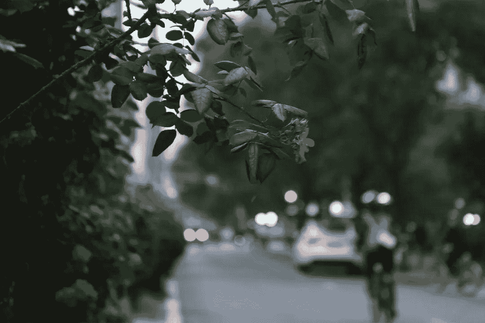

# 为什么国内没有真正的gap year？

> 来源：[https://docs.feishu.cn/docx/SiGCdIeagonGtixjxcoc3ERanSe](https://docs.feishu.cn/docx/SiGCdIeagonGtixjxcoc3ERanSe)

> 🔗 原文链接： h[ttps://mp.weixin.q](https://mp.weixin.qq.com/s?__biz=MjEwMzA5NTcyMQ==&mid=2653165865&idx=1&sn=757dc1bf1f0c352fe7b0bbc4ebcb336d&chksm=4eb5ffef79c276f9bd4ec35241be0084ce37b8363fb543c432f0c486cea0c5fedce8c651e946&mpshare=1&scene=1&srcid=08271j2mKT7RSRVmMdnwWUAq&sharer_sharetime=1661568698003&sharer_shareid=53419fa24e911f32abc2fd25def030d6#rd)q.com/s?__biz=Mj...

在很多国家，对于大学毕业生来说，「gap year」是一种寻常的生活方式，它简称「gap」，也被翻译成「间隔年」，指一个人暂时跳出曾经的轨道，花一段时间，去体验不同的生活，比如旅行、做义工、写作……或者干脆待在家里，以此来实现从学生到职场人两种身份的平稳过渡。

但是在国内，gap year的内涵发生了变化，变成了考研二战、考公、申请出国留学前实习、自媒体创业……在「过来人」的那些自信、积极、不容置疑的讲述里，gap并不应该是无用的假期——它需要有用，需要合理，必须是在为「更好的自己」蓄力。

一位小红书用户写道：老外的gap year，是「毕业之后花一年时间深度旅游，感受不同的生活」；小红书博主的gap year，是「我拿了三段大厂实习经历，顺便还考了几个证，然后又去英国留学了」。

为什么国内的gap year变成了这样？在他们的故事里，或许可以找到一些答案。

# **在哪儿**

「你在哪儿？」

微信蹦出这四个字时，正在家里gap的张蔻心跳加速，表情凝固了。她心里烦躁，挤出一句回复：「在看机会。」

她不愿面对这个问题。在她看来，对方看似是问地理位置，实则是打听她的社会位置——做什么工作？在哪里读书？目前处于哪个社会阶层、扮演怎样的社会角色？「我正在家里gap」的答案，她说不出口。

去年，张蔻大学毕业，出国留学的计划，因为申请到的学校不满意而暂停。她决定重新申请，gap一年再出国。在她的印象里，这是一种舶来的生活方式。上世纪五十年代起，国外的年轻人从固定不变的生活方式里跳出来，花一段时间，去另外的环境里体验新生活，比如旅行、做义工……这是gap最初的样子。

千**禧年之后，gap传入**国内，被翻译成「间隔年」。豆瓣上有一个「THE GAP YEAR间隔年」小组，几千位年轻人聚集在这里，他们把gap定义为「一次全方位的重启」。

申请受挫的张蔻，也渴望有一次这样的「重启」。大学的四年，她像是拧紧了发条，刷绩点、考雅思、参与各种比赛，从来没有休息过。现在，她渴望过一段「无用」的日子，先好好休息几个月，攒足精力，思考人生，再投入到接下来的生活。

但当她回到西安老家，真的开始gap，预想中的放松并没有到来。她每天凌晨三点睡，中午十二点醒，为offer焦虑，看电影打发时间。一个朋友得知了这件事，追问了她十几个问题：每天在家待着做什么？为什么不去实习、考证、丰富自己？

家人的态度也发生了变化。张蔻的双胞胎姐姐，顺利申请到学校，去了新加坡。一次，张蔻跟妈妈出门，偶遇了一位亲戚，对方问，「呦，你们家老二怎么还在家？」仿佛她不应该出现。

妈妈敷衍着回答，「在考呢，在学呢」，亲戚仍然用怀疑的眼神看了她一眼。被问得多了，妈妈也烦了，后来，只要涉及这个问题，妈妈就会说，「她马上也要去念书了」「她之后要出国」——现在进行时变成了一般将来时。

也是从那时候开始，gap的她害怕被问到「在哪儿」。她专门发了条朋友圈：不要总是问我在哪儿，我活着没死就可以了。

后来，她与另一位gap的同学聊天，同学的状况比她还糟。由于家人不支持，为了缓解矛盾，同学开始表演学习：每个早上8点准时到付费自习室，先补觉，趴桌子上睡到10点，再玩手机到中午。午饭是不能回家吃的，同学会去附近商场里吃个饭，找个付费按摩椅午休一下，下午再回自习室玩手机。晚上回家，同学跟家人都很满意，关系又和谐了。

在gap的这一年，95后李鱼也把自己藏了起来。2018年，他从医科大学毕业，做了一年医药代表后辞职考研，考上中药学专业的研究生。但只读了不到半年，他就退学了。今年年初，他带着几万块钱存款来到新疆，开始没有工作、不用上班，每天吃饭、睡觉、旅行的生活。

除了父母，李鱼没有主动告诉其他人这件事。有人问起，他会直接说「不想聊这个话题」， 至今，几个很好的朋友还默认他在读研。他也很少联系父母，一个月打不了一次电话，微信聊天永远是「嗯嗯」、「知道了」、「挺好的」。

作为一种对照，上一代人的gap经历中，更多的是探索自我的快乐。在一本讲述间隔年的书里，2006年，一位叫孙东纯的年轻人放下工作，在13个月的时间里去了泰国、老挝、印度、巴基斯坦……他一边旅行，一边做义工，在旅行中认识了一位日本女孩，后来成了他的妻子。在间隔年中，爱与被爱是这段经历的主题。

28岁的陈思，起初也试图过一段快乐而自由的gap生活。2016年，妈妈生病，她要回家照顾，借着这个契机，她开始gap。工作的那几年，她永远紧绷着，要么出差，要么坐班到筋疲力尽。而gap的这一年，她白天睡觉，傍晚出门散步，逛各种公园。

在许多个黄昏中，她看到了一些悠闲的背影——短衣短裤短发的帅气少女，手里甩着零食，在路上晃来晃去地走着；或是骑自行车飞驰而过的女孩，表情坚定，小腿有力，马尾辫直直飞起来。她第一次确切地感知到周围人的存在，就像她看到，北京的月季花，似乎一夜之间从钢筋混凝土的城市里生长出来。

图源视觉中国

# **gap比工作还累**

到了秋天，张蔻陷入了焦虑。曾经一起毕业的同学，隔三差五晒出新学校、新朋友，照片底部显示陌生的定位。群聊的话题，从猫猫狗狗转向了工作待遇，一个人看似自嘲地提起，新工作年包30万，「就是白菜价」。

打开小红书，那些高赞帖里，gap有几个常见的模板：考研二战、考公**、申请出国留学前实习、自媒体创业。人们用自信、**积极、不容置疑的口吻描述着gap，似乎在他们看来，gap不可以无用，它需要有用，需要合理，必须是在为「更好的自己」蓄力。

想到同龄人这时候在赚钱、学习，张蔻想，「差距一下子就拉开了」。她开始失眠，又因为失眠本身更焦虑。她也想不明白，为什么在当下，人们践行gap的方式会与自己想象中的gap完全不同。「家里蹲」的第四个月，张蔻决定妥协，尝试那种能获得高赞的gap。

她仔细盘点了自己的「资产」：毕业之后的绩点是固定数字，没办法再改变；英语这方面，托福已经考过，没有继续努力的空间；失去了学生身份，大学生比赛也不再能参加。她意识到，唯一有可能努力一下的就是实习，小红书上有人说，一些公司可以接受正在gap的学生。

10月，张蔻去了一家银行实习，开始了上午9点上班、晚上6点半下班的规律生活，每天做各类报表和数据分析。过了两个月，她又想到，既然有时间，可以去别的城市实习，拓宽可能性，尝试一下互联网行业。

她规定自己每天投够15—20份的简历，面试有时候太多排不开，下班后，她就在公司附近的便利店或者咖啡馆面试。面试的次数多了，刚开始磕磕绊绊的自我介绍和简历上的项目全背熟了，哪怕是非常拗口的数学模型公式也能脱口而出。最终，一家北京的互联网大厂向她敞开了怀抱，她住到了北京的小姨家里，开始新的工作。

互联网的实习节奏显然比银行更快、更累，朝10晚9，有开不完的会和做不完的项目，有时候要加班到夜里十一点，回家只想立刻睡觉。她变得嗜睡，也嗜甜，每天在上下班路上的便利店都会买费列罗、德芙、麦丽素，甜腻的滋味好像抚平了疲惫，也让她把从前的焦虑抛到了脑后。

但很快，焦虑又回来了。她接到一个电话，来自留学中介，中介说，她最想申请的、QS排名靠前的几所学校都发来了拒信，但有一所排名不高的学校发来了offer，可以给张蔻减免大约20个学分，一年半的课程缩短到一年上完。中介说，如果没什么问题，可以先交一个「留位费」——相当于交给那所学校的定金。

按理说，这是一个好消息，但张蔻也不知道自己怎么了，那天她站在公司的楼梯间，情绪非常激动，用一种生硬的语气跟中介说，「我不同意，我不接受」，两个人隔着电话吵了起来。中介完全不理解，保底的大学是张蔻自己选的，为什么申请到了又不愿意去读？回想起那个时刻，张蔻形容自己像「疯子一样」，她没办法再控制情绪，几乎是吼着说：「我宁愿把留位费浪费了都不会去，你不要想着用这个学校糊弄我，你做梦，这不可能。」

跟中介的关系陷入僵局之后，张蔻以为家人会站到自己这一边，但妈妈说，能减免20个学分也挺好的，远在新加坡的姐姐也来劝她。张蔻反问:「你自己的学校那么好，比我申请的这所好太多了，你是不是看不起我？」姐姐沉默着挂了电话。

后来回想起当时的情景，张蔻说，本以为这种「卷死自己」的gap方式可以缓解焦虑，没想到更焦虑了，「自己把自己逼进了一个死胡同，好像我付出了100%的努力，绝对不能只得到10%的回报」。

像张蔻一样，李鱼也有过一段「自己卷自己」的经历。严格来说，他经历了两次gap，第一次gap就是辞职考研。考研的同时还在准备考公，一个人要掰成两半用，有任何时间被浪费，他都会有负罪感。他害怕失败，觉得做两手准备，成功的概率会更大一些。

但同样的，李鱼的努力源于获得证明的渴望，那是符合他人期待、世俗意义上的「上岸」，并不是自己真正想要做的事。读研之后，他才确认，自己对医学并不是真的感兴趣。像是耗尽了燃料，没办法像考研时一样努力，看着身边的同学热切地投入新的学习，他感到一种慢性的压抑。

犹豫了一段时间，李鱼办理了退学手续，然后打电话通知父母。父母非常震惊，三个人吵了起来，父亲最后让步，表示可以接受李鱼休学，但李鱼说，来不及了，手续已经办完了。

张蔻在gap时拍到的日落  图源受访者

# **代价**

**g**ap在国内发生的「形变」，与环境的变化息息相关，在一个变化过快、机会越来越有限的时代，暂停需要付出代价。

陈思刚刚gap时，「内卷」这个词还没有被发明出来，互联网大厂的光环也没有那么闪亮，抖音只是一个刚刚上线的小众App，以前的同事转型进入大厂也不是什么稀罕事。一年之后，陈思觉得应该回到职场了，大厂突然变成了人们趋之若鹜的存在，大学在中国排名前五的她，投出去许多简历，却没有收到一封回复。

事情就是在这时逐渐失去了控制。一个大厂的朋友帮她内推，才促成了唯一一场面试。面试官面色严峻，问她，你之前gap了这么久，互联网公司工作强度高，竞争压力大，你能hold住吗？陈思有些犹疑，说，我也不太清楚。

从那间办公室走出来时，陈思就知道，面试肯定失败了。回家的地铁上，朋友发微信安慰她，「没关系，这个未必有多好」「大厂确实压力很大，大家都想走」。

本来陈思还想继续找工作，但没多久，她怀孕，然后生了孩子，有两年时间她在准备生产和产后带娃的状态中。加上gap的一年，三年很快过去了。孩子出生后，每个月的房贷、育儿嫂薪水、一家人的衣食住行加起来就有2万多，压力下，陈思准备重返职场。

这一次进大厂比之前容易了许多，陈思猜测，是因为自己已经生了孩子。但很快，她发现了一种非常显著的差别：同部门的同事普遍比自己小4、5岁，隔壁部门最年轻的leader是95后，才27岁。当年一起在媒体工作过的同龄人在她gap那一年进了大厂，有一些已经升到了管理层，而自己还是最普通、最基层的员工。

互联网最好的时候也很快过去了。入职大厂之后的两年，到处都在「毕业」，陈思今年刚好35岁，她非常担心，自己会不会是被淘汰的第一个？

陈思说:「会有那种人生的参差感，以前大家都一样，一起去采访，一起写稿子，但几年后他们的自信、对人生的掌控感，他们的收入、财富、地位……差距非常大，只有我变成了一个平庸的中年人。」

她深受折磨，常常会后悔，「中国人的职场年龄一环套一环，暂停一年引发了一系列连锁反应」。一位同事开解她，「你可是在外面潇洒了三年的，这是你要付出的代价」，似乎除了她，每个人都在职场上「如履薄冰，每走一步都在规划下一步要怎么走」。

新一代的年轻人，更快地看到了代价。

00后小墨在读大三时因为一个肺部手术需要休养，想要gap一年，之后留级重新读大三。但刚gap到一半，学校的培养计划变了，下一级要上的课变多了，为了按时毕业，她只好提前回学校，先把多出来的课程上完。

一位教育学的学生，在2020年gap，2021年重新工作时，教培行业变了天。还有人在2021年gap，晚一年找工作，2022年的夏天投递简历时，大厂纷纷锁了招人指标，找工作成了一件非常严峻的事情。

职场上，对gap的偏见也在加深。张蔻问过HR，为什么这么在意候选人曾经gap过？得到的回复是：「第一次申请学校、考研或者考公没有成功，有点像复读生，是被挑剩下的，一般情况下HR会觉得你可能不够优秀。」

小墨也曾听另一位HR提到，能去gap的人要么身体不好，要么家里很有钱，有底气gap，要么很有自己的想法，这样的人大概率不能成为一个合适的螺丝钉。

机会是有限的，陀螺是无限的，社会要挑转得更快、更连贯的那个。

图源《无法成为野兽的我们》剧照

# **意外的放松**

张蔻的旋转是因为一些意外才暂停的。今年4月，她回老家休息了一个月，然后准备去上海的一家互联网公司实习，但疫情突然爆发，上海去不了了，别的地方也不太方便，连她的北京健康宝都有了弹窗，没办法回北京。

实在没有了办法，她才放弃实习。她又恢复了每天睡到自然醒的生活，运动、做饭、看书。也是在这段时间，她拿到了一个满意的offer，这个offer给她疲惫的gap彻底踩下刹车。她突然发觉，自己在过去的日子里付出的全部努力，在此刻失去了意义。

从这时开始，她才真正地放空，思考一些自己以前从来没有想过的问题。张蔻意识到，即使「我已经停止了解周围同学的情况，但依然很焦虑」。家里人也没有给自己很大的压力，是自己给自己定了一个超高的目标，「如果没有达到，我就会非常的崩溃」。

目标来自于比较，这种比较一方面在内部，会留意同学能申到的最好的学校。而在外部，她也身处一个比较的氛围中。每当新认识的人知道她有姐姐的时候，一定会问，姐姐在哪里读书。得知姐姐就读于一所知名大学，接下来的问题一定会是，那你怎么不去那所学校？最初张蔻不知道怎么回答，后来脸皮厚了起来，直接说「考不上」。

小墨也在那段「被迫」的gap里思考了许多问题。离开学校那个具体的环境，她拥有了不一样的视角。在她看来，社会时钟无处不在，嘀嗒声像心跳一样，每时每刻都提醒着自己往前跑。她没有真正地放过假，所有的假期都默认用来补课和学习，小时候，周五才刚放假，周末在补课班又见到了同学校、同班的同学。连高考结束的那个假期，她也被父母催促着去考了驾照，皮肤晒得黑了两个色号。

上了大学，时钟的存在感更强了。学校要求一个学生6年内毕业，不少公务员考试只针对应届毕业生。企业招人，不要超过26岁的硕士、超过30岁的博士，不管什么学历，超过35岁，找工作的难度指数级增加。

为了在恰好的时间毕业、工作，小墨的同学，有的从大二就开始准备考公、到互联网公司实习，或是做科研项目——大四的保研综合排名设置在9月，想在其中获得科研加分，得在这之前结题。

在新疆，李鱼选择逆时钟而行。他有了两个小时时差，别人上班的时候，他刚起床；别人睡觉的时候，他还在伊犁河大桥上看日落。伊犁的夏天草木丰茂，走在路上，两边种的白杨树笔直高大，垂下一片浓荫，太阳在哗啦啦的树叶中间落下去，留下像海浪一样的红色的层云。

这里远离城市，没有外卖、快递，也没有买学区房的烦恼。李鱼想，人一生的意义，就是要赚很多钱、买很大的房子、过奢侈的生活吗？对比很强烈，当地人脸上，总能看见真实快乐的笑容。

对陈思而言，gap的体验依然是珍贵的。

在那段时间里，陈思思考自己与他人的关系，自己与自己的关系，她看了作家李娟、赫尔曼·黑塞的书，记录自己的思考。她发现自己一直在随波逐流，「我到了 30 岁，觉得别人都生孩子了，我就去生孩子，别人都去大厂，我也很羡慕，我也要去大厂」。她最终得出结论，人要建立自主性，有自己的意识，走自己的路，不是为了满足谁，也不是为了跟谁竞争。

在一个完美的故事里，一个人在觉醒之后，可以立刻改变，去走自己的路。但现实是，挣脱框架、丢掉时钟是非常困难的，敢拿人生赌博的极少。

图源《适婚女郎》剧照

年轻人如张蔻、李鱼、小墨，之后的计划仍然是回到轨道上——张蔻准备按计划出国读书，小墨已经回到了大学里，李鱼还没有做出具体的计划，但大概率会重回医药行业工作。

最近，陈思想努力在北京积分落户，这是她唯一能为孩子做的：提供一个入场券。她也曾想过，要不要带着孩子回老家，但老家是一个人情社会，没有互联网公司，也没什么支柱产业，两个35岁的中年人，回去能做什么呢？

陈思还听一位去匈牙利生活的朋友说，在匈牙利，女性有3年产假，企业没有35岁门槛。陈思可选择的地方是清迈，她也考虑过，要不要去赌一个未来，但那又意味着她要放弃现有的东西。

社会学家项飙曾经在一次访谈中说，在不确定的世界里，要建设好自己的大后方，如果能够跳出来看自己的遭遇，可能会更好。但陈思想，「我的人生真的可以跳出来吗？」gap之后，机会更少了，就连部门里新来的00后实习生，哪怕是名校研究生毕业，能力一个比一个出众，但因为没有hc，最终都黯然离开。

留给她的容错率正在变小，时间和空间都在挤压着她——外婆去世了，老家从小养大的狗狗被车撞死了，工作遇到了问题，家里又因为育儿吵架，青春就这样迅速逝去。一个周五，她走在路上，突然想为自己哭一场。

但就连为自己哭泣这件事，她努力了好久，最后也失败了。「我已经没有多少眼泪要流了。」

不过，大厂的朋友也想出去，羡慕陈思曾经暂停过。对陈思而言，有过体验，就有了一种底气，她知道自己不可能一直赖在大厂，如果有一天被扔出去，她也确信能养活自己。

但留给她一些滋养的，依旧是gap时的记忆。4月的一天，陈思的爱人带孩子去了公园，发了一张照片来，孩子坐在一棵巨大的樱花树下，椅子上堆着没有融化的雪。她突然一个激灵，从床上爬起来，带上相机，去公园拍花。

那是今年，她唯一真切地感受到快乐的时刻。

（受访者要求，文中张蔻、陈思、李鱼为化名）