# 如何把自己打造成一台学习机器（How to Make Yourself Into a Learning Machine）

> 来源：[https://docs.feishu.cn/docx/A7X4dKa22oc6RgxDcPoclptJnyb](https://docs.feishu.cn/docx/A7X4dKa22oc6RgxDcPoclptJnyb)

> 🔗 原文链接： h[ttps://mp.weixin.q](https://mp.weixin.qq.com/s?__biz=MzA4NDk5OTgzMg==&mid=2650594580&idx=1&sn=03fe28aa4d092040356537fe6b571979&chksm=87d6d6e3b0a15ff5f83b5c8dbb31703903f3951b45b7a436bb39b686b51f3de63ed95b14a244&mpshare=1&scene=1&srcid=1123MrOwlFkssJkW59Rju7qm&sharer_shareinfo=b3592461062d9f4cc424489266b4dfdb&sharer_shareinfo_first=b3592461062d9f4cc424489266b4dfdb#rd)q.com/s?__biz=Mz...

// 在 Superorganizers 上读到这篇文章。讲的是 Shopify 的产品工程总监聊他的学习心得与工具资源。我 借助 AI 对照翻译推荐出来。

Editor’s note: We're approaching the one-year anniversary of the release of ChatGPT, a knowledge and information machine unlike any we have ever before created. As we reflected on the role of knowledge, we also wondered what the future of learning would be. How can we learn in the age of AI? What role (if any) do books have? This interview , which we published before the rise of generative AI, might give us a window.

编辑注：我们即将迎来ChatGPT发布一周年纪念日，这是一台与以往任何机器都不同的知识和信息机器。在我们反思知识的作用时，我们也在思考学习的未来会是什么样子。在人工智能时代，我们如何学习？书籍在其中扮演着什么样的角色（如果有的话）？这篇采访在生成式人工智能兴起之前发布，或许可以给我们一些启示。

Imagine this: you’re an 18-year-old with just a high school degree. You immigrate to a new country that speaks a different language, and start work with some of the brightest engineers in the world.

想象一下：你是一个只有高中学历的18岁年轻人。你移民到一个说不同语言的新国家，并开始与世界上最聪明的工程师一起工作。

Soon after, you’re thrust into management. Now, you’re leading teams of people who are 10 or 20 years older than you, working on one of the fastest-growing internet companies of the last decade.

不久之后，你被推到管理岗位。现在，你要领导一支由比你年长10或20岁的人组成的团队，他们正在为过去十年中增长最快的互联网公司之一工作。

You have two options: sink or swim.

你有两个选择：沉下去或者游出去。

That’s the position Simon Eskildsen found himself in early in his career. He left his home in Denmark after high school, and moved to Canada alone to take a pre-college gap year working at Shopify.

这是西蒙·埃斯基尔森在职业生涯初期所处的位置。他在高中毕业后离开丹麦，独自搬到加拿大，在Shopify工作一年，度过了大学前的间隔年。

When he started, Shopify had 150 employees supporting tens of thousands of merchants. Now, it has more than 5,000 employees and over 1 million merchants.

当他开始时，Shopify有150名员工支持数以万计的商家。现在，它拥有超过5,000名员工和超过1百万的商家。

And Simon never went to college—he stayed at Shopify and moved up the ranks to lead infrastructure teams that help keep Shopify processing hundreds of thousands of requests a second, day and night.

而且西蒙从未上过大学-他留在Shopify，并晋升为领导基础设施团队的职位，帮助Shopify处理每秒数十万个请求，日夜不停。

So how did he do it?

那他是如何做到的？

He began to treat his mind like technology infrastructure.

他开始将自己的思维视为技术基础设施。

Instead of building systems to optimize server performance, he was optimizing his own brain: he was building himself into a learning machine.

他没有建立优化服务器性能的系统，而是在优化自己的大脑：他正在将自己打造成一个学习机器。

Simon realized that in order to level up fast enough to do his work he needed to read —a lot. And not only that, he needed to retain what he read.

西蒙意识到为了快速提升自己的工作能力，他需要大量阅读。而且不仅如此，他还需要记住所读的内容。

**So he built an elaborate system t**o read, retain, and apply the lessons in hundreds of books. And he didn’t just read about infrastructure—he read literature, and scientific history; he read about politics and philosophy.

所以他建立了一个复杂的系统来阅读、保留和应用数百本书中的教训。他不仅仅阅读基础设施方面的书籍，还阅读文学、科学历史；他阅读政治和哲学方面的书籍。

Along the way he discovered that reading broadly was the best way to get to the bottom of things—and therefore the best way to get better at his job.

一路上，他发现广泛阅读是深入了解事物的最佳途径，也是提高工作能力的最佳途径。

**We** met to discuss his elaborate system for remembering what he reads using Readwise and Anki , how he built his own custom Zettelkasten in Markdown, his process for automating his language learning, and his project to cook a dish from every country in the world.

我们见面讨论了他使用Readwise和Anki记忆阅读内容的复杂系统，他如何使用Markdown构建自己定制的Zettelkasten，他自动化语言学习的过程，以及他烹饪世界各国菜肴的项目。

Let’s dive in. 让我们开始吧。

## Simon introduces himself 西蒙介绍自己

I grew up in Denmark, but I left home at the ripe age of 18 to pursue an opportunity at a company called Shopify in Canada.

我在丹麦长大，但在18岁时离开家乡，前往加拿大的一家名为Shopify的公司追求机会。

I had heard about Shopify from the Rails community, and after I graduated high school I did an interview with them. After the interview they said, “Yeah, you can come visit us in Ottawa.”

我从Rails社区听说过Shopify，高中毕业后我参加了他们的面试。面试后他们说：“是的，你可以来渥太华参观我们。”

And my response was, “What’s an Ottawa?”

我的回应是： “渥太华是啥？”

But I ended up interviewing again in Ottawa, and then decided to join for a gap year. Things went well, and you could say I’m now on my sixth gap year. This was the job I would have wanted had I gone to university; I just got lucky to get in right after high school.

但最后我在渥太华再次面试，并决定加入一年的间隔年。事情进展顺利，可以说我现在正在度过我的第六个间隔年。这是我如果上大学的话会想要的工作；我只是在高中毕业后很幸运地进入了这个工作。

Back then, Shopify had tens of thousands of merchants. Today there are over 1 million. I work on building the infrastructure to make the site scale.

当时，Shopify有数以万计的商家。如今已经超过100万家。我负责构建基础设施，使网站能够扩展。

## How he started reading 他是如何开始阅读的

I began taking reading seriously when I started at Shopify in 2013. It was primarily driven by the fact that I became a manager very early in my career.

我在2013年加入Shopify时开始认真阅读。这主要是因为我在职业生涯早期就成为了一名经理。

When I started managing, I felt a strong obligation to be the best lead I could for the team. Managing is a big responsibility—and it’s especially challenging when some of your reports are 10 years older than you.

当我开始管理时，我感到有责任成为团队中最好的领导。管理是一项重大责任，尤其当你的下属中有些人比你大10岁时，这更具挑战性。

It seemed to me that the best way to meet this responsibility was to wake up earlier and read something every day before I came in.

在我看来，满足这个责任的最好方式是早起，每天在上班前读点东西。

As I started to read more, the question was whether to go deep or wide. I am curious about so many things, so I naturally gravitated to read widely. I strive to be T-shaped: really good at something, but with a wide foundation—and that’s a metaphor we use widely at Shopify.

当我开始阅读更多时，问题是要深入还是广泛涉猎。我对很多事情都很好奇，所以我自然而然地选择了广泛阅读。我努力成为T型人才：在某个领域非常擅长，但同时也有广泛的基础——这是我们在Shopify广泛使用的一个隐喻。

I read 30-50 books each year on topics ranging from the history of transistors to ancient philosophy. My girlfriend jokes that because I never went to university, I still enjoy studying. I’m not sure. I think I’d love university.

我每年阅读30-50本书，涵盖的主题从晶体管的历史到古代哲学。我的女朋友开玩笑说，因为我从未上过大学，所以我仍然喜欢学习。我不确定。我想我会喜欢上大学。

## How he selects books 他如何选择书籍

I used to have an extremely rigid process to decide which books to read, but I don’t anymore.

我过去有一个非常严格的流程来决定要读哪些书，但现在不再有了。

What I found was that** choosing books with a fancy process ends up being more ab**out what I “ought'' to read, rather than what I actually just find most fascinating. Eliminating a rigid system helped me pay better attention to what I like and don’t like: getting through the 700 pages of Anna Karenina was a struggle, but I tore through a book on the history of the telegraph in no time.

我发现，选择一本书时，过于繁琐的过程更多地关乎我“应该”读什么，而不是我真正觉得最有趣的内容。放弃刻板的系统帮助我更好地关注我喜欢和不喜欢的东西：读完《安娜·卡列尼娜》这本700页的书是一场斗争，但我很快就读完了一本关于电报历史的书。

The one thing I do try to follow is to go on streaks of reading a lot of books on a particular topic around the same time. Doing this is useful because it means I don’t have to just trust one author’s perspective on a particular topic, and it helps me connect a lot of facts together, so I can understand things better.

我尽力遵循的一件事是在同一时间段内连续阅读大量关于特定主题的书籍。 这样做很有用，因为这意味着我不必仅仅依赖一个作者对特定主题的观点，而且它帮助我将许多事实联系在一起，以便更好地理解事物。

For example, last year I became fascinated with the middle of the 19th century. There’s so much there: the gold rush, the ice industry, the Industrial Revolution, the telegraph. It was a fascinating time.

例如，去年我对19世纪中叶产生了浓厚的兴趣。那个时期有太多的事情：淘金热、冰业、工业革命、电报。那是一个迷人的时代。

I pick books by browsing Amazon and sending samples to my Kindle. Then I check out the samples to decide what I want to actually read cover to cover. I learned this from my friend Dan Doyon .

我通过浏览亚马逊并将样本发送到我的Kindle来挑选书籍。然后我会查看样本，决定我真正想要阅读的内容。我从我的朋友丹·多伊昂那里学到了这个方法。

## How he reads books 他如何阅读书籍

Once I started to read more books, I realized that I didn’t really remember much from them. That bothered me. So I went down the rabbit hole of building a bunch of systems to help me remember what I read.

一旦我开始阅读更多的书籍，我意识到我对它们的记忆并不多。这让我感到困扰。所以我开始构建一系列系统来帮助我记住所读之物。

The core of the system is highlighting.

这个系统的核心是高亮显示。

**A**nything that I find that’s important, I’ll highlight on my Kindle. All of those highlights automatically go to my Readwise where I can add them to my learning system. Readwise is fantastic because it automatically scrapes all of my Kindle highlights and puts them into one place for me where I can search, tag, and review them.

我在Kindle上发现的任何重要内容，我都会进行标注。所有这些标注都会自动发送到我的Readwise，我可以将它们添加到我的学习系统中。 Readwise非常棒，因为它会自动提取我在Kindle上的所有标注，并将它们放在一个地方供我搜索、标记和复习。

**My learning system itself has two c**omponents: a flashcard system and a custom-built note repository inspired by the Zettelkasten—which is a note-taking system developed by the social scientist Niklas Luhmann. The Zettelkasten is where I spend time processing, categorizing, and connecting what I read.

我的学习系统本身有两个组成部分：一个是基于闪卡的系统，另一个是受社会科学家尼克拉斯·卢曼的笔记系统Zettelkasten启发而构建的自定义笔记库。 Zettelkasten是我花时间处理、分类和连接我所阅读内容的地方。

## How he uses flash cards to remember facts 他如何使用闪卡来记忆事实

When I come across something in a book that seems useful to understand and remember , I will highlight it on my Kindle and add a note to it with the text: “.flash” .

当我在书中遇到一些看起来有用的东西，我会在我的Kindle上将其标记出来，并添加一个带有文本“ .flash”的注释。

All notes with “.flash” in them are automatically loaded into Readwise and organized under a “flash” tag.

所有带有“.flash”标签的笔记都会自动加载到Readwise中，并在“flash”标签下进行组织。

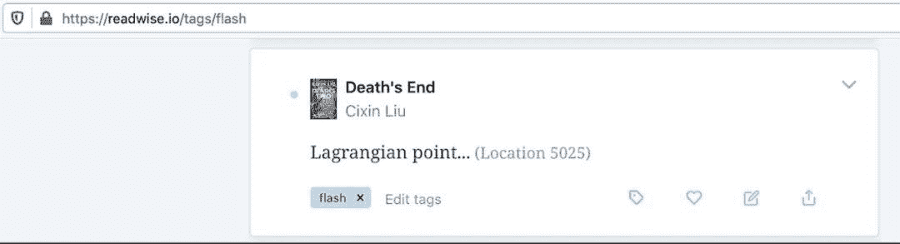

I’ll periodically open the list of “flash” tags in Readwise and translate them into flashcard form in Anki .

我会定期在Readwise中打开“闪存”标签列表，并将其翻译成Anki的闪卡形式。

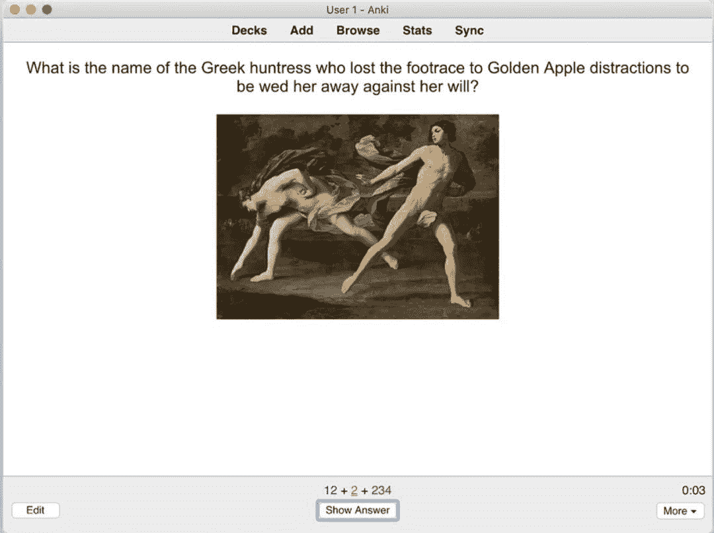

Anki helps me remember things by surfacing flashcards that I’m likely to forget just before I’d otherwise forget them. It’s called spaced repetition .

Anki通过展示我可能会忘记的卡片来帮助我记住事物。这被称为间隔重复。

I read to learn, and I flash to make sure I remember.

我阅读以学习，闪现以确保记住。

I have flash cards on everything from how many kilowatt-hours it takes for a car to travel 100 kilometers, to the definition of the term “pollyanna,” to the history and culture of the islands of New Caledonia.

我有关于一切的闪卡，从汽车行驶100公里所需的千瓦时数，到术语“波利安娜”的定义，再到新喀里多尼亚岛的历史和文化。

It’s powerful to read something and be confident you’ll retain it for a long, long time. To me, flash cards aren’t to memorize random things, or to win attrivia.

阅读某些内容并有信心能够长时间记住它是非常有力量的。对我来说，闪卡不是为了记住随机的事物，也不是为了在琐事竞赛中取胜。

They’re there to trigger a concept you’ve already learned, but want to make sure you don’t forget.

他们在那里触发你已经学过的概念，但是希望确保你不会忘记。

I am creeping up on 10,000 cards in Anki, and I’ve been doing this for over four years. It’s probably the most impactful habit I have in terms of impact over time invested.

我在Anki中已经积累了将近10,000张卡片，而且我已经这样做了四年多了。从长期投入来看，这可能是我最有影响力的习惯。

## He stores large concepts in his custom-made Zettelkasten system 他将大的概念存储在他定制的Zettelkasten系统中

**Wh**en I highlight something from a book that contains an idea, concept, metaphor, or generally something more abstract, I’ll put it into my Zettelkasten instead of my flashcard system. These highlights aren’t to be remembered—they are to be connected.

当我从一本书中突出显示包含思想、概念、隐喻或一般较抽象的内容时，我会将其放入我的Zettelkasten而不是我的记忆卡系统中。这些突出显示的内容不是为了记住，而是为了连接。

Zettelkasten—German for “slip box”—is a method to manage knowledge. Basically, you take ideas from books, articles, or conversations and write those ideas on note cards, collect them in a central database, and link them together so that you can start to find larger relationships between concepts you’re learning.

Zettelkasten（德语中的“便条盒”）是一种管理知识的方法。基本上，你从书籍、文章或对话中获取想法，并将这些想法写在便条卡上，收集到一个中央数据库中，并将它们链接在一起，以便你可以开始找到你正在学习的概念之间的更大关系。

In the beginning, I would actually use physical note cards that I would hand-write and keep on my desk as my Zettelkasten.

起初，我实际上会使用手写的纸质卡片，将它们放在桌子上作为我的Zettelkasten。

Keeping a physical system started to get out of hand, so I tried a bunch of software solutions—Workflowy, Dynalist, Notion—but they were all too slow and didn’t have the features I wanted, and I worried about how they’d age. I wanted a system that I could use for life.

保持一个物理系统开始变得难以控制，所以我尝试了一些软件解决方案——Workflowy、Dynalist、Notion——但它们都太慢了，而且没有我想要的功能，我还担心它们会变得过时。我想要一个可以用一辈子的系统。

So I engineered my own.

所以我自己设计了一个。

It’s just text files on my computer written in Markdown and edited using a plaintext editor. I’ve also written a lot of small, auxiliary tooling for searching , browsing related notes , editor integration, and so on. The main repo where I keep all of it is on  Github .

这只是我电脑上用Markdown编写并使用纯文本编辑器编辑的文本文件。我还编写了许多小型辅助工具，用于搜索、浏览相关笔记、编辑器集成等等。我将所有这些内容保存在Github上的主要仓库中。

Notes get into my Zettelkasten from the highlights in my Readwise. Readwise has a feature called Daily Review, which shows me about 15 of my book highlights every day.

笔记从我的Readwise中的亮点进入我的Zettelkasten。Readwise有一个名为Daily Review的功能，每天向我展示大约15个我书籍的亮点。

If I think a highlight is important, I’ll create a new note in my Zettelkasten and start connecting it with others. For example, this is a note about the controversy zippers created when they first came into use:

如果我认为一个亮点很重要，我会在我的Zettelkasten中创建一个新的笔记，并开始将其与其他内容联系起来。例如，这是一篇关于拉链在首次使用时引起的争议的笔记。

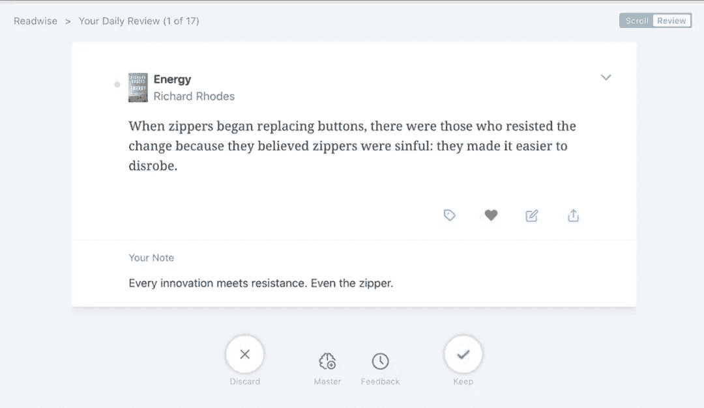

This one’s a winner. So I’ll create an entry in my Zettelkasten for it:

这个是赢家。所以我会在我的Zettelkasten中创建一个条目。

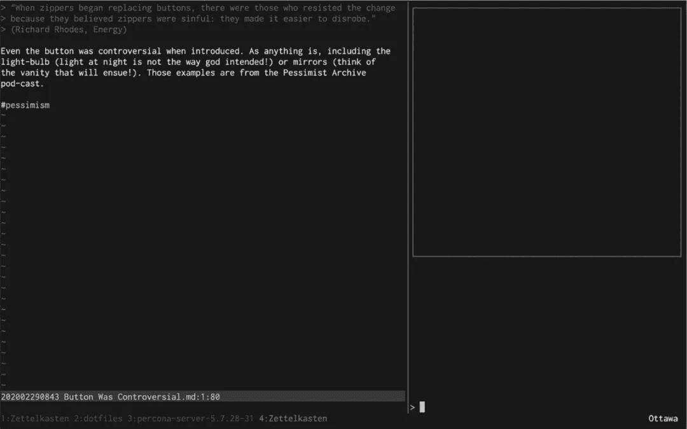

You’ll see in my Zettelkasten I put in the original quote and the source, and then write a short commentary on it.

在我的Zettelkasten中，你会看到我放入了原始引用和来源，然后对其进行简短的评论。

Then I’ll start connecting this to other notes. One way to do that is with tags, and you’ll see that I added a #pessimismtag to the note.

然后我将开始将其与其他笔记连接起来。一种方法是使用标签，你会看到我在笔记中添加了一个#悲观主义标签。

But my system also lets me create links directly to other notes as well.

但我的系统还可以直接创建到其他笔记的链接。

On the right-hand side I have a full-text search prompt. To find other notes to connect it to, I might start by searching “pessimism”:

在右侧，我有一个全文搜索提示。为了找到其他可以连接的笔记，我可以开始搜索“悲观主义”：

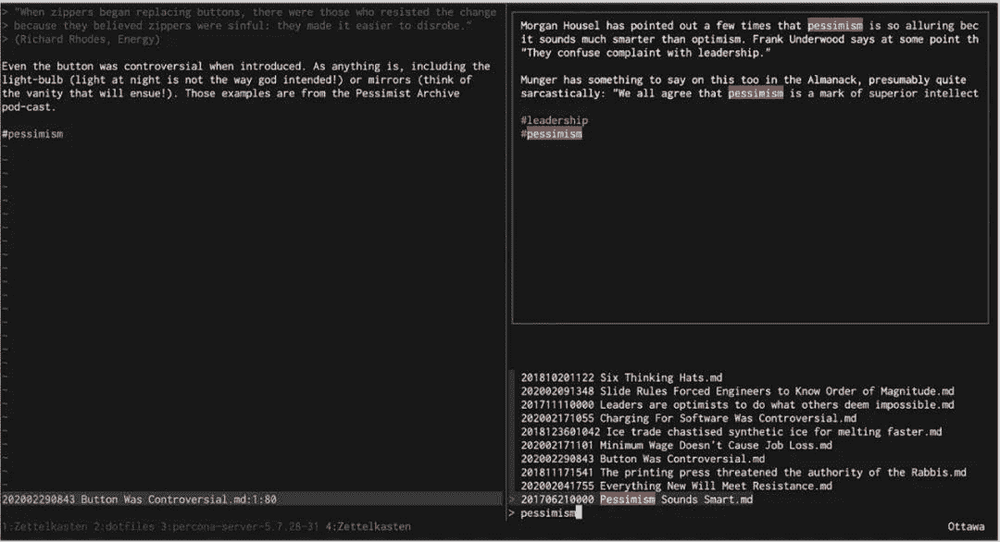

The first thing that comes up is a note I took from Morgan Housel that says thatpessimismtends to sound smart.

首先出现的是我从摩根·豪斯尔那里得到的一张笔记，上面写着悲观主义往往听起来很聪明。

If I hit the button on my console it will add a link to this note in the original note about zippers. I’ll also write a bit about why the link is relevant.

如果我按下控制台上的按钮，它将在关于拉链的原始笔记中添加一个链接到这个笔记。我还会写一点关于为什么这个链接相关的内容。

I’ll continue searching through my archive like this, and go down the rabbit hole to think about how this note connects to everything else in the system.

我会继续像这样搜索我的档案，并深入思考这个笔记与系统中的其他一切的联系。

By the end, the note might end up looking something like this:

到最后，这个便签可能会变成这样：

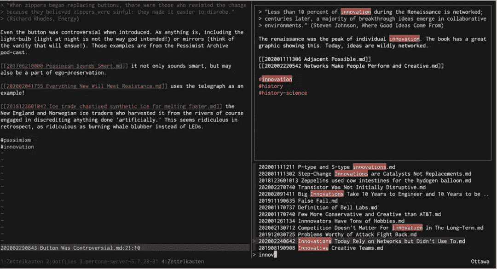

Of course, no note is ever completely done. At a later point, I might come back to it, add to it, change it, or rename it. 🔄

If I’m writing a presentation, thinking about a problem, or doing any kind of creative work, my Zettelkasten is a gold mine. All of my daily writing also happens inside of it, including reviewing books (which also end up on my personal website ).

如果我在写演示文稿、思考问题或进行任何创造性工作，我的Zettelkasten就是一个宝藏。我所有的日常写作也都在其中进行，包括书评（也会发布在我的个人网站上）。

I have about 700-800 notes, and have been doing it for about two years. I’ll likely continue to use it alongside flashcards, but it’s much slower to update and maintain.

我大约有700-800个笔记，已经做了大约两年了。我可能会继续使用它和卡片一起，但更新和维护起来要慢得多。

My engagement with it ebbs and flows over time, too

我的参与随着时间的推移有起有落

## Why he spends so much time memorizing things 他为什么花那么多时间记忆事物

I think memory is underrated.

我认为记忆被低估了。

For example, memorizing all of the U.S. presidents is something that people might think is for show. But to me it’s actually really helpful to know who was president at a certain time because it allows you to connect the president with that time period.

例如，记住所有美国总统是一件人们可能认为只是为了炫耀的事情。但对我来说，知道某个特定时期的总统是谁实际上非常有帮助，因为它让你能够将总统与那个时期联系起来。

For example, take Reagan. If you know when he was president, you can say, This was around the Cold War, and it was toward the end of it, and his platform supported trickle-down economics, which was a very important idea in that time period.

例如，以里根为例。如果你知道他是在什么时候担任总统，你可以说，这是在冷战时期，而且是接近尾声的时候，他的政策支持滴灌经济学，这在那个时期是一个非常重要的观念。

Memorizing these things means that if you’re talking about the U.S. in the eighties, you’ll remember that he was president, and all of those concepts come up.

记住这些事情意味着，如果你谈论的是80年代的美国，你会记得他是总统，所有这些概念都会涉及到。

So that’s what I find helpful—knowing all of these facts becomes a kind of memory connector.

所以这就是我发现有帮助的——了解所有这些事实成为一种记忆连接器。

It gives you this web of facts for you to put new information into context, and answer questions with deduction without having to go look something up.

它为你提供了一个事实网络，让你能够将新信息放入背景中，并通过推理回答问题，而无需去查找。

## He uses Things for GTD 他使用Things进行GTD

I dofairlystandard GTD with Things . I use it to organize things into time buckets, decide what to work on at the beginning of the day, and use tags to organize tasks. It’s nothing crazy. Here’s an example from a very real non-work day:

我在Things中使用相当标准的GTD方法。我用它将事物组织成时间段，决定一天开始时要处理的事情，并使用标签来组织任务。没什么特别的。以下是一个非常真实的非工作日的例子：

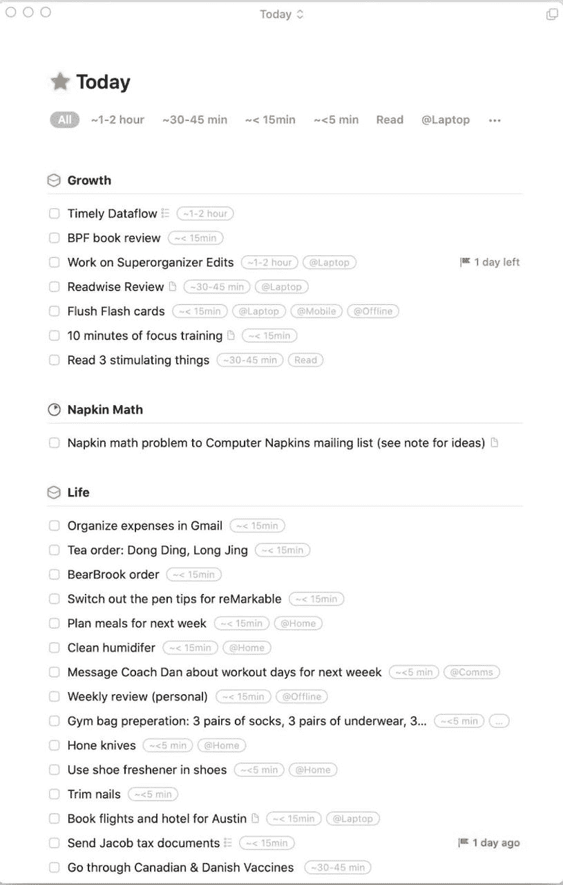

I have three main areas I throw tasks into:

我将任务分为三个主要领域：

+   Growth (a list of personal projects)
增长（个人项目列表）

+   Life ( chores ) 
生活 （家务）

+   Work
工作

In the Growth section, I keep track of all of my personal projects:

在“成长”部分，我追踪所有我的个人项目：

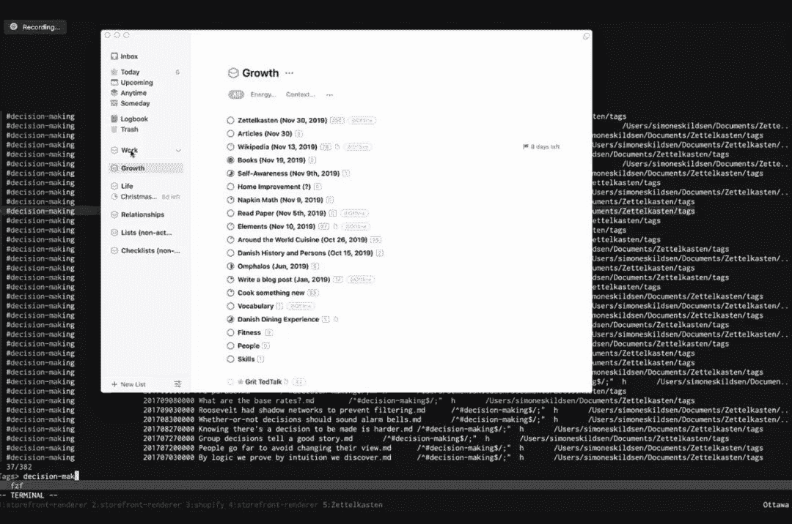

I have a lot of personal projects, and I work on them whenever I have the time.

我有很多个人项目，只要有时间我就会去做。

For example, I have a project called “Napkin Math,” where I’m working to improve my order-of-magnitude calculations when it comes to system design.

例如，我有一个名为“餐巾纸数学”的项目，我正在努力提高在系统设计方面的数量级计算能力。

But I have many other projects, like reviewing the Vital Articles on Wikipedia, the periodic elements (and their primary uses and sources), blog posts, and a million different things I’d like to learn.

但是我还有很多其他的项目，比如审查维基百科上的重要文章，周期表元素（以及它们的主要用途和来源），博客文章，还有我想学习的无数不同的事情。

I expect most of these projects to take years, if not decades, and some of them I’ll be working on for the rest of my life. I run a script when I have a few minutes that helps make little bursts of progress by choosing a random one of these areas.

我预计这些项目中的大部分将需要数年，甚至几十年的时间，其中一些我将终身致力于。当我有几分钟的空闲时间时，我会运行一个脚本，通过选择这些领域中的一个随机项目，来帮助我取得一些小的进展。

## He’s trying to master the cooking of every country in the world 他试图掌握世界上每个国家的烹饪

Another project I work on is called “Around the World Cuisine.” For the past four or five years, I’ve challenged myself to cook a dish from every single country.

我参与的另一个项目叫做“环游世界美食”。在过去的四五年里，我挑战自己要烹饪来自每个国家的一道菜。

My criteria for success? I want to be able to prepare it well enough that if someone from that country tries it they aren’t offended on behalf of their cuisine.

我对成功的标准是什么？我希望能够准备得足够好，以至于如果来自那个国家的人尝试了，他们不会为他们的美食感到冒犯。

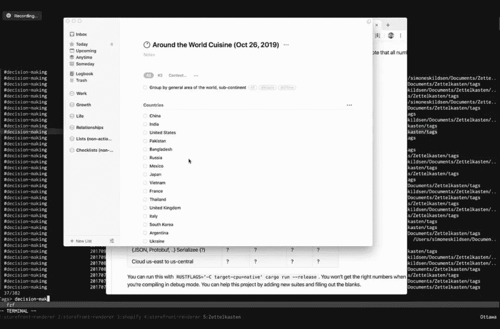

A few years ago I made a traditional Iranian beef stew. A co-worker of mine was from Iran so I brought it to him at work one day. He tasted it, looked at me, and said, “This is great!” So I checked it off the list.

几年前，我做了一道传统的伊朗牛肉炖菜。我的一个同事来自伊朗，所以有一天我把它带到了他的工作地点。他尝了一口，看着我，说：“这很棒！”于是我在清单上打了个勾。

We also get my friends involved. We pick a random country by going to random.country , look up the traditional meals, and then have a potluck where everyone brings a different dish. We’ve done Hong Kong, Mongolia, Bangladesh, Brazil, Spain, and many others.

我们还让我的朋友们参与进来。我们通过访问random.country随机选择一个国家，查找传统餐食，然后举办聚餐，每个人带来不同的菜肴。我们已经尝试过香港、蒙古、孟加拉国、巴西、西班牙等许多地方。

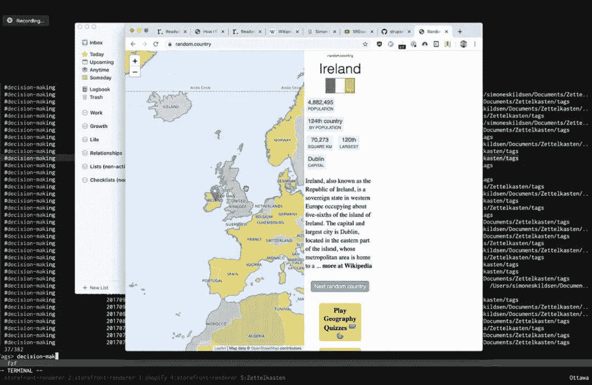

## He’s even automated his language learning 他甚至将他的语言学习自动化了

Another project I have is a system to help me build my vocabulary.

我另一个项目是一个帮助我建立词汇量的系统。

Since English isn’t my first language, I sometimes run into words while I’m reading that I don’t understand. So to learn more words, I created a script that takes words from Readwise and automatically adds the audio pronunciation, the definition, and examples in a sentence to an Airtable .

由于英语不是我的母语，我在阅读时有时会遇到不理解的单词。为了学习更多单词，我创建了一个脚本，从Readwise中获取单词并自动添加音频发音、定义和例句到Airtable中。

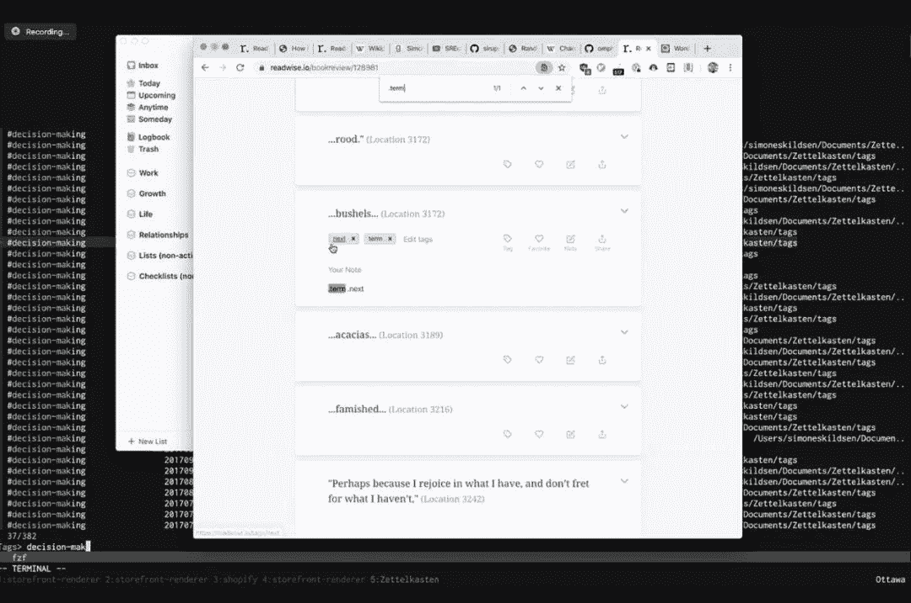

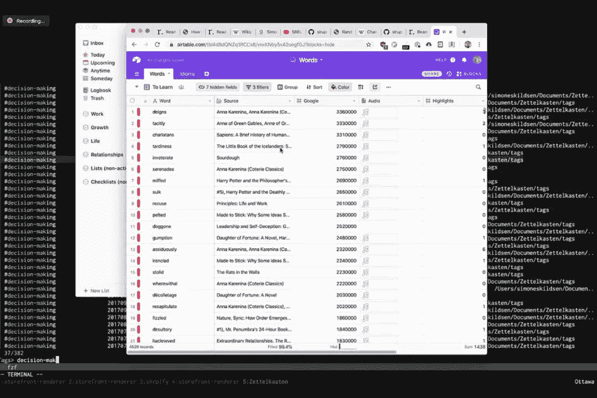

I put these words manually into Anki to help me learn them.

我手动将这些单词输入到Anki中，以帮助我学习它们。

I did run into a problem with this approach: I ended up using words that no one knew. I would take a word from a 19th-century novel and insert it into everyday conversation. No one would have any idea what I was talking about.

我在这种方法中遇到了一个问题：我最终使用了一些没有人知道的词语。我会从19世纪的小说中选取一个词语，然后插入到日常对话中。没有人知道我在说什么。

So I had to add another piece to the system to sort the words by how often they’re used. The most accurate proxy I’ve found is the number of Google results for a word.

所以我不得不向系统中添加另一个部分，以便根据单词的使用频率进行排序。我找到的最准确的代理是一个词在谷歌上的搜索结果数量。

That way I end up learning vocabulary that’s actually useful, and I don’t accidentally learn words that native speakers don’t even know.

这样我最终学到的词汇实际上是有用的，而且不会无意中学到母语人士都不知道的词语。

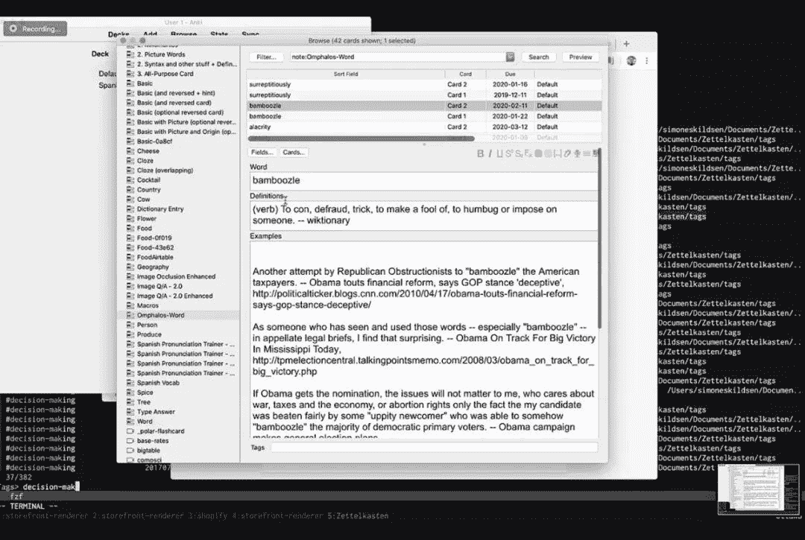

## He uses a reMarkable tablet to read long documents and emails 他使用一台reMarkable平板电脑来阅读长篇文件和电子邮件

Over the years, I’ve found that reading dense PDFs or Google Docs isn’t very good on a laptop or on a Kindle.

多年来，我发现在笔记本电脑或Kindle上阅读密集的PDF或Google文档效果不太好。

Recently, a friend was raving about the reMarkable tablet , and I now use it for reading those types of documents a fair bit. It’s a simple e-ink tablet. It’s larger than the Kindle, and feels like paper when you write. It doesn’t replace your Kindle. It’s not good for long-form.

最近，一个朋友对reMarkable平板赞不绝口，我现在经常用它来阅读那些类型的文件。它是一款简单的电子墨水平板。它比Kindle大，写字时感觉像纸张一样。它不能取代你的Kindle。对于长篇文章来说不太适用。

Categories of content that I just didn’t read before are now a pleasure to sink into a chair with.

我以前从未阅读过的内容类别现在成为了一个愉快的沉浸式体验。

Most of the Google Docs and longer emails I review, I send to my reMarkable and process there.

我将大部分的Google文档和长邮件发送到我的reMarkable上进行处理。

The reMarkable gives great space to think, but because of its limitations I wouldn’t recommend it to everyone. It’s for a very particular workflow. It can easily end up as another expensive  shelf gadget.

reMarkable给予了很大的思考空间，但由于其限制，我不会推荐给每个人。它适用于非常特定的工作流程。它很容易成为另一个昂贵的摆设。

Surprisingly, I’ve also found that it works very well for making presentations with. Drawing slides is much more fun—I get frustrated when I’m in Keynote for too long.

令人惊讶的是，我还发现它非常适合制作演示文稿。绘制幻灯片更有趣——在Keynote中呆得太久会让我感到沮丧。

## A book recommendation 一本书的推荐

Where Good Ideas Come From by Steven Johnson. This book is studded with good observations by someone who has spent a lot of time reading and thinking about scientific history. As an engineer—and fellow student of science—I loved it. I wrote a short review .

《好点子从何而来》是史蒂文·约翰逊的著作。这本书充满了对科学历史的深入阅读和思考的观察。作为一名工程师和科学的学习者，我非常喜欢它。我写了一篇简短的评论。