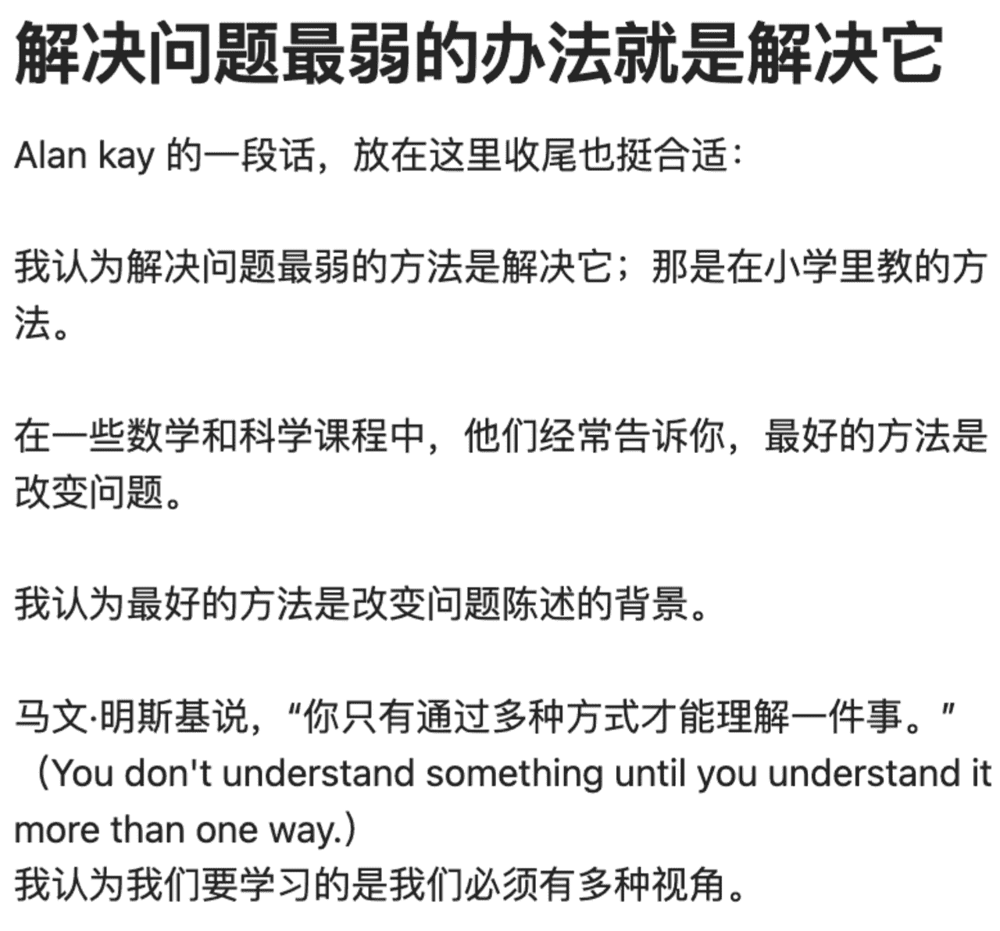

# 解决问题最弱的办法就是解决它

> 来源：[https://docs.feishu.cn/docx/NDdGdaq7bojgFSxC6oncTUvfn3g](https://docs.feishu.cn/docx/NDdGdaq7bojgFSxC6oncTUvfn3g)

斯坦福有一个经典实验:五美元实验

不同的创业小组被分到一个相同的作业:用五美元在两个小时之内挣到最多的钱，然后每个小组都要在课堂上做一个三分钟的演讲。 普通人的思维可能就是用这五美元去买东西，再卖出。 但当时得了第二名的那个小组却意识到那五美元看似是资源，其实是局限。 因此，他们直接解构了这道题目，把问题变成如何在一无所有的情况下，在两个小时之内挣到更多的钱。 于是他们去网红餐厅当黄牛卖位置，最后挣了几百美元。 而第一名的小组，他们不仅知道要重新去定义问题，还知道要重新定义资源。 他们发现在这道题里，最值钱的东西，其实是在斯坦福课堂上宣讲的三分钟。 于是，他们就去找那些想要招募斯坦福学生的公司，把门票卖个HR。 门票瞬间卖爆，他们毫无疑问成了第一名。 生活中任何问题都可以把它当成一道应用题，读题，想好如何解构命题、结构资源。当推翻所有案件，能够把每一道题都变成一张白纸的时候，就不会再被任何东西局限。 万物不为我所有，但皆为我所用。