# 『编程工程类工具分享』

> 来源：[https://docs.feishu.cn/docx/J8aRdiJRcoFCuuxvANKcKZJ7nih](https://docs.feishu.cn/docx/J8aRdiJRcoFCuuxvANKcKZJ7nih)

# 1 doxygen

注释自动生成，标准，

按/**

同时vsc下载插件之后就可以使用

# 2 .clang-format

在工程代码文件夹里

加入这个文件

里面可以写

```
BasedOnStyle: Chromium
IndentWidth: 4
ColumnLimit: 0
```

然后在setting里面找到c++，然后设置为file，就会根据这个文件来自动保存格式

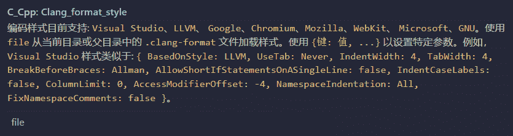

同时可以设置vsc自动保存

# 3 .gitignore

里面写的东西是git不会push到github上面的东西

```
bin/
build/
dbfiles/
datas/
.vscode/
.idea/
.history/
cmake-build-debug/
cmake-build-release/
```

# 4 glog

推荐使用glog模块（glog是谷歌提供的日志模块，代码已在thirdparty目录下提供）来打印必要的调试和日志信息来代替printf。在程序入口处调用google::InitGoogleLogging初始化日志模块后，即可通过LOG宏（通过#include "glog/logging.h"引入）来打印不同级别的日志，下面是一个示例：

```
#include &quot;glog/logging.h&quot;

void InitGoogleLog(char *argv) {
  FLAGS_logtostderr = true;
  FLAGS_colorlogtostderr = true;
  google::InitGoogleLogging(argv);
}

int main(int argc, char **argv) {
  InitGoogleLog(argv[0]);
  LOG(INFO) &lt;&lt; &quot;This is an info log!&quot;;
  LOG(WARNING) &lt;&lt; &quot;This is a warning log!&quot; &lt;&lt; std::endl;
  LOG(ERROR) &lt;&lt; &quot;This is an error log!&quot;;
  return 0;
}
```

# 5 让terminal走代理

1.  在.zshrc里永久写入

1.  在local里写入

+   在 Bash shell 中，可以设置HTTP_PROXY和HTTPS_PROXY环境变量，例如：

```
export HTTP_PROXY=http://127.0.0.1:7890
export HTTPS_PROXY=http://127.0.0.1:7890
```

+   在 Zsh shell 中，可以设置http_proxy和https_proxy环境变量，例如：

```
export http_proxy=http://127.0.0.1:7890
export https_proxy=http://127.0.0.1:7890
```

+   在 Windows 的 Command Prompt 中，可以使用set命令设置HTTP_PROXY和HTTPS_PROXY环境变量，例如：

```
set HTTP_PROXY=http://127.0.0.1:7890
set HTTPS_PROXY=http://127.0.0.1:7890
```

# 6 cmake

https://github.com/richardchien/modern-cmake-by-example

CMake是一个跨平台的开源构建工具，它使用一种名为CMake语言的脚本语言来描述软件项目的构建过程，可以生成适合不同操作系统、编译器和构建工具的构建文件。CMake可以自动检测编译器、库和头文件，并且可以方便地生成Makefile、Visual Studio项目、Xcode项目等不同的构建文件。CMake还支持模块化设计，可以在项目中使用已有的CMake模块来简化构建过程。由于其跨平台、简单易用和灵活性，CMake已成为许多开源项目的构建工具的首选，如KDE、QT等。

# 7 Qemu

QEMU 是一个功能强大的模拟器，可以在 x86 平台上执行不同架构下的程序。我们实验中采用 QEMU 来完成 RISC-V 架构的程序的模拟。

如何使用 QEMU（常见参数介绍）

以以下命令为例，我们简单介绍 QEMU 的参数所代表的含义

```
$ qemu-system-riscv64 \ -nographic \ -machine virt \ -kernel path/to/linux/arch/riscv/boot/Image \ -device virtio-blk-device,drive=hd0 \ -append &quot;root=/dev/vda ro console=ttyS0&quot; \ -bios fw_jump.bin \ -drive file=rootfs.img,format=raw,id=hd0 \ -S -s 
```

+   -nographic: 不使用图形窗口，使用命令行

+   -machine: 指定要emulate的机器，可以通过命令 qemu-system-riscv64 -machine help查看可选择的机器选项

+   -kernel: 指定内核image

+   -append cmdline: 使用cmdline作为内核的命令行

+   -device: 指定要模拟的设备，可以通过命令 qemu-system-riscv64 -device help 查看可选择的设备，通过命令 qemu-system-riscv64 -device <具体的设备>,help 查看某个设备的命令选项

+   -drive, file=<file_name>: 使用 file_name 作为文件系统

+   -S: 启动时暂停CPU执行

+   -s: -gdb tcp::1234 的简写

+   -bios default: 使用fw_jump.bin作为bootloader

更多参数信息可以参考[这里](https://www.qemu.org/docs/master/system/index.html)

**退出** QEMU 的方法为：使用 Ctrl+A，松开后再按下 X 键即可退出 QEMU。

我们常一个terminal打开qemu，一个打开gdb

# 8 Makefile

[m](https://seisman.github.io/how-to-write-makefile/introduction.html)akefile介绍 — 跟我一起写Makefile 1.0 文档 (seisman.github.io)

# 9 Gcc

一开始都是在UNIX操作系统上的

cc——>gcc（GNU编译器）

后来在Linux上跑

但我们也想在win上面跑，因为大多数家庭用的操作系统都是win

想把一个.c编译生成一个.exe

我们需要做到两步

+   把gcc移植过去

+   把库函数lib移植过去

+   cygwin：编译出unix程序，提供了一个可以在win上面跑unix程序的接口

+   MinGW（min GNU for Windows）直接编译出一个win的程序

+   gcc -> .c -> winlib -> win.exe

+   现在有这几种gcc

+   Mingw32，64

+   TDM-GCC

+   Clang-llvm

我们主要使用tdm-gcc，主要是好用，简单

直接官网安装，记得在路径里加上（高级设置，把bin的路径加到Path里）

就可以使用vsc了

可以多使用命令行

比如

```
gcc a.c
./a


g++ a.c
./a
```

# 10 Xmake

> https://github.com/xmake-io/xmake

> Xmake 是一个基于 Lua 的轻量级跨平台构建工具。

> 它非常的轻量，没有任何依赖，因为它内置了 Lua 运行时。

> 它使用 xmake.lua 维护项目构建，相比 makefile/CMakeLists.txt，配置语法更加简洁直观，对新手非常友好，短时间内就能快速入门，能够让用户把更多的精力集中在实际的项目开发上。

简而[言之](https://xmake.io/#/zh-cn/guide/quickstart)，Xmake是一套与CMake作用相似的构建系统，支持各类语言，并且简单易上手。具体的各类指令和操作在这里并不会涉及到很多，有兴趣的可以查看官方网站自带的快速上手教程： 链接

值得一[提的是](https://xmake.io/#/zh-cn/guide/installation)，Xmake是由国人大佬ruki为主要开发者，经过超长时间的持续开发完成的一套框架，并且仍在继续完善中；因此它有中文完备的官方网站和非常细致的中文教程，可以通过访问上面给出的链接来查看，在这里我们直接使用官方给出的安装页面作为安装的教程： 链接 ，只需要找到自己电脑所使用的系统并根据官方指引下载安装即可。

# Clangd

Clangd是包含在llvm框架下的一个语言服务器，可以通过插件与许多编辑器一起工作，使C语言和C++的编写更加轻松愉快。最新版本的Clangd可以提供函数签名的查看功能，这一点上与CLion的体验十分类似，并且在各类功能上全面优于VSCode本身推荐的C/C++拓展工具。

Clangd的安装则更加简单，直接打开vscode的插件界面，搜索并下载即可。

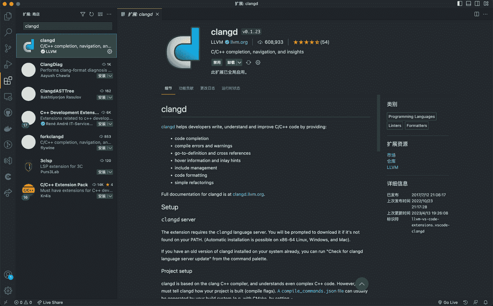

# Xmake+Clangd

在本文中，我将以OpenGL的环境配置（glfw+glad)作为案例，快速且简单地完成一个需要使用非官方库的C++应用程序的环境配置。

## 使用xmake

在包含你所需要编译的源文件的文件夹里新建一个xmake.lua文件并打开，这个文件就是xmake构建项目的各项设置来源。如图：

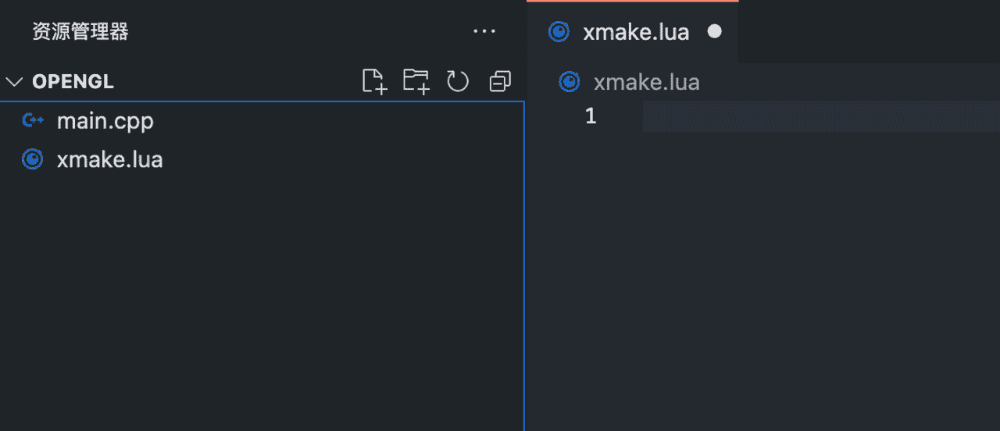

在lua脚本文件中键入以下内容：

```
add_requires(&quot;glad&quot;, &quot;glfw&quot;)
set_defaultarchs(&quot;arm64&quot;)
target(&quot;LearnOpenGL&quot;)
    add_packages(&quot;glad&quot;, &quot;glfw&quot;)
    set_kind(&quot;binary&quot;)
    add_files(&quot;main.cpp&quot;)
    set_targetdir(&quot;./build&quot;)
```

其实这个脚本文件非常简单易懂，下面简单解释一下：

第一行的add_requires即为为当前项目添加指定的依赖，在我们的例子中也就是glfw和glad这两个库，同时也可以指定所需要的版本，如果不指定就会默认下载并使用最新版本。

第二行的set defaultarchs即为指定编译出的程序基于的架构，这里使用arm64，是因为我的电脑是m2版本的macbook，本身是arm架构的64位系统；如果你的电脑是windows32位就设置成x86 64，其他架构同理。

第三行的target指令即为编译目标，也就是我们要把源文件编译成一个什么程序，这里可以简单理解为编译出的程序叫什么名字。第四行及以后的这些有缩进的指令都是对于第三行这一target的性质指定。

第四行的add packages同样很好理解，就是为目标添加指定的依赖，在这里就是刚刚add requires的glfw和glad。

第五行的set_kind即为制定编译出的程序是什么，在这里我们要的是二进制可执行文件，所以设为binary。

第六行的add_files就是添加需要编译的源文件，由于目前只有main一个源文件，所以只添加main.cpp足矣。

第七行的意思是指定编译出的文件“放在哪里”，非常好理解，在使用了上述的指令后，生成的可执行文件会位于当前文件夹中的build文件夹中。

因此，以上指令的结果就是添加我们所需要的依赖库，并且要求xmake将制定文件编译成可执行程序。打开命令行，在当前路径下输入xmake，会得到：

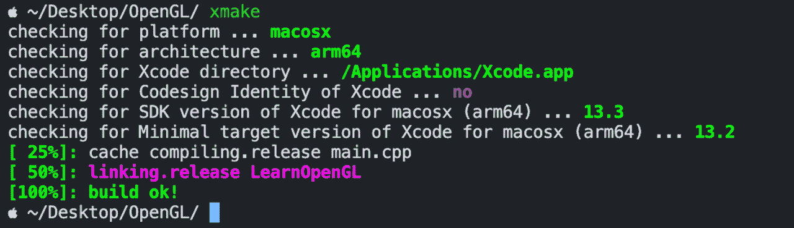

这说明我们的配置完全成功！

下面查看一下文件夹里，会发现多出了一个build文件夹，打开后里面正是我们想要的LearnOpenGL程序！打开程序也可以正常运行，得到与预期相符的结果。

## 支持clangd

但这时使用安装了clangd的VSCode打开main.cpp文件会出现下面的现象：

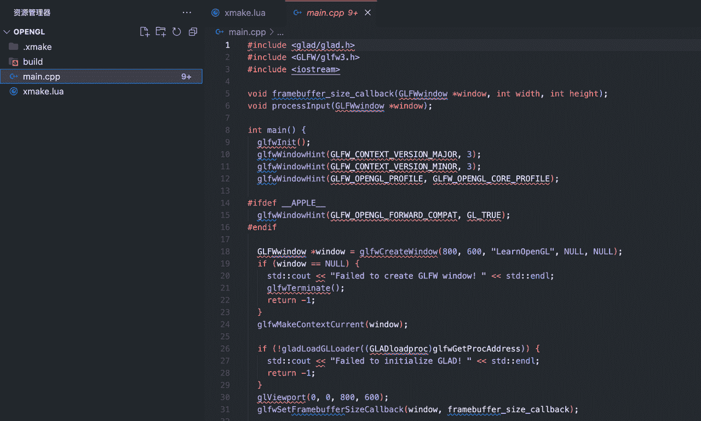

非常明显，这是因为我们没有为clangd指定包含路径，或者用通俗易懂的话讲，clangd现在不知道我们要用的glad.h和glfw3.h文件到底在什么地方，因此我们需要告诉clangd，这两个头文件究竟要去哪里找到。

首先简单解释下clangd的运行原理。clangd在被启动时会开启一个服务器，通过实时读取你所打开的c或者c++文件来进行报错和提示等操作，而需要包含的文件夹必须在服务器开启时就被指定，这样clangd才能知道你需要的头文件所在位置。

这一过程通过一个compile_commands.json文件实现，clangd会在当前路径下寻找这个文件，如果找到就按照里面的配置进行处理，如果没有找到，则会回归默认配置。

那么这个compile_commands.json文件从哪里来呢？你当然可以自己手动编写，但为了写出这个文件，需要了解的东西着实不少。幸好xmake为我们这些傻瓜提供了一个超简单的解决方案：

打开终端，输入：

```
xmake project -k compile_commands
```

如果没有错误，也就是上一步中build成功，会出现create ok！的提示，这时再查看目录，就会发现已经多出了一个compile_commands.json文件：

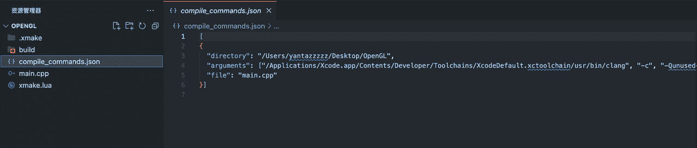

这里面的具体指令是什么作用我们不需要关心，直接关闭后重启vscode，就会发现clangd已经在正常运行了!

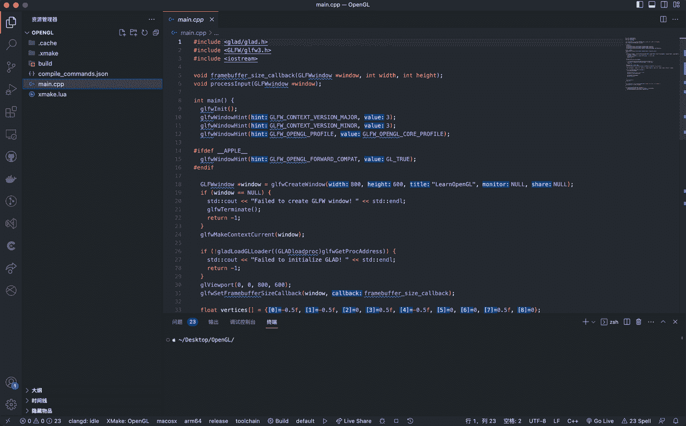

可以看到clangd为我们标记出了各个函数的原型和签名信息，非常舒服！

## 隐藏json文件

其实到刚刚为止，所有需要的配置都已经结束了，所有文件都已经在他们应该在的位置并且可以正常使用。但是一个干干净净的文件夹里多了个json文件并不那么令人舒适，因此我们可以将json隐藏掉。

首先新建一个.clangd文件夹，这里的.用在文件夹名首会默认将该文件夹隐藏。

将complie_commands.json文件移动到.clangd文件夹中：

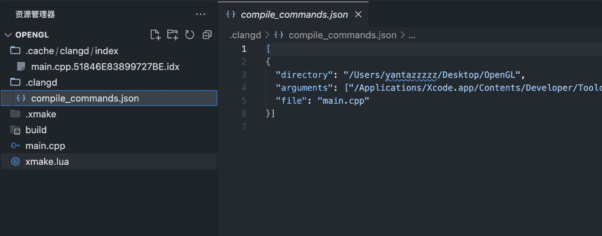

这时再打开main.cpp文件，会发现又回到了无法读取头文件路径的状态：

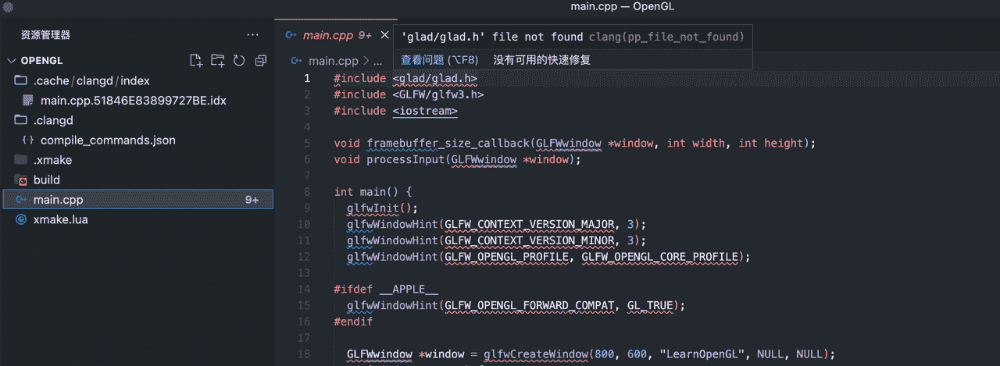

这是因为clangd只会在当前文件夹的可见文件夹中搜寻json文件，而不会渗入到隐藏文件中去，需要我们加入一定的配置。

打开vscode的设置，搜索clangd：

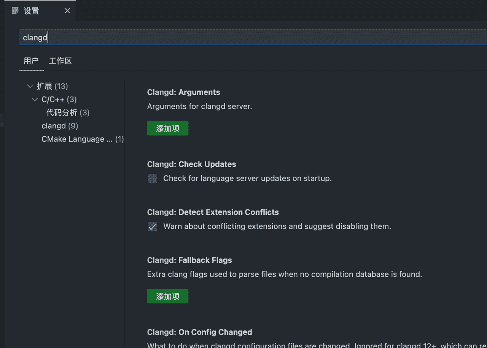

在Arguments中添加项:

```
--compile-commands-dir=.clangd
```

这个指令的意思就是，让clangd在.clangd文件夹中去搜索compile_commands.json文件。

添加完成后重启vscode并打开main.cpp文件，会发现一切恢复正常！

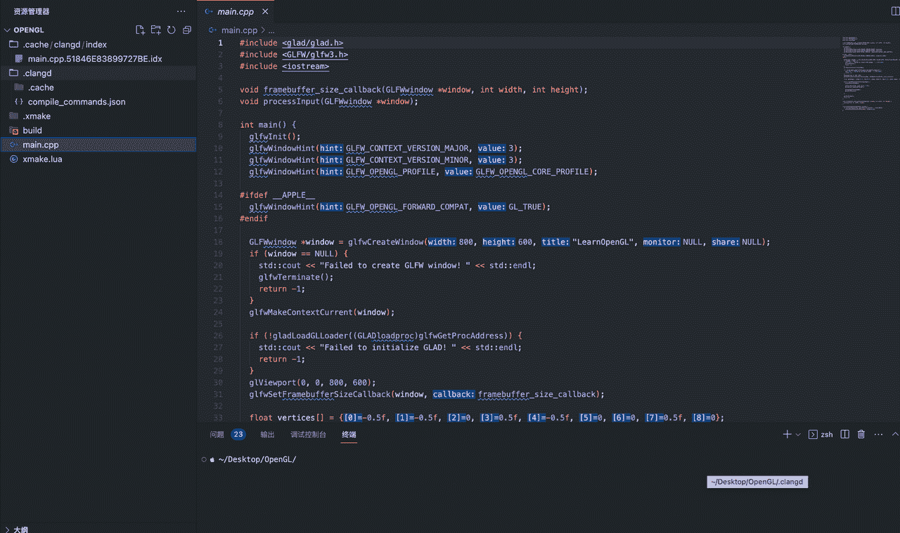

至此我们的配置就全部结束了，接下来就可以全身心地投入到开发中～这一过程相比CMakeLists的构建实在是简单太多，熟练之后仅仅一两分钟就能快速build起一个非常理想的开发环境！而且文件夹里没有让人讨厌的CMake相关文件，也完全不会产生MakeFile等中间产物！

# 11 All-in-one 黑客工具

https://github.com/Z4nzu/hackingtool

# 12 3D建模

## 12.1 taichi_blender

https://github.com/taichi-dev/taichi_blend

# 13 Text2App

https://text2app.ai/?referralCode=qkkaxfp&refSource=copy

# 14 Shell指令

玩游戏学shell指令

https://github.com/phyver/GameShell

## 14.1 cb

https://github.com/Slackadays/Clipboard

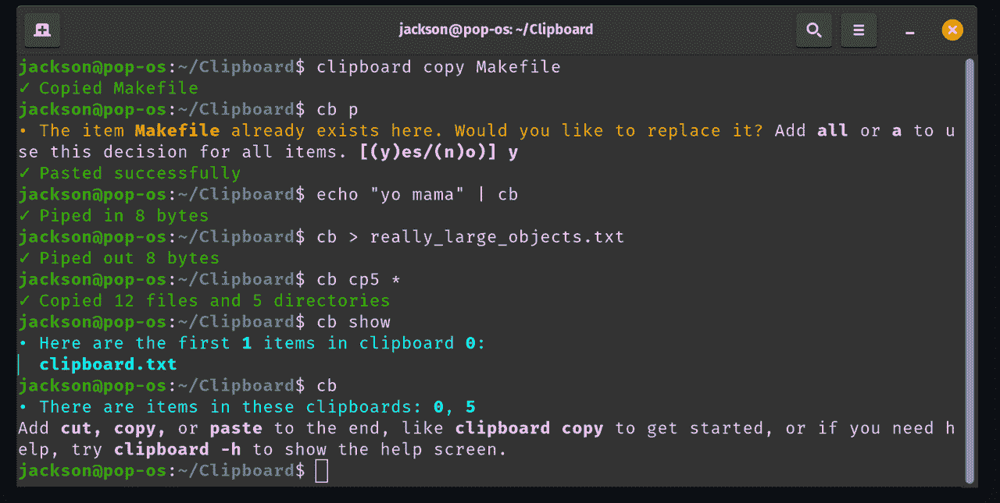

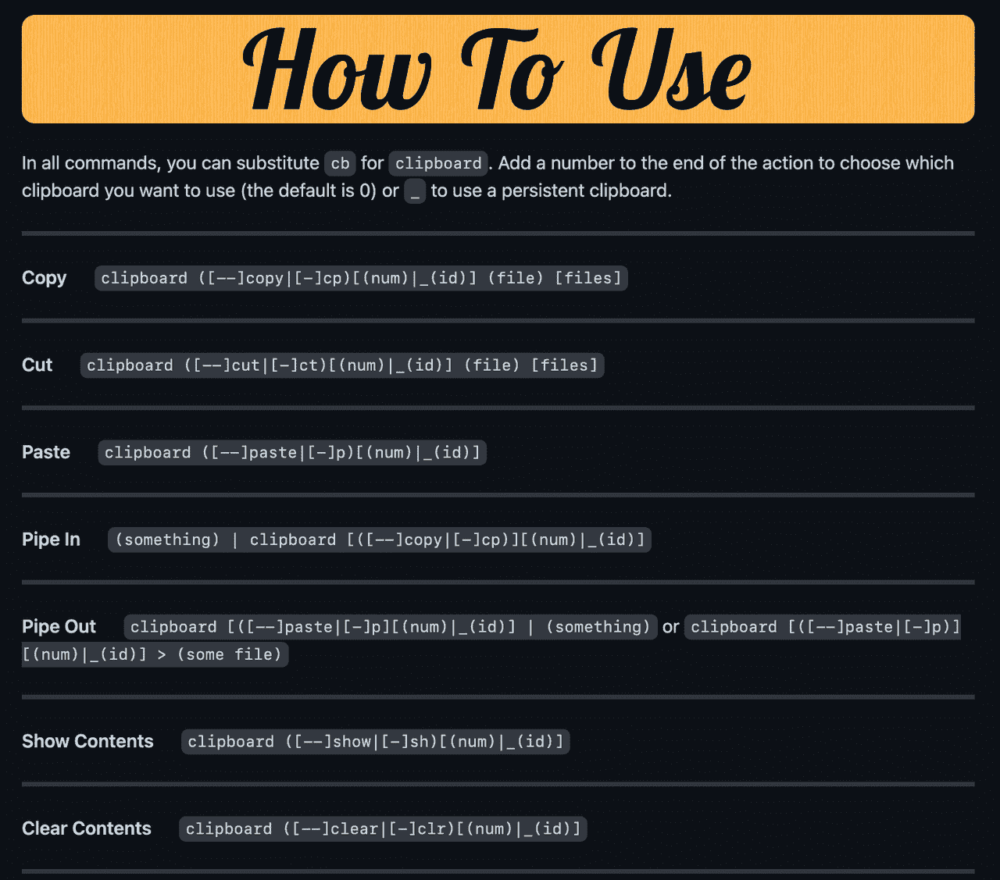

## 14.2 #

'#' 是 Vue CLI 的别名语法，表示根目录。

## 14.3 eg

eg：常用的 Linux 命令示例查询工具。它提供了 Linux 命令的常见用法，不仅使用方便而且示例简洁实用。

https://github.com/srsudar/eg

## 14.4 htop

查看电脑进程，内存等

## 14.5 新建一个iterm2

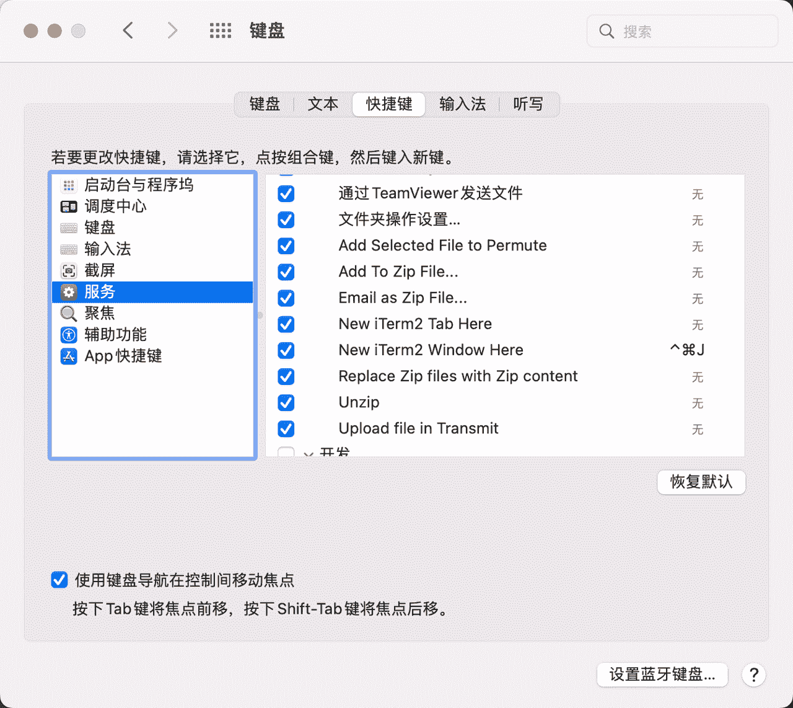

# 15 Docker

Play with Docker 是一个 Docker 学习平台，可以在浏览器上免费体验 Alpine Linux 虚拟机。不过需要登录和注册，而且每次登录创建的实例都有有时间限制，到时间还需要重新登录。

你可以在 Play with Docker 中构建和运行 Docker 容器，提升自己操作 Docker 的能力（默认已搭建好环境），甚至在 Docker Swarm 模式下创建集群， Docker-in-Docker (DinD) 用于提供多个 VM/PC 的效果。

地址：https://github.com/play-with-docker/play-with-docker

# 16 开发框架

## 16.1 Java 应用程序开发平台

JHipster 是一个全栈的 Java 应用程序开发平台，可用来创建基于 Maven+Spring+AngularJS 的项目，提供完全热加载的 Java 和 JavaScript 代码。它还提供了包含 CLI 工具在内的许多组件，用于处理多种技术栈的脚手架生成，比如用 Vue.js UI 为前端 MongoDB 作为后端，以 React 为前端的 Postgres 等等...

地址：https://github.com/jhipster/generator-jhipster

## 16.2 Java Web 框架

Vaadin 是一个可在 Java 中实现 Web 用户界面的 Web 框架，无需编写任何 HTML 或 JavaScript 代码。它包含一个服务器端，主要的应用逻辑都在服务器端运行，然后浏览器端通过 Ajax 技术跟服务器端进行交互。

地址：https://github.com/vaadin/platform

# 17 AI Debug

https://github.com/shobrook/adrenaline

# 18 NVM

控制不同版本的nodejs

要使用nvm（Node Version Manager）管理多个Node.js环境，请按照以下步骤进行操作：

1.  安装nvm：在终端中运行以下命令安装nvm：

```
bashCopy code
curl -o- https://raw.githubusercontent.com/nvm-sh/nvm/v0.39.0/install.sh | bash
```

1.  安装Node.js：使用nvm安装所需的Node.js版本，例如：

```
Copy code
nvm install 14.17.5
```

1.  使用Node.js：切换到所需的Node.js版本，例如：

```
perlCopy code
nvm use 14.17.5
```

1.  管理Node.js：您可以使用nvm安装其他Node.js版本、卸载Node.js版本和列出已安装的版本，例如：

```
arduinoCopy code
nvm install 16.13.0 // 安装Node.js 16.13.0版本
nvm uninstall 14.17.5 // 卸载Node.js 14.17.5版本
nvm ls // 列出已安装的所有Node.js版本
```

注意：在每个新的终端窗口中，您需要运行nvm use以使用所需的Node.js版本。

# 19 VSC快捷键

cmd+K+I 光标移到变量上，可以显示属性

# 20 脚手架

脚手架是一种快速构建项目的工具，它可以帮助开发人员自动生成一些项目骨架代码，并为开发人员提供了一些预定义的代码结构，从而使开发人员不用从头开始写代码。脚手架可以大大缩短开发时间，提高开发效率。

# 21 tmux

https://github.com/theniceboy/.config/blob/master/.tmux.conf

https://tmuxcheatsheet.com/

# 22 neovim

Lazyvim

https://www.lazyvim.org/configuration/examples

+   空格：提示

+   E: NeoTree

+   a：新增一个

# 23 ripgrep

https://github.com/BurntSushi/ripgrep

ripgrep 是一种命令行搜索工具，用于在文本文件中查找模式

# 24 fd

https://github.com/sharkdp/fd

搜索

# 25 终端文件管理器Joshuto

https://github.com/kamiyaa/joshuto

+   joshuto 打开

+   cw：改名

+   yy：复制

+   pp：粘贴

+   hjkl：上下左右

+   到某个目录下，：shell zsh打开terminal