# 正则表达式

> 来源：[https://docs.feishu.cn/docx/doxcnkVoijhBg2sOMhR3FAR7kpe](https://docs.feishu.cn/docx/doxcnkVoijhBg2sOMhR3FAR7kpe)

> https://regexr-cn.com/

> https://codejiaonang.com/#/

### []

+   匹配

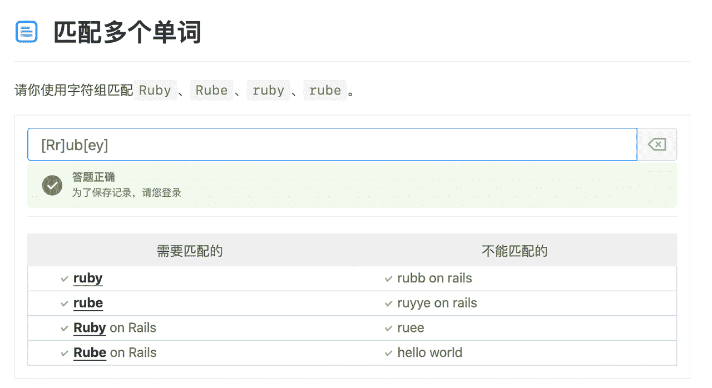

### -

+   区间

1.  要匹配任意数字可以使用[0-9]；

1.  如果想要匹配所有小写字母，可以写成[a-z]；

1.  想要匹配所有大写字母可以写成[A-Z]

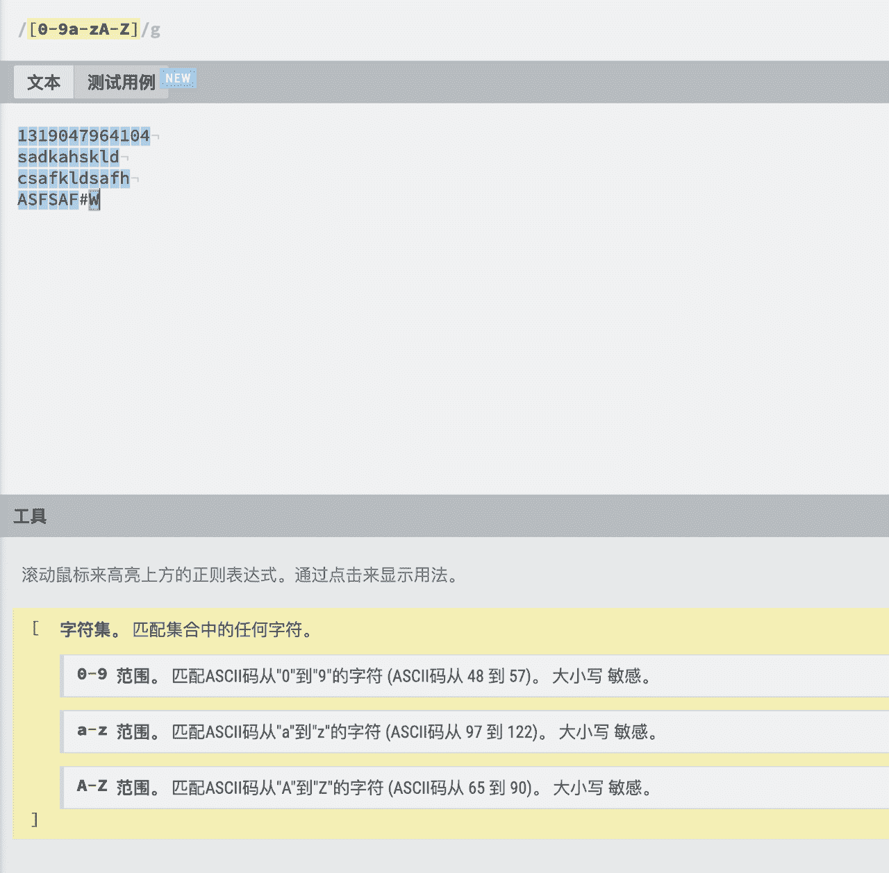

这个时候我们需要对-号进行转义操作，即 \-。

在正则中使用 \ 就可以进行对特殊符号进行转义，对 - 进行转义就可以表示为 \-，即 \- 就代表了 - 号本身。

> 转义符 \ 也适用于其他的符号，例如匹配圆括号可以使用 \(

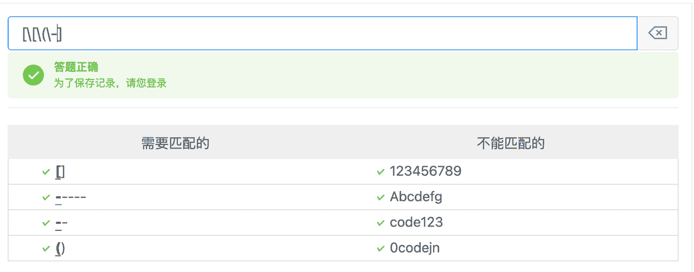

### ^

取反

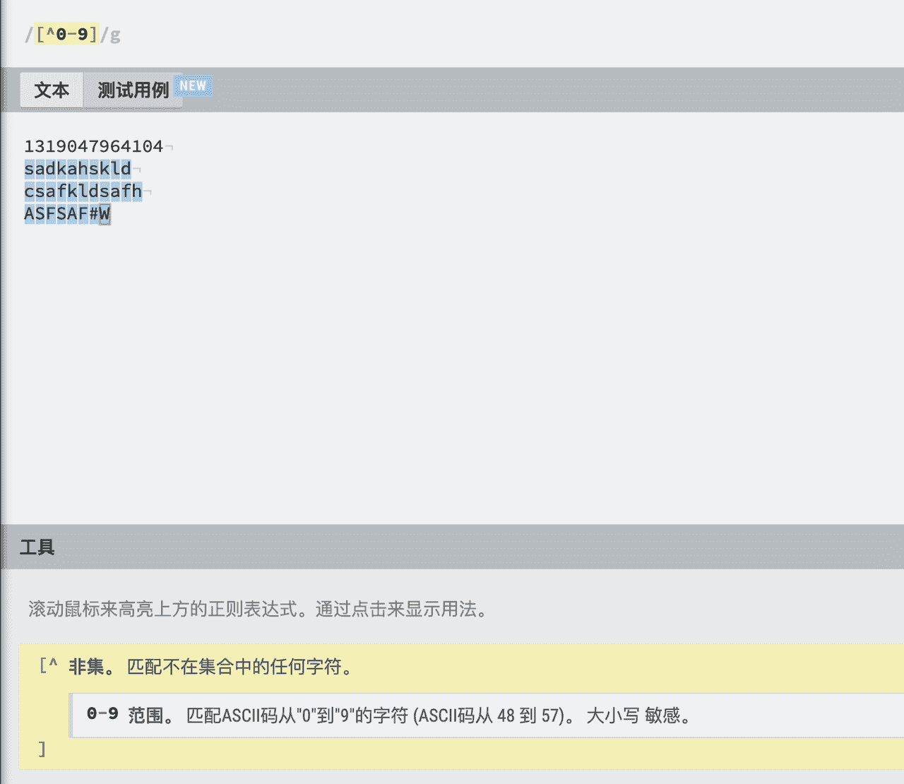

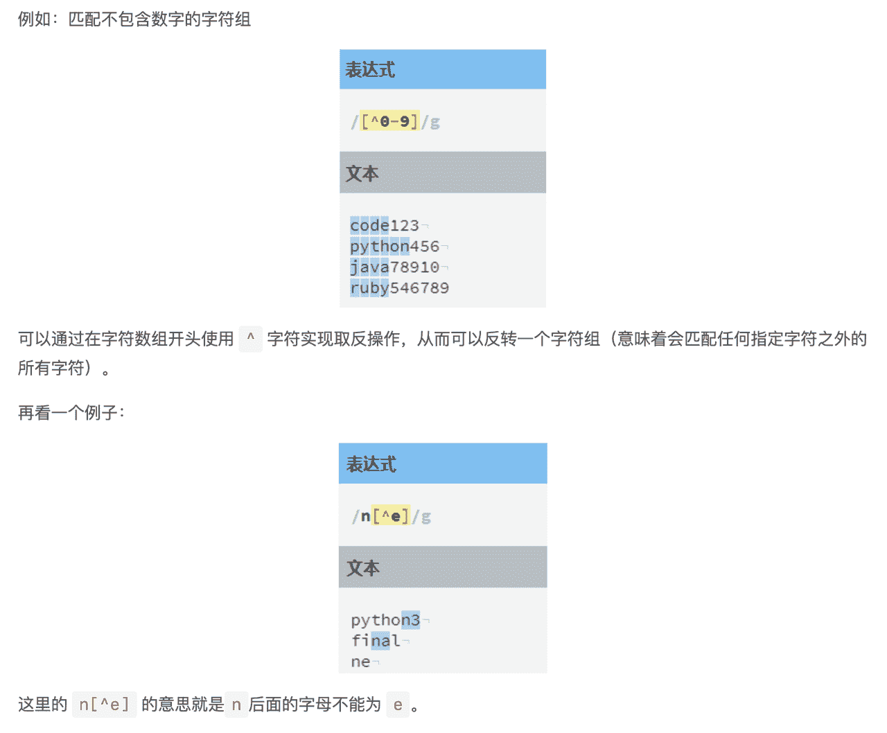

### 快捷方式

正则表达式引擎提供了一些快捷方式如：\w 可以与任意单词字符匹配。

当我们想要匹配任意数字的时候也可以使用快捷方式\d，d即digit数字的意思，等价于[0-9]。

\s快捷方式可以匹配空白字符，比如空格，tab、换行等。

\b 匹配的是单词的边界，例如，

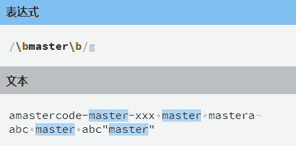

\bmaster\b 就仅匹配有边界的master单词。

快捷方式也可以取反，例如对于\w的取反为\W，将小写改写成大写即可，其他快捷方式也遵循这个规则。

### 开始和结束

正则表达式中 ^指定的是一个字符串的开始，$指定的是一个字符串的结束。

例如：

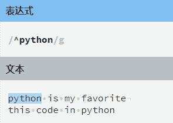

指定字符串的结束：

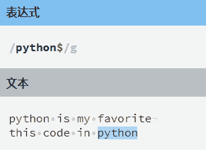

### . 任意字符

.字符代表匹配任何单个字符，它只能出现在方括号以外。

值得注意的是： .字符只有一个不能匹配的字符，也就是换行符（\n），不过要让.字符与换行符匹配也是可以的，以后会讨论。

示例：

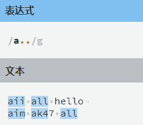

### ？ 可选字符

有时，我们可能想要匹配一个单词的不同写法，比如color和colour，或者honor与honour。

这个时候我们可以使用 ? 符号指定一个字符、字符组或其他基本单元可选，这意味着正则表达式引擎将会期望该字符出现零次或一次。

例如：

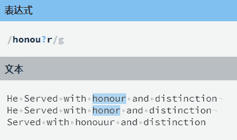

在这里 u? 表示u是可选的，即可以出现也可以不出现，可以匹配的是 honor 和 honour 。

通过这个案例可以知道?的作用就是匹配它之前的字符0次或1次。

> 请你思考一个问题： .? 表达式能匹配什么呢？

> 任意一个字符 0次 或 1次

简单说是贪婪匹配与非贪婪匹配的区别。

比如说匹配输入串A: 101000000000100

使用 1.*1 将会匹配到1010000000001, 匹配方法: 先匹配至输入串A的最后, 然后向前匹配, 直到可以匹配到1, 称之为贪婪匹配。

使用 1.?1 将会匹配到101, 匹配方法: 匹配下一个1之前的所有字符, 称之为非贪婪匹配。

所有带有量词的都是非贪婪匹配: .*?, .+?, .{2,6}? 甚至 .??

### 重复

在一个字符组后加上{N} 就可以表示在它之前的字符组出现N次。

例如：

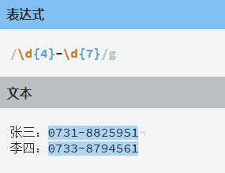

可能有时候，我们不知道具体要匹配字符组要重复的次数，比如身份证有15位也有18位的。

这里重复区间就可以出场了，语法：{M,N}，M是下界而N是上界。

举个例子：

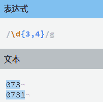

\d{3,4} 既可以匹配3个数字也可以匹配4个数字，不过当有4个数字的时候，优先匹配的是4个数字，这是因为正则表达式默认是贪婪模式，即尽可能的匹配更多字符，而要使用非贪婪模式，我们要在表达式后面加上 ?号。

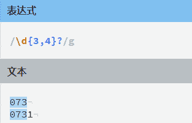

有时候我们可能遇到字符组的重复次数没有边界，例如：

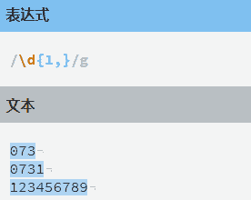

闭区间不写即可表示匹配一个或无数个。

### 速写

还可以使用两个速写字符指定常见的重复情况，可以使用 + 匹配1个到无数个，使用 *代表0个到无数个。

即：+等价于{1,}，*等价于{0,}。

+号示例：

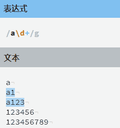

*号示例：

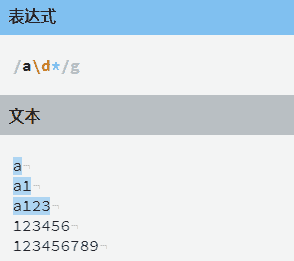

请使用正则表达式匹配以f开头的数据。

f.+

### 分组

在正则表达式中还提供了一种将表达式分组的机制，当使用分组时，除了获得整个匹配。还能够在匹配中选择每一个分组。

要实现分组很简单，使用()即可。

例如：

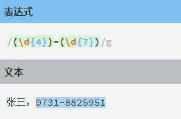

这段正则表达式将文本分成了两组，第一组为：0731，第二组为8825951。

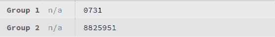

分组有一个非常重要的功能——捕获数据。所以()被称为捕获分组，用来捕获数据，当我们想要从匹配好的数据中提取关键数据的时候可以使用分组。

(\d{4}) 和 (\d{7})就分别捕获了两段数据：

1.  0731

1.  8825951

使用分组的同时还可以使用 或者（or）条件。

例如要提取所有图片文件的后缀名，可以在各个后缀名之间加上一个 |符号：

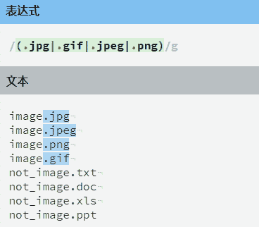

有时候，我们并不需要捕获某个分组的内容，但是又想使用分组的特性。

这个时候就可以使用非捕获组(?:表达式)，从而不捕获数据，还能使用分组的功能。

例如想要匹配两个字母组成的单词或者四个字母组成的单词就可以使用非捕获分组：

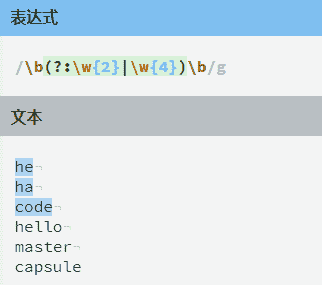

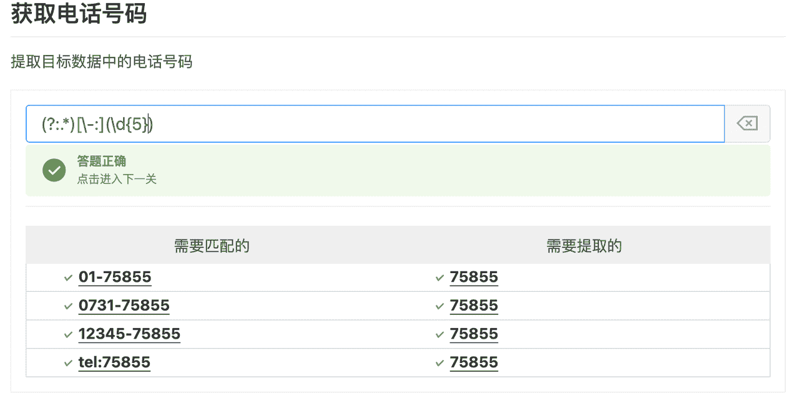

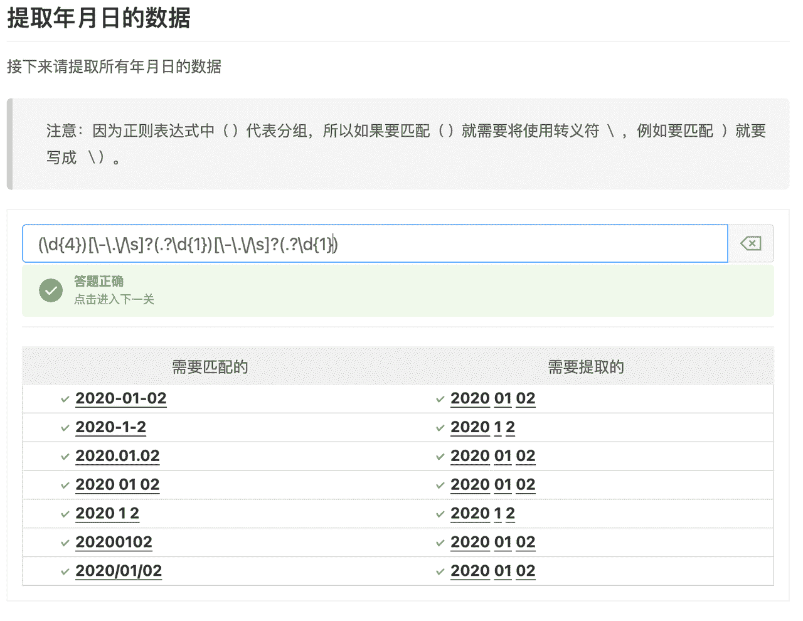

正则表达式还提供了一种引用之前匹配分组的机制，有些时候，我们或许会寻找到一个子匹配，该匹配接下来会再次出现。

例如，要匹配一段 HTML 代码，比如：0123提示abcd，可能会编写出这样一段正则表达式：

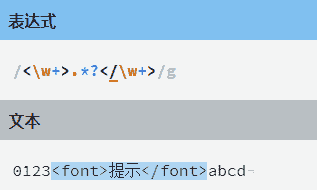

这确实可以匹配，不过可能还有另一种情况，如果数据改成这样：提示</bar>

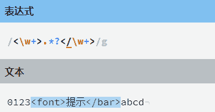

在这里font 和 bar 明显不是一对正确的标签，但是我们编写的正则表达式还是将它们给匹配了，所以这个结果是错误的。

我们想让后面分组的正则也匹配font，但是现在所有形式的都会匹配。

那如果想让后面分组的正则和第一个分组的正则匹配同样的数据该如何做呢？

可以使用分组的回溯引用，使用\N可以引用编号为N的分组，因此上述例子的代码我们可以改为：

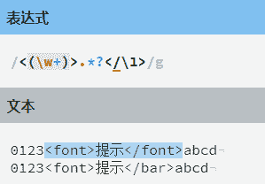

通过这个例子，可以发现 \1 表示的就是第一个分组，在这里第一个分组匹配的是 font 所以\1 就代表font。

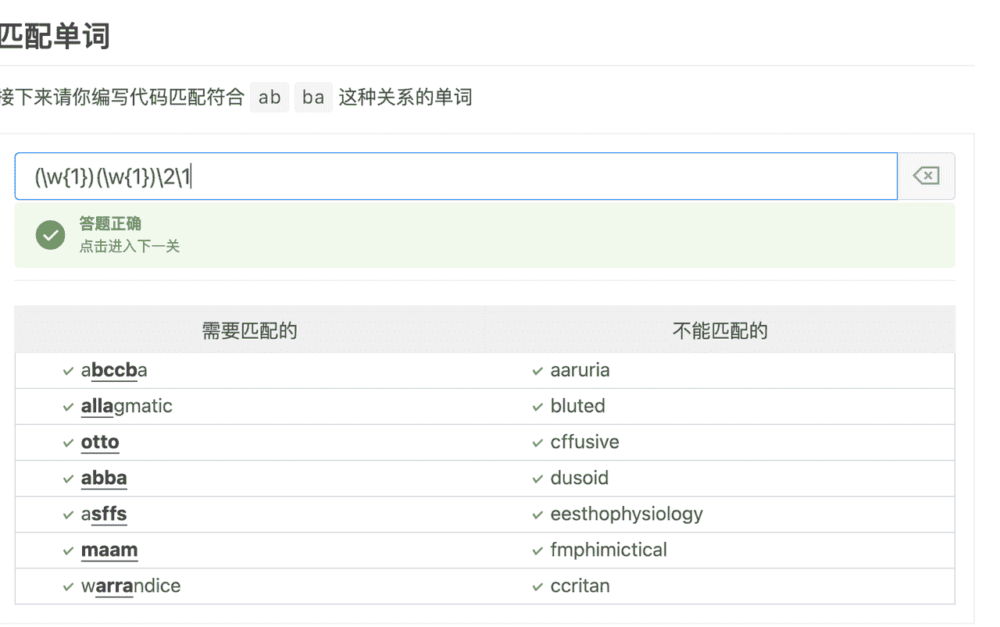

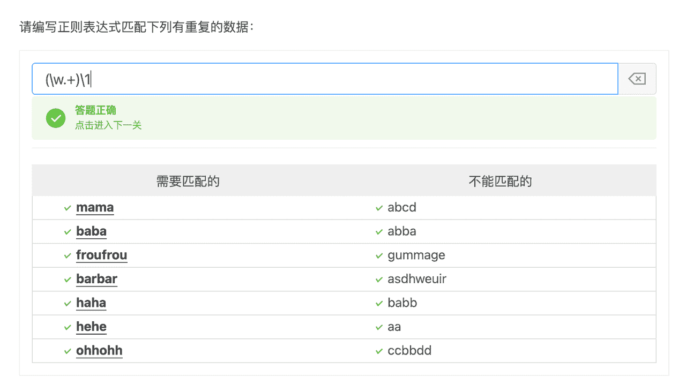

### 先行断言

很多人也称先行断言和后行断言为环视，也有人叫预搜索，其实叫什么无所谓，重要的是知道如何使用它们！

先行断言和后行断言总共有四种：

1.  正向先行断言

1.  反向先行断言

1.  正向后行断言

1.  反向后行断言

正向先行断言：(?=表达式)，指在某个位置向右看，表示所在位置右侧必须能匹配表达式

例如：

我喜欢你 我喜欢 我喜欢我 喜欢 喜欢你

如果要取出喜欢两个字，要求这个喜欢后面有你，这个时候就要这么写：喜欢(?=你)，这就是正向先行断言。

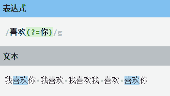

提取包含大小写字母的字符串

先行断言可以用来判断字符串是否符合特定的规则，例如提取包含至少一个大小写字母的字符串：

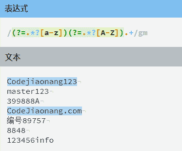

(?=.*?[a-z])(?=.*?[A-Z]).+ 这段正则表达式规定了匹配的字符串中必须包含至少一个大写和小写的字母。

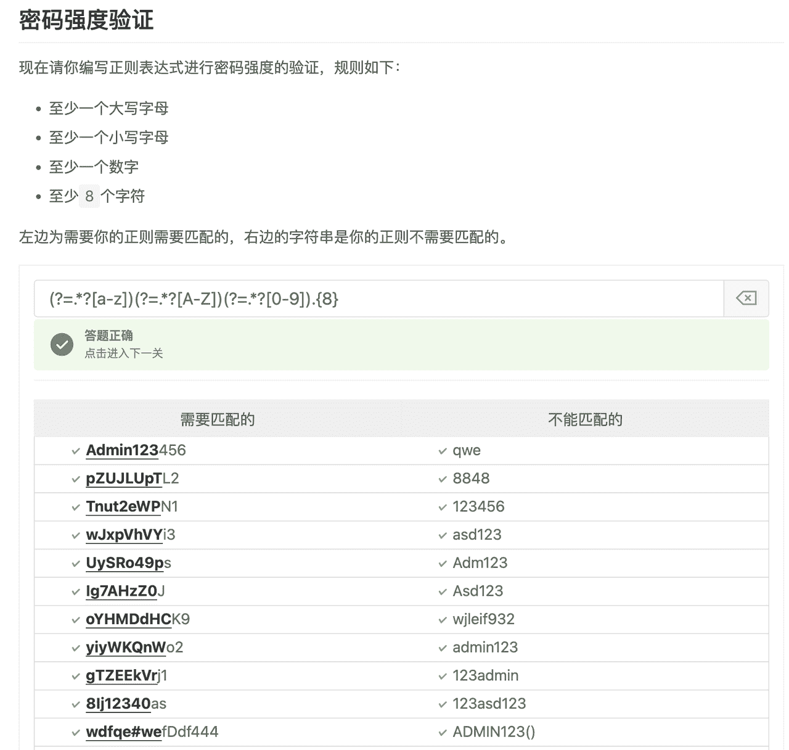

反向先行断言(?!表达式)的作用是保证右边不能出现某字符。

例如： 我喜欢你 我喜欢 我喜欢我 喜欢 喜欢你

如果要取出喜欢两个字，要求这个喜欢后面没有你，这个时候就要这么写：喜欢(?!你)，这就是反向先行断言。

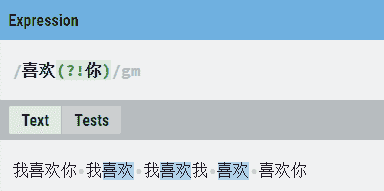

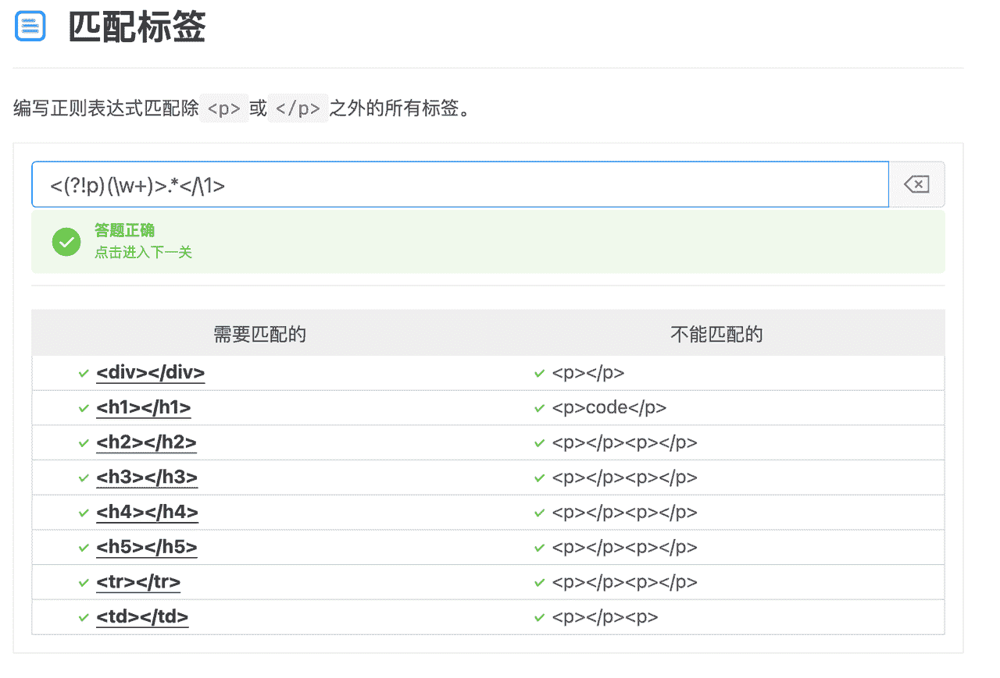

### 后行断言

先行断言和后行断言只有一个区别，即先行断言从左往右看，后行断言从右往左看。

正向后行断言：(?<=表达式)，指在某个位置向左看，表示所在位置左侧必须能匹配表达式

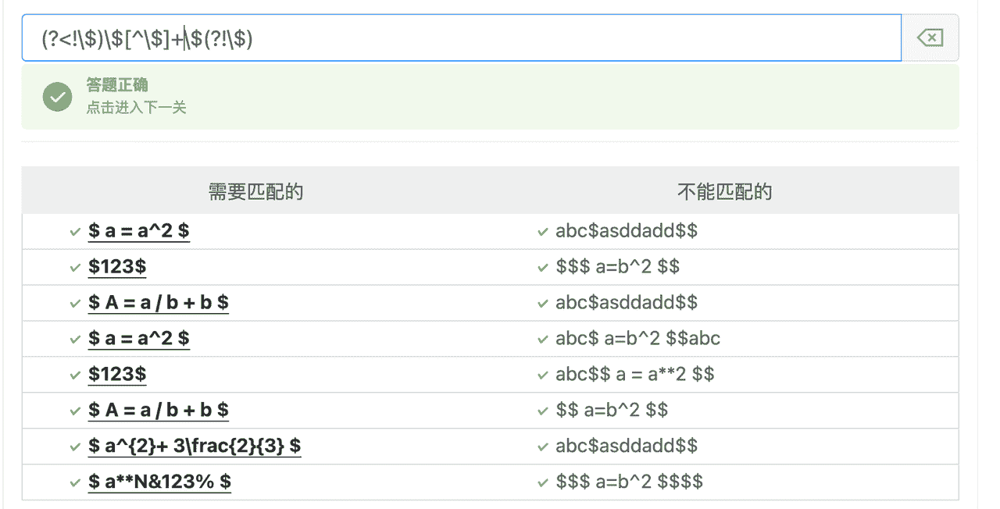

### Exam

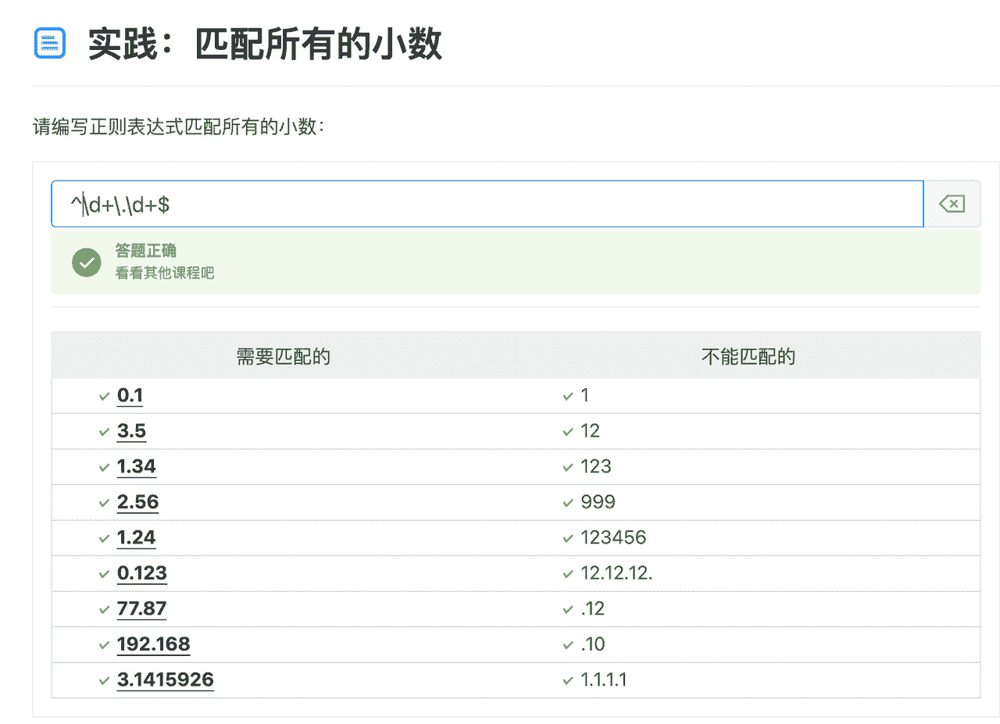