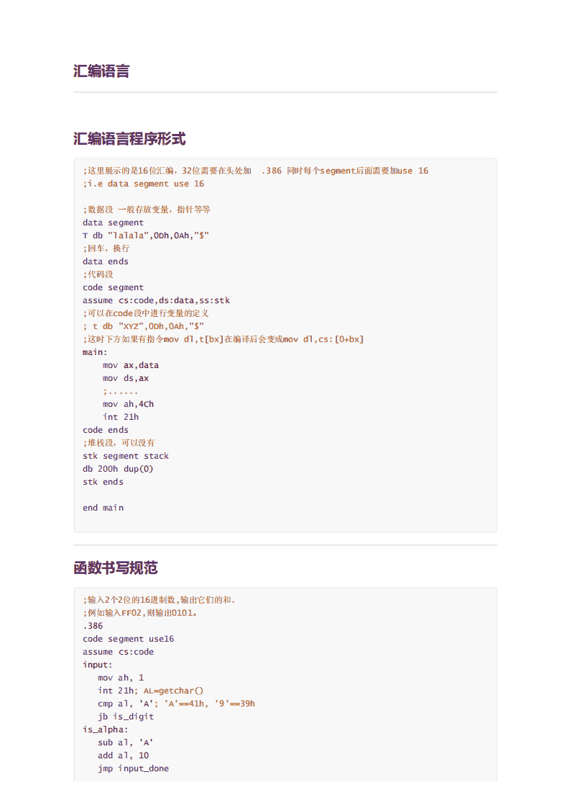
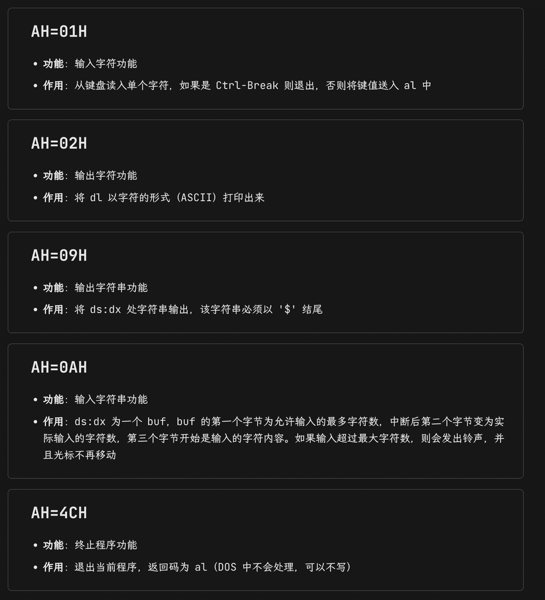
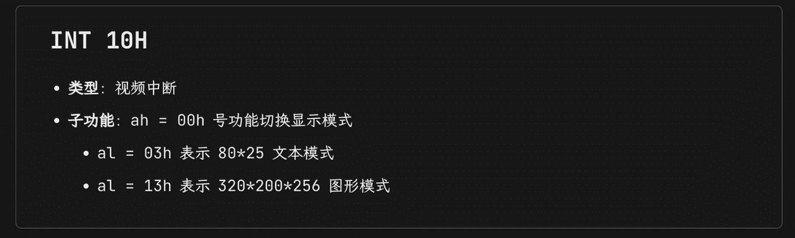
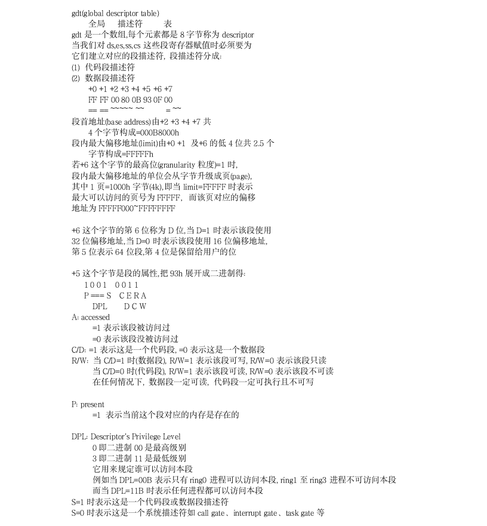
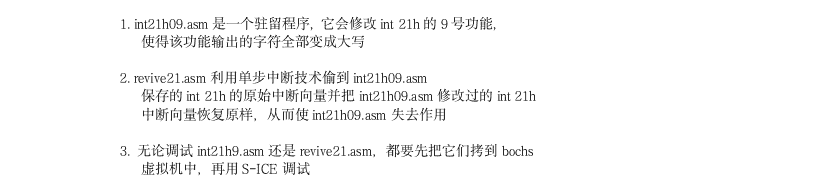
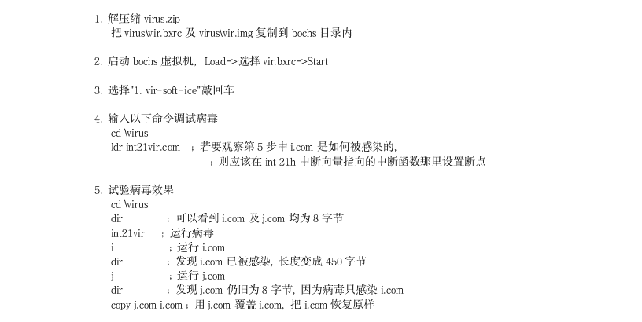

# 笔记

> 来源：[https://docs.feishu.cn/docx/JeISd8W5joX4Y1xJQWDcenC6nPb](https://docs.feishu.cn/docx/JeISd8W5joX4Y1xJQWDcenC6nPb)

> https://www.yuque.com/xianyuxuan/coding/mkte6u#JdoYt

> https://note.tonycrane.cc/cs/pl/asm/

# Readme

没有怎么好好记，但是引用了很多比较好的笔记，大家也可以看看，我感觉主要看小白的书就够了，上面两个链接可以作为补充。

# About class

> 保护模式

学习目的：

1.  帮助我们深入理解其他计算机语言

1.  **培养调试技能（debug）**

学习调试没有源代码的exe程序（只有地址）和有源代码的

Exe里面没有机器码，调试器可以把机器码翻译成汇编语言

跟踪别人的exe学习别人的核心算法，学习别人代码

还可以给exe自己加一些功能

1.  逆向工程(reverse-engineering)

把exe中包含的机器语言代码转化成源代码也称为反编译(decomp iley

IDA PRO可以把exe转化成汇编语言代码甚至也可以把exe转化成伪c语言代码（可读性较差）

病毒攻防、软件加密和破解

读懂没有源代码的exe程序，提取程序中的算法，修改exe程序，挖掘exe里面的漏洞

1.  混合语言编程

核心代码汇编，速度更快

没有库函数，和机器语言一一对应


[汇编语言.pdf](https://internal-api-drive-stream.feishu.cn/space/api/box/stream/download/all/WNcNb2Z4eoLwMZxP2CZcoUHgnMg)


[汇编语言 期末总结.pdf](https://internal-api-drive-stream.feishu.cn/space/api/box/stream/download/all/LCzXbleklo9c4VxWfcNcUQ6sn3d)



[asm复习.pdf](https://internal-api-drive-stream.feishu.cn/space/api/box/stream/download/all/SgSDbNTt1obnwjxt6LdcS2OlnWY)

# 汇编语言程序形式

## Sum demo演示

DOS 16位 用command进入

到tc（turbo c），tcc demo.c

用td（turbo d，调试16位）来debug， td exe

+   F8单步跟踪

010 editor

tc中的初始代码在c0s.obj中，一开始不是main的机器语言，c0s.obj主要作用是分配内存

compile会把main.c先**编译成m**ain.obj，接下来link，link时会搜索cs.lib把该库文件包含的的库函数.obj复制出来和c0s.obj,main.obj合在一起生成main.exe。不暴露.c文件，通过lib文件link

.obj 文件是指编译器生成的**目标文件**。这个目标文件包含着可执行文件所需的二进制代码和链接信息。

**三个push（main的参数，argc，argv，**emb），一个call代表main开始了

word ptr [0426],0001

word ptr是short int，说明变量宽度, [0426]相当于0426这个地址指的那个对象，类似于*

在数据窗按ctrl+g可以观察某个地址所指向的内容，输入ds:426

小端规则：看到是01 00 而不是00 01

超过八位的数保存到内存中时必须先存放低八位，后存放高八位

Intel CPU遵循**小端规则**

ARM是可以大小端通过编程修改的

> 32位 sum函数

```
.386
.model flat, stdcall
option casemap :none

include include\windows.inc
include include\kernel32.inc
include include\user32.inc

includelib lib\kernel32.lib
includelib lib\user32.lib

.data
result db 100 dup(0); dup:duplicate重复
;char result[100]={0};
format db &quot;%d&quot;,0; db:define byte字节类型
; char format[3]=&quot;%d&quot;;
prompt db &quot;The result&quot;,0

.code
main:         ; 标号
    mov eax, 0; eax:extended ax
    mov ebx, 1
again: 
    add eax, ebx; eax=0+1+2+3
    add ebx, 1  ; ebx=4
    cmp ebx, 100; cmp:compare
    jbe again   ; jbe:jump if below or equal
invoke wsprintf, offset result, offset format, eax
invoke MessageBox,0,offset result,offset prompt,0
    ret
end main; 指定程序的起始执行点
         ; end后面的标号决定了程序刚开始
         ; 运行时的eip的值。
```

编译器masm32在虚拟机d:\masm32\qeditor.exe 双击

点菜单project->build all（包含两步）

调试是用OllyDbg（32位的调试器）

把sum.exe拖到OllyDbg

intel的cpu里面复杂指令集长度不一样，由第一个字节决定：03后面就一个，83后面就三个

能够分配地址最小单位是byte

# 数据组织与结构

# 寄存器

> 寄存器不在内存中，在CPU里，没有地址，速度更快；变量在内存中；其他没有区别

# 汇编指令

# 中断

### 中断  ¶

中断是在  CPU  运行期间遇到某些情况暂时中止当前程序，去执行另一段特殊处理程序的过程。分为内部中断和外部中断，内部中断一般就是由  int  指令或者  CPU  的某些错误或者调试服务引起的，外部中断一般就是时钟中断、键盘中断等

中断调用与返回在前面指令部分有介绍

#### 中断向量  ¶

中断向量即中断服务程序入口的地址，为  4  个字节，前两个字节为偏移地址，后两个字节为段地址

系统中一共有  256  个中断号，范围在  00h  到  0FFh ，段地址  0000h  处为中断向量表，中断向量的地址位于  0000:[4*  中断号  ] ，例如  word ptr 0:[20h]  存放  8h  时钟中断的偏移地址， word ptr 0:[22h]  存放时钟中断的段地址

#### 更改中断向量  ¶

可以直接通过令  es  为  0 ，通过  es:[...]  的方式来更改中断向量，但程序结束后并不会改回来，而产生错误。因此要在改之前存下原来的中断向量，程序结束前再改回原来的中断向量

例

```
code segment
assume cs:code
old_00h dw 0, 0
int_00h:
    mov ch, 10h
    iret
main:
    push cs
    pop ds
    xor ax, ax
    mov es, ax
    mov bx, 0
    mov ax, es:[bx]
    mov dx, es:[bx+2]
    mov old_00h[0], ax
    mov old_00h[2], dx
    mov word ptr es:[bx], offset int_00h
    mov es:[bx+2], cs
    mov ax, 123h
    mov ch, 1
    div ch
    mov ax, old_00h[0]
    mov dx, old_00h[2]
    mov es:[bx], ax
    mov es:[bx+2], dx
    mov ah, 4Ch
    int 21h
code ends
end main
```

#### 除法溢出  ¶

除法溢出有两种情况：

+   除以  0  会溢出

+   商无法保存到  al  或  ax  中，会发生溢出

溢出的时候会在  div  指令的前面插入一条 int  00 h  并运行， DOS  执行  0  号中断会输出溢出信息并终止程序

因此也就可以修改  0  号中断的中断向量，使之继续运行， 0  号中断退出后仍会重新运行刚刚出现问题的  div  指令，一个例子见上（即修改中断向量的那个例子）

#### 时钟延迟  ¶

#### DOS  中断  ¶

DOS  中断即是  int 21h ，它作为一个函数集包含了标准输入  /  输出、文件管理、内存管理、进程管理的中断调用，提供了诸多子功能（ ah  为功能号），完整见  Ralf Brown's Interrupt List ，下面是一些常用功能



### BIOS  中断  ¶



+   **类型 **：视频中断

+   **子功能 **： ah = 00h  号功能切换显示模式

+   al = 03h  表示  80*25  文本模式

+   al = 13h  表示  320*200*256  图形模式

#### 文本模式编程  ¶

程序运行时默认终端就处于文本模式，可以直接通过写入相应内存地址来更改显示文本的内容

整个文本模式的屏幕左上角坐标为  (0, 0) ，右下角坐标为  (79, 24) 。内存结构为一个字表示一个字符（高  8  位为显示的字符，低  8  位中高  4  位为背景色，低  4  位为前景色）， (x, y)  位置处的字符对应内存位于  word ptr B800:[(y*80+x)*2]  处

编程时先设置  es  为  0B800h ，然后计算出  bx = (y*80+x)*2 ，然后令  byte ptr es:[bx] =  字符， byte ptr es:[bx+1] =  颜色

#### 图形模式编程  ¶

把显卡切换到图形模式使用  int 10h  中断， mov  ax ,  0013 h  设置子功能号为  0 ，模式编号  al  为  13h  即图形模式，然后 int  10 h  即可切换到图形模式，这种情况下是  320*200  分辨率、 256  色的模式。

屏幕上的一个点对应显卡内存上的一个字节，表示颜色。点  (x, y)  位于内存  0A00:[320*y+x]  的位置，颜色：

```
0 黑    1 蓝    2 绿    3 青    4 红    5 洋红
6 棕    7 白    8 灰    9 亮蓝  A 亮绿  B 亮青
C 亮红  D 紫    E 黄    F 亮白
```

编程时设置 es 为 0A00h，然后向 byte ptr es:[...] 中写入颜色码即可更改某处像素点颜色

再使用 mov  ax ,  0003 h  后 int  10 h  切换回文本模式

# 保护模式

## 保护模式



[protect.txt](https://internal-api-drive-stream.feishu.cn/space/api/box/stream/download/all/HdnGbOUFmoDOQqxnYkwcyBc7ngc)

简化版保护模式代码


[p0.asm](https://internal-api-drive-stream.feishu.cn/space/api/box/stream/download/all/Br2gbOH9EoqQfixx30UcNsrOnVh)

# 待看

http://cc.zju.edu.cn/bhh/moveblk.asm

http://cc.zju.edu.cn/bhh/antidbg.zip

http://cc.zju.edu.cn/bhh/readtime.asm

http://cc.zju.edu.cn/bhh/key.asm

http://cc.zju.edu.cn/bhh/music.asm


[schar.asm](https://internal-api-drive-stream.feishu.cn/space/api/box/stream/download/all/YZO2bzYpXowUJ6xhAzcc3XrjnKd)


[int80.asm](https://internal-api-drive-stream.feishu.cn/space/api/box/stream/download/all/RTBHbBkRlolOo4xqTs0c2QOfnQq)

## Revive


[revive21.asm](https://internal-api-drive-stream.feishu.cn/space/api/box/stream/download/all/D1XEbwYxoobA7HxSF3hc7NrTnAb)



[readme.txt](https://internal-api-drive-stream.feishu.cn/space/api/box/stream/download/all/DPt5birLLoyIdcx6Uo8cJ6QAnOe)


[int21h09.asm](https://internal-api-drive-stream.feishu.cn/space/api/box/stream/download/all/JtTZboHR8oFY1VxTdpZcIILJnFd)

## Virus



[virus.txt](https://internal-api-drive-stream.feishu.cn/space/api/box/stream/download/all/ZZRcbTm95orMOxxIBa2cpiqlnZe)


[vir.bxrc](https://internal-api-drive-stream.feishu.cn/space/api/box/stream/download/all/GfQAbyW5boPmflxEsEUcpFwqnZb)


[vir.img](https://internal-api-drive-stream.feishu.cn/space/api/box/stream/download/all/IE3pblts5oKVADxsvT5c0lAnneh)

## Asmnaked

asmnaked.zip演示了vc6中如何定义一个纯汇编函数


[asmnaked.zip](https://internal-api-drive-stream.feishu.cn/space/api/box/stream/download/all/Zw45br6cdo9hTMx4wnxcXJlnneh)

# Final

去年每道程序题都有字符串指令

保护模式10分

# N 代码

## Vscode masm调试

U ：反汇编

G：goto

T：下一步

D ds：0

## TD调试

Masm A;

Link A;

A

Td A

ALT+X 关闭

## 实现puts(s)

打印的代码是

+   让要打印出来的内容在dl

+   Mov ah, 2

+   Int 21h

```
;----------请把以下代码保存到src\main.asm------------------------------
;----------选中main.sh及src文件夹-&gt;右键-&gt;压缩成submit.zip提交----------
.386
data segment use16
sth db 10 dup(0)
s db 10 dup(&#x27;S&#x27;), 0; 测评时数组s的长度及内容和此样本不会一样,
                   ; 但s一定是一个符合C语言标准的字符串
data ends

code segment use16
assume cs:code, ds:data
main:
   mov ax, data
   mov ds, ax
;在#1_begin和#1_end之间补充代码实现puts(s)的效果,即除了输出字符串s本身内容外,还需要再输出0Dh及0Ah
;#1_begin--------------------------------------
   lea si, s
loop1:
   mov dl, [si]
   cmp dl, 0
   je loopend
   mov ah, 2
   int 21h
   inc si
   jmp loop1

loopend:
   mov dl, 0Dh
   mov ah, 2
   int 21h
   mov dl, 0Ah
   mov ah , 2
   int 21h
;#1_end----------------------------------------
   mov ah, 4Ch
   int 21h
code ends
end main
;----------请把以上代码保存到src\main.asm------------------------------
```

int21h/AH=09h用于输出一个$额数的字符串但不输出$本身

中断21h里的9号服务是显示字符**串**，显示DS：DX指向的字符串，直到遇到$

1.  mov ah, 9：把9这个值移动到ah寄存器。在DOS中断21h的服务中，9号服务是用于显示字符串的。它会显示DS:DX指向的字符串，直到遇到'$'字符为止。

1.  mov dx, offset s：把s的地址移动到dx寄存器。s是一个字符串变量，在这里，我们把它的地址存入dx寄存器，以便在下一步使用DOS服务来显示它。

1.  int 21h：调用DOS中断21h。由于ah寄存器设置为9，所以这个调用会打印出DS:DX指向的字符串，直到遇到'$'字符为止。

## 计算1-100和

1.  函数传参

1.  地址

1.  loop

```
;本题要求:
;完成3项程序填空,调用函数f()求1+2+3+...+n之和并保存到变量sum中,
;注意sum不会超过0FFFFh,故在计算过程中不需要考虑加法溢出
;==========请把在完成填空后把本文件保存到src\main.asm==================
;==========选中main.sh及src文件夹-&gt;右键-&gt;压缩成submit.zip提交==========
.386
data segment use16
sth db 10h dup(0)
n dw 3
sum dw 0
data ends

code segment use16
assume cs:code, ds:data
;函数f()原型:
;   short int f(short int n, short int *psum);
;函数f()功能:
;   计算1+2+3+...n的和, 并把和保存到*psum中。例如当n=3时, *psum=6。
;提示:
;   f()的参数通过堆栈传递, 其中n就是[bp+4], psum就是[bp+6]。
;注意:
;   在函数f()中不可直接引用data段中的变量n及sum, 否则会编译失败
f proc near
   push bp
   mov bp, sp
   mov bx, 0
   mov cx, 0
;#1_begin--------
   mov cx, [bp+4]
;#1_end----------
   mov bx, [bp+6]
   xor ax, ax
next:
   add ax, cx
   loop next
;#2_begin------
   mov [bx], ax
;#2_end--------
   pop bp
   ret
f endp

main:
   mov ax, data
   mov ds, ax
   mov ax, offset sum; ax = sum的偏移地址
;#3_begin------------
   push ax
;#3_end--------------
   push [n]     ; 传递n的值给函数f()
   call f
   add sp, 4    ; 清除堆栈上的2个参数
   mov ax, [sum]; 跟踪时请检查当n=3时,ax应该等于6
   mov ah, 4Ch
   int 21h
code ends
end main
;==========请在完成填空后把本文件保存到src\main.asm================
```

## 16位符号数n转化成十进制字符串，并填充′$′

1.  有符号，注意负数

1.  Neg

1.  负数先加上 -，再到正数

1.  loop

```
;==========请把以下代码保存到src\main.asm==============================
;==========选中main.sh及src文件夹-&gt;右键-&gt;压缩成submit.zip提交==========
.386
data segment use16
sth db 10h dup(0)
n dw 0FFF0h   
s db 10h dup(0)
data ends

code segment use16
assume cs:code, ds:data
;void f(short int n, char s[])
;注意f()的参数通过堆栈传递,其中n就是[bp+4], s就是[bp+6]。
;在函数f()中不可直接引用data段中的变量n及数组s, 否则会产生编译错误。
f proc near
   push bp
   mov bp, sp
;请在#1_begin和#1_end之间补充代码实现以下功能:
;把16位符号数n转化成十进制字符串保存到数组s中,并在字符串后面填充&#x27;$&#x27;
;例如,当n=0FFF0h时, s的内容为: &#x27;-&#x27;, &#x27;1&#x27;, &#x27;6&#x27;, &#x27;$&#x27;
;#1_begin-----------=========------------------
   mov ax, [bp+4]         ; 加载n到ax
   mov bx, [bp+6]         ; 加载s的地址到bx
   xor cx, cx
   
   ; 检查n是否为负数
   test ax, ax
   jns positive_number
   
   ; 是负数, 在字符串开头添加&#x27;-&#x27;
   mov byte ptr [bx], &#x27;-&#x27;
   neg ax                 ; 取绝对值
   inc bx                 ; 移动s的地址
   
positive_number:
   ; 转换数字到字符串
   mov si, 10             ; 设置除数为10
.reverse_loop:
   xor dx, dx             ; 清除dx
   div si    ; ax = ax / 10, dx = ax % 10
   push dx                ; 将余数压入栈中
   inc cx
   test ax, ax            ; 检查商是否为0
   jnz .reverse_loop
   
   ; 将数字从栈中弹出并存储为字符
.store_loop:
   pop dx                 ; 弹出数字
   add dx, &#x27;0&#x27;            ; 转换为字符
   mov byte ptr [bx], dl  ; 存储字符
   inc bx                 ; 移动到下一个字符位置
   loop .store_loop
   
   ; 在字符串后添加 &#x27;$&#x27;
   mov byte ptr [bx], &#x27;$&#x27;

;#1_end-------------=========------------------
   pop bp
   ret
f endp

main:
   mov ax, data
   mov ds, ax
   mov ax, offset s
   push ax
   push [n]
   call f
   add sp, 4
   mov ah, 9
   mov dx, offset s
   int 21h
   mov ah, 4Ch
   int 21h
code ends
end main
;==========请把以上代码保存到src\main.asm==============================

```

## sqrt开方+转换成10进制输出

+   注意浮点数

+   转换成10进制和上面类似，运用到pop，push

```
.386
code segment use16
assume cs:code
;Input: EAX
;Output: EAX = sqrt(EAX)
sqrt proc near
push bp
mov bp, sp
sub sp, 4             ; 创建一个32位的动态变量
mov [bp-4], eax       ; 把EAX保存到该动态变量中
fild dword ptr [bp-4] ; 把[bp-4]中的整数转化成小数载入到st(0)
fsqrt                 ; 对st(0)开方结果仍旧保存到st(0)
fistp dword ptr [bp-4]; 把st(0)中的值转化成整数并保存到[bp-4]中再弹出st(0)
mov eax, [bp-4]       ; EAX=函数的返回值
mov sp, bp
pop bp
ret
sqrt endp

;Input: EAX
;Output: output EAX to stdout in decimal format
val2dec proc near
   push eax
   push ebx
   push ecx
   push edx
   mov cx, 0
div_again:
   xor edx, edx
   mov ebx, 10
   div ebx
   add dl, &#x27;0&#x27;
   push dx
   inc cx
   or eax, eax
   jnz div_again
pop_again:
   pop dx
   mov ah, 2
   int 21h
   loop pop_again
   pop edx
   pop ecx
   pop ebx
   pop eax
   ret
val2dec endp

main:
   mov eax, 2147483647
   call sqrt          ; 用EAX传递参数给函数sqrt, 函数返回值也在EAX中
   call val2dec       ; 用EAX传递参数给函数val2dec, 该函数输出&quot;46341&quot;
   mov ah, 4Ch
   int 21h
code ends
end main
```

## 把32位的整数转成16进制输出

+   Rol

+   and会改变

+   用int 21h的2号功能输出

```
.386
data segment use16
abc dd 2147483647
data ends

code segment use16
assume cs:code, ds:data
main:
   mov ax, seg abc
   mov ds, ax
   mov eax, abc
   mov cx, 8
again:
   rol eax, 4
   push eax
   and eax, 0Fh
   cmp al, 10
   jb is_digit
is_alpha:
   sub al, 10
   add al, &#x27;A&#x27;
   jmp finish_4bits
is_digit:
   add al, &#x27;0&#x27;
finish_4bits:
   mov ah, 2
   mov dl, al
   int 21h
   pop eax
   sub cx, 1
   jnz again
   mov ah, 4Ch
   int 21h
code ends
end main
```

## 用变量传参+strlen+转换成16进制

+   hex部分和上面类似

```
.386
data segment use16
s db &quot;Hello,world!&quot;, 0Dh, 0Ah, 00h
p dw 0
n dw 0
data ends

code segment use16
assume cs:code, ds:data
;Input: [p]-&gt;string
;Output: [n]=string&#x27;s length
strlen proc near
   push ax
   push cx
   push si
   xor cx, cx
   mov si, [p]          ; p是函数strlen()的参数
strlen_next_char:
   lodsb
   or al, al
   jz strlen_done
   inc cx
   jmp strlen_next_char
strlen_done:
   mov [n], cx          ; n是函数strlen()的返回值
   pop si
   pop cx
   pop ax
   ret
strlen endp

;Input: [n]
;Output: Output n in hex to stdout
hex proc near
   push ax
   push cx
   push dx
   mov dx, [n]          ; n是函数hex()的参数
   mov cx, 4
hex_next_4_bits:
   rol dx, 4
   push dx
   and dl, 0Fh
   cmp dl, 10
   jae is_alpha
is_digit:
   add dl, &#x27;0&#x27;
   jmp hex_output
is_alpha:
   sub dl, 10-&#x27;A&#x27;       ; DL = DL - (10 - &#x27;A&#x27;) = DL - 10 + &#x27;A&#x27;
hex_output:
   mov ah, 2
   int 21h
   pop dx
   loop hex_next_4_bits
   pop dx
   pop cx
   pop ax
   ret
hex endp

main:
   mov ax, data
   mov ds, ax
   cld
   mov [p], offset s    ; 用变量p传递s的偏移地址给函数strlen()
   call strlen          ; strlen()的返回值在变量n中
   call hex             ; 用变量n传递参数给函数hex(), hex()输出000E
   mov ah, 4Ch
   int 21h
code ends
end main
```

## 图像模式，文本模式

Int 10h视频中断

+   ah==00h表示切换显示模式

+   al=03h 表示文本

+   Al=13h表示图形

```
mov ax, 0013h
int 10h        ;切换到320✖️200图形模式

mov ax, 0003h
int 10h        ;切换到80✖️25文本模式
```

## 16位整数转换成二进制

+   shl每次左移一个

+   巧用adc

```
data segment
abc dw 32767
data ends
code segment
assume cs:code, ds:data
main:
   mov ax, data
   mov ds, ax
   mov ax, [abc]
   mov cx, 16
again:
   shl ax, 1
;  mov dl, &#x27;0&#x27;
;  adc dl, 0
   jc is_one
is_zero:
   mov dl, &#x27;0&#x27;
   jmp output
is_one:
   mov dl, &#x27;1&#x27;
output:
   push ax
   mov ah, 2
   int 21h
   pop ax
   sub cx, 1
   jnz again
   mov ah, 4Ch
   int 21h
code ends
end main
```

## 段

ds一开始被赋值为psp段址，需要

```
mov ax, data
mov ds, ax
```

## 结束

```
mov ah, 4Ch
int 21h
```

## XLAT

用XLAT实现32位整数转换成16进制，关键在于读表

```
.386
data segment use16
t db &quot;0123456789ABCDEF&quot;
x dd 2147483647
data ends

code segment use16
assume cs:code, ds:data
main:
   mov ax, data    ;\
   mov ds, ax      ;| ds:bx-&gt;t[0]
   mov bx, offset t;/
   mov cx, 8
   mov eax, [x]
next:
   rol eax, 4
   push eax
   and eax, 0Fh
   xlat
   mov ah, 2
   mov dl, al
   int 21h
   pop eax
   sub cx, 1
   jnz next
   mov ah, 4Ch
   int 21h
code ends
end main
```

## MOVSB

实现memcpy

Slen = $ - offset s

```
data segment
s db &quot;A quick brown fox jumps over the lazy dog.&quot;
slen = $ - offset s
data ends

extra segment
t db slen dup(0)
extra ends

code segment
assume cs:code, ds:data, es:extra
main:
   mov ax, data
   mov ds, ax
   mov ax, extra
   mov es, ax
   mov si, offset s
   mov di, offset t
   mov cx, slen
   cld
   rep movsb
   mov ah, 4Ch
   int 21h
code ends
end main
```

## CMPSB

比较两个大小

+   0Ah是输入字符串，要求数组偏移地址在dx

+   调用后buf[2]之后才是输入的内容，buf[1]是长度

+   先读到buf里再memcpy到s

```
data segment
buf db 81, 0, 81 dup(0)
s db 100 dup(0)
t db 100 dup(0)
slen db 0
tlen db 0
equal_msg db &quot;Equal&quot;, 0Dh, 0Ah, &#x27;$&#x27;
unequal_msg db &quot;Not equal&quot;, 0Dh, 0Ah, &#x27;$&#x27;
data ends

code segment
assume cs:code, ds:data
input:
   mov ah, 0Ah
   mov dx, offset buf
   int 21h       ; 输入一个长度≤81字符(含回车)的字符串
                 ; 调用前:
                 ; buf[0]=字符串最大长度(含回车)
                 ; 调用后:
                 ; buf[1]=字符串长度(不含回车)
                 ; buf[2]起为输入的字符串内容
   mov ah, 2
   mov dl, 0Dh
   int 21h       ; 输出回车
   mov dl, 0Ah
   int 21h       ; 输出换行
   xor cx, cx
   mov cl, buf[1]
   push cx
   lea si, buf[2]
   rep movsb     ; 把输入的字符串复制到目标地址es:di
   pop cx
   mov byte ptr es:[di], 0; 目标字符串填入结束标志
   mov ax, cx    ; 返回AX=字符串长度
   ret

main:
   mov ax, data
   mov ds, ax
   mov es, ax
   cld
   mov di, offset s
   call input    ; 输入一个字符串保存到s
   mov [slen], al; slen = s的长度
   mov di, offset t
   call input    ; 输入一个字符串保存到t
   mov [tlen], al; tlen = t的长度
   xor cx, cx
   mov cl, [slen]
   cmp cl, [tlen]
   jne not_equal ; 若字符串长度不等则输出&quot;Not equal&quot;
prepare_to_cmp:
   or cx, cx
   jz exit       ; 若字符串长度为0则结束程序
   mov si, offset s
   mov di, offset t
   repe cmpsb    ; 比较字符串
   je is_equal   ; 若最后一次比较相等则一定全等
not_equal:
   mov dx, offset unequal_msg
   jmp output
is_equal:
   mov dx, offset equal_msg
output:
   mov ah, 9
   int 21h
exit:
   mov ah, 4Ch
   int 21h
code ends
end main

```

## SCASB

用repne scasb求字符串长度

+   Inc

+   not

```
data segment
s db &quot;abracadabra&quot;, 0
slen dw 0
data ends

code segment
assume cs:code, ds:data
main:
   mov ax, data
   mov ds, ax
   mov es, ax
   mov di, offset s; es:di-&gt;s[0]
   mov cx, 0FFFFh  ; CX=最大搜索次数
   xor al, al      ; AL=00h
   cld             ; DF=0
   repne scasb     ; 若本次比较不等则继续搜索
   inc cx          ; 假装末尾的00h没搜过
   not cx          ; CX=0FFFFh-CX=已搜过的字符个数(不含末尾的00h)
   mov [slen], cx  ; 保存字符串长度
   mov ah, 4Ch
   int 21h
code ends
end main
```

## STOSB

把数组s清零

```
.386
data segment use16
s db 2003 dup(&#x27;A&#x27;)
slen = $ - offset s
data ends

code segment use16
assume cs:code, ds:data
main:
   mov ax, data
   mov ds, ax
   mov es, ax
   mov di, offset s; ES:DI-&gt;s[0]
   mov cx, slen    ; CX = 数组s中包含的字符个数 = 2003
   xor eax, eax    ; EAX = 0
   push cx
   shr cx, 2       ; CX = CX / 4 = 500
   rep stosd       ; 先把s[0]至s[1999]清零
   pop cx
   and cx, 3       ; CX = CX % 4 = 3
   rep stosb       ; 再把s[2000]至s[2002]清零
   mov ah, 4Ch
   int 21h
code ends
end main
```

## LODSB

过滤数组的空格

+   先lodsb再stosb，遇到要跳过的可以跳过

```
data segment
s db &quot;Ada Lovelace is often regarded as &quot;
  db &quot;the first computer programmer.&quot;
slen = $ - offset s
t db slen dup(&#x27;T&#x27;)
data ends

code segment
assume cs:code, ds:data
main:
   mov ax, data
   mov ds, ax
   mov es, ax
   mov si, offset s; ds:si-&gt;s[0]
   mov di, offset t; es:di-&gt;t[0]
   mov cx, slen    ; CX = length of s
   cld             ; DF = 0
   jcxz done       ; jump if cx is zero
again:
   lodsb           ; AL=ds:[si], si++
   cmp al, &#x27; &#x27;
   je skip
   stosb           ; es:[di]=AL, di++
skip:
   loop again      ; dec cx
                   ; jnz again
done:
   xor al, al      ; AL = 00h
   stosb           ; es:[di]=AL, di++
   mov ah, 4Ch
   int 21h
code ends
end main

```

## 用call和retn实现puts

简单的函数调用

+   注意判断为0的时候结束

+   注意堆栈结构

```
data segment
s db &quot;Hello$World!&quot;, 0Dh, 0Ah, 00h
data ends

code segment
assume cs:code, ds:data
;Input:          ; 用寄存器传递参数
;AL=char to output
putchar:         ; 用标号定义一个函数
   push dx
   mov ah, 2
   mov dl, al
   int 21h
   pop dx
   retn

;Input:          ; 用堆栈传递参数
;dword ptr ss:[sp+2]-&gt;string to output
puts proc        ; 用函数名 proc ... 函数名 endp定义一个函数
   push bp       ;   ~~~~~~~~~~~     ~~~~~~~~~~~
   mov bp, sp    ; 构造堆栈框架
                 ; word ptr ss:[bp+0] = old bp
                 ; word ptr ss:[bp+2] = offset back
                 ; word ptr ss:[bp+4] = offset s
                 ; word ptr ss:[bp+6] = data
   push ds
   push si
   cld
   lds si, [bp+4]; SI = offset s
                 ; DS = data
puts_next_char:
   lodsb
   or al, al
   jz puts_done
   call putchar
   jmp puts_next_char
puts_done:
   pop si
   pop ds
   pop bp
   retn 4        ; back_addr = ss:[sp] = offset back
                 ; sp = sp + 6, 弹出返回地址及main压入的两个字
                 ; IP = back_addr = offset back, 返回到back:
puts endp

main:
   mov ax, data
   push ax       ; 先压入s的段地址
   mov ax, offset s
   push ax       ; 后压入s的偏移地址
   call puts     ; 调用函数puts()输出s
back:
   mov ah, 4Ch
   int 21h
code ends
end main
```

## Callfar

注意远端的调用

```
data segment
s db &quot;Hello$World!&quot;, 0Dh, 0Ah, 00h
data ends

faraway segment
assume cs:faraway, ds:data
;Input:          ; 用寄存器传递参数
;AL=char to output
putchar label far; 用标号定义一个函数
   push dx
   mov ah, 2
   mov dl, al
   int 21h
   pop dx
   retf

;Input:          ; 用堆栈传递参数
;dword ptr ss:[sp+4]-&gt;string to output
puts proc far    ; 用函数名 proc far ... 函数名 endp定义一个函数
   push bp       ;   ~~~~~~~~~~~~~~~     ~~~~~~~~~~~
   mov bp, sp    ; 构造堆栈框架
                 ; word ptr ss:[bp+0] = old bp
                 ; word ptr ss:[bp+2] = offset back
                 ; word ptr ss:[bp+4] = code
                 ; word ptr ss:[bp+6] = offset s
                 ; word ptr ss:[bp+8] = data
   push ds
   push si
   cld
   lds si, [bp+6]; SI = offset s
                 ; DS = data
puts_next_char:
   lodsb
   or al, al
   jz puts_done
   call far ptr putchar
   jmp puts_next_char
puts_done:
   pop si
   pop ds
   pop bp
   retf 4        ; back_ip = ss:[sp] = offset back
                 ; back_cs = ss:[sp+2] = code
                 ; sp = sp + 8, 弹出返回地址及main压入的两个字
                 ; IP = back_ip = offset back\
                 ; CS = back_cs = code       / 返回code:back
puts endp
faraway ends

code segment
assume cs:code, ds:data
prompt db &quot;far call demo&quot;, 0Dh, 0Ah, 00h
prompt_len = $ - offset prompt - 1
main:
   mov cx, prompt_len
   mov bx, 0
show_prompt:
   mov al, cs:prompt[bx]
   call far ptr putchar
   inc bx
   loop show_prompt
   mov ax, data
   push ax          ; 先压入s的段地址
   mov ax, offset s
   push ax          ; 后压入s的偏移地址
   call far ptr puts; 调用函数puts()输出s
back:
   mov ah, 4Ch
   int 21h
code ends
end main
```

## Int n

```
mov ah, 0
mov al, 3
int 10h
mov ah, 2
mov al, &#x27;A&#x27;
int 21h
mov ah, 0
int 16h
mov ah, 4Ch
int 21h
```

## 修改中断向量，恢复中断向量 int 0

读中断向量，修改中断向量，恢复中断向量

```
data segment
old_00h dw 0, 0
data ends

code segment
assume cs:code, ds:data
int_00h:                 ; int 00h的中断服务函数
   push bp
   mov bp, sp
   add word ptr [bp+2], 2; 把返回地址加2
   pop bp
   iret                  ; 返回到code:back
main:
   mov ax, data
   mov ds, ax
   xor bx, bx
   mov es, bx
   mov ax, es:[bx]
   mov dx, es:[bx+2]
   mov old_00h[0], ax;
   mov old_00h[2], dx; 保存int 00h的中断向量
   mov word ptr es:[bx], offset int_00h
   mov es:[bx+2], cs ; 修改int 00h的中断向量为code:int_00h
   mov ax, 123h
here_is_an_int_00h:
   div bh            ; div bh指令的机器码为2个字节: 0F6h, 0F7h
                     ; 由于BH=0, 故发生除法溢出, CPU会在div bh
                     ; 指令上方插入int 00h并调用该中断
back:
   mov ah, 2
   mov dl, &#x27;B&#x27;
   int 21h
   mov ax, old_00h[0]
   mov dx, old_00h[2]
   mov es:[0], ax    ;
   mov es:[2], dx    ; 恢复int 00h的中断向量
   mov ah, 4Ch
   int 21h
code ends
end main
```

## 中断 Int1

```
code segment
assume cs:code, ds:code
main:
   jmp begin
old1h dw 0, 0
prev_addr dw offset first, code; 前一条指令的地址
begin: 
   push cs
   pop ds; DS=CS
   xor ax, ax
   mov es, ax; es=0
   mov bx, 4 ; bx=4
             ; es:bx-&gt;int 1h的中断向量即int 1h函数的地址
             ; dword ptr 0:[4]储存了int 1h函数的的地址
             ; 前16位存放偏移地址
             ; 后16位存放段地址
             ; 0:n*4用来存放int n的中断向量
   push es:[bx]
   pop old1h[0]
   push es:[bx+2]
   pop old1h[2]
   ;上述4条指令可以换成以下4条指令
   ;mov ax, es:[bx]
   ;mov dx, es:[bx+2]
   ;mov old1h[0], ax
   ;mov old1h[2], dx

   mov word ptr es:[bx], offset int1h
   mov word ptr es:[bx+2], cs
   pushf; save old FL

   pushf ; 把FL压入堆栈
   pop ax; AX=FL
   or ax, 100h; 第8位置1
   push ax
   popf; FL=AX, 此时TF=1, 但注意popf后并不会插入int 1h指令,
       ; 因为只有当本条指令执行前TF=1, CPU才会在该条指令后插入int 1h指令
first:
   nop ; 由于nop前TF=1, 因此nop后会插入int 1h指令
;int 1h (first int 1h), cpu会执行pushf, push cs, push offset back, jmp dword ptr 0:[4]
single_step_begin:
back:
   xor ax, ax
;int 1h
   mov cx, 3
;int 1h
next:
   add ax, cx
;int 1h
   nop
;int 1h
   loop next
;int 1h
   popf; restore old FL, TF=0
;int 1h (final int 1h)
   nop;
single_step_end:
   push old1h[0]
   pop es:[bx]
   push old1h[2]
   pop es:[bx+2]
   mov ah, 4Ch
   int 21h
int1h:     ; cpu进入int n中断函数时会自动对TF及IF清零, 故在int1h函数执行期间并不会发生int 1h中断
   push bp 
   mov bp, sp
   push bx
   push es
   mov bx, cs:prev_addr[0]
   mov es, cs:prev_addr[2]
   ;上面2条指令可以改成以下这条指令
   ;les bx, cs:prevaddr
   inc byte ptr es:[bx]; 加密上一条指令
   mov bx, [bp+2]      ; bx=下条指令的偏移地址
   mov es, [bp+4]      ; es=下条指令的段地址, 此时es:bx-&gt;下条指令的首字节
   ;上面2条指令可以换成以下这条指令
   ;les bx, dword ptr [bp+2]

   dec byte ptr es:[bx]; 解密下一条指令
   mov cs:prev_addr[0], bx
   mov cs:prev_addr[2], es
   pop es
   pop bx
   pop bp
   iret; cpu会一气呵成地执行pop ip, pop cs, popf
code ends
end main 
```

## 中断 int8

和上面类似

注意ds，es，我们可能会把保存的变量存在ds，那么就要弄成ds，并且ds要初始赋值

```
code segment
assume cs:code, ds:code
s db &#x27;0&#x27;, 17h          ; 待显示的字符及颜色
count db 0             ; 每隔1/18秒count++
stop  db 0             ; stop==1时程序结束
old_8h dw 0, 0         ; 用来保存int 8h的中断向量
int_8h:                ; 中断函数
   push ax             ;\中断函数不能破坏任何一个寄存器的值,
   push es             ;/故需要把用到的寄存器都压入堆栈
   mov ax, 0B800h      
   mov es, ax          ; ES = 0B800h
   inc cs:[count]      ; 因每隔1/18秒自动产生一次时钟中断int 8h，
   cmp cs:[count], 18  ; 故需要累计18次中断才刚好是1秒钟
   jb skip             ; 不足18次中断就返回
   mov cs:[count], 0   ; 满18次中断后，count清零
   mov ax, word ptr cs:[s]
   mov es:[0], ax      ; 在(0,0)处显示计数
   inc cs:s[0]         ; 计数加1
   cmp cs:s[0], &#x27;9&#x27;
   jbe skip
   mov stop, 1         ; 计数超过&#x27;9&#x27;时把stop置1
skip:
   pop es              ;\ 
   pop ax              ;/恢复寄存器的值
   push ax
   mov al, 20h         ; EOI信号(end of interrupt)
   out 20h, al         ; 20h是中断控制器的端口号
                       ; 发送20h信号给20h号端口是告诉中断控制器
                       ; 本次硬件中断已处理完毕，如果不发送此信号
                       ; 给中断控制器的话，下次再有硬件中断发生时
                       ; 中断控制器将不会放行新中断从而CPU将无法
                       ; 收到新的中断请求
   pop ax
   iret                ; 中断返回
main:
   push cs 
   pop ds              ; DS = CS
   xor ax, ax
   mov es, ax          ; ES = 0
   mov bx, 8h*4
   mov ax, es:[bx]
   mov dx, es:[bx+2]
   mov cs:old_8h[0], ax;\
   mov cs:old_8h[2], dx;/保存int 8h的中断向量
   cli                 ; 禁止硬件中断,防止在修改中断向量期间发生硬件中断
   mov word ptr es:[bx], offset int_8h
   mov es:[bx+2], cs   ; 修改int 8h的中断向量为code:int_8h
   sti                 ; 允许硬件中断
wait_for_stop_signal:
   ;int 8              ; 此处可能会发生int 8h
   cmp stop, 1
   ;int 8              ; 此处可能会发生int 8h
   jne wait_for_stop_signal
   cli                 
   mov ax, cs:old_8h[0]
   mov dx, cs:old_8h[2]
   mov es:[bx], ax     ;\
   mov es:[bx+2], dx   ;/恢复int 8h的中断向量
   sti
   mov ah, 4Ch
   int 21h
code ends
end main
```

## 中断 int9

```
data segment
old_9h dw 0, 0
stop   db 0
key    db 0
phead  dw 0
key_extend  db &#x27;KeyExtend=&#x27;, 0
key_up      db &#x27;KeyUp=&#x27;, 0
key_down    db &#x27;KeyDown=&#x27;, 0
key_code    db &#x27;00h &#x27;, 0
hex_tbl     db &#x27;0123456789ABCDEF&#x27;
cr          db 0Dh, 0Ah, 0
data ends

code segment
assume cs:code, ds:data
int_9h:
   push ax
   push bx
   push cx
   push ds
   mov ax, data
   mov ds, ax       ; 这里设置DS是因为被中断的不一定是当前进程
   in al, 60h       ; AL=键码
   mov [key], al
   cmp al, 0E0h     ; 0E0h是前缀键码
   je  extend
   cmp al, 0E1h     ; 0E1h是前缀键码
   jne up_or_down
extend:
   mov [phead], offset key_extend
   call output
   jmp check_esc
up_or_down:
   test al, 80h     ; 最高位==1时是键盘被释放时的键码
   jz down
up:
   mov [phead], offset key_up
   call output
   mov bx, offset cr
   call display_str ; 输出回车换行
   jmp check_esc
down:               ; 最高位==0时是键盘被压下时的键码
   mov [phead], offset key_down
   call output
check_esc:   
   cmp [key], 81h   ; Esc键被释放时的键码
   jne int_9h_iret
   mov [stop], 1    ; Esc键松开时stop置1
int_9h_iret:
   mov al, 20h      ; 发EOI(End Of Interrupt)信号
   out 20h, al      ; 给中断控制器，表示本次中断已处理完毕
   pop ds
   pop cx
   pop bx
   pop ax
   iret             ; 中断返回

output:
   push ax
   push bx
   push cx
   mov bx, offset hex_tbl
   mov cl, 4
   push ax          ; 设AL=31h=0011 0001B
   shr al, cl; AL=03h
   xlat             ; AL = DS:[BX+AL] = &#x27;3&#x27;
   mov key_code[0], al
   pop ax
   and al, 0Fh      ; AL=01h
   xlat             ; AL=&#x27;1&#x27;
   mov key_code[1], al
   mov bx, [phead]
   call display_str ; 输出提示信息
   mov bx, offset key_code
   call display_str ; 输出键码
   pop cx
   pop bx
   pop ax
   ret   
display_str:
   push ax
   push bx
   push si
   mov si, bx
   mov bx, 0007h    ; BH=page number, 
                    ; BL=foreground color in graphics mode
display_next_char:
   mov ah, 0Eh      ; AH=0Eh
   lodsb
   or al, al
   jz display_str_done
   int 10h          ; 调用int 10h的0Eh号功能输出AL中的字符
   jmp display_next_char
display_str_done:
   pop si
   pop bx
   pop ax
   ret
main:
   mov ax, data
   mov ds, ax
   cld
   xor ax, ax
   mov es, ax
   mov bx, 9*4
   push es:[bx]     ;\
   pop old_9h[0]    ; \
   push es:[bx+2]   ; /保存int 9h的中断向量
   pop old_9h[2]    ;/ 
   cli
   mov word ptr es:[bx], offset int_9h
   mov es:[bx+2], cs; 修改int 9h的中断向量
   sti
wait_again:
   cmp [stop], 1
   jne wait_again   ; 主程序在此循环等待
   push old_9h[0]   ;\
   pop es:[bx]      ; \
   push old_9h[2]   ; /恢复int 9h的中断向量
   pop es:[bx+2]    ;/
   mov ah, 4Ch
   int 21h
code ends
end main
```

## 递归

注意

+   Ret

+   先赋值ip，再sp+2

+   call

+   先sp-2，再ss:[sp]=back_addr

```
code segment
assume cs:code
;Input: n=[bp+4]
;Output: AX=1+2+3+...+n
f proc near
   push bp       ; (3)(6)(9)
   mov bp, sp
   mov ax, [bp+2]
   cmp ax, 1
   je done
   dec ax
   push ax       ; (4)(7)
   call f        ; (5)(8)
there:
   add sp, 2     ; (12)(15)
   add ax, [bp+2]
done:
   pop bp        ; (10)(13)(16)
   ret           ; (11)(14)(17)
f endp

main:
   mov ax, 3
   push ax       ; (1)
   call f        ; (2)
here:            ; f(3)的返回值在AX中, 值为6
   add sp, 2     ; (18)
   mov ah, 4Ch
   int 21h
code ends
end main
```