# 错题集

> 来源：[https://docs.feishu.cn/docx/QEazdmCxFoZ2buxSRXccpdFdnxe](https://docs.feishu.cn/docx/QEazdmCxFoZ2buxSRXccpdFdnxe)

OOP错题合集

# SXJ

1.  加上fixed表示浮点数精度位数，不加为全部有效位数

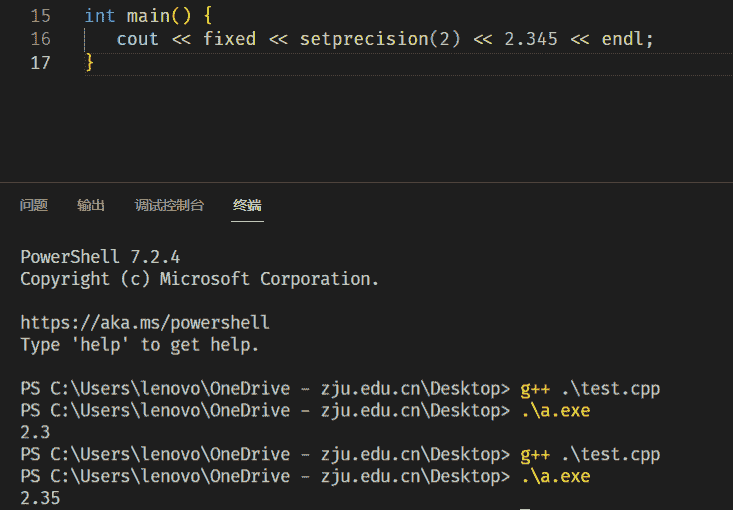

1.

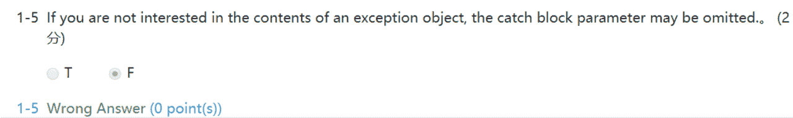

1.

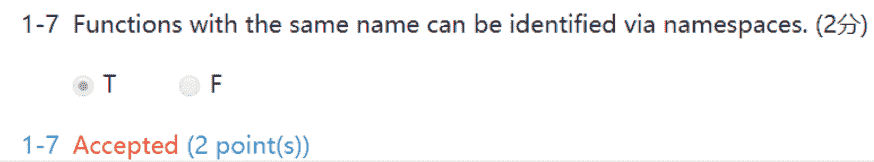

1.  Once Virtual, Always Virtual，传递继承的时候子类孙类不加virtual也会隐式加上virtual


1.  What to do!不是how to do

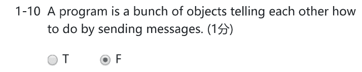

1.  加了const之后参数列表不同，就不是virtual的override了，所以直接静态绑定

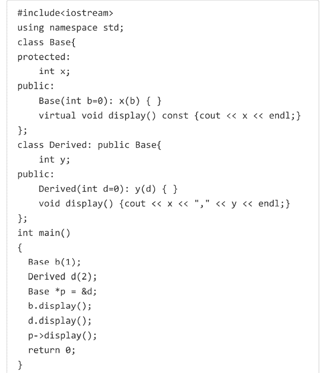

输出：

1

0，2

0

1.  注意new出来的数组用delete只会调用第一个的析构

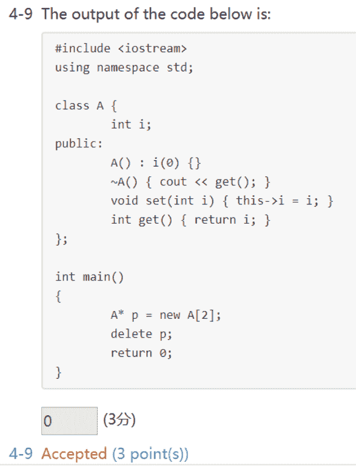

1.  new double[100]{};或者new double[100]();会初始为0，不加最后一个括号就是任意值

1.  throw相关

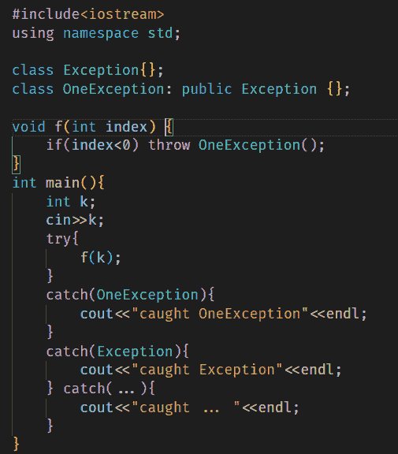

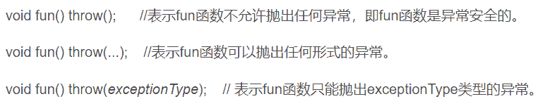

1.  explicit表示**必须显示调用构造函数**（其中函数参数、=初始化等都是implicit的）

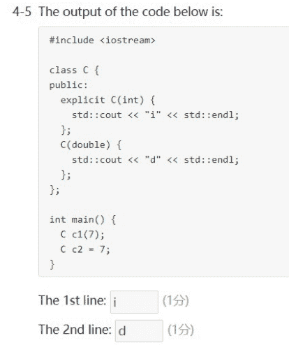

1.  Name hiding：发生在子类和父类之间，他们有两个同名的函数（甚至参数表不同也没用），子类就会hide掉父类的同名函数

1.  模板函数需要类型完全符合

另外**函数模板和普通函数区别结论：**1.两者允许并存 2.函数模板不允许自动类型转化 3.普通函数能够进行自动类型转换.

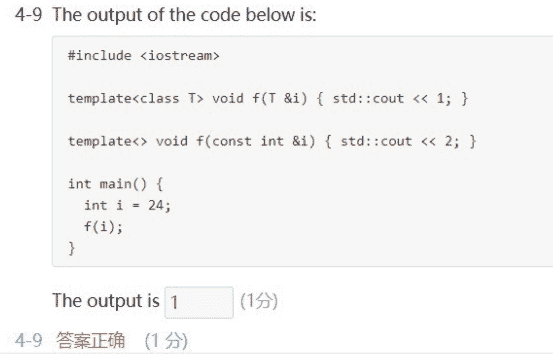

1.  **构造顺序**：静态成员--虚基类---（抽象类、基类）--成员变量--类自身的构造函数

1.  *之后得到的对象的虚函数表还是derive的虚函数表，因此还是动态绑定

1.  一些改错

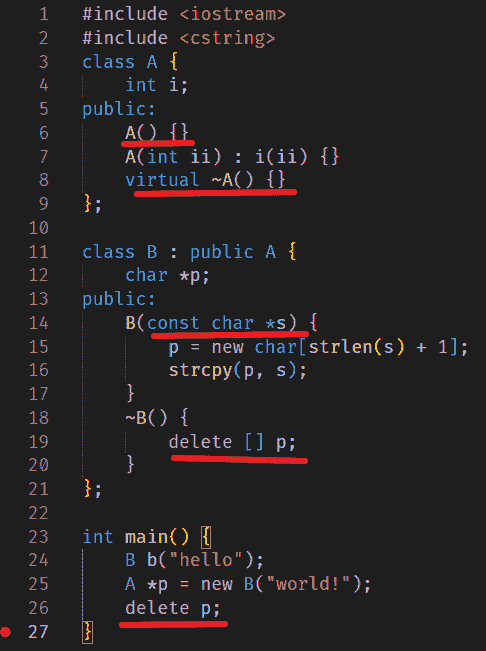

1.

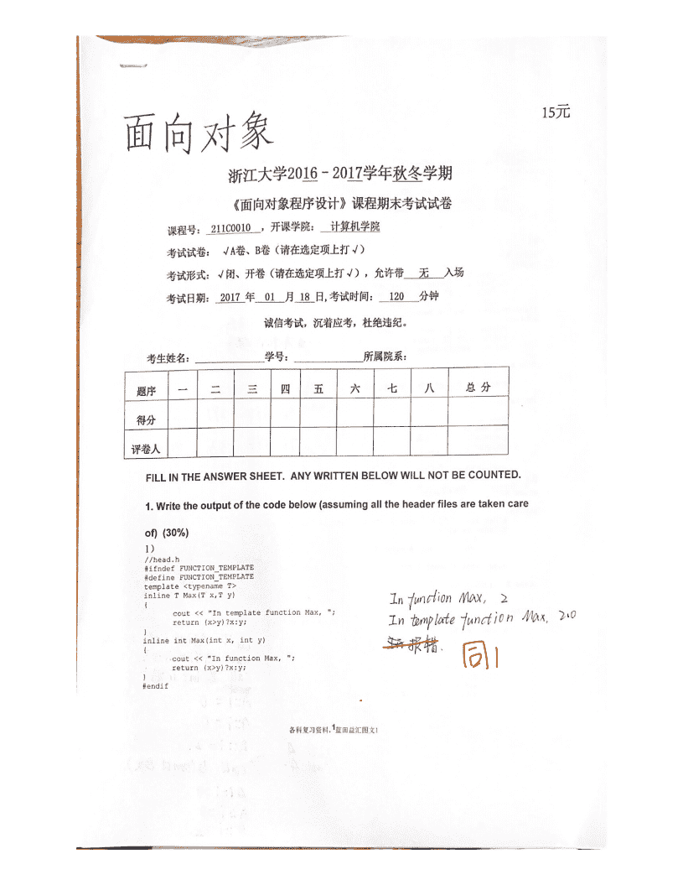

[扫描文稿.pdf](https://internal-api-drive-stream.feishu.cn/space/api/box/stream/download/all/boxcnPCfUMvDEfdFlg5QU9j7REg)

# TY

##### 关于const

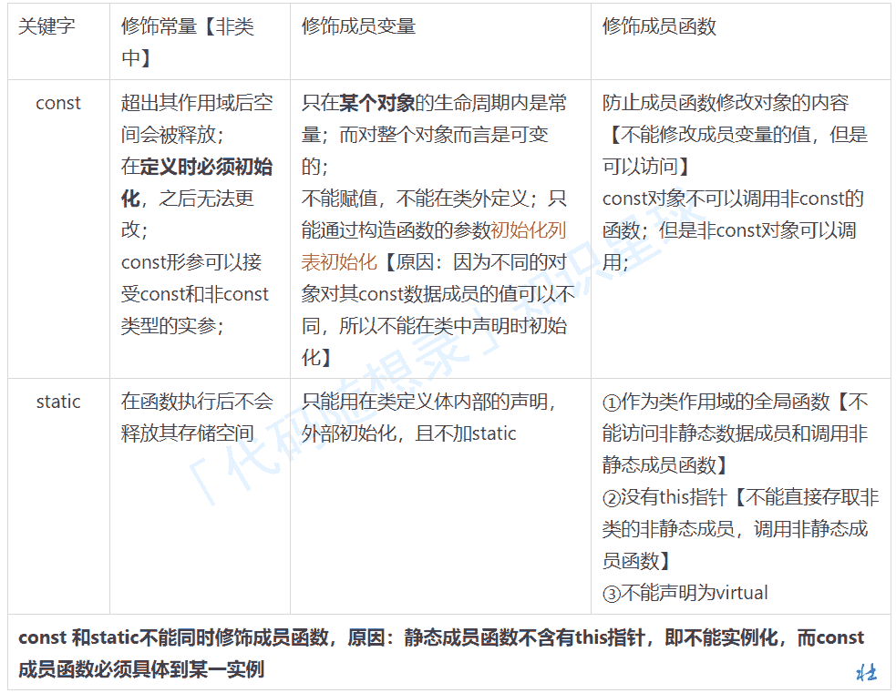

+   如果const要在外部被引用，需要

+   extern const int x = 1; （1）定义

+   通过对它初始化并指定为extern，我们强迫给它分配内存。 初始化使得它成为一个定义而不是一个声明。

+   extern const int x; （2）声明（外函数）

+   const的输出

+   当常变量为 const int a =i 时，直接输出j时，编译器不能进行优化，也就是不能够直接用i代替a；所以将const

+   当常变量为const int a =5时，直接输出a时，编译器会进行优化，也就是用文字常量5直接代替a；

##### 继承

+   基类的指针可以指向派生类对象：指向派生类里面，基类的那部分，如果有虚函数则是派生类的函数

+   派生类指针不能指向基类对象：因为派生类指针可以指向派生类中特有的成员变量，会溢出，所以不允许这个事情发生。

+   基类虚函数的优先级高于派生类中的需要强制类型转换的同名函数

+   基类和派生类中的参数不同，不构成多态

+   如果有多重继承，调用爷爷的爷爷的虚函数，会找到最小的辈分的函数运行。

##### 全局变量和静态变量

1.  全局变量定义的位置无论是在main之前还是在main之后，都是在main执行之前按从前往后的顺序构造。

1.  构造过程中，全局变量和全局静态变量构造顺序优先级相同。

1.  析构过程中，先将定义过的全局变量和静态变量（包括全局和局部）按构造顺序排好（和静态变量的作用域无关），然后按相反的顺序析构。

##### 一些细节

1.  构造函数对常数据成员初始化，只能通过初始化列表。

1.  前缀or后缀

+   int count::operator++(int)是后缀a++

+   count& count::operator++()是前缀++a

1.  static函数外必须定义

+   拷贝构造和赋值，默认浅拷贝。这就导致如果拷贝构造了两个，在第一个析构的时候delete掉了变量，第二个就寄了

1.  含纯虚函数的类不能实例化

1.  protected的范围：友类，子类，自己

1.  private：友类，自己

1.  引用一旦初始化，赋值无效

1.  delete指针，只析构指针指向的类（基类）

1.  函数后面加throw()会不抛出异常

1.  捕捉异常范围从小到大

1.  不同变量的函数不构成继承多态。

1.  只有返回类型不同不算重载

1.  “new出来的的变量在堆区,但静态变量放在全局区。 ”

1.  **在Person类中定义了**其他构造函数，那么，编译器不会为你创建默认构造函数

1.  class中的变量和函数默认**private**，struct中的函数默认为public

1.  包含纯虚函数的类称为“抽象类”，不能实例化

1.  Abstract class指的是用关键字abstract修饰的类，叫做抽象类，是不允许实例化的类，不能直接创建对象，必须要通过子类创建才能使用abstract类的方法。

1.  C++默认的绑定方式是静态绑定

1.  静态绑定：在编译时刻，根据指针或引用变量的静态类型来决定成员函数属于哪一个类。

动态绑定：在运行时刻，根据指针或引用变量实际指向或引用的对象类型（动态类型）来确定成员函数属于哪一个类。

1.  动态绑定的实现条件：

1.  类的定义中成员函数声明为虚函数

1.  通过引用或指针来访问对象的虚函数

1.  super class超类也叫父类，对于C，一个子类可以继承多个父类,从而实现多重继承。

1.  二义性仅针对double面临float和int的选择，对于其他数据类型不会报错，正常类型强制转换就可以。（float默认选择double，就很正常，只有double有选择恐惧症）

1.  Manipulators are objects to be inserted or extracted into/from streams.

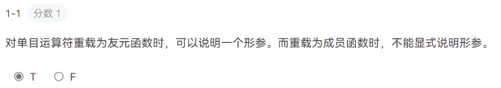

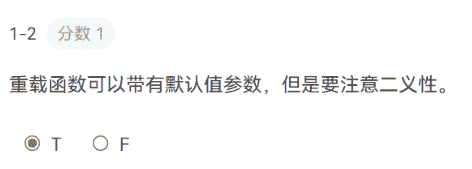

题

```
 //A有构造，析构，Exception有构造、析构
 try{
     A a;
     a.f(10);//里面throw Exception();
 }
 catch(Exception m){
     cout&lt;&lt;&quot;catch&quot;&lt;&lt;endl;
 } 
```

应该是：

```
 A()
 Exception()
 Exception(const Exception&amp;)
 ~A()
 catch exception
 ~Exception()
 ~Exception()
```

# Fcr

1.

```
#include &lt;iostream&gt;
#include &lt;string.h&gt;
using namespace std;
class A
{
public:
    A() { cout &lt;&lt; &quot;A( )&quot; &lt;&lt; endl; }
    ~A() { cout &lt;&lt; &quot;~A()&quot; &lt;&lt; endl; }
};
class B : public A
{
public:
    B() { cout &lt;&lt; &quot;B( )&quot; &lt;&lt; endl; }
    ~B() { cout &lt;&lt; &quot;~B()&quot; &lt;&lt; endl; }
};
int main()
{
    A *ap = new B[2];
    delete []ap;
}
```

没有虚函数，所以只会析构A

2.

不要忘记释放内存

3.

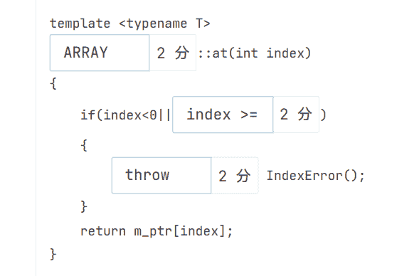

成员函数写在外面的时候记得

加上<T>

```
T&amp; ARRAY&lt;T&gt;
```

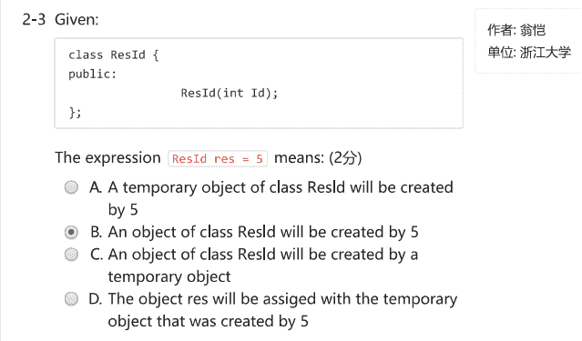

是B

# Cxt

1)函数重载：

函数名称必须相同。

参数列表必须不同（个数不同、类型不同、参数排列顺序不同等）。

函数的返回类型可以相同也可以不相同

*仅仅返回类型不同不足以成为函数的重载。

2)运算符重载

当**运算符重载为类的成员函数**时，函数的参数个数比原来的操作数要少一个（后置单目运算符除外），这是因为成员函数用this指针隐式地访问了类的一个对象，它充当了运算符函数最左边的操作数。因此：

**(1) 双目运算符**重载为类的成员函数时，函数只显式说明一个参数，该形参是运算符的右操作数。

**(2) 前置单目运**算**符重载为类的成**员函数时，不需要显式说明参数，即函数没有形参。

(3) 后置单目运算符重载为类的成员函数时，函数要带有一个整型形参。

3) <<

使用提取符(<<)可以输出各种基本数据类型的变量的值，也可以输出指针值。 是真的可以(wow)

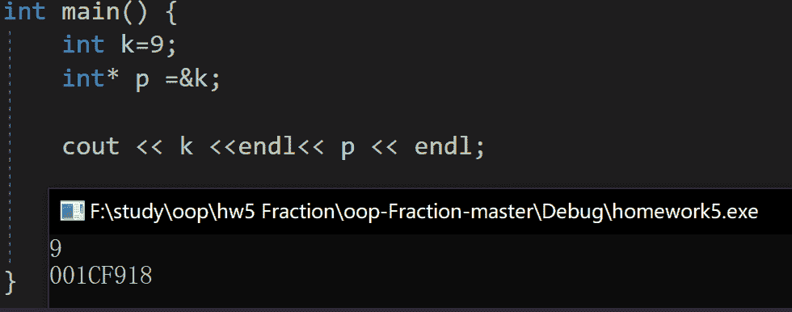

4）const成员函数、const对象调用规则

在相同的函数参数及相同的名字的情况下，const函数与非const函数可以构成重载函数，但是const成员函数不能改变任何的非静态变量。

调用规则：

const对象默认调用const成员函数，非const对象默认调用非const成员函数；

在**同时存在c**onst函数和非const重载函数的前提下，若 非const对象 想调用 const成员函数，则需要显示的转化，例如(const Student&)obj.getAge();若const对象想调用非const成员函数，同理进行强制类型转换const_cast < Student&>(constObj).getAge();(注意constObj一定要加括号)

当类中只有一种函数存在的情况，非const对象可以调用const成员函数或者非const成员函数，const对象只能调用const成员函数，若直接调用非const成员函数编译器会报错。

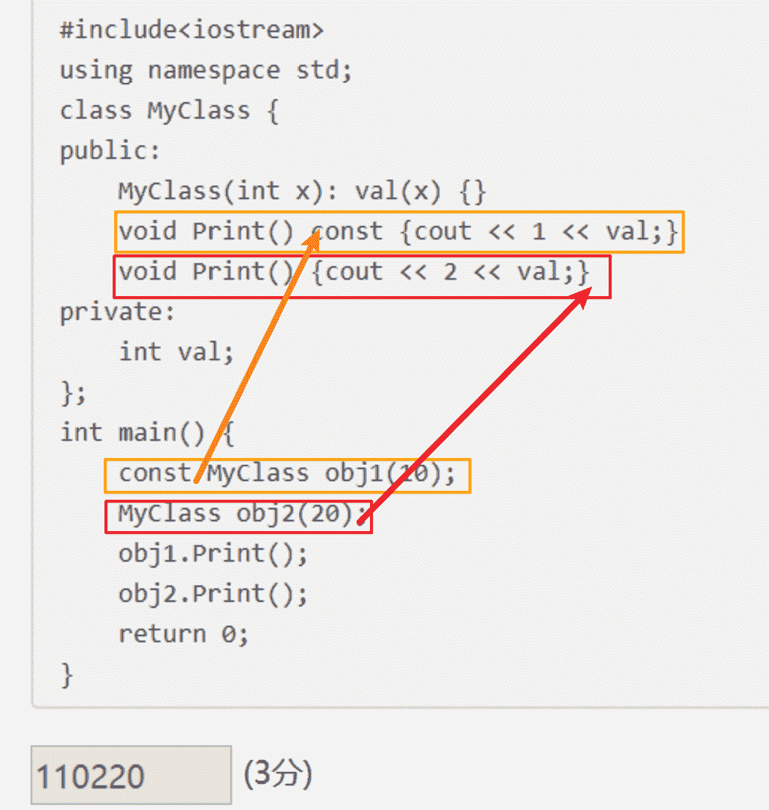

# Hyc

1.  template<> 特化

```
template&lt;T&gt; void f(T a) {cout &lt;&lt; 1;}
template&lt;&gt; void f(int a) {cout &lt;&lt; 2;}

int a;
call f(a)时输出2，而不会用上面那个产生模板
```