# 计算机系统Ⅲ

> 来源：[https://docs.feishu.cn/docx/IZKIdgoIboNAhOxOuzQc8eKAnUh](https://docs.feishu.cn/docx/IZKIdgoIboNAhOxOuzQc8eKAnUh)

## 前言

- 更自由，可以选择自己的方向
- 聊聊我们的课
- 从硬件到软件
- 操作系统作为管理软硬件资源的软件
- 系统Ⅲ会讲授
- `Memory内存`方面的内容
- 计算机系统的工作流程
- 知道为什么不仅仅知道What
- 探索设计时候的`tradeoff/量化`的研究方法
- 你自己的`system`，你未来的设想
- 下次上课带过来你的设计
- 一些关于安全的点
- `CPU vulnerability`
- `Memory attack`
- `System security`
- 硬件怎么影响整体，对计算机工作底层的理解，系统级编程
- `lab`：5+X part
- 软硬件结合
- `kernel`升级
- 性能优化

Road map

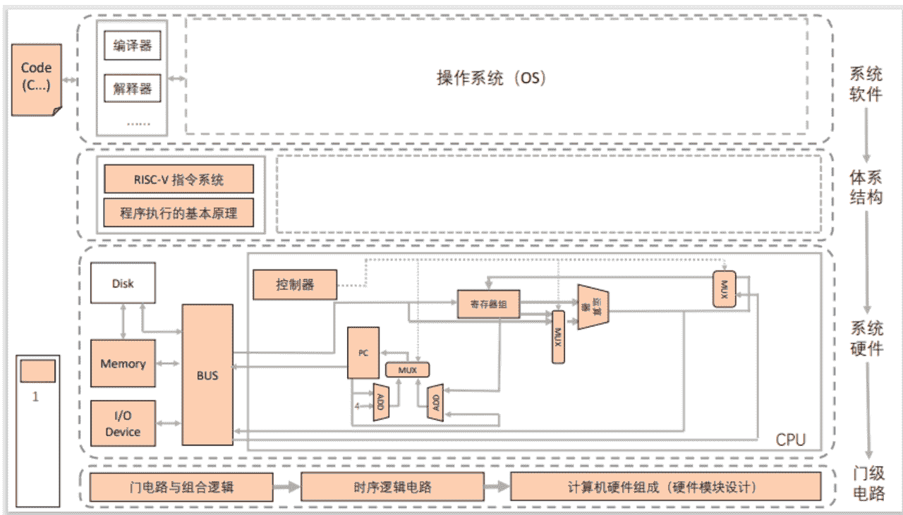

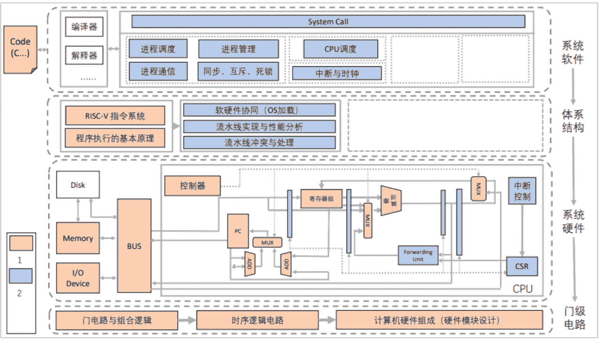

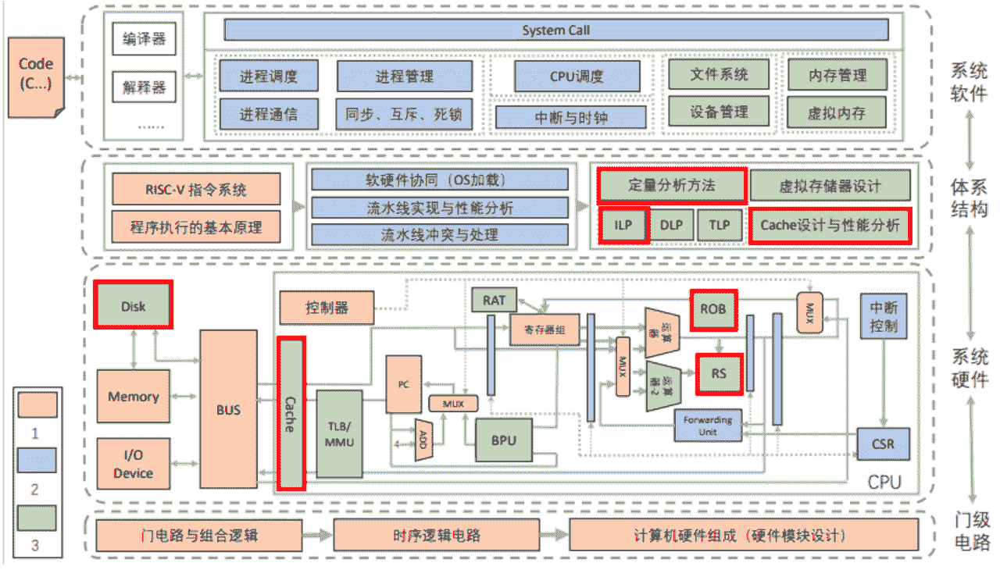

## 1 Fundamentals of computer science

- Problem
- Algorithm
- Program
- Runtime system（`VM`、`OS`、`MM`）
- `ISA`
- Microarchitecture
- Logic
- Circuits
- electrons

### 1.1 Von Neumann Structure

- 把数据和程序放进了`Memory`

### 1.2 Classes of Computers

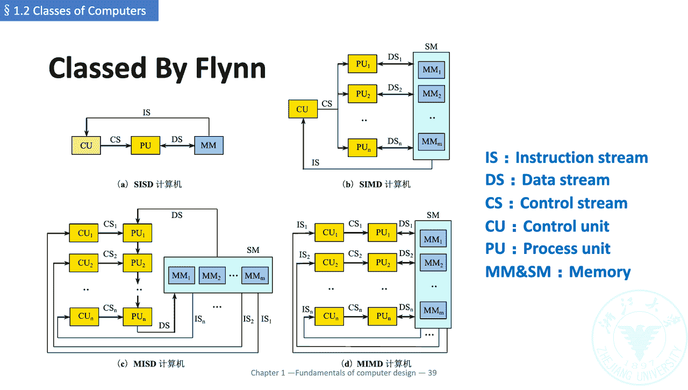

- Desktop Computers
- Server Computers
- Embedded Computers
- Personal Mobile Devices
- Supercomputer
- 多台协同的设计
- 还需要物理的设计

### 1.3 Understanding Performance

- Algorithm
- Determines number of operations executed 指令数量
- Programming language、compiler、architecture
- Determine number of machine instructions executed per operation 机器指令的数量
- Processor and memory system
- Determine how fast instructions are executed 指令执行的速度
- I/O system（Including `OS`）
- Determines how fast I/O operations are executed I/O指令执行的速度

根据处理数据的过程，慢慢分成三个领域

- Speed up `processing`（parallel）处理
- Speed up `transmission`（accurary）传输
- Increase `storage` capacity and speed up storage（reliability）存储

也是我们主要讨论的三个方向

#### 1.3.1 Measuring Execution Time

- Elapsed time：从一个事件的开始到结束所经过的实际时间，也可以称为运行时间或墙钟时间。它是指计算机程序的执行时间，包含了程序启动和终止的时间、输入输出的时间、以及程序实际运行的时间。
- Total response time, including all aspects
- Processing, I/O, `OS` overhead, idle time
- Determines system performance
- `CPU` time：程序在`CPU`上真正执行的时间，不包括等待输入输出或者其他进程调度所花费的时间。
- Time spent processing a given job
- Discounts `I/O time`, other jobs’ shares
- Comprises user `CPU` time and system `CPU` time
- User `CPU` time : `CPU` time spent in the program itself
- System `CPU` time: `CPU` time spent in the `OS`, performing tasks on behalf of the program
- Different programs are affected differently by `CPU` and system performance

#### 1.3.2 The improvement of computer architecture

- Improvement of `input / output`
- The development of memory organization structure
- Associative memory and associated processor
- General register group
- Cache
- Two directions of instruction set development:
- `CISC`
- `RISC`
- Parallel processing technology
- How to develop parallelism in traditional machines?
- Develop parallel technologies at different levels.
- For example, micro operation level, instruction level, thread level, process level, etc

### 1.4 Quantitative approaches（2个量化的公式）

> Execution time：the best performance measure

#### 1.4.1 CPU性能公式

##### 1.4.1.1 Measuring Data Size

- bit
- nibble - four bits
- byte - eight bits
- word - four bytes on embedded/mobile processors and eight bytes on desktops and servers
- KB -  bytes
- MB -  bytes
- GB -  bytes
- TB -  bytes
- PB -  bytes

##### 1.4.1.2 CPU Performance


> Clock Period（Clock Cycle Time）：duration of a clock cycle

- 减少`clock cycles`的数量
- 减少每个`clock cycle`的长度/提高`clock rate`


`CPI`是指每条指令所需的时钟周期数（Cycles Per Instruction），也被称为指令周期数（Instruction Per Cycle）。

`CPI`通常是由处理器架构、指令集、编译器、操作系统等多个因素共同决定的，它可以用来描述处理器的效率和性能。例如，一个`CPI`为2的处理器，完成一条指令需要2个时钟周期，相对而言速度就比`CPI`为3的处理器快。

`CPI`还可以用来计算程序的运行时间，因为程序运行时间取决于指令的数量和每条指令的`CPI`。通常情况下，我们希望`CPI`尽可能地小，这样可以提高计算机系统的性能和效率。

> 指令数由`program`、`ISA`、`compiler`决定

> `CPI`由计算机硬件决定

> 不同的指令的`CPI`不一样——>平均`CPI`

> 指令数不一样——>各自算`CPI`，再加起来算`Clock Cycles`

> 加权`CPI`

- Performance depends on
- Algorithm: affects `IC`, possibly `CPI`
- Programming language: affects `IC`, `CPI`
- Compiler: affects `IC`, `CPI`
- Instruction set architecture: affects `IC`, `CPI`,

#### 1.4.2 Amdahl’s Law

> Make the common case fast！

最优的`Speedup`不会超过

### 1.5 Great Architecture ideas

- Design for `Moore’s Law`
- Use `abstraction` to simplify the design
- Make the common case fast
- Improve `performance` via parallelism
- 指令层
- 进程层
- Improve `performance` via pipelining
- Improve `performance` via prediction
- Use a hierarchy of memories
- 空间：提高空间量
- 速度：把东西放到离`CPU`最近的地方
- 猜测
- Improve `dependability` via redundancy
- 冗余备份，不过占用了空间
- 安全和效能`balance`

#### 1.5.1 Why learn architecture？

> 软硬件界面，中流砥柱

程序员需要了解“below the program”下的东西

- The parallel nature of processors
- The hierarchical nature of memory
- The translation of high-level languages into hardware instructions

## 2 ILP（Instruction-Level Parallelism乱序并行）

> 流水线不是分越多层越好，会有其他损耗，需要做`balance`

Instructions Dependence：

- 数据相关（Data Dependence）

对于指令`i`和指令`j`，如果指令`j`使用指令`i`产生的结果或者指令`j`与指令`k`数据相关，指令`k`与指令`i`数据相关，则指令`j`与指令`i`数据相关。

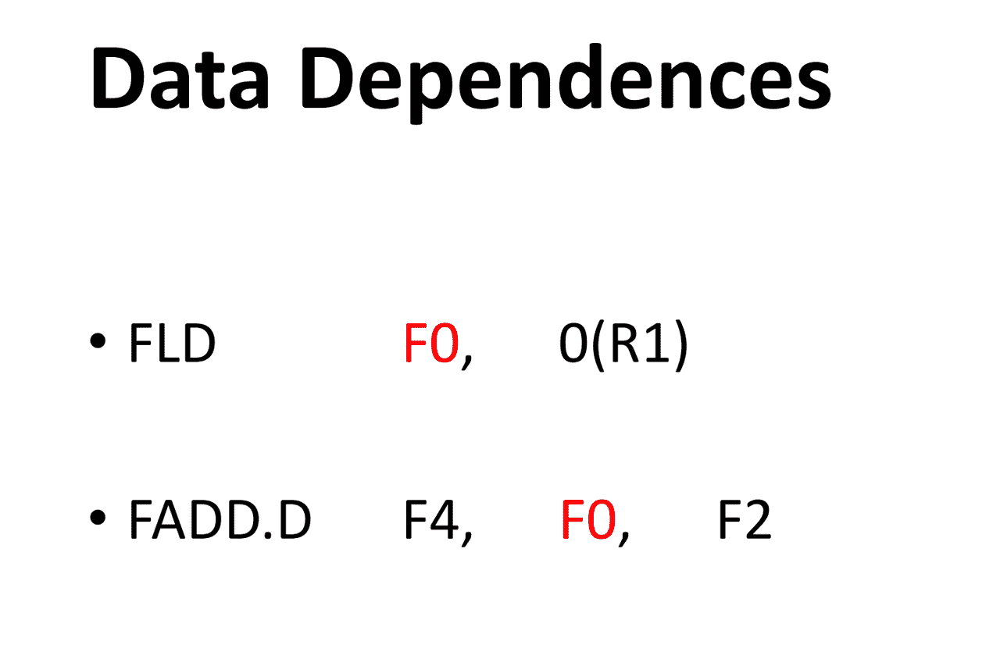

- 传递性`RAW`

硬件可以采用互锁（`Interlock`）机制，也就是一旦硬件检测到某条指令与前面正在流水线中执行的指令存在数据相关，则停止本指令的执行，插入空转周期，知道前面执行指令的结果可用为止。

如果定义指令的相关距离（`Distance`）为两条指令之间的指令条数，则分析数据相关的主要工作如下：

- 确定指令的相关性，找到所有可能产生停顿的地方
- 确定必须严格遵守的数据的计算顺序
- 确定指令的最大相关距离，确定程序中可能的最大并行性

另一个需要判断的还有是发生在寄存器还是存储器。

- 名相关（Name Dependence）

指令使用的寄存器或存储器称为名。如果两条指令使用相同的名，但它们之间并没有数据流，则称之为名相关。

1）反相关（`Anti-dependence`）:指令`i`先执行，指令`j`写的名是指令`i`读的名。（先读后写相关`WAR`）

2）输出相关（`Output Dependence`）：指令`j`和指令`i`写相同的名。（写后写相关`WAW`）

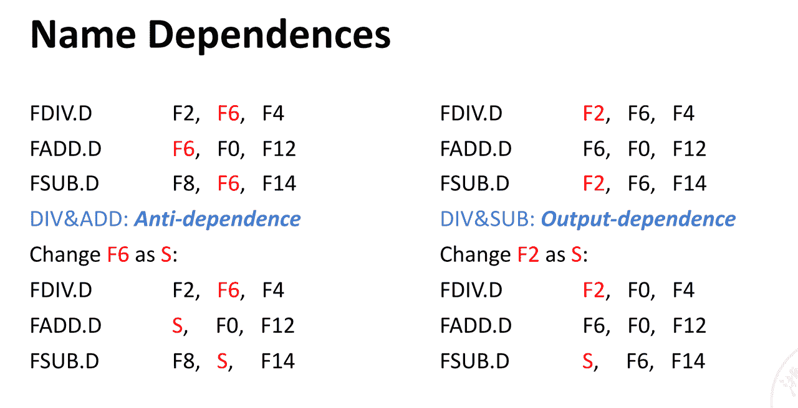

与数据相关比较，名相关的指令之间没有数据交换。可以通过改变指令中操作数的名消除名相关，即换名（`Renaming`）技术。对于寄存器操作数进行换名称为寄存器换名（`Register Renaming`）。

- 控制相关（`Control Dependence`）

由分支指令引起的相关，需要根据分支指令执行的结果来确定后续指令执行的顺序。

处理原则：

1）与控制相关的指令不能移到分支指令之前，即控制有关的指令不能调度到分支指令控制范围之外。

2）与控制无关的指令不能移到分支指令之后，即控制无关的指令不能调度到分支指令控制范围之内。

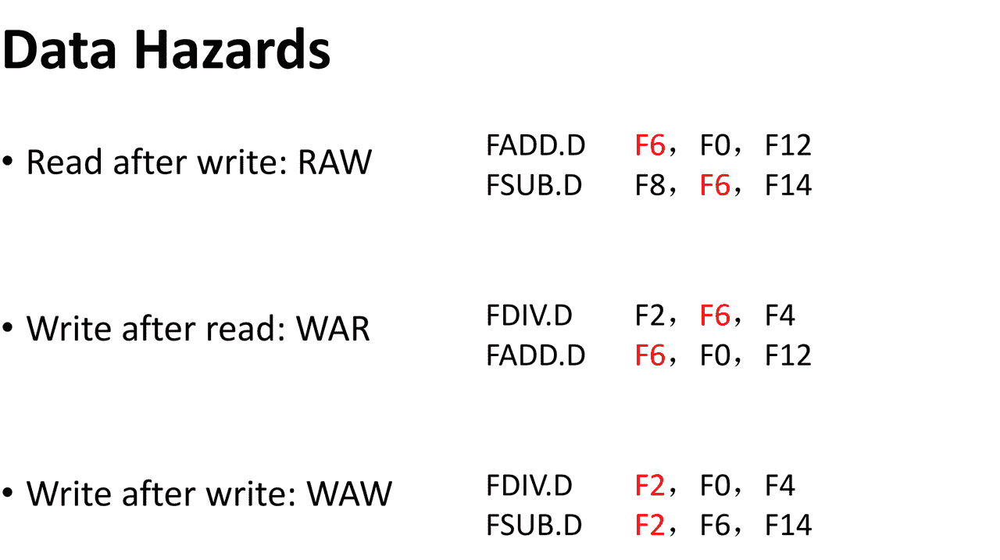

异步的`Hazard`：

- Structure
- Data
- `RAW`（Read after write）——Data dependences
- `WAR`——Anti-dependences
- `WAW`——Output dependence
- `Control`——Control

Solution：

- Data
- Forwarding
- Bubble
- reorder
- Control

- 静态分支预测
- 基于一般的分支情况
- 一直预测`taken`
- 一直预测`not taken`
- 动态分支预测
- 硬件记录最近的分支`buffer`，记录最近分支的历史
- 假设未来的行为会继续这个趋势，如果错误，`stall`，更新
- 延迟槽`Delay slot`
- 有了更高级的动态分支预测就不需要使用`Delay slot`了
- `BHT`（Branch History Table）
- `1-Bit Predictor`
- `2-Bit Predictor`
- `Branch-Target Buffers`

> 看`Lab 1`

> 指令级并行的概念：当指令间不存在相关时，它们在流水线中是可以重叠起来并行执行的。

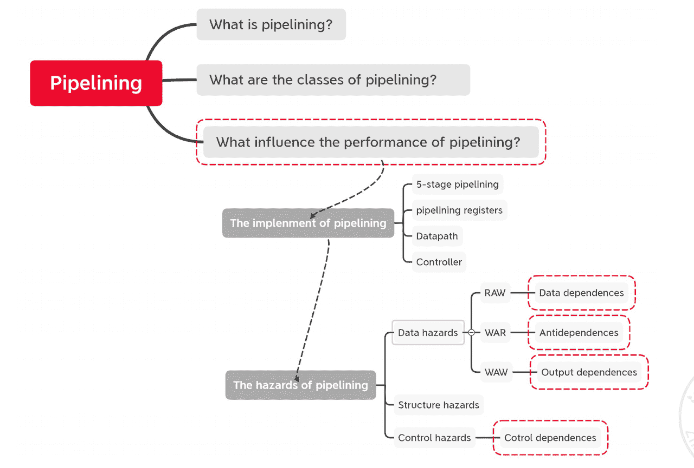

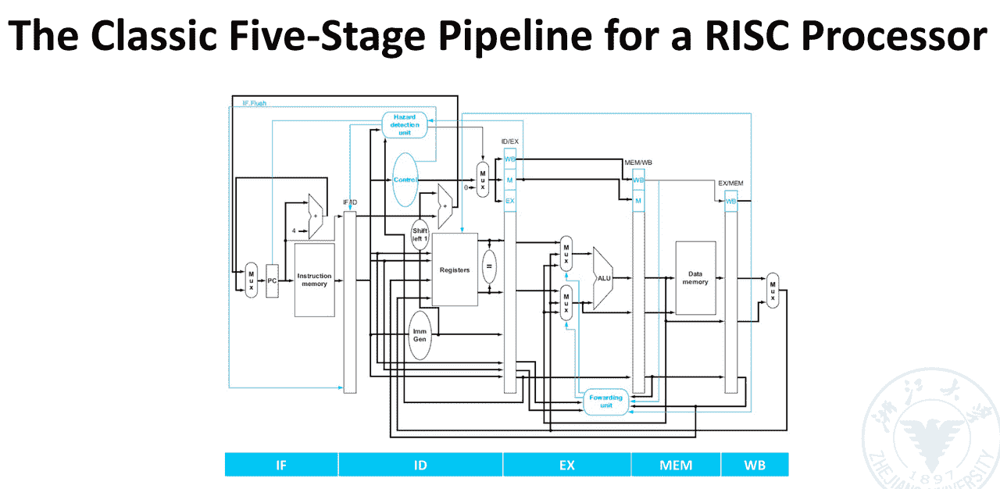

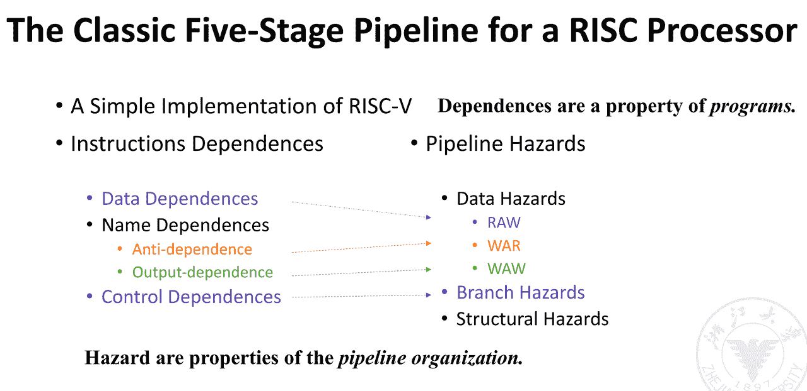

### 2.0 静态调度

依靠编译器确定并分理出程序中存在相关的指令，然后进行指令调度，并对代码进行优化，这个过程称为静态调度。

> 区别在于在程序运行之前还是之后

### 2.1 Dynamic Scheduling动态调度

> 当停滞的时候，让一些排序在后的可以先发生，乱序执行

> 通过硬件重新安排指令的执行顺序来调整相关指令实际执行时的关系，减少处理器空转。

> 但乱序执行引入了`WAR`和`WAW`的风险，这两种在五阶段的整数流水线和其有序浮点管道的逻辑扩展中本来是不存在的

- 在计算机系统中，乱序执行是一种优化技术，它允许处理器在不改变程序语义的前提下，通过重排序指令的执行顺序来提高程序的执行效率。然而，乱序执行也会引入一些风险，其中包括`WAR`（写后读）和`WAW`（写后写）的风险。

- 在五阶段的整数流水线和有序浮点管道中，由于每个指令按照顺序一个接一个地执行，不存在指令之间的数据依赖问题，因此也就不存在`WAR`和`WAW`的风险。但是，在乱序执行中，由于指令的执行顺序是动态决定的，如果存在数据依赖关系，就有可能出现`WAR`和`WAW`的风险。

- `WAR`风险是指，一个指令在写入结果之前，另一个指令已经读取了同一个寄存器的值。这可能会导致另一个指令读取到错误的数据，从而影响程序的执行结果。

- `WAW`风险是指，两个指令都试图写入同一个寄存器，且它们的执行顺序与程序的执行顺序不同。这可能会导致寄存器中保存了错误的结果，从而影响程序的执行结果。

> 动态调度常用的两种硬件策略：`Scoreboard` 和 `Tomasulo`

- 执行时可以乱序，因此指令的结束也是乱序的

#### 2.1.1 Scoreboard algorithm

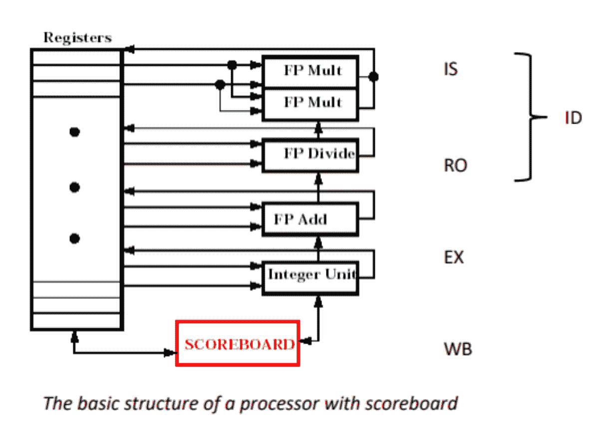

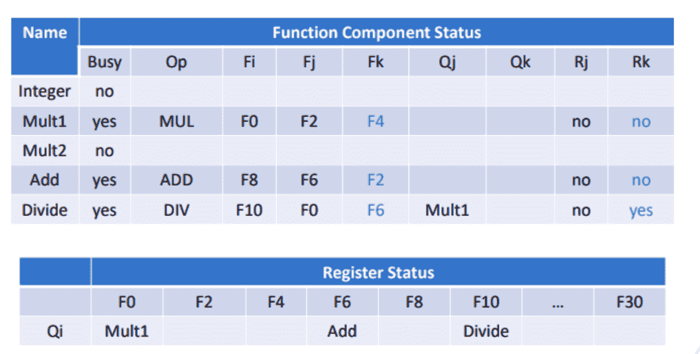

```
FLD    F6,34(R2)
FLD    F2,45(R3)
FMUL.D    F0,F2,F4
FSUB.D    F8,F2,F6
FDIV.D    F10,F0,F6
FADD.D    F6,F8,F2
```

- 每条指令均经过记分牌，并记录下各条指令间数据相关的信息，这一步对应于指令流出，部分取代指令译码（`ID`）阶段的功能。然后记分牌就需要判断什么时候指令可以读到所需的操作数，开始执行指令。如果记分牌判断出一条指令不能立即执行，它就检测硬件的变化从而决定何时能够执行。记分牌还控制指令写目标寄存器的时机。

- 为了允许乱序执行，在`ID`段拆开检查`Structural/data hazards`，每条指令在流水线中的执行过程可分为指令的流出、读操作数、执行和写结果等四段。


### 2.1.1 Scoreboard

+ `IS` `Issue`：译码，顺序进入。若本指令所需的功能部件有空闲（检查`structural hazard`），且其他正在执行的指令使用的目的存储器于本指令的不同，记分牌就向功能部件流出本指令，并修改记分牌内部的数据记录。

+ `RO` `Read Operand`：直到无`data hazard`，读操作数，数据就绪就可以乱序执行。

+ `EX` `Execute`：取到操作数后就开始执行指令。

+ `WR`：记分牌知道指令执行完毕后，如果目标寄存器空闲，就将结果写入到目标寄存器中，然后释放本指令使用的资源。

+ 一些重要信息记录在`Scoreboard`里，以免出现新的`hazard`（`WAR`，`WAW`）

+ `指令状态表`：每个指令在哪一阶段

+ `功能部件状态表`：记录各个功能部件的状态。每个功能部件在状态表中都由以下9个域来记录：

+ `Busy`：指示功能部件是否在工作

+ `Op`：功能部件当前执行的操作

+ `F_i`：目的寄存器编号

+ `F_j`,`F_k`：源寄存器编号

+ `Q_j`,`Q_k`：向`R_j`,`R_k`中写结果的功能部件

+ `R_j`,`R_k`：表示`F_j`，`F_k`是否就绪，是否已经被使用

+ `yes`——操作数准备好了但是还没有读

+ `no & Qj = null`——操作数被读了

+ `no & Qj != null`——操作数没有`ready`

+ `结果寄存器状态表`：每个寄存器在表中有一个域，用于记录写入本寄存器的功能部件（编号）。如果当前正在运行的功能部件没有需要写入本寄存器的，则相应域置为空。

+ 总是在检测是否引起了`WAR`、`WAW`冲突

记分牌的性能受限于以下几个方面：

+ 程序指令中可开发的并行性，即是否存在可以并行执行的不相关的指令

+ 记分牌容量。决定了流水线能在多大范围内寻找不相关指令。流水线中可以同时容纳的指令数量又称为指令窗口，目前假设记分牌指令窗口中仅仅容纳一个基本块，这样就可以不考虑分支指令的问题。

+ 功能部件的数目和种类。

+ 反相关和输出相关。引起记分牌中`WAR`和`WAW`阻塞。

#### 2.1.2 Robert Tomasulo

> 引入了寄存器重命名，最小化`WAW`和`WAR`的危害

> 比`Scoreboard`更优

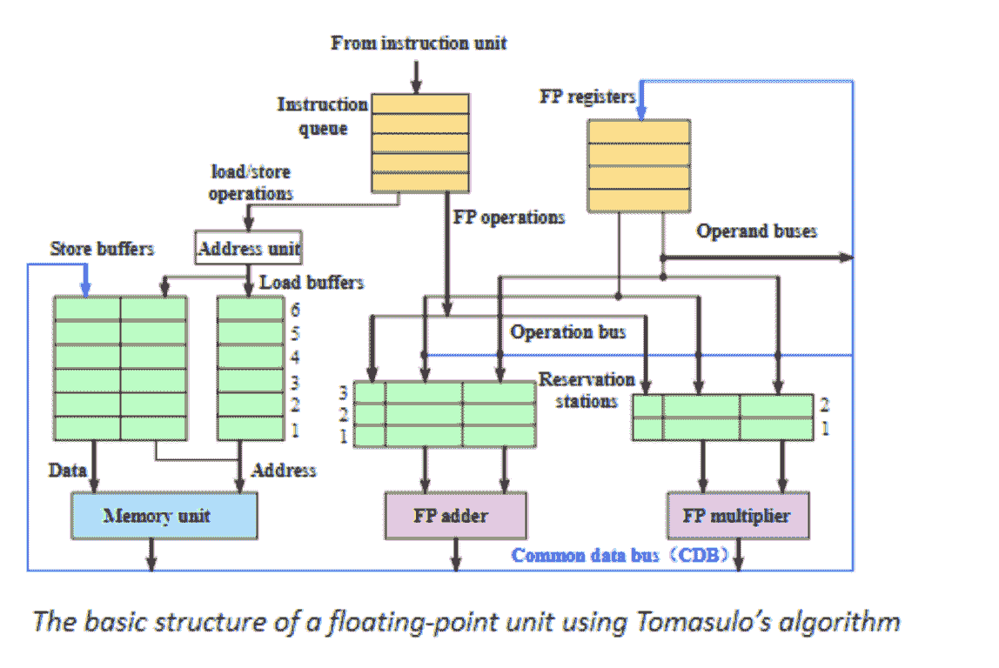

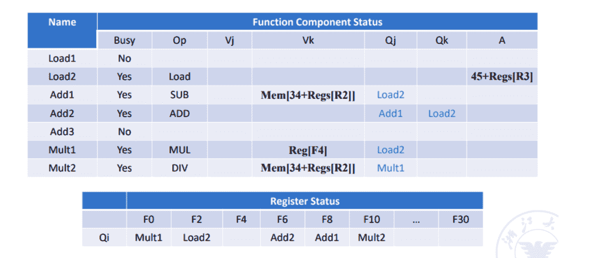

```
FLD    F6,34(R2)
FLD    F2,45(R3)
FMUL.D    F0,F2,F4
FSUB.D    F8,F2,F6
FDIV.D    F10,F0,F6
FADD.D    F6,F8,F2
```

将记分牌的关键部分和寄存器换名技术结合在一起，其核心思想是通过寄存器换名来消除`WAW`和`WAR`相关而可能引发的流水线阻塞。

+ 假设有两个临时寄存器`S`和`T`

> `Tomasulo`算法采用寄存器重命名（`Renaming`）方法，将记分牌中的寄存器和指令的运算内容用一大组"虚拟寄存器名"来代替（也就是下面的保留站）。

> 功能部件缓冲器称为 “保留站(`reservation stations`)”，用来存放未决的操作数；

+ 可以把指令都先放入保留站，需要管`load/store`顺序，不需要管是否存在`WAR`、`WAW`冒险，可以乱序执行，但是`Scoreboard`需要考虑

> 指令中的寄存器被数值或者指向保留站的指针代替，这一过程称为：寄存器换名(`register renaming`) ;

> 保留站比实际寄存器多，因而可以完成编译器所不能完成的一些优化工作；以消除`WAR`、`WAW`冒险；

算法阶段

+ `Issue`

从图中的`FP Op Queue`中取出指令，如果保留站空闲（无结构冒险），控制机制发射指令，发送操作数（对寄存器进行换名，消除名相关）；如果有结构冒险，则`stall`。

+ `Execute`

对操作数执行操作（`EX`），如果两个操作数都已就绪，就执行（`RAW`的处理）；如果没有就绪，就观测公共数据总线等待所需结果；

+ `Load` 和 `Store`需要两步执行

+ `Write result`

+ 写回到`CDB`，传到寄存器和保留站里（包括`store buffer`）。需要一个周期才可写回。

有三个表

+ `指令状态表`

+ 只是帮助理解，不是硬件的一部分

+ `保留站`

+ 保留了每一个操作的阶段

+ `寄存器状态表`

+ 包括操作的保留站编号

保留站组成

+ `Op`：该部件将完成的具体操作（例如, + or –）

+ `V_j`, `V_k`：源操作数的实际数值，存储缓冲器（`Store buffers`）设有`V`域，存放将存储的结果；

+ `Q_j`, `Q_k`：将产生源寄存器值（将写的值）的保留站。

+ `Busy`：指明保留站或相应的`FU`（`functional unit`）处于忙状态

+ `A`：用户`load`或`store`的地址计算信息

+ `Register result status`结果寄存器：指明哪个功能部件将写到哪个寄存器（`Q_i`）。如果没有将写入寄存器的未决指令，该域为空；在`Tomasulo`算法中`Q_j`、`Q_k`=`0` 就表示操作数处于`ready`状态。

`Tomasulo`算法和记分牌在结构上还有下列3处显著的不同：

+ 指令流出逻辑和保留站相结合实现寄存器换名，从而完全消除了数据`WAW`和`WAR`相关这类名相关。

+ 冲突检测和指令执行控制机制分开。一个功能部件的指令何时开始执行，由该功能部件的保留站控制，而记分牌则是集中控制。

+ 计算的结果通过相关通路（公共数据总线`Common Data Bus`，`CDB`实现）直接从功能部件进入对应的保留站进行缓冲，而不一定是写到寄存器。所有等待这个结果的功能部件（指令）可同时读取。与之相比，记分牌将结果首先写到寄存器，等待此结果的功能部件要通过竞争，在记分牌的控制下使用。

`Tomasulo`算法相对于记分牌技术主要的优点列举如下：

+ 具有分布的阻塞检测机制：如果多条指令都在等待一个结果，且指令的另一个操作数都已准备就绪，公共数据总线广播这个被等待的结果后，这些指令可以同时得到这个结果数据，并同时开始进入执行段。

+ 消除了数据的`WAW`和`WAR`相关导致的阻塞。

> 注意：由于一旦指令进入流出段，原来指令在程序中的顺序就难以再保持，为了保持程序的例外特征不变，一旦由一条分支指令还没有执行完毕，其后的指令是不允许进入执行段，后面将采用前瞻技术解决这个问题。

> `Tomasulo`算法的另一个关键技术——动态存储器地址判别。第二遍循环的取操作在第一遍循环的存操作完成前就可以执行，这与正常的顺序是不同的。这种动态的存储器地址判别技术在编译器中调度取和存操作时也经常使用，可以消除关于存储器的写后读（`RAW`）相关、读后写（`WAR`）相关和写后写（`WAW`）相关。

`Tomasulo`算法结合了以下两种不同的技术：寄存器换名，可以获得更大的虚拟寄存器空间；对寄存文件中源操作数缓存，解决了寄存器中的有效操作数相关引起的阻塞

`Tomasulo`算法提高指令级并行的关键技术：指令动态调度、寄存器换名、动态存储器地址判别

缺点

+ 结构复杂

+ 性能受限于`CDB`

+ `load`和`store`可以乱序执行，只需要它们链接到不同的地址，如果是同一个地址，则

+ `load`比`store`早，则交换它们导致`WAR hazard`

+ `store`比`load`早，则交换它们导致`RAW hazard`

+ 交换两个`store`在相同地址会导致`WAW hazard`

#### 2.1.3 Homework

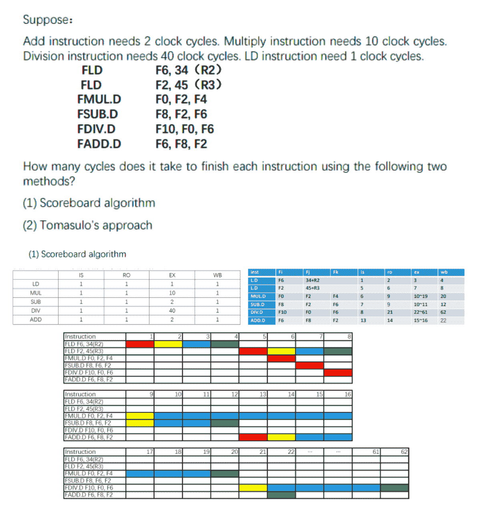

`Scoreboard`有两个`mul`，一个`div`，一个`integer`，一个`add`

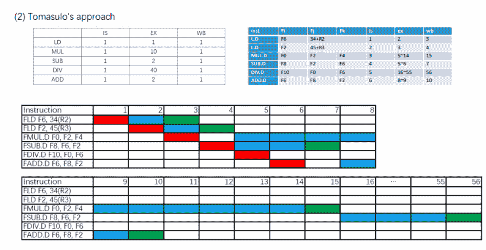

> 托马斯洛也只有一个`load`，所以前两个`ld`，第二个需要等到第一条`wb`的时候才能跑

> `add`写回的时候可以直接写回

> `Tomasulo`在`EX`检查`busy`是否能进部件，`Scoreboard`在`IS`检查是否`busy`，但都是`wb`的时候才修改`busy`

> `IS`检测结构冲突和`WAW`

> `RO`检测`RAW`（数据冲突）

### 2.2 Hardware-Based Speculation

> 增加了一步：在`Tomasulo`的基础上，硬件上增加了`reorder buffer`，先写到`reorder buffer`，再写到`regs`，允许乱序执行，在`reorder`调整和原来指令顺序一样；每一条指令在`wb`之后再有一个`commit`步，允许了之后再写入`regs`

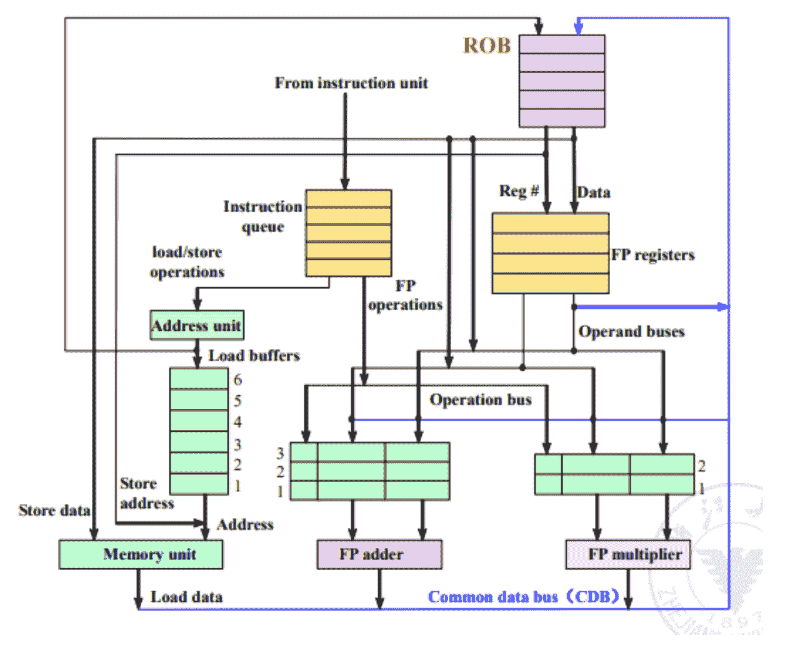

+ `IS`

+ `EX`

+ `WB`

+ 写到`ROB`

+ `Commit`（已经排序了）

`Hardware-Based Speculation`有三个`key ideas`

+ 动态分支预测，选择某个指令执行

+ 具有撤销不正确推测的能力

+ 动态调度，解决不同基本块组合的调度问题

相比于`Tomasulo`，`Hardware-Based Speculation`对`ROB`还有一个记录，通过`ROB`编号，释放空间。

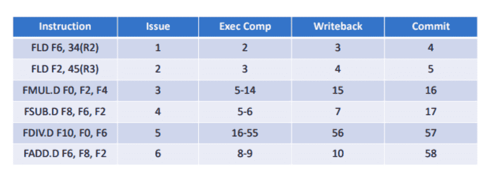

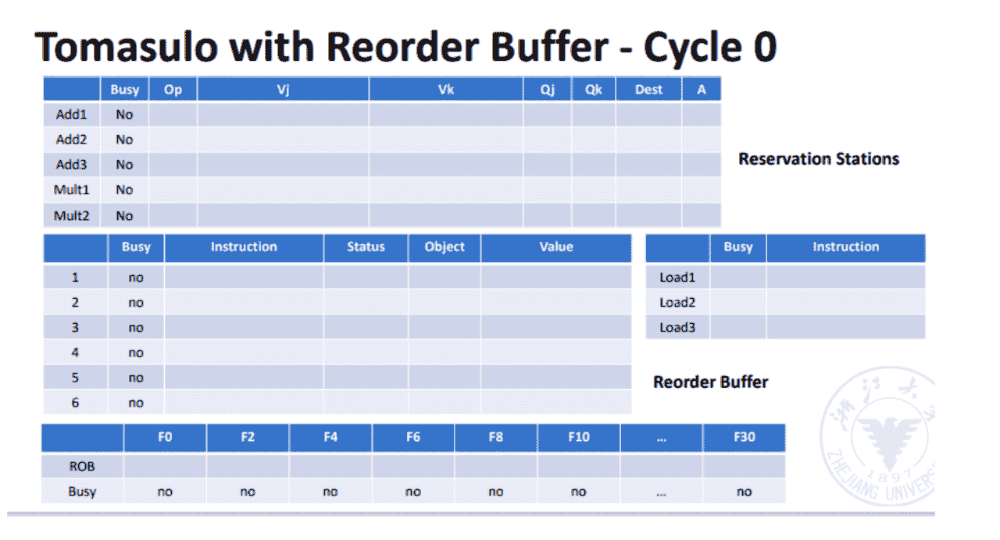

+ 指令是顺序执行的

+ 保证了精确异常，乱序的好处都有

+ 容易扩展到整数寄存器和整数函数

+ 硬件有些复杂

### 2.3 Exploiting ILP Using Multiple Issue and Static Scheduling

+ 多发射：一次好多条指令同时执行

+ 超标量：每个`clock`发射的指令数不是固定的；由特定的情况决定；可以是由编译器调度的静态，也可以是根据`Tomasulo`的动态

+ 是目前最成功的方法

+ 对于程序员来说是透明的，因为可以检查到下一条指令是否流出，不需要重新排列指令来满足指令的发出

+ 双发射：同时发两条指令，一条浮点数，一条整数

+ 超长指令字：每个`clock`发射的指令数是固定的（4-16），这些指令组成了一个长串的指令，指令之间的并行性是通过指令来确定的。

+ 指令的调度通过静态编译

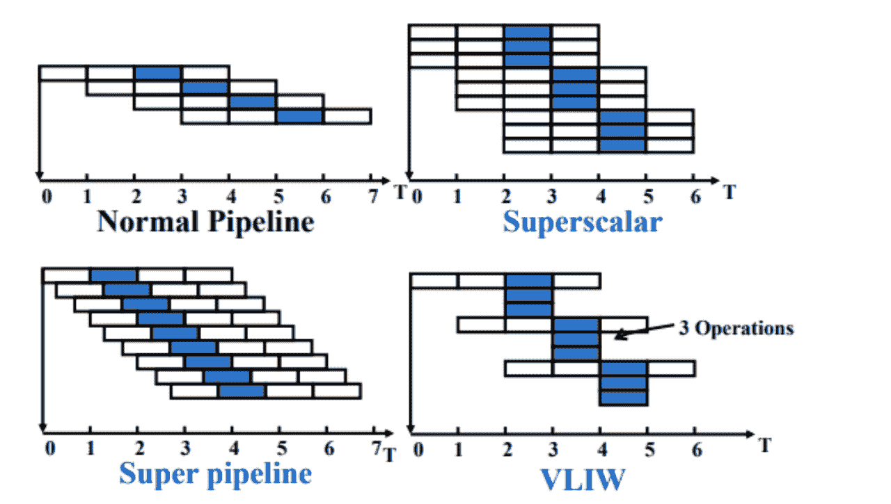

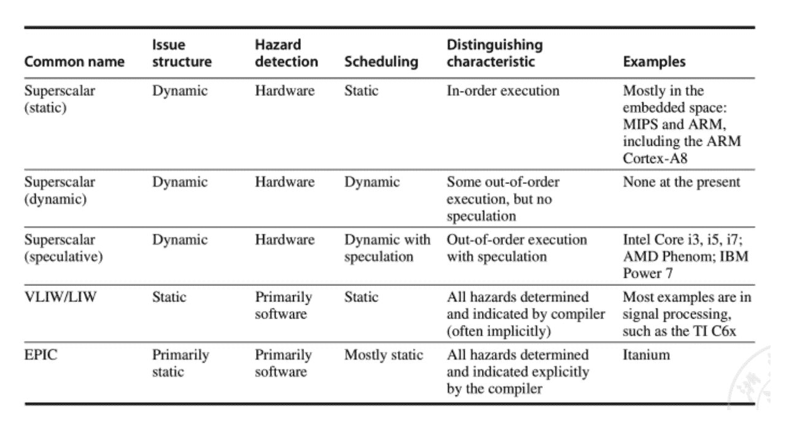

### 2.4 Nonlinear Pipelining

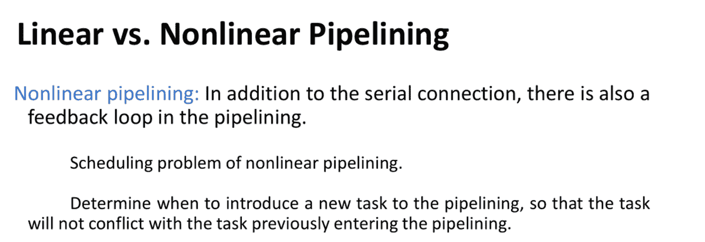

> 存在一些反馈的回环

> `Reservation Table`预约表


+ 不优化了，直接单周期顺序执行 ×

+ 寻找更优方法

+ 利用冲突向量

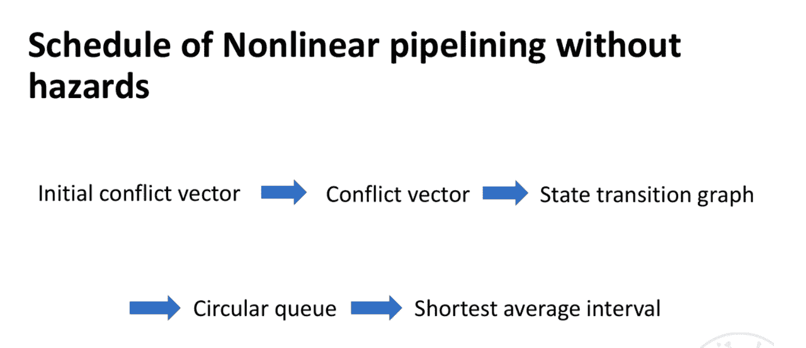

> 举个例子

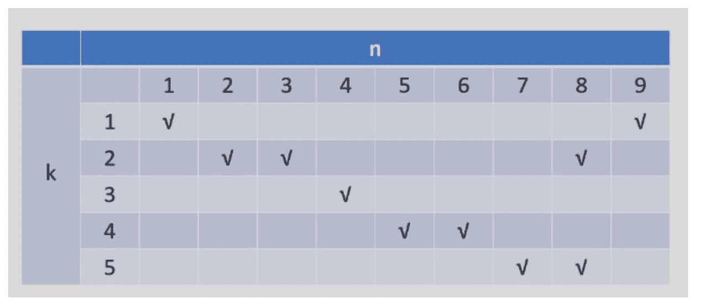

> 找到冲突拍子：

+ 8

+ 1,5,6

+ 1

+ 1

> 把集合表示成向量的样子`c_0={10110001}`

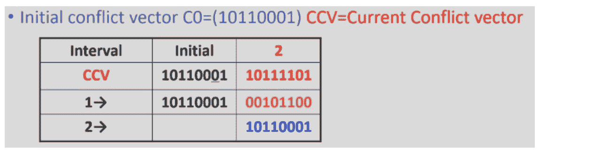

> 右移两拍（为什么？因为从右到左数第一个是`0`的是第二个），取并集

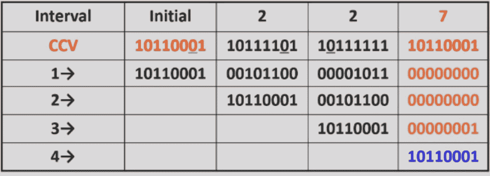

> `2`——>`2`——>`7`回到之前的状态

> 不过其实也可以`2`——>`7`

我们希望找到回环，构成回路

> 会有很多的调度方案构成回环

> 形成状态机，状态是冲突向量

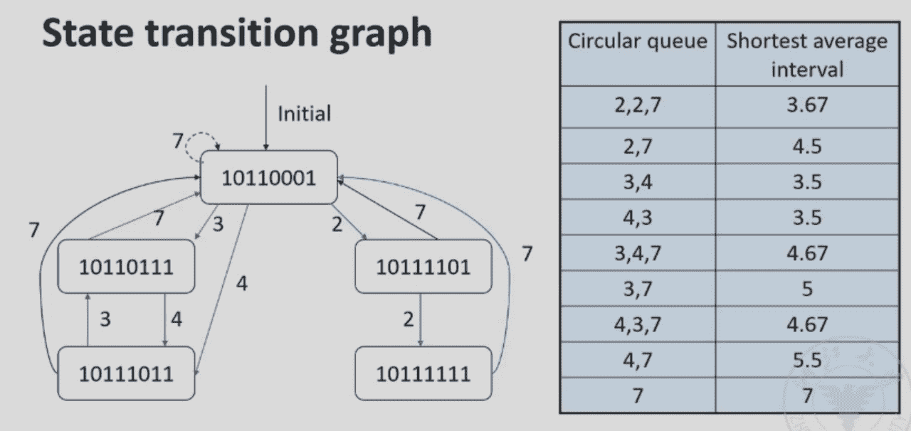

> `3`,`4`在其他两个状态中循环了

> 只要循环即可，不一定要回到初始状态；只要形成回环，就可以是一个调度方案

> 单功能和多功能静态可以用这种方法，多功能动态不可以，要用更进阶的东西解决

> 这个是咋看的？

+ 因为单功能只有一张固定的预约表，多功能静态只不过有多张固定的预约表；多功能动态按道理来说有无限张，故不行

CPU在追寻高效的同时，出现一些问题

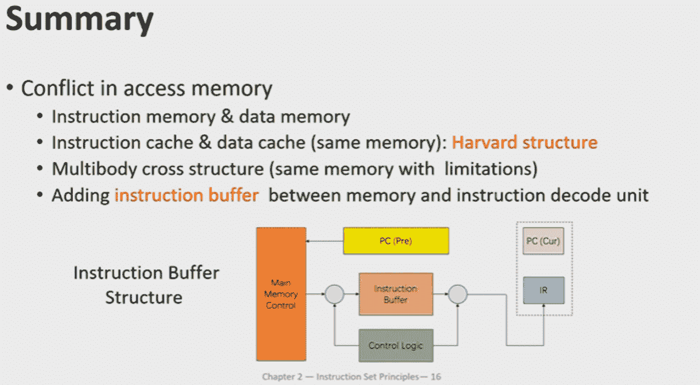

多次取`memory`中有冲突

+ 在`memory`拆分

+ 在`cache`拆分

+ 多流出结构，增加硬件

+ 发现指令在取指和译码之间存在速度差异，——>放一个`buffer`，先从`buffer`里取，不从`memory`中取

> 在`memory`写东西也存在问题，引入`buffer`

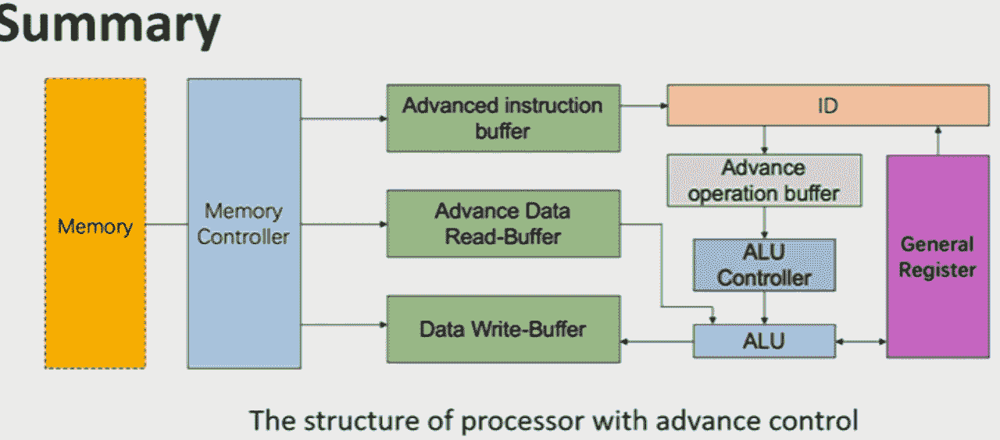

> 顺序执行不能满足——>乱序

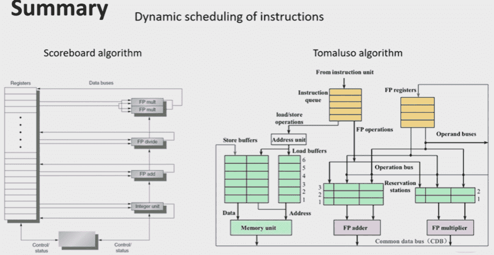

> 加了`ROB`

> 数据状态才能使我们加的硬件有意义

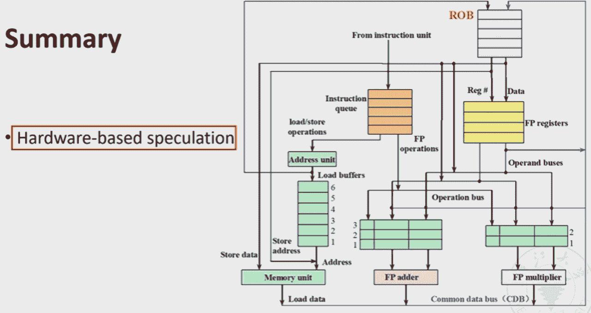

## 3 Memory Hierarchy (Cache)

### 3.1 Technology Trend and Memory Hierarchy

`Memory`设计逻辑：

+ `Register`

+ `Cache`

+ `Memory`

+ `Storage`

> DNA的结构组织硬盘

器件的发展：

+ `Mechanical memory` 机械式存储器是一种最早期的计算机存储器，它通常由一个机械装置组成，使用旋转齿轮或滑动器件来存储和读取数据。由于它的结构简单，所以成本相对较低，但是读取速度较慢，容量也比较有限。

+ `Acoustic wave/torque wave delay line memory` 声波/扭矩波延迟线存储器是一种使用声波或扭矩波来传输和存储数据的存储器。它通常由一个长而窄的金属管组成，其中包含了许多反射器和传感器。当信号传输到管的一端时，它会在反射器之间反弹，形成一个连续的波，直到信号传输到管的另一端。由于信号传输的速度是有限的，所以存储器的读取速度也比较慢，但是它的容量相对较大。

+ `Magnetic Drum Memory` 磁鼓存储器是一种使用磁性表面来存储数据的存储器。它通常由一个圆柱形的金属鼓组成，外面覆盖了一个磁性材料。数据存储在磁性材料的表面上，可以通过在鼓的旋转过程中读取和写入数据。磁鼓存储器的容量相对较大，读取速度也比声波/扭矩波延迟线存储器要快一些，但是由于鼓的旋转速度限制，它的读取速度仍然比较慢。

+ `Magnetic core memory` 磁芯存储器是一种使用小型磁铁来存储数据的存储器。它通常由一个矩形的磁性芯组成，可以通过改变磁性芯的磁极方向来存储数据。由于磁芯存储器的读取速度非常快，并且具有较高的可靠性和稳定性，因此它成为了早期计算机中最常用的存储器之一。然而，由于磁芯存储器的制造成本相对较高，容量也比较有限，所以随着半导体技术的发展，磁芯存储器逐渐被

+ `Electronic memory` 电子存储器是一种使用电子器件来存储和读取数据的存储器。它可以分为随机存储器（`RAM`）和只读存储器（`ROM`）两类。

+ `SRAM` 静态随机存储器是一种使用闪存器件来存储数据的存储器。它的存储单元通常由6个晶体管组成，读更快，写慢；和CPU时钟周期接近，不需要刷新电路，比较省电；6个晶体管，`Cache`的主要组成。相对来说比较昂贵。

+ `DRAM` 动态随机存储器是一种使用电容器件来存储数据的存储器。它的存储单元通常由一个电容器和一个开关晶体管组成。由于电容器需要不断地充电和放电，所以`DRAM`需要不断地进行刷新操作，以保持数据的稳定性。电容，单个晶体管存储，更慢一些；密度高，价格低

+ `SDRAM` 同步动态随机存储器是一种使用同步时钟信号来控制数据读取和写入的`DRAM`。它可以提高`DRAM`的性能和数据吞吐量，但是相对来说也更加昂贵。

+ `Flash` 闪存存储器是一种使用闪存器件来存储数据的存储器。它的存储单元通常由一个晶体管和一个电容器组成，读取速度比较慢，但是容量比较大，适合存储大量的数据。有读写寿命。

+ `ROM` 只读存储器是一种只能读取不能写入数据的存储器。它可以分为可编程只读存储器（`PROM`）和可擦写可编程只读存储器（`EPROM`）两种。

+ `PROM` 可编程只读存储器是一种使用电学技术来编程的`ROM`。它只能进行一次编程操作，无法再次擦写或修改存储的数据。

+ `EPROM` 可擦写可编程只读存储器是一种使用紫外线辐射来擦除数据的`EPROM`。它可以擦除并重新编程数据，但是擦除和编程的操作需要较长时间，并且`EPROM`的制造成本相对比较高。

+ `Optical memory`

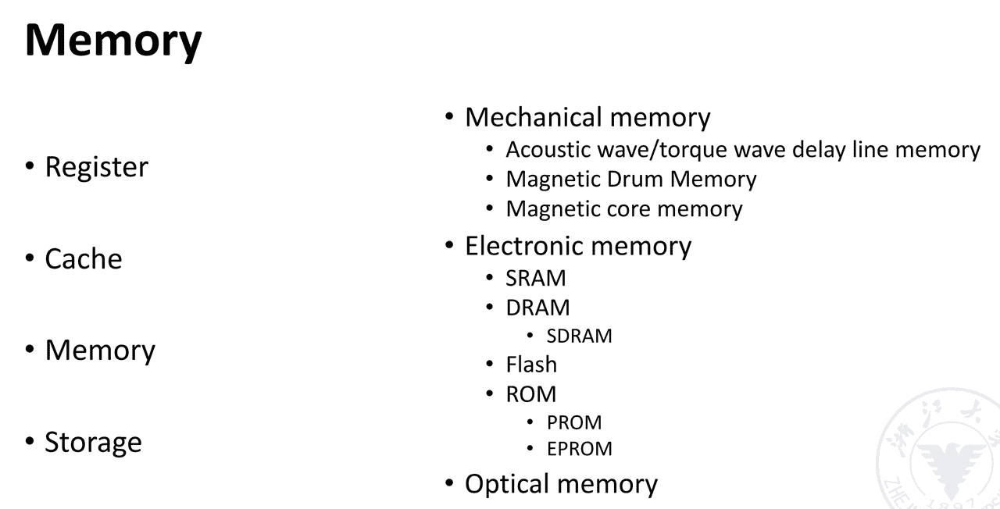

非易失性存储器（`Non-volatile memory`）是一种可以在断电情况下保持存储数据的存储器，而易失性存储器（`Volatile memory`）是一种在断电情况下会失去存储数据的存储器。

以下是常见的非易失性存储器和易失性存储器：

非易失性存储器：

+ 闪存存储器（`Flash memory`）

+ 固态硬盘（`Solid State Drive`，`SSD`）

+ 可擦写可编程只读存储器（`EPROM`）

+ 可编程只读存储器（`PROM`）

+ 可擦除可编程只读存储器（`EEPROM`）

易失性存储器：

+ 随机存储器（`Random Access Memory`，`RAM`）

+ 动态随机存储器（`Dynamic Random Access Memory`，`DRAM`）

+ 静态随机存储器（`Static Random Access Memory`，`SRAM`）


# 存储器层次结构与缓存设计

## 存储器类型与局部性原理

### 存储器类型

+ `SDRAM`（同步动态随机存储器，Synchronous Dynamic Random Access Memory）

+ `Dual Port RAM`（双端口随机存储器）

+ `Register`（寄存器）

### 局部性原理

+ 时间上的局部`Temporal locality`（locality in time）: if an item is referenced, it will tend to be referenced again soon.

+ 被访问过的也会很快地被再次访问到

+ 空间上的局部`Spatial locality`（locality in space）: if an item is referenced, items whose addresses are close by will tend to be referenced soon.

+ 附近的也会被很快访问到

> 满了才会去拿

> 用“表”来存，删除会删去表，但是删不去数据，只有覆盖才会覆盖

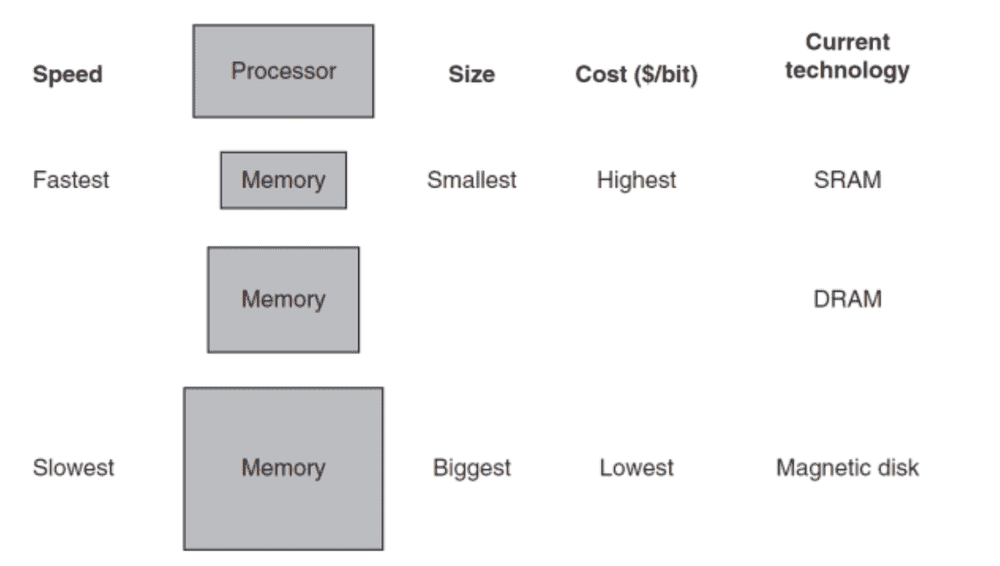

> 快 = 小

> 分层设计（抽象）

> 我们关系其中的逻辑和关系

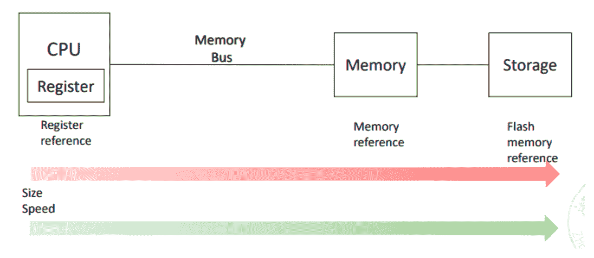

## Cache

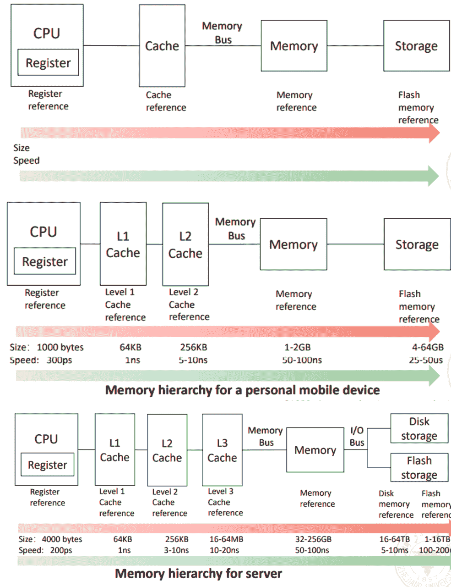

### 缓存（Cache）

> 缓存是一种高速存储器，用于存储最近访问的数据。由于缓存位于`CPU`和内存之间，所以当`CPU`需要访问数据时，它首先会在缓存中查找，如果缓存中有数据，则可以直接读取，否则再从内存中读取。由于缓存的读取速度非常快，因此它可以加速数据的访问。

> 应用场景：缓存常被用于加速计算机的访问速度，例如浏览器中的网页缓存、`CPU`中的高速缓存等。

### 内存（Memory）

> 内存是计算机中用于临时存储数据和指令的存储器，它的读写速度非常快，但容量比较有限。内存通常被用来存储正在运行的程序和数据，以便`CPU`能够快速访问它们。

> 应用场景：内存常被用于存储运行时需要的数据和程序代码，例如操作系统、应用程序、数据库等。

### 磁盘

> 磁盘是一种常见的存储介质，包括硬盘、固态硬盘、`U盘`等。在保存文件时，计算机会将文件写入磁盘中的一个或多个文件，然后将这些文件的相关信息（例如文件名、大小、位置等）保存在文件系统中。

> 应用场景：磁盘通常被用于**长期存储数据**，例如操作系统、应用程序、数据库、音视频文件等。

**现代处理器**希望有一种容量大，同时速度又很快的存储器，但事实上，容量和速度是一对相互制约的因素，容量大必然速度慢，反之亦然。为了近似地达到这个目标，可以使用多级结构的`Cache`，即在`CPU`和物理存储器之间加入多级`Cache`，这些`Cache`的大小随着与`CPU`的距离增大而增大，同时速度随着与`CPU`的距离增大而减小，从而构建出一个`Memory Hierarchy`。通常情况下，`L1 Cache`容量很小，能够和处理器内核保持在同样的速度等级，`L2 Cache`的访问则需要消耗处理器的几个时钟周期，但容量要更大一些，以此类推。一般来说，`L2 Cache`会使用`write-back`的方式，而`L1 Cache`则采用`write-through`的方式，这样可以在不损失太多性能的情况下简化流水线的设计，尤其是在多核环境下简化存储器一致性同步设计。

`L1`缓存：`L1`缓存是`CPU`内部的一块高速缓存，通常位于`CPU`和主内存之间。由于`L1`缓存距离`CPU`非常近，因此它的读写速度非常快，但容量较小。`L1`缓存一般分为指令缓存和数据缓存两种，用于存储`CPU`执行的指令和数据。

`L2`缓存：`L2`缓存通常位于`CPU`和主内存之间，容量比`L1`缓存大，但速度比`L1`缓存慢。`L2`缓存的作用是为`L1`缓存提供更大的缓存容量，并且减少`CPU`访问主内存的次数。

`L3`缓存：`L3`缓存位于主内存和`L2`缓存之间，容量最大，速度最慢。`L3`缓存的作用是为多个`CPU`核心提供共享缓存，以便它们之间共享数据和减少访问主内存的次数。

在`CPU`访问数据时，它首先会在`L1`缓存中查找，如果缓存中有数据，则可以直接读取。如果缓存中没有数据，则会在`L2`缓存中查找，如果还没有，则会继续在`L3`缓存和主内存中查找，直到找到为止。由于`L1`缓存和`L2`缓存距离`CPU`更近，因此访问速度更快，而`L3`缓存和主内存距离更远，因此速度更慢。

这里还存在两个概念，分别是`Inclusive`与`Exclusive`，其定义如下：

+ `Inclusive`：如果下级`Cache`包括了上级`Cache`中的所有内容，则称下级`Cache`是`Inclusive`的。

+ `Exclusive`：如果下级`Cache`和上级`Cache`的内容互不相同，则称下级`Cache`是`Exclusive`的

例如`L1 Cache`与`L2 Cache`采用`Inclusive`与`Exclusive`的形式如下图所示：

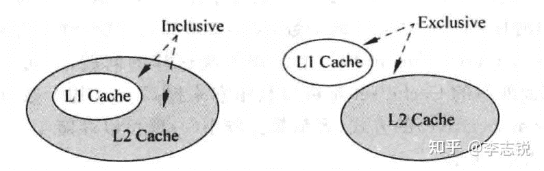

`Inclusive`的缺点在于，其一份数据同时保存在两个地方，比较浪费硬件资源，但其最大的优点在于，简化了一致性（`coherence`）的管理，例如在多核的处理器中，当其中一个处理器改变了存储器中一个地址的数据时，如果在其它处理器的私有`Cache`（一般在多核处理器中，`L1 Cache`和`L2 Cache`都是私有的）中也保存了这个地址的数据，那么需要将它们置为无效，以避免这些处理器使用到错误的数据。如果是`Inclusive`类型的`Cache`，那么只需要检查最低一级的`Cache`即可，否则需要同时检查`L1`与`L2 Cache`，由于`L1 Cache`在处理器流水线的关键路径上，这会影响到处理器的执行效率；而`Exclusive`类型的`Cache`避免了硬件的浪费，由于`Cache`容量的大小直接影响处理器的性能，在同样的硅片面积下，`Exclusive`类型的`Cache`可以获得更多可用的容量，在一定程度上提高了处理器的性能，不过现代的大多数处理器都采用了`Inclusive`类型的`Cache`。

`L1`在`processor`里，存储介质是`SRAM`

黑客通过你获取数据的速度判断你是否使用过这个数据，利用`cache`信息的漏洞

多级`cache`

+ `L1`: 一级 `cache`，在处理器的内部，以核心频率工作

+ `L2`: 以处理器一半的频率工作，和 `CPU` 一起封装

+ `L3`: 在主板上，以总线频率工作

## 3.2 Four Questions for Cache Designers

> `Cache`: a safe place for hiding or storing things.

> Webster’s New World Dictionary of the American Language Second College Edition (1976)

当地址离开处理器后遇到的第一次层`memory hierarchy`

+ `Employ buffering to reuse commonly occurring items`（利用`buffer`）

### Cache Hit/Miss

+ 处理器能找到需要的数据——`Hit rate` , `Hit time`

+ 处理器不能找到需要的数据——`Miss rate` , `Miss penalty`

+ 从`memory`里取，并放到`cache`里

+ `Miss penalty`取决于`Latency`延迟（the time to retrieve the first word of the block）和`Bandwidth`带宽（the time to retrieve the rest of this block）

不同的计算机对`memory hierarchy`要求不一样

+ 桌面电脑：

+ 主要运行单个用户的单个应用程序

+ 更关注来自内存层次结构的**平均延迟**。

+ 服务器电脑：

+ 可能有数百个用户同时运行数十个应用程序。

+ 更关注**内存带宽**。

+ 嵌入式计算机（需要多样化，形态很多，要求很快响应）：

+ 实时应用程序。

+ 最差情况下的性能 vs 最佳情况下的性能。

+ 更关注功耗和电池寿命。

+ 硬件 vs 软件。

+ 运行单个应用程序和使用简单的操作系统。

+ 内存层次结构的保护作用通常会降低。

+ 主存储器非常小。

+ 通常没有**磁盘存储**。

### 硬件

+ 越小越快，越贵

+ 越大越慢，越便宜

### 提高`memory`速度的方式

+ Hierarchies bases on memories of different speeds and size

+ 离`CPU`越近，速度越快，越小，越昂贵

+ 利用好`principle of locality`，不均匀的访问

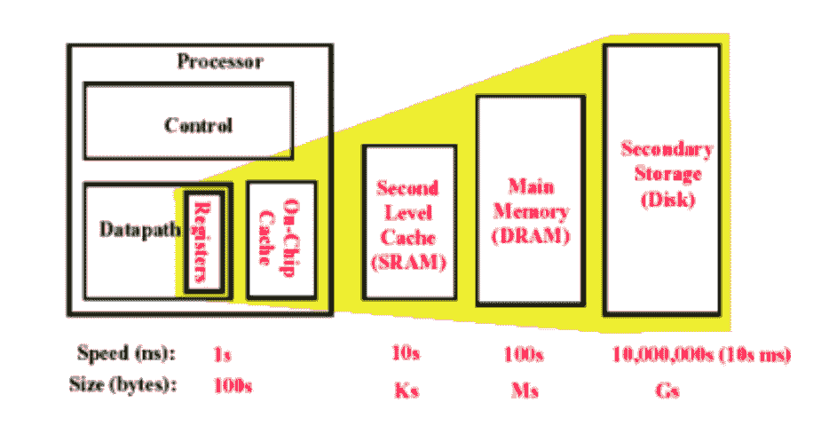

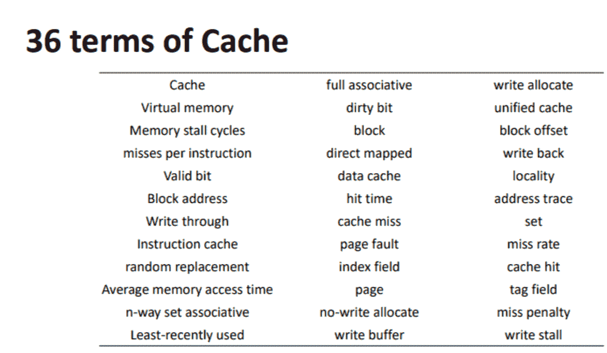

+ 缓存（`Cache`）：一种高速存储器，用于存储最近访问的数据，以加速数据的访问速度。

+ 虚拟内存（`Virtual memory`）：一种将磁盘空间用作内存扩展的技术。

+ 存储器停顿周期（`Memory stall cycles`）：由于访问内存所需的时间导致`CPU`停顿的时间。

+ 每指令缺失数（`Misses per instruction`）：在执行指令时，需要从缓存中获取数据，但是该数据在缓存中不存在的次数。

+ 有效位（`Valid bit`）：用于表示缓存行中的数据是否有效。

+ 块地址（`Block address`）：用于标识缓存中的块。

+ 写直通（`Write through`）：在写入缓存时，同时将数据写入主存。

+ 指令缓存（`Instruction cache`）：用于存储`CPU`执行的指令的缓存。

+ 随机替换（`Random replacement`）：在缓存行满时，随机选择一行进行替换。

+ 平均内存访问时间（`Average memory access time`）：访问内存的平均时间。

+ n路组相联（`n-way set associative`）：一种将缓存分成n个组的技术。

+ 最近最少使用（`Least-recently used`）：在缓存行满时，选择最近最少使用的行进行替换。

+ 全相联（`Full associative`）：缓存中的所有行都可以存储任意地址的数据。

+ 脏位（`Dirty bit`）：用于表示缓存行中的数据是否已经被修改。

+ 块（`Block`）：缓存中的最小存储单位。

+ 直接映射数据缓存（`Direct mapped data cache`）：将每个内存地址映射到缓存中唯一的一个缓存行。

+ 命中时间（`Hit time`）：在缓存中查找数据所需的时间。

+ 缓存未命中（`Cache miss`）：在缓存中查找数据失败。

+ 缺页中断（`Page fault`）：访问虚拟内存中不存在的页时，操作系统产生的中断。

+ 索引字段（`Index field`）：用于计算缓存行在组中的位置。

+ 页面（`Page`）：虚拟内存中的最小存储单位。

+ 不写分配（`No-write allocate`）：在写入缓存时，不将数据写入缓存，而是直接写入主存。

+ 写缓冲区（`Write buffer`）：用于缓存将数据写入主存的数据。

+ 写分配（`Write allocate`）：在写入缓存时，先将数据写入缓存，然后再将数据写入主存。

+ 统一缓存（`Unified cache`）：使用一个缓存存储器来同时缓存指令和数据。与传统的分开的指令缓存和数据缓存不同，统一缓存可以更有效地利用缓存存储器，并且减少访问内存的次数。在统一缓存中，`CPU`可以通过一个地址总线同时访问指令和数据缓存。这种设计可以提高缓存的命中率，并且可以更快地执行代码。

+ 块偏移量（`Block offset`）：用于表示访问数据在缓存块中的位置。

+ 写回（`Write back`）：在缓存中修改数据时，只在缓存中修改，不立即将数据写回主存，而是等到缓存行被替换时再写回主存。

+ 局部性（`Locality`）：计算机程序访问数据时存在的时间和空间局部性。

+ 地址跟踪（`Address trace`）：记录计算机程序访问内存地址的序列。

+ 组（`Set`）：缓存中的一组缓存行。

+ 不命中率（`Miss rate`）：缓存中查找数据失败的次数占总访问次数的比例。

+ 缓存命中标记字段（`Cache hit tag field`）：用于比较缓存行中的地址和访问的地址是否匹配。

+ 不命中惩罚（`Miss penalty`）：在缓存未命中时，从主存中读取数据所需的时间。

+ 写延迟（`Write stall`）：在写入缓存时，由于缓存被占用而导致`CPU`停顿的时间。

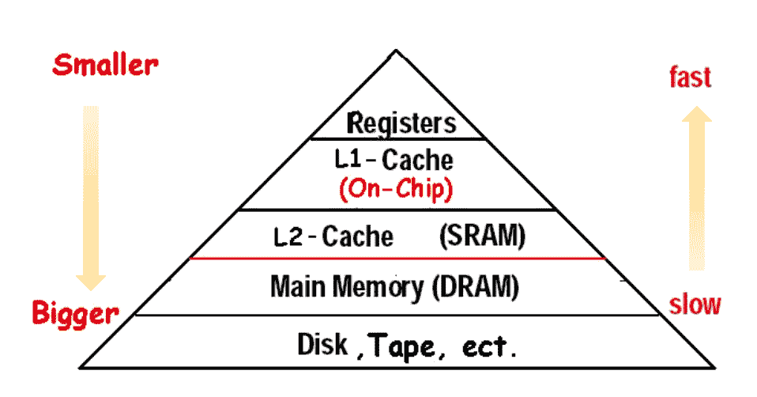

`Cache`是一种思想

### Four Questions for Cache Designers

> Caching is a general concept used in processors, operating systems, file systems, and applications. There are Four Questions for Cache/Memory Hierarchy Designers

+ Q1: Where can a block be placed in the upper level/main memory?  (`Block placement`)

+ `Fully Associative`, `Set Associative`, `Direct Mapped`

+ Q2: How is a block found if it is in the upper level/main memory? (`Block identification`)

+ `Tag`/`Block`

+ Q3: Which block should be replaced on a Cache/main memory miss?  (`Block replacement`)

+ `Random`, `LRU`, `FIFO`

+ Q4: What happens on a write?  (`Write strategy`)

+ `Write Back` or `Write Through` (with `Write Buffer`)

+ Where to write?

### 3.2.1 Q1: Block placement

+ `Direct mapped`

+ 物理地址按照一定的方式固定映射到 `cache` 的某一块上，但是物理地址比 `cache` 中的地址要大，所以会有很多物理地址映射到同一个 `cache` 块上， 为了标记是哪个物理块，假设 `cache` 一共有 `M` 块，则：

+ `cache` 中有一位有效位，`1` 表明数据有效，`0` 表示数据无效

+ 物理块号：`j = 物理地址 / 块的大小`

+ `cache` 块号（`index`索引号）：`i = j mod M`

+ 当 `cache` 中恰好有 `2^n` 个 `block` 的时候，对应的 `cache` 索引就是内存地址的 最低 `n` 位

+ `TAG = j / M` 要来记录区分不同的内存块

+ `cache` 中地址的形式：`TAG（j / M）` + `Index（j mod M）` + `ByteOffset`

+ 其中 `TAG + index` 构成 `cache` 块的地址

+ 利用率不高

+ `Fully-associative`随机放

+ 直接映射每个物理块有固定的 `cache` 块很容易判断命中与否（比较 `TAG`）， 但造成 `cache` 块的闲置

+ 考虑不固定的映射方式，当需要替换的时候就遍历 `cache` 中所有的块，覆盖今后最不可能用到的块，这样可以提高 `cache` 的命中率

+ 虽然提高了命中率，但是时间效率降低了

+ 大量 `TAG` 判断是否命中会使得硬件的设计非常复杂，如果采用顺序判断， 由于在 `cache` 中，`Cache` 与主存存取速度的差别在 `1-2` 个数量级，确定是否命中的时间太长，`cache`就失去意义了

+ 块地址：按照块确定的地址，把原地址除以块的大小即可，块内部分为块内地址

+ 主存地址 / 块大小 = `TAG` 余数作为 `block-offset`

+ `n-way Set-associative`

+ 分组 + 全相联

+ `n`的意思是一个组里有 `n` 个块

+ 直接映射是一种 `n` 个组的组相联，全相联是 `1` 个组的组相联；直接映射是 `1` 路组相联，全相联是 `m` 路组相联

+ 组相联和直接映射的区别：

+ 组相联分成了若干组直接映射，因此在每一组里，`Index` 的位数减少了， 而 `TAG` 的位数增加了

+ 同样大小的 `cache`，如果分成了 `2^n` 路组相联，那么相比于直接映射，`index` 减少了 `n` 位，`TAG` 增加了 `n` 位，实际上原理就是同样多的 `m` 个 `block` 分成了若干组，在每个组里面进行直接映射，所以单组的块数相比于直接映射减少了，所以 `index` 的位数也变少了

+ `Block` can go in one of a set of places in the `cache`.

+ A `set` is a group of blocks in the `cache`.

+ `Block address MOD Number of sets in the cache`

+ If sets have `n` blocks, the `cache` is said to be `n-way set associative`.

+ 关联度越高，缓存空间利用率越高，块冲突概率越低，故障率也越低。

+ 大部分是 ，不是越大越好

+ 不同映射方式的比较

+ 全相联的 `cache` 效率最好，但是块数多了就难以判断是否命中

+ 直接映射的 `cache` 效率低，但是命中率高，组相联的各项水平处于二者之间

+ 其实就是因为直接映射和全相联是两种组相联的特殊情况，直接映射是 `1` 路组相联，全相联是 `m` 路组相联

### 3.2.2 Q2: Block Identification


## 3.2 Cache Organization

每个块都有一个地址标签，存储着该块中存储的数据在主内存中的地址。每个块都有一个地址标签，存储着该块中存储的数据在主内存中的地址。

When checking the cache, the processor will compare the requested memory address to the `cache tag` -- if the two are equal, then there is a cache hit and the data is present in the cache 当检查缓存时，处理器会将请求的内存地址与缓存标签进行比较--如果两者相等，则表示命中了缓存，并且数据存在于缓存中。

Often, each `cache block` also has a `valid bit` that tells if the contents of the `cache block` are valid 通常情况下，每个缓存块还有一个有效位来指示该缓存块的内容是否有效。

集合->块->字节

`Tag+Index+Offset`：组相联

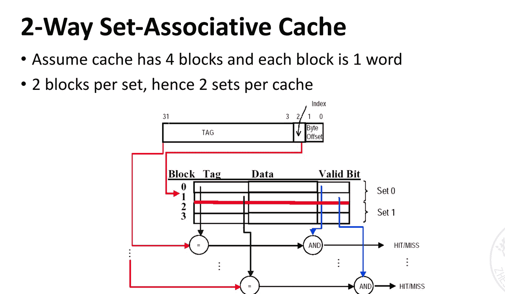

`index`定位到某个组，然后再扫

`Tag+Offset`：全相联

由于一个`Cache`块会映射所有内存块，因此组标记`TAG`需要扩大到与主内存块索引相同的位数，而且映射的过程需要沿着`Cache`从头到尾匹配`Cache`块的`TAG`标记。

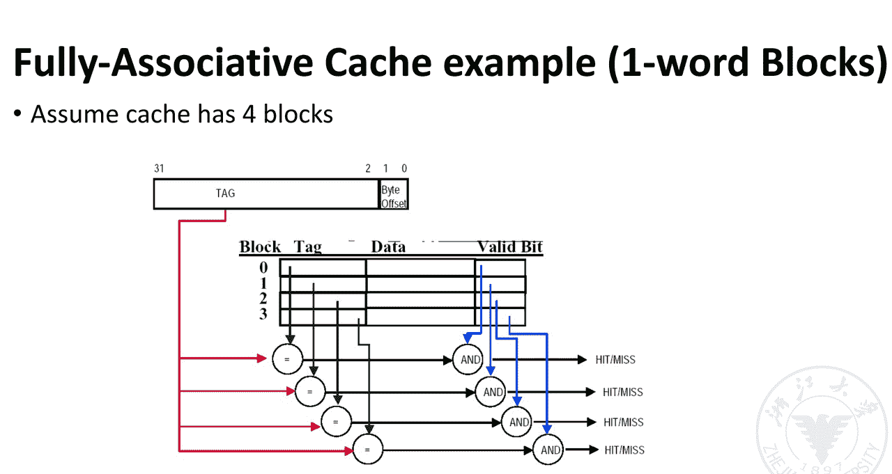

扫下来寻找

直接映射：块->字节

`Tag+Index+Offset`

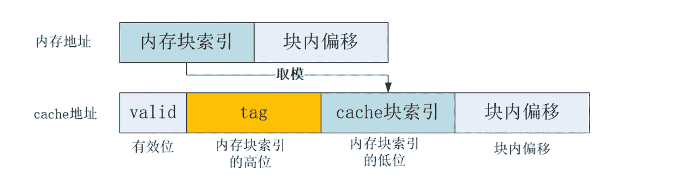

`Tag`：标记当前缓存块存储的是哪一个内存块的数据

组标记就是内存块索引的高位，而 `Cache` 块索引就是内存块索引的低4位（8个字块需要4位）

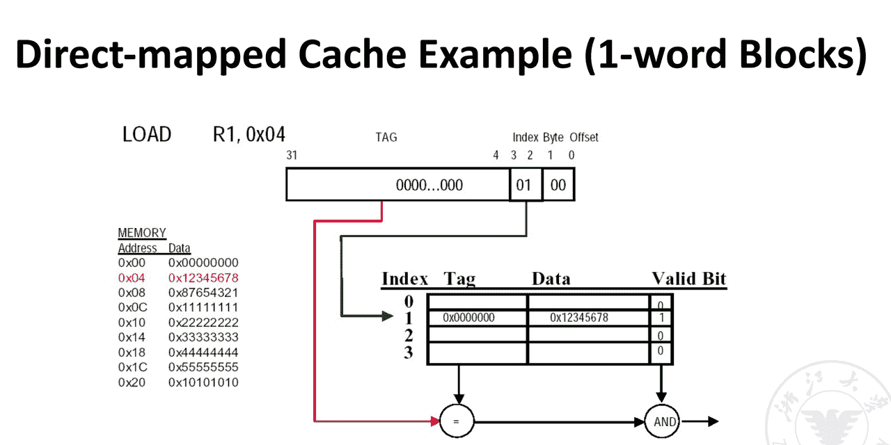

`1-word Blocks`，一行就是一个`block`

用`index`定位，用`Tag`比较

`Index`、`Tag`是块的属性，`offset`是块里面数据的属性

The `Index` field selects

The `set`, in case of a `set-associative` cache 在组相联缓存的情况下，集合

The `block`, in case of a `direct-mapped` cache 在直接映射缓存的情况下，块

Has as many bits as `log2(#sets)` for `set-associative` caches, or `log2(#blocks)` for `direct-mapped` caches 对于组相联缓存，索引字段具有与`log2(#sets)`一样多的位数；对于直接映射缓存，则为`log2(#blocks)`

The `Byte Offset` field selects

The `byte` within the `block` 块内的字节

Has as many bits as `log2(size of block)` 具有与`log2(块大小)`一样多的位数

The `Tag` is used to find the matching `block` within a `set` or in the `cache` 标记用于在集合或高速缓存中查找匹配块。对比`Tag`来验证是否匹配

Has as many bits as

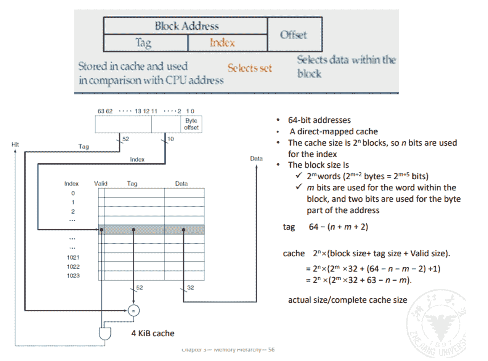

条件是 32 位的字节地址，直接映射的 `cache`，有   个 `block`， 一个 `block` 的大小是   `word`，因此需要 `n` 位作为 `index`，`m` 位 用于查找块中的字，2 位是字节的偏移信息

则 `TAG` 的大小是 `32-(n+m+2)`

`cache` 需要的总位数是 `block` 数量 *（`block` 的大小可以放几个`data`的位 + 有效位的大小 +`TAG` 大小）也就是

关于 `block size` 的计算：假设 `block` 是   个 `word` 的大小 · 常识：`word` 是计算机中存取的基本单位

为了定位是哪一个 `word`，需要 `m` 位 ；而在 `word` 里面，为了定位是哪个字节，需要 2 位，所以一共需要 `m+2` 位，`block size` 就是 `m+2` bits

### 3.2.3 Q3: Block Replacement

随机替换`Random replacement` - 随机选择任何一个块

在硬件中很容易实现，只需要一个随机数生成器

块的分配在缓存中均匀分布

可能会剔除即将被访问的块

最近最少使用`Least-Recently Used`（`LRU`） - 从集合中选择最近最少访问的块

假定最近访问的块更可能再次被引用

这需要在缓存中额外的位来跟踪访问。

先进先出`First In, First Out`（`FIFO`）- 选择最先进入缓存的块

> `OPT`是理想算法，看未来，最优算法

### 3.2.4 Q4: Write Strategy

`write-through cache`

当数据被写入`cache`的同时，数据同时被写入主`memory`

`Cache control bit: only a valid bit`

`memory` (or other processors) always have latest data

`write-back cache`

不写回`memory`，直到不得不写回的时候（要被修改的时候）才写回

无法简单地丢弃缓存的数据 需要将其写回内存

缓存控制位：一个有效位和`脏位（标记缓存的修改）`

带宽要低得多，因为数据经常被多次覆盖

写穿优势：`读取未命中不会写入到cache`，内存层次结构一致且易于实现。

不会写入到`memory`

因为 `through` 始终会使得 `cache` 和 `memory` 中一致，read miss 的时候，只是替换，不会导致写 `memory`；因为 `through` 始终会使得 `cache` 和 `memory` 中一致，read miss 的时候，只是替换，不会导致写 `memory`

写回优势：写入发生在缓存速度上，并且当多个写入发生在同一块时，主内存带宽较小。

`write stall`：当`CPU`在写入过程中必须等待写入完成

`Write Buffer`：

- 一个小的缓冲区，可以容纳一些等待进入主内存的数值。
- 为了避免写的停滞，许多CPU使用`Write Buffer`。
- 缓冲器在写一下子很多的时候有帮助。
- 它并不能完全消除`stall`，因为如果突发事件大于缓冲区，缓冲区有可能被填满。

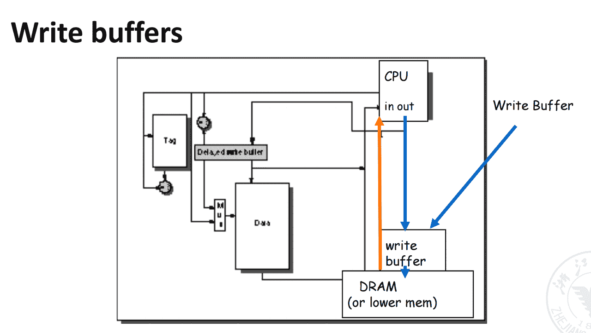

`write miss`

- 如果在`写入时发生缺失`（块不存在），有两个选项。当`CPU`执行写操作时，需要写入一个缓存块，但在缓存中并没有找到该块的情况。当出现`write miss`时，`CPU`需要从主存中读取该块并将其写入到缓存中。这个过程需要较长的时间，并且会影响`CPU`的性能。
- `Write allocate` 写分配
- 在发生缺失之前，将`块加载到高速缓存`中。
- `Write around` (`no write allocate`)
- 仅将`块写入主内存`
- 它不会被存储在高速缓存中。

一般来说

- `write-back` caches use `write-allocate`
- 等到要被替换了才写入`memory`里，当我`write miss`的时候，我就把块加载到`cache`里，再写
- `write-through` caches use `write-around`.
- 每次写入都会改，当我`write miss`的话，我就仅把块写入主内存

Since no data is returned to the requester on write operations, a decision needs to be made on `write misses`, whether or not data would be loaded into the cache. This is defined by these two approaches:

- `Write allocate` (also called fetch on write): data at the missed-write location is loaded to cache, followed by a write-hit operation. In this approach, `write misses` are similar to read misses.

- `No-write allocate` (also called `write-no-allocate` or `write around`): data at the missed-write location is not loaded to cache, and is written directly to the backing store. In this approach, data is loaded into the cache on read misses only.

Both `write-through` and `write-back` policies can use either of these `write-miss` policies, but usually they are paired in this way:([4])

- A `write-back` cache uses `write allocate`, hoping for subsequent writes (or even reads) to the same location, which is now cached.

- A `write-through` cache uses `no-write allocate`. Here, subsequent writes have no advantage, since they still need to be written directly to the backing store.

Case

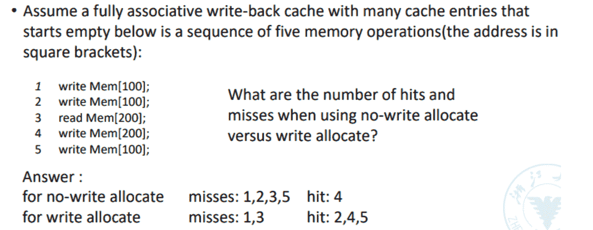

+ `Unified Cache`：即能保存指令，也能保存程序数据的高速缓存
+ 所有内存请求都通过单个缓存All memory requests go through a single cache.
+ 这需要更少的硬件，但也具有较低的性能。This requires less hardware, but also has lower performance
+ `i-cache`：只保存指令的高速缓存
+ `d-cache`：只保存程序数据的高速缓存
+ `Split I & D cache`
+ A separate cache is used for instructions and data.
+ 这使用了额外的硬件，尽管有一些简化（`I`缓存是只读的）。

> 重点`cache`的`performance`

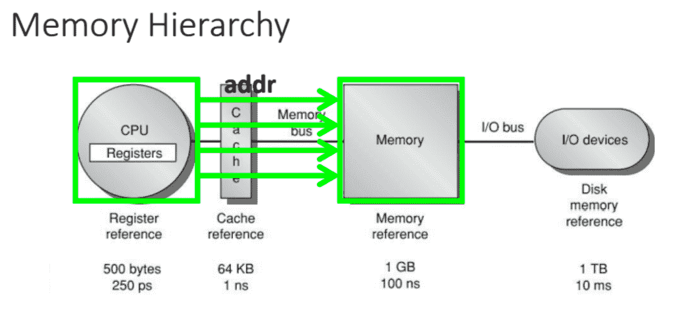

> `Virtual Memory`

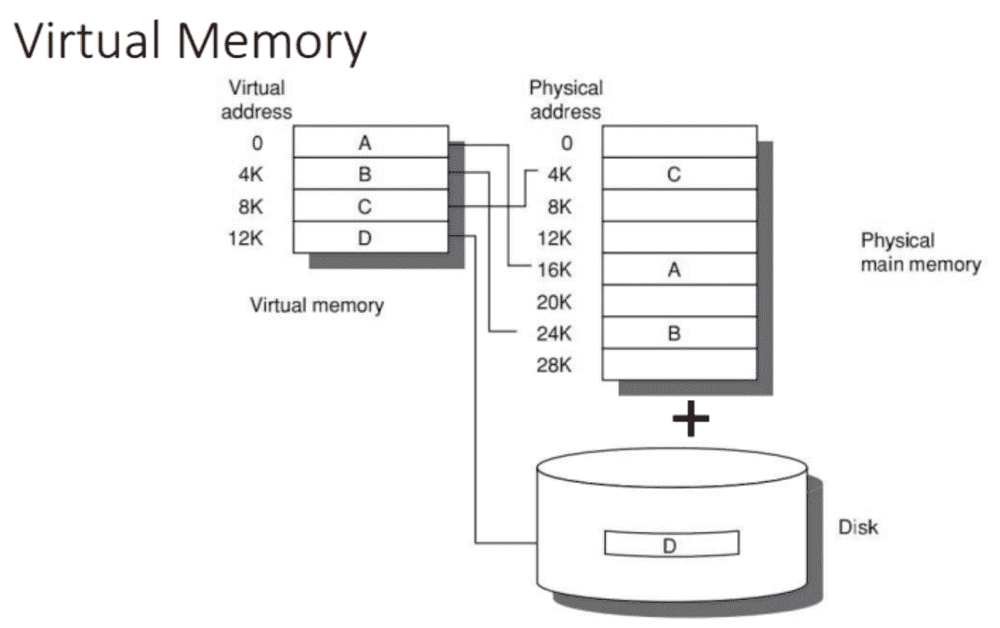

> Program uses

+ discontiguous memory locations + secondary/non-memory storage
+ 不连续的内存位置+二级/非内存存储

>

> 有限状态机来控制`Cache`

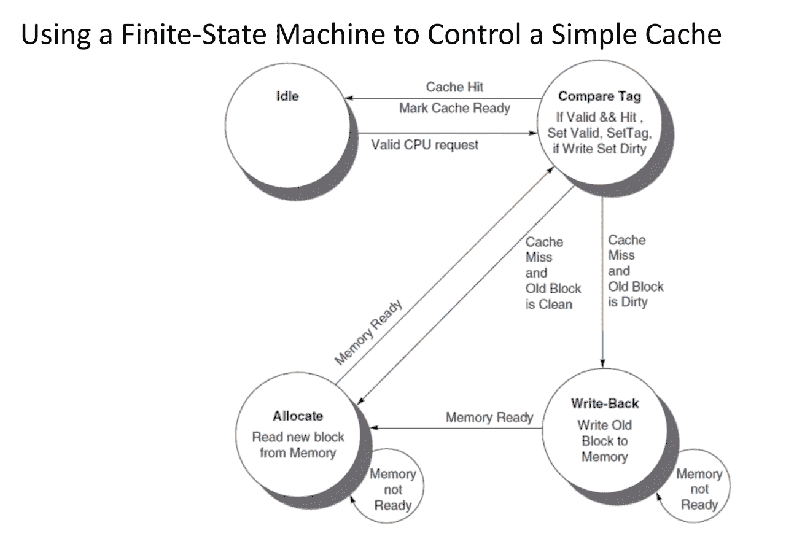

## 3.3 Memory System Performance

> `CPU Execution time`

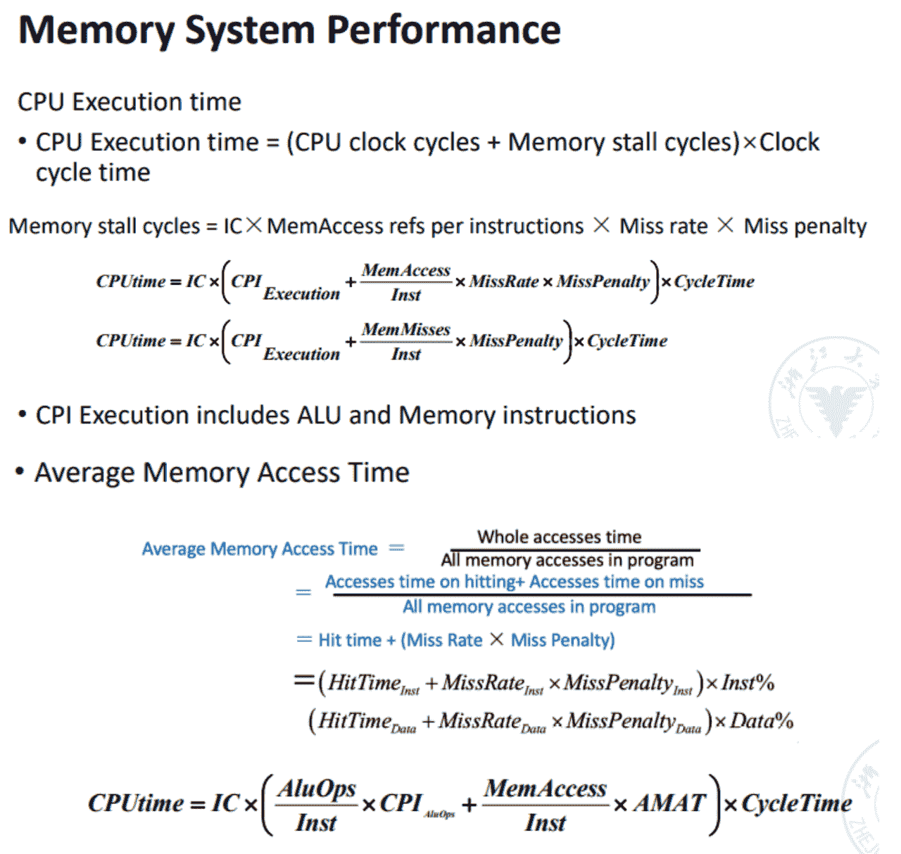

> `CPI`包括`ALU`和`Memory`的指令

>

>


### 3.3.1 Summary

> How to improve：


1. Reduce the `miss penalty` ——`multilevel caches`, `critical word first`, `read miss` before `write miss`, merging `write buffers`, and `victim caches`

1. Reduce the `miss rate` ——larger `block size`, large `cache size`, higher `associativity`, `way prediction` and `pseudo-associativity`, and `compiler optimizations`

1. Reduce the time to hit in the `cache` ——small and simple caches, avoiding `address translation`, `pipelined cache access`, and `trace caches`.

1. Reduce the `miss penalty` and `miss rate` via `parallelism` ——`non-blocking caches`, `hardware prefetching`, and `compiler prefetching`


1. **降低**缓存**未命中的惩罚时间**——多级缓存、关键字优先、先读后写、合并写缓冲区和牺牲缓存等技术。
1. **降低**缓存**未命中率**——更大的块大小、更大的缓存容量、更高的关联度、路预测和伪关联度以及编译器优化等技术。
1. **缩短缓存命中时间**——小而简单的缓存、避免地址转换、流水线式的缓存访问和跟踪缓存等技术。
1. 通过**并行处理**降低**未命中的惩罚时间和未命中率**——非阻塞缓存、硬件预取和编译器预取等技术。


### 3.4 Cache Coherence

> 不同处理器同时访问一个`Cache`

> `Coherence`：defines what values can be returned by a read

+   当一个处理器的一读一写接连发生时，不能有另外一个处理器的写插在中间

> 主要在`cache`

> `Consistency`：determines when a written value will be returned by a read

> 主要在`memory`

两种

+   Migration：

+   A data item can be moved to a local cache and used there in a transparent fashion. Migration reduces both the latency to access a shared data item that is allocated remotely and the bandwidth demand on the shared memory.

+   Replication：

+   When shared data are being simultaneously read, the caches make a copy of the data item in the local cache. Replication reduces both latency of access and contention for a read shared data item.

+   Causes of Cache coherence problems

+   In modern parallel computers, processors often have `Cache`. Memory data may have multiple copies in the entire system. This leads to the cache coherence problem.

> 以下两个都是串行的原子的操作

+   Cache coherence protocol

+   A set of rules implemented by `Cache`, `CPU`, and memory to prevent different versions of the same data from appearing in multiple Caches forms a cache coherence protocol.

+   UMA：Bus snooping protocol 总线监督

+   总线连了一个共同的`memory`，每个`CPU`还有一个私有的`cache`和`memory`

+   In the snoopy coherence protocols, all processors snoop the bus. When a processor modifies the data in the private cache, it broadcasts invalid information or updated data on the bus to invalidate or update other copies.


+   Write-through cache coherency protocol

+   While writing the data in the cache line, the content in the corresponding memory is also modified, and the data in the memory is kept up to date at any time.


+   Write Invalidation Protocol

+   MSI protocol

+   Invalid

+   Shared

+   Modified

+   indicates that the block has been updated in the private cache; implies that the block is exclusive


> +   MESI protocol：再把`exclusive`分成`read`和`write`

> +   `exclusive`->`read` by others->`shared` `exclusive`->`write`->`modified`

+   Write-back cache consistency protocol

+   The write operation does not directly write to the memory. On the contrary, when the cache line is modified, a certain bit in the cache is set to indicate that the data in the cache line is correct but the data in the memory is out of date. Of course, the line will eventually be written back to memory, but it may be after multiple write operations.


+   MESI protocol

+   Invalid: The data contained in the cache item is invalid.

+   Shared: This row of data exists in multiple cache items, and the data  in the memory is the latest.

+   Exclusive: No other cache items include this row of data, and the  data in memory is the latest.

+   有好多正在改，会只有一个成为`Exclusive`

+   Modified: The data of the item is valid, but the data in the memory is invalid, and there is no copy of the data in other cache items.当前修改了，只有本地是对的

+   让其他变成`invalid`

+   `load` `store`只需要`buffer`，不太需要`CPU`，减少`CPU`的开销


+   例子：


+   MOESI

+   增加了`owned`: indicates that the associated block is owned by that cache and out-of-date in memory

+   `Modified` -> `Owned` without writing the shared block to memory

+   现在还有一种情况：

+   `x`和`y`是同一条cache线的，但是会导致比如我改`x`的时候，`y`也被迫`invalid`了，导致效率很低，其实可以分成`x`和`y`两条线


+   NUMA：Directory based protocol 目录

+   牺牲空间选择时间

+   每个`CPU`都有一个比较近的`memory`

+   The directory protocol uses a directory to record which processors in the system have copies of certain storage blocks in the cache. When a processor wants to write a shared block, it sends an invalid signal to those processors that have copies of the block through the directory in a "point-to-point” way, so that all other copies are invalidated


### 3.5 CPU vulnerabilities

#### 3.5.1 漏洞介绍


> 缓存侧信道攻击

> 有防御措施：但是都很影响性能

#### 3.5.2 Meltdown

利用芯片硬件层面执行加速机制的实现缺陷，实施侧信道攻击，间接通过`CPU`缓存读取系统内存数据；利用了Intel `CPU`的乱序执行技术，通过对内存的响应时间差来建立一个侧信道攻击，破坏了位于用户和操作系统之间的基本隔离，“熔化”了由硬件来实现的安全边界


> 缓解措施

+   `KAISER`：一种内核修改，无需内核映射到用户空间

+   问题：存在一些限制。由于x86架构的设计，需要在用户空间中映射多个权限内存位置。这会留下Meltdown的残留攻击面，即，这些存储位置仍然可以从用户空间读取。

#### 3.5.3 Spectre

`Spectre`则是破坏了不同应用程序之间的隔离。问题的根源在于预测执行（speculative execution），这是一种优化技术，处理器会推测在未来有用的数据并执行计算。这种技术的目的在于提前准备好计算结果，当这些数据被需要时可立即使用。在此过程中，Intel没有很好地将低权限的应用程序与访问内核内存分开，这意味着攻击者可以使用恶意应用程序来获取应该被隔离的私有数据。

Spectre攻击主要分为三个阶段：

+   训练`CPU`的分支预测单元（BPU），使其在运行漏洞利用代码时会进行特定的预测执行；

+   预测执行使得`CPU`将要访问的地址的内容读取到`CPU Cache`中；

+   通过缓存测信道攻击，可以知道哪一个数组元素被访问过，也即对应的内存页存放在`CPU Cache`中，从而推测出地址的内容。

缓解措施

+   1）序列化指令：限制预测执行。 问题：无法在所有`CPU`或系统配置中工作。

+   2）插入推测执行阻止指令：在每个条件分支及其目标之后的指令处插入此指令。 问题：严重降低性能。

+   3）微代码修复现有处理器 问题：修补程序可能会阻止推测执行或阻止推测内存读取，但这会极大地破坏性能。

### 3.6 Storage Systems

> `Disk`,`RAID`,`Dependability`（可靠性）

1960-1980：没有存储，不断电的时候有`memory`

1990-：需要更稳定、更可靠的存储

文本很脆弱，容易受损，乱码


> 写保护

#### 3.6.1 Disk


+   磁头

+   盘片

>

+   performance

+   positioning time定位时间/random access time

+   seek time

+   rotational latency

+   transmission time

> Disk Capacity

+   Areal Density

+   in 2011, the highest density

+   400 billion bits/inch^2

+   Costs per gigabyte

+   between 1983 and 2011,

+   improved by almost

+   a factor of 1,000,000

> Disk vs DRAM

+   Cost:`Disk`便宜

+   Access time:`DRAM`短

> Disk’s Competitor

+   Flash Memory

+   non-volatile semiconductor memory;

+   same bandwidth as disks;

+   100 to 1000 times faster;

+   15 to 25 times higher cost/gigabyte;

+   Wear out

+   limited to 1 million writes

+   Popular in cell phones,

+   but not in desktop and server

> Disk Power

+   Power by disk motor

+   ≈  x  x No. of platters

+   RPM: Revolutions Per Minute rotation speed

+   Smaller platters, slower rotation, and fewer platters reduce disk motor power

> 在磁盘中存放是连续的，记录`start`和`size`

> 不连续的话，用链表的形式连接起来


#### 3.6.2 固态硬盘

非易失性存储

`SSD`

+   更快

+   电源消耗少

+   容量大/寿命短

#### 3.6.3 Disk scheduling

> minimize seek time

+   `FCFS`（First-Come First Served）

+   除了这个都会starvation

+   `SSTF`（Shortest-Seek-Time-First）

+   可能会starvation

+   `SCAN`

+   电梯算法，从一端到另一端，再从另一端到一端

+   `C-SCAN`

+   循环扫描

+   `LOCK`/`C-LOCK`

+   在`SCAN`和`C-SCAN`基础上，只需要移到一个方向的当前`queue`里面最远请求为止

#### 3.6.4 Disk Management

`mount`

> bootloader

> boot disk

Swap-space management

物理内存的数量达到临界低点，并且进程从内存移到交换空间以便释放内存空间时，就会出现交换。现实中，很少这样执行，相反，系统将交换与虚拟内存技术和交换页面结合。

#### 3.6.5 Disk Array：RAID

> 磁盘冗余阵列

> 冗余换取有效性

> `RAID 0`没有可靠性

+   Disk arrays with redundant disks to tolerate faults

+   冗余来容错

+   If a single disk fails, the lost information is reconstructed from redundant information

+   Striping: simply spreading data over multiple disks

+   RAID: redundant array of inexpensive/independent disks


> `RAID[0]`：Nonredundant striped


+   可以同时访问0123，并行，读写是之前的`n`倍

+   没有校验，容错机制

+   但是性能很好

> `RAID[1]`


+   镜像，安全，可同时跑

+   有点浪费

> 01结合


## RAID


### RAID[2]

+   ECC校验位，右边三个奇偶校验位

+   每个字节都有一个校验位


### RAID[3]


+   校验，所有数据的改变都需要在校验位上面修改；只有一个存放校验位

### RAID[4]

+   校验的单位不一样，是块


### 3&4

+   都需要校验，所有校验变成了效率的瓶颈


### RAID[5]

+   块交叉，散列存放，不放在一个地方


+   解决了校验成为瓶颈的问题

### RAID[6]

+   对角线校验


### RAID的问题

> RAID并不总是确保数据对操作系统和使用者是可用的

> 可能有更高权限的用户修改内容

> ZFS

> checksum校验和

### 3.6.6 Dependability: Fault, Error, Failure

#### Failure

+   A system failure occurs when the actual behavior deviates from the  specified behavior.

#### Error/Fault

+   The failure occurred because of an error, a defect in that module.

+   The cause of an error is a fault.

+   When a fault occurs, it creates a latent error, which becomes  effective when it is activated;

+   When the error actually affects the delivered service, a failure occurs.


#### Categories of Faults by Cause

+   Hardware faults

+   failed devices

+   Design faults

+   usually in software design;

+   occasionally in hardware design;

+   Operation faults

+   mistakes by operations and maintenance personnel;

+   Environmental faults

+   fire, flood, earthquake, power failure, sabotage;

#### Categories of Faults by Duration

+   Transient faults

+   exist for a limited time and are not recurring;

+   Intermittent faults

+   cause a system to oscillate between faulty and fault-free operation

+   Permanent faults

+   do not correct themselves with the passing of time;

#### Threats/Vulnerabilities/Attacks

##### Threats

+   A threat is a specific means by which a risk can be realized by an  adversary

+   Context specific (a fact of the environment)

##### Vulnerabilities

+   A Vulnerability is a flaw that is accessible (threat) to an adversary who  has the capability to exploit that flaw

##### Attacks

+   An attack occurs when someone attempts to exploit a vulnerability

+   Kinds of attacks: Passive/Active/Denial of Service


## 4 Memory Hierarchy（Main Memory）

### 4.0 操作系统回顾

> 资源管理+控制系统

> 硬件+操作系统+应用+用户

> `DMA`（Direct Memory Access，直接内存访问）是一种计算机系统中用于高速数据传输的技术。在传统的`I/O`操作中，`CPU`需要通过`I/O`控制器来读取或写入数据，这样的方式会占用`CPU`的时间和资源。而`DMA`技术可以使得数据传输不需要`CPU`的干预，从而提高了数据传输的速度和效率。

> `DMA`：`CPU`不需要频繁的执行内存搬运工作，而是交给另外一个`DMA controller`来做

+   `DMA`不会访问cache——需要一些软件去同步修改cache

+   `DMA`可以控制主存，被攻击后危险

+   `IOMMU`来检查

>

> `MMIO` 是 Memory-Mapped Input/Output（内存映射输入/输出）的缩写。这是一种让`CPU`与硬件设备进行通信的机制。

+   `Interrupt` & `trap`

+   异步  &  同步

+   硬件  &  软件

+   决定触发中断的两种方式

+   `polling`，再根据寄存器确定原因

+   `vector`，根据不同接口确定不同的原因

> 同步`IO`

+   会等`IO`

> 异步`IO`

+   不等，先执行下去，通过信号通知等待的东西已经完成

>

+   Single-Processor

+   Multiple-Processor

+   asymmetric multiprocessing

+   symmetric multiprocessing（`SMP`）

+   每个`CPU`有自己的cache，但是共享memory

> `NUMA`（Non-Uniform Memory Access，非一致性内存访问）是一种计算机系统中用于处理多处理器（multi-processor）的内存访问机制。在多处理器系统中，每个处理器都有自己的本地内存（local memory），同时还可以访问其他处理器的内存。在`NUMA`系统中，不同处理器的本地内存访问速度可能是不同的，因此被称为“非一致性内存访问”。

>

> Dual-mode operation 多个模式

+   特权态

+   privilege instruction

+   用户态

>

+   `Timer`

+   定时发中断

+   `System Calls`：系统调用

+   系统调用参数传参

>


>

> Program

+   `process` 动态的概念

+   资源分配的实体

+   每个`process`有不同页表：虚拟内存和物理内存的映射关系

+   State

+   New

+   Running

+   Waiting

+   Ready

+   terminated

+   可以调度，有生命周期

+   进程是隔离的

+   `thread`

+   调度的实体

+   共享数据

+   并行

+   层级结构

+   微内核：安全性可靠性强，性能差；把一些模块移出

+   外内核：云原生，操作系统应该是定制性，由应用层决定定制；接口，用应用态进行调用修改

>

+   `PCB`：内核态维护的数据结构；代表进程

+   `Pid`

+   Process state

+   `PC`

+   `CPU` registers

+   `CPU` Scheduling information

+   Memory-management data

+   Accounting data

+   `I/O`

+   Linux的`PCB`是`Task_struct`

+   `TCB` Thread Control Block：和调度有关的

>

> 调度

+   抢占式的

+   非抢占式的

+   `CPU` burst

+   `CPU` burst（`CPU`运行时间）指的是进程在`CPU`上运行的时间段，也就是进程需要进行计算和处理的阶段。在`CPU` burst期间，进程会占用`CPU`的资源，执行程序代码，进行计算和处理等操作。

+   `I/O` burst

+   `I/O` burst（`I/O`等待时间）指的是进程在等待`I/O`操作完成的时间段，也就是进程需要进行输入输出操作的阶段。在`I/O` burst期间，进程会暂停执行，等待`I/O`操作完成，此时`CPU`可以被其他进程占用。

> 上下文切换

>

> 多线程模型

+   一对一

+   多对多

+   双层

>

+   用户调度

+   `kernel`调度

>

> 同步

+   `Race condition`

+   `Critical section`

+   `Test and set`

+   `Compare and swap`

#### 死锁


死锁定义：如果所申请的资源被其他等待进程占有，那么该等待进程有可能再也无法改变状态。


线程一获得了`firstmutex`，线程二获得了`secondmutex`，然后一想要`secondmutex`，二想要`firstmutex`。

死锁的条件：必须同时成立


1.  互斥条件（`Mutual Exclusion`）：每个资源要么已经分配给一个进程，要么就是可用的。即资源不能同时被多个进程共享。

1.  占有并等待条件（`Hold and Wait`）：一个进程至少持有一个资源，但又在等待另一个当前被别的进程持有的资源。

1.  非抢占条件（`No Preemption`）：资源只能在进程完成任务后自愿释放，不能被强行从进程中夺走。

1.  循环等待条件（`Circular Wait`）：存在一个进程资源的循环等待链，链中的每个进程都在等待下一个进程所持有的资源。假设有一组进程`P1, P2, ..., Pn`，`P1`等待`P2`持有的资源，`P2`等待`P3`持有的资源，以此类推，`Pn`等待`P1`持有的资源。这就形成了一个循环的等待链。

资源分配图

+   申请边 `P -> R`

+   分配边 `R -> P`


+   如果图里没有环

+   没有死锁

+   如果图里有环

+   如果只有一个实例：死锁

+   如果有多个：可能死锁

死锁处理方法：

1.  通过协议预防（副作用：设备使用率低，系统吞吐率低）

+   确保只有一个条件不成立

+   互斥：可共享资源不要求互斥访问

+   `Hold and wait`：两种协议

1.  每个进程在执行前申请并获得所有资源

1.  只允许进程在没有资源的时候才能申请资源

1.  问题：资源利用率低，可能发生饥饿

+   无抢占：如果一个进程持有资源并申请另一个不能立即分配的资源，那么他的资源可以被抢占

+   循环等待：对所有资源进行排序，安装递增顺序申请资源；还可以用于静态检测

+   如果能动态的获取锁，锁的顺序无法保证死锁预防

+   解决方案：进行一个判断，分类；进行顺序排列


1.  避免死锁

+   方法：提前声明需要的最大资源数量，需要额外信息申请资源

+   资源分配状态数据结构记录：可用的资源，已分配的资源，进程的最大需求

+   1.`Safe state`：找出`safe sequence`。for each `Pi`, resources that `Pi` can still request can be satisfied by currently available resources + resources held by all the `Pi`, with `j < i`


+   `Safe state`：不会进入死锁；不是`safe state`，有可能进入死锁

+   缺点：资源利用率低

+   2.资源分配图算法

+   增加了一个概念：需求边，`Pi -> Rj`，表示进程`Pi`在将来某个时候申请资源`Rj`，用虚线表示

+   当进程`Pi`申请资源`Rj`时，需求变`Pi -> Rj`变成了申请边；类似的，在进程`Pi`释放`Rj`时，分配边`Rj -> pi`变成了需求变`Pi -> Rj`

+   只有将申请边`Pi -> Rj`变成分配边`Rj -> Pi`并且不会导致资源分配图形成环时，才能允许申请。

+   3.银行家算法（适用多个实例的资源分配系统，资源分配图无法用，只能银行家算法，但是效率不如资源分配图）

+   数据结构


+   `Need[i][j] = Max[i][j] - Allocation[i][j]`

1.  Safe state


1.  可以允许系统进入死锁，然后检测，加以恢复

+   一个用来检查系统状态从而确定是否出现死锁的算法

+   单例：等待图

+   多例：银行家算法

+   一个用来从死锁状态中恢复的算法。

+   方法1：简单地中止一个或多个进程来打破循环等待。

+   方法2:从一个或多个死锁进程那里抢占一个或多个资源。

1.  可以忽略这个问题，认为死锁是不可能在系统内发生的

### 4.1 背景

> 内存虚拟化

> 内存管理

#### 内存

##### 存储器分类特性

> 按存储介质：

> 半导体：`SRAM`、`DRAM`、各种`ROM`、`FLASH`

> 磁介质：磁盘、磁带

> 光介质：`CDROM`

> 按存取方式：

> 随相，存取：半导体介质各种存储器

> 顺序存取：磁带

> 半顺序存取（二维存取）：磁盘、`CDROM`

> 按读写功能：

> 读写：各种`RAM`、`FLASH`、磁盘、磁带

> 只读：各种`ROM`、`CDROM`

> 按存储可保存性：

> 易失性：各种`RAM`

> 非易失性：各种`R`、各种磁介质、`CDROM`

> 电池维持：`CMOS`导体

> 按在计算机系统中的作用：

> 主存储器：计算相，运行的主要存储器存放运行程序、数据。

> 辅助存储器如外存。

> 缓冲存储器：作为一些`I/O`操作的数据缓存。

> 控制存储器：用于存放一些控制程序、数据设置。

> 存储器的分级结构:

> 快存：多级`cache`

> 主存：`RAM`, `ROM`

> 外存：磁盘、磁带、`CDROM`、抽屉、软件店

#### 4.1.1 基本硬件

我们需要保护用户进程之间不会互相影响，确保每个进程有一个单独的内存空间

+   基地址寄存器

+   界限地址寄存器

> 这两个寄存器只能`kernel`才能修改，在这两个寄存器之间是一个进程可以访问的合法地址的范围

#### 4.1.2 地址绑定

一个程序在不同阶段有不同的地址，不同的地址有转换关系，每一次绑定都是从一个地址空间到另一个地址空间的映射

> Compile，Load，Execution


符号地址，编译器将符号地址绑定到可重定位的地址，链接或加载的时候再将这些可重定位的地址绑定到绝对地址

> Linkers & Loaders

> `linker`：`.o`——>`.exe`

> `loader`：`.exe`——>内存，生成进程

+   取决是静态链接还是动态，会不一样

+   `lazy binding`延时绑定

> 先把外部函数置0，再取决于链接方式

+   静态链接：会把外部函数实现的地址放进来，并且把函数实现都放进来

+   难做共享，`loader`不知道什么是可以共享的

+   动态链接：原来为0的地方，被`PLT`替代，`PLT`再指向`GOT`表，表里是这个函数依赖的外部函数

+   利用`loader`

+   延迟绑定：直到拖的不能再拖的时候再执行；当外部函数被调用的时候再做`Basic-ROP` · 语雀 (yuque.com)

#### 4.1.3 逻辑地址和物理地址

> 逻辑地址：`CPU`执行程序，编译器寻址方式产生的地址


> 物理地址：内存单元看到的地址，加载到内存地址寄存器的地址；不一定从0开始

`MMU Memory-Management Unit`内存管理单元：实现虚拟地址到物理地址之间的运行映射；同时实行保护；硬件

> 一个简单的想法，有个偏移量加一下：`relocation register`


#### 4.1.4 动态加载

为了获得更好的内存空间利用率，使用动态加载

一个程序只有调用的时候才会加载

所有程序都以可重定位加载格式保存到磁盘中

#### 4.1.5 动态链接与共享库

+   静态链接：引用的库代码会直接`copy`到文件里

+   优点：依赖很低

+   缺点：文件很大

+   动态链接：每个库的引用都有一个存根（`stub`），是一小段代码，用来指出如何定位适合的内存驻留库函数，或者程序不在内存时应该如何加载库

### 4.2 连续内存分配Contiguous Allocation

> 比较早期的分配内存的方法

内存通常分为两个区域：一个用于驻留操作系统`Resident operating system`，另一个用于用户进程`User processes`。操作系统可以放在低内存，也可放在高内存。影响这一决定的主要因素是中断向量的位置。由于中断向量通常位于低内存，因此程序员通常将操作系统也放在低内存。本书只讨论操作系统位于低内存的情况；其他情况的讨论也类似。

通常，我们需要将多个进程同时放在内存中。因此我们需要考虑，如何为输入队列中需要调入内存的进程分配内存空间。在采用连续内存分配`contiguous memory allocation` 时，每个进程位于一个连续的内存区域，与包含下一个进程的内存相连。

#### 4.2.1 内存保护

`MMU` 通过动态地将逻辑地址加上重定位寄存器的值，来进行映射。

基地址+`limit`寄存器。限制它能访问的范围

#### 4.2.2 内存分配

将内存分区

+   可变分区`Variable-partition`，操作系统有一个表，用于记录哪些内存可用和哪些内存已用。开始，所有内存都可用于用户进程，因此可以作为一大块的可用内存，称为`hole`。最后，正如将会看到的，内存有一个集合，以包含各种大小的`hole`。

+   操作系统根据调度算法来对输入队列进行排序。内存不断地分配给进程，直到下一个进程的内存需求不能满足为止

+   通常，如上所述，可用的内存块为分散在内存里的不同大小的`hole`的集合。当新进程需要内存时，系统为该进程查找足够大的`hole`。如果`hole`太大，那么就分为两块：一块分配给新进程，另一块还回到`hole`集合。当进程终止时，它将释放内存，该内存将还给`hole`的集合。如果新`hole`与其他`hole`相邻，那么将这些`hole`合并成大`hole`。这时，系统可以检查：是否有进程在等待内存空间，以及新合并的内存空间是否满足等待进程等。

+   动态存储分配问题

+   `First-fit`：分配首个可以用的`hole`；查找可以从头，也可以从首次适应结束开始

+   `Best-fit`：分配最小的可以用的`hole`；查找整个列表

+   `Worst-fit`：分配最大的`hole`；查找整个列表，除非列表按大小排序这种方法可以产生最大剩余`hole`，该`hole`可能比最优适应产生的较小剩余`hole`更为适用。

模拟结果显示，首次适应和最优适应在执行时间和利用空间方面都好于最差适应。首次适应和最优适应在利用空间方面难分伯仲，但是首次适应要更快些。

#### 4.2.3 碎片

用于内存分配的首次适应和最优适应算法都有外部碎片（`external fragmentation`）的问题。

+   `External fragmentation`

+   内存被分成了大量的小`hole`，有空闲/浪费

+   采用首次适应方法的统计说明，不管使用什么优化，假定有`N`个可分配块，那么可能有`0.5N`个块为外部碎片。即`1/3`的内存可能不能使用。这一特性称为`50%规则`（`50-percent rule`）

+   `Internal fragmentation`

+   内存碎片可以是内部的，也可以是外部的。假设有一个`18464`字节大小的`hole`，并采用多分区分配方案。假设有一个进程需要`18462`字节。如果只能分配所要求的块，那么还剩下一个`2`字节的`hole`。维护这一小`hole`的开销要比`hole`本身大很多。因此，通常按固定大小的块为单位（而不是字节）来分配内存。采用这种方案，进程所分配的内存可能比所需的要大。这两个数字之差称为内部碎片（`internal fragmentation`），这部分内存在分区内部，但又不能用。

+   分页会导致

外部碎片解决方法

+   紧缩：移动内存内容，以便将所有空闲空间合并成一整块；但是并非总是可能，而且还要评估开销

+   外部碎片化问题的另一个可能的解决方案是：允许进程的逻辑地址空间是不连续的；这样，只要有物理内存可用，就允许为进程分配内存。有两种互补的技术可以实现这个解决方案：分段（8.4 节）和分页（8.5 节）。这两个技术也可以组合起来。但是`Paging`还会有内部碎片的问题。

### 4.3 Paging

分段允许物理地址是非连续的。分页避免了外部碎片和紧缩，而分段不可以。分页也避免了将不同大小的内存块匹配到交换空间的麻烦问题。

#### 4.3.1 基本概念


实现分页的基本方法涉及将物理内存分为固定大小的块，称为帧或页帧（`frame`）；而将逻辑内存也分为同样大小的块，称为页或页面（`page`）。

由`CPU`生成的每个地址分为两部分：页码（`page number`）`p`和页偏移（`page offset`）`d`。页码作为页表的索引。

页表包含每页所在物理内存的基地址（页表的索引`index`是页码，存储的是`frame number`，帧码，帧的编号，页码和帧码的映射）。这个基地址与页偏移的组合就形成了物理内存地址，可发送到物理单元。

页大小（与帧大小一样）是由硬件来决定的。页的大小为`2`的幂；根据计算机体系结构的不同，页大小可从`512`字节到`1GB`不等。将页的大小选为`2`的幂可以方便地将逻辑地址转换为页码和页偏移。如果逻辑地址空间为`2^m`，且页大小为`2^n`字节，那么逻辑地址的高`m-n`位表示页码，而低`n`位表示页偏移。


+   采用分页，不会有外部碎片，但是会有内部碎片；因为分配是以`frame`为单位的，如果不足一`frame`就会有碎片

+   如果进程大小与页大小无关，那么每个进程的内部碎片的均值为半页。从这个角度来看，小的页面大小是可取的。不过，由于页表内的每项也有一定的开销，该开销随着页的增大而降低。再者，磁盘`V/O`操作随着传输量的增大也会更为有效（第12章）。一般来说，随着时间的推移，页的大小也随着进程、数据和内存的不断增大而增大。现在，页大小通常为`4KB`～`8KB`，有的系统可能支持更大的页。

+   所以我们需要一个`balance`，一般页的大小是`4KB`～`8KB`；而且我们往往更愿意变大，内部碎片我们还可以忍受，但是我们不希望`TLB`的`miss`概率变大

+   由于操作系统管理物理内存，它应知道物理内存的分配细节：哪些帧已分配，哪些帧空着，总共有多少帧，等等。这些信息通常保存在称为帧表（`frame table`）的数据结构中。在帧表中，每个条目对应着一个帧，以表示该帧是空闲还是已占用；如果占用，是被哪个（或哪些）进程的哪个页所占用。

#### 4.3.2 硬件支持

+   页表的硬件实现

+   寄存器

+   对于大的页表来说不行

+   将页表基地址寄存器`PTBR`指向页表

+   存的是物理地址；根据帧码加上页偏移得到物理地址

+   将页表放进内存，将`PTBR`指向页表；

+   问题是：这种方法访问一个字节需要两次内存访问（一次用于页表条目，一次字节）

+   `TLB`（转换表缓冲区`Translation Look-aside Buffer`）

+   `TLB`条目由两部分组成：键（标签）和值。现代的`TLB`查找硬件是指令流水线的一部分，基本上不添加任何性能负担。为了能够在单步的流水线中执行搜索，`TLB`不应大；通常它的大小在`32`～`1024`之间。

+   `TLB`与页表一起使用的方法如下：`TLB`只包含少数的页表条目。当`CPU`产生一个逻辑地址后，它的页码就发送到`TLB`。如果找到这个页码，它的帧码也就立即可用，可用于访问内存。如上面所提到的，这些步骤可作为`CPU`的流水线的一部分来执行；与没有实现分页的系统相比，这并没有减低性能。

+   如果页码不在`TLB`中（称为`TLB`未命中（`TLB miss`）），那么就需访问页表。取决于`CPU`，这可能由硬件自动处理或通过操作系统的中断来处理。当得到帧码后，就可以用它来访问内存（见图8-14）。另外，将页码和帧码添加到`TLB`，这样下次再用时就可很快查找到。如果`TLB`内的条目已满，那么会选择一个来替换。替换策略有很多，从最近最少使用替换（`LRU`），到轮转替换，到随机替换等。有的`CPU`允许操作系统参与`LRU`条目的替换，其他的自己负责替换。另外，有的`TLB`允许有些条目固定下来，也就是说，它们不会从`TLB`中被替换。通常，重要内核代码的条目是固定下来的。

+   `页码——>帧码`

+   类似于`cache`

+   `TLB`必须和`Page Table`一致。有的`TLB`在每个`TLB`条目中还保存地址空间标识符（`Address-Space Identifier`，`ASID`）。`ASID`唯一标识每个进程，并为进程提供地址空间的保护。当`TLB`试图解析虚拟页码时，它确保当前运行进程的`ASID`与虚拟页相关的`ASID`相匹配。如果不匹配，那么就作为`TLB`未命中。除了提供地址空间保护外，`ASID`也允许`TLB`同时包括多个不同进程的条目。如果`TLB`不支持单独的`ASID`，每次选择一个页表时（例如，上下文切换时），`TLB`就应被刷新（`flush`）（或删除），以确保下一个进程不会使用错误的地址转换。否则，`TLB`内可能有旧的条目，它们包含有效的页码地址，但有从上一个进程遗留下来的不正确或无效的物理地址。

+   `TLB` and operating system

+   `MIPS`: OS should deal with `TLB` miss exception

+   `X86`: `TLB` miss is/handled by hardware

+   `TLB` usually use a fast-lookup hardware cache called `associative memory`


+   `TLB`在今天一般是硬件来管理的


+   `Effective memory-access time`（`EAT`）

+   有效访问时间 = `miss rate × time_m + hit rate × time_h`

所以上下文切换的时候，`PTBR`也要被切换

#### 4.3.3 页表保护

+   页表的保护

+   通过与每个帧关联的保护位来实现，保存在页表中；

+   用一个位可以定义一个页是可读可写或只可读。每次内存引用都要通过页表，来查找正确的帧码；在计算物理地址的同时，可以通过检查保护位来验证有没有对只可读页进行写操作。对只读页进行写操作会向操作系统产生硬件陷阱或内存保护冲突）。

+   还有一个位通常与页表中的每一条目相关联：有效-无效位（`valid-invalid bit`）。当该位为有效时，该值表示相关的页在进程的逻辑地址空间内，因此是合法（或有效）的页。当该位为无效时，该值表示相关的页不在进程的逻辑地址空间内。通过使用有效-无效位，非法地址会被捕捉到。操作系统通过对该位的设置，可以允许或不允许对某页的访问。

+   方便做保护和隔离

+   一个进程很少会使用它的所有地址空间。事实上，许多进程只用到地址空间的小部分。

对这些情况，如果为地址范围内的所有页都在页表中建立一个条目，这将是非常浪费的。表中的大多数并不会被使用，却占用可用的地址空间。有的系统提供硬件，如页表长度寄存器`Page-Table Length Register`，`PTLR`）来表示页表的大小，该寄存器的值可用于检查每个逻辑地址以验证其是否位于进程的有效范围内。如果检测无法通过，则会被操作系统捕捉到。


#### 4.3.4 共享页

可能多个进程共用一个页表

分页的优点之一是可以共享公共代码，可以用于进程之间通讯

!! 共享代码，但不共享数据

### 4.4 页表结构

#### 4.4.1 分层分页

> 当大逻辑地址空间时，页表的条目会变得非常的多，一个简单的想法是再划分，划分成更小的块

`Page table`必须是物理上连续的。分层可以让其不连续

假设32位的逻辑地址空间和`4K`大小的页，逻辑地址被分为20位的页码和12位的页偏移，把页码再分，分成10位的页码和10位的页偏移

`p1`用来访问外部页表的索引，`p2`是内部页表的页偏移

对于64位，可以再分，三级结构，分为`32`，`10`，`10`，`12`。外部页表的大小仍然很大，再多级的内存访问不可取

> 对于64位，分层页表通常被认为是不适当的；


#### 4.4.2 哈希页表

处理大于32位地址空间常用方法是使用哈希页表

索引，通过哈希函数找到，然后遍历链表（哈希碰撞延伸出来的）

不确定，很拉！

#### 4.4.3 倒置页表

物理比较少，虚拟的多，我们倒过来

对于每个真正的内存页或帧，倒置页表只有一个条目，每个条目包含保存在真正内存位置上的页的虚拟地址以及拥有该页进程的信息


减少了存储每个页表所需的内存空间，但是增加了由于引用页而查找页表所需的时间

> 实现共享内存会有困难

### 4.5 交换

> 物理内存不够用的时候

进程可以暂时从内存交换到备份存储（`backing store`）外部磁盘等，等到再次执行，就调回内存，而且不需要物理内存一样

但是存在一个问题，上下文切换时间很高

——>我们可不可以只交换`page`

> 现代操作系统基本上不用`swapping`了

+   现在内存多

+   现在主要用闪存，对读写敏感

> 苹果/安卓当没有空闲内存的时候，会`kill`进程，保存一些应用程序状态到闪存里

### 4.6 32位/64位

> 多了一个分段，生成线性地址，1-to-1

`PAE`页地址扩展：三级方案`2,9,9,12`

单个的上限没有改变，只是多个进程总体可以访问更大的物理内存

## 5 Virtual Memory

虚拟内存技术允许执行进程的时候不必完全处于内存

程序也可以大于物理内存

实现了逻辑内存与物理内存的分离

+   不用再担忧内存容量的限制

+   减少浪费，可以同时运行更多的程序，并发执行，轻松共享

核心：

> 物理内存的分配是访问到合法的虚拟地址的时候才分配的

> 一个虚拟地址合不合法看你有没有通过系统调用申请空间

> 操作系统会用一个数据结构维护哪些是合法的，哪些是不合法的

物理地址是操作系统需要关心的值，而虚拟地址是我们程序员编写程序时候的值


`heap`和`stack`中间的空白空间是`hole`

### 5.1 请求调页 Demand paging

仅在需要时才加载页面。这种技术被称为请求调页（`demand paging`），常常用于虚拟内存系统。

`lazy swapper`：除非需要某个页面，否则不会将它交换到内存中；利用率很高，性能不高

`pre-page`：根据`locate`原理，访问一个`page`的时候，把相邻的几个也一起交换进去。`it can reduce the number of page faults during execution . if pre-paged pages are unused, V/O and memory was wasted`

使用这种方案需要一定形式的硬件支持，以区分内存的页面和磁盘的页面。8.5.3节所述的有效-无效位方案可用于这一目的。然而此时，当该位被设置为“有效”时，相关联的页面是合法的，并且在内存中。当该位被设置为“无效”时，页面无效（即不在进程的逻辑地址空间中），或有效但只在磁盘上。对于已调入内存的页面，它的页表条目是照常设置的；但是对于不在内存的页面，它的页表条目可简单标记为无效，或者包含磁盘上的页面地址。

+   `CPU`来设定有效无效位

请注意，如果进程从不试图访问标记为无效的页面，那么并没有什么影响。因此，如果猜测正确并且只调入所有实际需要的页面，那么进程就如同所有页面都已调入内存一样正常运行。当进程执行和访问那些内存驻留（`memory resident`）的页面时，执行会正常进行。

`Demand paging` needs hardware support

`page table entries with valid / invalid bit`

`backing storage` (usually `disks`)

`instruction restart`

但是，如果进程试图访问那些尚未调入内存中的页面时，对标记为无效的页面访问会产生缺页错误（`page fault`）。分页硬件在通过页表转换地址时会注意到无效位被设置，从而陷入操作系统。这种陷阱是由于操作系统未能将所需的页面调入内存引起的。

`Page Fault`（无效）


1.  检查这个进程的内部表（通常与`PCB`（`Process Control Block`，进程控制块）一起保存），以确定该引用是有效的还是无效的内存访问。


1. 如果引用无效，那么终止进程。如果引用有效但是尚未调入页面，那么现在就应调入。`swap`（不一定要从`backing store`加载东西，如果一些东西需要读进来那就需要，比如一些文件）

1. 找到一个空闲帧（例如，从空闲帧链表上得到一个。`Free-Frame-list`维护有哪些`frame`是空闲的）。

1. 调度一个磁盘操作，以将所需页面读到刚分配的帧。

1. 当磁盘读取完成时，修改进程的内部表和页表，以指示该页现在处于内存中。

1. 重新启动被陷阱中断的指令。该进程现在能访问所需的页面，就好像它总是在内存中。

1. 陷入操作系统。

1. 保存用户寄存器和进程状态。

1. 确定中断是否为缺页错误。

1. 检查页面引用是否合法，并确定页面的磁盘位置。

1. 从磁盘读入页面到空闲帧：a. 在该磁盘队列中等待，直到读请求被处理。b. 等待磁盘的寻道或延迟时间。c.开始传输磁盘页面到空闲帧。

6. 在等待时，将 `CPU` 分配给其他用户（`CPU` 调度，可选)。

7. 收到来自 `T/O` 子系统的中断（`1/0` 完成）。

8.保存其他用户的寄存器和进程状态（如果执行了第6步)。

9. 确认中断是来自上述磁盘的。

10.修正页表和其他表，以表示所需页面现在已在内存中。

11. 等待 `CPU` 再次分配给本进程。

12.恢复用户寄存器、进程状态和新页表，再重新执行中断的指令。

## 5.2 请求调页的性能

请求调页内存的有效访问时间(`effective access time`)。对大多数计算机系统而言，内存访问时间（用 `ma` 表示）的范围为10～200ns。只要没有出现缺页错误，有效访问时间就等于内存访问时间。

然而，如果出现缺页错误，那么就应先从磁盘中读入相关页面，再访问所需要的字。

`EAT=(1-p) * 有效访问时间 + p * 缺页错误时间`


和缺页错误率成正比

提高性能：交换空间，交换空间的`I/O`通常要快于文件系统的

从磁盘上的程序二进制文件请求页，但在释放帧时丢弃而不是分页（下次从磁盘重新加载），

仍然需要写入以交换空间

对于文件无关的页面，需要使用交换空间（匿名内存）

移动操作系统不支持`Swapping`

## 5.3 写时复制

`copy-on-write`：允许父进程和子进程最初共享相同的页面来工作，权限变成只读；任何一个进程写入共享页面，才创建共享页面的副本

## 5.4 页面置换

> 替换页不要很快的被访问到
> 不要一直抖动

页面替换完成了逻辑内存和物理内存之间的分离 – 可以在较小的物理内存上提供大型虚拟内存

带页面置换的`Page Fault` 处理

1. 找到所需页面的磁盘位置

1. 找到一个空闲帧

1. a.如果有空闲帧，使用它

1. b.如果没有空闲帧，使用页面置换算法选择一个牺牲帧

1. c.将牺牲帧的内容写到磁盘上，修改对应的页表和帧表，将其内容写到交换空间

1. 将所需页面读入（新的）空闲帧，修改页表和帧表

1. 从发生缺页错误位置，继续用户进程

如果没有空闲帧，那么需要两个页面传输（一个调出，一个调入）加倍了缺页错误处理时间，增加了有效访问时间

采用`dirty bit`可以减少这种开销，由硬件设置，只有被修改过的我们才需要进行 `2.c` 操作，写进磁盘

为实现请求调页，必须解决两个主要问题：应设计帧分配算法（`frame-allocation algorithm`）和页面置换算法(`page-replacement algorithm`）。

随着可用帧数量的增加，缺页错误的数量会减少

`页面置换`算法：

采用`最小缺页错误率`的算法

> 内存引用的串为内存引用串（`Reference string`）

+   `FIFO`先进先出

+   性能未不好

+   `增加可用帧数，错误数不一定更小`——`Belady异常`

+   `OPT/MIN`最优页面置换

+   最理想的：置换`最长时间不会使用`的页面，就是离的最远的那个

+   但是我们无法预知未来

+   优化上界

+   `LRU`最近最少使用算法

+   优化算法的近似

+   实现方法：1.`Counter`计数器：计数 ；2.`Stack`：最近访问的放到栈顶

+   `LRU`和`OPT`没有`BElady`异常，属于堆栈算法。帧数为`n`的内存页面集合是帧数为`/+1`的内存页面集合的子集。

+   近似`LRU`页面置换

+   硬件引入`reference bit`：初始为`0`，被引用了是`1`

+   不知道访问的顺序

+   额外引用算法`Additional-Reference-Bits Algorithm`：

+   保留`x`位的字节，定期的右移，引用了为`1`，比如四位`1111`是最近引用的，替换最小编号的

+   位数可自定

+   通过定期记录引用位，我们可以获得额外的排序信息。可以为内存中的页表的每个页面保留一个`8`位的字节。定时器中断定期地（如每`100ms`） 将控制传到操作系统。操作系统将每个页面引用位移到其`8`位字节的高位，将其他位右移`1`位，并丢弃最低位。这些`8`位移位寄存器包含着最近`8`个时间周期内的页面使用情况。例如，如果移位寄存器包含 `00000000`， 那么该页面在`8`个时间周期内没有使用。每个周期内使用至少一次的页面具有`11111111` 的移位寄存器值。具有`11000100` 的历史寄存器值的页面比具有值为 `01110111` 的页面更为“最近使用的”。如果将这些 `8`位字节解释为无符号整数，那么具有最小编号的页面是 `LRU`页面，可以被替换。请注意，不能保证数字是唯一的。可以置换所有具有最小值的页面，或者在这些页面之间采用 `FIFO` 来选择置换。

+   第二次机会算法`Second-chance algorithm`（时钟算法）

+   循环队列

+   引用了就替换成`1`

+   替换的时候

+   如果是`0`，就直接替换

+   如果是`1`，就置`0`，并找下一个`0`


+   增强型第二次机会算法

+   将`引用位`和`dirty`位作有序对，使用和第二次机会算法一样的算法进行替换

+   `(0,0)`最近没有使用且没有修改的页面，最佳替换

+   `(0,1)`最近没有使用但有修改的，不太好的置换

+   `(1,0)`最近使用但没有修改的，可能很快再次使用

+   `(1,1)`最近使用且修改，可能很快再次使用并且需要写出

+   `LFU`最不经常使用

+   特殊情况，有一个大的计数，即使不再需要却仍保留在内存中。一种解决方案是，定期地将计数右移`1`位，以形成指数衰减的平均使用计数。

+   `MFU`最经常使用：具有最小计数的页面可能刚刚被引人并且尚未使用。

+   页面缓冲算法：保留一个空闲帧缓冲池

+   系统通常保留一个空闲帧缓冲池。当出现缺页错误时，会像以前一样选择一个牺牲帧。然而，在写出牺牲帧之前，所需页面就读到来自缓冲池的空闲帧。这种措施允许进程尽快重新启动，而无需等待写出牺牲帧。当牺牲帧以后被写出后，它被添加到空闲帧池。

+   这种方法的扩展之一是，`维护一个修改页面的列表`。每当调页设备空闲时，就选择一个修改页面以写到磁盘上，然后重置它的修改位。这种方案增加了在需要选择置换时干净的且无需写出的页面的概率。

+   另一种修改是，`保留一个空闲帧池`，并且记住哪些页面在哪些帧内。因为在帧被写到磁盘后帧内容并未被修改，所以当该帧被重用之前，如果再次需要，那么旧的页面可以从空闲帧池中直接取出并被使用。这种情况不需要`1/0`。当发生缺页错误时，首先检查所需页面是否在空闲帧池中。如果不在，我们应选择一个自由帧并读人页面。

+   `帧分配算法`：

+   多个进程在内存中，必须决定要为每个进程分配多少帧；并且当需要页面置换时，必须选择要置换的帧

+   平均分配

+   按照比例分配，按照`size`大小

+   考虑页面置换分配帧

+   全局置换

+   允许一个进程从`所有帧的集合`中选择一个置换帧

+   局部置换

+   每个进程`只从它自己分配的帧`中进行选择

+   `NUMA`：非均匀内存访问，具有明显不同的内存访问时间的系统

主要的`page fault`：页面被引用但不在内存中

次要的`page fault`：映射不存在，但是页面在内存中（共享库、已回收但尚未释放）

## 5.5 系统抖动`Thrashing`

不停的出现缺页错误

高度的页面调度活动

如果一个进程的调页时间多于它的执行时间，那么这个进程就在抖动——低`CPU`利用率

+   局部置换算法/优先级置换算法

+   限制系统抖动，如果一个进程抖动，不能向其他进程获取帧，不会导致其他进程抖动；但没有解决问题

+   给进程提供足够多的`frame`，基于局部性假设


+   `Working-set model`：检测最近`n`个页面引用；工作集是程序局部的近似

+   `Page-Fault Frequency`：定义一个缺页错误率可以接受的范围，超过了就多分配一帧，低了就删除一帧

+   工作集和缺页错误率存在直接关系，一个峰的开始和下一个峰的开始之间的时间跨度，表示从一个工作集到另一个工作集的转变

## 5.6 分配内核内存

内核内存不同于普通用户模式

+   内核保守的使用内存，并努力最小化碎片浪费；许多操作系统的内核代码或数据不受调页系统的控制

+   用户模式分配的页面不必位于连续物理内存；但是内核需要位于连续物理内存,比如`I/O`；因为没有接口`MMU`，只能直接

`Buddy system`伙伴系统从物理连续的大小固定的段上进行分配

+   `2`的幂分配器来分配单元，不断分裂，直到满足；释放了之后还可以合并

让我们考虑一个简单例子。假设内存段的大小最初为`256KB`，内核请求 `21KB` 的内存。最初，这个段分为两个伙伴，称为`A`和`AR`，每个的大小都为`128KB`；这两个伙伴之一进一步分成两个 `64KB` 的伙伴，即`BL`和`BR`。然而，从`21KB` 开始的下一个大的 `2`的幂是 `32KB`， 因此`BL`或 `BR`再次划分为两个`32KB` 的伙伴`CL`和`CR`。因此，其中一个 `32KB` 的段可用于满足`21KB` 请求。这种方案如图 `9-26` 所示，其中 `CL`段是分配给 `21KB`请求的。


+   缺点是存在`分配段内的碎片`

`Slab`分配

> `slab`是一段`连续的物理内存`，由`一个或者多个物理连续的页面`组成。每个`cache`由一个或多个`slab`组成。每个内核数据结构都有一个`cache`

> `每个cache含有内核数据结构的对象实例object`：里面被分为同样大小的`object`，一个`slab`里有多个`object`

> `cache`——>`slab`——>`object`

> `Kmalloc`：物理地址也需要连续

> `Vmalloc`：物理地址不需要连续

`slab`可能处于三种可能状态

+   `full`：所有都是使用

+   `empty`：所有都是空闲

+   `partial`：部分使用，部分空闲

优先选用`partial`，再空，如果都用完了，就再`buddy system`再分配一个出来，再分配对象内存

优点：1.无碎片2. 快速满足内存请求

## 5.7 其他注意事项

+   `prepaging`预调页面

+   纯请求调页的一个明显特性是，当进程启动时，发生大量的缺页错误。这种情况源于试图将最初局部调到内存。

+   调进冷启动需要的所有页面，防止冷启动开始的大量缺页错误

+   如果调用进来很多页面没有被用到，就浪费了

+   问题在于，采用预调页面的成本是否小于处理相应缺页错误的成本。通过预调页面而调进内存的许多页面也有可能没有使用。

+   `Page size`页面大小

+   从碎片化考虑——>`size`要小

+   从页表的大小考虑——>`size`要大

+   从`Page fault`——>`size`要大

+   `Resolution`精度——>`size`要小

+   最小化`I/O`时间——>`size`要大

+   延迟和寻道时间通常远远超出传输时间

+   更少的总的`I/O`和总的分配内存——>`size`要小

+   更精准的匹配局部性

+   `TLB`大小和有效性——>`size`要大

+   `TLB reach``TLB`范围

+   通过`TLB`访问的内存量：`TLB`条数与页面大小的乘积

+   增加页面大小以减轻 `TLB` 压力

+   程序结构

+   程序的写法会影响性能

+   `for`循环，`i`和`j`的位置

+   `I/O interlock`

+   当使用请求调页的时候，有时候需要有些页面被锁定在内存中

## 5.8 Linux virtual memory

+   `Physical addresses`-used by hardware

+   `DMA`，`Peripherals`

+   `Virtual addresses`-used by software instructions

+   `load/store`

+   Any instruction accesses memory

`MMU`内存管理单元，硬件，`作PA和VA的映射`，处理`permission`；打开`MMU`之前要把页表设置好，打开之后就是虚拟地址了

页表上面一部分是`kernel`的，下面一部分是`user`的

## 5.9 Paging for RISC-V


> 虚拟地址39位（`9+9+9+12`）

> 物理56位（`44+12`）

`satp`寄存器 `[mode:63-60][ASID:59-44][PPN:43-00]`

+   `44`位

+   存储基地址

+   放物理地址

`SV39`

[`39:63`] == 和`bit 38`一样 [`vpn2:38-30`][`vpn1:29-21`][`vpn0:20-12`]

[`page offset:11-0`]

`64bits`

[`reverse:63-54`][`ppn2:53-28`][`ppn1:27-19`]

[`ppn0:18-10`][`RSW:9-8`][`D|A|G|U|X|W|R|U:7-0`]

支持物理地址位数：`44`位页框号+`12`位页

> 设置好了页表项，一定要保证你现在运行的代码和数据的虚拟地址的映射是设定好的

`VA`: `0xffff ffc0 1357 9bdf`

`PA`: `0x93779bdf`

The physical address of page table is `0x8010 0000`

Question: How to setup the `satp` and `page tables`?

`SATP` • Mode: `8` (`sv39`) • Asid = `0` • PPN = `0x8010 0000`/`4K` = `0x80100`（设定最外层页表的物理地址，因为是页对齐的，我只需要存页号，需要除`4K`就行）

`First Level Page Table`

`Page size = 4K`

需要`Page table entry`个数 = `2^9`，每一个页表项`entry`大小是`8`字节 乘起来刚好是`4K`（每一级页表都是`4K`里能存下的）

`0xffff ffc0 1357 9bdf` • `1100 0000 0001` [`38:30`] • `b’1 0000 0000 x 8 bytes` = `0x800` （还在算`index`）• So the physical address of first level page table is `0x8010 0000` + `0x800` = `0x8010 0800`

指向的是下一级的页表

Suppose its value is `0x00000000_20040401`

`V` = `1`, `R` =`0`, `W` = `0`, `X` = `0` (`rwx` = `0`，代表`page table entry`指向的不是物理页，而是下一级的页表）

`PPN` [`53:10`] = `0x80101`，所以物理地址的页表是`0x8010 1000`，接着拿中间的`9bit`

• `VPN[1]` (`bit 29` : `bit 21`) -> `b’0 1001 1010` (`0x96`) • The second-page table address is `0x8010 1000` + `0x96x8` = `0x801014b0` • Suppose its value is `0x00000000_20040801` • Third-level page table address: `200408 >> 2 << 12` = `0x8010 2000`

• `VPN[0]` (`bit 20` : `bit 12`) -> `b’1 0111 1001` (`0x179`) • The page table entry address is `0x80102000` + `0x179x8` = `0x80102bc8` • Suppose its value is `0x00000000_24dde40f`

• `V` =`1` `RWX` = `111` • `PPN` = `0x24dde4 >> 2` = `0x93779` • -> `pa` = `PPN << 12` + `page offset` = `0x93779bdf`

## 6 File System

> 文件是由创建者`定义的相关信息的集合`，逻辑存储单位

> 文件系统提供机制，以便在线存储和访问磁盘的数据与程序

+   文件集合

+   目录结构

> 文件有很多类型

> 文件表示程序和数据，数据可以是数字的、字符的、字符数字的或二进制的。文件可以是自由形式的。

### 6.1 文件概念

文件属性

+   名称

+   标识符

+   类型

+   位置

+   尺寸

+   保护：谁能读写

+   时间、日期和用户标识

文件操作(这6个基本操作组成了所需文件操作的最小集合)

+   创建文件

+   写文件

+   写指针：写到哪了

+   读文件

+   读指针：读到哪了

+   重新定位文件

+   删除文件

+   找到关联的目录条目，释放空间

+   截断`truncate`文件


+ 删除文件内容，但保留属性，让文件重置为 0，释放文件空间

在首次使用文件之前进行系统调用 `open()`，操作系统有一个 `open file table` 以用于维护所有打开文件的信息；当请求文件操作时，可通过该表的索引制定文件，不需要搜索。

总而言之，每个打开文件具有如下关联信息：

+ 文件指针
+ 文件打开计数
+ 文件的磁盘位置
+ 访问权限

> 系统调用 `open()` 通常返回一个指针，以指向打开文件表的对应条目

文件锁：允许一个进程锁定文件，防止其他进程访问他，用于同步

+ 共享锁
+ 读者锁，可以多个进程并发获取他
+ 互斥锁
+ 写者锁，只能有一个进程获取锁
+ 强制锁定 `mandatory lock`：阻止其他进程访问锁定文件
+ 建议锁定 `advisory lock`：不会组织访问

文件类型

+ 文件扩展名
+ `UNIX系统` 采用位于文件开始部分的 `magic number` 来表明文件类型；扩展名提示

文件结构

## 6.2 访问方式

### 6.2.1 顺序访问

文件信息按顺序加以处理

磁带

### 6.2.2 直接访问

以任意顺序快速读取和写入记录

对于大量信息的立即访问，直接访问文件极为有用

## 6.3 目录与磁盘结构

一个存储设备可以按整体来用于文件系统

一个磁盘可以划分为 4 个 `分区`，每个分区有单独的文件系统

包含文件系统的分区通常为 `卷`；也可以是没有文件系统的，称为 `raw`，应用如数据库就喜欢用 `raw disks`

### 6.3.1 目录的操作

+ 搜索文件
+ 创建文件
+ 删除文件
+ 遍历目录
+ 重命名文件
+ 遍历文件系统
+ 一级目录 `single-level`
+ 名字要唯一；难以对文件分组
+ 二级目录 `two-level`

对于两级目录结构，每个用户都有自己的用户文件目录(`User Fle Directory`，`UFD`)。这些 `UFD` 具有类似的结构，但是只列出了单个用户的文件。当用户作业开始或用户登录时，搜索系统的主文件目录(`Master File Directory`，`MFD`)。通过用户名或账户可索引 `MFD`，每个条目指向该用户的 `UFD`。

+ 解决了名字冲突的问题
+ 隔离，但是很难互相合作共享
+ 路径名：树根是 `MFD`；树根的直接后代为 `UFD`，文件为树的叶
+ 树目录
+ 可以使用绝对路径和相对路径；树结构禁止共享文件或目录
+ 删除目录
+ 如果目录为空，则包含它的目录条目可以简单删除。然而，如果要删除的目录不为空，而是包括多个文件或子目录，则可有两种选择。有的系统不能删除目录，除非它是空的。因此，要删除目录，用户必须首先删除该目录内的所有文件。如果有任何子目录存在，则必须对它们递归应用此过程，以便它们也可以删除。这种方法可能会导致大量的工作。
+ 有向无环图目录
+ 可以共享目录子目录和文件
+ 可以 `link` 一个文件的目录，可以方便的使用别名，软连接
+ 硬链接，有软件计数。UNIX 操作系统里 `inode` 文件信息块有引用计数，对 `hard link` 删除

## 6.4 文件系统安装

`mount`：挂载

必须先挂载文件系统，才能访问

## 6.5 文件共享

> 想既共享又有隔离

### 6.5.1 多用户

很难维护

系统采用了组和用户的概念，`User ID` 定位 `User`，`Group ID` 定位 `Group`

### 6.5.2 远程文件系统

`Network File System` (`NFS`) is a common distributed filesharing method

`NFS` is standard UNIX file sharing protocol, `CIFS` is standard for Windows

`DFS`：分布式文件系统

`CIFS`：通用互联网文档系统

### 6.5.3 保护

访问类型

+ 读
+ 写
+ 执行
+ 附加：在文件末尾加入新的信息
+ 删除
+ 列表：列出文件的名称和属性

为每个文件和目录关联一个 `ACL` 访问控制列表 `Access Control List`：Assign each file and firectory with an access control list

一位一个 `bit` 一个权限 `rwxrwxrwx`

+ `owner`：创建文件的用户
+ `group`：共享文件并且需要类似访问的一组用户是组
+ `others`：系统内的所有其他用户


不想给所有文件的权限，只是针对某个文件给予权限，可以用 `ACL`

> 读比写慢，读会 `cache miss`

> `cat`：查看文件的内容

> `seek`：到上次执行到的位置

> `stat`：读信息，信息被保存在 `inode`

> `rm`：删除，`unlink`；`reference count`（为 0 就彻底删除）

> `lm`：硬链接

> `ls -i`：看链接号

`inode`（索引节点）是一个非常重要的数据结构，它用于存储文件或目录的元数据信息。每个文件和目录在文件系统中都有一个与之关联的 `inode`。

`inode` 通常包含以下信息：

1. 文件类型：用于标识该 `inode` 关联的是一个普通文件、目录还是其他类型的文件，如符号链接。
2. 权限和所有权：文件的访问权限（读、写、执行）和所有者信息。
3. 时间戳：包括文件的创建时间、最后修改时间和最后访问时间。
4. 大小：文件的大小。
5. 块映射：文件数据的物理存储位置信息。这通常是一个指向文件系统上数据块的指针列表，每个数据块包含文件的一部分内容。
6. 链接计数：表示有多少文件名引用此 `inode`。对于普通文件，通常是 1，但如果有硬链接，这个数字可能会更大。

## 6.6 文件系统实现

> 文件系统提供高效和便携的磁盘访问，以便允许轻松存储、定位、提取数据

> `FCB` 文件控制块就是 `inode`，存储目录或者文件的信息，存储在 `storage` 上


文件系统需要维护磁盘和内存中的结构，在磁盘上用于数据存储，在内存中用于数据访问

文件系统包括如下信息：

`on-disk`

+ 引导控制块（`boot control block`）
+ 从该卷引导操作系统的所需信息
+ 卷控制块（`volume control block`）
+ 卷的详细信息
+ 目录结构
+ 文件名字；文件映射关系
+ `per-file file control block`（每个文件的 `FCB`）
+ 关于 `file` 的详细信息

`In-memory`

+ 安装表 `mount table`
+ 内存中的目录结构的缓存含有最近访问目录的信息
+ 整个系统的打开文件表（`system-wide open-file table`）：每个打开文件的 `FCB` 的副本以及其他信息
+ 每个进程的打开文件表（`per-process open-file table`）：一个指向整个系统的打开文件表中的适当条目的指针以及其他信息
+ `I/O Memory Buffers`

> `FCB` 包括：

+ `file permissions`
+ `file dates` (`create`, `access`, `write`)
+ `file owner`, `group`, `ACL`
+ `file size`
+ `file data blocks` 或指向 `file data blocks` 的指针

`open()` 将文件名传递到逻辑文件系统，搜索整个系统的打开文件表，确定是否以及被其他进程使用，如果是，就在每个进程的打开文件表创建条目；如果没有，搜索再复制。调用 `open()` 返回单个进程的指针。递增系统范围的打开文件表中的打开数。

虚拟文件系统（`VFS` 层）

+ 通过定义一个清晰的 `VFS 接口`，将文件系统的通用操作和实现分开
+ 提供一种机制，以唯一标识网络上的文件；掩盖了文件的细节，可以跨网络

`VFS` 定义了 4 种主要对象类型

+ `superblock`: defines the file system type, size, status, and other metadata 表示整个文件系统
+ `inode`: contains metadata about a file (location, access mode, owners..) 表示一个单独的文件
+ `dentry`: associates names to `inodes`, and the directory layout 表示单个目录条目
+ `file`: actual data of the file 表示已经打开的文件


## 6.7 目录实现

> 目录存的是文件名

+ 线性列表
+ 查找要线性搜索；编程简单，但搜索耗时
+ 哈希表
+ 搜索快捷，但是会出现哈希碰撞

## 6.8 Disk 分配方法

+ 连续分配
+ 简单实施
+ 磁盘空间连续，不灵活，存在外部碎片，不能动态存储；适用于磁带等顺序磁带；
需要离线（停机）或在线压实
+ `Linked` 分配
+ 链表；解决了连续分配的所有问题；可以分散，但是查找文件块需要许多 I/O 和 disk seeks；同时指针浪费空间，如果指针损坏怎么办？
+ `FAT`（`File-Allocation Table`）：文件分配表使用链接分配
+ 索引分配
+ 里面放了 `pointer`；没有外部碎片，允许文件的空，索引需要空间，小文件会浪费
+ 多级索引
+ 第一级索引块指向一组第二级索引，它指向文件块
+ 组合方案
+ 前 15 个指针
+ 前 12 个指向直接块
+ 前 3 个间接块，有一级、二级、三级

### 空闲空间管理

系统需要维护空闲空间列表 `free-space list`

`Bitmap` 位向量空闲为 1，非空位 0

+ 链表：将所有空闲链表链接起来
+ 组：在第一个空闲块中存储 n 个空闲块的地址
+ 计数

文件系统效率和性能取决于：

磁盘分配和目录算法

文件目录条目中保存的数据类型

元数据结构的预分配或按需分配

固定大小或可变大小的数据结构

+ 提速的方法：
+ `data` 和 `metadata` 靠的近一点
+ 使用 `cache`
+ 异步写入
+ `read` 比 `write` 慢
+ `free-behind` and `read-ahead`
+ 一旦请求下一个页面，就从缓冲区删除一个页面
+ 请求的页面和一些之后的页面可以一起读取并缓存，这些页面可能在当前页面处理之后被请求
+ `page cache`

## 6.9 恢复

文件和目录保存在内存和磁盘上，并且必须注意确保系统故障不能导致数据丢失或数据不一致。

+ 不一致检查
+ 基于日志的文件系统

实例


56 个存数据

5 个存 `inode`

> 假设 `inodes` are `256 bytes`，`4KB block` can hold `16 inodes`，then `5 blocks` -> `80 inodes` -> `80 files`

1 个存 `superblock`（全局信息）

`bitmap` 管理哪块地方是空闲的

`superblock` 存储全局信息

Suppose a `dir` (`inode number` 5) has 3 files: `foo`, `bar`, `footer`


## 6.10 Crash Consistency

> `update` 的时候需要 `update inode`，`bitmap`，`data`，但是如果中途发生异常

+ `Data` is written to the disk, but `inode` and `bitmap` are not updated.
+ 文件系统根据 `inode` 和 `bitmap` 来看；`data` 是索引的；文件系统不知道写进去了
+ `Inode` is written to the disk
+ `inode` 指向的是老的数据
+ on-disk `bitmap` 说 `data block` 已经 `free` 了，但是 `inode` 说由数据
+ Only `Bitmap` is written to the disk
+ `Bitmap` 已经分配了，但是没有 `inode` 指向他
+ `Inode` and `Bitmap` 被写入 disk，`Data` 没有
+ 数据是旧的
+ `Inode` and `Data` 被写入，但是 `Bitmap` 没有
+ `inode` 指向数据，但是 `bitmap` 说 block free 了——inconsistency
+ `Block` and `Data` are written，but not the `inode`
+ 不知道 `data` 属于谁，没有 `inode` 指向谁

解决方法：

1. `checker`
2. 日记或者预写日志记录
3. `Linux ext3`

## 7 Storage

见 3.6

## 8 I/O Systems

操作系统主要工作是 `I/O`

> A new level of abstraction

设备驱动程序（`device driver`）为 `I/O` 子程序提供了统一的设备访问接口

+ `bus`
+ 总线
+ `port`
+ 端口
+ `controller`
+ 控制设备

Directly map

+ 外设有自己的 id
+ 扩展性不强

`Memory-mapped I/O`

+ 扩展性 很好
+ 可改变的

## 9 `DLP` and `TLP`（数据级并行/线程级并行）

## 10 Summary

完整的在这，之前的 md 文档丢失了，第八、九章有些丢失


[计算机系统Ⅲ.pdf](https://internal-api-drive-stream.feishu.cn/space/api/box/stream/download/all/Pfs1bAaVfoeLbHxiaHCcABNPn8f)
