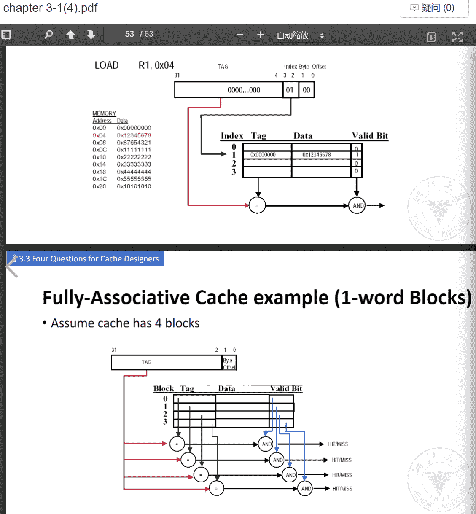
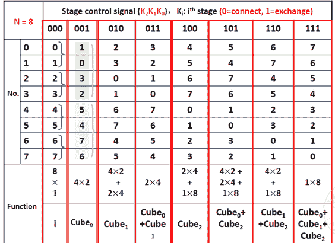
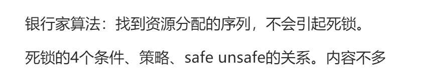
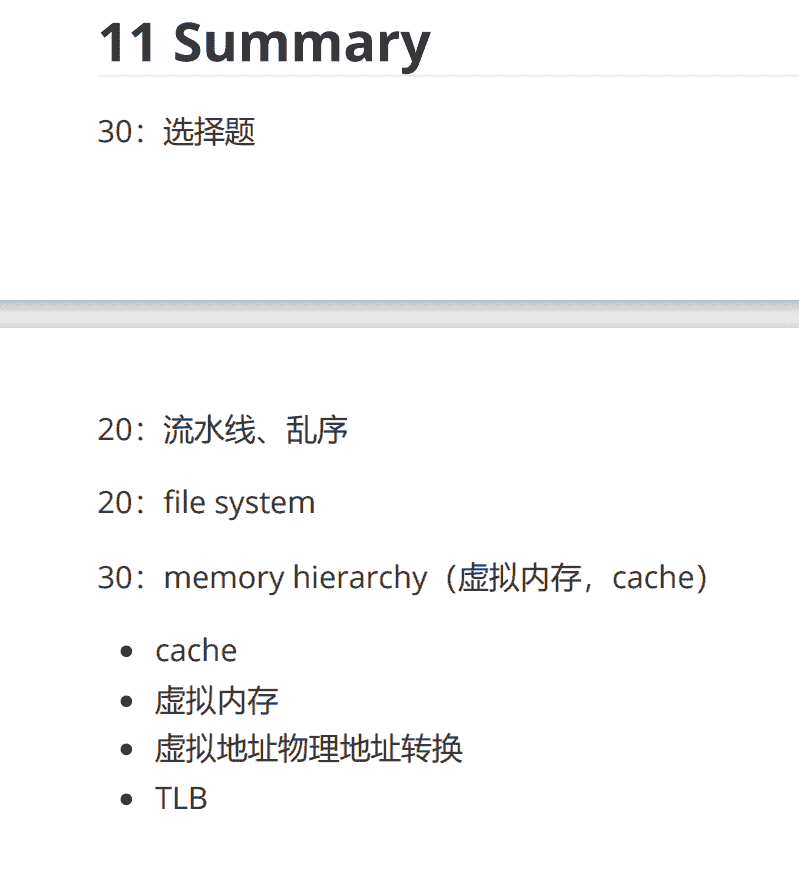
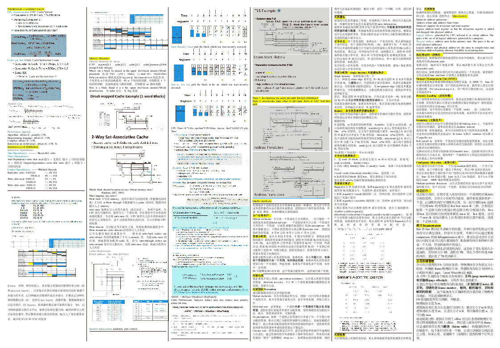

# A4

> 来源：[https://docs.feishu.cn/docx/FQHfd45vTofwkDxKDZpcpIQInFg](https://docs.feishu.cn/docx/FQHfd45vTofwkDxKDZpcpIQInFg)

# About

TLB一道大题10分

Cache一道大题10分

乱序部分肯定有一道大题 10分

文件系统 20

rwx和Acess control list

虚拟地址物理地址转换

cube那个网络表格图,会有一道选择

dlp和tlp考选择

三个动态调度算法

文件系统访问控制

文件系统综合（inode计算之类的都有）

多级cache（书上有图）+虚拟内存 TLB……

# A4

[系统3 A4.docx](https://internal-api-drive-stream.feishu.cn/space/api/box/stream/download/all/ORyobjMZPoK1DRxzodOceLjcnrg)