# Java应用技术

> 来源：[https://docs.feishu.cn/docx/BpyQdiyQEogRKFxotY1cS9r9nCb](https://docs.feishu.cn/docx/BpyQdiyQEogRKFxotY1cS9r9nCb)
> RyanFcr

## 0 About class

+ 平时分70%+期末考试30%
+ 包含出勤，PTA作业，编程小作业，大作业，期中考试
+ `Java` as a language
+ IO, exception, RTTI
+ GUI, MVC
+ Threads
+ Unit test, CI
+ JDBC, socket
+ Design patterns
+ Lambda, Stream
+ Parallel, concurrency, distributed

语言的能力/适用领域主要是由

+ 库
+ 传统所决定的，习惯
+ 技术的选择是非技术的

现在工业大多都用`Java`写网页后端，但是我们这节课不会学

## 1 Introduction

### 1.1 Java语言的特性

+ 简洁
+ 没有`C/C++`中的指针，不能做计算，没有多重继承和运算符重载的语法特性
+ `C/C++` 等指针 初始化、计算 会导致有问题
+ Java里`reference`，其实就是指针，不过不能计算，但是没有解决野指针，可能是`null`；像`kotlin` 要求不是`null`，才能操作；提供了自动内存分配和回收内存空间
+ `Java = C++ --`
+ 没有多继承
+ 没有虚继承
+ 没有模板
+ 没有运算符重载
+ 稳定
+ 面向对象
+ `Java`设计的核心是如何复用代码，并且支持继承封装多态
+ 可移植性
+ 这种可移植性来源于体系结构中立性，另外，`Java` 还严格规定了各个基本数据类型的长度。`Java` 系统本身也具有很强的可移植性，`Java` 编译器是用 `Java` 实现的，`Java` 的运行环境是用 `ANSIC` 实现的。
+ `Java is Interpreted`
+ 代码会编译成字节码(`bytecode`)在`Java虚拟机`上解释执行。`Java` 平台中的 `Java` 解释器对字节码进行解释执行，执行过程中需要的类在联接阶段被载入到运行环境中。
+ `bytecode`独立于电脑的架构，与平台无关，比写一个`complier`更好
+ `Java`是跨平台的，可以在所有有`JVM`的计算机上运行，`JMV`可以设置不同的安全等级
+ 统一的`data type`
+ `int`：32-bit
+ `char`：Unicode
+ 编译执行的语言
+ 源码不能被直接解释执行
+ 解释：源码直接一条一条被执行了
+ `safety`
+ 编译：源码编译产生一个可执行文件，再去执行；和操作系统有关
+ 快
+ 优化
+ `Java` 中`security`和`speed`里面有一个`tradeoff`
+ 鲁棒性
+ 强类型机制，异常处理，垃圾内存自动搜集等机制
+ 我们不能自己清理垃圾
+ 清理垃圾的机制是 `Lazy` ；等到没有内存的时候再清理
+ 性能
+ 性能比较慢？
+ 字节码执行的时候是解释执行的，天然的和本地代码执行慢
+ `Code check`
+ 安全性
+ `Index check`
+ 自动内存管理`Auto memory management`
+ `Stack machine`
+ 堆栈机，在内存里，天然慢
+ 性能比较快？
+ 与那些解释型的高级脚本语言相比，`Java` 的确是高性能的。事实上，`Java` 的运行速度随着 `JIT` (Just-In-Ti me，即时编译编译器）编译器技术的发展越来越接近于 `C++`。
+ `JIT`：先把字节码翻译成`x86`的命令，后面直接执行
+ `Multi-threads`
+ 在 `Java` 语言中，线程是一种特殊的对象，它必须由 `Thread` 类或其子（孙）类来创建。通常有两种方法来创建线程：其一，使用型构为 `Thread(Runnable)` 的构造子类将一个实现了 `Runnable` 接口的对象包装成一个线程，其二，从 `Thread` 类派生出子类并重写 `run` 方法，使用该子类创建的对象即为线程。注意的是 `Thread` 类己经实现了 `Runnable` 接口，因此，任何一个线程均有它的 `run` 方法，而 `run` 方法中包含了线程所要运行的代码。线程的活动由一组方法来控制。`Java` 语言支持多个线程的同时执行，并提供多线程之间的同步机制（关键字为 `synchronized`)
+ `Byte code simple design`
+ Dynamic
+ `Java` 语言的设计目标之一是适应于动态变化的环境。`Java` 程序需要的类能够动态地被载入到运行环境，也可以通过网络来载入所需要的类。这也有利于软件的升级。另外，`Java` 中的类有一个运行时刻的表示，能进行运行时刻的类型检查。
+ 动态性与编程语言是编译型还是解释型有关。
+ 任何的对象都在`堆``Heap`里
+ 单根结构，所有的`class`都有一个父类，`object`
+ `Java`的代码是和库紧密连接的——>`Java`是很重的
+ `String`类

Java生逢其时

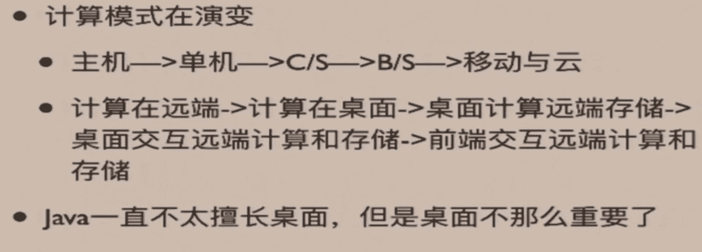

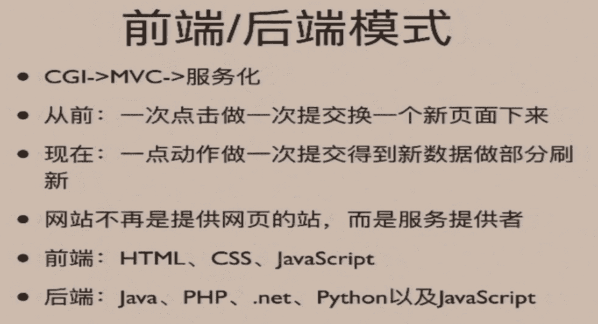

> Pta 一开始`JS`，但是直接被放弃，最后选择了`kotlin`

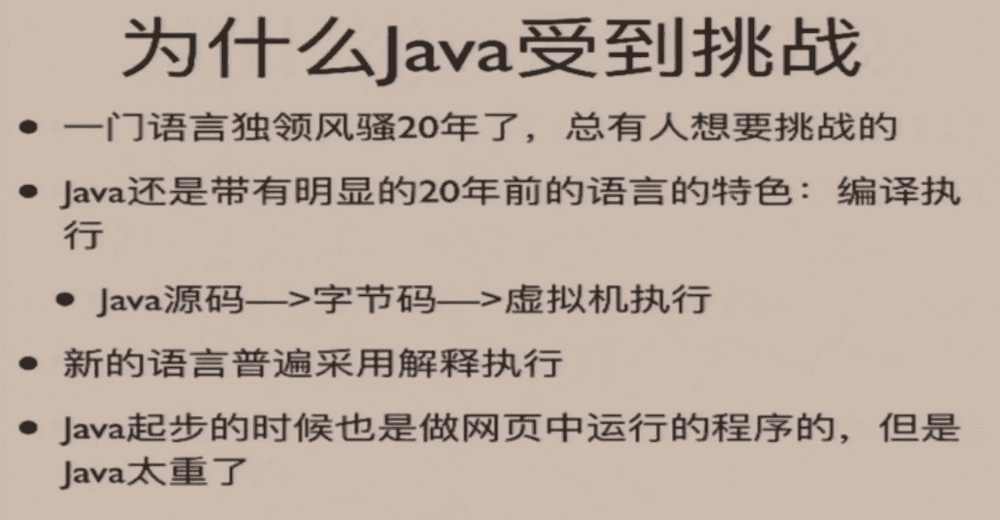

`Java`是最后一个编译执行的主流语言。`Java`是编译执行的，但是是解释性语言。

后面的很多都是解释执行

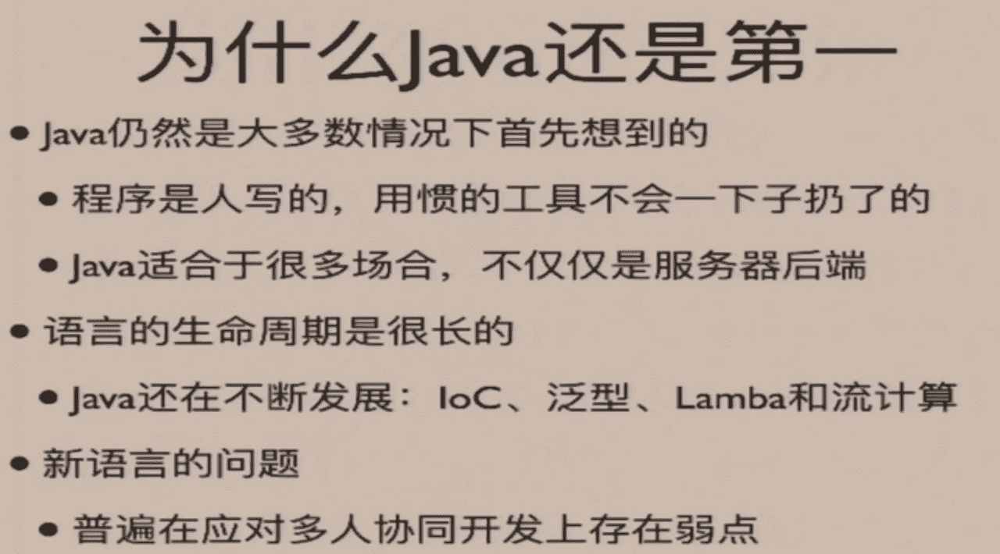

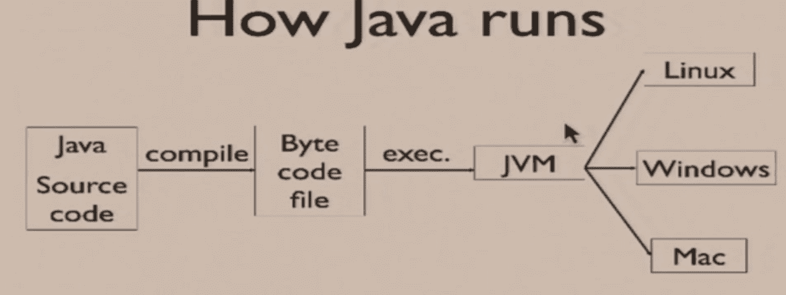

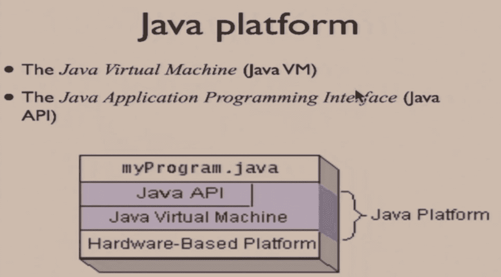

### 1.2 JDK的版本

+ `Java Standard Edition` (`J2SE`)
+ 可以用于开发客户端应用和`app`
+ `Java Enterprise Edition` (`J2EE`)
+ 可以用于开发服务端应用，企业级应用，比如`Java Servlets`
+ `Java Micro Edition` (`J2ME`)
+ 开发手机应用，移动端
+ 本课程中的内容主要是`J2SE`

### 1.3 Java程序的组成

+ 一个简单的`Java`程序

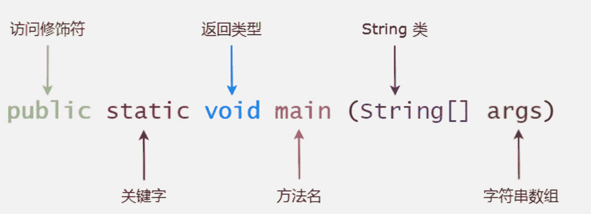

+ 类名`大写字母`；方法名`小写字母`

+ 该代码被保存在 `HelloWorld.java` 文件中。`Java` 程序的源文件名与`public`类名必须相同，否则会导致编译错误。

+ 命令行编译：`Javac HelloWorld.java` `Java HelloWorld`

```
 public class HelloWorld{
     public static void main(String[] args) {
         System.out.println(&quot;Hello World!&quot;);
     }
 }
 
 import java. util. Scanner;

public class A{
    public static void main (String [] args) { 
        Scanner in = new Scanner(System.in);
        int i = in.nextInt();//in.next()读入一个单词，以空格为标志
        //in.nextLine（）读入一整行
        System.out.println( &quot;Hello World!&quot;);
        System.out.println(i);
        in.close()；
    }
}
```

+ `Java`代码编译的过程
+ `Java`代码文件的后缀名是`.java`，被`Java`编译器编译之后编译成`.class`文件，之后在`JVM`中运行
+ `Java` 的代码的基本单位是一个个的类 (`class`)，每个文件中只能有1个公共顶级类，但可以有多个非公共顶级类。
+ 会生成按`class`名分类的`class`文件；以`class`为单位
+ `Java` 要求每个代码文件声明其所属的包(`package`)。包的结构类似于文件夹的结构。在`DE` 中新建类文件时， `IDE` 一般会帮助我们写好所属的包。
+ 在 `IDE` 中编写 `Java` 程序的步骤是：新建 `project`-＞ 在源码（`src`）文件夹中新建类 (`class`)-＞ 在创建出的类文件中编写代码。附属产生的 `.iml` 文件是配置文件。
+ 每个`Java`程序至少需要一个`class`，每个`class`都有唯一的`class name`
+ `block`是`java`程序的组件，比如一个类就是一个`class block`
+ `Java`程序中的错误
+ 语法错误`Syntax Error`：会在编译期间被检查出来，因此有语法错误的时候无法通过编译
+ 运行时错误 `Run time Error`
+ 程序逻辑上本身的错误

### 1.4 ⭐作业里一道莫名其妙的题目

+ 对于下面的这样一个`Java`程序，它可以通过编译但是运行的时候会因为没有入口`main`函数而出现错误
+ 这是因为`Java`的编译器会把类编译成`class`文件，下面这个类是一个合法的类，没有语法错误，因此可以通过编译
+ 但是在`JVM`中执行的时候会因为没有入口`main`函数而出现错误

```
 public class main {
     public void main() {
         System.out.println(&quot;Hello World!&quot;);
     }
 }
```

### 1.5 赋值

> 赋值基本上全是对象指针，改来改去都是一个东西

## 2 Java的基本语法

### 2.1 Java的变量命名

+ 变量：包含大小写字母，数字，下划线和`$`符号
+ `Java`中的变量不能用数字开头，也不能是保留字
+ 变量的定义和声明
+ `Java`中不区分变量的声明和定义，这是和`C/C++`的最大不同
+ `C/C++`中的编译器不会为基本类型赋予初始默认值
+ `Java`对于方法的局部变量，`Java`以编译时错误来保证变量在使用前都能得到恰当的初始化，而`c`是不会报错
+ 但是`Java`对于方法内的单个变量不会赋予初始值，对于数组会赋予默认的值
+ 对于下面这样一段代码
+ 输出的结果是0，因为变量进行了初始化但是没有赋予具体值
+ `Java`中`int`类型的默认值就是0

```
public class JavaPractice {
     static int array[] = new int[5];
     public static void main(String a[]) {
         System.out.println(array[0]);
     }
 }
```

+ 常量定义`final datatype CONSTANTNAME = VALUE`;
+ 常量名均大写
+ `final`的主要用法有如下三种
+ 修饰变量，表示变量的值不能改变，但是可以进行任何合法形式的初始化，相当于`C/C++`中的`const`类型
+ `final`变量是不可改变的，但它的值可以在运行时刻初始化，也可以在编译时刻初始化，甚至可以放在构造函数中初始化，而不必在声明的时候初始化，所以下面的语句均合法
+ `final inti=1`;//编译时刻
+ `final int i2= (int) (Math.Random①* 10)`;//运行时刻
+ `final int i3`：//构造函数里再初始化
+ 修饰类对象，表示这个变量不能再赋值成其他的对象，比如一个对象被`new`了之后，就不能再把它`new`成一个新的对象
+ 修饰`method`，表示一个`Java`函数不可更改，不能被重写
+ 修饰类，表示这个类不能被继承，类中的所有方法也就变成了`final`类型的
+ `Java`中的变量类型
+ 数值型变量：`Java`中整数类型的范围和运行的机器无关，这一点和`C/C++`不同
+ `byte` 8bit 有符号类型
+ -128-127
+ `short` 16bit 有符号类型
+ `int` 32bit有符号类型
+ 整数的缺省类型为 `int`。`int`的长度被固定为32位，在不同的机器上长度一致，最大2147483647。
+ `long` 64bit有符号类型
+ 如果表示一个整数为 `long` 类型，需要加后缀`L`或`l`，如 `31L`。
+ `float`和`double`分别是32bit和64bit的`IEEE754`标准
+ 一个浮点数的缺省类型为 `double`，占8字节64位。表示一个浮点数为 `float` 型，需要加后缀`F`或 `f`，`float` 占32位4字节。
+ 浮点数可以用标准计数法（如 12.3）或科学技术法（如 2.5E4, 3.66e7 等）表示。科学计数法也称指数形式，`E`或`e` 前面的数称为尾数，后面的数称为阶码。
+ 八进制数以`0`为前缀，如 `027` 等，十六进制数以 `0x` 或 `0X` 为前缀，如 `0xAC`, `0X1b` 等。
+ 字符类型`char`

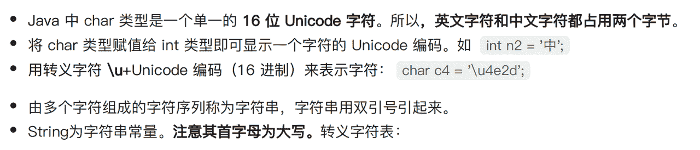

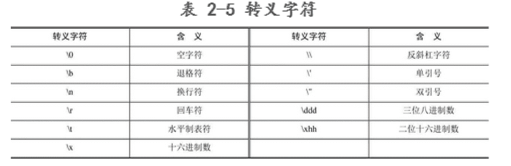

+ `UTF-8`（8-bit Unicode Transformation Format）是一种针对`Unicode`的可变长度字符编码，又称万国码。
+ 布尔类型：数据类型为 `boolean`，只有 `true` 和 `false` 两种取值。
+ `Java`中变量的默认值可以简记为均初始为0。

> 没有无符号数，`c`引入`unsigned`的本义是为了表达逻辑移位

> `java`用`>>>`

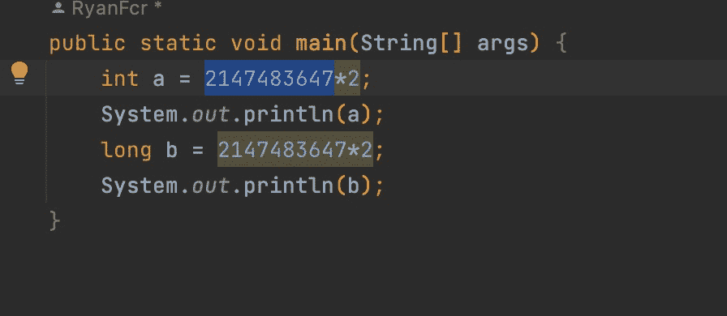

> 输出 -2 -2

> 因为2147483647*2默认就是`int`

> 2147483647+1 = -2147483648

+ 数值类型的读入
+ 首先需要定义`Scanner`读入器`Scanner input = new Scanner(System.in)`
+ 之后可以用`input`的`nextInt`方法读取下一个整数，其他数据类型同理
+ `next`：分割读取
+ `nextLine`：一整行读取，包括单词之间的空格和除回车以外的所有符号(即。它读到行尾)
+ `nextInt`：`nextInt()` 是取`next()` 然后把字符串解析成一个`int`数字。
+ `hasNext`：用来判断是否还有输入（空格也是）
+ `hasNextInt`：用来判断是否输入是`int`
+ 例子：

```
public static void main(String[] argv){
    String s = &quot;16 abc 32 de 64&quot;;
    Scanner sc = new Scanner(s);
    while ( sc.hasNext() ) {
        if ( sc.hasNextInt() ) {
            System.out.printf(&quot;%02X&quot;,sc.nextInt());
        } else {
            System.out.print(sc.next());
        }
    }
}
```
10abc20de40

+ 输出

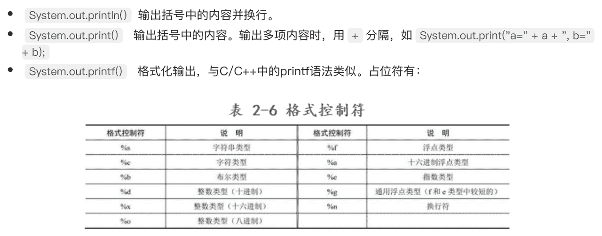

+ `Java`中的数值运算：支持加减乘除取余等各种操作
+ 除法中如整数除法的结果是整数，浮点数除法的结果浮点数
+ 整数除0能过编译，执行结果是`ava.lang.ArithmeticException: / by zero`
+ 与整数运算不同，浮点数运算时，除数为0不会报错。但是会返回几个特殊值：

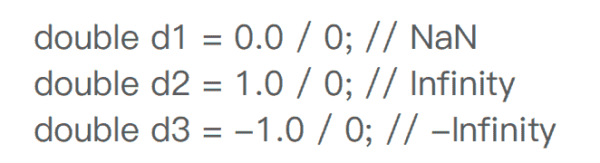

+ 几个特殊的浮点数值
+ `Double.POSITIVE_INFINITY` 正无穷大
+ `Double.NEGATIVE_INFINITY` 负无穷大
+ `Double.NaN` 不是数字
+ 可以用`Double.isNaN`来判断是否为数字
+ 类型转换：`byte`，`short`，`int`，`float`，`double`，`long`，`char`之间可以进行类型转换
+ 其中整形向浮点型的转换可能会造成精度的损失
+ 浮点数向整形转换的时候会丢弃小数部分
+ `Java`不支持`C++`中的自动强制类型转换，有需要的类型转换必须显式地声明
+ 加宽转换一般可以是隐式的。
+ 缩窄转换必须是显式的。需要在括号中指定目标类型，例如从`long`类型到`int`类型的缩窄转换： `long a = 10; int b = (int)a;`

### 2.2 选择语句

+ 布尔类型变量(`boolean`) 值只有`true`和`false`，`Java`中的大小关系符和`C/C++`一致


## 2.2 流程控制

### 2.2.1 if语句和switch语句

+ 和C/C++基本一致

+ `if`语句有单个`if`，`if`-else，多层嵌套`if`等写法，`else`和最近的`if`匹配

+ `switch`语句也跟C/C++基本一致，有`break`有`default`

+ 布尔类型和`long`不能用在`switch`的选择里，下面的代码是错误的

```
boolean x;
switch(x) {
        //
}
```

### 2.2.2 逻辑运算符

+ Java中有如下逻辑运算符

+ `!`逻辑否，`&&`逻辑且，`||`逻辑或，`^`逻辑异或

+ `&&`和`||`的运算按照`短路`的方式来求值，如果第一个操作数已经可以确定表达式的值，后面的就不需要进行运算了

+ `&`和`|`也可以进行逻辑运算，区别是这两个不用`短路`的方式来求值

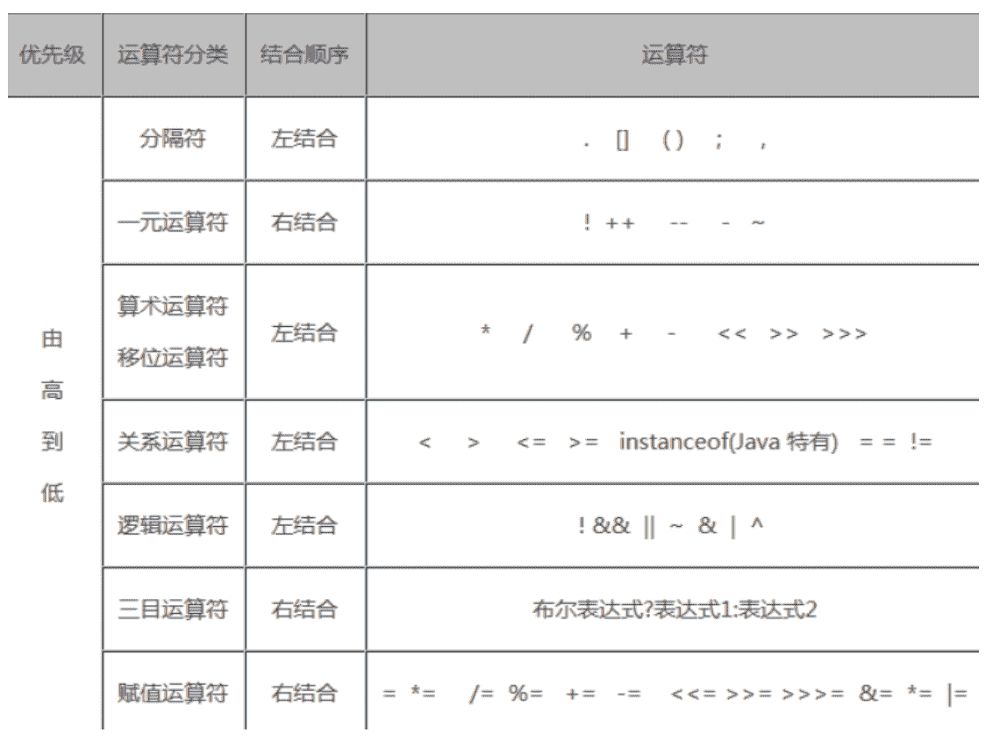

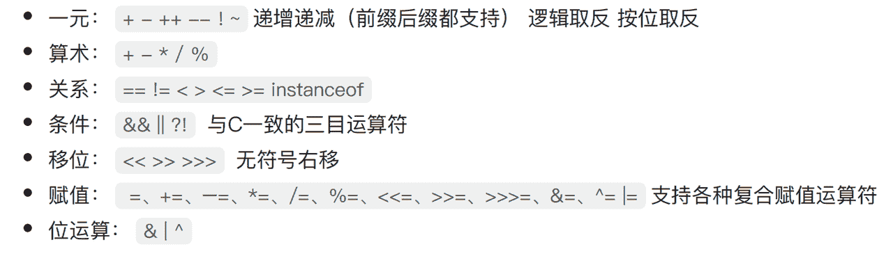

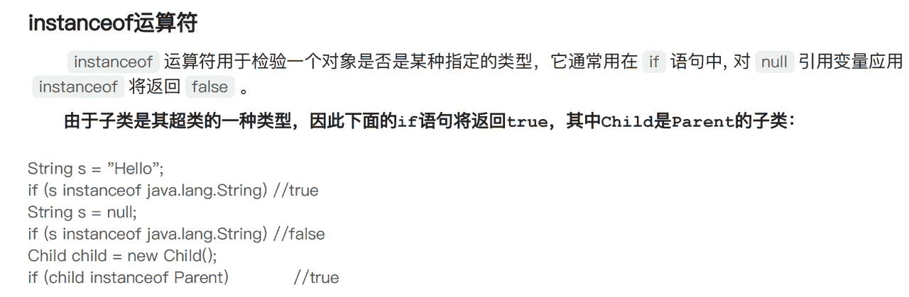

## 2.3 数学函数

> `Math.xxx`

+ 常见的两个常数：`PI`和`E`表示圆周率和自然对数的底数

+ 常见的数学类方法

+ 三角函数

+ 幂

+ `Exp`

+ `Log`

+ `log10`

+ `Pow`

+ `Sqrt`

+ `Ceil`

+ `Floor`

+ `Rint`

+ `Round`

+ 高斯函数和舍入方法

+ 最大，最小，绝对值和随机

## 2.4 字符和字符串类型

+ Java中的字符类型有两种表示方式，`ASCII`编码和`Unicode`编码模式

+ `Unicode`编码模式的形式是前缀`\u`+四位十六进制数，可以表示从0000到FFFF一共65536个字符

+ 常见的`ASCII`码

+ `'0'` - `'9'`在`ASCII`码中是48到57

+ `'A'` - `'Z'` 是65-90，`'a'`-`'z'`是97-122

+ 字符串内置方法

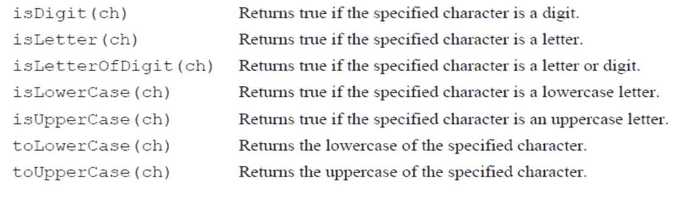

+ 字符串类型 `String`

+ 一些简单的内置方法

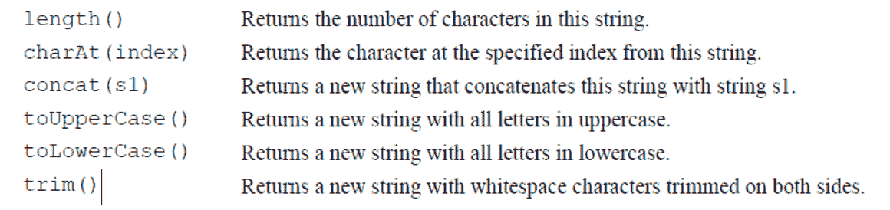

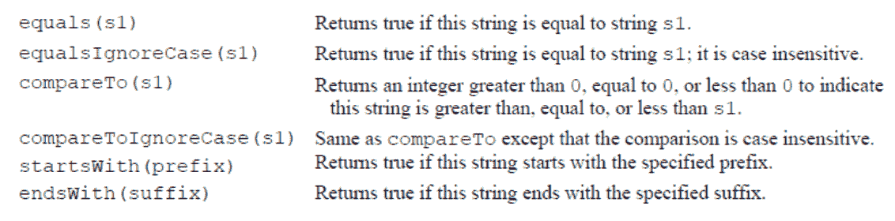

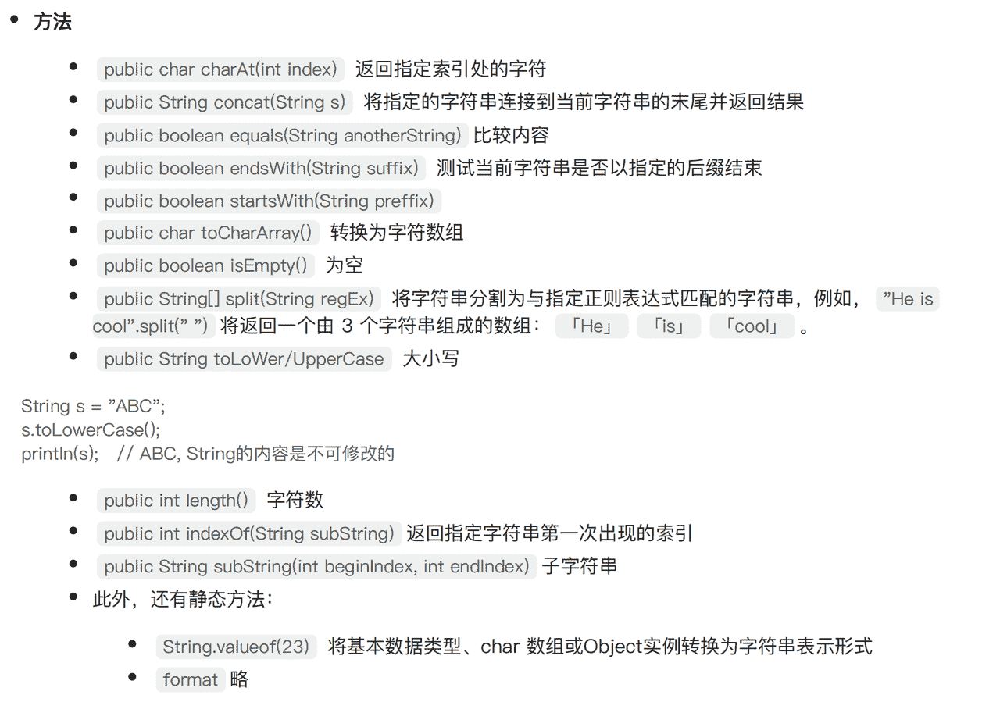

+ `replaceAll()`

```
import java.util.Scanner;

public class test1 {
    public static void main(String []args){
        Scanner in = new Scanner(System.in);
        String s = in.nextLine();
        String str3 = s.replaceAll("[^a-zA-Z0-9]","").toLowerCase();//把所有的字母以及数字保留
        for(int i = 0 ; i < str3.length()/2 ;i++){
            if(str3.charAt(i)!=str3.charAt(str3.length()-i-1)){
                System.out.print("false");
                return;
            }
        }
        System.out.print("true");
        return;
    }
}
```

+ 读取字符串的方式：

+ 使用`next()` 从有效字符开始扫描，遇到第一个分隔符或者结束符的时候结束，将结果作为字符串返回

+ `nextLine`扫描当前行所有的字符串作为结果返回

+ 获取字串，使用`substring`方法，必须要有的参数是起始位置`beginIndex`，结束位置`endIndex`可以缺省，默认值是字符串末尾，`substring`是左闭右开的

+ 访问单个字符和子串的位置

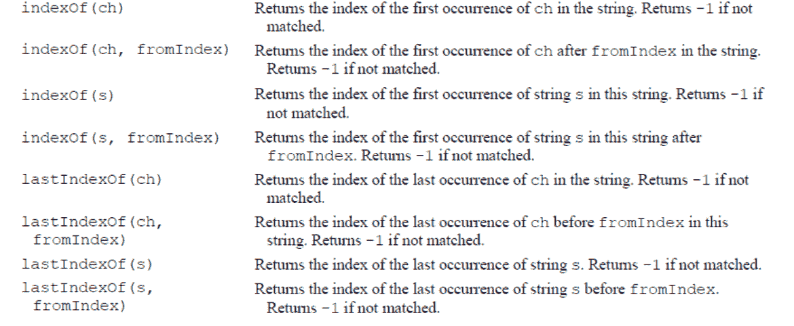

```
String s;//指的是产生一个reference指向nothing，未来可以指定指向某个string的object，而不是一个对象
//是野指针
```

一个对象是`String`，则是不可改变的，`immutable`

但是如果是`String` `reference`，则可以改变指向谁

```
int age = 25;
String s2 = "I am" + age + "years young";

1+2+"age" ——> "3age"
"age"+1+2 ——> "age12"
从左到右

if(input == "bye")
//test identity 表面是否指针指向同一对象，而不是内容相等
if(input.equals("bye")) 
//test equality
input.equalsIgnoreCase("bye")
//不管大小

compareTo来比较字符串的大小
charAt来获得index的字符
```

> 转换成`String`的方法

+ `""+12`

+ `Integer.toString(12)`

+ `String.valueOf(12)`

> 转成数字

+ 数字的`.valueOf`

+ 字符串类型是`不可变`的，不能对`String`中的内容做出改变，同时如果在函数中对`String`进行赋值操作也不能改变主函数里的`String`，比如下面这样一段代码，最后的输出还是A,B

```
public class Main {
    public static void main(String args[]) {
        String a = new String("A");
        String b = new String("B");
        swap(a, b);
        System.out.println(a + "." + b);
    }
    static void swap(String x, String y) {
        y = x;
    }
}
```

+ `String`的所有函数只是制造一个新的，但不提供修改原来的字符串的方法

> `immutable`可以让大家都指向某个东西，不需要考虑安全问题，别人修改了怎么办

+ 格式化输出

+ `System.out.printf(format, items);` 具体的用法和C语言的`printf`类似

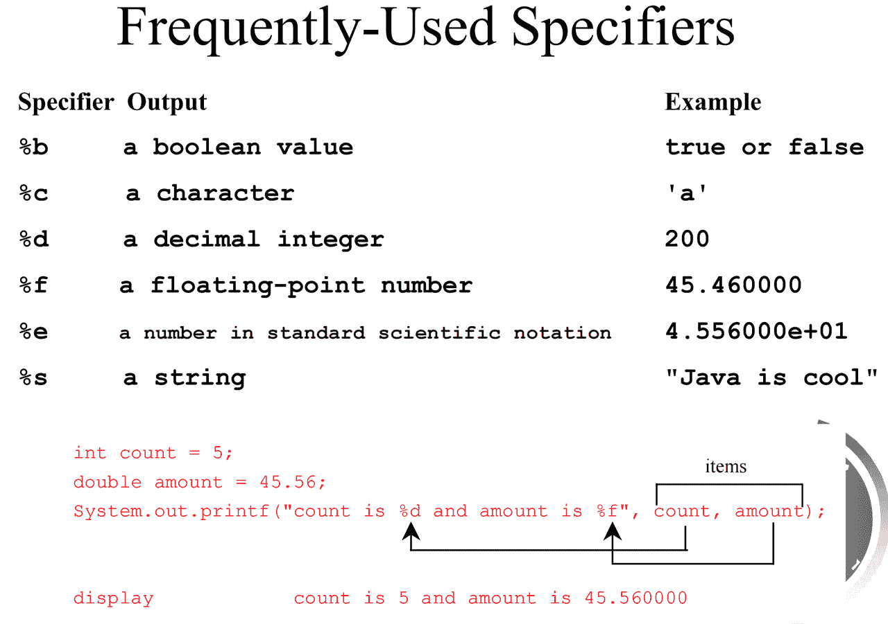

+ 占位符的具体格式包括

+ `%[index$][标识]*[最小宽度][.精度]转换符`

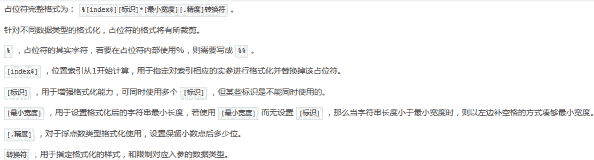

+ `index`表示从第几个位置开始计算来进行格式化，起始为1

+ 最小宽度是格式化之后最小的长度，当输出结果小于最小宽度的时候用标识符填补空格，没有标识符的时候用空格填充

+ 字符串可用标识：`-` 表示左对齐，默认的是右对齐

+ 整数和浮点数可用标识：

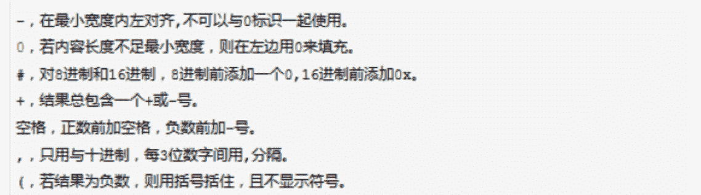

+ 对日期进行格式化

+ 精度用于设置浮点数保留几位小数

+ 转换符用于指定转化的格式，有`f`，`d`等等

## 2.5 循环

+ 和C/C++基本一致，有`for`循环，`while`循环和`do-while`循环

+ 要注意区别`while`循环和`do-while`循环

+ `for(;;){}`和`while(true){}`等价

+ Java中也有`break`和`continue`来结束或者跳出循环

+ Java有带标签的`break`，类似`goto`

+ 范围 `for` 循环是传值的。不能直接修改遍历的容器的对象值，但是可以通过修改指针所指的对象来实现间接修改。

## 2.6 方法

+ 将程序中的一部分过程抽象成一个方法，起到代码复用的作用，一个方法的定义包含如下如内容

+ 访问控制`modifier` 修饰符，包括方法的`public`/`private`/`protected`和是否是`static`，`final`等属性

+ Java要求每个`member`前都要有个修饰符

+ Java修饰符不只是修饰变量，也可以修饰类

+ `friendly`：默认是`friendly`，同一个`package`可以访问

+ `Public`：所有人都可以访问

+ `Private`：内部类

+ `Protected`：

+ C++ 子类可以访问

+ Java 同一个`package`以及子类可以访问

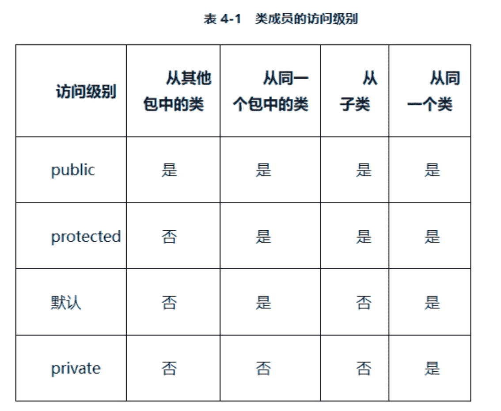

+ `return` value type 返回值类型

+ `method name` 方法名

+ `formal parameters` 形式参数

+ 方法名+形式参数称为方法的签名

+ 与之相对应的是`actual parameter or argument`实际参数，也就是调用方法的时候使用的参数

+ 实参的内容不会因为方法中的操作被改变

+ `body` 方法的具体内容

```
modifier 返回类型 方法名称([参数类型 变量, ......]) {
        方法体代码;
        [return [返回值];]
}
```

+ 方法的重载`overload`：相同的方法名，不同的参数表构成重载关系

+ 只有返回值类型不同时不构成重载，这种写法会引起编译错误，不能使用

+ 被重载的方法必须改变参数列表(参数个数或类型不一样)；

+ 被重载的方法可以改变返回类型；

+ 被重载的方法可以改变访问修饰符；

+ 被重载的方法可以声明新的或更广的检查异常；

+ 方法能够在同一个类中或者在一个子类中被重载。

+ 无法以返回值类型作为重载函数的区分标准。

+ `局部变量`：定义在方法内部的变量叫做`局部变量`

+ `局部变量`的可调用范围是从定义开始到不再包含这个变量的方法内部区域为止(比如`for`循环中定义的变量只能在`for`循环中调用)

+ Java对于方法的`局部变量`，Java以编译时错误来保证变量在使用前都能得到恰当的初始化

+ 但是Java对于方法内的单个变量不会赋予初始值，对于数组会赋予默认的值

```
import java.util.Scanner;
public class test {
    public static void main(String[] args) {
        f();
    }
    public static void f()
    {
        double[] list = new double [5];
        int i;
        System.out.println(list[0]);//不会报错，默认赋值
        System.out.println(i);//会直接报错
    }
}
```

+ 可变参数

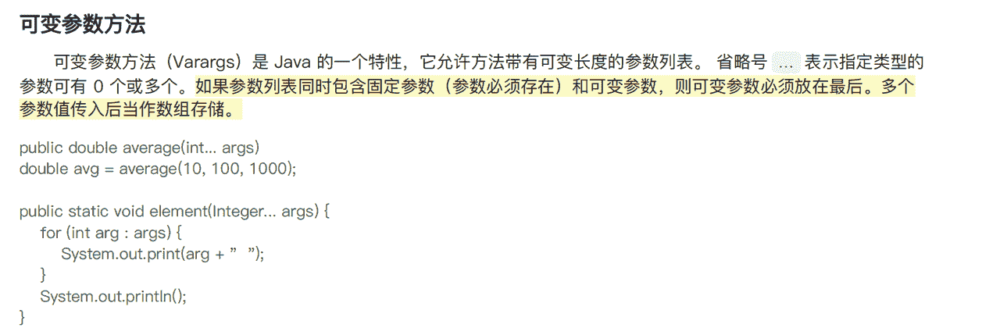

## 2.7 数组

### 2.7.1 一维数组

+ Java中数组的定义方式`datatype[ ] array`，中括号也可以放在后面，然后需要用`new datatype[size]`来声明数组的大小

```
int[] arr = new int [5];
int[] arr1={1,2,3,4,5};//简化格式
int arr2[] = {1,2,3,4,5};
int[] arr3 = new int []{1,2,3,4,5};//完整格式

int arr4[2] = {1,2};//错误
```

+ 声明数组并不创建数组或为其元素分配空间，编译器只是声明了一个对象引用。创建数组的一种方法是使用 `new` 关键字

+ 可以用`length`来获取数组的长度，但要注意这个和`String`类型的`length()` 方法不一样，数组里的`length`是`state`

+ `int [][] a = new int[2][3]`，那么`a.length`是2，`a[1].length`为3

+ 数组的长度定义之后就不能改变

+ 数组的长度确定之后，里面所有元素的值会被设定为默认值

+ 对于数值类型的数组，默认值是0

+ 对于`char`类型，默认值是`\u0000`

+ 对于`boolean`类型，默认值是`false`

+ 数组可以在定义的时候直接赋予若干值，此时数组的长度会被自动设定为值的个数，但是下面这种方式是错误的，不可以分成两步，因为声明数组的时候必须指定数组的大小

```
double[] list;
list = {1, 2, 3, 4};
```

+ Java数组和C++数组的区别

+ Java的数组定义在`堆`上，C++中直接声明大小的数组分配在`栈`上，动态分配的数组在`堆`上

+ Java的`[ ]`运算符会检查数组边界，防止下标溢出，并且没有指针运算

+ 使用一个负索引或大于等于数组大小的索引将抛出 `java.lang.ArrayIndexOutOfBoundsException` 异常。

+ Java中命令行参数是`String[] args`，其中`args[0]`是第一个参数，程序名没有存储在`args`中，需要在启动Java程序的时候就输入；C++会存储程序名

+ 数组的遍历

+ 用下标`i`去遍历一个数组

+ 用`elementType value: arrayRefVar` 的形式来遍历

```
for (double value: myList)  
    System.out.println(value); 
    
//In general, the syntax is 
for (elementType value: arrayRefVar) { 
// Process the value 
}
```

+ `java.util.Arrays`类

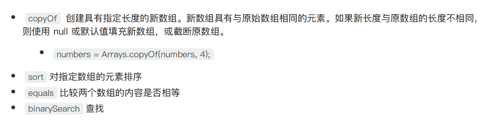

+ `copyOf`是深拷贝

如果数组元素是数值型，则多余的元素被赋值为0；若是布尔型，则赋值为false。

相反，如果长度小于原始数组长度，则只拷贝前面的元素。

+ 数组作为方法的参数

+ `Anonymous Array` 匿名数组：在方法调用中的参数里直接写一个数组，没有用变量去引用，如`new int[]{1,2,3}`直接作为参数

+ 将数组作为参数的时候，数组作为一个引用传入，方法中改变数组的值将会影响到原来的数组，但是匿名数组没有变量名

### 2.7.2 多维数组

+ 二维数组的定义：`dataType[][] refVar`;

+ 如何`new`：`new dataType[rowSize][columnSize]`

+ Java的二维数组每一列大小可以不同，并不需要完全相同！

+ 如何创建一个二维数组？以下四种写法中，只有第2行的是对的

+ 总结起来就是中括号可以放在前面也可以放在后面，但是声明的时候不能直接指定数组的大小

+ 数组的大小需要在`new`的时候指定，并且二维数组一定要有行的数目

```
int a[3][2] = ;//前面是
int a[][] = new int[3][];
int[][] a = new int[][3];
int[][] a = new int[][];
```

## 3 Java OOP

### 3.1 类和对象

#### 3.1.1 类的定义和初始化

+ 类（`Class`)是一个共享相同结构和行为的对象的集合。类定义了一件事物的抽象特点。一个对象拥有状态(`state`)和行为(`behavior`)两个属性，状态定义了对象的内容，行为定义了对象可以进行哪些操作，类就是用于定义同一类对象的

+ Java中用变量定义状态，用方法定义行为

+ Java中的类也有构造函数，名称和类一样，在对象构造的时候调用，但是对象的定义也可以不需要构造函数，当类定义里没有显式声明的构造函数时Java编译器会自动调用一个`default constructor`

+ 构造方法没有返回值，甚至没有`void`。构造方法必须与类名相同。与C++不同的是，构造方法需要添加访问标识符。

+ 使用就是`new`一个对象

+ `main`

+ `main`方法是一个特殊方法，它提供了应用程序的入口点。一个应用程序通常有很多类，其中只有一个类需要`main`方法，此方法允许调用包含的类。`public static void main(String[] args)`

+ 向`main`方法传递参数：`java className arg1 arg2 arg3...`

+ Java中方法和成员变量的引用方式：`objectRefVar.methodName(arguments)`


## 3.1

+   Reference Data Fields有默认值

+   `String`类型是`null`，数值类型是`0`，布尔类型是`false`，`char`类型是`\u0000`，但是Java对于方法中的局部变量不会赋予默认值

+   比如局部变量里`int x`后直接对其进行`print`会发生编译错误，因为变量没有初始化

+   和`C++`的区别

+   Java编译器会为这些数据成员进行默认初始化，实际上是把刚分配的对象内存都置0

+   在对象里定义一个引用，并且没有初始化的时候，默认为`null`

+   Java中在默认的初始化动作之后才进行指定初始化，比如下面这段代码中，创建一个对象的时候变量`i`先变成`0`在被赋值为`999`——定义初始化

+   也就是说一定会有用默认值去初始化类成员变量的这个过程

+   并且`C++`不支持直接在类定义里给成员变量赋值，但是Java可以

```
 public class Value {
     int i = 999;
 }

 //这样是可以的，扫两遍
 //尽管没有main函数，但是不会报错
 //构造的时候i和a都先设置成0，然后调用f初始化i，所以i是0；
 //如果将第10和11行交换那么i是10。在f里加print函数可以发现是扫了两次的。
 public class Main {
     int i = f();
     int a = 10;
     
     int f() {
         return a;
     }
 }

 //未定义a是啥，编译错误：非法前向引用
 public class Main {
     int i =f(a);
     int a = 10;
     
     int f(int k) {
         return k;
     }
 }
```

+   Java中数据成员的初始化过程是

> 静态`static`和这些无关，是在类加载的时候初始化

+   初始化对象的存储空间为零或`null`

+   父类的类定义初始化

+   调用父类的构造函数

+   在进行类定义里的初始化

+   先定义表达式

+   再大括号（实例化）

+   实例化

```
{
    ...
}
```

+   甚至可以调函数，也可以调用成员变量

+   本身构造函数初始化

+   对象和基本变量类型的区别

+   基本变量类型在拷贝的时候只是拷贝一个值

+   对象在拷贝中改变的是变量对于对象的引用

+   比如`c1=c2`的赋值导致`c1`也指向了`c2`指向的对象，而`c1`指向的对象不再被引用，会触发JVM的垃圾回收机制

+   对于不需要使用的对象可以给它赋值为`null`，这样就会触发JVM的垃圾回收机制释放内存空间

+   Java是动态的装载一个一个`Class`文件，`class`被装载的时候才开始初始化

### 3.1.2 JVM--垃圾回收机制

+   Java的垃圾回收机制

+   对于不再被引用的对象和被赋值为`null`的对象就会触发Java的垃圾回收机制

+   先标记是否是垃圾

+   再对是垃圾的对象执行该对象的`finalize`函数

+   执行的时间取决于垃圾回收机制 —— 懒

+   一般而言如果类自己管理内存，程序员就应该警惕内存泄漏的问题

+   内存泄漏是指没有指针/引用指向一段存内存，导致这部分内存无法被调用和修改

+   内存泄漏的另一个常见的来源是缓存，把对象引用到了缓存中就容易内存泄漏

+   缓存可以用软引用来实现

+   Java提供了强引用，软引用，弱引用和虚引用4种引用方式

+   平时我们用的是强引用，强引用只要存在就不会被当作垃圾回收，真不行了就抛出OOM异常

+   `object = null;` 就会导致原本是强引用被垃圾回收

+   软引用：是用来描述一些还有用但并非必须的对象。

对于软引用关联着的对象，在系统将要发生内存溢出异常之前，将会把这些对象列进回收范围之中进行第二次回收。如果这次回收还没有足够的内存，才会抛出内存溢出异常。

+   用软引用关联的对象在即将发生内存异常之前会被列入垃圾回收的范围而被回收，如果内存还是不够才会抛出内存异常(OOM, out of memory)的问题

+   软引用主要应用于内存敏感的高速缓存，在安卓系统中经常用到

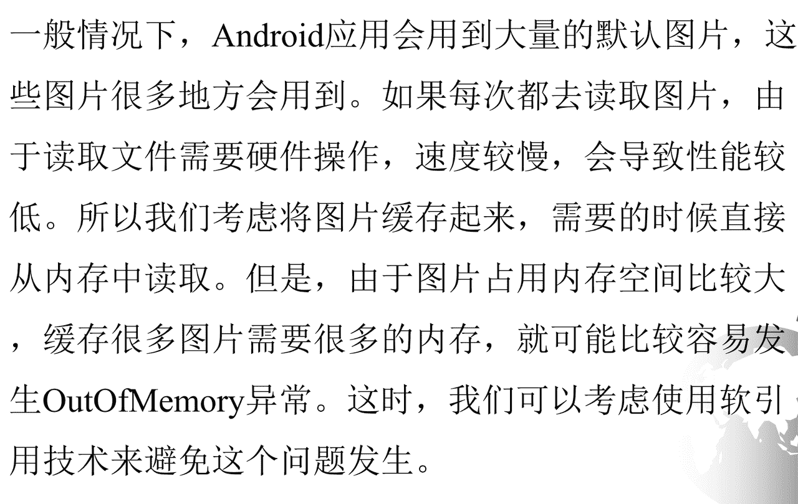

### 3.1.3 对象内存分配

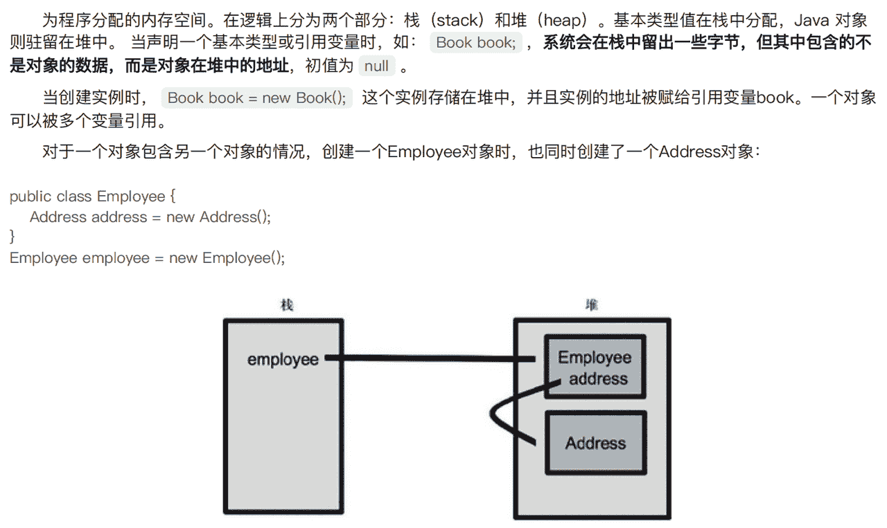

### 3.1.4 Instance 和 static

+   `instance` 和 `static`——和`C++`相同

+   `instance`是变量的实例，`instance variable`属于特定的实例，`instance method`由类的一个实例调用

+   `static`类型的变量和方法被一个类的所有成员共享

+   `static`类型的方法只能调用`static`的方法、变量；但是`instance method`可以调用`static`的方法、变量

+   是类的一个成员，不需要实例化即可调用

+   没有`this`

+   `C++`本身静态成员变量是全局变量，但是访问受限

+   Java没有全局变量，是类变量

+   静态变量的初始化是在类被装载的时候

+   生命周期

+   当程序运行的时候，第一次`new`创建一个类的对象，或通过类名访问静态变量或静态方法时，`Java`会将类加载进内存，为这个类分配一块空间（其实是方法区）， 这块空间会包括类的定义、它的变量和方法信息，还有类的静态变量，并对静态变量赋值。

+   类加载进内存后，一般不会释放，直到程序结束。一般情况，类只会加载一次，所以静态变量在内存中只存在一份。

+   通过`new`创建一个对象时，对象产生，在内存中会存储这个对象的实例变量值。每`new`一次，都会产生一个变对象，会有一份独立的实例变量。

+   在类里面会有一个静态块

+   监控什么时候被装载

+   静态变量先于类

+   `static`块，在给静态成员变量初始化之后，给`static`块初始化

+   实例初始化与静态初始化不同。后者发生在类加载时，它与实例化无关；相反，实例初始化发生在创建对象时。此外，与静态初始化器不同，实例初始化器可以访问实例变量。

+   Java变量的初始化顺序：静态变量或静态语句块——>实例变量或初始化语句块--->构造方法（注：这里实例变量的初始化是在构造方法中第一条指令执行前执行的，注意并不是构造方法之前）

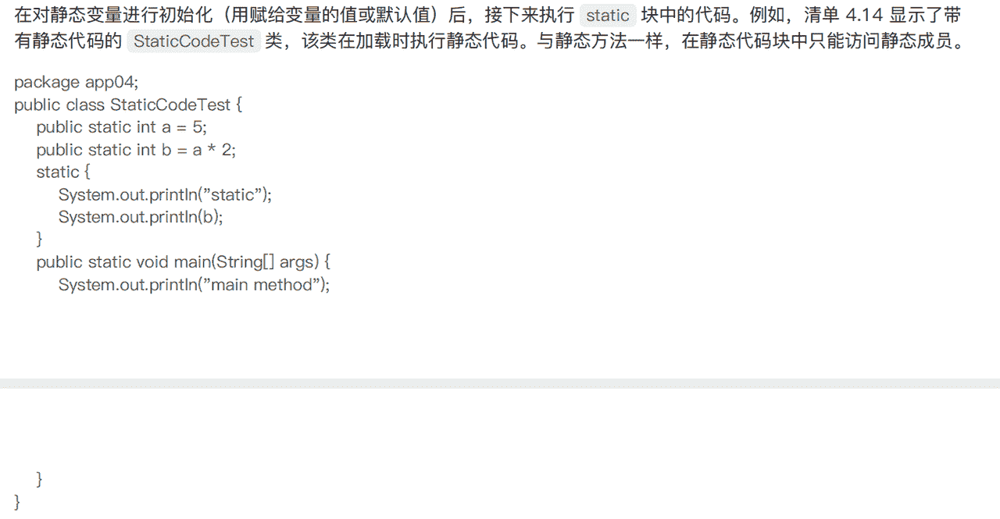

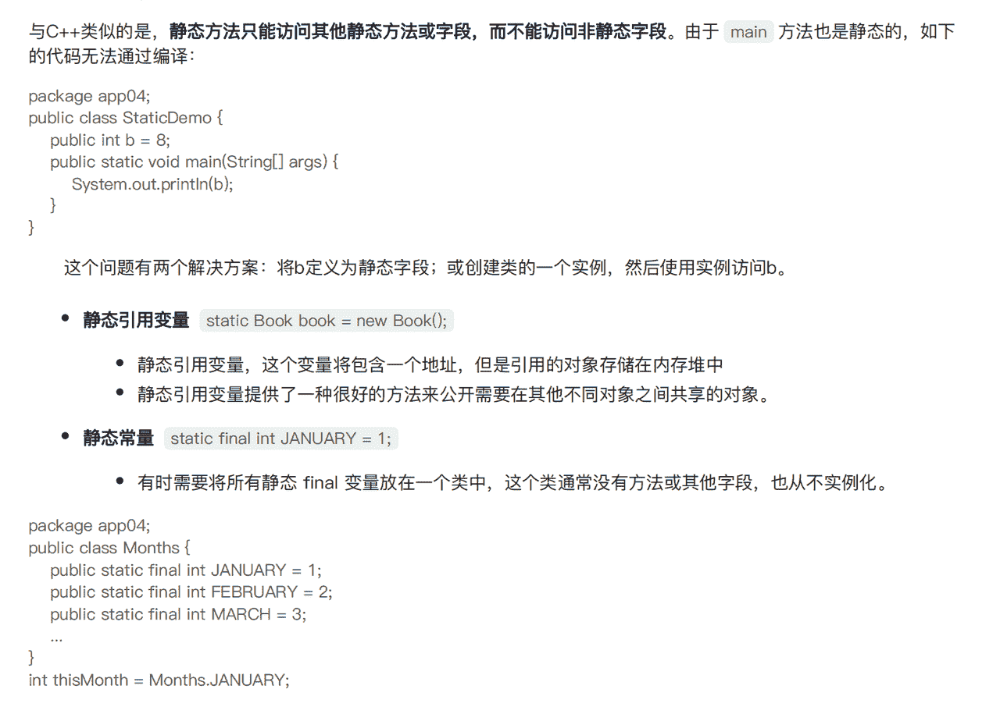

### 3.1.5 private构造函数

+   `private`构造函数

1.  单例模式：只有一个实例，为`static`类型，能创建类的实例，但只能被类的静态方法调用。

1.  工具类：工具类`Utils`，里面含有很多静态函数或者静态变量，由于静态的原因，我们完全可以通过类名来访问，这样，我们就没有必要实例化它们，所以我们可以将其构造函数设置为私有，这样就防止用户滥用。

### 3.1.6 this关键字

+   `this`关键字：和`C++`相同，就是没有`*`

+   是对象本身的引用的名字，用于访问`hidden data fields`

+   代理构造：一个常见的用法是在类的`constructor`中去调用其他的`constructor`，用`this`用参数

+   `this()`必须是构造函数中的第一条语句，所以只能有一个`this`，`this`前面甚至不能调用`super`构造

### 3.1.7 不可变类

+   不可变类 `Immutable class`

+   `Java`自带了很多不可变的类，比如`String`和一些基本的包装类

+   不可变类的优点：更加容易设计，实现和使用，更加安全

+   编写不可变类的原则

+   不提供可以修改对象状态的方法(`mutator`)

+   保证类不会被扩展，具体的做法是声明为`final`类型

+   不可变类使所有的`state`都是`final`和`private`的

+   确保对于任何可变组件的互斥访问，方法不返回`reference`

+   必要时可以进行拷贝保护

+   不可变对象，只有一种状态，也就是在创建的时候的状态（`Boolean`，`Integer`，`Long`）

+   本质上是线程安全的

+   可以提供静态工厂，把频繁被请求的实例缓存起来

+   缺点是对于每一个不同的值都需要一个单独的对象，会不断的生成对象

+   为了确保不可变性，类不允许自己被子类化，因为不能调用自己的构造函数，除了使类成为`final`之外，还可以让类的所有构造函数都变为私有的或者包级私有的(`protected`)，并添加公共的静态工厂来代替公有的`constructor`，利用函数来构造

+   用到了常量池技术

```
public class Complex {
     private final double re;
     private final double im;
     private Complex(double re, double im) {
         this.re = re;
         this.im = im;
     }
     public static Complex valueOf(double re, double im) {
         return new Complex(re, im);
     }
 }
```

### 3.1.8 对象构建

+   对象构建的TIPS

+   静态工厂方法代替构造器：

+   `静态工厂方法`。使用`静态工厂方法`实例化的类通常具有私有构造方法，这意味着不能使用`new`调用构造方法。相反，它提供了一个静态方法，该方法可以实现在它内部调用私有构造方法。由于静态方法是在同一个类中定义的，因此它可以访问私有构造方法。又因为它是一个静态方法，所以还可以在没有实例的情况下调用它。使用静态工厂方法的主要目标是提供一个特定实例，这个案例依赖于传递给方法的参数。一个典型的例子是`java.time.LocalDate`类，它表示日期，它的构造方法是私有的，但它提供了几个静态工厂方法来创建实例。`LocalDate`类的相关内容参见第 13 章。

+   有名字，代码的可读性更高

+   不必再每次调用的时候创建一个新的对象

+   可以返回原返回类型的任何子类型的对象。我们在选择返回对象的类有更大的灵活性

+   基于`Builder`构造

+   遇到`多个constructor参数`时可以考虑用`Builder`，可以解决类定义中的参数过多导致需要重载很多次的问题(导致代码的可读性变差，代码质量也下降)

+   提供一个静态内部类来访问私有构造变量

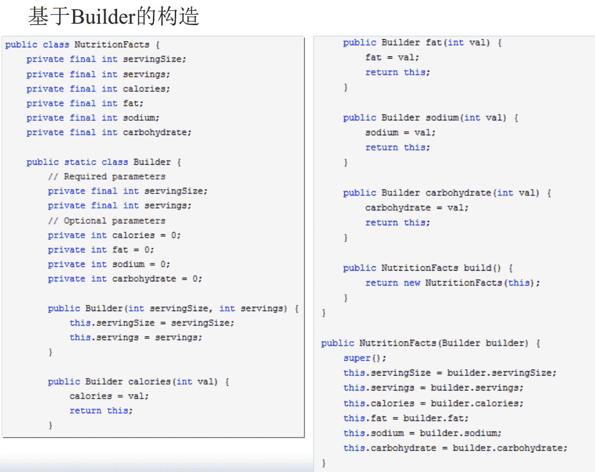

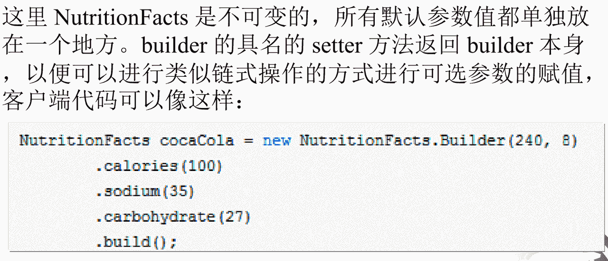

+   另一种方案是设置无参数的构造方法，通过`setter`方法来设置参数，但是这样不能保证对象的一致性

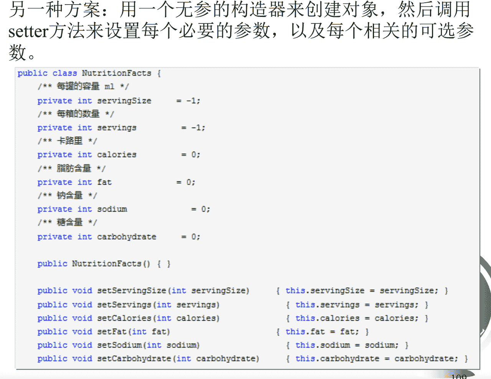

+   线程不安全

+   这种方法也使得类不能设置为不可变类

+   单例对象构建：通常用于那些本质上唯一的对象，如文件系统、窗口管理器等

+   有特权的客户端可以通过反射机制调用私有构造器，要抵御这种攻击可以修改构造器，要求创建第二个实例的时候抛出异常

+   枚举类方法：编写包含单个元素的枚举

+   反射 (`reflection`)。反射是 `Java` 中的一个强大的特性，它允许创建对象、调用方法和访问对象上的字段。之所以使用反射，主要是因为在编写代码时不知道要创建的对象类的名称。例如，在关系数据库中通常要求操作数据的 `Java` 代码与大多数数据库服务器一起工作，但是在编写代码时，不知道用户将使用哪种数据库。在这种情况下，反射就派上用场了。

### 3.1.9 包(Package)和包管理

+   `package`可以方便管理和组织`Java`文件的目录结构，防止不同文件之间的命名冲突

+   作为`Java`代码源文件的第一条语句，如果缺省则指定为无名包

+   编译器在编译源文件阶段不检查目录结构

+   但是运行的时候会检查；假设你是`hello`包的（`package hello`），必须要先有一个`hello`目录，在目录下面有`class`文件，再运行，才可以找到这个`class`文件；如果你到上一层或者下一层，则都不可以找到`hello`下面的`hello`

+   如果你到上一层，可以`java -cp cases.hello.Hello`假设上一层是`cases`

+   `` `set | grep CLASSPATH` `` 这个也可以

+   类的导入

+   可以在每个类前面添加完整的包名

+   也可以使用`import`语句导入整个包，比如`import java.time.*`

+   没有理由去用`*`

+   也可以只导入包中的特定类

+   当命名冲突时，需要注意包的名字

+   `import`不会递归，只会引入当前`package`下的直接类

+   `package`静态导入

+   不仅可以导入类，也可以导入静态的方法和静态域，比如`import static java.lang.System.*;`之后就可以使用`out.println`

+   `Java`默认`import java.lang.*;` 核心类都在这个包里

+   `Java`的`import`和`C++`的`include`的区别

+   `C++`中要用`#include`把外部声明加载进来，`C++`编译器只能查看正在编译的文件和`#include`的文件，`Java`编译器可以查看其他文件，只是告诉编译器要去哪里查看

+   `Java`中显式地给出包名的时候不需要`import`，而`C++`要引用别的文件一定要`#include`

+   `package`和`import`更类似于`namespace`和`using`

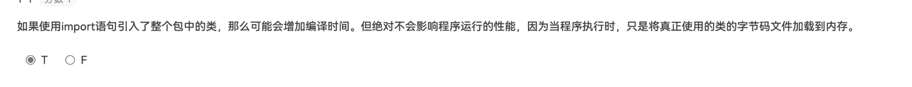

### 3.1.10 其他特性

+   `Date`类返回日期等信息

+   `Random`类返回随机 `java.util.Random`

+   值传递和引用传递（传递的是一个对象）

+   `Java`本质上是一种值传递

+   函数传参的时候会把值拷贝一份传进去

+   例子

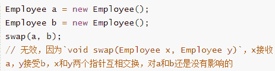

+   因为值传递，所以互换是没有影响的

+   但是如果是改变指针内部的值，那是有影响的，就相当于拷贝了一个指针，指向同一个地方，那改变指针内部的值还是可以的

+   函数接受一个数组和类，地址相同，函数内修改后，函数外也发生变化

+   对象中的一个数组实际上是一个`reference variable`的数组

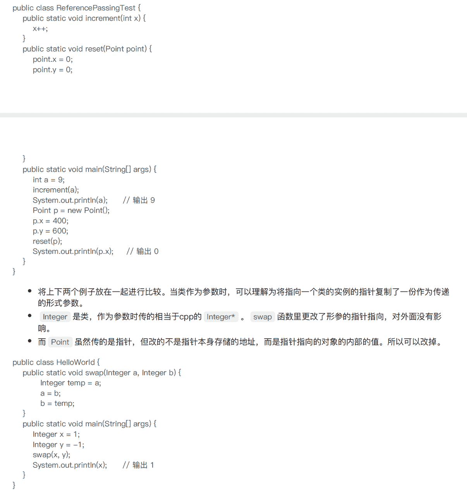

## 3.2 包装类

+   类和类之间的关系

+   `Association` 关联

+   一对一

+   一对多

+   多对多

+   `Aggregation` 聚合

+   聚合是一种特殊的关联

+   `has-a`

+   `Composition` 组合

+   组合是一种特殊的聚合

+   如果没有`container class` 里面的类也不会存在

+   组合的关系比聚合更加紧密

+   `Wrapper class` 包装类/封装类

+   实现了对`Java`中的各类基本数据类型的包装

+   对象是`immutable`的，创建之后就不能改变

+   包装类的构造函数有多种

+   比如整型的包装类`Integer`可以用一个`int`类型来构造，也可以用`String`类型来构造

+   没有无参数的构造函数

+   数值包装类

+   每个数值型的包装类中有常数`MAX_VALUE`和`MIN_VALUE` 分别代表这个数据类型中的可能的最大值和最小值

+   所有的数值型包装类实现了向其他数值类型转换的方法，比如`doubleValue`，`intValue`等等

+   静态方法`valueOf`：参数是一个字符串，产生对应的数值类型的值

+   `JDK1.5`以上的版本允许包装类和原本的内置类型进行自动转换

+   `boxing/unboxing`

+   `BigInteger`类和`BigDecimal`类

+   用于处理大数值的包装类

+   `String`类的语法特性

+   `immutable` 不可修改类，需要通过`charAt()`方法访问字符串中的单个元素

+   比如`String s = "Hello"; s = "Java";` 此时只是新构造出了一个“`Java`”的`String`对象并让`s`指向这个对象，原来的“`Hello`”对象并没有消失

+   自动装箱：`AutoBoxing`

+   基本类型在运算的时候，`JVM`会将其装箱成安全的包装类来使用

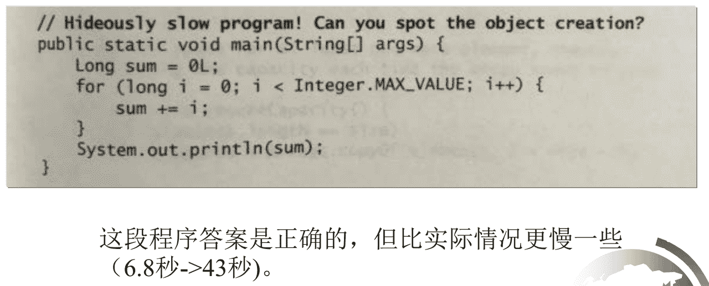

+   `Integer`包装数据

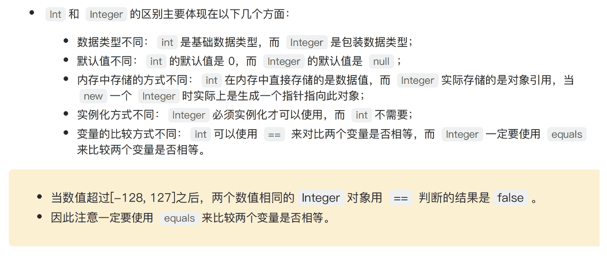

## 3.3 Constant Pool 常量池

+   `Java` `Constant Pool` 常量池技术

+   可以方便快捷地创建某些对象，当需要的时候就从池里取出来，常量池实际上就是一个内存空间存在于方法区中


+ JVM将源代码编译成`class`文件之后，会用一部分字节分类存储常量，集中在`class`中的一个区域存放，包含了关于类方法接口中的常量，也包括字符串常量

+ 比如`String s = "java"` 则在编译期可以识别为和`java`是同一个字符串的，都会自动优化成常量，也就是说如果有多个字符串的值为`java`则他们都会引用自同一`String`对象

```
String s1 = "Hello";
String s2 = "Hello";
String s3 = "Hel" + "lo";
String s4 = "Hel" + new String("lo");
String s5 = new String("Hello");
String s6 = s5.intern();
String s7 = "H", s8 = "ello";
String s9 = s7 + s8;
s1 == s2 true;
s1 == s3 true; // 编译期进行了一定的优化
s1 == s4 false;
s1 == s5 false;
s1 == s9 false; // s9是两个变量拼起来的
s1 == s6 true;//intern
```

+ 对于上面这一段代码，`s1`、`s2`和`s3`是相同的(因为常量池技术)而`s1`和`s4`是不同的，`s1`和`s9`也是不同的，因为`s4`和`s9`不是常量，在编译期没有确定是不是常量

+ 而`s1`和`s6`是相等的，和`s5`是不同的，因为`s5`位于堆中，`intern`方法会试图将`Hello`这个值加入常量池中，而此时常量池中已经有了`Hello`所以直接返回了其地址

+ Java中定义的包装类大部分实现了常量池技术，只有浮点数类型的包装类没有实现

+ 其中`Byte`、`Short`、`Integer`、`Long`、`Character`只对`-128-127`的对象使用常量池

```
import java.util.Scanner;
public class test {
    
    public static void main(String[] args){
        i = 127
        String s1 = i; 
        String s2 = i;
        System.out.println(s1 == s2);

    }
}
```

对于`-128-127`，常量池 所以是`True`
如果超过`127`则是`False`

当一个`class`进行比较的时候，用`equals`
默认你不重新写`equals`函数的话，他用`object`的`equals`，他不知道怎么比较，就比较是否指针指向同一变量
重新写了就按你重新写的来比较

+ `Double`类型是没有缓存的，所以就会有如下结果

```
Double x = 1.1;
Double y = 1.1;
x == y // -> false!
```

+ `Integer`利用缓存机制实现了常量池，缓存了256个对象，主要是常用的证书

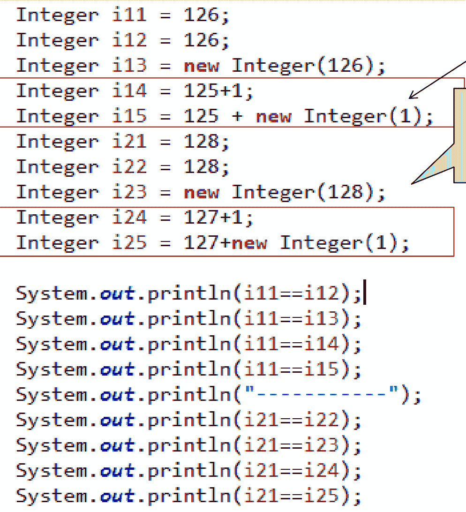

> 包装类判断应该用`equals`

> `True`

> `False`：反编译可以看到

+ `Integer i13 = new Integer (126)`

+ `Integer i15 = Integer.valueof (125 + (new Integer (1)) .intvalue());`

+ 126是`new`出来的，`1`虽然也是`new`出来的但是和`125`相加，就需要`intvalue`转换一下，转换完之后

> `True`

> `True`：因为有加法，所以在计算加法的时候会取`int` value，所以最后实际上还是在做`integer i15 = valueOf(126)`

> `False`

> `False`

> `False`

> `False`

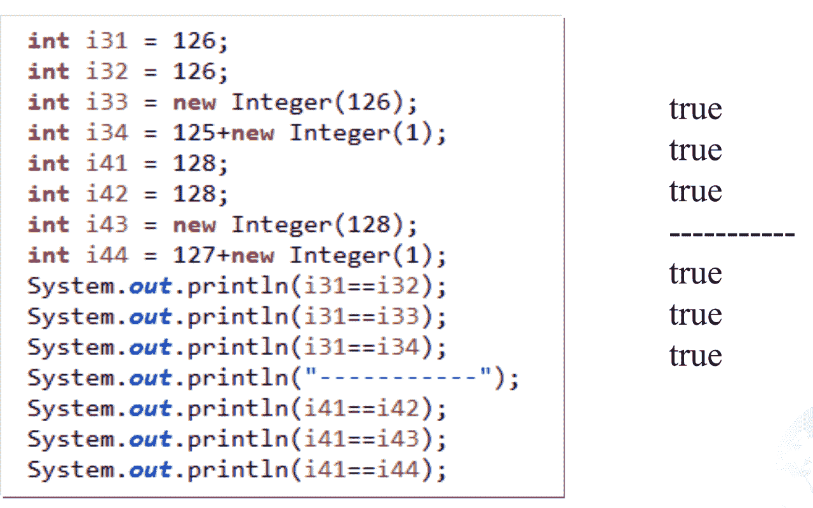

> `int`的比较，只是数字上的比较

尽量使用 `Integer.valueOf(int)` 方法来获取一个 `Integer` 对象，而不使用 `new Integer(int)` 来构造 `Integer` 对象

## 3.4 `String`的语法特性

+ `String`的`intern`方法

+ 需要`1.7`以上的`JDK`

+ `intern`方法设计的初衷就是要重用`String`对象，节约内存消耗

+ Java的运行时`Data Area`

+ 堆`heap`中存放创建的实例对象

+ 方法区中存储了已经被`JVM`加载的类的信息和静态变量，编译器编译的代码

+ `JDK1.7`之后常量池被放入到堆空间中，导致`intern`的功能发生了变化

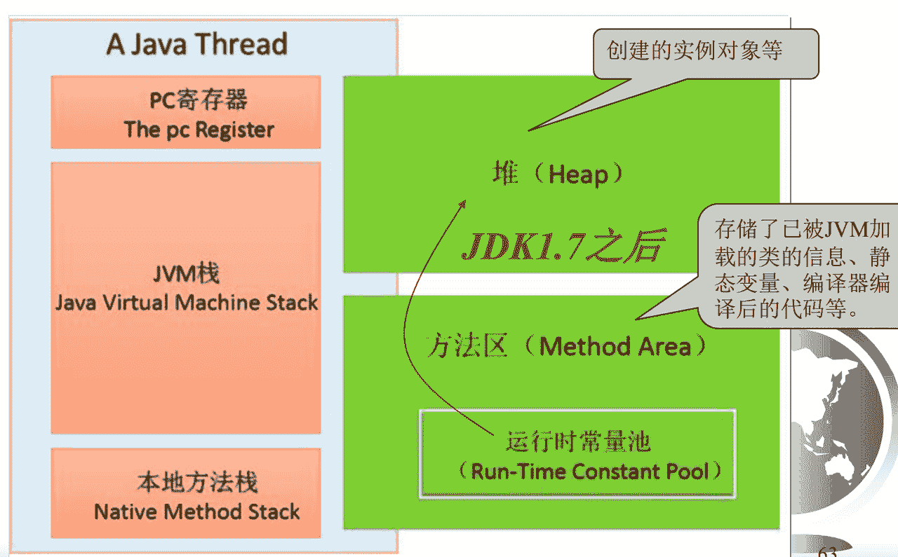

+ 加了一个无关赋值，结果就不一样了，涉及到常量池的设计，第一个看见的被放进常量池重用

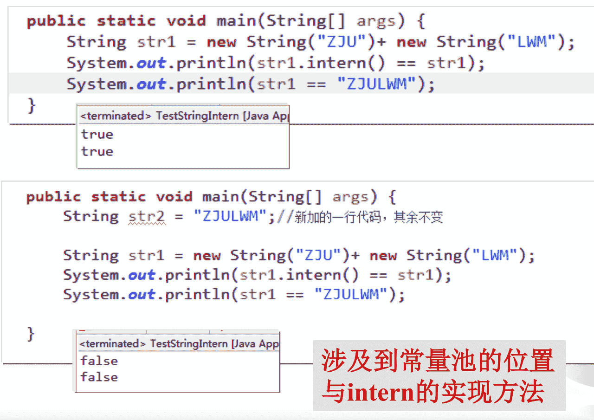

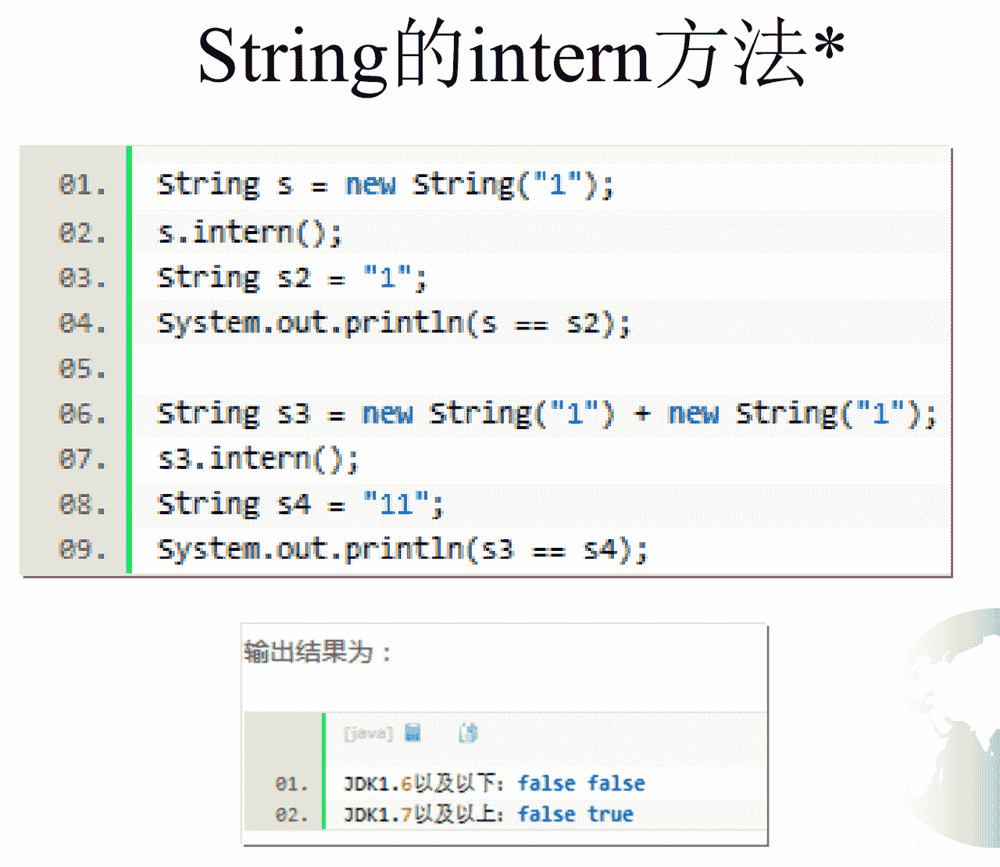

+ `intern`方法在`JDK1.6`中的作用是：比如`String s = new String("ZJULWM")`，再调用`s.intern()`，此时返回值还是字符串`"ZJULWM"`，表面上看起来好像这个方法没什么用处。但实际上，在`JDK1.6`中它做了个小动作：检查常量池里是否存在`"ZJULWM"`这么一个字符串，如果存在，就返回池里的字符串；如果不存在，该方法会把`"ZJULWM"`添加到常量池中，然后再返回它的引用。

+ `11`没有在常量池出现，所以就把`s3`的引用放进常量池；`1`是已经在常量池出现的了

+ `String`的其他语法

+ `String`的匹配，代替和分割`split`，支持正则表达式匹配

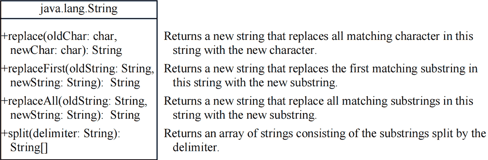

+ 包装类大多都有`toString()`或`valueOf()`的静态方法用来将其转换成`String`类型

+ `String`的`format`方法：根据指定的格式生成`String`，比如`String s = String.format("%7.2f%6d-4s",45.556, 14, "AB");`

+ 关于`Java`中`String`的一些细节

+ Java中的`String`不是以空字符`'\0'`结尾的

+ `char`是单引号 `string`是双引号

+ Java中的`String`不可改变，是`final`类型

+ 在`String`池中维护

+ 比较是否相同的时候要用`equals`方法，不要用`==`

+ 使用`indexOf`等方法去查询元素的位置

+ 使用`subString`方法去获取子串，因为`==`比较的是引用的对象，`equals`比较的是`String`所代表的值

+ `+`运算完成了对`String`的重载

+ 使用`trim`方法删除首尾空格

+ `split`方法支持正则表达式

+ 不要存储敏感信息在`String`中

### 3.4.1 `StringBuilder`和`StringBuffer`

+ 是`String`的以一种替代品，`String`可以使用的地方一定也能用这两个，但是更加灵活，是可以变化的

+ `Builder`和`Buffer`拥有`toString`，`capacity`，`length`，`setLength`和`charAt`等方法

+ 三者的比较

+ 在执行速度上，`StringBuilder`>`StringBuffer`>`String`

+ 比如对于`String s = "abcd"`，如果我们执行`s = s + 1`实际上执行之后的`s`跟原本的`s`不是同一个对象而是生成了一个新的对象(因为`String`是不可变的)，原来的对象被垃圾回收了，导致`String`的执行效率非常低

+ 线程安全

+ `Builder`是线程非安全的，`Buffer`是线程安全的，当有多个线程区使用某个字符串时，`StringBuilder`不安全

+ 对于三者使用的总结：

1. 如果要操作少量的数据用 `String`

1. 单线程操作字符串缓冲区下操作大量数据 `StringBuilder`

1. 多线程操作字符串缓冲区下操作大量数据 `StringBuffer`

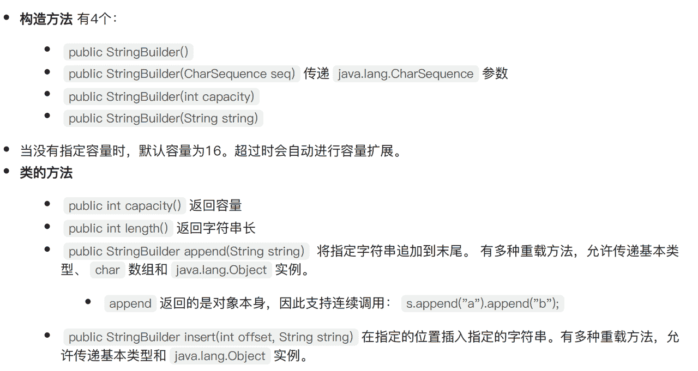

正则表达式

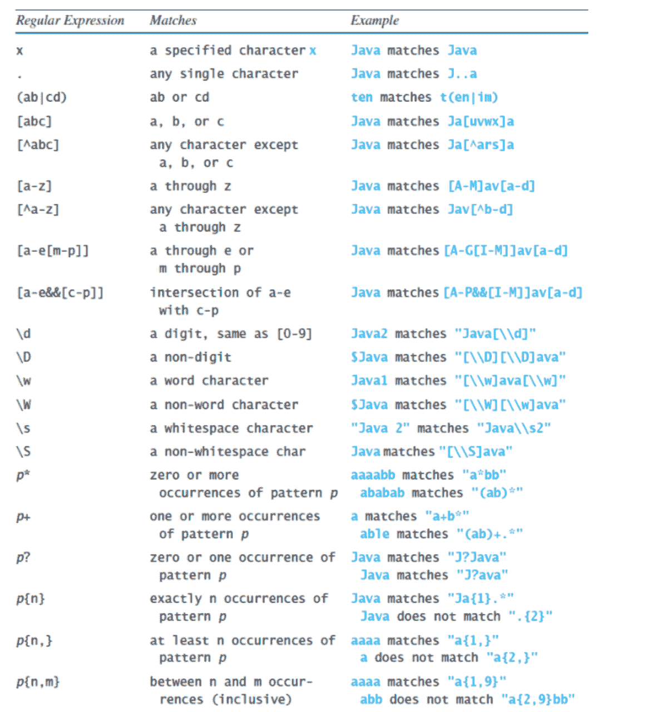

## 3.5 枚举类 `Enum`

+ `JDK1.5`才有的新类型，采用`enum`关键字定义，所有的枚举类型都继承自`Enum`类型

+ 通常常量用`public final static`来定义，在枚举类中可以用如下方式定义

```
 public enum Light{
     public final static RED = 1, GREEN = 2, YELLOW = 3;
 }
```

+ Java的枚举本质上是`int`值

+ 通过公有的`final`静态域为每个枚举常量导出实例的类，是对象

+ 可以执行里面的方法

+ 由于没有`constructor`，枚举类型是真正的`final`，是实例受控的，是单例的泛型化

+ 比如上面这个枚举类的定义，如果定义了一个`Light`类型的变量，那么任何非空对象一定属于`Light`的三个值之一

+ 枚举类的特性

+ 枚举类是`final`，不能被继承

+ 含有`values()`的静态方法，可以按照声明顺序返回其值数组

+ `ordinal()`方法，返回枚举值在枚举类中的顺序，根据声明时候的顺序决定(从0开始)

+ 不支持`clone`，确保单例模型

+ 可以用`valueOf`来得到枚举实例，用`toString`将枚举转化为可以打印的字符串

+ 比如`Light L = Light.valueOf("RED");`

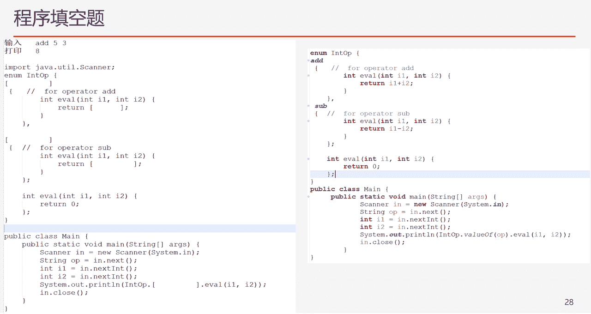

+ 枚举类型也支持`switch`语句直接对实例进行选择

+ 循环

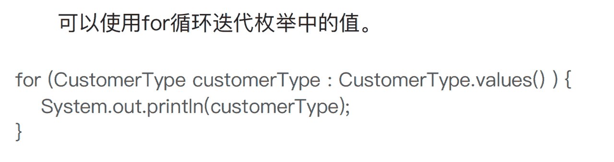

+ `enum`类型可以可以关联不同的数据，也可以添加任意的方法和域来增强枚举类型,比如添加构造函数来丰富枚举类的结构

+ 特定于常量的方法实现，是一种`override`

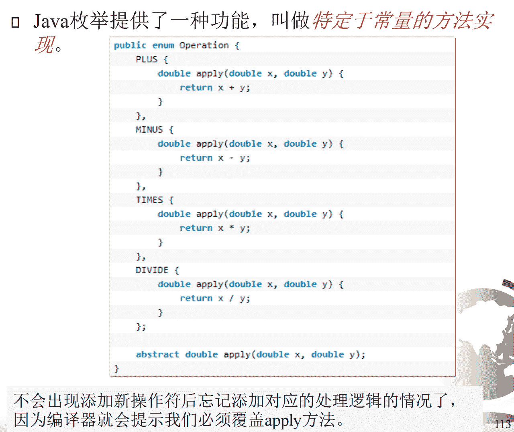

+ 特定于常量的方法实例

+ 缺点是难以共享代码，可以借助策略枚举，将处理委托给另一个枚举类型

```
 public enum Operation{
     PLUS{
         double apply(double x, double y){
             return x+y;
         }
     },
     MINUS{
         double apply(double x, double y){
             return x-y;
         }
     };
     abstract double apply(double x, double y);
 }
```

+ 这一部分听说期末考会考编程题，需要练练

## 3.6 继承和多态

### 3.6.1 继承

+ 所有没有显式扩展父类的 `Java` 类都将自动扩展`java.lang.Object`类。`Object`是 `Java` 中的最终超类。默认情况下，`Parent`类是`Object`类的子类。

+ Java中继承的关键词是`extends`

+ 只能有一个父类

```
class ThisClass extends SuperClass {
    // class body
}
```

+ `super`方法：

+ 子类没有继承基类的构造函数，但是子类中可以用关键字`super`去调用基类的构造函数

```
public class Parcel7 {
    public wrapping warp(int x) {
        return new wrapping(x) {
            public int value(){
                return super.value()//调用父类的参数
            }
        };
    }
}
```

+ 如果不显式地声明`super`，则会自动调用基类的无参数的构造函数

```
    class A {
        int i ;
        A(int i) {this.i = i*2;}

    }
    class test extends  A {
        public static void main(String[] args){
            test b = new test(2);
        }
        test(int x){
            super(x);//如果没有这行，就会报错
            System.out.println((x));
        }
    }
```

+ super关键字可以调用基类的构造方法

+ 可以将参数传递给基类

+ super必须是构造方法中的第一个语句

+ 在子类中，我们可以访问它的超类的 `public` 和 `protected`方法和字段，但不能访问超类的 `private` 方法。如果子类和超类在同一个包中，还可以访问超类的默认方法和字段。

+ `override`重写：覆写父类的方法

+ 子类会继承父类所有的方法。要修改父类行为，可以通过覆盖方法实现。要覆盖一个方法，只需在子类中编写新方法，而不需要修改父类的任何内容。可以覆盖父类的 `public` 和 `protected` 方法。如果子类和父类位于同一个包中，还可以覆盖有默认访问级别的方法。

+ 参数列表与被重写方法的参数列表必须完全相同。

+ 返回类型与被重写方法的返回类型可以不相同，但是必须是父类返回值的派生类（`java5` 及更早版本返回类型要一样，`java7` 及更高版本可以不同）。

+ 访问权限不能比父类中被重写的方法的访问权限更低。例如：如果父类的一个方法被声明为 `public`，那么在子类中重写该方法就不能声明为 `protected`。

+ 父类的成员方法只能被它的子类重写。

+ 声明为 `final` 的方法不能被重写。

+ 声明为 `static` 的方法不能被重写，但是能够被再次声明。

+ `static`可以被继承，`static`类型的方法也不能被重写，如果在子类中被重定义了，那么父类的该静态方法就会被`hidden`，就不能用了

+ 子类和父类在同一个包中，那么子类可以重写父类所有方法，除了声明为 `private` 和 `final` 的方法。

+ 子类和父类不在同一个包中，那么子类只能够重写父类的声明为 `public` 和 `protected` 的非 `final` 方法。

+ 重写的方法能够抛出任何非强制异常，无论被重写的方法是否抛出异常。但是，重写的方法不能抛出新的强制性异常，或者比被重写方法声明的更广泛的强制性异常，反之则可以。

+ 构造方法不能被重写。

+ 如果不能继承一个类，则不能重写该类的方法。

+ `private`类型的方法不能被重写

+ 可以做静态绑定，加速

+ 但也可以在子类定义`private`，但是子类和父类中的方法已经没关系了

+ `JDK1.5`开始增加了`@override`注解来声明一个覆写——不要忘了写`override`，尽管这不是必须的

+ 每个类都会有一个`equals`的方法，要注意区分`overload`重载和`override`重写

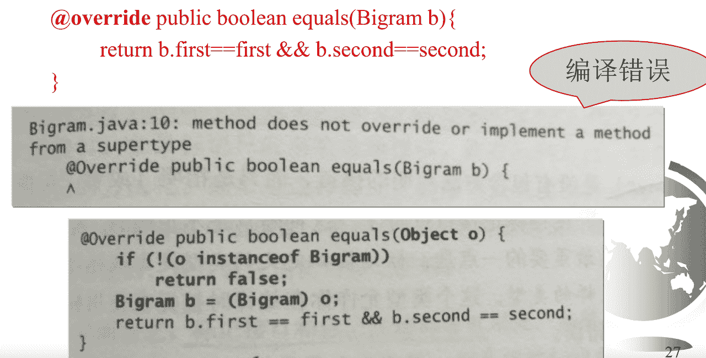

+ 上面错，下面对（因为参数需要一样，不然就变成`overload`）

+ 删掉`override`也可以

+ 方法的覆写`override`发生在继承的子类中，而重载`overload`在继承的子类和基类中都会发生

+ `overload`是静态的，不会因为具体是哪一个就去调用哪一个，在编译的时候就决定了要调用哪一个；`override`是动态的。静态匹配，都是`collection`


+ `Object`类是`java.lang.Object`中定义的基本类型，如果一个类没有声明继承自何处，那么就是继承自`Object`类

+ 万物起源`Object`

+ `clone` 创建并返回此对象的副本。

+ `equals` 比较参数和此对象。类必须实现此方法，以提供比较实例内容的方法。

+ `getClass` 返回对象的 `java.lang.Class` 对象

+ `toString` 返回对象的描述

+ 默认情况下会显示一个实例的类名和`@`符号后面跟一个代表这个实例的数字


```
public class Main {
    static class a {
        public a (){}
    }
    public static void main(String[]args){
        a aa = new a();
        System.out.println(aa.toString());
        System.out.println(aa.getClass());
    }
}
Main$a@75b84c92
class Main$a
```

+   父类的私有变量在子类存在但不能直接访问，和`c++`一样

+   Java没有`namehide`

+   父类的函数调用一个函数，如果这个函数是多态的`override`了，就会调用子类的，存在一定风险，子类还没有初始化，就会是0；和`C++`不一样

+   先调用父类的构造函数，再是子类的；其中仍然保持静态优先的规则

```
class Animal{
   public void move(){
      System.out.println(&quot;动物可以移动&quot;);
   }
}

class Dog extends Animal{
   public void move(){
      System.out.println(&quot;狗可以跑和走&quot;);
   }
}

public class TestDog{
   public static void main(String args[]){
      Animal a = new Animal(); // Animal 对象
      Animal b = new Dog(); // Dog 对象

      a.move();// 执行 Animal 类的方法

      b.move();//执行 Dog 类的方法
   }
}

动物可以移动
狗可以跑和走
class Animal{
   public void move(){
      System.out.println(&quot;动物可以移动&quot;);
   }
}

class Dog extends Animal{
   public void move(){
      System.out.println(&quot;狗可以跑和走&quot;);
   }
   public void bark(){
      System.out.println(&quot;狗可以吠叫&quot;);
   }
}

public class TestDog{
   public static void main(String args[]){
      Animal a = new Animal(); // Animal 对象
      Animal b = new Dog(); // Dog 对象

      a.move();// 执行 Animal 类的方法
      b.move();//执行 Dog 类的方法
      b.bark();
   }
}
```
该程序将抛出一个编译错误，因为`b`的引用类型`Animal`没有`bark()`方法。

## 3.6.2 多态 Polymorphism

+   多态意味着基类可以被引用作为一个子类来使用

+   Java的动态绑定(`dynamic binding`)特性

+   除了`static`方法和`final`方法，Java中的方法绑定都发生在运行时，而不是编译时。运行时绑定也称为后期绑定或动态绑定。因此，Java中的后期绑定机制使多态性成为可能。

+   多态性对`static`方法不起作用，因为它们是前期绑定的。例如，如果`Employee`和`Manager`类中的`work()`方法是`static`的，那么调用`employee.work()`将输出`1 am an employee`。此外，由于`final`方法不能扩展，因此多态性也不能用于`final`方法。

+   如果有一个类型为`A`的引用变量`a`，那么给它赋一个类型为`B`的对象是合法的，这称为向上转换 (upcasting)`A a = new B()`;


+   上面的代码中，把`B`的一个实例赋给`a`时，`a`的类型是`A`。这意味着，不能调用不是在`A`中定义的`B`中的方法。但是，如果输出`a.getClass().getName()`的值，将得到`B`而不是`A`。为什么呢？这是由于在编译时`a`的类型为`A`，因此编译器不允许调用不是在`A`中定义的`B`的方法。此外，在运行时，`a`的类型是`B`，正如`a.getClass().getName()`的返回值（`B`）所示。

这就是多态性的本质。如果`B`覆盖了`A`中的一个方法（例如名为`play`的方法），那么调用`a.play()`将导致调用`B`中的`play`实现（而不是`A`中的）。多态性使对象（本例中指是`a`引用的对象）能够确定在调用方法时选择哪个方法（`A`中的方法还是`B`中的方法）。多态性指明运行时调用的对象实现。但是实际上，多态性的作用还远不止于此。

+   `Generic Programming` 元编程

+   当一个方法的参数是`superclass`的时候，可以用他的任意一个子类作为参数，但是具体的调用会动态地决定

+   `Casting objects`

+   `Upcast`


+   把子类的对象赋给一个父类

+   Java都是指针，所以只需要满足这个条件即可

+   Java和`C++`的区别

+   Java转换失败的时候会抛出异常，而`C++`转换失败会产生一个`nullptr`，这样就会在一个操作中完成测试和类型转换


+   Java中的类型转换需要和`instanceof`结合使用，先用`instanceof`判断，然后来进行转换

+   `equals`方法

+   默认的`equals`方法在`Object`中是这样定义的

```
 public boolean equals(Object obj) {
     return this == obj;
 }
```

+   可以在自定义类中`override`这个`equals`方法

+   `==` 比 `equals`的要求更高，会检测两个引用变量是不是引用的同一个对象，而`equals`只要求内容相同

+   我们集合中就只需要内容相同，则需要`equals`重写

## 3.7 Java的内置模板类

+   `ArrayList` 任意长度的任意类型数组

+   可以用`ArrayList<typename>` 来定义一个`typename`类型的任意长数组

+   相比于普通数组，拥有更多功能比如`add`，`remove`和`clear`，和普通数组之间可以互相转换

+   `ArrayList`可以用`java.util.Collections.max`和`min`方法来获取其中的最大值

+   此外`java.util.Collections`中还有`sort`和`shuffle`等方法

+   `MyStack`类

+   一个内置的`Stack`结构，支持栈的`pop`，`push`，`peek`等多种操作

## 3.8 关键词`protected`和`final`

### 3.8.1 `protected`

+   `protected`关键词表示一个类或者数据或者方法可以被同一个包或者子类任意访问

+   Java中状态和方法可访问的范围从小到大是`private`，`default`，`protected`，`public`

+   `private`只能在同个类中访问

+   `default`可以在`private`的基础上同个包中访问

+   `protected`在此基础上可以被子类访问

+   `public`可以被随便访问

### 3.8.2 `final`

+   含有`final`关键字的类不能被继承

+   含有`final`关键字的变量是常量

+   含有`final`关键字的方法不能被覆写

### 3.8.3 复杂的case


方法是动态，直接`c.a`这种都是静态的


### 3.8.4 继承的问题


+   会导致子类的封装性被打破

+   子类的`add`因为动态绑定去调用子类的`add`了

+   父类不能随意增加公开方法，因为父类增加就是给所有子类增加，而子类可能必须要重写该方法才能确保方法的正确性。

如何解决

+   避免使用继承

+   使用`final`

+   优先使用组合而非继承使用接口

+   组合(`composition`)：不继承现有的类，而是在新的类中增加一个`private state`并引用现有类的一个实例

+   正确使用继承

## 3.9 嵌套类

### 3.9.1 复合优先于继承

+   继承打破了代码的封装性，子类依赖于基类中特定功能的实现，如果基类随着版本变化会破坏子类

+   复合`composition`就是不继承而是在新的类中增加一个`private state`并引用现有类的一个实例

### 3.9.2 嵌套类 nested class

> 为什么成员函数可以`override`，而成员变量不可以，因为成员变量是静态的，成员函数是动态的
>
> 成员类是数据
>
> 成员类是静态的，和成员变量相似
>
> 内部类有一个隐藏的`reference`对于外部类来说

在类内部可定义成员变量和方法，且在类内部也可以定义另一个类。如果在类`Outer`的内部再定义一个类`Inner`，此时类`Inner`就称为内部类（或称为嵌套类），而类`Outer`则称为外部类（或称为宿主类）

`Inner Class`只是Java编译器的概念，对于JVM，则不知道内部类这回事，因为每个内部类都会编译为一个独立的类，生成一个独立的`class`文件。

`Inner Class`既可以可以方便访问外部类的私有变量，也可以声明把内部类为`private`，从而实现对外完全隐藏。


```
public class Test {
    public class InnerClass{
        public int getSum(int x,int y){
            return x+y;
        }
    }
    public static void main(String[] args){
        Test.InnerClass ti = new Test().new InnerClass();//注意这个new的方法
        int i = ti.getSum(2,3);
        System.out.println(i);
    }
}
```

+   内部类

+   静态内部类(`Static Inner Class`)

+   `Static Inner Class`与一般的类差不多，可以有静态变量静态方法、成员变量、成员方法、构造函数等。


+   不需要创建外层类的实例就可以实例化静态嵌套类。

+   `Inner Class`可以访问`Outer Class`的`Static Variable`和`Method`（无论`private`还是`public`），但不可访问`Outer Class`的成员变量和方法。

+   `Outer Class`可以直接使用`Inner Class`

+   `public`的`Static Inner Class`可以被外部使用。这里的外部指的是外部类的外部

+   外部类和内部类可以互相访问，无论内部类是`private`还是`public`

+   但是如果要用`OuterClassName.InnerClassName`这样的形式访问，需要内部类是`public`

```
Outer.StaticInner si = new Outer.StaticInner（）；
//Outer是外部类，StaticInner是内部类
```

+   成员内部类

+   成员内部类是一个类，该类的定义直接由另一个类或接口声明包围。仅在有一个外部类的实例引用时才能创建成员内部类的实例。要在外层类中创建内部类的实例，可以像调用其他普通类一样调用内部类的构造方法。但是，要在外层类的层外部创建内部类的实例，可以使用以下语法：

`＜外部类名>.<内部类名＞ inner =new <外部类实例名>.new InnerClassName();`

+   首先把外部类`new`出来；内部类如果在外部类可以直接`new`，但是在外部类的外面使用需要先`new`出一个外部类，在用外部类`new`出一个内部类

+   在内部类中，可以使用关键字`this`引用当前实例（内部类的实例）。要引用外层类的实例，可以使用`<外部类名>.this`


+   用内部类作为辅助类，需要把`inner class`作为`private`；只在该外部类中使用，不希望在外面被使用；内部类之间的`private`方法可以共享因此经常被作为辅助类

+   可以有多个内部类

+   内部类之间可以互相访问对方的`private`的变量，只要内部类的对象被`calling`

+   但是只能实例对象才能访问，不能直接访问


+   可以内部类再内部类

+   有内部类的时候在编译成`class`文件的时候会产生多个`class`文件，每有一个类定义就会产生一个`class`文件

+   名字为`外部类的名字$内部类的名字`

+   为什么这么设计？说明内部类需要分开装载；是一个运行的实体（内部类也有`static`等修饰符，就说明他也有是否属于整个类还是某个对象，说明他是一个运行的实体）

+   第一个对象产生的时候才会被装载

+   调用方法的优先级：先内部类，没有再看外部类，如果都有，默认内部类，想调用外部类可以再加外部类.`方法`


+   局部内部类(`Local Class`)

+   局部内部类简称局部类(`local class`)，是一个内部类，根据定义，它不是任何其他类的成员类（因为它的声明并不直接在外部类的声明中）。局部类有一个名称，而匿名类没有名称。

+   局部类可以在任何代码块中声明，它的作用域在这个块中，例如，可以在方法、计块、`while` 块中声明一个局部类。如果某个类的实例仅在这个作用域内使用，则可以将这个类定义成局部类。

+   编译成`class`文件，名字为包名.外部类的名字`$`数字局部类的名字 数字

+   有多个，就按数字排

+   为什么要有数字？因为无法保证其他方法里面会不会有同名的类

+   局部类不仅可以访问其外层类的成员，还可以访问局部变量。但是，局部类只能访问`final`局部变量。

+   方法的局部变量位于栈上，只存在于该方法的生命期内，满足本地变量

+   但是该方法结束之后，在方法你创建的内部类对象可能仍然存在于堆中

+   只有`final`和`abstract`可以用来修饰局部内部类


+   匿名内部类(`Anonymous Class`)

+   定义初始化块起到了匿名类事实上初始化函数的作用

+   匿名内部类没有单独的类定义，它在创建对象的同时定义类。


```
package cn.prg.testDemo;

public class Test {
    private int num;
    public void Show(A a){
        a.Print();
    }
    public int getNum(){
        return num;
    }
    public void setNum(int n){
        num=n;
    }
    public static void main(String[] args) {
        Test test = new Test();
        int n;
        //创建匿名类,匿名类作为方法的参数
        test.Show(new A(){
            //匿名类不能有构造器，因为没有类名
            public void Print(){//重写了父类的方法。
                System.out.println(&quot;我是匿名类&quot;);
                //匿名类可以访问外部类的成员变量和方法
                test.num=10;
                System.out.println(test.getNum());
                test.setNum(100);
            }
        });
        System.out.println(test.getNum());
    }
}
class A{
    public void Print(){
        System.out.println(&quot;我是匿名类的父类!&quot;);
    }
}
```

+ 匿名内部类只能被使用一次，用来创建一个对象。它没有名字，也没有构造函数，但可以根据参数列表，调用对应的父类构造方法。

+ 与局部内部类一样，可以访问外部类的所有变量和方法，可以访问方法中的`final`参数和局部变量。

+ 匿名内部类是实现回调接口的一种简便方式


+ 我们希望返回一个接口，然后我们写了一个内部类，implement 那个接口，然后我们可以直接返回这个内部类，尽管大家其实都不知道这个内部类，内部类是在我们内部制造出来的，但是其实可以调用内部类的函数（实现接口里的函数），因为运行时候，函数都是存在的

```
public class Parcel8 {
    public Destination dest(final String dest) {//变量可以和函数同名，java可以区分出来
    return new Destination() {
        private String label = dest;
        public String readLabel() {return label;)
    };
}

}
```

### 3.10 抽象类和接口 Abstract class and Interfaces

#### 3.10.1 Abstract class 抽象类

+ 抽象类具有与接口类似的功能，即在服务提供者与其客户之间提供一种契约，同时，抽象类还可以提供部分实现。要显式覆盖的方法可声明为抽象方法。因为抽象类不能实例化，所以仍然需要创建实现类，但不必覆盖不用的或不修改的方法。

+ 抽象类的语法特性

+ 抽象类不能实例化出对象，抽象方法只能在抽象类里使用

+ 如果某个类里有抽象方法，则一定是抽象类；但是抽象类不一定要有抽象方法。抽象类可以包含抽象方法和非抽象方法

+ Base class 就是抽象类，但是没有抽象方法

+ 任何继承抽象类的子类必须实现父类的所有抽象方法，除非该子类也是抽象类

+ 抽象类不能使用`new`操作符，但是依然可以定义构造方法并在子类中调用

+ 抽象类的非抽象子类可以创建对象

+ Java中的抽象类表示一种继承关系，一个类只能继承一个抽象类

+ 子类也可以是抽象类，不管是继承了一个抽象类还是一个具体的类；父类是具体的类，子类也还是可以是抽象类

+ 子类甚至可以重写方法，使子类变成抽象类

+ 抽象类可以成为一个数据类型

+ 一个类不能同时被`abstract`和`final`修饰

+ 抽象方法不能同时被声明称`final`和`static`

+ 抽象方法

```
public abstract class Patients{
        public abstract void tackMedicine();
}
//普通的方法，加上abstract关键词，没有具体函数体实现
//抽象方法只能在抽象类里用

//实现方法里面不能再有abstract关键词
public class ColdPatients extends Patients{
        public void tackMedicine(){
                System.out.println(&quot;来点儿清凉油&quot;);
        }
}
```

+ 继承了抽象方法的子类必须`override`这个方法，否则这个子类也必须声明为抽象类，最终必须有子类`override`这个方法，否则这些类定义都不能实例化出对象

#### 3.10.2 Interface 接口 完全抽象类

> 类、`enum`、`interface`最后会变成`class`文件

+ `Interface` 接口：用来定义各种类的表现。初学者会认为接口类似于用 `interface` 关键字声明的 Java 类，它的方法没有主体。虽然这样描述也正确，但是把接口当作一个没有实现的类来处理就忽略了全局。一种更好的定义是「接口是一种契约」。它是服务提供者（服务器） 和此类服务的用户（客户）之间的一种契约。有时服务器定义契约，有时客户定义契约。

+ 在Java 8之前，接口中的方法都是抽象方法，没有实现体。

+ 接口只包含常数和抽象方法，用于指定对象的通用行为，定义的方法如下

+ 接口是抽象方法的集合

+ 默认的修饰符是 `public abstract`

```
public interface InterfaceName {
   constant declarations;
   abstract method signatures;
 }
```

+ 在Java 8中，允许定义两类新方法：静态方法和默认方法。

+ 默认方法，给接口增加功能（之前的可以默认，不实现，不需要修改之前的）；默认方法是指接口的默认方法，它是Java 8的新特性之一。顾名思义，默认方法就是接口提供一个默认实现，且不强制实现类去覆写的方法。默认方法用`default`关键字来修饰。


+ `private`为了不让外面调用——>我们发现接口越来越像普通的类了


+ 实现接口的关键字：用`implements`关键字来让一个类实现接口中的方法

+ 如果实现接口的类是抽象类，就可以先不用实现

+ 一个类可以有多个接口，但是只能继承自一个类；有多个接口之后，就要都实现其中的方法，不然就变成了抽象类

+ 接口也不能实例化出一个对象，但是接口名可以作为变量类型来使用

+ 在`interface`里所有常量数据默认是`public final static`，不需要自己写；类在实现接口的方法时，必须显式地使用`public`修饰符；必须初始化。

+ 方法不能用`final`修饰

+ 接口中的方法不是在接口中实现的，只能由实现接口的类来具体实现接口中的方法

+ 接口可以继承其他的接口，可以继承多个接口

+ 接口支持继承。一个接口可以扩展另一个接口。如果A接口扩展了B接口，就说A是B的子接口，B是A的超接口。由于 A直接继承B，因此B是A的直接超接口。继承A的任何接口都是B的间接子接口。

+ 用接口支持多重继承


+ 扩展接口的目的是什么呢？就是为了在不破坏现有代码的情况下安全地向接口添加功能。这是因为一旦接口发布， 就不能向其添加新方法了。

具体case：

```
public class Main {
    public static void main(String[]args){
            Vehicle vehicle = new Car();
            vehicle.print();
    }
}
interface Vehicle{
    default void print(){
        System.out.println(&quot;我是一辆车！&quot;);
    }
    static void blowHorn(){
        System.out.println(&quot;喇叭！&quot;);
    }
}
interface FourWheeler{
    default void print(){
        System.out.println(&quot;我是一辆四轮车！&quot;);
    }
}
class Car implements Vehicle,FourWheeler{
    public void print(){
        Vehicle.super.print();
        FourWheeler.super.print();
        Vehicle.blowHorn();
        System.out.println(&quot;我是一辆汽车！&quot;);
    }
}
```

+ 有些接口有多个抽象方法，实现类必须实现所有这些方法。如果只需要某些方法，那么这可能是一项单调乏味的任务。鉴于此，可以创建一个通用实现类，该类使用默认代码实现接口中的抽象方法；然后，实现类可以扩展通用类，并覆盖它希望修改的方法。这种通用类称为基类(base class)，使用起来十分方便。

+ marker interface 标记接口

+ 没有任何方法和属性的接口，仅仅表明它的类属于某个特定的类型，这个接口只起到了标记作用；一种特殊的接口

+ 比如A class that implements the `Cloneable` interface is marked cloneable, and its objects can be cloned using the `clone`

+ Deep copy

+ 浅拷贝（`shallowCopy`）只是增加了一个指针指向已存在的内存地址， 深拷贝（`deepCopy`）是增加了一个指针并且申请了一个新的内存，使这个增加的指针指向这个新的内存， 使用深拷贝的情况下，释放内存的时候不会因为出现浅拷贝时释放同一个内存的错误。

+ Shallow copy

+ 默认浅拷贝，要深拷贝需要`override`

+ 主要用于

+ 建立一个公共的父接口

+ 向一个类添加数据类型。增加一个特性。

+ 接口和抽象类的区别

+ 抽象类的方法可以有方法体

+ 抽象类中的成员变量可以是各种类型的，接口中只能是`public static final`类型

+ 一个类只能继承一个抽象类，但是可以实现多个接口（单根结构是不够的）

### 3.11 设计类原则

1. Coherent
1. Separating responsibilities
1. `String`, `Stringbuffer`
1. Classes are designed for reuse.
1. Provide a `public` no-arg constructor and `override` the `equals` method and the `toString` method defined in the `Object` class whenever possible.
1. Follow standard Java programming style and naming conventions.
1. Choose informative names for classes, data fields, and methods.
1. Always place the data declaration before the constructor, and place constructors before methods.
1. Always provide a constructor and initialize variables to avoid programming errors.
1. `Public`, `private`, `protected`


[华为 Java 编程军规.docx](https://internal-api-drive-stream.feishu.cn/space/api/box/stream/download/all/boxcnLlm8a91fqHXNdMYGrl1Jqb)


[Google Java编程风格指南中文版.docx](https://internal-api-drive-stream.feishu.cn/space/api/box/stream/download/all/boxcnDwX37SArtdCMJJh7nep1Gg)


[Java语言编码规范.docx](https://internal-api-drive-stream.feishu.cn/space/api/box/stream/download/all/boxcnGhBIjeux84S8MtF1O38vqh)

十个设计原则


如果高层模块直接调用低层模块提供的服务，那么就是具体耦合关系，这样高层模块依赖于低层模块就不可避免。但是，如果我们使用抽象耦合关系，在高层模块和低层模块之间定义一个抽象接口，高层模块调用抽象接口定义的方法，低层模块实现该接口。这样，就消除了高层模块和低层模块之间的直接依赖关系。现在，高层模块就不依赖于低层模块了，二者都依赖于抽象。同时也实现了“抽象不应该依赖于细节，细节应该依赖于抽象”。

依赖倒转原则的本质就是要求将类之间的关系建立在抽象接口的基础上的。通过上面的方式，将错误的依赖关系倒转过来，使具体实现类依赖于抽象类和接口。这就是依赖倒转原则中“倒转”的由来。


## 4. Java高级语法特性

### 4.1 异常处理

+ Java中的异常类型


+ 注意异常和错误的区别，系统错误是JVM抛出的，异常是由程序引起的，可以被检测出来，异常的原因是写代码的人希望自己能够针对异常来进行操作，而不是直接报错

+ 异常类型

+ `Unchecked Exceptions` 不可恢复的逻辑错误，包括`RuntimeException`和`Error`

+ `Error`：这种情况属于JVM发生了不可恢复的故障， 例如内存溢出，无法处理。

+ `RuntimeException`：这种情况属于错误的编码导致的，出现异常后需要修改代码才能修复，一般来说 `catch`后没有恰当的处理方式，因此不应该捕获。

+ `NullPointerException`：对`null`对象调用方法

+ `IndexOutOfBoundsException`：越界


# Java 异常处理与 I/O

## 4.1 异常处理

+ Java不需要对`unchecked exceptions`进行检查

+ `checked exceptions` 需要进行`catch`

+ 检查异常是在编译过程中应该预料到并从中恢复的异常。它基本上是所有派生自 `Exception` 的子类，但不是 `RuntimeException` 的子类，如 `IOException` 异常和 `SQLException` 异常。编译器可以通过拒绝编译任何包含可能引发已检查异常的程序来防止发生已检查异常。

+ `Exception` 类


+ 抛出自定义异常时带上原始异常信息

+ 打印异常的时候带上 **异常堆栈**


+ 捕获异常

+ `try-catch` 语句块中可以加入 `finally` 子句，不管有没有找到错误都会被执行

+ 可以没有 `catch` 只有 `finally`，但是必须有一个

+ 抛出异常之后如果没有 `finally` 就不会再往下执行，有 `finally` 的时候抛出异常之后还会执行 `finally` 中的语句


```
statement2
handling ex
finalStatements
throw ex//回到catch(Exception2 ex)
```


+ Declaring Exceptions 方法需要声明检查的异常的种类，从方法中抛出异常时，调用代码必须捕获由方法抛出的异常。`throws` 语句表明方法可能抛出指定类型的异常。


+ Throwing Exceptions

+ 当发现了错误类型的时候可以创建一个合适的错误类型将其抛出

+ 语法是 `throw new TheException()`


+ Java的异常检查使用规范

+ 1 不要**忽略** `checked exception`：捕获就必须要处理

+ 调用 `print` 不算是处理


+ 2 不要捕获 `unchecked exception`

+ 3 不要一次捕获所有的异常


+ 4 使用 `finally` 语句块释放资源，但是 `final` 块不能抛出异常


+ 5 `final` 不能抛出异常


+ 不要同时使用异常机制和返回值

+ `try` 不要太庞大，不然代码的可读性会降低


+ 守护线程中需要 `catch` `runtime exception`


+ 子类要在父类前面

+ 会编译错误


C

例子

```
import java.util.Scanner;

public class Main{
    public static void main(String [] args){
        Scanner in = new Scanner(System.in);
        double side1,side2,side3;
        side1=in.nextDouble();
        side2=in.nextDouble();
        side3=in.nextDouble();
        try{
            Triangle t = new Triangle(side1,side2,side3);
            System.out.println(&quot;三角形创建成功&quot;);
        }
        catch(IllegalTriangleException e){
            System.out.println(&quot;IllegalTriangleException: 边长不符合要求&quot;);
        }

    }
}


class Triangle {
    private double side1;
    private double side2;
    private double side3;

    public Triangle(double side1, double side2, double side3) throws IllegalTriangleException {
        if (side1 + side2 &lt;= side3 || side2 + side3 &lt;= side1 || side1 + side3 &lt;= side2) {
            throw new IllegalTriangleException();
        } else {
            this.side1 = side1;
            this.side2 = side2;
            this.side3 = side3;
        }
    }
}
class IllegalTriangleException extends Exception {
    IllegalTriangleException() {
        super();
    }

    IllegalTriangleException(String message) {
        super(message);
    }
}
```

## 4.2 Assertion 断言

+ 包含一个在程序运行过程中一定是真的布尔表达式，用 `assert` 进行定义

+ 当断言被创建的时候，Java会计算这个表达式，如果结果是 `false` 就会抛出 `AssertionsError` 这个异常；检测是否正确

+ `AssertionsError` 有多种构造函数，用于匹配 `message` 的 data type

```
 public class AssertionDemo {
 public static void main(String[] args) {
   int i; int sum = 0;
   for (i = 0; i &lt; 10; i++) {
     sum += i;
   }
   assert i == 10;
   assert sum &gt; 10 &amp;&amp; sum &lt; 5 * 10 : &quot;sum is &quot; + sum;
   }
 }
```


+ 可以选择性的 `enable` 和 `disable`

+ 默认 `disable`

+ 不要在 `public` 的方法中使用 `assertion` 而应该使用 `exception handling`

## 4.3 文本读写

+ `File` 类：一个由文件名和路径组成的包装类，提供了一系列文件信息和修改操作


+ 文件读写需要 `Scanner` 和 `PrintWriter`（Text IO）

+ Text

+ Binary 处理流


+ `PrintWriter` 用于写入文件

+ 提供了一系列重载的 `print` 和 `println` 方法


+ 普通的需要关闭，`try` 可以不需要，自动关闭


+ 构造函数需要文件名作为变量，可以指定编码方式，比如 `UTF-8`

+ `PrintWriter out = new PrintWriter("myfile.txt',“UTF-8”);`

+ `Scanner` 用于读文件

+ 初始化之后和标准输入一样使用 `nextXXX` 来读写

+ `Scanner` 的构造方式

+ 错误方式 `Scanner in = new Scanner("file.txt");` 构造了一个带字符串参数的 `Scanner`

+ 正确方式 `Scanner in = new Scanner(new File("file.txt"), "UTF-8");`

+ 需要用 `File` 对象进行构造

+ `Scanner in = new Scanner(Paths.get("myfile.txt"), "UTF-8");`

+ 指定的 `UTF-8` 编码，就要用 `UTF-8` 解码

+ `URL` 类：从 web 中读取信息

+ 构造方式 `URL url = new URL("www.xxxxxxx");`

+ 完成构造之后可以用 `openStream` 打开一个输入流，用 `Scanner` 进行读取

+ `Scanner input = new Scanner(url.openStream);`

## 4.4 二进制读写

+ 文本读写是人能看懂的，二进制读写是机器可以看懂的，文本读写事实上是需要编码和解码的，但是二进制读写不需要编解码而可以直接被机器识别

+ 二进制很高效

+ Text IO requires encoding and decoding.

+ Java 通过输入输出流的形式来进行二进制文件的读写，二进制读写的一系列类的关系如下：


`InputStream` 和 `OutputStream` 只能读写 `byte`，是抽象类


+ `FileInputStream` 和 `FileOutputStream` 都是继承于父类，没有增加额外的类和数据

+ 文件读写

+ 只能读写 `byte` 或者整个文件；读和写都是一个 `byte` 一个 `byte` 来的

+ 在创建 `FllenputStream` 类的对象时，如果找不到指定的文件将抛出 `FleNotFoundException` 异常，该异常必须捕获或声明抛出。


```
public FileOutputStream (String filename)
public FileOutputStream(File file)
public FileOutputStream(String filename, boolean append) 
public FileOutputStream(File file, boolean append)
```

+ `FilterInputStream` 和 `FilterOutputStream` 用来简单处理

+ `DataInputStream` 和 `DataOutputStream` 转换成 `String` 或 `int`

+ Order and format

+ 检查是否读完

+ `UTF[-8：UT](https://baike.baidu.com/item/ASCII/309296?fromModule=lemma_inlink)F-8`（8位元，Universal Character Set/Unicode Transformation Format）是针对 `Unicode` 的一种可变长度字符编码。它可以用来表示 `Unicode` 标准中的任何字符，而且其编码中的第一个字节仍与 `ASCII` 相容，使得原来处理 `ASCII` 字符的软件无须或只进行少部分修改后，便可继续使用。


+ `BufferedInputStream` / `BufferedOutputStream`：用 `buffer` 来加速 IO


组合


`FilterInputStream` 子类可以分成两类：

1) `DatalnputStream` 能以一种与机器无关的方式，直接从地从字节输入流读取 `JAVA` 基本类型和 `String` 类型的数据。

2）其它的子类使得能够对 `InputStream` 进行改进，即在原有的 `InputStream` 基础上可以提供了新的功能特性。日常中用的最多的就是 `BufferedlnputStream` 使得 `inputStream` 具有缓冲的功能。


+ `ObjectInputStream` / `ObjectOutputStream`：对于对象


+ 序列化和反序列化：可以被写入输入输出流的对象被称为是可序列化的。

+ 可序列化的对象必须 `implement` `Serializable`；实现 `Serializable` 的接口，可以进行对象的序列化和反序列化；是一个 `marker interface`，不需要额外的 `code` 来实现；除此之外，这个对象必须本身真的是可以被序列化的

+ `transient` 关键词来 `mark` 不需要序列化的内容

+ `static` 变量也是不可以序列化的

+ 序列化后的对象不需要再次调用 构造器重新生成，但是在实际中，我们会希望对象的某一部分不需要被 序列化，或者说一个对象被还原之后，其内部的某些子对象需要重新创建，从而不必将该子对象序列化


+ 反序列化之后得到的对象和原来的不是同一个，因此是深拷贝

+ 反序列化之后不需要构造函数，基于存储后的二进制来构造

+ 对单例模式的影响


破坏单例模式


+ 高级的文本 I/O

+ 区分字节流和字符流


`BufferedReader` `BufferedWriter` `FileReader` `FileWriter`

`PipedOutputStream` 和 `PipedInputStream`


## 4.5 Generics 泛型

+ 是一种对变量类型进行参数化的功能，类似于 `C++` 中的模板

+ 优点是能在编译期就发现一些错误而不是运行时

+ 一个泛型类或者方法可以声明类名和函数名作为变量

### 4.5.1 泛型方法

+ 泛型方法的类型参数声明要写在返回值类型前面，用尖括号括起来，比如

`public static <T> void printArray(T[] input);`

+ `<T>` 中的 `T` 被称为类型参数，而方法中的 `T` 被称为参数化类型，它不是运行时真正的参数。

+ `<T>` 相当于 `C++` 的 `template <T>` 就是个声明，表示要用到的泛型参数

+ 类型参数可以有多个参数，有逗号隔开，类型参数也可以被用来声明返回值类型

+ 构造函数没有 `E`


### 4.5 泛型

```java
public class Test1 {
    public <T> void testMethod(T t) {
    }
}
```


+ 有界限的类型参数：可以让类型参数有一定的范围
+ 用`extends`关键字+`类型的上界`来控制类型的范围
+ 比如`<T extends Comparable<T>>` 表示`T`必须是可以比较大小的类型


#### 4.5.2 泛型类

+ 类型参数的声明添加在`类名`的后面

```java
public class Test<T> {
    T field1;
}
Test<String> test1 = new Test<>();
Test<Integer> test2 = new Test<>();
```

+ 参数化类型没有实际类型参数的继承关系


+ 泛型的继承关系需要通过`通配符`

+ `?` unbounded wildcard
+ `? extends T` bounded wildcard
+ `? super T` lower bound wildcard


Case：


+ 使用`?`代替具体类型参数，比如`List<?>`可以代表所有具体类型`List`的父类
+ 比如`List<? extends Number>`表示参数的泛型上限为`Number`类型
+ 可以传`Number`或者`Number`的子类
+ `List<? super Number>`表示参数的泛型下限为`Number`类型
+ 可以传`Number`或者`Number`的父类
+ `?`和`? extends`，只能读，不能写；`? super`则可写入


+ 不允许用泛型类型来创建泛型数组


+ 泛型的实现方式：
+ 泛型使用一种叫做`类型擦除`的方法来实现，编译器编译的时候使用泛型类型来编译代码，随后将其删除，因此泛型信息在运行时是不可知的，这个方法使得泛型可以向后兼容旧代码。
+ 在泛型类被类型擦除的时候，之前泛型类中的类型参数部分如果没有指定上限，如 `<T>`则会被转译成普通的 `Object` 类型，如果指定了上限如 `<T extends String>`则类型参数就被替换成类型上限。
+ 泛型类的所有实例都有相同的运行时类，所以泛型类的静态变量和方法是被它的所有实例共享的。所以在静态方法、数据域或初始化语句中，为了类而引用泛型参数是非法的
+ JVM必须检查`try`子句中抛出的异常类型是否与`catch`子句中指定的类型匹配。但在运行期间类型信息不知道。
+ 判断函数中的范型参数能否被接受：画范型的继承关系，比如下面这样：
+ 这张图中，上层的可以容纳下层的对象


### 4.6 Collection 框架


+ Java的一系列泛型容器，主要支持的类型是集合`Set`、列表`List`和映射`Map`
+ 其中`Set`和`List`是`Collection`接口的子接口，`set`是内容无序的，而`list`是有序的


`Deque`接口到`linkedlist`，应该是一个虚线

+ 而`Map`是一种`key-value`的映射


+ `hashcode`的使用方式：在接口中定义的`hashcode`是里面所有元素的映射，可以通过维护`hashcode`来方便对象之间进行的比较，比如`equals`等方法，只需要比较`hashcode`就可以


+ `LinkedHashSet`相比普通的`HashSet`，也使用`hashcode`来决定元素的存储位置，并用链表维护元素的顺序，所以性能比`HashSet`要差

+ `HashSet`
+ 底层是`Hashmap`
+ 最多允许一个`null`
+ 比`LinkedHashSet`和`TreeSet`都快

+ `LinkedHashSet`
+ `LinkedHashMap`
+ 额外用双向链表来维护顺序

+ `TreeSet`
+ `SortedSet`是`Set`的子接口，`TreeSet`是一个具体的类


+ 还可以将比较器传进来
+ The `Comparator` interface has two methods, `compare` and `equals`.


+ `List`
+ 可以重复
+ 增加了位置信息，可以根据位置来进行操作


+ `ArrayList`
+ 数组
+ 性能差


+ `LinkedList`
+ 双向链表来存储元素
+ 性能差
+ 迭代器模式


+ 迭代器陷阱：迭代过程中不能发生结构上的变化（添加、插入、删除），比如插入删除，否则会出问题
+ 因为迭代器是根据`位置`来进行的，会维护索引相关的数据，这一部分数据不能发生变化，否则会出问题
+ 解决方法：迭代器直接删除
+ `collections`类可以创造线程安全的
+ `Collection`还有`Vector`（线程安全）、`Stack`、`Queue`、`PriorityQueue`等`list`结构

+ `Map`
+ `Key` `value`


+ `Hashmap`
+ `Treemap`
+ `linkedhashmap`
+ `LRU`，最近使用会被排序到前面
+ `equals`要保证`hashcode`是一样的，重写`equal`的时候也要重写`hashcode`


+ `Arrays`类


+ 枚举集合和枚举`map`
+ `EnumSet`提供了非常方便的方法来创建枚举集合，枚举集合中的所有元素必须都来自于单个枚举类型


## 5 高级应用

### 5.1 Java Beans


+ 可序列化的`public`的类，构造函数是`public`并且没有参数的


+ 命名规范


Bean和Bean之间通过`event`来通讯


+ `event`对应有`listener`来处理


例子：


`Observable`


### 5.2 Swing GUI和MVC设计模式


[19 - SwingTutorial(2).pdf](https://internal-api-drive-stream.feishu.cn/space/api/box/stream/download/all/boxcnpZ7LL4KyQbMgvJxYK1Dwne)

+ `Swing`是一套`GUI`的库


+ 容器
+ 可以把组件放进来并且布局
+ `JFrame`
+ `JPanel`
+ `Layout managers`
+ 组件之间大小、约束
+ `preferredSize`, `minimumSize`, `maximum Size`
+ `CardLayout`
+ `GridBagLayout`
+ 约束（自适应）
+ `Gridx` `gridy`
+ `Gridwidth` `gridheight`
+ `Weightx` `weighty`
+ `Anchor`
+ `Fill`


+ `BoxLayout`：`box`
+ `OverlayLayout`：可以重叠
+ `Spring`：弹簧
+ `JScrollPane`：滑动调
+ `JTabbedPane`
+ `JSplitPane`
+ `SwingBorder`


[20 - Containers, Layout Managers, and Borders(2).pdf](https://internal-api-drive-stream.feishu.cn/space/api/box/stream/download/all/boxcnQNCBPUjnTsMVfeqfV0VteZ)

+ `Menus`
+ `JMenuBar`, `JMenu`, `JMenuItem`，`JCheckBoxMenuItem`, and `JRadioButtonMenuItem`
+ `Submenus`子菜单
+ `JCheckBoxMenuItem`勾选框


+ 这种需要是一个`Group`
+ 加`Icon`
+ `Popup menus`
+ 鼠标右键
+ `Popup trigger`
+ `Toolbars` 工具栏
+ `JToolBar`
+ `BoxLayout`
+ 可以浮动
+ 利用`Action`来做，创建`action objects`来处理`actions`
+ 自动创建`component`，关联到快捷键和按钮上
+ `Dialogs`
+ 对话框
+ `JOptionPane`
+ `Message Types`
+ `ERROR`
+ `INFORMATION`
+ `Comfirmation`
+ `Input dialogs`
+ `message`是`object`
+ `JColorChooser`
+ `JFileChooser`
+ `Open`
+ `Save`
+ `Internal Frame`


[21 - Menus, Toolbars, and  Dialogs(2).pdf](https://internal-api-drive-stream.feishu.cn/space/api/box/stream/download/all/boxcnsNjLLfeaG072loxj5uq3Ah)

+ `MVC`设计模式
+ 隔离
+ `MVC`是`Model-View-Controller`的简称，即
+ `C`负责获取输入
+ `M`负责存储处理数据
+ `V`负责展示数据


+ `Swing GUI`就是根据`MVC`模式设计的
+ `Model`注册一些`listener`，来监听数据的变化，来调整`view`
+ 有一些变种 `controller`和`view`合在一起
+ `JSpinner`


+ `JList`
+ 多个`model`

[22 - MVC and Swing MVC Components(2).pdf](https://internal-api-drive-stream.feishu.cn/space/api/box/stream/download/all/boxcnjOR0imF9qmFZJA7sHTpvBc)

[23 - JTable and JTree(2).pdf](https://internal-api-drive-stream.feishu.cn/space/api/box/stream/download/all/boxcnEqOwxxOQxYwD3pTnyx5Soc)

[24 - Graphics and Java 2D(2).pdf](https://internal-api-drive-stream.feishu.cn/space/api/box/stream/download/all/boxcn1qS2qTz5MUhDRXrbe5CTcg)

### 5.3 Socket网络编程


[26 - Networking(2).pdf](https://internal-api-drive-stream.feishu.cn/space/api/box/stream/download/all/boxcnRsUHRtl9i5eWoT70D2Qs1f)

`client`/`server`建立`socket`连接，然后就开始建立`IO`流通讯


+ 也可以得到`host`的`address`
+ `Multiple clients`多线程
+ 网络也可以直接传输`object`
+ 网页也可以`URL`
+ `JEditorPane`
+ 多个玩家链接
+ 监听两个`player`
+ `TCP`：`Stream socket`
+ `UDP`：`Datagram`
+ `Datagram packet`
+ `Send`
+ `Receive`


### 5.4 多线程


[25 - Multithreading(3).pdf](https://internal-api-drive-stream.feishu.cn/space/api/box/stream/download/all/boxcn8BmkYpOlEbGagRN2bBTBxe)


# 1 Thread

## 需要覆盖 `Run（）`


## 创建线程，`start`

## `start` 和 `run` 有什么区别


## `start` 是启动线程的方法，其中会调用 `run`

## `run` 的话，没有创建一个新的 `thread`，而是依然在 `main` 线程中执行；所以还是要用 `start`

## `start` 会调用 `run`，但是先 `ready`


## `Yield`

## `yield` 会使当前线程让出 `CPU` 执行时间片，与其他线程一起重新竞争 `CPU` 时间片。

## `Sleep`

## `sleep` 导致当前线程休眠，与 `wait` 方法不同的是 `sleep` 不会释放当前占有的锁，`sleep(long)` 会导致线程进入 `TIMED-WATING` 状态，而 `wait（）` 方法会导致当前线程进入 `WATING` 状态。

## `Interrupt`：现在在 `ready` 或者 `running`，`interrupted flag` 被设置；如果线程现在被阻塞了，就 `awaken`，进入 `ready` 状态

## `interrupt` 方法只是改变中断状态而已，它不会中断一个正在运行的线程。


这一方法实际完成的是，给受阻塞的线程发出一个中断信号，这样受阻线程就得以退出阻塞的状态。


## `Join` ：等待某个线程结束

## `join()` 方法：`Thread` 提供的让一个线程去等待另一个线程完成。当在某个程序执行流中（如 `main` 线程）调用其它线程（如 `t2` 线程）的 `join` 方法 (`t2.join()`)，调用线程（`main` 线程）将被阻塞，直到被 `join()` 方法加入的 `join` 线程（`t2.start()`）执行完成为止。

## `isAlive`：在 `ready`，`blocked`，`running` 就是 `true`；是新的，没有 `start` 或者已经 `finished` 就是 `false`

## `isInterrupt`：检测是否中断


# 2 Runnable


选 `A`

## 生命周期


## `start()` 会使线程进入就绪态，等待调度机调度它开始运行，此时会自动调用它的 `run()` 来进入运行态

## `wait()` 函数内对信号量机制做了包装，会阻塞当前进程。

## 进程进入 `finish()` 后实际上已经死了，不能起死回生。

## `sleep()` 时间到后并不会立即运行，而是进入就绪队列等待下一次调度。


## 优先级


## 防止死锁


## 共享内存

## 冲突&同步

## `Race condition`

## 如何解决？

## `synchronized` 关键词

## 使用显式锁

## 使用原子变量


修改 `CPU` 缓存数据，并没有真正改内存的数据；我希望读数据直接读内存，改也直接改内存

`synchronized`：同时只能有一个线程进来，相当于加了锁


`synchronized` 同步的对象可以是任意对象


## 也可以显示的调用锁，`lock`

## 公平锁

## 线程间的协作


## `Wait`


## `Monitor`


## `Semaphores` ：可以限制共享的数量


## 线程协作：同时开始

## 等待结束：`join`

## 最后运行都结束了，用 `notifyAll` 来通知所有线程。

## 异步


## `get()` 返回真正的结果，如果还没有完成，则会阻塞直到完成；如果调用过程发生异常则 `get` 方法抛出调用过程中的异常

## 集合点：同步


## 死锁

## 资源排序


## 线程安全的 `collection`


## 其实就是加了 `synchronized`

## The methods in `java.util.Vector`, `iava.util.Stack`, and `Hashtable` are already `synchronized`.


## 加锁错对象


## 迭代器是 `fail-fast`

## 遍历的时候会错误抛出异常

## 解决方法：


## 线程池


使用线程池的原因：

1.  线程的创建和销毀的开销都比较大，降低资源消耗

1.  线程是可复用的，提高响应速度

1.  对多任务多线程进行管理，提高线程的可管理性

## `SwingWorker` 可以帮助我们在后台执行耗时的任务，而避免阻塞我们的应用程序，以让用户感觉不爽。


## 原子


## 5.5 数据库 `JDBC` 编程

### `API`

### 建立链接

### 执行语句

### `Database metadata` 是数据库的元数据，知道数据库支持什么，有什么信息

## 5.6 流计算，`lambda` 表达式和 `RTTI`

### 5.6.1 `Lambda` 表达式

`Lambda` 表达式也称为闭包 (`closures`)，它可以使某些 Java 代码结构更简短，更易于阅读，尤其是在使用内部类时。


怎么用 `Lambda` 表达式？

### 任何可以接受一个 `FI` (`Functional Interface`, 函数式接口) 实例的地方，都可以用 `Lambda` 表达式。

### Java8 引入了函数式接口，在 `java.util.function` 包含了几大类函数式接口声明

函数式接口定义：


### 5.6.2 流

### `Stream` 也是 Java 8.0 的新特性

### 可以把 `Stream` 当成一个高级版本的 `Iterator`。

### 原始版本的 `Iterator`，用户只能一个一个的遍历元素并对其执行某些操作；

### 高级版本的 `Stream`，用户只要给出需要对其包含的元素执行什么操作，比如“过滤掉长度大于 10 的字符串”、“获取每个字符串的首字母”等，具体这些操作如何应用到每个元素上，就给 `Stream` 就好了！


### 5.6.3 RTTI


### 检测创建的对象，类型，接口

### 创建新的实例

`java.lang.reflection`

`Class` `java.lang. reflect .Class`


### 得到成员变量和方法等

## 7 错题

### 7.1 变量名

变量名可以用汉字表示

### 7.2 `length`

数组长度用 `length`，字符串是 `length()`

按理说，数组和字符串都是对象，访问长度都用 `length()` 方法就好了。为什么数组偏偏剑走偏锋用的 `length` 字段呢？

首先呢，我们必须要明白：数组是一个容器，当它被创建后，不仅元素的类型是确定的，元素的个数也是确定的。换句话说，数组的长度是确定的，不可能再变长或者变短。因此，数组可以使用一个字段 (`length`) 来表示长度。

那为什么数组不单独定义一个类来表示呢？就像字符串 `String` 类那样呢？

一个合理的解释是 Java 将其隐藏了。假如真的存在一个 `Array.java`，我们也可以假想它真实的样子，它必须要定义一个容器来存放数组的元素，就像 `String` 类那样。

但这样做真的有必要吗？为数组单独定义一个类，是不是有点画蛇添足的意味。那既然数组没必要定义成一个类，也就没有必要再定义一个 `length()` 方法来获取数组的长度了，直接用 `length` 这个字段就可以了，不是吗？

那为什么字符串 `String` 类会有 `length()` 方法呢？来看一下源码就明白了。

```
*/

public int length() {

return value.length;

}
```

`length()` 方法返回的正是字符数组 `value` 的长度 (`length`)，`value` 本身是 `private` 的，因此很有必要为 `String` 类提供一个 `public` 级别的方法来供外部访问字符的长度。

原文链接：`https://blog.csdn.net/weixin_42393261/article/details/114028478`

### 7.3 大小端


多字节存储用大端

`C.char` 是 `UTF-16`

### 7.4 标识符


Java 中标识符是为方法、变量或其他用户定义项所定义的名称。标识符可以有一个或多个字符。在 Java 语言中，标识符的构成规则如下。

### 标识符由 `数` 字（`0~9`）和字母（`A~Z` 和 `a~z`）、美元符号（`$`）、下划线（`_`）以及 `Unicode` 字符集中符号大于 `0xC0` 的所有符号组合构成（各符号之间没有空格）。

### 标识符的第一个符号为字母、下划线和美元符号，后面可以是任何字母、数字、美元符号或下划线。

另外，Java 区分大小写，因此 `myvar` 和 `MyVar` 是两个不同的标识符。提示：标识符命名时，切记不能以数字开头，也不能使用任何 Java 关键字作为标识符，而且不能赋予标识符任何标准的方法名。标识符分为两类，分别为关键字和用户自定义标识符。

1.  关键字是有特殊含义的标识符，如 `true`、`false` 表示逻辑的真假。

1.  用户自定义标识符是由用户按标识符构成规则生成的非保留字的标识符，如 `abc` 就是一个标识符。

提示：使用标识符时一定要注意，或者使用关键字，或者使用自定义的非关键字标识符。此外，标识符可以包含关键字，但不能与关键字重名。例如以下合法与不合法标识符。

### 合法标识符：`date`、`$2011`、`_date`、`D_$date` 等。

### 不合法的标识符：`123.com`、`2com`、`for`、`if` 等。

标识符用来命名常量、变量、类和类的对象等。因此，一个良好的编程习惯要求命名标识符时，应赋予它一个有意义或有用途的名字。

Java 语言目前定义了 51 个关键字，这些关键字不能作为变量名、类名和方法名来使用。以下对这些关键字进行了分类。

1.  数据类型：`boolean`、`int`、`long`、`short`、`byte`、`float`、`double`、`char`、`class`、`interface`。


## Java 基础语法与关键字

### 7.4 Java 关键字

- 流程控制：`if`、`else`、`do`、`while`、`for`、`switch`、`case`、`default`、`break`、`continue`、`return`、`try`、`catch`、`finally`。

- 修饰符：`public`、`protected`、`private`、`final`、`void`、`static`、`strict`、`abstract`、`transient`、`synchronized`、`volatile`、`native`。

- 动作：`package`、`import`、`throw`、`throws`、`extends`、`implements`、`this`、`supper`、`instanceof`、`new`。

- 保留字：`true`、`false`、`null`、`goto`、`const`。

### 7.5 String

`s.trim()` 没有改变原来的 `s`，只是生成一个新的 `s`


### 7.6 argv


Java 程序中主 `main()` 方法中参数定义了一个字符串数组 `argv`（`argv` 名为任意），实质是用来从命令行接收用户参数的。采用命令行执行 Java 程序的语句由四个部分组成：第一部分为命令各；第二部分是命令参数，是可选的；第三部分为应用程序的名称，即源文件中的主类类名；第四部分为用户输入的参数，多个参数之间用空格分隔。若用户输入参数，则从类名后开始，第一个参数存储字符串数组元数 `argv[0]` 中，第二个参数存于 `argv[1]` 中，以此类推。

### 7.7 JIT


C，把 `byte code` 翻译成 `x86` 的机器码，然后执行

D `JIT` 是在运行时保留二进制字节码程序，下次就直接运行二进制而不是字节码，来加快解释执行；而 `native invoking` 是指用非 `java` 语言来实现程序

### 7.8 format


没有 `%i`

### 7.9 Binary IO


B


转换成 `Bytes` 的过程和使用什么字符集有关

### 7.10


可以，单例就是 `private`

### 7.11


- 静态方法不需要构造对象
- 反序列化的时候，构造函数并不需要

### 7.12


`getClass()` 后都是 `ArrayList`，泛型在运行的时候其实是看不见你用的类型是什么的，`Integer` 还是 `Double`

### 7.13


`read` 读的是 `int`，要返回 `EOF`，`-1`

### 7.14 构造函数


已经有 `this` 和 `super` 了

并且无法在构造函数里再调用构造函数

只可能是我调用父类的构造函数，生成一个父类的对象

### 7.15 native method


为了和硬件打交道

一个 `Native Method` 就是一个 `Java` 调用非 `java` 代码的接口。一个 `Native Method` 是这样一个 `java` 的方法：该方法的实现由非 `java` 语言实现，比如 `C`。这个特征并非 `java` 所特有，很多其它的编程语言都有这一机制，比如在 `C++` 中，你可以用 `extern "C"` 告知 `C++` 编译器去调用一个 `C` 的函数。

- 比如和操作系统交互
- 比如和外界环境交互

### 7.16 exception


重新抛出异常，需要对象的名字


异常必须继承 `Exception`

`Integers` 无法被抛出

### 7.17 GUI


跑出来是长这样的

在 `JFrame` 的 `BorderLayout` 布局下没有指定方位的时候默认就是 `center`，然后其实不管加了几次 `button` 最后都只有最后一个显示。覆盖了。


A. `default` 是 `BorderLayout`
B `GridLayout` 是平均分的
C 可以指定坐标
D 可以留白

### 7.18 Multithread


其实 `run()` 和 `start()` 写反了，所以不会跑，但是也不报错


要先 `ready`

### 7.19


`Object` 是 `String` 的父类

但是 `List<String>` `List<Object>` 并无关系

### 7.20 返回值类型不相同的重载

- 只有返回值类型不同时不构成重载，这种写法会引起编译错误，不能使用


### 7.21 缓存池


第一个：不是相同的对象

第二个：缓存池

### 7.22


直接 `house` 的 `equals()` 没有重写

### 7.23 substring

`substring()` 左闭右开


### 7.24

- Compiled `Java` program can be executed in any operating systems directly.【F】
- 应该要在 JVM 上运行
- `Java` 的各种数据类型占用固定长度，与具体的软硬件平台环境无关。【T】
- 字节码文件是与平台无关的二进制码，执行时由解释器解释成本地机器码。【T】
- 一个 `Java` 源文件中可以有多个类，但只能有一个类是 `public` 的。【T】
- 如果 `Java` 源文件中包含了多个类，那么用编译器 `javac` 编译完源文件后将生成多个扩展名为 `.class` 的文件。 【T】

### 7.25

Which statements about the garbage collection are true?【B】

A. The program developer must create a thread to be responsible for free the memory.
B. The garbage collection will check for and free memory no longer needed.
C. The garbage collection allows the program developer to explicitly and immediately free the memory.
D. The garbage collection can free the memory used by `Java` object at expect time.

### 7.26

```
float a = 2.0;//错误，小数默认是double
float a = 2.0f；
byte b = 257;//错误，byte应该在-128-127之间

double转int直接舍去小数部分，负数也如此 
```

```
long temp = (int)3.9;

temp %= 2;
```

A. 0
B. 1
C. 2
D. 3

### 7.27 protected


同一个包也能 `access`

### 7.28


`a` 是 `Animal`

访问的是 `Animal` 类里的 `age` 变量

### 7.29


就是正常的生成两个 `class` 文件

### 7.30


编译良好，互相调用导致递归爆栈

### 7.31 try

`try` 必须有 `catch` 或者 `finally`，不能只有一个 `try`


### 7.32 exception


错误: 已捕获到异常错误 `NullPointerException`

`NullPointerException` 继承自 `Exception`，`Exception` 在上面会直接 `catch`，应该调换顺序


其他三个都是 runtime exception 是 unchecked

### 7.33


A

局部内部类也可以在外面使用

C 是正确的，局部内部类确实可以访问外部类的所有成员


### 7.34 垃圾回收


### 7.35


`Foo`

`Foo.Bar`

动态绑定，先调用父类的构造函数，构造函数中调用了 `Bar()` 函数，是调用父类的 `Bar()` 函数

### 7.36 类如指针


把 `ValHold` 看作是指针

传进 `another` 里面，修改成了 20，所以最后是 20

### 7.37


包名.类名$匿名内部类

有多个，就按数字排

重写了 `run()`，但是没有重写 `show()`

在抽象类中像上述情况下调用了 `getClass()` 方法之后，这个获取的 `class` 就是能够实例化抽象类的子类的类名名称。

### 7.38


构造方法静态没有意义，`new` 一个东西出来结果是和对象无关的，是共享的？好像没有这个必要

### 7.39 string 比较


### 7.40 static 对多态性无效


- 多态性对 `static` 方法不起作用，因为它们是前期绑定的。例如，如果 `Employee` 和 `Manager` 类中的 `work()` 方法是 `static` 的，那么调用 `emplovee.work()` 将输出 `1 am an emplovee`。此外，由于 `final` 方法不能扩展，因此多态性也不能用于 `final` 方法。
- 在 `Java` 中，子类是不能重写父类的静态方法的。
- 静态方法是属于类的，而不是属于对象的。所以，当你在子类中声明一个与父类静态方法同名的方法时，实际上是在子类中声明了一个新的方法。这个新方法并不会覆盖父类的静态方法，也不会继承父类的静态方法。
- 但是，你可以在子类中定义一个新的静态方法，并使用 `@Override` 注解来指示这是一个覆盖操作。这样做是合法的，但是这个新的静态方法与父类中的静态方法没有任何关系。
- 如果你在父类和子类中都定义了一个同名的静态方法 `f()`，然后你创建了一个子类的对象 `Child`，并将其赋值给父类的引用 `Base a`，然后调用 `a.f()`，那么会执行父类的 `f()` 方法。
- 这是因为在 `Java` 中，静态方法是属于类的，而不是属于对象的。所以，当你调用 `a.f()` 时，编译器会查找 `a` 变量所属的类，也就是父类 `Base`，然后调用父类中的 `f` 方法。

### 7.41 动态绑定 & 赋值顺序


动态绑定

### 7.42 泛型类型擦除

```
List<String> l1 = new ArrayList<String>();
List<Integer> l2 = new ArrayList<Integer>();
                
System.out.println(l1.getClass() == l2.getClass());

True 
```

### 7.43 type-safe


是 `type-safe`

第二个应该是输出流

### 7.44 =


### 7.45 序列化


### 7.46 未初始化编译错误


### 7.47 数组


### 7.48 sleep


`sleep()` 导致当前进程休眠

### 7.49 short byte


编译不过，因为需要的是 `short`，提供的却是 `int`

### 7.50 public 和 final 的位置


### 7.51 PI


`PI` 是 `double`

编译能过，但是是 `run-time exception`

### 7.52


### 7.53 package


### 7.54 goto


`11`

最下面那个 `System.out` 是和 `second` 一个级，会被跳过去

### 7.55 iterator 不能直接处理 map

只能处理 `keyset`，`value` 等

### 7.56 wait 和 notify


### 7.57 缺少默认的构造函数


父类没有默认构造

必须显式调用父类的有参构造函数

### 7.58 StringBuffer


## 8 期末


