# 笔记

> 来源：[https://docs.feishu.cn/docx/T1qLd1LWAo7A8lxH9kCcRtWQn6g](https://docs.feishu.cn/docx/T1qLd1LWAo7A8lxH9kCcRtWQn6g)

## About class

> 主要是copy xyxgg的笔记

> https://www.yuque.com/xianyuxuan/coding/compiler

### 课程学习内容

首先简要介绍一下 “编译” 或者 “编译器” 这个更加广泛的方向，一般高级语言、面向通用 CPU 平台的编译器涉及的内容大致可以分为以下几个部分 :

+   前端：指编译器读取我们文本文件的源代码，理解代码的结构和语义，生成 语法树（AST）

+   中端：根据语法树生成中间表示（IR），做一些 target independent optimization

+   后端：根据 IR 生成汇编，并做 target dependent optimization

+   其他：相关的运行时（Runtime）和语言设计等

编译原理课程基本只涉及前端，大部分时间会花在讲 `tokenzier` 和 parser，这部分的一部分理论基础会在“计算理论”这门课学到。其他主要会很散的讲一点 Runtime 和 Memory 的问题。

书面作业一般是理论题目，通常是和上面这些算法相关的，一般不难。

Project 分两个小 lab 和一个大作业，小 lab 是用 `flex` 写 `tokenzier` 和用 `bison` 写 parser，非常简单。大作业（3 人一组）是写一个完整的编译器，实现语言和被编译的语言不限，可以自己设计，验收是需要你用被编译的语言写解决 3 个 task 的代码（类似于程算的题目），用你写的编译器编译后根据输出检查正确性，对生成的代码质量没有要求。

期末考试可以带 cheating sheet，题目比较传统，选择和简答题。选择部分刁钻题还是有一些的，建议对一些概念和算法流程要比较清楚。

### 分数构成

书面作业（10%）+ 课堂 Quiz（10%）+ 期中考试（15%）+ Project（25%）+ 期末考试（40%），期末考斩杀线为 40 分。

### 相关书单

+   Compiler Contruction and Practice, Kenneth C. Loudon（2022 春夏学期教材）

+   Compiler -- Principles, Techniques and Tools (2nd ed.), Aho, Sethi and Ullman（俗称“龙书”）

+   Modern Compiler Implementation in C (Java, ML), Andrew Appel（俗称“虎书”）

+   Engineering a Compiler (2nd/3rd ed.), Cooper, Keith D., Torczon, Linda（俗称“橡书”）

+   Advanced Compiler Design and Implementation, Steven S.Muchnick（俗称“鲸书”）

+   Optimizing Compilers for Modern Architectures, Allen

+   Parsing Techniques: A Practical Guide， Grune, Jacobs

### 学习建议

编译原理的教材不固定，可能每几年轮换一次。

推荐初学者使用“橡书”，虽然讲的稍微泛一点，但是内容比较广和丰富；不太建议使用“龙书”，虽然享有盛名，但是讲的太繁琐了；不太建议看“虎书”，虽然有代码，但是内容涉及略少，而且虎书的代码对这门课用处不大；完全不建议看 Compiler Contruction and Practice，内容很老而且讲的不清楚。

由于这门课重点在 parser 有兴趣可以看 Parsing Techniques 这本书，这本书对 parsing 算法讲解比老师清晰很多。

如果对编译优化感兴趣，可以看“鲸书”，或者其他涉及程序分析、静态分析的书籍和论文。

这门课的 Project 设计非常不合理，小 lab 用的是很老的 `flex` 和 `bison`，虽然很简单，但是很多人写了之后形成了惯性，也用在大作业里面（然后就会发现面对复杂一点的语法就非常不好用，不灵活，很难调试）。大作业没有任何指导文档，但是要求能“跑起来”，大家要么使用类似 `LLVM` 的框架帮你生成汇编，要么直接使用 `interpreter` 解释执行 AST。前者对于不熟悉 `LLVM`、`Linker`、`Loader` 的人来说会相对困难，后者相对比较简单一点，建议大家提早开工，不要拖太久。

### 相关课程与书籍推荐

该部分仅面向认为课程内容过少，对编译领域感兴趣，想要深入学习相关技术的同学，只建议有余力的情况下学习 :

+   [THU Rust](https://lab.cs.tsinghua.edu.cn/rust/)，清华大学 Rust 程序设计课程。

+   [CMU 15-745](https://www.cs.cmu.edu/afs/cs/academic/class/15745-s19/www/)，研究生课程，主要内容是使用 `LLVM` 编写优化 Pass，能够熟悉 `LLVM` 的架构，主要问题是近几年的 slides 和 materials 需要 CMU 教职工身份认证，没有资源的话可以看 19 年的。如果你有兴趣，可以提前在假期的时候先写一写，这样对付我们学校的大作业相对能比较从容。

+   [LLVM 笔记](https://www.cnblogs.com/Five100Miles/)，`LLVM` 一些核心概念和重要源码的解读，熟悉 `C++` 的同学初学 `LLVM` 可以先看这个。

+   Static Program Analysis - DC888，经典的面向编译器分析和编译优化的课程

+   中科大的编译原理课程，大作业是从中端和后端的几个 topic 中选一查阅资料加代码实现，似乎有给框架，涉及 `SSA`、`Phi`、`RA`、`Optimize`、`Lowering` 等话题，内容丰富，可参考他们的 大作业展示。

+   北京大学熊老师的 [程序分析课程](https://xiongyingfei.github.io/SA/2022/main.htm)

+   相关延伸的和 AI 相关的如 `tvm`，需要有一定 HPC 经验。

## 1 绪论 | Introduction

### 1.1 Modules and Interfaces

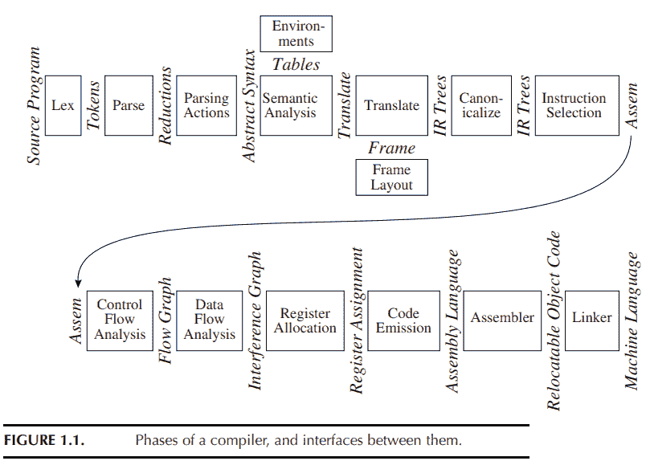

> 不同模块，提供接口

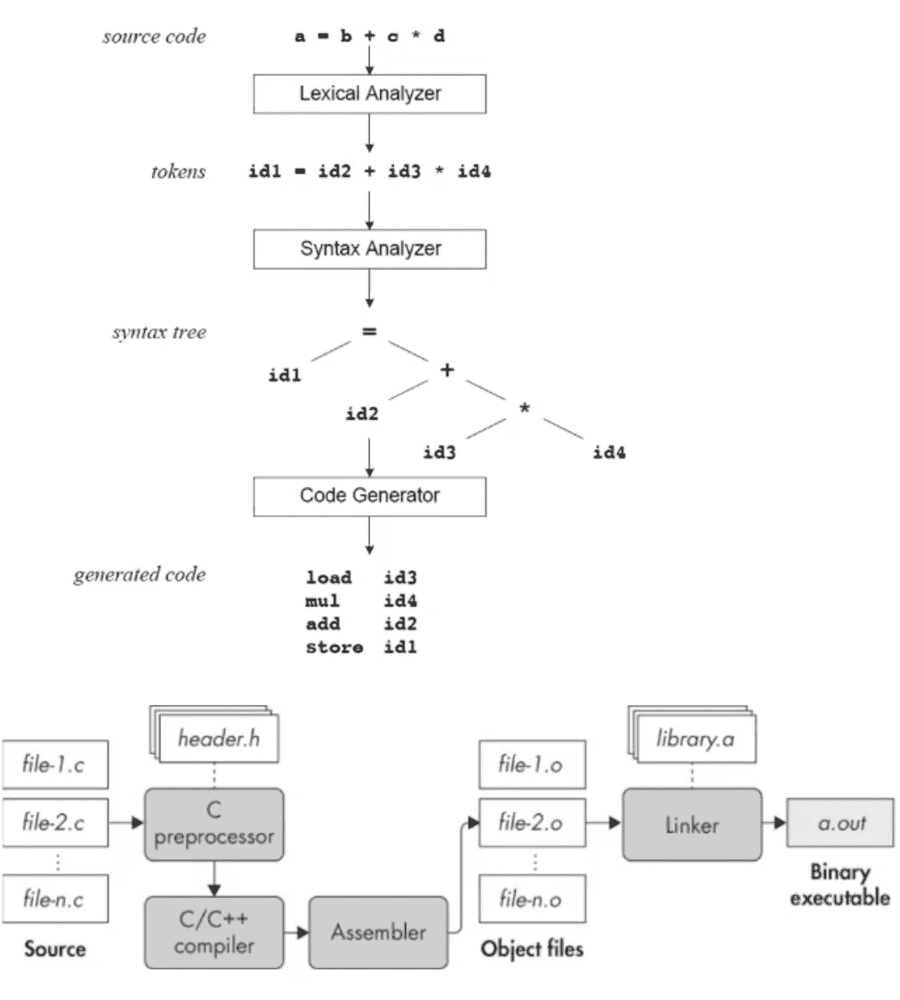

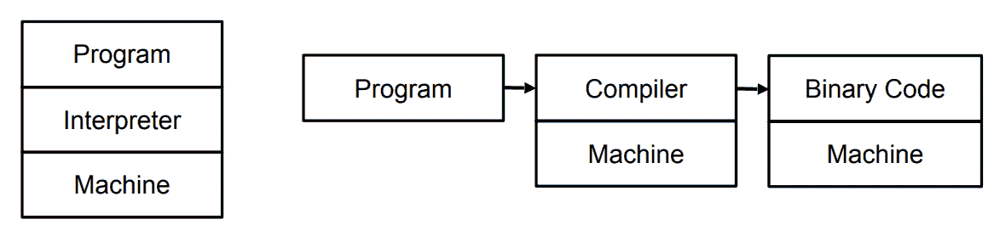

---

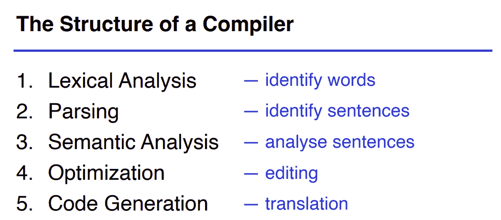

+   Lexical Analysis：将源代码中的字符流转换为有意义的词法单元（token）序列

+   Parsing：将一段文本或代码解析成其语法结构的过程，变成抽象语法树

+   Semantic Analysis：检查源代码中的语义错误，并生成相应的错误信息

+   Optimization：对生成的代码进行优化，以提高代码的执行效率和性能。

> 词法，语法，语义

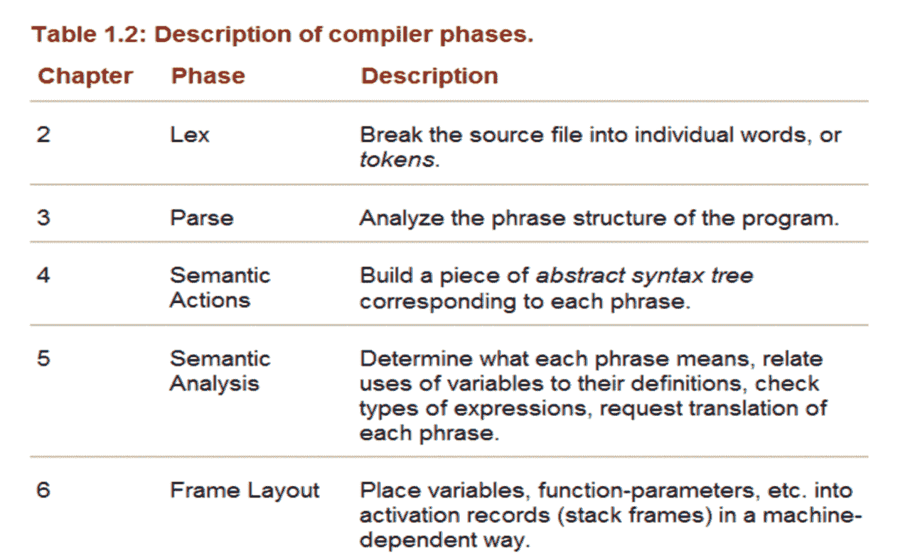

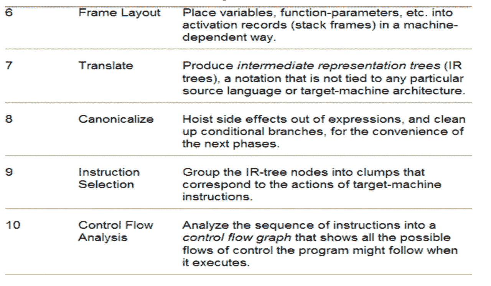

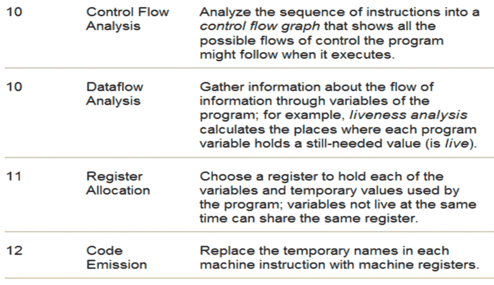

### 1.2 Tools and Software

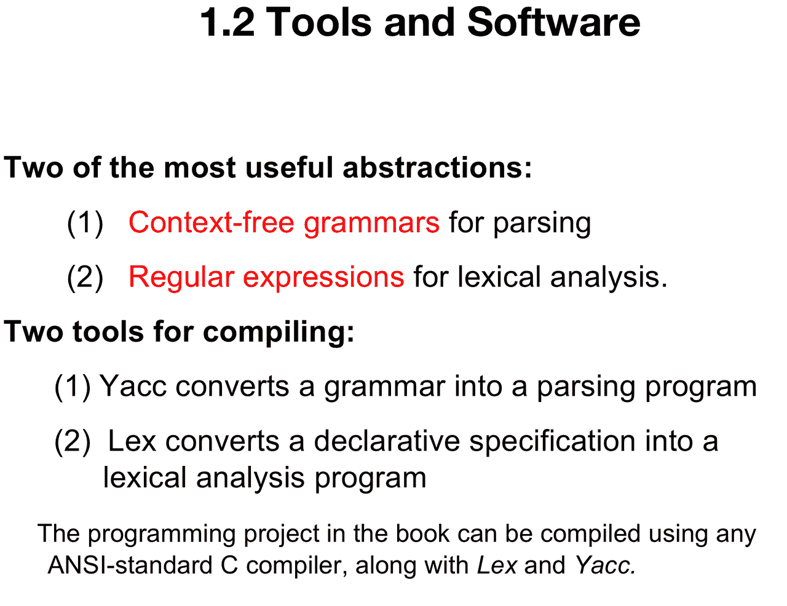

## 2 词法分析 | Lexical Analysis

输入：字符流；输出：抛弃空白符和注释后，生成一系列名字、关键字和标点符号

(Input: a stream of characters; Output: a stream of names, keywords and punctuation marks, discarding space and comments)

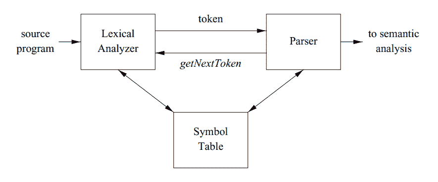

程序中每个地方都有可能出现空白符和注释，如果让语法分析器来处理它们则会使得语法分析过于复杂。

### 2.1 词法单词 | Lexical Tokens

Tokens 是指程序设计语言中具有独立含义的最小词法单位，包含单词、标点符号、操作符、分隔符等。例如典型测试语言的一些 token 类型为：

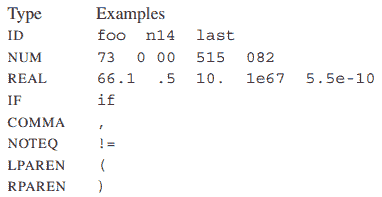

另外一些 tokens 如 `IF`, `VOID`, `RETURN` 称作 reserved words保留字，在大多数语言中不能成为 identifiers（即上图中的 `ID`）。

一些 nontokens：

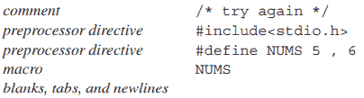

> 预处理会把`nontokens`删掉

在一些需要宏预处理器的语言中，由预处理器处理源程序的字符流，并生成另外的字符流，然后由词法分析器（Lexical Analyzer）读入新产生的字符流。这种宏预处理过程也可以与词法分析器集成在一起。

```
float match0(char *s) /* find a zero */
{if (!strncmp(s, &quot;0.0&quot;, 3))
        return 0.;
}
```

经词法分析器分析产生流

```
FLOAT ID(match0) LPAREN CHAR STAR ID(s) RPAREN
LBRACE IF LPAREN BANG ID(strncmp) LPAREN ID(s)
COMMA STRING(0.0) COMMA NUM(3) RPAREN RPAREN
RETURN REAL(0.0) SEMI RBRACE EOF
```

+   Ad hoc就是根据字符去做匹配

+   正则+`DFA`：抽象一层，更普遍适用

### 2.2 正则表达式 | Regular Expressions

称 language 是 string 的集合；string 是 symbol 的有限序列；symbol 是有限 alphabet 中的元素。

每个正则表达式表示字符串的一个集合（i.e. language），即它可以匹配很多字符串：

+   Symbol : `a` , 匹配字符串 `"a"`。

+   Alternation : `M` 和 `N` 是两个正则表达式，`M|N` 可以匹配 `M` 和 `N` 匹配集合的并集。如 `a|b` 可以匹配字符串 `"a"` 或 `"b"`。

+   Concatenation : `M` 和 `N` 是两个正则表达式，`M·N` 可以匹配 `M` 和 `N` 中各一个字符串的联合。如 `(a||b)·a` 匹配字符串 `"aa"` 或 `"ab"`。

+   Epsilon : `ϵ` 匹配空字符串。如 `(a·b)|ϵ` 代表 language {`""`, `"ab"`}。

+   Repetition : `M` 是一个正则表达式，则 `M` 的 克林闭包 (Kleene closure) 为 `M*` ，如果一个字符串是由 `M` 中的字符串零至多次 concatenation 的结果，则该字符串属于 `M*` 。如 `((a|b)·a)*` 表示无穷集合 {`""`, `"aa"`, `"ba"`, `"aaaa"`, `"baaa"`, `"aaba"`, `"baba"`, `"aaaaaa"`, ... }。

在书写正则表达式时，我们有时省略 `·` 和 `ϵ` ，并规定 `*` 优先级高于 `·` 高于 `|` 。还有一些缩写形式：

+   `[abcd]` 表示 `(a|b|c|d)`

+   `[b-gM-Qkr]` 表示 `[bcdefgMNOPQkr]`

+   `M?` 表示 `(M|ϵ)` ，即 `M` 出现 0 次或 1 次

+   `M+` 表示 `(M·M*)` ，即 `M` 出现至少 1 次

还有一些其他符号：

+   `.` 表示除换行符外的所有单个字符

+   `"a.+*"` ，引号中的字符串匹配其自身，不作为运算符

`Lex` 和其他类似的词法分析器中规定了两条规则以消除二义性：

+   `Longest Match` : 输入的字符串中的最长的能与任一正则表达式匹配的子串为匹配到的 token

+   `Rule Priority` : 对匹配到的 longest substring，选择第一个与之匹配的正则表达式。即正则表达式的书写顺序是有意义的

例如：

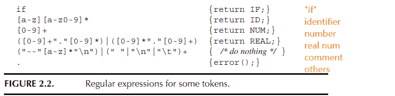

（其中注释是 `--` 开始的只包含小写字母、以换行结束的字符串）

则 `if` 会匹配第一条（虽然也能匹配第二条，但是 `Rule Priority` ），而 `if9` 会匹配第二条（虽然 `if` 也能匹配到第一条，但是 `Longest match` ）。可以看到，上面的规则是完整（complete）的，因为非法字符都能够被 `·` 识别到。

### 2.3 确定有限自动机 | Deterministic Finite Automaton, DFA

有限自动机有一个 finite set of states ，以及连接各个 state 的 edges ，每条 edge 由一个 symbol 标记。有一个状态是 start state ，某些状态是 final state 。例如：

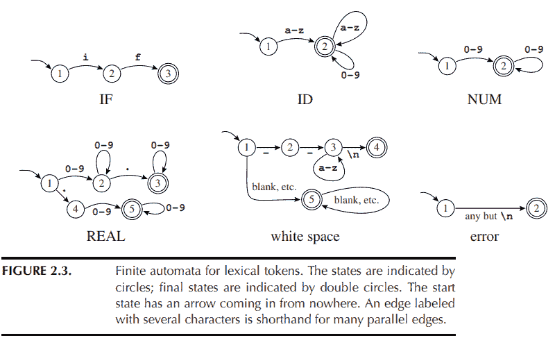

上图是一个 DFA。在 DFA 中，不会有从一个状态出发的两条边标记为同一个符号。图 2.3 的 DFA 与图 2.2 的正则表达式匹配的是同样的字符串。

图 2.3 可以合并成一个有限自动机：

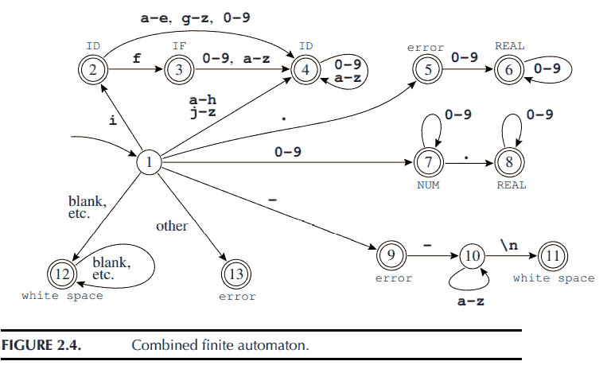

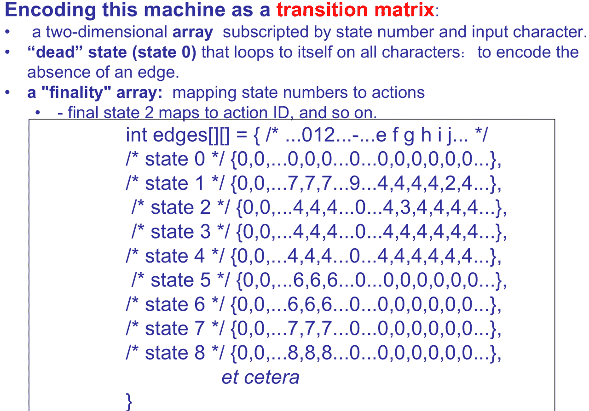

+   转移矩阵

+   `Dead state`：表示没有那条边

为了识别最长的匹配，词法分析器应当记录迄今遇到的最长匹配及该匹配的位置。词法分析器使用`Last-Final` 和 `Input-Position-of-Last-Final` 记录最近遇到的 final state 的编号和最后一次处于 final state 的时机。每当进入一个终态时，词法分析器更新这两个变量；当到达 dead state 时，从这两个变量就可以得知其匹配的 token。例如：

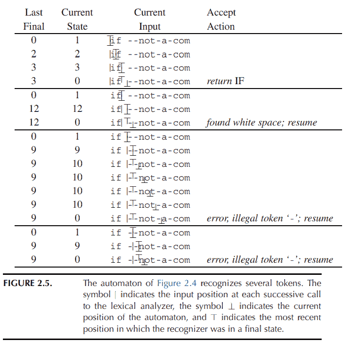

> 三个符号，标记开始，现在和下一个

> 如果没有线，就是dead state，current state就变成0，就结束

有时，词法分析可以分成扫描阶段和词法分析阶段两个部分：

+   扫描阶段主要负责完成一些不需要生成词法单元的简单处理，比如删除注释和将多个连续的空白字符压缩成一个字符；

+   词法分析阶段是较为复杂的部分，它处理扫描阶段的输出并生成词法单元。

See Also： [根据有限状态自动机求正则表达式](https://www.yuque.com/xianyuxuan/notes/iks452?view=doc_embed)

### 2.4 非确定有限状态机 | Nondeterministic Finite Automaton, NFA

NFA 可能存在从同一个状态出发的标有多条相同符号的边；也可能存在标有 `ϵ` 的边，这种边可以在不接收输入字符的情况下进行状态转换。

#### 2.4.1 将正则表达式转换为 NFA

我们可以比较容易地将一个正则表达式转为一个 NFA：

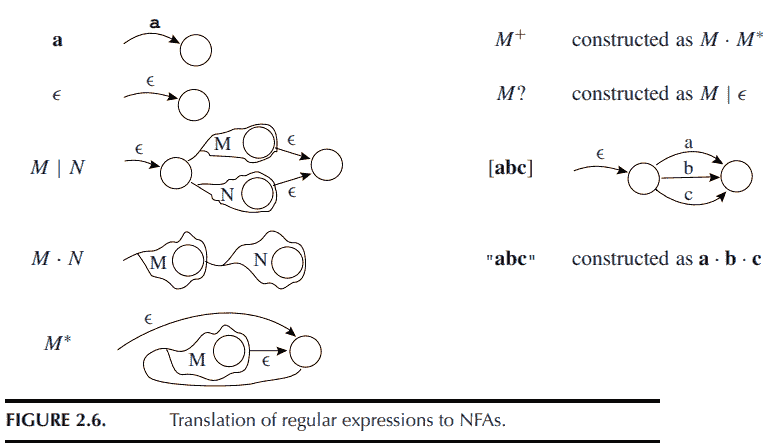

例如，我们将图 2.2 中 `IF`, `ID`, `NUM`, `error` 的一些表达式转换成了一个 NFA：

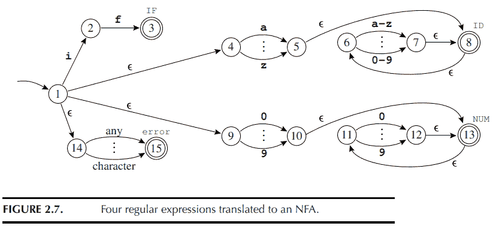

#### 2.4.2 将 NFA 转换为 DFA

> DFA更适合词法识别

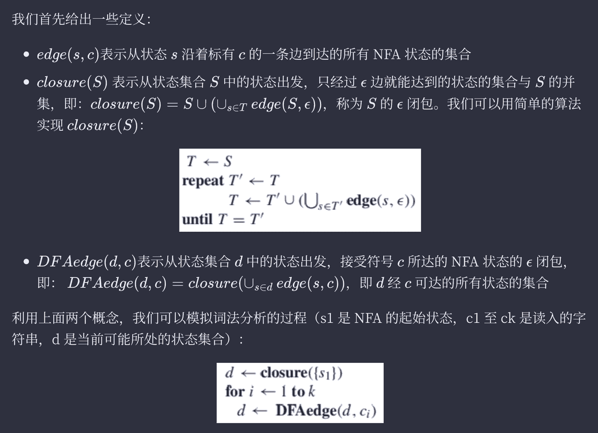

以图 2.7 为例，我们读入字符串 `"in"`。始态的 闭包为 {1, 4, 9, 14}，接受字符 `i` 后可达 {2, 5, 6, 8, 15}，再接受 `n` 后可达 {6, 7, 8}， 其中 8 是终态，因此 `"in"` 是一个 `ID`。

用类似的想法，我们可以将 NFA 转换为 DFA：

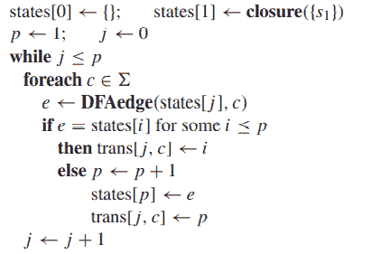

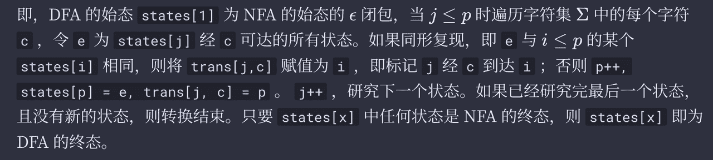

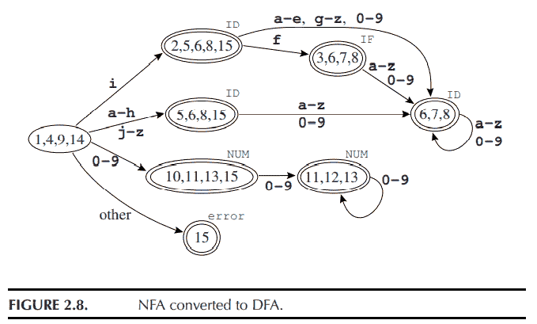

这个 DFA 是可以最小化的。

#### 2.4.3 DFA 的最小化

懒得写了，请看 [https://www.bilibili.com/](https://www.bilibili.com/video/BV1KT4y1U7cg/)video/BV1KT4y1U7cg/ 54分10秒

关键是判断两个状态是不是等价的，可以等价的就可以合并

输入和输出一样 = 等价

我们怎么找？

+   等价的话，他们首先要么都是`final`，要么都是`non-final`

+   我们先假设一个最小模型，一个包含所有`non-final`，和一个包含所有`final`

+   不断地对所有的字母进行运算，根据结果来看是否还在，出现不一致的行为就分裂

1.  一个到`terminal`，一个到非`terminal`


1. 一个到`A`，一个到`B`，`A`和`B`不等价

1. 一个到`A`，一个到`error`

+ 如果出现`error transition`，也要分裂

直到不可再分或者成立为止

## 2.5 例子：从正则表达式到 DFA

`(a|b)*a(a|b|ε)`

根据 2.4.1，我们得到该正则表达式的 NFA：

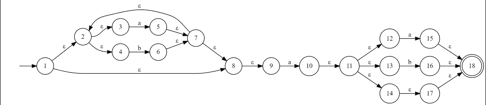

Start with the state `state[1]` :

where is the `ε`-closure of `state` in the DFA.

When `state[1]` accept `` `a` `` , it will reach `state[2]` :

When `state[1]` accept `` `b` `` , it will reach `state[3]` :

When `state[2]` accept `` `a` `` , it will reach `state[4]` :

When `state[2]` accept `` `b` `` , it will reach `state[5]` :

When `state[3]` accept `` `a` `` , it'll reach `state[2]` ; when accept `` `b` `` , it'll reach `state[3]` .

When `state[4]` accept `` `a` `` , it'll reach `state[4]` ; when accept `` `b` `` , it'll reach `state[5]` .

When `state[5]` accept `` `a` `` , it'll reach `state[2]` ; when accept `` `b` `` , it'll reach `state[3]` .

As `state[2, 4, 5]` contains the final state `18` in the NFA, so they are final states in DFA.

So here we've got the DFA:

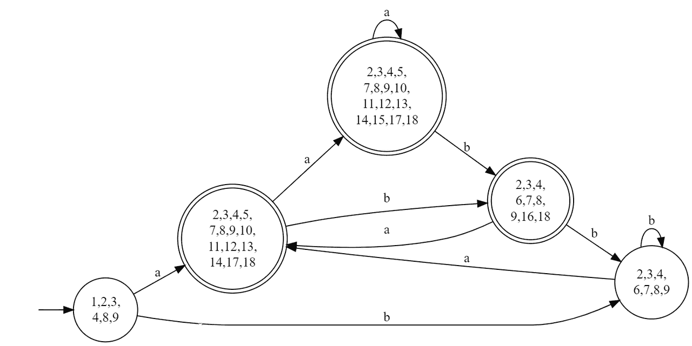

And we just denote the sets of states by number 1~5:

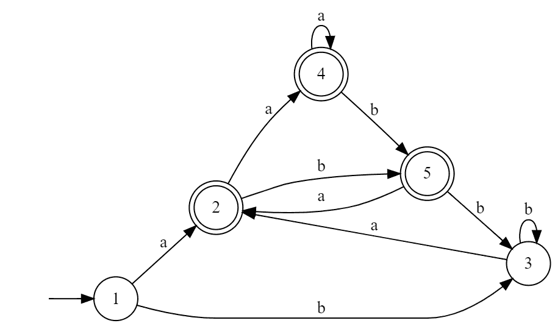

(If we don't do the simplification, figure above is the DFA wanted) We can finally simplify the DFA above to be the following one:

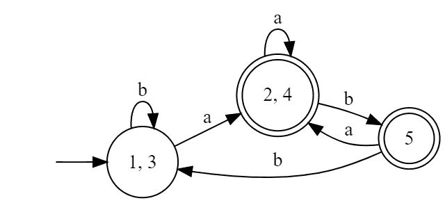

i.e.

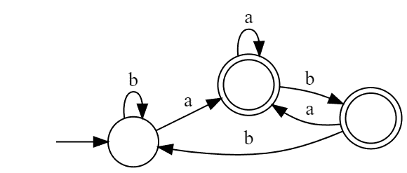

## 2.6 Lex：词法分析器的生成器

> RE——>NFA

> NFA——>DFA

> DFA——>`table-driven algorithm`

[这篇博客](https://blog.csdn.net/weixin_44007632/article/details/108666375)是我看到的唯一一个能看懂的 `Lex` 和 `Yacc` 教程。

一个来自于`flex`使用手册的结构：

```
定义(definations)
%%
规则(rules)
%%
代码(user code)
```

`flex`的代码分为三个部分，由`%%`分割，这些部分可以为空，但为了`flex`代码能够按照我们此前介绍的方法成功编译，需要加入部分内容，形成下方的 新手框架 ：

```
%{

%}

%%

%%
int main(int argc, char **argv)
{
  yylex()
  return 0;
}
int yywrap()
{
        return 1;
}
```

接下来介绍这个框架中的内容：

①第一部分，较原框架加入了`%{ %}`，这对大括号内没有任何内容，所以目前起不到任何作用。加入这对大括号的目的是，在这个部分可以使用`C`语言代码进行预处理，例如使用`#include<stdio.h>`，或是定义宏、常量等等。主要内容是`C`本身的定义

②第二部分，没有变化，这里的要写入的代码是重点内容，将在后续展开。写的正规表达式，并且正规表达式要做的`action`。

③第三部分，这个部分就是用来写`C`语言代码的，因此不需要使用`%{%}`括号对。在这里，我们添加了两个函数（从代码上来看这里似乎有三个函数？），接下来我们展开讲述这些内容。

由于`flex`代码要先编译为`C`代码，显然需要一个`main`函数，所以需要我们手写一个`main`函数，这就是第一个函数的由来。此时想必有人会疑惑，那么`main`中调用的`fflex()`函数是什么呢，我们并没有定义它啊？

`yylex()`函数，其实会由第二部分我们写入的匹配规则自动生成，也就是说，它其实就是由`lex`产生的词法分析程序，当我们调用它时，才会正式开始词法分析。关于这个函数的具体内容，我们会在之后讲述。

最后就是`yywarp`函数，这是一个约束函数，当它返回`1`时，代表扫描结束，此时结束程序。这个函数在读取多个文件时很有用处，关于它的进阶运用也会在未来而不是现在展开。

综上所述，我们讲述了`flex`代码的基本结构，并给出了一个新手框架。接下来，我们只要在第二部分中加入内容，在其他部分稍作修改，就能制作出一个有不错功能的带词法分析功能的程序了。

### 2.3 第二部分的编写

第二部分由多条规则（`rule`）组成，每条`rule`可以由 `pattern` 与 `action` 组成。

`pattern`使用正则表达式表示，含义为需要匹配的词的规则。

`action`使用代码表示，含义为成功匹配该词后执行的动作。

/----------/

以下是`flex`中的`pattern`参考：

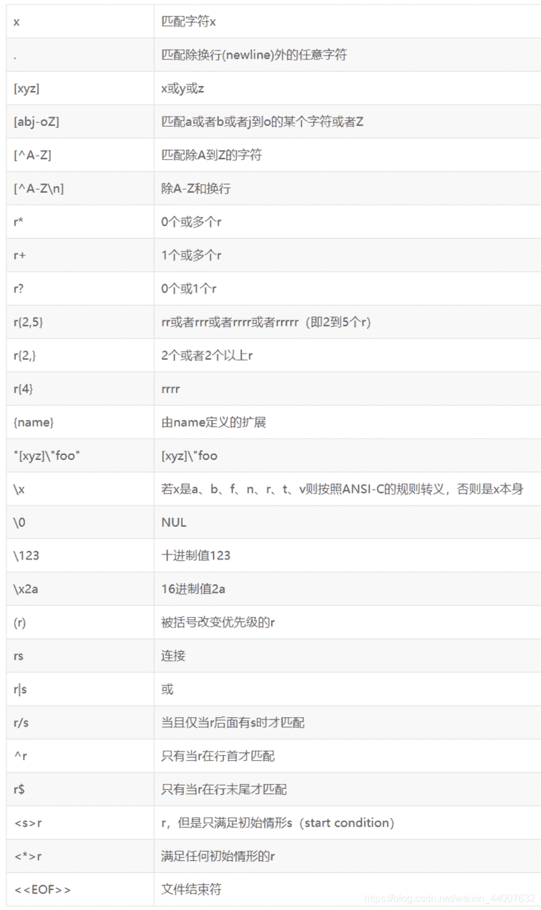

> 一些约定的

> `nat [0-9]+`

> `signedNat (+l-)?{nat}`

/-----/

为了对第二部分有着进一步的感性认识，这里贴出一个代码，供学习者阅读：

```
%{
int num=0;
int chars=0;
%}
%%
[a-zA-Z]+  { chars++; }
[1-9]+[0-9]* {num++;}
\n         
.          
%%
main(int argc, char **argv)
{
  yylex();
  printf("%8d%8d\n", num,chars);
}
int yywrap()
{
        return 1;
}
```

程序解释：

可以看到，在第一部分，我们用`C`代码定义了变量`num`和`chars`，它们都需要被写在两个花括号里。

第二部分，我们依次解释其中的规则。

①`[a-zA-Z]+` 表示匹配长度至少为1的连续字母串，当匹配到时，对`chars`做增1操作。（这里的动作的花括号可以省略）

②`[1-9]+[0-9]*` 表示匹配一个数字，该数字不能以`0`开头，当匹配到时，对`num`做增1操作。

③`\n`匹配换行符，不做任何操作

④`.`匹配任意字符（除`\n`外），不做任何操作

/------/

答疑：

一些学习者看到了上述解释，可能还是有许多疑惑，对于一些常见的疑惑，这里给出解释。

Q1：对于规则③④，既然不做任何操作，那么为什么要匹配呢？

A1：事实上，`flex`对任何没有匹配到的字符，会自动做原样输出操作。因此，对于那些不需要将其输出，而是需要将其忽略的`pattern`，应该进行匹配并做无操作处理。

Q2：既然点号`.`可以匹配任意字符，显然也能匹配到规则①②的`pattern`，那么它们会起效吗？

A2：`flex`拥有一套简单的消除歧义的规则，使词法分析程序工作的两条规则是：1、`flex`模式只匹配输入字符或字符串一次；2、`flex`执行当前输入的最长可能匹配的动作。第二条规则就解决了这个疑惑，显然，当匹配到任意一个字符时，它满足④的`pattern`，但`flex`会尽量向更长的`pattern`进行匹配，因此会继续向后读，直到后一个字符读入后将无法匹配任意一个`pattern`，此时才进行匹配。所以当满足数字或字母串（单词）的匹配规则时，它必然先匹配这两者。

Q3：虽然这么说，但还是有一个问题——如果我只输入一个数字`1`，那么程序会把它判定为①的`pattern`还是④的`pattern`呢？

A3：`flex`的规则有着隐藏优先级，即匹配长度相同时，将最上面的规则作为匹配结果。由于规则①在④的上面，所以显然会将其匹配成数字。

/-----/

程序功能：

既然已经完全解释了这个程序代码，想必大家都可以看出，将这个代码编译后生成的`exe`文件的功能了。那便是输入几段文本，统计其中的单词数和数字个数。

`Lex` 由词法规范生成一个 `C` 程序，即一个词法分析器。`Lex` 的一个示例是：

> 我们给一下关于`Lexer`的形式化说明

```
%option noyywrap
%{
    int lineCount = 0, charCount = 0, wordCount = 0, isLastBlank = 1;
%}
wordChar    [0-9a-zA-Z]
otherChar   [^{wordChar}]

%%

\n      lineCount++; charCount++; isLastBlank = 1;
{wordChar}  {
            charCount++;
            if (isLastBlank)
                wordCount++;
            isLastBlank = 0;
        }
{otherChar} charCount++; isLastBlank = 1;

%%

int main() {
    yylex();
    printf("There are %d chars, %d words and %d lines.\n", charCount, wordCount, lineCount);
    return 0;
}
```

这个实例统计了一个输入中的字符数、词数以及行数，其中“词”定义为由数字和字母形成的连续的字符串。下面具体解释这个实例：

两个 `%%` （8、19 行）将该实例分为了三个部分。

+ 第一个部分中：

+ `%option noyywrap` 显式地声明了不使用 `yywrap()` 函数。这一函数用于对多个文件的解析，当这个函数返回 `1` 时表示解析结束。这里我们对 `stdin` 进行解析，不需要 `yywrap()` 函数。

+ `%{` 和 `%}` 扩起的部分（这两个符号必须顶格），这一部分的内容会被直接拷贝到生成的 `C` 程序中，即使用的一些 `include`、声明和宏等。这里用到的是一些变量的定义。

+ 定义了一些正则表达式的简写形式和状态说明。如 `digits [0-9]+` 允许用名字 `{digits}` 来代表正则表达式中非空的数字序列。状态说明将在后文讲解。

+ 第二个部分的每一行由一个正则表达式和一个或若干个 `C` 语言语句组成，表示识别的正则表达式及对应的动作。如果语句不止一行，需要用大括号括起来。

+ 第三个部分是可选的，保存一些可选函数。这个部分也会被直接拷贝到结果文件中。这里函数 `yylex()` 启动标准读入并对其进行分析。

我们将上述文件保存为 `counter.l` ，在命令行中使用：

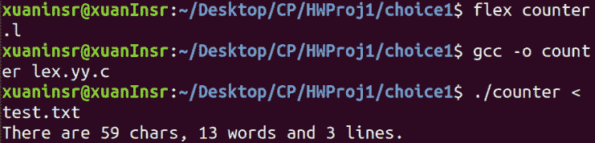

即，我们使用 `flex` 将 `.l` 生成 `lex.yy.c`，然后编译 `lex.yy.c` 进行运行。

这是我们控制输入输出的一个例子

我们看另一个例子：

```
%option noyywrap
%{
char toUpperCase(char ch) {
    if (ch >= 'a' && ch <= 'z')
        return ch - 'a' + 'A';
    else
        return ch;
}   
%}
keyWords and|array|begin|case|const|div|do|downto|else|end|for|function|goto|if|in|mod|not|of|or|packed|procedure|program|record|repeat|set|then|to|type|until|var|white|with
nonChar [^a-zA-Z0-9]
%%
{keyWords}{nonChar} for (int i = 0; i < strlen(yytext); i++) putchar(toUpperCase(yytext[i]));
.           putchar(yytext[0]);
%%
int main() {
    yylex();
    return 0;
}
```

这是一个将输入中的关键字转为大写的示例。我们注意到这里出现了一个新的变量 `yytext` 。事实上，`lex` 在翻译成 `C` 文件时会有一些全局变量供使用。它们包括：

+ `yyin` ， `FILE *` 类型变量，指向正在解析的文件。默认情况下指向 `stdin`。

+ `yyout` ， `FILE *` 类型变量，指向输出的位置。默认情况下指向 `stdout`。

+ `yytext` ， `char *` 类型变量，指向刚刚识别到的字符串。

+ `yyleng` ，整型变量，保存刚刚识别到的字符串的长度。

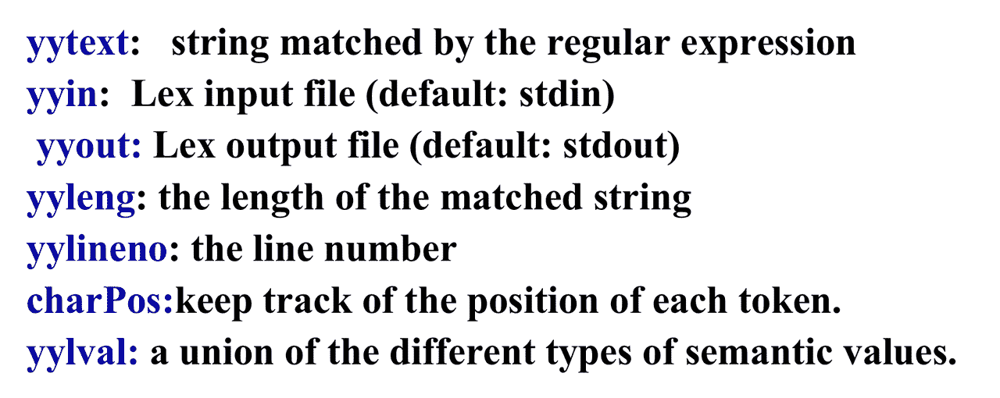

### 开始状态 | Start State

如图所示的自动机可以用下面的 `Lex` 实现：

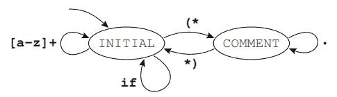

```
/* ...... */
%Start INITIAL COMMENT
%%
<INITIAL>if {ADJ; return IF;}
<INITIAL>[a-z]+ {ADJ; yylval.sval=String(yytext); return ID;}
<INITIAL>"(*" {ADJ; BEGIN COMMENT;}
<INITIAL>. {ADJ; EM_error("illegal character");}
<COMMENT>")" {ADJ; BEGIN INITIAL;}
<COMMENT>. {ADJ;}
. {BEGIN INITIAL; yyless(1);}
```

## 2.7 习题

下面的习题只是自己尝试的结果，没有找到标准答案用以对照。

参考了 [https://www.doc88.com/](https://www.doc88.com/p-779865898611.html)。

### 2.7.2 正则表达式

#### 2.1 Write regular expressions for each of the following.

a. Strings over the alphabet `{a, b, c}` where the first `a` precedes (先于) the first `b`.

b. Strings over the alphabet `{a, b, c}` with an even number of `a`’s.

c. Binary numbers that are multiples of four.

d. Binary numbers that are greater than `101001`.

e. Strings over the alphabet `{a, b, c}` that don't contain the contiguous substring `baa`.

f. The language of nonnegative integer constants in `C`, where numbers beginning with `0` are octal constants and other numbers are decimal constants.

g. Binary numbers `n` such that there exists an integer solution of `an + bn = cn`.

#### 2.1 根据要求写正则表达式

a. 首先是一个 `ab` ，然后在左边、中间、右边塞一些东西：`a` 左边只能塞 `c`，`ab` 中间可以塞 `a` 或者 `c`，`b` 右边可以塞 `a`、`b` 或 `c`。所以是：`c*a(a|c)*b[abc]*`

b. 拆成 `...a...a...` 的结构即可：`((b|c)*a(b|c)*a(b|c)*)*`

c. 是四的倍数的话尾数应该为 `00`：`(0|1)*00`

d. 大于六位数；或者为 `10101-`、`1011--`、`11----`，其中 `-` 表示 `0` 或 `1`，因此是：`1(0|1)*(0|1)(0|1)(0|1)(0|1)(0|1)(0|1)(0|1)|10101(0|1)|1011(0|1)(0|1)|11(0|1)(0|1)(0|1)(0|1)`

e. 由于过程较复杂，本题写在了《根据有限状态自动机求正则表达式》一文中。由于没有找到标准答案，不保证正确性；且不是最简形式。结果是：`((a|((ba)*b)*(ba)*c)*((ba)*b)*(ba)+|(a|((ba)*b)*(ba)*c)*((ba)*b)+|(a|((ba)*b)*(ba)*c)*)`

f. 注意 `8` 进制的 `0` 表示为 `00`：`00|0[1-7][0-7]*|0|[1-9][0-9]*`

g. 费马大定理；此处 `n` 只能为 `1` 或 `2`。因此：`1|10`。

#### 2.2 For each of the following, explain why you're not surprised that there is no regular expression defining it.


## 2.1

a. Strings of `a`'s and `b`'s where there are more `a`'s than `b`'s.

b. Strings of `a`'s and `b`'s that are palindromes (the same forward as backward).

c. Syntactically correct `C` programs.

## 2.2

a. 正则表达式应与有限自动机一一对应，而有限自动机无法实现计数功能，因为 `a` 和 `b` 的个数是无限的；状态数为 `N` 的自动机无法记忆大于 `N` 的计数状态。

b. 同样的，记录没有长度限制的回文串需要无限个状态。

c. 例如，判断括号是否匹配需要计数，因此也无法实现。

这是龙书对“正则表达式无法描述同样数量的 `a` 和 `b` 组成的串的集合”的证明：

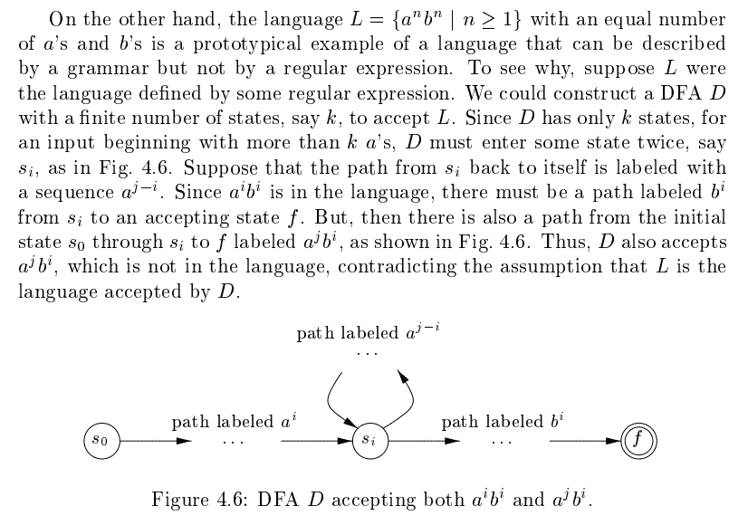

## 2.3 Explain in informal English what each of these finite state automata recognizes.

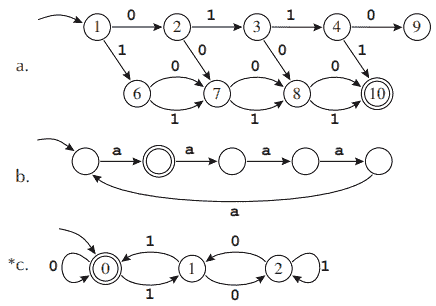

a. 不为 `0110` 的四位二进制数

b.  个 `a` 组成的字符串

c. 不会！对应的正则表达式是 `(0|1(01*0)*1)*`

# 3 语法分析 | Parsing ¶

> 词法正确和语法正确不等价

此部分介绍 语法分析 (Parsing) 和 上下文无关文法 (Context-Free Grammar, `CFG`) 的相关概念以及 自顶向下分析 (Top-Down Parsing) 的有关内容。

**输入**：词法分析生成的 `token` 流； **输出**：语法分析树/中间表示

**Input**: `sequence of tokens from lexer`; **Output**: `parse tree` of the program (But some parsers never produce a parse tree ...)

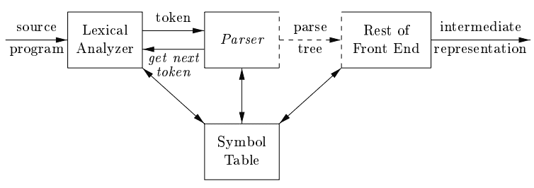

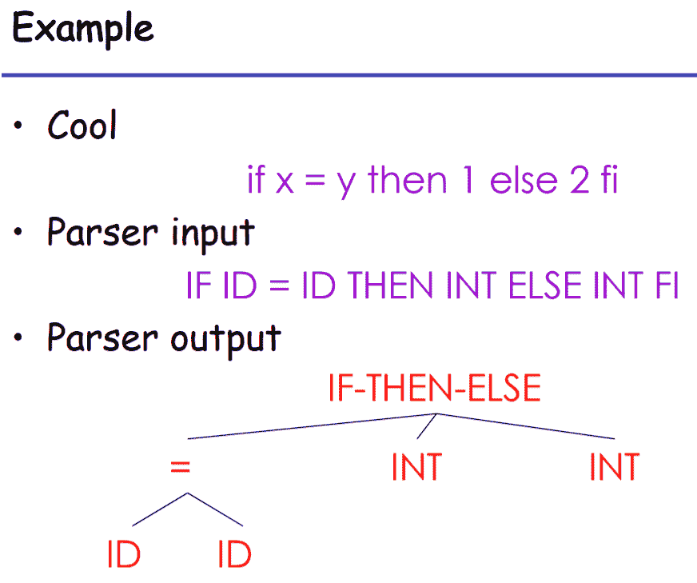

在 `2.5` 节给出的 `Lex` 示例中，我们用名字 `digits` 作为了数字 `[0-9]+` 的别名。这种别名使得我们使用 `Lex` 编写词法规范时更加容易理解。实际上，这种别名的实现非常简单：`Lex` 在利用正则表达式生成有限自动机之前，用 `[0-9]+` 代替 `digits` 的所有出现即可。这与 `C` 语言中的宏定义类似。

但是，正如我们在习题 `2.2` 中探讨过的那样，正则表达式不能实现对括号等的嵌套识别。考虑下面的定义：

```
digits = [0-9]+
sum     = expr "+" expr
expr    = "(" sum ")" | digits
```

那么，形如 `19` 、 `5+6` 、 `((1+2)+(3+4))` 等的表达式都可以被上述规则包括（分别对应 `digits`, `sum` 和 `expr`）。其中所有括号都是配对的，但是有限自动机无法实现这种配对的识别。因此，`sum` 和 `expr` 不可能被正则表达式表示。这种递归而获得的额外的表示能力正是语法分析所需要的。

## 3.1 上下文无关文法 | Context-Free Grammars, `CFGs` ¶

如我们所说，编程语言具有递归结构。如同我们用正则表达式静态地定义词法结构一样，我们使用 上下文无关文法 静态地定义语法结构。我们在稍后讨论“上下文无关”的含义。

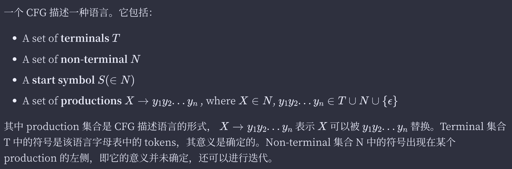

`CFG` 描述的语言从 start symbol `S` 出发，将字符串中任何 non-terminal 用某个 production 右侧的东西替换，不断重复直到字符串中没有 non-terminal。亦即，一个 `CFG` 描述的语言即为自 start symbol 开始，经有限个 production 推导可以得到的 terminal 串的集合。

例如：

```
EXPR -> if EXPR then EXPR else EXPR fi
      | while EXPR loop EXPR pool
      | id
```

这里的“`|`”是或。一般我们将 non-terminal 用大写表示，将 terminal 用小写表示，将 start symbol 写在第一个表达式的左侧。上例等同于：

```
EXPR -> if EXPR then EXPR else EXPR fi
EXPR -> while EXPR loop EXPR pool
EXPR -> id
```

也就是说，我们在 `CFG` 中可以不适用可选符号 `|` 和克林闭包 `*`，即：

+   `aux` -> `c`\|`d` 可写为 `aux` -> `c` , `aux` -> `d`

+   `expr` -> `aux*` 可写为 `expr` -> `aux expr` , `expr` -> `ϵ`

举一个更加详细的例子。看下面一个 `CFG` （文法 `3-1`）：

```
S -> S; S
S -> id := E
S -> print(L)

E -> id
E -> num
E -> E + E
E -> (S, E)

L -> E
L -> L, E
```

> （`S`，`E`）先允许 `S`，再执行 `E`

这个文法有 `S`、`E`、`L` 三个 non-terminal，有 terminal `;`、`id`、`:=`、`print`、`(`、`)`、`num`、`+`、`，`，与它对应的源程序可以是 `a := 7; b := c + (d := 5 + 6, d); print(b)` ，这个源程序经词法分析后是 `id := num; id := id + (id := num + num, id); print(id)` 。

### 3.1.1 推导 | Derivation ¶

如果存在 production `A -> a` ，那么串 `xay` 就是表达式 `xAy` 的一个实例，我们称 `xAy => xay` ，即 `xAy` 经过一步推导出 `xay` 。在 `=>` 上增加 `*` 或 `+` 表示经过零或多步、一或多步推导出。推导证明一个句子属于一个 `CFG` 的语言。

例如文法 `3-1` 的一个句子 `a := 7; b := c + 2` 可以经如下推导：

```
S
S; S
id := E; S
id := num; S
id := num; id := E
id := num; id := E + E
id := num; id := id + E
id := num; id := id + num
```

在上面的推导中，我们每一次选取最左边的非终结符进行扩展，因此称为 最左推导 (leftmost derivation) ，类似地，也有 最右推导 (rightmost derivation) 。当然，推导也可以既不是最左推导，也不是最右推导。

但是，如 `a := 1; b := 2; c := 3` 的句子有两种不同的 最左推导 ：

```
S => S; S => id := num; S => id := num; S; S => ...
S => S; S => S; S; S => id := num; S; S => ...
```

这种现象说明文法是 二义性 (ambiguous) ，我们将在 `3.1.3` 小节讨论这个问题。

### 3.1.2 语法分析树 | Parse Tree ¶

推导过程中，我们对每个非终结符进行扩展。将非终结符作为父结点，扩展出的内容作为子结点，则可以形成一棵树，即语法分析树。`3.1.1` 例子的语法分析树为：

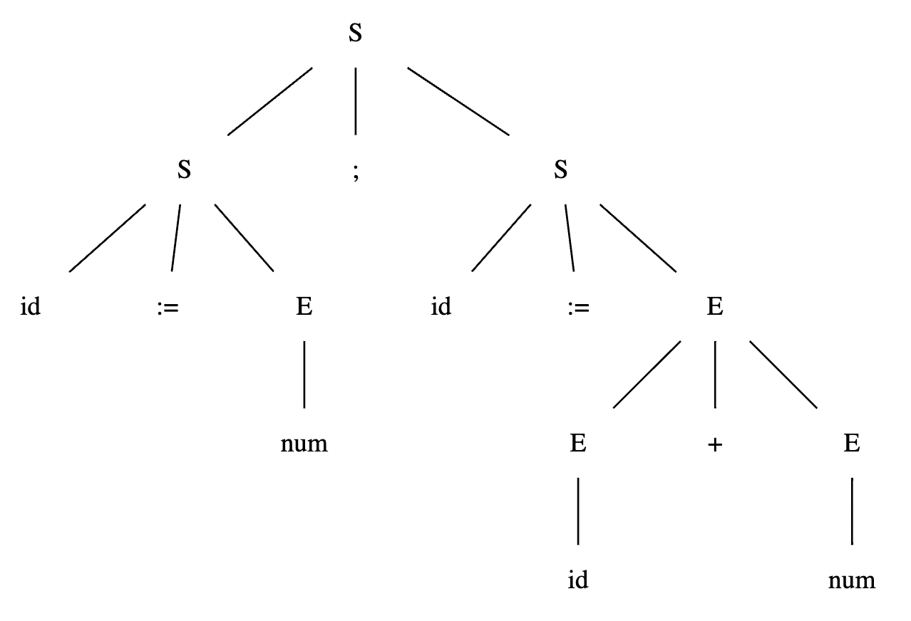

可以看到，语法分析树的所有叶子结点均为 terminals，其他节点均为 non-terminals。叶子结点的中序遍历即为原输入。与原输入相比，语法分析树显示了 token 之间的联系。每种推导对应了一棵语法分析树，但是每棵语法分析树可以对应多种推导方式。

可以说明，对于每一种最左推导，一定有且仅有一种最右推导与其形成同样的语法分析树；其区别只是树的分支加入的顺序。

### 3.1.3 二义性 | Ambiguity ¶

> grammar 本身有二义文法

看下面一个例子：

**Grammar**: `E -> E+E | E*E | (E) | id`

**String**: `id * id + id`

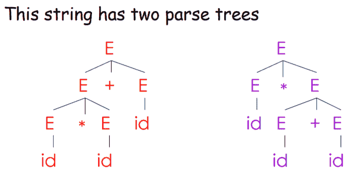

这两棵语法分析树分别对应两种最左推导：

+   `E => E+E => E*E+E => ...`

+   `E => E*E => E*E+E => ...`

这两种推导方式都是符合文法的最左推导。

如果一个文法会使某些字符串有不止一个语法分析树，即该字符串有多种最左推导（或对应地，有多种最右推导），则称这个文法有二义性。我们希望文法是无二义性的。

无二义性只有一棵语法分析树，一棵树可以有多个推导

> 重写，强行有好几层

需要解决二义性，最直接的方法是重新写一个没有二义性的文法。上例中，我们一般选取左边那种理解，因为我们认为 `*` 比 `+` 具有更高的 `precedence` 。那么我们可以通过重写，强制这种优先级：

**Grammar**: `E -> T+E | T` , `T -> F*T | F` , `F -> id | (E)`

通过这种方式，我们强制了 `id` 和 `()` 具有最高优先级（因为他们会被作为一个整体展开），`*` 次之， `+` 优先级最低。这样，上例就只有唯一一种最左推导：

`E => T+E => F*T+E => ...`

即消除了二义性。

我们再考虑这样一个例子：

**Grammar**: `E -> E-E | num` ， **String**: `3-2-1`

可以发现，这样一个简单的文法也有两种不同的最左推导，分别得到 `(3-2)-1` 和 `3-(2-1)` 两种结果，显然我们希望的是前一种。这个问题的原因是 `associativity` ，我们希望 `-` 是左结合的。因此我们可以通过重写，强制这种结合性：

**Grammar**: `E -> E-T` , `T -> num`

这样就消除了二义性。

需要说明的是，这里并没有一种通用的方法来解决二义性（`Why？`），因此我们只能通过人工的方式完成上面那样的消除二义性文法的重写。但是我们同时可以发现，这种重写会使得文法变得复杂，难以阅读和维护。因此，我们尝试通过某种消除二义性的声明来接受二义性，因为这样的文法更加简单和自然。

大多数工具采取这样的方法。这些工具通过声明 `precedence` & `associativity` 来消除文法中的二义性。

> The parser doesn't really understand about associativity & precedence. Instead, these declarations tell it to make certain kind of moves in certain situations. We won't be able to explain this until we get much further into parsing technology.

### 3.1.4 文件结束符 | EOF Marker ¶

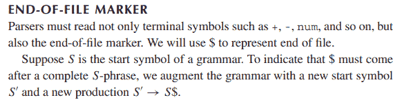

`$` 表示文件结束符

### 3.1.5 上下文无关 | Context Free ¶

我们所说的“上下文无关”或者“静态”，这里解释的很清楚（其实就是字面意思）：

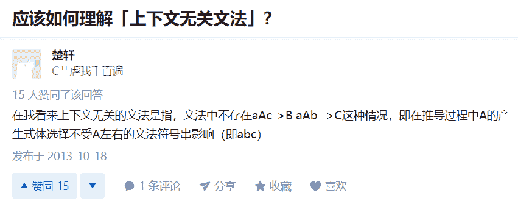

那么什么是上下文有关呢？我们可以说，如果只有对特定的串 `β` 和 `γ`，才有规则 `βAγ -> βαγ` 时，我们称这条规则是上下文有关的。实际上，我们在 `C` 语言中需要先声明后使用就是一种上下文有关的例子。即：

```
{
     int x;
     ...
     ...x...
     ...
}
```

如果给相关的规则加上一些限制，那么我们有可能可以使用 `BNF` 来完成对上述上下文有关文法的分析；但即使如此，这个工作量是巨大的。因此，我们将这些信息和限制放到稍后去处理。在语法分析部分，我们暂时只考虑上下文无关文法的分析。

## 3.2 递归下降分析 | Recursive Descent Parsing ¶

> 能力比较强，但是效率比较低

> 但不是所有的 `CFG` 都可以使用 `RDP`

`Recursive Descent Parsing` 是 自顶向下分析 (Top-Down Parsing) 的一种。所谓 Top-Down Parsing，就是从顶（start symbol）开始，从上到下、从左到右构造 `parse tree`。

### 3.2.1 思路 ¶

递归下降利用的核心思路是，`parse tree` 叶子结点的中序遍历即为输入的 `token` 流。

递归下降分析的过程，即从上到下、从左到右，对 `parse tree` 中的每一个结点进行遍历。对于遍历到的每个结点，如果该点是

+   `Terminal`，则查看下一位输入是否与该 `terminal` 相同。如果相同，则接受该输入；如果不同，或者没有下一位输入，则说明出现了错误，进行 `backtrack`，即回溯到上一步 `non-terminal`（因为 `terminal` 一定由 `non-terminal` 引出）；

+   `Non-terminal`，则：

+   尝试第一个从该 `non-terminal` 引出的 `production`，即将该 `production` 的右端作为该结点的子结点加入 `parse tree`，然后依次遍历子结点

+   如果 `backtrack` 到了当前 `non-terminal`，则尝试下一个 `production`

+   如果 `backtrack` 到了当前 `non-terminal` 但所有 `production` 都已经尝试完了，那么说明该 `non-terminal` 是不应当出现的，回溯到上一步 `non-terminal`。

重复该步骤，直到所有结点都被遍历完。如果此时输入已经结束，那么我们找到了一个匹配的 `parsing`；否则说明仍然存在错误，继续 `backtrack`。

下面是递归下降分析的一个实例：

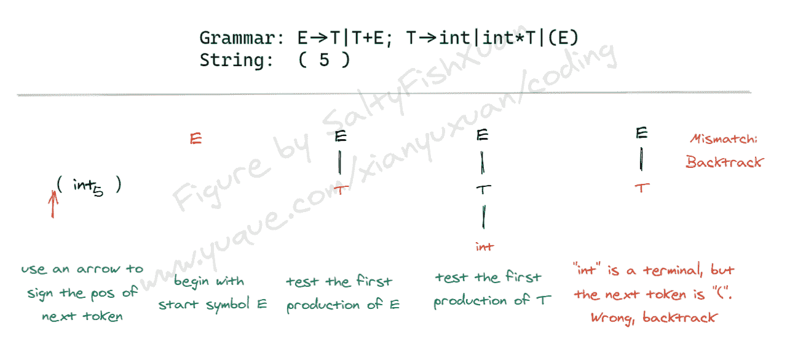

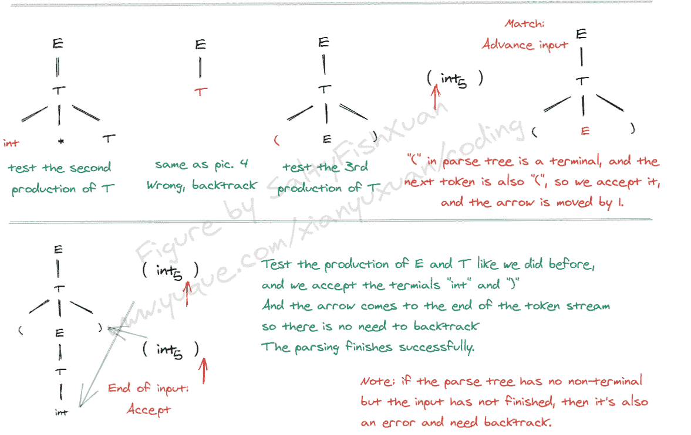

> 如果搞完了，还有输入没输入完，也是错误

### 3.2.2 实现 ¶

`Grammar`: `E -> T | T+E` , `T -> int | int * T | (E)`

我们用 `C` 语言尝试实现 `Recursive Descent Parser`：

+   我们用 `TOKEN` 表示 `token` 的类型，用指针 `next` 指向下一个 `token`（Line 1~4）

+   我们用一系列函数进行前述思路中的检查和尝试，这些函数的返回值类型为 `bool` ，用来表示识别成功与否。如果不成功，我们进行回溯。这里的 `parse tree` 实际上是由函数的嵌套关系组织的，因此所谓“回溯”除了函数的自然返回，就只需要将 `next` 回到之前的位置即可。

+   `bool term(TOKEN tok)` 是对 `terminal` 的检查，顺便把 `next++`

+   `bool E1()` 是 `non-terminal` `E` 的第一个 `production` `E -> T` 。可以看到其返回 `true` 的条件即为 `T()` 为真。类似地， `bool E2()` 是 `production` `E -> T+E` 对应的函数，返回 `true` 的条件为依次匹配到 `T()` , `term(PLUS)` （即 `terminal` `"+"`）和 `E()` 。

+   `bool E()` 是 `non-terminal` `E` 的所有 `production` 的集合，注意到 `11` 行首先保存 `next` 到 `save` ，用来回溯；然后 `12` 行首先判断 `E1()` 是否为真：

+   如果为真则根据 `C` 语言的短路规则，其后的 `(next = save, E2())` 并不会被运行，直接返回真；

+   如果不为真则运行 `(next = save, E2())` ，即首先恢复 `next` ，然后判断 `E2()` 是否为真。

需要特殊说明的是，这里第 `12` 行的 `(next = save, E1())` 中的 `next = save` 并没有作用，因为第 `10` 行刚刚将 `save` 赋值为 `next` ，这里只是为了整齐，去掉也可以。

+   开始 `parsing` 时，我们只需要调用 `start symbol` 对应的函数，即 `E()` 。


```
enum TOKEN {INT, OPEN, CLOSE, PLUS, TIMES};
          /* int    (        )        +      -    */
TOKEN input[MAXN];
TOKEN *next = input;

bool term(TOKEN tok) { return *next++ == tok; }

bool E1() { return T(); }
bool E2() { return T() && term(PLUS) && E(); }
bool E() {
     TOKEN *save = next; 
     return (next = save, E1()) 
          || (next = save, E2()); 
}

bool T1() { return term(INT); }
bool T2() { return term(INT) && term(TIMES) && T(); }
bool T3() { return term(OPEN) && E() && term(CLOSE); }
bool T() { 
     TOKEN *save = next; 
     return (next = save, T1())
        || (next = save, T2())
        || (next = save, T3()); 
}
```

但是，我们考虑这样一种情况： `S -> Sa`

则我们会写出这样两个函数： `bool S1() { return S() && term(a); }` , `bool S() { return S1(); }` ，我们可以发现 `S()` 进入了死循环。这种情况称为 左递归 (`left-recursive`) 。

### 3.2.3 左递归 | Left-Recursive ¶

> 在计算机科学中，左递归是指一个文法规则或者产生式，其右边的第一个符号是左边的非终结符。换句话说，如果一个非终结符 `A` 可以推导出一个以它自己为起始符号的推导式，那么它就是左递归的。

> 例如，以下文法规则就是左递归的：

> `A -> Aα | β`

> 因为它可以推导出以 `A` 开始的推导式 `A -> Aα -> Aαα -> ...`，这种递归会一直进行下去直到耗尽内存资源。

> 左递归在语法分析中会带来问题，因为它可能导致无限递归和无法判断的情况。为了避免这些问题，我们通常会尝试将左递归转化为右递归或者消除递归，以便更容易地分析语法。

承上例，如果存在一个 non-`terminal` `S` 使得 `S ->+ Sa` ，即经过 1 个或多个 `production` 后，`S` 可以产生一个由 `S` 开头的右端，那么我们用前述方法生成的 `Recursive Descent` 代码就不能够完成语法分析，因为它会陷入死循环。这是左递归的一般形式。

实际上，左递归可以被机械地（即，有一般方法地）消除。考虑这样一种文法： `S -> Sa | b` ，实际上这种文法生成的是一个 `b` 以及若干个 `a` 。我们可以将它重写为 右递归 (`right-recursion`) 的形式： `S -> bT` , `T -> aT | ϵ` 。这两种文法的区别是，我们将递归移到了产生式的最右边，而这是可以被 `Recursive Descent` 接受的形式。

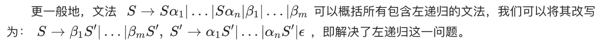

实际上，我们实现 `Recursive Descent Parsing` 时，在 3.2.2 小节中展示的步骤之前，我们需要首先将文法改写成没有左递归的形式。

### 3.2.4 总结 ¶

`Recursive Descent` 是一种非常简单而且通用的方法，因为其过程比较简单，且虽然左递归需要提前消除，但是消除左递归的过程是比较简单的，而且可用算法自动完成。在实际操作中，人们通常手动将左递归消除，因为编译器的设计者需要知道 `parser` 使用何种文法，且消除左递归是容易的。

由于 `Recursive Descent` 需要 `backtrack`，在过去被人们认为非常低效，因此不很常用；在如今的机器上 `Recursive Descent` 是非常快速和简单的，因此在如今非常流行。例如 `gcc` 就用到了手写的 `Recursive Descent`。

## 3.3 LL(1) Parsing ¶

预测分析 (`Predictive Parsing`) 也是一种 `Top-Down Parsing`，它通过查看当前输入位置之后的几个 `token` 来决定使用哪一个 `production`，从而避免了 `backtracking`。提前偷看。避免了回溯。

预测分析器可以用于处理 `LL(k)` 文法，`LL(k)` 各部分的含义是：

+   第一个 `L`：`left-to-right scan of input`

+   第二个 `L`：`leftmost derivation`

+   `k`：`predict based on k tokens of lookahead`

我们这里讨论 `LL(1)` 文法，即通过查看当前 `token` 之后的一个 `token` 就能决定使用哪个 `production` 的文法。

### 3.3.1 思路 ¶

对于 `Recursive Descent`，每一步有多种可选的 `production`；`Backtracking` used to undo bad choices.

对于 `LL(1)`，每一步只会有一个或零个 (`error state`) 可以选择的 `production`。由于 "`LL`"，因此实际上我们每次只需要将最左端的 `non-terminal` 用一个 `production` 的右端替换；而 "`(1)`" 要求我们只查看输入中的 1 个 `token` 就可以知道使用哪一个 `production`；即：每一个 `production` 右端的第一个 `terminal` 是唯一的。在这样的条件下，我们可以通过不断的展开和查看 `production` 来完成 `token` 流的语法分析。

这一要求对大多数文法来说是不能满足的，但是我们可以通过一些方法来满足这一要求。

### 3.3.2 提取左因子 | Left Factoring ¶

我们仍然讨论 3.2 中用到的文法： `E -> T+E | T` , `T -> int | int*T | (E)`

我们发现一个 `non-terminal` 的 `production` 的右端以相同的符号开始，那么我们可以通过 `left factoring` 解决这一问题，即提取相同的开始符号，并将剩下的部分用一个新的 `non-terminal` 来代替，如 `E -> T+E | T` 可以改写为 `E -> TX` , `X -> +E | ϵ` 。类似地， `T -> int | int*T | (E)` 改写为 `T -> intY | (E)` , `Y -> *T | ϵ` 。

### 3.3.3 预测分析表 | Predictive Parsing Table ¶

如我们之前所说，我们需要根据每一个当前最左端的 `non-terminal` 以及 `lookahead` 得到的 `next input token` 来选取唯一的 `production`。因此我们可以通过一个表格来表示这种预测关系，下图是上述文法的对应例子（我们稍后再讨论这张表的建立方式）：

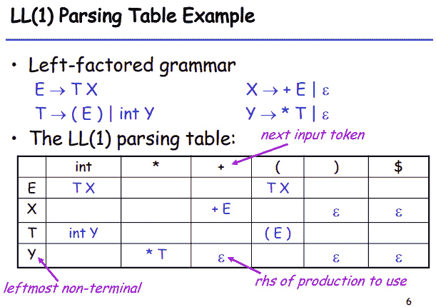

注意表的横纵坐标

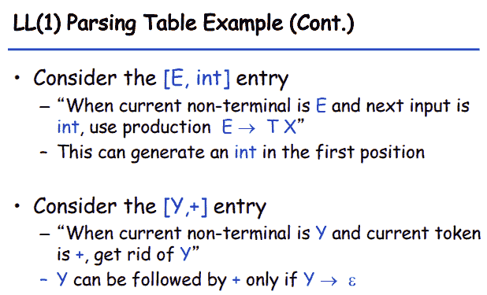

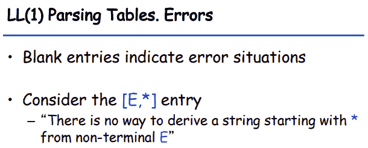

本文中，如果 `Parsing Table` 中 `non-terminal` `A` 和 `terminal` `t` 对应的项目为 `a` ，那么记 `T[A,t] = a` 。

### 3.3.4 使用预测分析表 ¶

由于我们的语法分析过程始终只需要考虑最左端的 `non-terminal`，我们可以用一个栈来存储正在生成的 `parse tree`，栈顶即为 `leftmost non-terminal` 或者即将被匹配的 `leftmost terminal`（如果与输入相同则出栈，如果不同则说明出现了语法错误）。如果出现了 `error state`，则也说明出现了语法错误；如果栈为空且输入结束，则语法分析成功结束。

下面是 `LL(1) Parsing` 的算法：

```
initialize stack = {S, $}
repeat
    case stack.top of
     X: //non-terminal
            if T[X, *next] = Y1...Yn then
                pop X
                push Y1...Yn onto stack
          else
                error()
     t: //terminal
            if t == *next++ then
                pop t
          else
                error()
until stack == {}
if *next
    error()
else
    accept()
```

其中：

+   Line 1, 14： `S` 是 `Start Symbol`，`$` 是输入的末尾，如果最终 stack 为空，说明栈为空（除了 `$` ）的同时输入到达结束，即 `parsing` 被接受。

+   Line 3：当栈非空时，我们不断进行这一工作：检查栈顶是 `non-terminal` 还是 `terminal`，如果：

+   为 `non-terminal`，那么根据该 `non-terminal`（即 `leftmost`）以及输入的下一个 `token`（即 `*next` ）在 `Parsing Table` 中进行查找，如果该项为空说明出现错误（Line 7~8）；否则将表中的对应内容，即 `T[X, *next]` 压入栈顶，即栈从 `{X, rest}` 变为 `{Y1, ..., Yn, rest}` 。`Production` 右端的 `leftmost symbol` 成为新的栈顶。

+   为 `terminal`，这种情况与之前的 `Recursive Descent` 中对 `terminal` 的处理一致。

+   匹配的话，都移出

+   不匹配的话，错误

下面是一个例子：

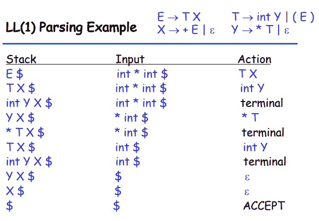

`E int ->TX`

`T int -> int Y`

然后 `stack` 和 `input` 都是 `int`，可以把 `int` 移出去

### 3.3.5 构造预测分析表 ¶

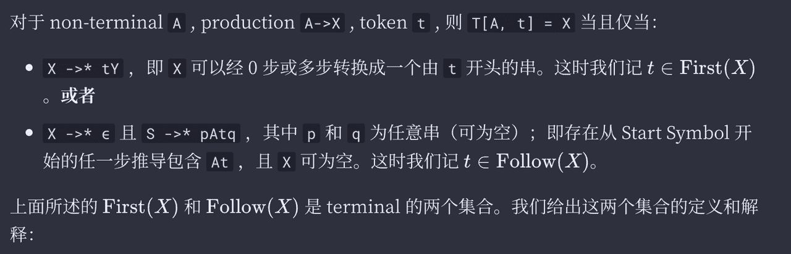

+   要么多步之后，里面能包含

+   要么多步之后，就是空，但是下一个是包含

#### 3.3.5.0 Nullable sets

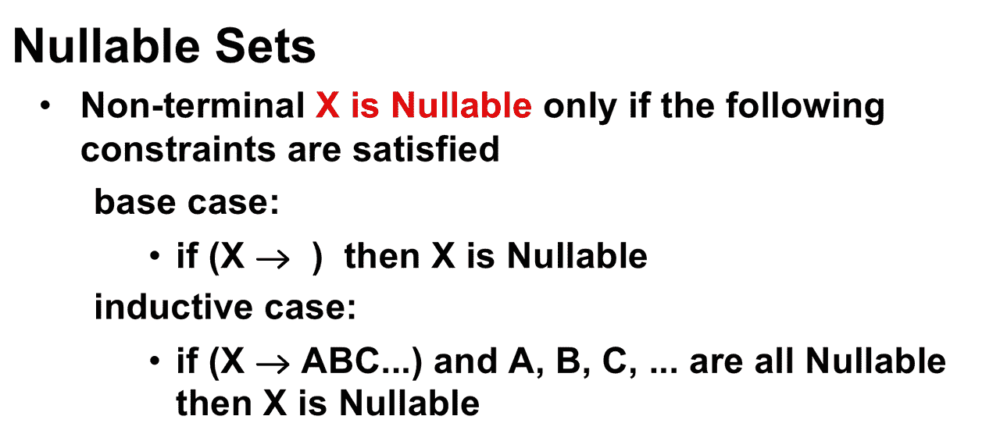

可空是可以传递的

> 理解就是 `eposilon`

#### 3.3.5.1 First Sets ¶

对于 `terminal` 可以看出之后会包含的是什么，但是对于 `non-terminal` 没有那么简单，所以需要 `First Sets`

+   多步生成的情况，可能有哪些开头

但是还有一种情况，比如 `A->BC`，如果 `B` 有 `epilsion`，则我们用 `Follow(B)` 来表示，可能有哪些开头

+   要么多步之后，就是空，但是下一个是包含

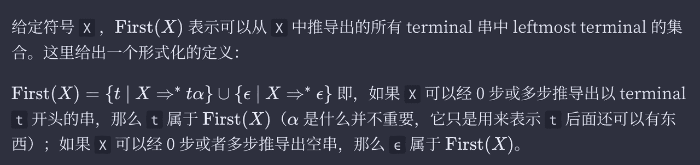

我们可以按照如下思路计算出 `First Sets`：


举个例子，我们仍然研究刚刚的文法：


+   要么是 `T` 开头

+   要么是 `T` 是空，然后 `X` 开头

一般地，对于一个非终结符 `X` ，计算它的 `First` 集合的算法是：（Ref： [Link](https://github.com/amirbawab/EasyCC-CPP/blob/2bba922715d442ad250997bed6116d98fa1418bc/src/syntax/grammar/Grammar.cppL270)）

```
/* 遍历所有 production。即，在以这个 Non-terminal 为左端的一个 production 中：*/

If epsilon not found in the first set of the current token or
the current token is the last one in the production, then add all
the tokens to the first set and don't continue evaluating the next tokens
Example 1:
     A -> B C D
     B -> 'T1' | 'T2'
     ...
Then First(A) contains First(B)
Example 2:
     A -> B C D
     B -> EPSILON | 'T1'
     C -> 'T2' | 'T3'
     ...
Then First(A) contains First(B)-{EPSILON} U First(C)
Example 3:
     A -> B C D
     B -> EPSILON | 'T1'
     C -> EPSILON | 'T2'
     D -> EPSILON | 'T3'
     ...
Then First(A) contains First(B)-{EPSILON} U First(C)-{EPSILON} U First(D).
Note that in Example 3, EPSILON will be in First(A)
```

我们遍历每一条 `production`。对于每一条 `production`，记左边的 `non-terminal` 为 `X`，我们遍历其右边的 `tokens`：


#### 3.3.5.2 Follow Sets ¶

对于 `terminal` 可以看出之后会包含的是什么，但是对于 `non-terminal` 没有那么简单，所以需要 `First Sets`

+   多步生成的情况，可能有哪些开头

但是还有一种情况，比如 `A->BC`，如果 `B` 有 `epilsion`，则我们用 `Follow(B)` 来表示，可能有哪些开头

+   要么多步之后，就是空，但是下一个是包含

> `X` 是 `non-terminal`


一般地，对于一个非终结符 `X` ，计算它的 `Follow` 集合的算法是：（Ref： [Link](https://github.com/amirbawab/EasyCC-CPP/blob/2bba922715d442ad250997bed6116d98fa1418bc/src/syntax/grammar/Grammar.cppL335)）


```
/* 遍历所有 production 右边的每一个 token。即，对于每个 production 中出现的每个 token： */

// If the current token is a non-terminal then iterate on the next token
// and add its first set to the follow set of the current token except for
// the epsilon value. If the first set had an epsilon value, then the next token
// needs to be evaluated as well. This repeats until no epsilon is found or if
// there are no more tokens in the production, which in that case the follow set
// of the LHS is added to the follow set of the current token.
// Example 1
//        A -> B C D
//        Follow(A) = {'T1'}
//        First(C) = {'T2', EPSILON}
//        First(D) = {'T3'}
// Then Follow(B) contains First(C)-{EPSILON} U First(D)
// Example 2
//        A -> B C D
//        Follow(A) = {'T1'}
//        First(C) = {'T2', EPSILON}
//        First(D) = {'T3', EPSILON}
// Then Follow(B) contains First(C)-{EPSILON} U First(D)-{EPSILON} U Follow(A)
```


Inductive case两种可能同时存在

若`A`是一个`N`，那么`Follow(A)`由`T`和`$`组成。

①若`A`是`$`，直接进入`Follow(A)`

②若存在产生式`B→ `，则`First( )-{ }`在`Follow(A)`中

③若存在产生式`B→ `，且 在`First( )`中，则`Follow(A)`包括`Follow(B)`

PS：③更常见的情况是`B→ `，那么`Follow(A)`包括`Follow(B)`

#### 3.3.5.3 Construct Predictive Table ¶

根据我们计算出的`First Sets`和`Follow Sets`，我们可以通过如下算法构造出该文法的预测分析表：


case：


#### 3.3.5.4 例子 ¶

下面是课本中的一道例题，展示了**去除左递归**、计算`First`和`Follow Set`、构造`LL(1) Parsing Table`和使用`Parsing Table`的过程。


solution

a. Production `lexp-seq -> lexp-seq lexp | lexp` is left-recursive. We rewrite it to be: `lexp-seq -> lexp seq` , `seq -> lexp seq | EPSILON` . That is, the grammar after removing the left recursion is:

```
lexp -> atom | list
atom -> number | identifier
list -> (lexp-seq)
lexp-seq -> lexp seq
seq -> lexp seq | EPSILON
```


> `seq`的）需要考虑`follow set`，因为`seq`的`first set`里面有`eposilon`


### 3.3.6 LL(1) Grammar ¶

> `LL(1)`不能左递归

如果在如上述方法构造出的`LL(1) Parsing Table`中的每一格都至多有 1 个`production`，那么对于每一个`current non-terminal`和`next input token`的组合，都有且仅有一种情况（一个`production`或者`error state`）与之对应。这样的文法能够利用`LL(1)`完成预测分析，我们称这个文法是`LL(1)`的。

证明是不是`LL(1)`，就给出表，如果每个都最多只有一个，是能够明确的，就是。

解决方法：

> 语法本身是二义的，仍然无法解决其二义性

+ **去掉左递归**

等价地，一个文法是`LL(1)`的，如果：

1. For every `production` `A→α1|α2|...|αn` , `First(αi)` ∩ `First(αj)` is empty for all i and j, 1 ≤ i, j ≤ n, i ≠ j.

2. For every `non-terminal` `A` such that `First(A)` contains `EPSILON` , `First(A)` ∩ `Follow(A)` is empty.

一些相关的问题和参考回答

a. No. For each possible pair of `non-terminal` on the top of the stack (i.e. leftmost `non-terminal`) and the input `token` (i.e. the pending `terminal`), there is at most 1 `production` to use. So it's impossible for an input string to get 2+ different parsing trees. So `LL(1)` grammar must not be ambiguous.

b. No. If the grammar is ambiguous, then there must be some points where 2+ choices are available, which means that there will be 2+ `production`s in an entry of the `parsing table`. But this violates the definition of `LL(1)` grammar. So no ambiguous grammar can be `LL(1)`.

c. No. Left-recursive grammars or grammars without left-factoring may be unambiguous but they are still not `LL(1)`. Other grammars which are complex enough maybe also not `LL(1)`. In fact, most programming language `CFG`s used now are not `LL(1)` because of their complexity.

## 更多练习 ¶

### 2021 MidTerm ¶


### 2018 MidTerm ¶


做题时，`first`是先看右边是`terminal`的`non-terminal` `production`

`follow`是先看`start symbol`；然后根据`production`推


此部分介绍 `自底向上分析` (`Bottom-Up Parsing`) 以及 `Yacc` 的有关内容。

## 3.4 自底向上分析 | Bottom-Up Parsing ¶

所谓 `自底向上分析 (Bottom-Up Parsing)` ，就是从输入的 `token` 流一步步简化为 `start symbol`。`Bottom-Up Parsing` 相较 `Top-Down Parsing` 而言更加通用，而且并没有牺牲性能。`Bottom-Up Parsing` 的思路基于我们之前讨论过的 `Top-Down Parsing` 的相关思路。

同样的，我们首先讨论 `Bottom-Up Parsing` 的过程，稍后再讨论这些过程具体是怎么实现的，例如 `parser` 如何知道在什么情形下使用哪条 `production`。

我们看这样一个例子，其左边一列是输入的 `token` 流一步一步被 `规约 (reduce)` 到 `start symbol` 的过程，其右边一列是每一步用到的 `production`。注意：自底向上分析使用 `production` 时是将 `production` 的 `rhs` 转换为 `lhs`：


从下往上查看分析过程，我们可以发现一个重要事实： 自底向上分析是最右分析的一个逆过程 。


我们进一步可以注意到：所有操作都会发生在 `|` 紧邻的左右两边。实际上，只会有 2 种操作产生：

1. `Reduce` ，规约：将 `|` 左边的一些 `token` 用某条 `production` 转换为一个 `Non-terminal`；

2. `Shift` ，移进：将 `|` 右移一位，即将下一个 `terminal` 纳入考虑。

因此，上面的例子实际上就是：


我们容易想到，这个分析过程用**栈**很容易实现。我们将 `|` 左边的部分存在栈中，那么 `reduce` 操作就是将栈顶的若干个元素（对应某个 `production` 的 `rhs`，也有可能是 0 个）`pop` 出来，然后 `push` 相应 `production` 的 `lhs`；而 `shift` 操作就是读取输入 `token` 流中的一个 `terminal` 并将其 `push` 到栈顶。

在**一个状态下**，`parser` 可能会有多种可选的操作，既可以 `reduce` 也可以 `shift`，这称为一个 `shift-reduce conflict`；有时还可能有多个可选的 `reduce` 方式，这称为一个 `reduce-reduce conflict`。这些冲突通常表明语法存在一定问题，当然也可以通过定义优先级的方式进行解决。我们将在后面讨论相应的解决方法。

### Viable Prefix ¶


## 3.5 LR(0) Parsing ¶

[这篇博客](https://www.xiaoheidiannao.com/LR0-Analysis-Table-Construction-Algorithm.html)[是使我学明](https://www.cnblogs.com/bryce1010/p/9387114.html)白 `LR(0)` 分析表构造的关键博客； [这篇博客](http://leaver.me/2012/05/14/%E4%B8%80%E4%B8%AA%E7%AE%80%E5%8D%95%E5%AE%9E%E4%BE%8B%E7%9A%84lr%E5%88%86%E6%9E%90%E8%BF%87%E7%A8%8B/) 是使我理解这张表怎么用的关键博客（3.5.3 中的伪代码也基于此处更改）； 这篇博客 中有一个具体的示例演示这张表的用法。

`LR(0) Parsing` 是 `Bottom-Up Parsing` 的一种。`LR(k)` 表示 `Left-to-Right Scan`, Rightmost Derivation, Predict Based on k Tokens of Lookahead。

### 3.5.1 LR(0) Item ¶


`LR Item`：凑的进度

我们希望最后凑成`.`在最右边，然后就可以规约了

`NFA`构造算法


### 3.5.2 LR(0) Parsing Table 的构造 ¶

我们会看到，`LR(0) Item` 之间会有一些转换关系。例如：


在


需要引入`eplision`过渡，就变成一个`NFA`了


那么，对于我们提出的例子，其 `NFA` 就是：进一步地，我们将 `NFA` 转换为 `DFA`：


当遇到`S`的时候有多种展开方式

我们可以据此构造出一个 `LR(0) Parsing Table`：


`reduce`有两个参数，根据第几条`production`，进入到某个状态

`reduce`是`pop`一堆，然后`push`一个`non-terminal`；一个状态，如果有类似`S->.`这样的，其实无论输入什么都会`reduce`，所以一行都写`reduce`

`Goto`是读入`S`（`non-terminal`），然后执行，根据下面创建方式的第二条

其中，`sk` 表示将对应的 `terminal` 压栈，然后移到到状态 `k`；`gk` 表示将对应的 `non-terminal` 压栈，然后移到状态 `k`；`rk` 表示用第 `k` 条 `production` 规约，这里 `r1`, `r2`, `r3` 分别为 `S'->S`, `S->(S)S`, `S->EPSILON`，然后`goto`哪个状态；`accept` 表示接受。


我们可以发现，我们建立的表中 `T[1, "("]`, `T[3, "("]`, `T[5, "("]` 这三项被标红，因为这些表项中有不止一个操作，这说明这里出现了冲突。这三项均为 `shift-reduce conflict`。这说明，这个文法并不是 `LR(0)` 文法。（由此可见 `LR(0)` 文法太弱，不是很有用。但是这会为后面的文法学习打下基础。）

+ `s-r conflict`：包含了完整项的状态不能包含任何其他项目，否则`s-r`冲突

+ `r-r conflict`：两个完整项共存则出现`r-r`冲突

+ `LR(0)`文法不可能是二义的

### 3.5.3 LR(0) Parsing Table 的使用 ¶

这里使用的 `LR(0) Parsing Table` 应当是一个没有冲突的表，即必须对 `LR(0) Parsing Table` 进行分析。

在使用 `LR(0)` `Parsing Table` 进行分析时，我们维护 2 个栈，分别存储当前分析的 `token`（就像 3.4 中我们讨论的那样）以及每个 `token` 对应的状态编号，我们称为 `token` 栈和状态栈。


`shift` 操作的实现是十分容易理解的：将当前 `terminal` 压入 `token` 栈，将 `sk` 指示的状态 `k` 压入状态栈即可。但对于 `reduce` 操作（假设操作为 `rj` ，对应 production 为 `A->β`），那么我们需要首先将两个栈 `pop` 出 `|β|`（`β` 中 `token` 的个数）项，然后查看 `pop` 后 栈顶的状态 `S`，查看 `T[S, A]` 的值即 `gk`，然后将 `A` 压入 `token` 栈，`k` 压入状态栈。

+   `shift`：压入`token`栈
+   `goto`：`state`栈
+   `reduce`：将两个栈`pop`出`|β|`项，再看栈顶状态

具体算法的伪代码如下：

```
置 ptr 指向输入串 w 的第一个符号
令 Si 为状态栈顶的状态
a 是 ptr 指向的符号，即当前输入符号
WHILE(1) BEGIN
  IF T[Si, a] = Sj THEN
    BEGIN
      PUSH (j, a)                           // 将 j 压入状态栈，将 a 压入 token 栈
      ptr++
    END
  ELSE IF T[Si, a] = rj THEN    // rj 为 A->β
    BEGIN
      pop |β| times
      若当前栈顶状态为Sk
      push (T[Sk, A], A)            // 如果 T[Sk, A] 为空也应返回一个错误
    END
  ELSE IF T[Si, a] = accept THEN
    return 0
  ELSE 
    return -1
END
```

我们说这种分析法为 `LR(0)`，是因为我们 实际上 没有进行 `look-ahead`（虽然在上述的伪代码中我们做了这件事）：所有的 `reduce` 操作实际上是与状态绑定的，而不是与 (状态, 输入) 对绑定的。因此我们在读取当前符号之前，就知道应该 `reduce` 还是应该 `shift` 了，而如果是 `shift`，则可以认为是读入当前符号以后再做判断，也就是说从理论上讲我们没有（或者说不必）做任何 `look-ahead`。

## 3.6 SLR(1) Parsing

`SLR(1)` 中的 `S` 表示 `Simple`。`SLR(1) Parsing` 在 `LR(0)` 的基础上通过简单的判断尝试解决冲突。`1`表示看了`1 bit`

`SLR(1)` 在如 3.5.2 那样生成了 `LR(0)` `DFA` 后，计算每一个 `non-terminal` 的 `Follow Set`，并根据这两者创建 `SLR(1)` 分析表。

我们继续使用 3.5 小节的例子： `S'->S` , `S->(S)S` , `S->EPSILON` 。那么，`FOLLOW(S')` = `{$}`，`FOLLOW(S)` = `{')', $}`。


对于我们的例子，我们可以构造如下的 `SLR(1) Parsing Table`。可以发现，我们已经消除了 `conflict`。


可以发现，与 `LR(0)` 不同的是，`SLR(1)` 的 `reduce` 不再只与状态有关，我们需要提前观看下一个符号从而判断进行什么样的 `shift` 或 `reduce` 操作。

如果这样构造出的 `SLR(1) Parsing Table` 没有含冲突的表项，那么称这个文法为 `SLR(1) Grammar`，否则不是。

`SLR(1) Parsing Table` 的使用方法与 3.5.3 完全一致，可以使用一样的伪代码。

+   `SLR(1)`不可能是二义性

## 3.7 LR(1) Parsing

`LR(1)` 在 `SLR(1)` 的基础上进行了进一步优化。


`Lookahead symbol`

+   `LR(1) items`：`[]`前面是`LR(0)`项，后面是`lookahead token`

+   `LR(1)`的起始状态[`S’→·S,$`]的闭包

例如下面这个例子：

```
S'-> S
S -> aAd
S -> bBd
S -> aBe
S -> bAe
A -> c
B -> c
```

`Start Symbol` 有 `LR(1) Item` `S'->.S`, `$` ，并可以通过此推出如下 `State 1` 中的 `items`。其余推导略同，下面是 `LR(1) DFA`：


如果以此法构造出的 `Parsing Table` 没有冲突项，则说明文法是 `LR(1)` 的，否则不是。

既有`shift` 和 `reduce` 就会冲突

`DFA`里，找`reduce`的情况，看看有没有关于`lookhead symbol`的`shift`


`LR(1)`文法不可能二义性

## 3.8 LALR(1) Parsing

可以看到，`LR(1)` 的状态有点太多了。在刚刚提出 `LR(1)` 的那个年代，如此大的空间需求还是不太现实的。因此，`LR(1)` 的简化版本 `LALR(1)` (`Look-Ahead LR(1)`) 被提出了。


但是，这有时（虽然很少）也可能引入 `reduce-reduce conflict`，例如 3.7 最后的例子的 `LALR(1)` `DFA` 是：


注意到合并后的状态 `5&6`，会存在 `reduce-reduce conflict`。这说明这个文法不是 `LALR(1)` 文法。

根据 `DFA` 可以构造 `LALR(1) Parsing Table`，其方法与 `LR(1)` 完全一致，在此不再赘述。同样地，如果构造出的 `Parsing Table` 没有冲突项，则说明文法是 `LALR(1)` 的，否则不是。


+   如果文法是`SLR(1)`，那么必然是`LALR(1)`

+   `LR(1)`比`LALR(1)`或`SLR(1)`更早检测出错误；`LALR(1)`和`SLR(1)`都比`LR(0)`更早

## 3.9 Yacc：LALR(1) 语法分析器的生成器

我们在 2.6 `Lex`：词法分析器的生成器 中学习了 `Lex` 的使用。我们从本章的学习中发现词法分析器的生成同样是一个相当机械而复杂的过程。因此前人也设计了生成 `Parser` 的程序，这里我们用到的是 `Yacc`。

`Yacc` 需要和 `Lex` 结合使用，除非我们在其中自己编写 `yylex()` 函数。

## 习题

### LR(0) & SLR(1)

Example

5.8 Consider the following grammar

```
declaration → type var-list
type → int 
  | float
var-list → identifier, var-list 
    | identifier
```

a. Rewrite it in a form more suitable for bottom-up parsing. b. Construct the `LR(0)` `DFA` for the rewritten grammar. c. Construct the `SLR(1)` parsing table for the rewritten grammar.

solution

a. Add a start symbol and remove the right recursion:

```
S -> declaration
declaration -> type var-list
type -> int
type -> float
var-list -> var-list, identifier
var-list -> identifier
```

b. The `LR(0)` `NFA` is as follows:


We can simplify the `NFA` and get the requested `DFA`:

Therefore, the follow set of each `non-terminal` is:

So we can construct the `SLR(1)` `Parsing Table` with the `DFA` and follow sets:


## 4 Semantic Analysis | 语义分析

语义分析阶段的任务是：构造符号表，将变量的定义和它们的在作用域中的各个使用联系起来，在表达式中进行类型推断和类型检查以保证其正确性等。

我们这里提到的语义分析是 静态语义分析，即对上述内容的检查，而不包含可能的逻辑错误，如死循环、除以 0 等情况。

### 4.1 属性文法 相关依赖图

#### 4.1.1 属性 & binding

属性 (attributes) 包括编程语言组件的任意特性。例如，标识符的属性就包括其种属（变量、数组、函数名等等）、数据类型、存储位置、长度、值、作用域等。

属性的确定时间是有多种可能的。属性值的计算以及将计算出来的值与相关的语言结构进行联系的过程称为`binding`，发生的时间称为 `binding time`。在程序执行之前就进行 `binding` 的属性称为 `static attributes`；在程序执行过程中才进行 `binding` 的属性称为 `dynamic attributes`。

#### 4.1.2 语义规则 & 属性文法

属性文法对文法的每一个产生式都配备了一组属性的属性等式（`attribute equation`，或称 `语义规则` `semantic rule`），对属性进行计算和传递。

【例 1】 例如，看下列简单的整数算术表达式文法：


它的属性文法是：


其中 `val` 即为一个属性，表示 `factor`, `exp`, `term`, `number` 的数字值。需要注意的有如下几点：

+   在第一对文法规则和对应的语义规则（如下图）中，两个 `+` 的含义不尽相同。文法规则中，`+` 只是一个语义符号，而语义规则中，这是一个普通的算术加运算符。对于其他的语义规则也同理。

+   同样在这对文法规则中，我们对 `exp` 的两次出现进行了编号，这是因为两个 `exp` 并非同一个，因此也具有不一样的值，需要在此进行区分。

+   `number` 没有出现在等式的左边过，这说明我们需要在任意一个使用这个属性文法的语义分析前计算 `number.val`。

#### 4.1.3 相关依赖图

我们需要考虑的是，在进行语义规则中的赋值操作之前，赋值符号右边所用到的所有值应当是已经存在且有效的；这一要求在语义规则中并没有很好地体现出来。为了解决这个问题，我们需要为属性的赋值寻找一个顺序。

每一个赋值语句本身指明了一个运算时的顺序，我们可以用一个 `Associated Dependency Graph` 来指示每一个文法规则的依赖关系。

【例 2】 例如对于文法规则 `number(1) → number(2) digit` ，其对应的语义规则只有一条 `number(1).val = number(2).val * 10+ digit.val` ，则依赖图为：


即，我们使用箭头来表征这种依赖关系。箭头所指的属性应当 后于 箭头出发的属性被计算。

由于图形化表示可以区分同一 `token` 的不同出现，我们对于重复的符号可以省略下标。

如果结合 `number → digit` 这一规则，我们可以给出一个字符串 `345` 的语法树和相关图：


#### 4.1.4 将语法树和相关图结合起来

【例 3】 语义规则与文法规则在形式上不一定十分相似。考虑下面这个变量声明的简单文法：


其属性文法是：


这里属性 `dtype` 是变量或者变量列表的数据类型。可以看到，在第一条文法规则中，`decl` 并没有出现在对应的语义规则中；而倒数第二条文法规则则对应了两条语义规则。

我们继续基于这个文法考虑其依赖关系。注意倒数第二条文法规则，其对应的相关图是：


这个相关图与例 2 中的相关图的箭头方向相反，因为例 2 中的属性是从 `lhs` 向 `rhs` 传递的，而这里相反。

另外，第一条文法规则对应的语义规则中没有出现 `decl`，但是我们仍然要将其表示在相关图中，从而保证文法规则在上面得到完整体现。因为这一考虑，我们一般会在语法树上绘制相关图。这个文法规则的语法树片段以及在其上绘制的相关图为：


实际上，这里的虚线是语法树的构成部分，而箭头才表示依赖关系。我们可以看到，在这种表示方法中，我们不使用 `.` 来标识属性和语法树结点的从属关系，而是将对应的属性写在相关结点的旁边。

这样，倒数第二条文法规则的相关图画为：


作为一个例子，字符串 `float x, y` 的相关图是：


#### 4.1.5 考虑多个属性的情况 & 元语言

【例 4】 我们考虑一个表示 8 进制或 10 进制数的文法。我们用后缀 `o` 表示这个数是 8 进制数，后缀 `d` 表示这个数是 10 进制数。这个文法是：


需要注意的是，形如 `189o` 的数是可以被这个文法接受的，但是这并不是正确的，因为 8 进制数重不应当包含数字 `8` 或 `9`。我们当然也可以通过重新设计这个文法来解决这一问题，但是这样的结果是复杂的。我们现在使用语义分析来解决这个问题。其对应的属性文法是：


这里使用到了 `if...then...else...` 表达式，其含义是清晰的。

在属性文法中，如我们之前用到的算术表达式以及 `if...then...else...` 表达式等允许出现的表达式的集合称作属性文法的 元语言 (`meta-language`)。通常我们希望元语言的内涵尽可能清晰，不致于引起其自身语义的混淆。我们还希望元语言接近于一种实际使用的编程语言，因为在语义分析程序中需要把属性等式转换成执行代码。我们甚至可以在元语言中增加函数，因为这也可以在编程语言中简单地实现。

我们考虑这个文法的相关图。第一条文法规则对应的相关图为：


这个相关图同时表示了两种属性的依赖关系。

文法规则 `num -> num digit` 的相关图为：


其他文法规则类似。最终我们可以画出字符串 `345o` 的相关图：


### 4.2 属性计算算法

#### 4.2.1 相关图的赋值顺序

我们需要找到一个计算顺序，其实就是要找到对应相关图的拓扑序。相关图有拓扑序的前提是它是无圈的 ([`Acyclic`](https://www.yuque.com/xianyuxuan/coding/zd5qu0#9asiq))。拓扑序的定义以及计算算法在 https://www.yuque.com/xianyuxuan/coding/zd5qu0#9asiq 可以找到。

需要注意的是，对于一些没有入度的结点，我们可能需要使用一些直接可用的信息。这些信息可能来自词法分析或者语法分析阶段。

#### 4.2.2 合成属性 & S 属性文法

我们定义一个属性是 `合成` (`synthesized`) 的，如果在语法树中它所有的相关都从子结点指向父结点。即，每一个文法规则中，关于这个属性的语义规则都是 `rhs` 决定 `lhs`。

我们称一个属性文法为 `S 属性文法` (`S-attribute grammar`)，如果它的所有属性都是合成属性。

`S 属性文法`的相关图是一个属性值可以简单地通过自底向上或者后序遍历实现。即：

```
void PostEvaluate(treeNode T) {
    for T 的每一个子结点 C
        PostEvaluate(C);
    
    计算 T 的值;
}
```


【例 1 cont.】 我们考虑 4.1 中例 1 的文法：


这里属性 `val` 是一个合成属性。

我们如果给出如下形式的语法树结构：

```
typedef enum { Plus, Minus, Times } OpKind;
typedef enum { OpKind, ConstKind } ExpKind;
typedef struct streenode { 
    ExpKind kind;
    OpKind op;
    struct streenode *lchild, *rchild;
    int val;
} STreeNode;
typedef STreeNode *SyntaxTree;
```

那么我们可以得到如下形式的递归的计算函数：

```
void postEval(SyntaxTree t) { 
    int temp;
    if (t->kind == OpKind) { 
        postEval(t->lchild);
        postEval(t->rchild);
        switch (t->op) { 
            case Plus:
            t->val = t->lchild->val + t->rchild->val;
            break;
                
            case Minus:
            t->val = t->lchild->val - t->rchild->val;
            break;
                
            case Times:
            t->val = t->lchild->val * t->rchild->val;
            break;
        } /* end switch /
    } / end if /
    else {
        ...
    }
} / end postEval */
```

这里当树结点类型为 `OpKind` ，即算术计算式时，第 4 行和第 5 行首先计算了子结点的值，其次在 `switch` 中计算了该结点的值，这就是一种后序遍历的实现。

#### 4.2.3 继承属性

如果一个属性不是合成的，我们称它是 继承 (inherited) 属性。继承依赖可能有多种形式：


上[图](https://www.yuque.com/xianyuxuan/coding/hcr461#WUKsG)中 c) 的一个例子是我们使用 `First Child Next Sibling` 方法构造语法树的情况（可以在这个文档里https://www.yuque.com/xianyuxuan/coding/hcr461#WUKsG 看到这一方法的含义）。我们将在下面的例子中还会看到其他的情况。

继承属性的计算可以通过对分析树或语法树的前序遍历或前序/中序遍历的组合来进行。与合成属性不同，子孙继承属性计算的顺序是重要的，因为在子孙的属性中继承属性可能有依赖关系。

【例 3 cont.】 我们考虑 4.1 中例 3 的文法：


我们可以通过这样的代码实现属性的计算，这里的树通过 `child[]` 数组保存指向子结点的指针：

```
void evalType(treeNode T) {
    switch (T->kind) {
        case decl:        // 这是一个中序的例子
            // 计算第一个子结点 'type'
            evalType(T->child[0]);        
            // 将 'type' 的 dtype 赋值给 'var-list'
            T->child[1]->dtype = T->child[0]->dtype;
            // 计算第二个子结点 'var-list'
            evalType(T->child[1]);
            break;
            
        case type:        // 根据子结点是 int 还是 float 决定 'type' 结点的 dtype
            T->dtype = T->child[0]->dtype;
            break;
            
        case var-list:  // 这是一个前序的例子
            // 将 'var-list' 的 dtype 赋值给 'id'
            T->child[0]->dtype = T->dtype;
            // 如果第三个子结点 'var-list2' 不为 NULL，
            // 将 'var-list' 的 dtype 赋值给它，并进入计算之
            if (T->child[2]) {
                T->child[2]->dtype = T->dtype;
                evalType(T->child[2]);
            }
            break;
    } // end of switch
}
```


我们也可以考虑通过存储 `sibling` 的方式来存储一串 `id` 结点：

```
typedef enum { decl, type, id } nodekind;
typedef enum { integer, real } typekind;
typedef struct treeNode { 
    nodekind kind;
        struct treeNode *lchild, *rchild;        /* for decl nodes only */
    struct treeNode *sibling;                        /* for id nodes only /
        typekind dtype;                                                / for type and id nodes */
        char *name;                                                        /* for id nodes only */
}  SyntaxTree;
```

对应的 `evalType` 函数为：

```
void evalType(SyntaxTree t) { 
    switch (t->kind) { 
        case decl:
            // id.dtype = type.dtype
                        t->rchild->dtype = t->lchild->dtype;
            evalType(t->rchild);
            break;
                case id:
                        if (t->sibling != NULL) { 
                // id.next.dtype = id.dtype
                t->sibling->dtype = t->dtype;
                evalType(t->sibling);
            }
            break;
        } /* end switch /
} / end evalType */
```

也可以简化为：

```
void evalType(SyntaxTree t) { 
    if (t->kind == decl) {
        // id.dtype = type.dtype
        SyntaxTree temp = t->rchild;
        temp->dtype = t->lchild->dtype;
        
        while (temp->sibling) {
            temp->sibling->dtype = temp->dtype;
            temp = temp->sibling;
        }
    }
} /* end evalType */
```

如果合成属性依赖于继承属性（及其他合成属性），但继承属性不依赖于任何合成属性，那么就可能在分析树或语法树的一遍遍历中计算所有的属性。

继承属性依赖于合成属性的情形更加复杂，需要对分析树或语法树进行多遍遍历。（例 6.14）

#### 4.2.4 语法分析时属性的计算

以前性能有限的时候人们希望能在语法分析的过程中就完成一些属性计算；现在虽然不需要了但是还是要学一学。

我们的语法分析方法都是从左向右处理的，因此如果我们希望在语法分析过程中计算一些属性，那么这些属性一定不可以有向右的依赖。例如对于 `A->XY`，`Y` 可以依赖 `A` 也可以依赖 `X`，但是 `X` 不能依赖 `Y`。例 4 中的文法就不满足这一性质。

我们定义满足这一性质的属性文法为 `L-attributed`。形式化地：


显然，`S-attributed` 的文法都是 `L-attributed` 的文法。

给定一个 `L` 属性文法，对于 `Top-Down` 可以通过把继承属性转换成参数、把合成属性转换成返回值；对于 `Bottom-up`，`LR` 分析适合处理合成属性，对于继承属性很难处理。


#### 4.2.5 将继承属性修改为合成属性 (6.2.6)

定理：(Knuth [1968]) 给定一个属性文法，通过适当地修改文法，而无须改变文法的语言，所有的继承属性可以改变成合成属性。

为什么要修改成合成属性呢？我们之前讨论过，自底向上的分析适合处理合成属性，而很难处理继承属性；我们将继承属性改为合成属性的重要意义就是方便自底向上的分析。

那么如何改写呢？看看例子：

【例 3 cont.】 对于之前的文法规则：


对于倒数第二条文法，其 `rhs` 的 `dtype` 属性是依赖于 `lhs` 的。如果我们重写如下，`dtype` 就是合成的了：


不过实际上并不完全是合成的，例如下面这张图中两个虚线的箭头其实按定义来讲是继承的：


也就是说，这里 `id.dtype = var-list.dtype` 的语义仍然是继承的，因为它们是从产生式左边传递给产生式右边的。

但是为什么这样的传递可以接受呢？回到我们将继承属性修改为合成属性的目的，即方便自底向上的分析。

也就是说，这里所谓“合成”的核心目标只是不希望有递归的向下传递；偶尔的一些继承式的属性传递可以直接在父亲节点中完成。比如 `id.dtype = var-list.dtype` 这样的语义规则虽然是继承的，但是在 `var-list` 这个节点就可以完成，因此也可以在自底向上的过程中完成，并不需要像原先的 `var-list2.dtype = var-list1.dtype` 那样递归下去运算。

（相关练习还有课本习题 6.7）

### 4.3 符号表

对于语法树，外部数据结构最初的一个例子是 符号表 (symbol table)，结合程序中声明的常量、变量和过程存储属性。


采用 `哈希`：


这里面有多个 `i`，因为作用域屏蔽。

这种有冲突就搞个列表的方式叫 `separate chaining` 分离链表法；还有开放寻址法 `open addressing`，就是冲突后找下一个有空的。

多个作用域也可以像这样维护一个符号表栈：


#### 题目选讲

【2008】


### 4.4 类型检查

递归类型：

```
struct intBST
{ 
    int isNull;
    int val;
    struct intBST left, right;
};
```

这个在 `C` 语言是不合法的；但是对于一些其他语言采用类似写法是可以的，因为实际上存的是指针。

在例如函数调用之类的情形中，我们需要检查参数的类型和预先的要求是否相同。这要求我们讨论类型之间的等价性。

+   结构等价                 两个类型当且仅当他们有相同的结构，即语法树时才相同。一般要求数组大小相同、结构体顺序相同，但是也可以不同。

+   名等价                当且仅当两个类型有相同的类型名时才等价。

+   例如，定义 `t1 = int`，`t2 = int`，但是 `t1`、`t2`、`int` 仍然两两不等价

+   说明等价                弱化版的名等价，即别名之间可以等价。

+   在上面的例子中，这三个类型等价。

重载、多态、（隐式）类型转换给类型检查带来了更多工作。

https://github.com/cmcl/tiger

https://github.com/WilliamX1/tiger-compiler


[Compilers-Notes.pdf](https://internal-api-drive-stream.feishu.cn/space/api/box/stream/download/all/G18TbmpORoAKktxoRiAcFiipnQb)


[Tiger_Compiler_Doc.pdf](https://internal-api-drive-stream.feishu.cn/space/api/box/stream/download/all/KhZ0bHeMBoHRpHx0NapczXcUnYf)

# Midterm

https://xuan-insr.github.io/compile_principle/#0-%E5%BC%80%E5%A7%8B%E4%B9%8B%E5%89%8D%E4%B9%8B%E5%89%8D

历年卷

https://www.yuque.com/xianyuxuan/coding/cp_midterm

# Final

https://www.cc98.org/topic/5355540

https://www.yuque.com/xianyuxuan/coding/cp_final
