# 笔记

> 来源：[https://docs.feishu.cn/docx/B8H2dPkkFoePzvxNEk0c8nMTnid](https://docs.feishu.cn/docx/B8H2dPkkFoePzvxNEk0c8nMTnid)

> https://list.zju.edu.cn/kaibu/netsec2023/

# 1 About Class

T**he cours**e** contai**ns three major teaching components; they are lectures, labs OR research practice, and tests including assignments, quizzes, and exams;

## 1.1 定义

基于计算机网络

**共享资源通过communicatio**n（data transmission）

classify分类

+   wired

+   Wireless

According to how many hops the data should transfer from the source to the destination：

Single-hop是指数据从源节点直接传输到目标节点，中间没有其他节点的干扰。Multi-hop是指数据需要通过多个中间节点进行传输，每个节点都将数据转发到下一个节点，直到数据到达目标节点。

+   Single-hop

+   Multi-hop

According to how many paths/routes can the data follow from the source to the destination:

+   Single-path

+   Multi-path

+   Faster

+   可能也意味着更容易被攻击

+   Unicast：一对一

+   需要更安全的加密解密，隔离

+   Multicast：一对组

+   Broadcast：一对所有

Communication services

**confidentiality in**tegrity availability

CIA

Three Common properties to protect is: confidentiality, integrity, and availability

+   **C**onfidentiality | 保密性 (not leaked to unauthorized parties)

+   Integrity | 完整性 (not modified)

+   **A**vailability | 可用性 (keep online, available when needed)

Confidentiality: Confidentiality refers to protecting information from being accessed by unauthorized parties. In other words, only the people who are authorized to do so can gain access to sensitive data.

Integrity: is the maintenance of, and the assurance of the accuracy and consistency of, data over its entire life-cycle, and is a critical aspect to the design, implementation and usage of any system which stores, processes, or retrieves data.

Availability： For any information system to serve its purpose, the information must be available when it is needed. This means the computing systems used to store and process the information, the security controls used to protect it, and the communication channels used to access it must be functioning correctly. High-availability systems aim to remain available at all times, preventing service disruptions due to power outages, hardware failures, and system upgrades. Ensuring availability also involves preventing denial-of-service attacks, such as a flood of incoming messages to the target system, essentially forcing it to shut down.

# 2 DDos

## 2.1 DoS - Denial of Service

+   控制一个机器，向 victim 发送海量 request 以 overload 它，从而使其没有能力满足一些合理的请求

+   flood / overload

+   defence: block the attacking device

+   每层都能 DoS

在计算中，拒绝服务攻击（DoS攻击）是一种网络攻击，其中肇事者试图通过临时或无限期地破坏连接到互联网的主机的服务，使其目标用户无法使用机器或网络资源。拒绝服务通常通过向目标机器或资源提出多余的请求来完成，试图使系统超载，并阻止部分或所有合法请求得到满足。

在分布式拒绝服务攻击（DDoS攻击）中，涌入受害者的流量来自许多不同的来源。这实际上使得仅仅通过阻止单个源来阻止攻击是不可能的。

防御：block the attacking source

## 2.2 DDoS - Distruibuted DoS

+   弄好多个机器，就很难 block 了

### 2.2.1 Symmetric DDoS Attack

#### 2.2.1.1 Ping Flood

**在Ping Flood攻击中使**用的互联网控制信息协议（ICMP）是网络设备用于通信的互联网层协议。网络诊断工具traceroute和ping都使用ICMP操作。通常情况下，ICMP回波请求和回波回复信息用于ping网络设备，目的是诊断设备的健康状况和连接性，以及发送者和设备之间的连接。

一个ICMP请求需要一些服务器资源来处理每个请求和发送响应。该请求还需要传入信息（回音请求）和传出响应（回音响应）的带宽。

Ping Flood是一种网络攻击，它利用了Ping命令来向目标主机发送大量的Ping请求，从而使目标主机过载或崩溃。攻击者通过发送大量的Ping请求，使目标主机不断地响应请求，从而导致网络拥塞和服务质量下降。Ping Flood攻击通常是DDoS（分布式拒绝服务攻击）的一种形式。

Ping Flood攻击的目的是压倒目标设备对大量请求的响应能力和/或用虚假流量使网络连接过载。 通过让僵尸网络中的许多设备用ICMP请求瞄准同一个互联网财产或基础设施组件，攻击流量大大增加，有可能导致正常的网络活动中断。历史上，攻击者通常会伪造一个假的IP地址，以掩盖发送设备。在现代僵尸网络攻击中，恶意行为者很少认为有必要掩盖僵尸的IP，而是依靠一个由未被欺骗的僵尸组成的大型网络来使目标的容量饱和。

Ping (ICMP) Flood的DDoS形式可以分解为两个重复的步骤。

攻击者使用多个设备向目标服务器发送许多ICMP回波请求包。

然后，目标服务器向每个请求设备的IP地址发送一个ICMP回波数据包作为回应。

+   ICMP Echo

+   Echo request & response consume bandwidth

+   消耗其响应能力 或者 网络带宽

+   解决：禁用 ICMP (ping / tracert / etc.)

+   通过禁用目标路由器、计算机或其他设备的ICMP功能，最容易实现禁用Ping flood。网络管理员可以访问该设备的管理界面，禁用其使用ICMP发送和接收任何请求的能力，有效地消除了请求和回声的处理。这样做的后果是，所有涉及ICMP的网络活动都被禁用，使设备对ping请求、traceroute请求和其他网络活动没有反应。

+   不是最终解决方案；没有解决，并且降低效率

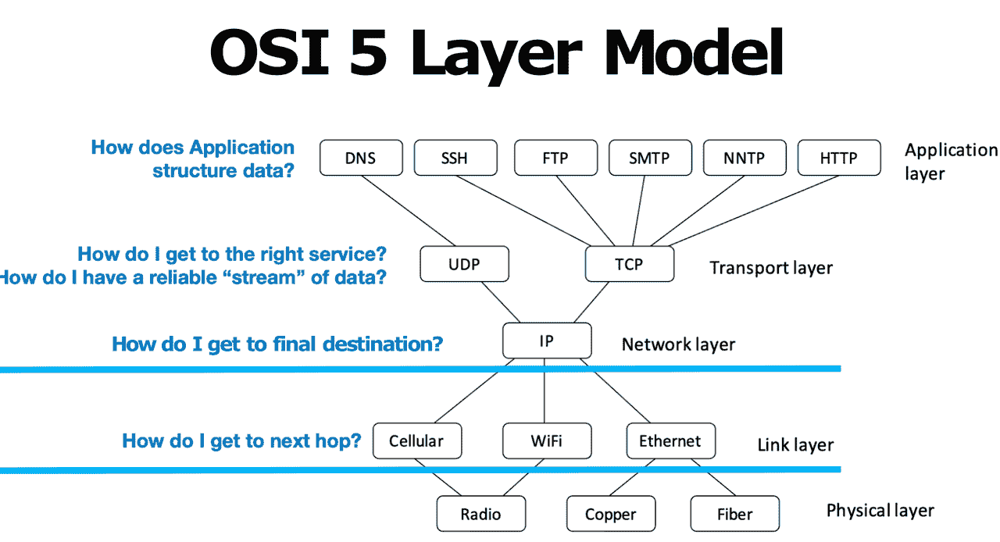

+   link/IP layer: send too much traffic for switches/routers to handle

+   transport layer: require servers to maintain a large number of concurrent connections or states

+   application layer: require servers to perform expensive queries or cryptographic operations

每个层次的协议是不同，目的相同

#### 2.2.1.2 TCP SYN Flood

TCP SYN Flood攻击是一种拒绝服务（DoS）攻击，旨在通过洪泛服务器的TCP连接请求来使其过载，最终使服务器无法处理合法请求。以下是攻击的工作原理：

1.  攻击者使用僵尸网络（即受攻击者控制的网络）向目标服务器发起大量连接请求。

1.  攻击者向服务器发送TCP SYN数据包，但未完成必要的三次握手以建立连接。攻击者会伪造每个数据包的源IP地址，使其看起来像是来自不同的设备。

1.  服务器接收到SYN数据包后，会响应一个SYN-ACK数据包，表示服务器已准备好建立连接。然而，由于攻击者未完成三次握手，服务器会一直等待回应，而无法完成连接。

1.  服务器必须**维护每个未完成的连接请求记录**（称为半开连接），直到超时或关闭，server 会分配资源并加入 SYN queue / SYN backlog 中，而这个队列的容量是比较小的（一般只有 128）。这会占用服务器资源，并可能导致服务器无法接受新的合法连接。

1.  攻击者继续向服务器洪泛SYN数据包，从而超出其处理新请求的能力，并使其无法响应合法流量。

+   优化：**IP Spoofing**，即发送的 SYN 携带的是**随机的 IP 地址（伪造的）****而不是 attack**er 的 IP 地址，这样可以减小攻击者的带宽压力；亲测这样不会发回 RST（看下面的图）

+   为了防止自己的ip地址被禁

+   另外一个思路，让被攻击者的server去伪造成IP然后作为攻击者攻击其他人

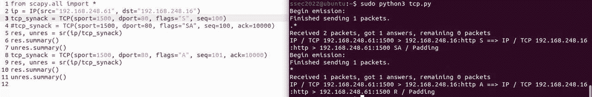

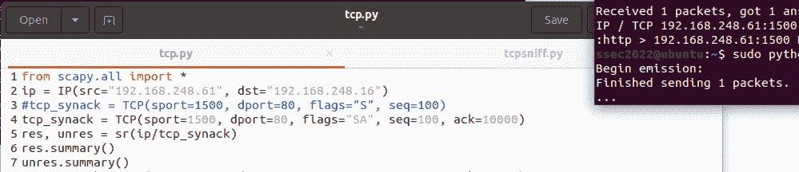

+   现实中难以解决：因为很少检测源头

+   解决

+   增加queue的长度，减少过期时间

+   解决：SYN Cookies

+   SYN Cookies 技术的工作方式是修改服务器响应传入 SYN 包的方式。服务器不再将每个传入的 SYN 包**记录在连接队列中并为每个连接**请求分配服务器资源，而是使用加密算法根据传入包的源 IP 地址、源端口和一个秘密密钥创建一个唯一的 SYN Cookie 值。

+   当服务器**收到客户端发送的后续 AC**K 包时，它使用 SYN Cookie 值来重建原始 SYN 包的参数，并完成连接设置过程。如果 SYN Cookie 值无效，则服务器会丢弃该数据包，因为它很可能是攻击者发送的伪造数据包。

+   通过使用 SYN Cookies，服务器可以在未验证每个传入连接请求之前不分配资源，从而保护自己免受 TCP SYN Flood 攻击的影响，使服务器能够处理大量的连接请求而不会耗尽所有资源。

+   **但是持续计算也很耗资源**

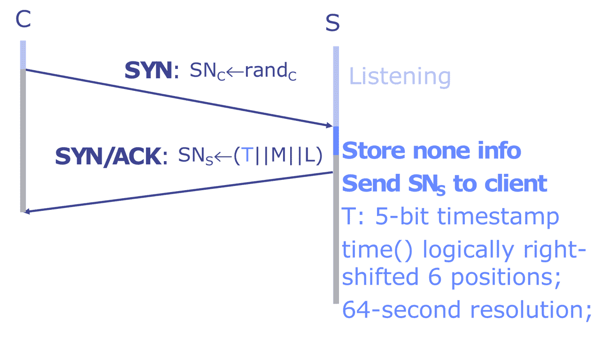

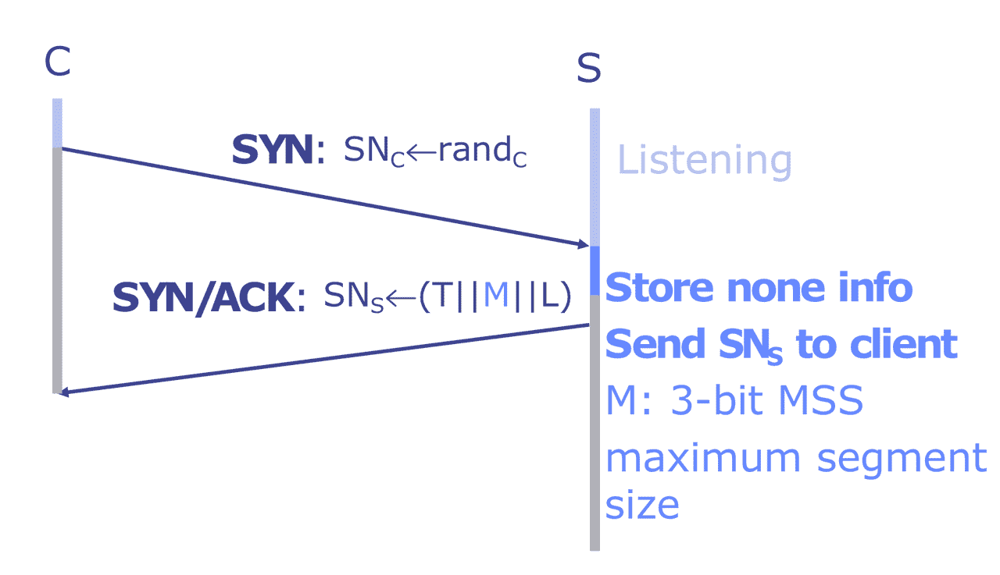

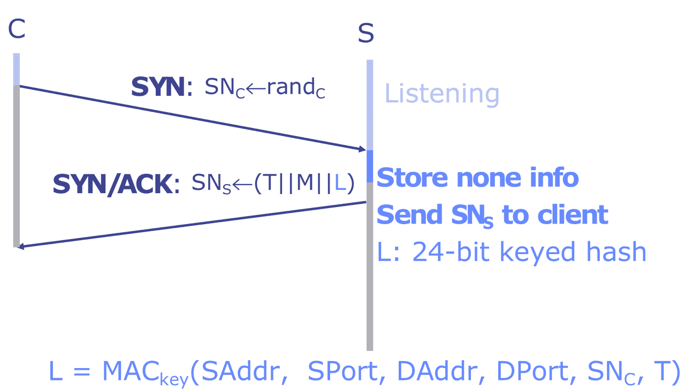

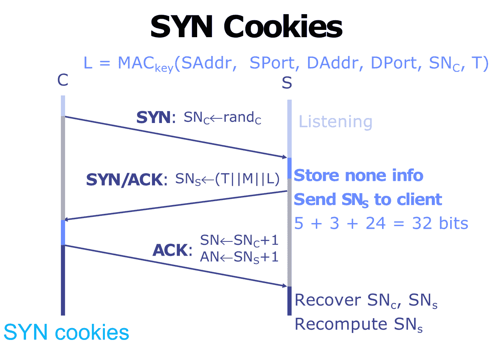

+   验证就重新算一遍，和SNs对比，前提是client发的SNc是对的才能验证成功，不过攻击者不会care这个，也不会造成什么攻击，就是链接不通过

+   TCP SYN Flood Backscatter：指 server 接收到 Spoofed IP 的 SYN 后发回的 SYN + ACK

+   伪造的IP地址收到server发的SYN+ACK之后，不会反应（因为并非那个IP真正发的），以此来检测DDOS

+   可以用来检测 DDoS 攻击

### 2.2.2 Asymmetric DDoS Attack (Traffic Flood) 带宽、通信的角度

+   用较少的资源造成较大规模的攻击

#### 2.2.2.1 Smurf Attack

> S**murf A**ttack（又称Smurf DoS攻击）是一种早期的网络攻击方式，它利用了ICMP（Internet控制消息协议）协议中的“广播地址”功能，向网络中的所有计算机发送大量的ping请求，从而导致网络拥塞和服务不可用。攻击者通常会伪造源IP地址，使得所有的ping响应都被发送到攻击目标的IP地址，进一步增强攻击效果。Smurf Attack通常是分布式拒绝服务攻击（DDoS攻击）的一种形式，可以使用多个计算机或网络节点来进一步增强攻击的强度和持续时间。由于现代网络设备已经禁用了ICMP广播地址功能，因此Smurf Attack已经不再是一个主要的网络安全威胁。

将一个 Echo Request 广播到一个子网去，这个 request 的 IP 被 spoof 成 victim；这个子网的每个 host 都会给 victim 发回一个 reply。

解决：禁用子网的 broadcast，或者拒绝外来的 broadcast packet。

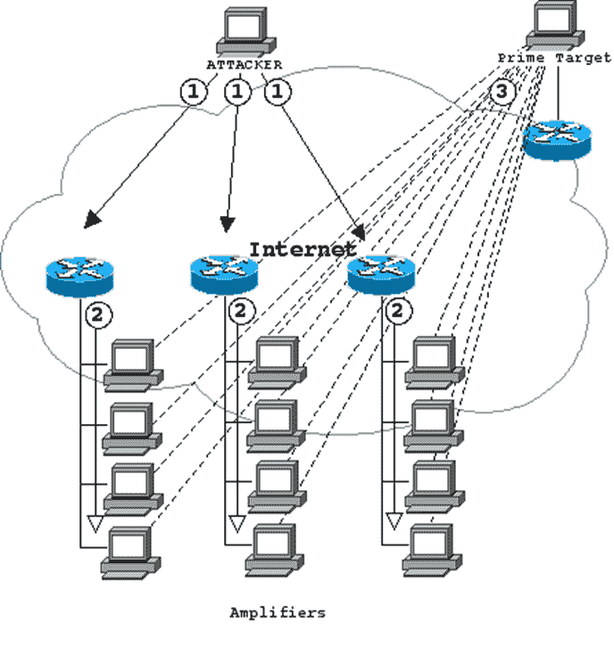

#### 2.2.2.2 DNS Amplification Attack

> DNS放大攻击（DNS Amplification Attack）是一种分布式拒绝服务攻击（DDoS攻击）

> 在这种攻击中，攻击者向互联网上的开放DNS解析器**发送大量的DNS查询，请**求少量的数据，但使用受害者**的伪造IP地址。因此，**DNS解析器将响应发送到受害者的IP地址，使其过载并导致拒绝服务。

> 攻击者利用DNS查询的特性，构造一个较小的查询请求，但是会返回一个较大的DNS响应数据包，这种方式可以将攻击流量放大几倍。

利用 open DNS resolvers，即互联网公开、大家**都可以访问的 DNS ****res****olv**er；利用 DNS 请求的 ANY 类型，可以获取给定名字的所有类型的信息；同样使用 spoofed IP。

Extension mechanism for DNS (EDNS, or EDNS(0)) gives us a mechanism to send DNS data in larger packets over UDP.

一个DNS扩增可以分解为四个步骤。

+   攻击者使用一个被破坏的端点，向一个DNS重定向器发送带有欺骗性IP地址的UDP数据包。数据包上的欺骗地址指向受害者的真实IP地址。

+   每个UDP数据包都向DNS解析器发出请求，通常会传递一个参数，如 "ANY"，以便尽可能地收到最大的响应。

+   在收到请求后，DNS解析器，试图通过响应来提供帮助，向被欺骗的IP地址发送一个大的响应。

+   目标的IP地址收到响应后，周围的网络基础设施就会被大量的流量淹没，从而导致拒绝服务。

解决方案：减少 互联网公开、大家都可以访问的open resolver 的数量，或者认证 src IP，防止 spoofed packet 离开子网（这需要 ISP 来做）。

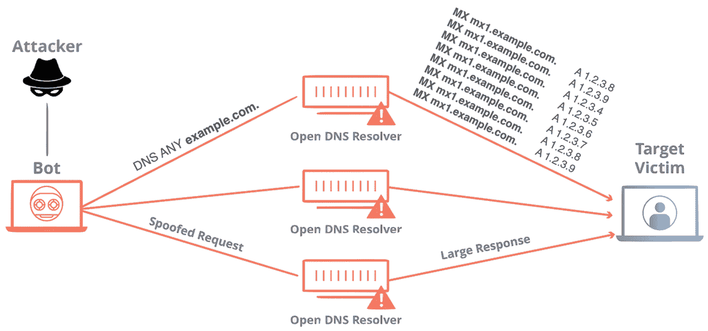

#### 2.2.2.3 NTP Amplification Attack

> NTP放大，很像DNS放大，可以被认为是在一个恶意的青少年打电话给一个餐厅，说 "我要一份所有的东西，请给我回电话，告诉我整个订单。" 当餐馆要求提供回电号码时，给出的号码是目标受害者的电话号码。然后，目标人物就会收到餐厅的电话，其中有很多他们没有要求的信息。

> 网络时间协议是为了让互联网连接的设备同步其内部时钟而设计的，在互联网架构中具有重要功能。通过利用一些NTP服务器上启用的monlist命令，攻击者能够成倍地增加他们最初的请求流量，导致大量的响应。 该命令在旧设备上默认启用，并以向NTP服务器发出的请求的最后600个源IP地址进行响应。一个内存中有600个地址的服务器的monlist请求将比初始请求大206倍。这意味着，一个拥有1GB互联网流量的攻击者可以提供200多GB的攻击--由此产生的攻击流量大量增加。

NTP (Network** Time Protoc**ol) 的 monlist 指令可以获取当前活跃 IP 信息。借此可以实现 DDoS。

一个NTP放大攻击可以分为四个步骤。

+   攻击者使用僵尸网络向启用了monlist命令的NTP服务器发送带有欺骗性IP地址的UDP数据包。每个数据包上的欺骗性IP地址都指向受害者的真实IP地址。

+   每个UDP数据包都使用monlist命令向NTP服务器发出请求，从而产生一个大的响应。

+   然后，服务器用**产生的数据**对被欺骗的地址进行响应。

+   目标的IP地址收到响应后，周围的**网络基础设施**就会被大量的流量所淹没，从而导致拒绝服务。

解决：减少支持 monlist 的 NTP Server，或者认证 src IP，防止 spoofed packet 离开子网。

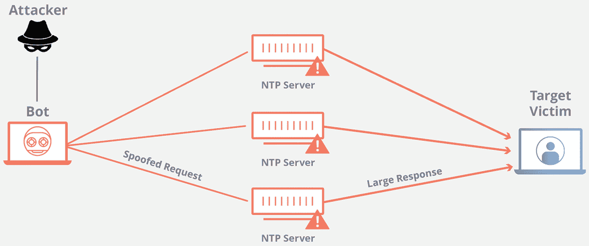

#### 2.2.2.4 Memcached Attack

> Memcached攻击的操作与所有DDoS放大攻击类似，如NTP放大和DNS放大。该攻击的工作原理是向一个易受攻击的服务器发送欺骗性请求，然后用比初始请求更大的数据量进行响应，放大流量。

Memcached服务器是一种用于缓存数据的开源软件，可用于提高Web应用程序的性能和响应速度。它通常用于缓存数据库查询、API调用和页面渲染等数据，以减少应用程序对数据库和其他后端资源的请求。

Memcached servers 提供通用的缓存服务以提高网站访问速率。Memcached 服务使用 UDP，因此发送前并不需要握手（前面几个也一样）。攻击者预先加载一些信息，然后伪装成 victim 向 server 请求。

一个memcached攻击发生在4个步骤中。

+   攻击者在暴露的memcached服务器上植入大量的有效载荷的数据。

+   接下来，攻击者用目标受害者的IP地址伪造一个HTTP GET请求。

+   收到请求的易受攻击的memcached服务器，试图通过响应来提供帮助，向目标发送一个大的响应。

+   目标服务器或其周围的基础设施无法处理从memcached服务器发送的大量数据，导致合法请求过载和拒绝服务。

解决：禁用 UDP 或者屏蔽 Memcached server 或者认证 IP 或者对 Memcached server 发送 flush_all 命令。

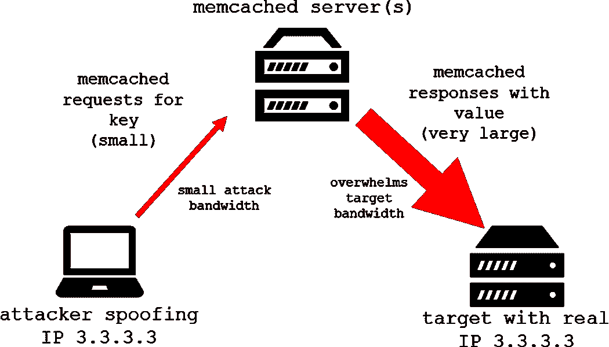

#### 2.2.2.5 SSDP Attack

Simple Service Discovery **Protocol 简单服务发现协议 是** Universal Plug and Play (UPnP) 即插即用设备技术的基础，大意是即插即用设备会维护一个列表。

SSDP（Simple Service Discovery Protocol）攻击是一种利用UPnP（Universal Plug and Play）**协议的漏洞**进行攻击的方式。UPnP是一种网络协议，它允许设备自动发现并配置其他设备，从而实现设备的自动化交互。SSDP是UPnP协议中的一个重要组成部分，它通过UDP广播的方式，在网络上发现和识别其他设备。

1.  攻击者进行扫描，寻找可用作放大因素的即插即用的设备。

1.  当攻击者发现联网设备时，他们创建一个所有响应设备的列表。

1.  攻击者用目标受害者的欺骗性IP地址创建一个UDP数据包。

1.  然后，攻击者使用僵尸网络向每个即插即用设备发送一个欺骗性的发现包，要求通过设置某些标志，特别是ssdp:rootdevice或ssdp:all，获得尽可能多的数据。

攻击者可以利用UPnP协议开放的SSDP端口（一般是UDP 1900端口），向网络中发送大量的SSDP请求，从而产生大量的网络流量，导致目标系统的瘫痪。SSDP攻击通常用于分布式拒绝服务（DDoS）攻击，攻击者可以通过控制大量的僵尸设备（如IoT设备）来发动攻击。

攻击者伪造成 victim 的地址，发送 ssdp:rootdevice和 ssdp:all 等请求以获得全部设备列表。

解决：关闭 UDP 端口 1900。

为了防范SSDP攻击，管理员可以通过限制UPnP协议的使用、配置防火墙规则来阻止不必要的UDP广播、升级设备的固件以修补已知的漏洞等安全措施来加强系统的安全性。

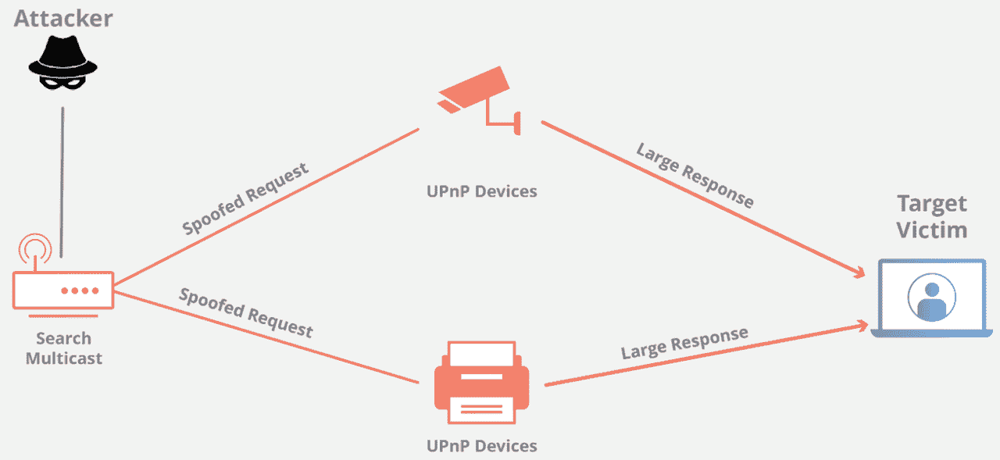

### 2.2.3 Asymmetric DDoS Attack (Computation) 计算的角度

+   用较低的开销**消耗 victim 的大量算力**

+   加密解密计算

#### 2.2.3.0 SSL/TLS Handshake

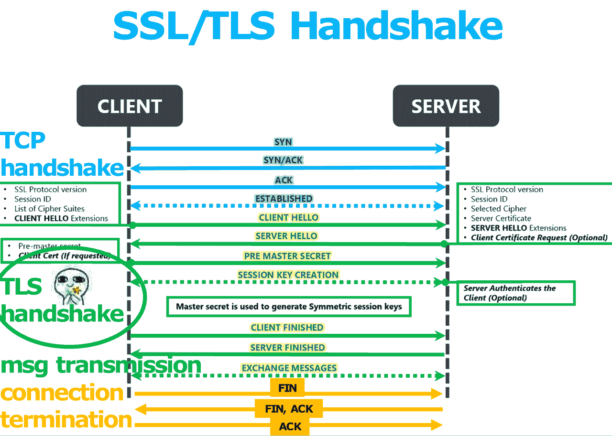

SSL（Secure Sockets Layer）和TLS（Transport Layer Security）是一种用于保护网络通信安全的协议，用于对网络通信中的数据进行加密和解密操作。SSL是TLS的前身，现在已经逐渐被TLS所取代，但是两者在实现上非常类似。

SSL/TLS协议主要通过使用公开密钥加密（Public Key Encryption）技术和对称密钥加密（Symmetric Key Encryption）技术来保护数据的机密性和完整性。在SSL/TLS握手过程中，客户端和服务器会进行一系列的加密解密操作，用于建立安全通信的密钥，从而保护数据的安全。

在SSL/TLS握手过程中，客户端会向服务器发送一个Client Hello消息，包括支持的加密套件、随机数等信息。服务器会回应一个Server Hell**o消息，**包括选定的加密套件、随机数等信息。在此基础上，客户端和服务器会进行一系列的握手操作，包括发送和接收证书、生成对称密钥、交换加密密钥等步骤。在这个过程中，加密解密操作会被频繁使用，用于对数据进行加密和解密，从而保证数据在传输过程中的机密性和完整性。

需要进行加密解密操作的原因在于，网络通信中的数据很容易被黑客截取和窃取，为了保护数据的机密性和完整性，需要对数据进行加密。而为了能够解密数据，需要使用密钥进行解密操作。因此，在SSL/TLS协议中，客户端和服务器需要进行一系列的加密解密操作，用于保护数据的安全。

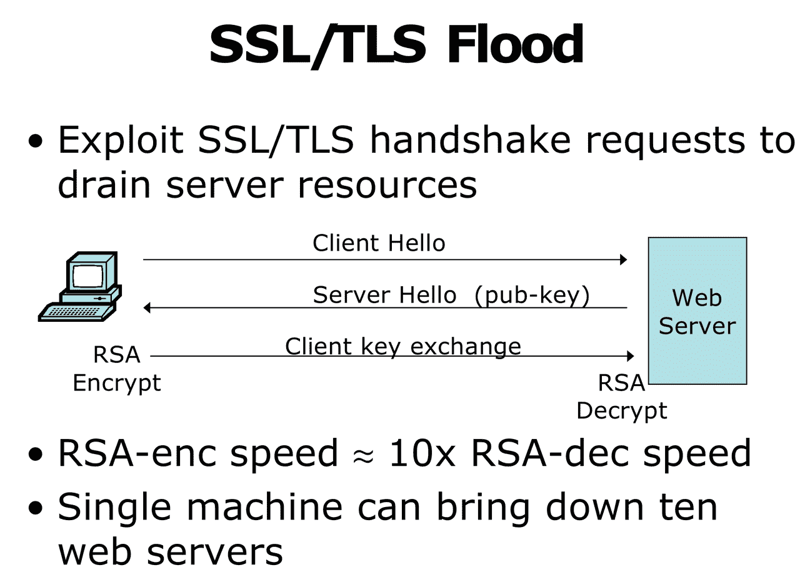

> 对称加密算法通常比非对称加密算法更快。

> RSA是非对称加密

**在SSL/****T**LS握手过程中，客户端和服务器需要进行多次通信，进行加密和解密等操作，这些操作会消耗服务器的资源。攻击者可以通过控制大量的僵尸设备（如IoT设备）来发动攻击，从而形成分布式的攻击效果，使目标系统无法正常运作。

为了防范SSL/TLS flood攻击，管理员可以采取多种措施，例如限制来自同一IP地址的请求、使用防火墙来过滤恶意的SSL/TLS请求、使用SSL/TLS加速器、升级SSL/TLS协议的版本、使用负载均衡技术等。此外，还可以对系统进行优化，如通过增加CPU、内存、带宽等硬件资源、优化操作系统内核参数等来提高系统的抗压能力。

#### 2.2.3.1 HTTP Flood

> 不能使用ip spoofing

> 因为HTTP Flood需要TLS，TLS需要保证返回的source ip是自己的才行，ip spoofing是假链接，实际上没有连接成功

HTTP Flood是一种分布式**拒绝服务（DDoS**）攻击方式，攻击者通过大量的HTTP请求向目标服务器发送大量无效的请求，从而耗尽目标服务器的资源，使其无法正常处理合法用户的请求。

**HTTP Flood攻击通常利用了HT**TP协议中的漏洞，例如HTTP请求中的虚假信息、HTTP请求中的合法信息超过服务器的处理能力等。攻击者可以通过控制大量的僵尸设备（如IoT设备）来发动攻击，从而形成分布式的攻击效果，使目标系统无法正常运作。

+   完成TCP链接

+   完成TLS握手协议

+   Get/Post

为了防范HTTP Flood攻击，管理员可以采取多种措施，例如限制来自同一IP地址的请求、使用反向代理服务器、配置防火墙规则、升级系统软件以修补已知漏洞等。此外，管理员还可以通过限制非法的HTTP请求，限制请求端速率、使用负载均衡技术等手段来提高系统的安全性。

#### 2.2.3.2 Fragmented HTTP Flood

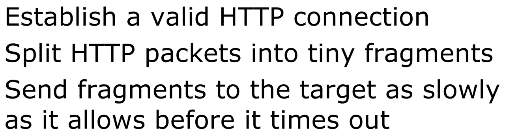

攻击者将HTTP请求**分解成多个小分段的数据包**，并通过不同的源IP地址发送给目标服务器，从而使服务器无法正常处理请求。

攻**击者使用的HTT**P请求通常会包含大量的HTT**P头信息和**无效数据，这会占用服务器的资源并降低服务器的性能。而将HTTP请求分解成多个小分段的数据包，则可以使服务器需要更多的资源来处理这些小数据包，并且更难以检测和过滤。

为了防范Fragmented HTTP Flood攻击，可以采取多种安全措施，如使用反向代理服务器、配置防火墙规则、使用网络流量分析工具等。此外，还可以加强服务器的抗压能力，例如增加带宽、升级服务器硬件、使用负载均衡技术等。

#### 2.2.3.3 Payment DDoS

Payment DDoS是一种网络攻击方式，攻击者通过向在线支付系统发送大量的虚假支付请求来消耗系统资源和造成拒绝服务。Payment DDoS攻击通常会导致在线支付系统崩溃，无法正常处理合法用户的支付请求，从而给商家和消费者带来不必要的经济损失。

在Payment DDoS攻击中，攻击者通常使用大量的僵尸设备（如感染的计算机、路由器、IoT设备等）来模拟合法用户，发送虚假的支付请求。这些请求可能会包含大量的无效信息，例如假的信用卡信息、错误的付款金额、无效的付款方式等。由于在线支付系统需要对每个请求进行验证和处理，因此大量的虚假请求会占用系统的资源并降低系统的性能，最终导致系统的崩溃。

为了防范Payment DDoS攻击，商家和支付系统可以采取多种安全措施，例如实施反欺诈技术、使用网络流量分析工具、配置防火墙规则等。此外，商家和支付系统还应该加强自身的安全防护能力，例如采用多因素认证、加强用户身份验证、监控异常交易等措施，以提高支付系统的安全性和可靠性。

### 2.2.4 Asymmetric DDoS Attack (Others)

#### 2.2.4.1 Tail Attack

这种攻击利用了新发现的N层网络应用程序的系统漏洞（亚秒级持续时间的百万瓶颈和强依赖性的资源争夺）。分布式节点之间具有强烈依赖性的毫秒级瓶颈和资源争夺），以达到攻击目的。分布式节点之间的资源争夺），目的是造成目标网络应用的长尾延时导致目标网络应用的长尾延迟问题（例如，第95百分位数的响应时间>1秒），并破坏服务提供商的长期业务，而所有的系统资源都远未达到饱和。

#### 2.2.4.2 SDN CrossPath Attack

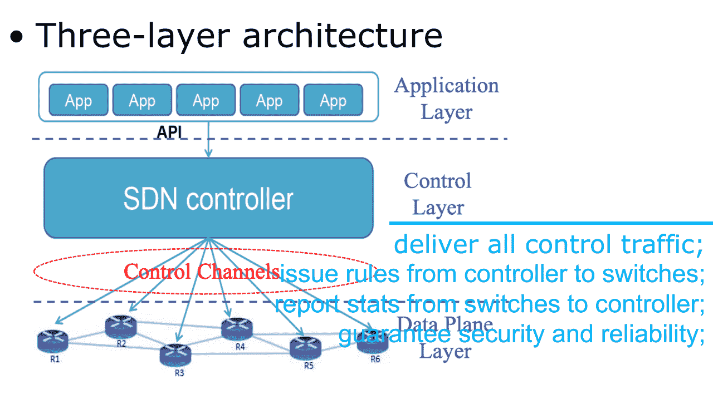

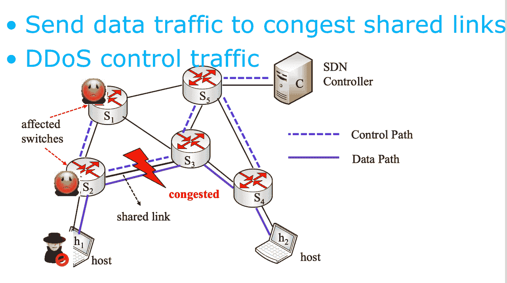

SDN CrossPath Attack（SDN跨路径攻击）是一种网络安全攻击方式，针对软件定义网络（SDN）中的跨路径流规则进行攻击。SDN是一种基于控制**平面（Contro****l Plan**e）和数据平面（Data Plane）分离的网络架构，它允许网络管理员通过控制器来管理和控制整个网络。在SDN中，跨路径流规则用于在不同的交换机之间实现数据流的路由，攻击者可以利用跨路径流规则的特性进行攻击。

> 发现某个link是给router和controller用的，就可以制造大规模的数据传输，瘫痪

在SDN CrossPath Attack中，攻击者发送虚假**的流规则到SDN控制器，这些流**规**则可能会导致**数据流跨越不同的交换机路径，形成一个环路。当数据流遇到这个环路时，它将被无限循环，占用网络带宽和交换机资源，最终导致网络瘫痪。

为了防范SDN CrossPath Attack，可以采取多种安全措施，例如对SDN控制器进行安全配置、对流规则进行验证和过滤、使用网络流量分析工具等。此外，还可以使用入侵检测系统（IDS）和入侵防御系统（IPS）等安全技术来监测和阻止SDN CrossPath Attack。

## 2.3 DDoS Defences

第一个思路是让攻击者的攻击**更困难**（1~3）

第二个思路是消耗攻击者的**更多资源**（4~5）

+   enrich server with more resources;

+   leverage the sources of others;

### 2.3.1 Ingress Filtering

Ingress Filtering（入口过滤）是一种网**络安全技术**，用于在网络入口处对数据包进行过滤和检查，以防止来自非法来源的攻击流量进入网络。Ingress Filtering通常是一种针对IP地址欺骗（IP Spoofing）攻击的一种防御措施。

IP**地址欺骗攻击是一种网络攻击方式，攻**击者伪造源IP地址发送攻击流量，以模拟合法的网络流量。这种攻击方式可以伪装攻击者的身份，避免被网络防御系统检测和追踪。Ingress Filtering技术通过检查网络流量的源IP地址和目标IP地址，对非法的源IP地址进行阻止和过滤，从而防止攻击者通过IP地址欺骗攻击进入网络。

Ingress Filtering技术通常在网络边界处（如路由器、防火墙等）部署，对网络流量进行过滤和检查。在网络流量进入网络之前，Ingress Filtering会检查源IP地址是否合法，如果源IP地址是非法的，则会拒绝流量，并向网络管理员发出警告。

需要注意的是，Ingress Filtering虽然可以防止IP地址欺骗攻击，但它并不能完全解决网络安全问题。攻击者可以使用其他技术来规避Ingress Filtering的检查，因此需要采用多种安全技术和措施来提高网络的安全性和可靠性。

> ISP是英文Internet Service Provider的缩写，即互联网服务提供商。ISP是指向最终用户提供互联网接入服务的公司或组织，通过提供宽带接入、域名服务、电子邮件、虚拟主机等服务，使用户能够连接互联网并进行数据交换。

要求 ISP 只传输合法 src IP 的包。问题是：这种方式需要所有 ISP 都使用，但是他们没有理由要用。

+   边界传输的ISP，他们检查就可以了；但是他们没有理由去检查。

+   中间可不可以？Transit AS；但是routing protocols只在乎终点而非起点

+   AS指的是自治系统（Autonomous System）

只有 src AS 能检查，中间的都很难检查……

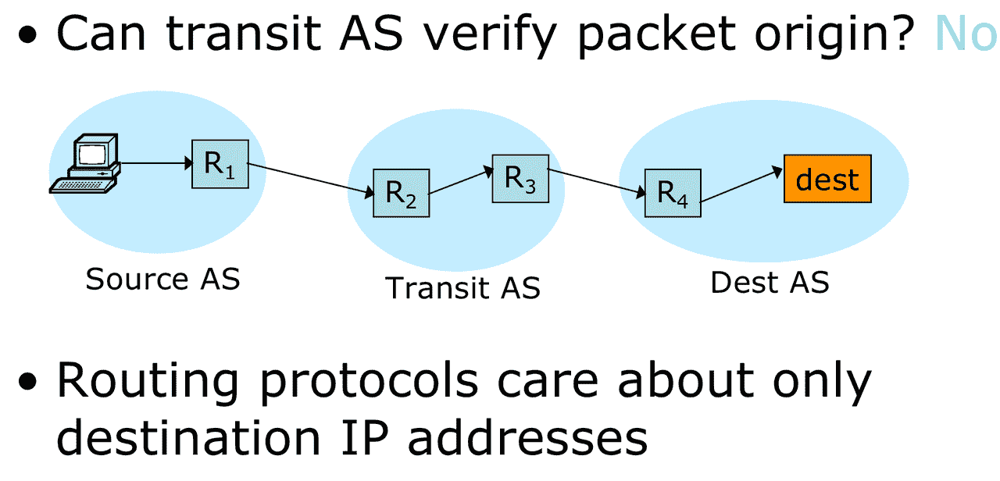

除非我们修改包的协议——也就引出我们下面的内容

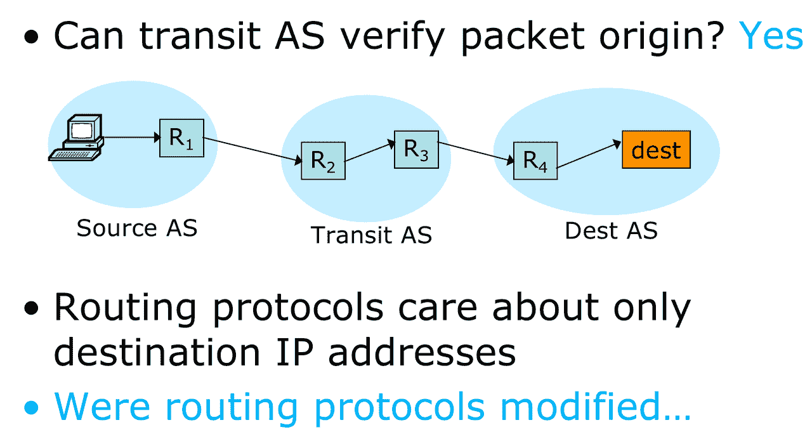

### 2.3.2 Traceback

……除非给包里新增一些内容

+   最简单的方式是在 packet 里维护路径信息

+   但是太大了，占用带宽，限制吞吐率

+   可以通过 Edge Sampling

+   基于路由器可信、包足够多且路径一致的假设

IP Traceback

IP追踪是一种技术，可用于确定网络攻击的源头。它允许网络管理员在攻击发生时追踪攻击者的位置，并采取必要的措施来阻止攻击。

IP追踪的基本原理是在数据包中插入特殊标识符，该标识符将在传输过程中一直保留，并记录经过每个路由器的信息。当攻击发生时，管理员可以使用这些信息来确定攻击者的位置。

有几种不同的IP追踪技术可供选择。一种常见的方法是使用源地址验证（SAV）技术，该技术验证传入数据包的源地址，并跟踪数据包的路径。另一种方法是使用跳数限制（TTL）技术，该技术限制数据包在网络中传输的最大跳数，并记录每个路由器的信息。还有一种称为Packet Marking的技术，它可以在数据包中插入标识符并记录传输路径

**IP Traceback**

router adds its own IP address to packet

victim reads path from packet

Assumptions: trusted routers; sufficient packets to track; stable route from attacker to victim

Limitations: requires space in packet; path can be long; no extra fields in current IP format (changes to packet format too much to expect)

Sample and Merge: store one link in each packet; router probabilistically stores own address; fixed space regardless of path length

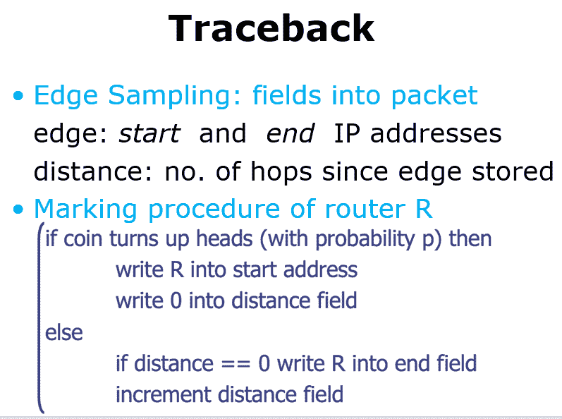

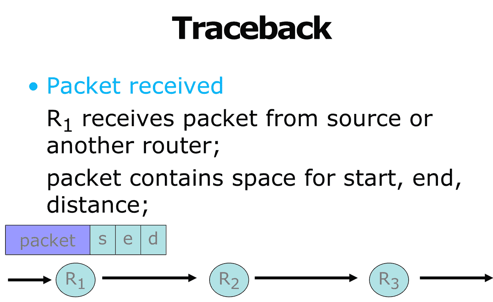

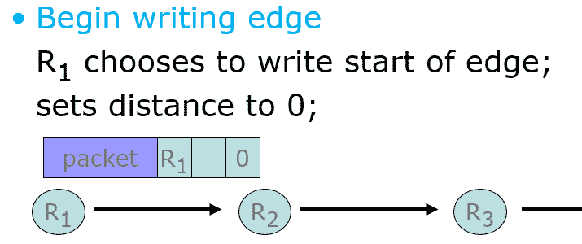

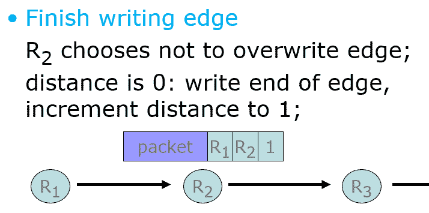

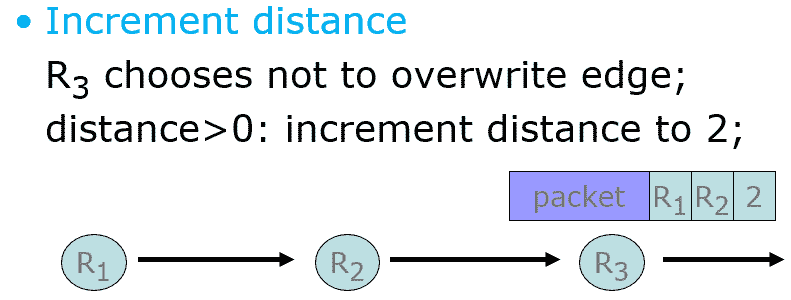

+   有一定概率改写

+   由于包足够多，因此根据不同包的采样就可以还原出路径。

+   但是如果有恶意的中间路由器……，被恶意修改

+   增加一些密码学手段做校验 (Path Validation)

itrace

每个路由器对其正在转发的数据包进行采样，并将其内容和相邻路由器的信息复制到ICMP回溯消息中。

路由器使用HMAC和X.509数字证书对回溯消息进行认证

路由器向目的地发送ICMP回溯消息

要求所有传输攻击流量的路由器都启用iTrace，以构建整个攻击路径

然而ICMP数据包通常被过滤掉......因为ICMP Ping Flood攻击

但是我们很难在网络层修改路由，overly network是可以在应用层上面修改

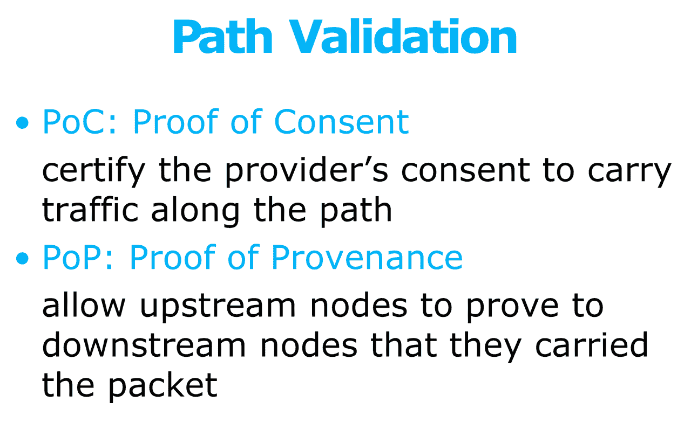

先验证，认可

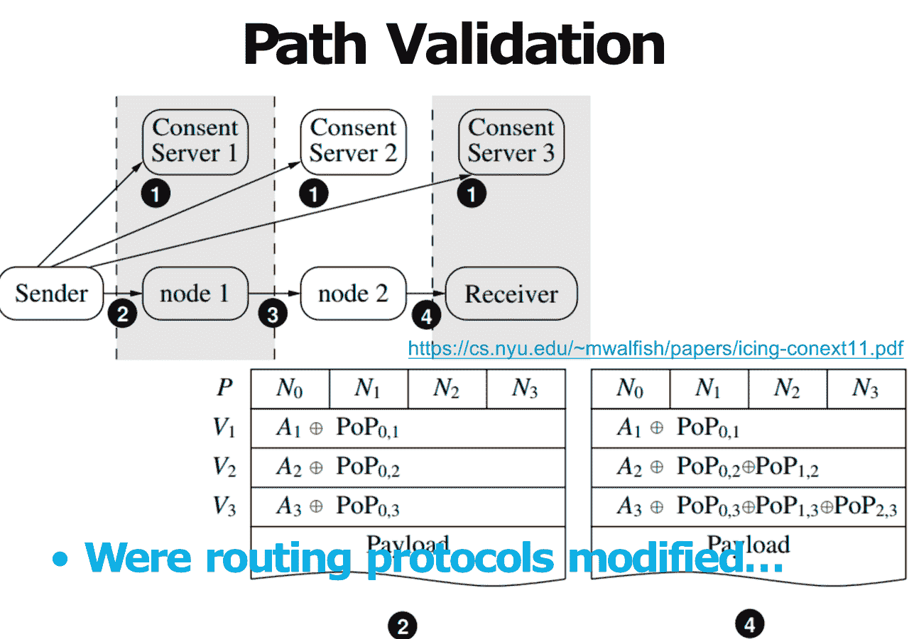

每一个节点都需要给后面的每一跳给他们的凭证——O(N^2)

### 2.3.3 Alibi Routing

> 不想流量经过不安全（审查/丢包）的AS

证明一个 packet **没有** 经过某个 AS

+   引入 proof waypoint 使得 packet 在给定时间内不可能同时经过 proof waypoint 和需要避开的 AS

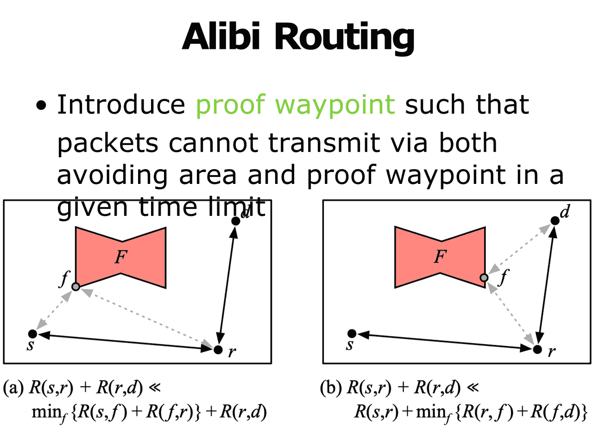

> 选取一个特别的点，如果走的比这个时间更长，说明就走了那个不能走的路了

Alibi Routing是一种网络路由安全技术，旨在保护互联网路由协议（如BGP）中的路由信息不被篡改或误导。

Alibi Routing通过在网络中添加一组辅助路径来实现路由验证和错误检测。辅助路径是一条由可信赖的第三方提供的额外路由路径，与主路径并行传输路由信息。当路由信息被篡改或误导时，Alibi Routing能够检测到这些问题，并将其报告给网络管理员或其他相关方。

### 2.3.4 Client Puzzles

让 client 算个题。

> 让攻击者先计算

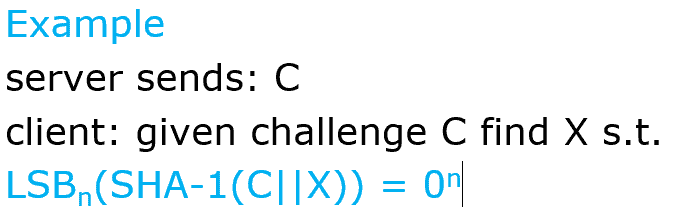

（n 可以根据流量情况修改）

坏处：需要修改协议；对垃圾设备不友好，尤其是 n 较大时

### 2.3.5 CAPTCHA

Completely Automated Public Turing test to tell Computers and Humans Apart

就是验证码

# 3 Secure Routing

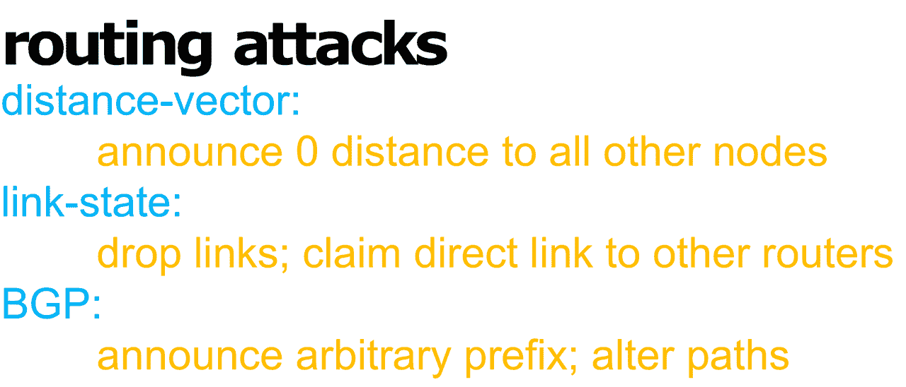

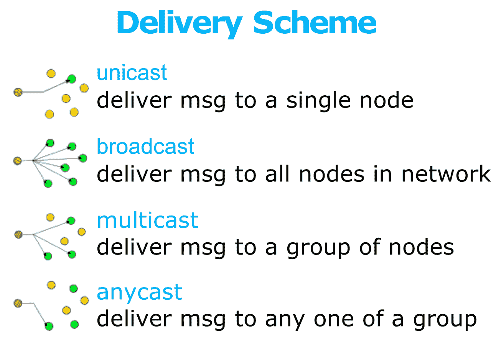

+   Unicast

+   deliver msg to a single node

+   Broadcast

+   deliver msg to all nodes in the network

+   Multicast

+   deliver msg to a group of nodes

+   Anycast

+   deliver msg to any one of a group

+   geocast

+   deliver a message to a group of nodes based on geographic location

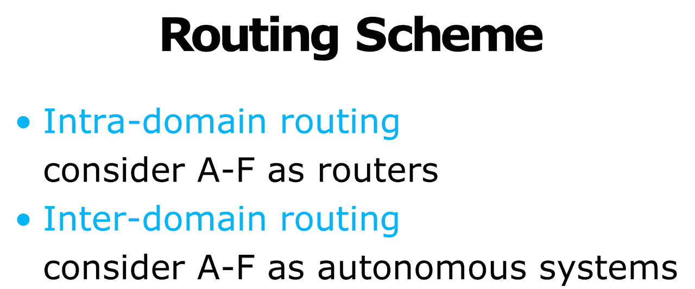

**What is the framework of the** Dijkstra algorithm?

The algorithm maintains a set of visited nodes and a set of unvisited nodes, with the distance from the starting node to each node initialized to infinity, except for the starting node, which is initialized to 0.

At each iteration, the algorithm selects the node with the smallest distance from the starting node that has not been visited yet, adds it to the visited set, and updates the distances of its neighboring nodes if a shorter path is found. This process is repeated until all nodes have been visited, and the shortest path from the starting node to each node has been determined.

The Dijkstra algorithm can be implemented using a priority queue to efficiently select the node with the smallest distance.

**W**hat is the framework of the Bellman-Ford algorithm?

The Bellman-Ford algorithm is a shortest path algorithm that finds the shortest path from a source vertex to all other vertices in a weighted graph that may have negative edges. The algorithm works by iteratively relaxing the edges of the graph until it finds the shortest path.

The framework of the Bellman-Ford algorithm can be described as follows:

1.  Initialize the distances from the source vertex to all other vertices to infinity, except for the source vertex itself, which is set to 0.

1.  For each vertex in the graph, iterate through all of its outgoing edges, and relax each edge by updating the distance to the destination vertex if a shorter path is found through the current vertex.

1.  Repeat step 2 for V-1 iterations, where V is the number of vertices in the graph. This ensures that all possible paths of length up to V-1 are considered.

1.  Check for negative weight cycles in the graph by iterating through all the edges again, and checking if the distance to the destination vertex can be further improved. If this is the case, then there is a negative weight cycle in the graph, and the algorithm cannot find a shortest path.

1.  If there is no negative weight cycle, then the distances computed after the V-1 iterations represent the shortest path from the source vertex to all other vertices in the graph.

## 3.1 Routing Attacks

+   Link-State

+   **Each router knows com**plete topology & link cost information;

+   independently run routing algorithms to calculate the shortest path to each destination;

+   全局视角

+   通过每个节点了解整个网络的拓扑结构，从而计算出最优的路径。每个节点都会收集整个网络中所有节点的拓扑信息，并通过一个全局算法计算出每个节点到其他节点的最短路径。这个算法使用Dijkstra算法计算最短路径，并将路由表发送到整个网络中的每个节点。Link-State算法的优点是计算出的路由是最短路径，能够提高网络的性能和可靠性。

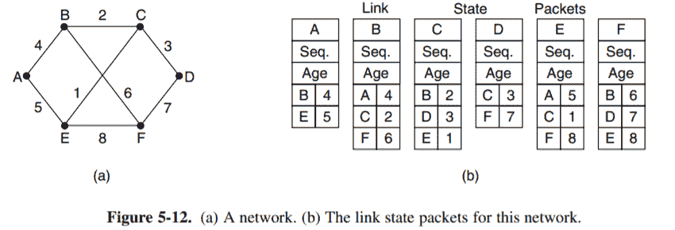

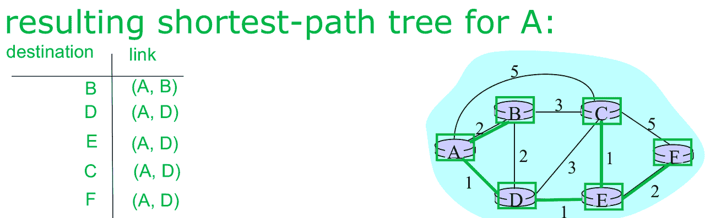

+   drop links（不想要的）OR claim direct link to other routers

常见的Link-State算法包括以下几种：

1.  OSPF（Open Shortest Path First）：是一种常用的链路状态路由协议，广泛应用于企业网络和互联网中。OSPF使用了多种技术，如多区域设计、认证、可靠性等，以提高网络的可扩展性和安全性。

1.  IS-IS（Intermediate System to Intermediate System）：是一种链路状态路由协议，也被称为CLNS（Connectionless Network Service）路由协议。IS-IS最初是为ISO（International Organization for Standardization）的OSI（Open Systems Interconnection）协议设计的，现在也广泛应用于IP网络中。

1.  SPF（Shortest Path First）：是一种通用的链路状态路由算法，可以用于不同类型的网络，如局域网、广域网等。SPF算法基于Dijkstra算法，通过计算出每个节点到其他节点的最短路径，构建出最优的路由表。

1.  RIPv2（Routing Information Protocol version 2）：是一种基于链路状态的路由协议，可以在IPv4和IPv6网络中使用。RIPv2使用了类似OSPF的链路状态路由协议，通过广播网络中的路由信息，实现路由表的动态更新。

+   Distance-Vector

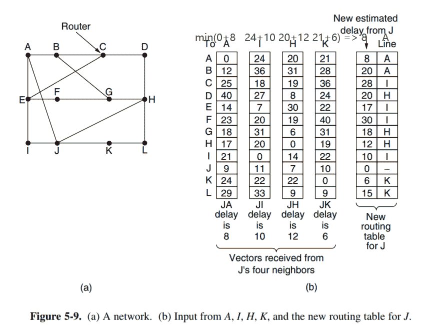

+   不全局信息

+   announce 0 distance to all other nodes

+   Distance-Vector算法是计算机网络中一种常用的路由算法，也被称为距离向量**路由协议**（Distance V**ector Routing** Protocol，简称DVRP）。该算法的核心思想是每个节点维护一个距离向量表，记录它到网络中其他节点的距离，然后通过向相邻节点广播它的距离向量表，与相邻节点交换信息，以更新整个网络中每个节点的距离向量表。该算法通常使用Bellman-Ford算法来计算最短路径。

+   Distance-Vector算法的优点是简单易实现，占用网络带宽较少，但也存在缺点，如慢收敛、易产生路由环等问题。常见的Distance-Vector算法包括RIP（Routing Information Protocol）、IGRP（Interior Gateway Routing Protocol）和EIGRP（Enhanced Interior Gateway Routing Protocol）等。

### 3.1.0 Intro

Interior Gateway Port

+   RIP：routing information protocol

+   OSPF：open shortest path first

inter-domain routing

+   BGP: Border Gateway Protocol

BGP（Border Gateway Protocol）是一种用于在不同的自治系统（AS）之间交换路由信息的协议，是互联网中最常用的路由协议之一。BGP协议运行在TCP协议之上，可以实现不同自治系统之间的路由互联。

BGP协议的核心思想是通过向相邻自治系统广播路由信息**，实现不同自**治系统之间的路由交换。每个自治系统都会维护一个BGP路由表，记录自己的网络拓扑和可达性信息，并将其向相邻自治系统广播。当一个自治系统收到来自相邻自治系统的路由信息时，会将其与自己的BGP路由表进行比较，更新自己的路由表，从而实现自治系统之间的路由交换。

BGP协议的特点是具有很高的可靠性和灵活性，可以实现对路由信息进行筛选、转发和控制，从而保障网络的安全和稳定性。同时，BGP协议也存在一些缺点，如复杂性高、易受攻击等问题，需要通过合理的配置和管理来解决。

BGP协议通常用于连接不同的ISP（Internet Service Provider），或者用于构建大型企业内部的多个自治系统之间的路由。

可以理解为就抽象出来两层，**一层为内部，一层为路由之间**

+   BGP

+   类似 Vector Routing；AS 的 border routers 扮演 routers，AS 的 prefix 扮演 IP

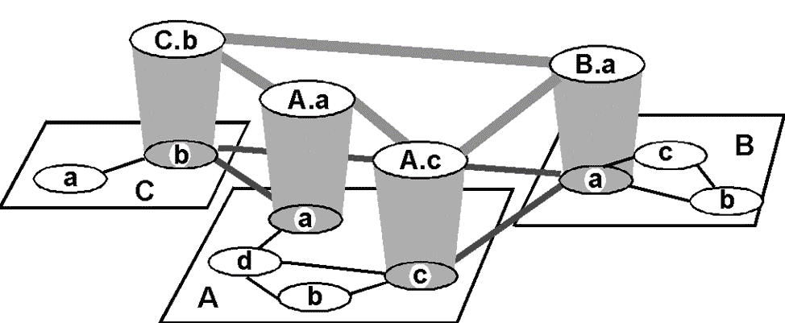

+   announce arbitrary prefixes; alter paths

### 3.1.1 Prefix Hijacking

1.  说自己是某个 prefix（一摸一样）

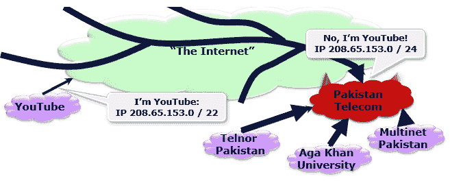

你把他的IP变成你的prefix，让根据最长路径，先到攻击者这边

1.  或者说自己离得近（假装自己是被攻击者的邻居，不是和被攻击者一摸一样，构成一条更近的路线，这里的更近区别于原先的那么长的路径，这样发送消息会先发给邻居，再发给被攻击者）

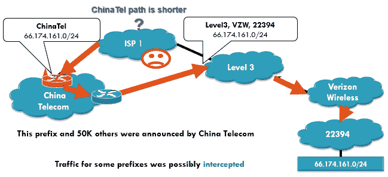

但是上述攻击太明显了，所以还有就是发一样的内容，作为邻居，因为更短的跳，而被选择

前缀劫持是一种网络路由攻击，攻击者非法宣称拥有未分配给自己的IP地址前缀（一段IP地址范围）。这可以使攻击者将本应发往前缀的合法流量重定向到攻击者自己的网络中，从而可以拦截或操纵流量。

以下是前缀劫持攻击的工作原理：

1.  攻击者找到一组IP地址前缀，这些前缀当前没有被合法的所有者使用。

1.  攻击者开始从自己的网络中发布前缀，使用边界网关协议（BGP）通告。BGP是在互联网上不同网络之间交换路由信息的协议。

1.  互联网上的其他网络接收到BGP通告，并开始将流量定向到攻击者的网络。

1.  攻击者可以拦截、操纵或阻止流量，从而有可能窃取敏感信息、破坏通信或发起进一步攻击。

前缀劫持通常发生在较小的ISP网络中，因为它们通常没有足够的资源来保证路由表的正确性和安全性。此外，前缀劫持也可能发生在BGP（边界网关协议）中，因为BGP没有强制要求验证路由表中的前缀信息。

为了防止前缀劫持，网络管理员可以使用RPKI（资源公钥基础设施）等技术来验证路由表中的前缀信息。

### 3.1.2 Path Tampering

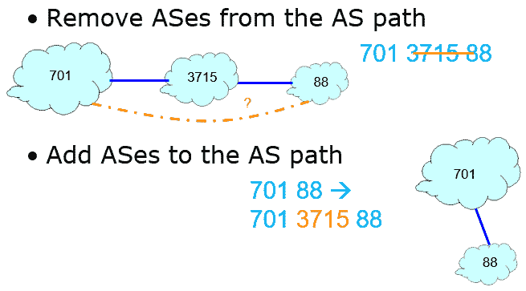

我们可以修改path上的AS来达到跳转具体几跳的目的，从而做一些攻击

## 3.2 Secure Routing

### 3.2.1 RPKI | Resource Public Key Infrastructure

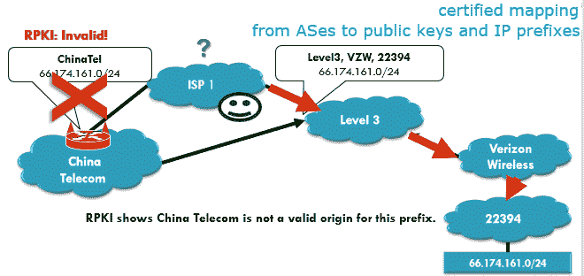

解决这个问题的一个方法是使用**RPKI做起源认证****，RPK**I是IP前缀和拥有它们的As之间的认证映射。因此，现在ISP 1可以检查RPKI，看到中国电信不是这个前缀的有效发起人，并选择正确的路径到这个前缀。

资源公钥基础设施（Resource Public Key Infrastructure，RPKI）是一种用于验证路由表中前缀信息的安全机制。RPKI使用数字证书和公钥密码学来确保路由表中的前缀信息来源于合法的网络服务提供商（ISP）。RPKI的基本原理是将ISP拥有的IP地址块与数字证书进行绑定，验证数字证书的过程可以保证路由表中的前缀信息来源于被授权的ISP。使用RPKI可以有效地防止前缀劫持和其他恶意攻击，提高路由表的安全性。RPKI已经被广泛应用于BGP（边界网关协议）网络中，成为保障互联网安全的重要工具之一。

问题：3.1.1.2 防不住，邻居防不住

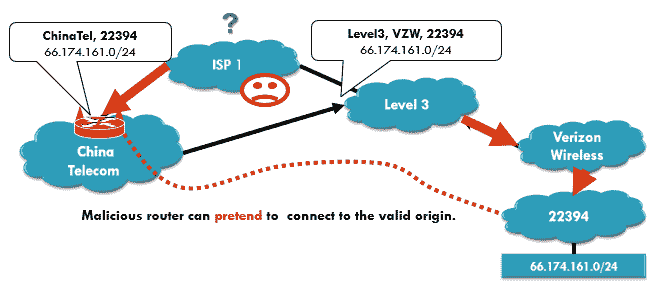

除了验证自己是自己外，还要**验证邻居关系**

邻居之间可以得到证明

### 3.2.2 Secure BGP

> 也验证了邻居关系

+   Each AS on the path cryptographically signs its announcement

+   Guarantees that each AS on the path made the announcement on the path.

+   Address attestations

+   Claim the right to originate a prefix

+   Signed and distributed out-of-band

+   Checked through delegation chain from ICANN

+   Route attestations

+   Distributed as an attribute in BGP update message

+   Signed by each AS as route traverses the network

+   Signature signs previously attached signatures

+   S-BGP can validate

+   **AS path indicates the order** ASes were traversed

+   **No intermediate ASes we**re added or removed

+   计算量很大，性能很差

+   Deployment challenges 部署也很难

+   Complete, accurate registries

+   E.g., of prefix ownership

+   Public Key Infrastructure

+   To know the public key for any given AS

+   Cryptographic operations

+   E.g., digital signatures on BGP messages

+   Need to perform operations quickly

+   To avoid delaying response to routing changes

+   Difficulty of incremental deployment 不能让所有人来配合你，其他节点不愿意配合

+   Hard to have a "flag day" to deploy S-BGP

# 4 Anonymous Communication

## 4.1 Overlay Communication

Packet 里至少包含 IP 信息。

Why wanted？匿名访问医疗、选举等信息；以及攻击者匿名访问非法信息。

通过加密（**比如 HTTPS）可以保护访问**的内容；但是访问行为本身也可以泄露很多信息。

因此，**应当隐藏目的 IP 信息**；但是总需要以某种方式送过去。可以 relay：

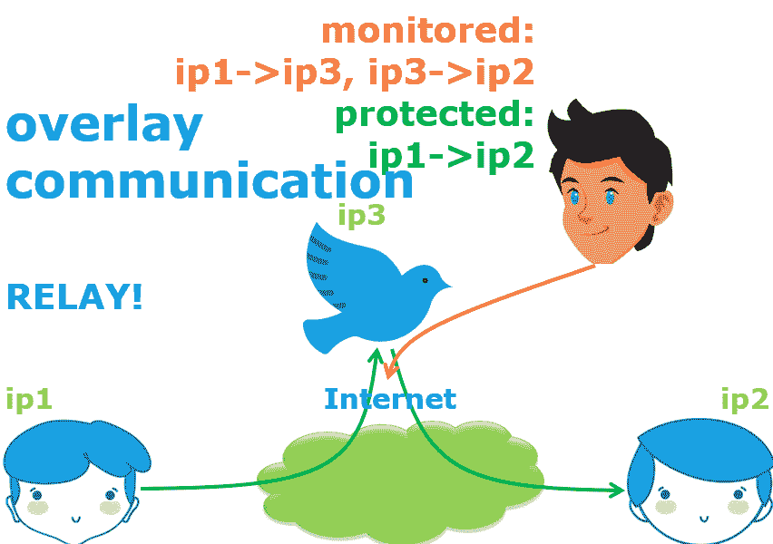

+   Different layers

+   引入Relay node

+   **Re**lay（中继）通常指的是一种网络设备或服务，它用于转发数据包或消息，以帮助连接不同的网络或子网。中继可以帮助解决网络通信中的距离限制和协议转换问题，从而扩大网络的覆盖范围和功能。

+   中继可以分为**物理中继**和**逻辑中继**两种类型。物理中继是指一种网络设备或链路，它用于将数据包从一个物理网络转发到另一个物理网络。比如，网络交换机、路由器、网关等设备都可以被用作物理中继。逻辑中继是指一种软件或服务，它用于将数据包从一个逻辑网络转发到另一个逻辑网络。比如，代理服务器、VPN 网关、DNS 中继等服务都可以被用作逻辑中继。

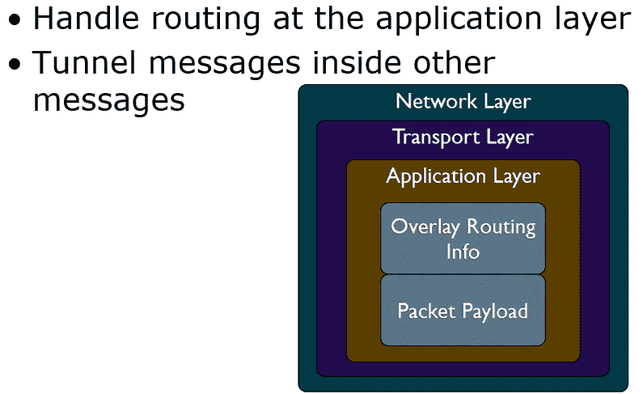

Tunnel messages inside other messages

Overlay Communicat**ion（又**称覆盖通信）是一种在网络中添加虚拟网络层的技术，用于改进网络性能和扩展网络功能。通过覆盖通信，可以在现有的网络架构上增加一个虚拟的网络层，这个虚拟层与底层网络相互独立，可以实现更高效、更安全和更灵活的通信方式。

**覆盖通信的主要**思想是，在应用层和传输层之间添加一个中间层，这个中间层可以通过使用不同的协议、路由和拓扑结构来优化网络通信。在覆盖通信中，应用程序会将数据包发送到覆盖网络中，然后由覆盖网络负责将数据包传输到目标地址，从而实现更快速、更可靠的通信。

### 4.1.1 Threat Model

下面我们要考虑这种 relay 的风险。

考虑风险时，我们需要定义攻击者的行为模式：Insider Byzantine Attacker.

**Insider** 表示攻击者本身是网络的组成部分（ASes），而且攻击者可能控制着不止一个 ASes，但是攻击者并没有能力看到网络的全貌；

**Byzantine**** 是一种**攻击模式，表示攻击者的攻击方式是不稳定的。长期、一致的攻击会容易被发现，因此攻击者采取间断式的、不同方式的攻击，就比较难被检测到了。

攻击者的目标是在目的 IP 信息隐藏在数据包中的情况下，得知数据包的最终目的地。

### 4.1.2 Traceforward Attack

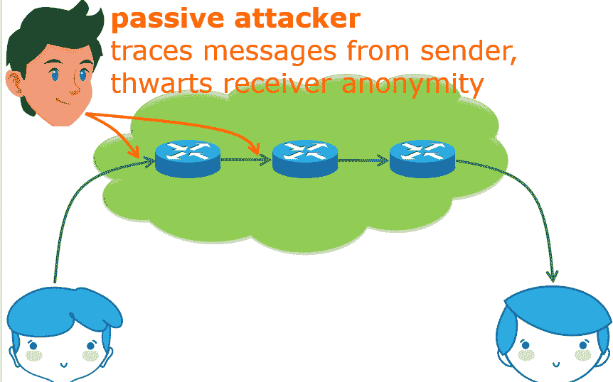

被动攻击者跟踪数据信息

### 4.1.3 Marking Attack

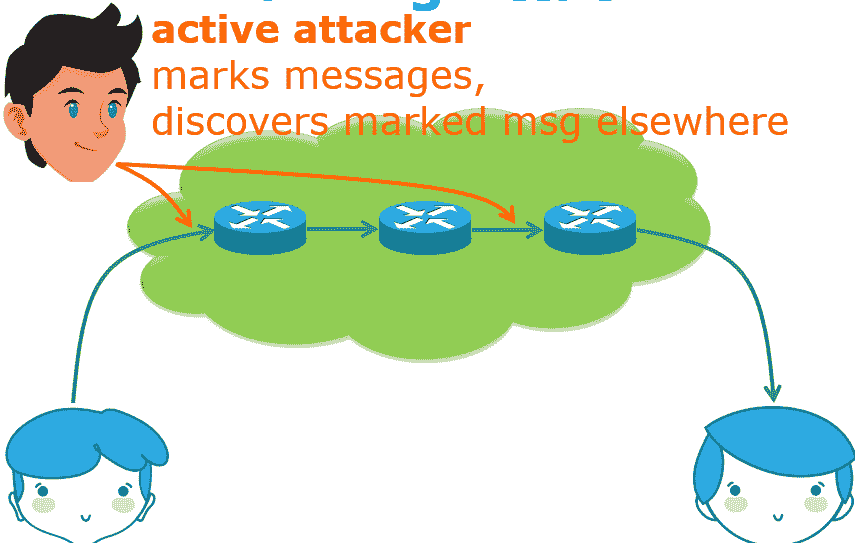

攻击者比较厉害，可以改数据包（比如数据包经过他了），那可以加个标记，然后在其他地方发现就知道是发过来了

## 4.2 Anonymizing Proxy

An**onymizing P**roxy是一种网络代理服务器，可以隐藏用户的真实IP地址，从而保护用户的隐私和安全。当用户使用Anonymizing Proxy时，所有的网络请求都会通过代理服务器进行转发，从而隐藏用户的真实IP地址。Anonymizing Proxy可以用于访问被封锁的网站、保护个人隐私、加速网络连接等。

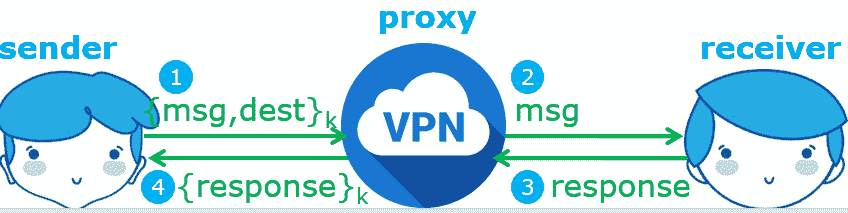

+   如果攻击者在 sender 和 proxy 之间，sender丧失匿名性；

+   如果在 proxy 和 receiver 之间，receiver 丧失匿名性；

+   如果两个攻击者串通对比 ingress 和 egress 代理流量，则匿名性失效；

+   如果 proxy 本身是 attacker，匿名性同样失效。

### 4.2.1 Receiver as Attacker

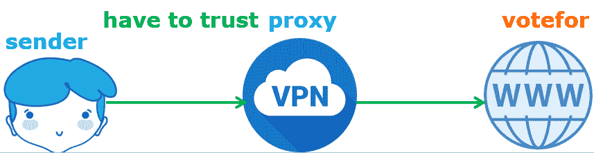

保护发送者的匿名性

### 4.2.2 Advantages & Disadvantages

+   **Advantages**

+   easy to configure

+   receiver need not to be aware of anonymity service

+   have been widely deployed on Internet

+   **Disadvantages**

+   trusted third party needed

+   proxy may release / sell logs or blackmail (敲诈) senders

+   anonymity largely depends on the locations of the attacker, which is likely unknown

### 4.2.3 How to evade (逃避) attackers?

Dynamize proxy location

Crowds Algorithm

人海战术，每个结点叫做一个 Jondo

算法是：首先将信息发给一个 random jondo，每个 jondo 以 P 的概率发给另一个随机 jondo，以 1-P 的概率发给终点。

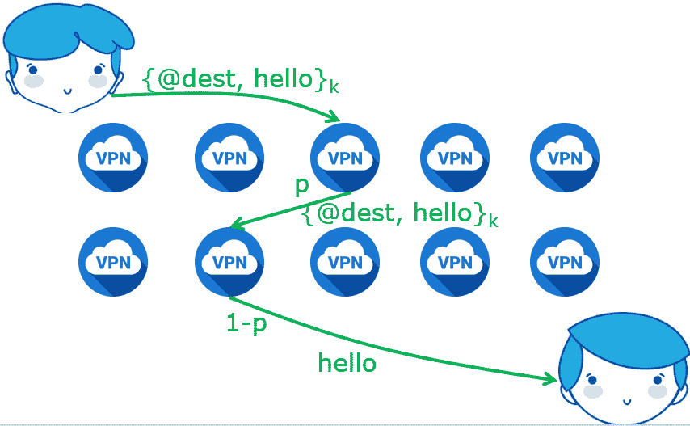

问题是：必须信任 proxy；任何一个 proxy 是恶意的都会暴露 receiver

### 4.2.4 How to evade untrusted proxies?

+   弄多一些 proxies，这样攻击者控制的概率就小了；攻击者同时控制那么多proxies的概率很低

#### 4.2.4.1 Source Routing

Source Routing / Path Addressing 允许发送者指定一个包的部分或者全部路由

**源路由技术中，数据包的路由路径**是在数据包的头部中指定的，这意味着发送方可以选择数据包的路由路径，而不是让网络中的路由器根据它们的路由表来自动选择。

#### 4.2.4.2 POF-Based Source Routing

POF - Protocol Oblivious Forwarding

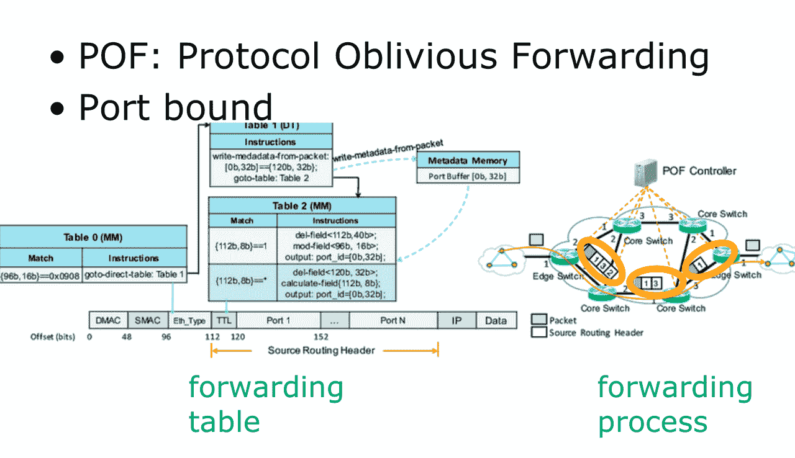

POF-Based Source Routing是一种网络通信协议，其中POF代表Protocol Oblivious Forwarding，意为协议无关的转发。

在传统的网络协议中，路由器需要了解特定的协议来进行转发，而POF-Based Source Routing采用了一种新的转发机制，即从数据包的源头开始指定数据包的路径。在此过程中，POF-Based Source Routing不需要了解任何特定的协议，而只需要遵循指定路径进行数据包的转发。

绑定端口，源给了一个栈，里面说了要怎么走

这种方式可以带来许多好处，比如更加高效和灵活，可以适应不同类型的网络环境和应用场景。同时，POF-Based Source Routing也可以提高网络的安全性，因为它可以在数据包的源头就确定数据包的路径，避免了路由器被攻击的风险。

总之，POF-Based Source Routing是一种协议无关的网络通信协议，可以在网络通信中带来许多好处。

匿名性问题：泄露了 port sequence

如何解决：隐藏非 neighbors 的 port sequence

## 4.3 Onion Routing

> 不想泄露交流的对象节点

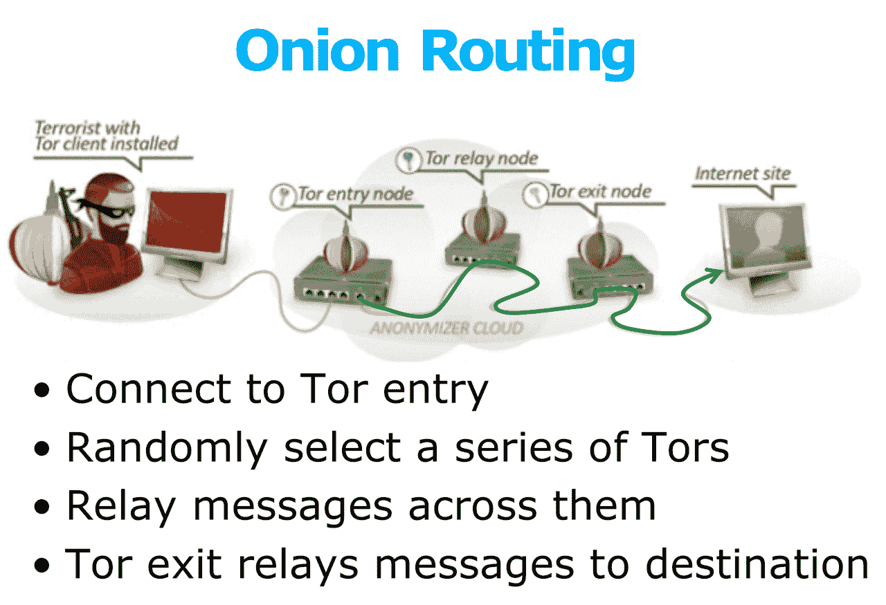

连接到Tor条目

随机选择一系列的Tors

在它们之间转发信息

Tor出口将信息转发到目的地

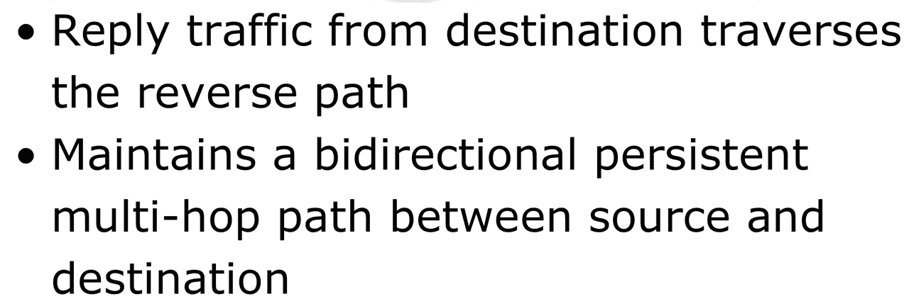

在洋葱网络中，消息被封装在加密层中，类似于洋葱层。加密数据通过一系列称为“洋葱路由器”的网络节点传输，每个节点“将”一个层“去皮”，揭示数据的下一个目的地。当最后一层被解密时，消息到达目的地。发件人保持匿名，因为每个中介人只知道紧接着和紧接着的节点的位置。因此，洋葱路由通过隐藏发件人和收件人的身份，为匿名性提供了更好的保证，使外部方很难将通信追溯到其来源。

> 层级加密

> 除了让C解密，**同时要告诉D要发给C**

发回来的时候用**同一条反向链接**即可，看需要，如果没有匿名需求，其实直接发也可以

> A，B，C之间还有很多路由器

可以只用三个，更多没啥用了，而且慢；两个的话万一他们属于一个人就寄了；三个的话可能性低一点，差不多够了

### 4.3.1 How to de-anonymization?

如果 tor nodes collude with each other 就寄了

或者**算力足够破解密码**

或者，被动监测 / 主动部署 Tor 结点，进行流量分析和关联

如何分析？ 后面再说

#### 4.3.1.1 Path Selection Attack

Tor 选择结点时是有权重的，权重和 bandwidth 有关。

恶意结点报告一个高 bandwidth，从而可以拥有更大的权重；

**如**果它作为 entry node，则可以知道 sender；作为 exit node，则可以知道 receiver

Tor路径选择算法：

通过自我报告的带宽对节点进行加权；

选择每个节点，使用加权

概率分布；

攻击：

恶意中继报告非常高的带宽以

增加选择概率；

如果它控制了第一跳，则删除发送者；

如果它控制了最后一跳，则删除接收器；

#### 4.3.1.2 Counting Attack

通过计算数据包的数量来**关联流入和流出的流 **

#### 4.3.1.3 Low Latency Attack

Tor 路由器为每个匿名电路**分配自己的队列**，以轮询方式从每个队列中**取出一个包**。

节点越多，对列越多，轮询的时间越长。

新队列会影响所有其他队列的延迟，基于此对队列中的包进行推测。

A要攻击Init，他想知道Init在不在活动

**假设**只有 Init 和 A 一起在占用 T2，A 循环给 T2 发包并测试延迟，当延迟变大，意味着有 Init Traffic，说明Init在活动。

#### 4.3.1.4 Cross-Site Attack

Crawling:

攻击者部署 Tor routers，访问 darknet，抓取 transaction 信息，并从中提取有价值的 Bitcoin 账户等

Correlation:

在公开网络上搜索这些账户

钱包总会在网络上留下信息

# 5 Web Security

## 5.0 Intro

DOM（Document Object Model，文档对象模型）是一种用于操作 HTML 和 XML 文档的 API。它将文档表示为一个由节点和属性组成的对象树，可以通过 JavaScript 等脚本语言来访问和修改。DOM 提供了一些方法和属性来对文档中的元素进行选择、添加、删除或修改

## 5.1 Goals

+   Integrity | 完整性

+   恶意网站不应能够修改计算机，或者其他网站上的信息

+   Confidentiality | 保密性

+   恶意网站不应能够得知计算机或者其它网站上的机密信息

+   Privacy | 隐私性

+   恶意网站不应能够窥探我的在线活动

+   Availability | 可用性

+   攻击者不应能够使得网站不可用

## 5.2 Web Security: Server Side

+   可能遇到的问题

+   窃取敏感信息

+   修改用户信息

+   攻击者可以服务器网关攻击用户

+   冒充用户

+   注入攻击

+   攻击者使用恶意的输入

+   服务器没有**检查输入的格式**

+   于是攻击者可以执行任意代码

### 5.2.1 SQL Injection

ok = execute( SELECT * FROM Users  WHERE user= ' ' ; DROP TABLE Users -- … )

构造假的输入来强行改变逻辑

条件判断永远为真，登录永远成立

插入一个信息，改变后台数据，注册一个新的，然后之后都可以用这个

#### 5.2.1.1 Solution: Input Sanitization

**检查或者通**过操作使得用户输入的字符串不存在指令

+   拒绝一些特殊的字符；或者

+   对输入进行转义

+   在一些如引号之类的特殊字符之前**加 ****\**；取决于不同的 SQL 解析器

#### 5.2.1.2 Solution: Prepared Statement

SQL 注入攻击的主要原因是**数据和代码**混在了一起。因此我们可以考虑将代码和数据分开。

Prepared Statement 的本意是优化一**些常用的**计算：它允许用户给数据库发送一种语句模板，其中的参数可能尚未绑定。数据库进行解析、编译、优化，但尚不执行，直到用户将参数绑定上去再计算。

但是，这种方式也可以用来**防止 SQL 注入攻击**，因为此时数据库非常明确地了解代码和数据之间的界限，通过后面的绑定传入的参数并不会被解析。

## 5.3 Web Security: Client Side

### 5.3.1 Same-Origin Policy

防止恶意网站监视/篡改用户信息或与其他网站的交互

浏览器强制进行。

+   浏览器中不同站点相互隔离

+   同一站点的不同页面不隔离

一个 origin 不能访问另一个 origin 的资源

http 80, https 443

### 5.3.2 Cookie

+   当浏览器首次连接到Web服务器时，服务器在响应中包含Set-Cookie：标头

+   每个cookie只是一个名称值对

如果现在有能对应的 cookie 就带上；如果没有的话服务器会返回一个 Set-Cookie:

第二个是sub domain（.site.com）

### 5.3.3 Session Token

一个 HTTP Session 是一系列请求-响应 transactions。

服务器在用户登入后会给其分配一个 session token，作为当前 session 的唯一 identifier，以 cookie 的形式呈现。服务器维护用户和 session token 的表，因此看到 session token 即知道是哪个用户。

### 5.3.4 Cross-Site Request Forgery | CSRF

+   利用Web服务器在连接会话中用于识别用户的Cookie

+   第三方网站可以伪造与同一站点请求完全相同的请求

+   服务器无法区分同一站点和跨站点请求

在Lab3有详细介绍

跨站请求伪造（Cross-Site Request Forgery，CSRF），也被称为“one-click attack”或“session riding”，是一种常见的网络攻击技术。

攻击者利用用户已登录的身份，在用户不知情的情况下发送恶意请求给目标网站，从而欺骗网站执行某些操作，例如修改用户的账户信息、发送垃圾邮件或执行恶意代码等。

攻击者通常会通过欺骗用户点击恶意链接或访问恶意网站，从而在用户的浏览器中植入恶意代码或链接。当用户访问受害网站时，恶意代码或链接会自动向目标网站发送请求，触发CSRF攻击。

CSRF攻击的具体实现细节如下：

1.  攻击者在自己的网站上，构建一份包含目标网站接口信息的HTML表单，隐藏在网页中。

1.  攻击者向受害者发送包含恶意链接的电子邮件、社交媒体消息等，诱导受害者点击链接进入攻击者构建的网页。

1.  受害者在浏览器中访问攻击者构建的网页，由于网页中包含恶意表单，浏览器会自动向目标网站发送请求。

1.  目标网站收到请求后，由于浏览器在请求中自动附带了受害者的身份认证信息（如cookie等），服务器误认为这是一个合法的请求，并执行相应的操作。

1.  攻击者在后台收集到了受害者提交的数据或执行的操作，从而达到攻击的目的。

#### 5.3.4.1 Defenses: Referer Validation

HTTP header 中的 Referer 字段显示发起这个 request 的 URL

#### 5.3.4.2 Defenses: CSRF Token

CSRF 攻击的攻击者并不能获取到 cookie，而只是冒用之。因此服务器可以生成一个唯一的、秘密的、不可预测的 token，以 cookie 以外的方式发给 client，client 在提交请求的时候会附带这些信息；如果没有这些信息则认为是非法的。

对于 GET 请求，可以放在 URL 里，这可以通过 server 在返回 html 之前将其中所有 <a> 或 <href> 的链接后面加上 ctrftoken=value 这种东西；对于 POST 请求，server 可以在表单里加一个 hidden 的 <input>，将 token value 写进去。

要防止CSRF攻击，可以采取以下措施：

1.  在关键操作（例如修改账户信息、删除文件等）之前，要求用户输入密码或其他身份验证信息。

1.  在表单中添加CSRF令牌，确保提交的请求来自于受信任的源。

1.  禁止使用浏览器中的cookie或session ID等敏感信息作为请求参数，避免被攻击者利用。

1.  对于不需要公开的接口或数据，使用限制访问的安全机制，例如API密钥或访问令牌等。

1.  对于不需要的HTTP方法（如PUT、DELETE等）进行过滤或禁用，防止被攻击者利用。

### 5.3.5 Cross-Site Scripting | XSS

用户输入包含脚本，网站如果试图显示这些输入而缺乏适当处理，则会被当做脚本执行。

可以用来盗取 Cookie 等。

核心仍然是之前所说的 Same-Origin Policy

跨站脚本攻击（Cross-Site Scripting，XSS）是指攻击者利用Web应用程序的漏洞，在用户浏览器上注入恶意的脚本代码，从而在用户访问受害网站时进行各种攻击，如窃取用户敏感信息、劫持用户会话、篡改页面内容等。

跨站脚本攻击通常发生在Web应用程序的输入验证不充分的情况下，攻击者可以在Web页面中注入恶意的脚本代码。常见的攻击手段包括通过表单提交数据、利用URL参数、发送恶意电子邮件等方式将恶意脚本注入到受害网站中。当用户浏览器加载包含恶意脚本的页面时，恶意脚本就会被执行，攻击者就可以利用这些脚本对用户进行攻击。

#### 5.3.5.1 Stored XSS | 存储型跨站脚本攻击

存储型 XSS 攻击者在良性 Web 服务上留下 JavaScript，以便受害者加载。

脚本会永久地放在数据库里，例如留言板等

永久存储在服务器，可能影响任何与Web应用程序交互的人

> Stored XSS 和 Reflected XSS区别在于

> 恶意脚本的存储位置及其执行方式

+   永久

+   点击链接

#### 5.3.5.2 Reflected XSS | 反射型跨站脚本攻击

反射型 XSS 攻击者让用户**点击带有脚本的特制 URL**，Web 服务将脚本反射回来。

攻击者把脚本通过 URL 的方式发给服务器（可以发给 victim 让他访问这个 URL），而服务器如果试图不加处理地显示输入（例如搜索结果等），就会使得访问者运行相应的脚本

攻击者让受害用户访问一个嵌入恶意JavaScript或恶意内容的bank.com网址。

服务器将其**回显**到受害用户的响应中。

受害者的浏览器在与bank.com相同的源内执行该脚本。

#### 5.3.5.3 Defenses: Input Validation

规定输入的合法格式等

#### 5.3.5.4 Defenses: Output Escaping

转义

#### 5.3.5.5 Defenses: Content Security Policy | CSP

Content-Security-Policy 这个 HTTP header 允许 response 指定白名单，指示浏览器仅从这些来源执行或呈现资源。

例如 Content-Security-Policy: script-src 'self'; object-src 'none'; style-src cdn.example.org third-party.org; child-src https:指示了：

+   脚本：只信任当前域名

+   <object> 标签：不信任任何URL，即不加载任何资源

+   样式表：只信任 cdn.example.org 和 third-party.org

+   框架（frame）：必须使用HTTPS协议加载

+   其他资源：没有限制

(ref: [http://www.ruanyifeng.com/b](http://www.ruanyifeng.com/blog/2016/09/csp.html)log/2016/09/csp.html)

### 5.3.6 DNS hijacking

A DNS hijacking attack can have a significant impact on network security. In a DNS hijacking attack, the attacker manipulates DNS queries to redirect users to malicious sites. This can result in users unknowingly downloading malware or entering sensitive information on a fake website. The attacker can also use the hijacked DNS to obtain SSL encryption certificates for the targeted domains, making it easier to conduct further attacks. DNS hijacking can also be used to launch phishing attacks, malware attacks, DDoS attacks, and DNS tunneling attacks. A local DNS attack can install malware on the user's computer, giving the attacker access to the user's network systems and enabling them to steal data and change DNS settings. To protect against DNS hijacking, it is important to use strong passwords, enable two-factor authentication, and use DNSSEC to validate DNS responses. It is also important to monitor DNS traffic for signs of suspicious activity and to keep software and security patches up to date.

DNS劫持攻击可能会对网络安全产生重大影响。在DNS劫持攻击中，攻击者操纵DNS查询将用户重定向到恶意网站。这可能导致用户在不知不觉中下载恶意软件或在假网站上输入敏感信息。攻击者还可以使用被劫持的DNS获取目标域的SSL加密证书，从而更容易进行进一步的攻击。DNS劫持还可用于发起网络钓鱼攻击、恶意软件攻击、DDoS攻击和DNS隧道攻击。本地DNS攻击可以在用户的计算机上安装恶意软件，允许攻击者访问用户的网络系统，并使他们能够窃取数据并更改DNS设置。为了防止DNS劫持，重要的是使用强密码，启用双重身份验证，并使用DNSSEC来验证DNS响应。同样重要的是，要监控DNS流量是否有可疑活动的迹象，并使软件和安全补丁保持最新。

# 6 Email Security

## 6.1 Email Architecture

RFC 5322是Internet工程任务组（IETF）发布的一个标准文档，其中定义了一种邮件的格式标准，即"Internet Message Format"，也被称为"RFC 2822"。RFC 5322描述了电子邮件的格式、电子邮件头部、邮件正文、邮件附件等方面的规范。

在RFC 5322标准中，每封邮件都由头部和正文两部分组成。头部包含了很多信息，如邮件主题、发件人、收件人、日期、回复地址、抄送等等。正文则包含邮件的实际内容。RFC 5322还规定了一些其他的格式要求，如字符集、换行符、邮件地址的格式等等。

MIME（Multipurpose Internet Mail Extensions，多用途互联网邮件扩展）是一种Internet标准，它扩展了SMTP（Simple Mail Transfer Protocol，简单邮件传输协议）协议，使其能够支持多媒体邮件、附件、非ASCII字符集等。

MIME定义了一种标准的邮件格式，支持在邮件中包含多种媒体类型，如文本、HTML、图片、音频、视频等。MIME协议可以使得邮件客户端和邮件服务器能够识别和处理不同类型的媒体文件，从而提供了更加丰富的邮件交互体验。

MIME协议是一种面向文本的协议，它通过将二进制数据转换为文本形式来处理多媒体文件。具体来说，它将多媒体文件转换为一段文本，并将其嵌入到邮件的消息体中。这样，在发送邮件时，邮件客户端就可以将邮件的内容和附件一起发送到邮件服务器，而接收方的邮件客户端则可以正确地解析邮件，并显示邮件的内容和附件。

定义五个新的标题字段，以提供有关消息内容的信息

MIME-Version

Content-Type

Content-Transfer-Encoding

Cotent-ID

Content-Description

标准化支持多媒体电子邮件的表示

## 6.2 Email Security Threats

+   Authentication-related Threats

+   未认证的访问        unauthorised access to email systems

+   Integrity-related Threats

+   非法修改                unauthorized modification of email contents

+   Confidential-related Threats

+   信息泄露                unauthorized disclosure of sensitive information

+   Availability-related Threats

+   无法正常使用        block users from sending and receiving emails

## 6.3 S/MIME

**Secure / Multipurpose Inte**rnet Mail Extension

+   Authentication | 认证

+   Confidentiality | 保密

+   Compression | 压缩

+   Email compatibility | 兼容

### 6.3.1 Authentication

1.  发送方创建消息

1.  使用 SHA-256 生成 256 位的消息摘要

1.  使用发送方的私钥用 RSA 加密消息摘要，将结果和签名者的身份追加到消息中

1.  接收方使用 RSA 和发送方的公钥对消息摘要进行解密、恢复和验证

### 6.3.2 Confidentiality

1.  发送方创建一条消息和一个 128 位的随机数字，作为此消息的内容加密密钥（Content-Encryption Key）

1.  使用内容加密密钥加密消息

1.  使用接收方的公钥对内容加密密钥进行 RSA 加密，并将其附加到消息中

1.  接收方使用 RSA 及其私钥对内容加密密钥进行解密和恢复

1.  使用内容加密密钥解密消息

### 6.3.3 Content Type

Data - 内部 MIME 编码的消息内容，可以封装在以下类型：

+   SignedData - 信息的数字签名

+   EnvelopedData - 任何类型的加密数据，以及一个或多个收件人的加密内容加密密钥

+   CompressedData - 信息的压缩

## 6.4 PGP

Pretty Good Privacy - 和 S/MIME 一样的功能，对个人使用免费且流行

**与 S/MIME 的区别：**

+   Key Certification

+   S/MIME 使用由 CA 或授权机构（可信第三方）颁发的 X.509 证书

+   S/MIME使用CA或授权机构颁发的X.509证书；OpenPGP允许用户生成自己的OpenPGP公钥和私钥，然后向已知的个人或组织征求其公钥的签名

+   **OpenPGP 允许用户生**成他们自己的 OpenPGP 公钥和私钥，然后从已知的个人或组织征求对他们的公钥的签名

+   Key Distribution

+   OpenPGP 不在每条消息中包含发送者的公钥

+   接收方需要从受 TLS 保护的网站或 OpenPGP 公钥服务器来获取

+   OpenPGP 密钥没有审查，用户自己决定是否信任

NIST 800-177 建议使用 S/MIME 而不是 PGP，因为在验证公钥的 CA 系统中更有信心。

## 6.5 DANE

CA中心化很危险

DANE 的目的是用 DNSSEC 提供的安全性取代对 CA 系统安全性的依赖。

**鉴**于域名的 DNS 管理员有权提供有关该区域的身份信息，所以也可以让管理员在 域名 和 该域名上的主机可能使用的证书 之间进行认证和绑定。

即，DANE 是 DNS-based Authentication of Named Entities，基于 DNS 的对有域名实体的认证。使用 DNSSEC 将 X.509 证书绑定到 DNS 域名。

### 6.5.1 TLSA Record

TLS Authentication Record

+   一个由 DANE 定义的新的 DNS 记录类型，用于 SSL/TLS 证书的安全认证方式

+   指定 CA 可以为证书提供担保的约束条件，或指定特定的 PKIX [Public Key Infrastructure (X.509)] end-entity 证书有效的约束条件。Specify constraints on which CA can vouch for a certificate, or which specific PKIX [Public Key Infrastructure (X.509)] end-entity certificate is valid.

+   指定可以直接在 DNS 中认证的 service certificate 或者 CA。Specify that a service certificate or a CA can be directly authenticated in the DNS itse

### 6.5.2 DANE for SMTP

**目标漏洞**：攻击者可以剥离TLS能力广告并降级连接以不使用TLS； TLS连接通常未经身份验证（例如，使用自签名证书和不匹配的证书很常见）。

+   一方不支持tls，则都不用tls

一个域名可以使用TLSA的存在作为加密必须执行的指示器，从而防止恶意降级。

一个域名可以使用DNSSEC签名的TLSA来验证在TLS连接设置中使用的证书。

### 6.5.3 DANE for S/MIME

引入SMIMEA DNS记录以将证书与DNS域名关联

帮助MUAs处理消息正文中指定的电子邮件地址中指定的域名（而不是外部SMTP信封中指定的域名 - TLSA目的）。

### 6.5.4 SPF

Sender Policy Framework

**ADMD（行政管理域）在DN**S中发布SPF记录，指定允许哪些主机/IP地址使用其名称；接收器使用已发布的SPF记录来测试在邮件交易期间使用给定的“HELO”或“MAIL FROM”身份发送邮件传输代理（MTA）的授权；

### 6.5.5 DKIM

DomainKeys Identified Mail

使用电子邮件来源的管理域的私钥签署电子邮件；在接收端，MDA可以通过DNS访问相应的公钥并验证签名，从而验证消息来自声称的管理域

S/MIME和PGP与DKIM的区别：S/MIME和PGP使用发送者的私钥对消息内容进行签名；而DKIM使用发送者所在域的私钥。

+   sign email message by a private key of the administrative domain from which the email originates;

+   at the receiving end, the MDA can access the corresponding public key via a DNS and verify the signature, thus authenticating that the message comes from the claimed administrative domain

## 6.6 What if Email is exploited?

### Spam

Spam攻击，大量广告

### Phishing

钓鱼

### Malware

附件有病毒，恶意的，开启进程

# 7 Traffic Analysis/Anomaly Detection

filter malicious traffic

## 7.1 Firewall

一个 barrier，双向流量都需要通过，分别用 firewall security policy 指定两方向有什么流量可以通过。

**目标**：

+   所有从内部到外部的流量都必须通过防火墙，反之亦然。

+   只有 local security policy 定义的授权流量才被允许通过。

+   防火墙本身是不受渗透的。

防火墙**本身不会被入侵或**攻破。防火墙是一种网络安全设备，通常用于保护计算机网络免受未经授权的访问和攻击。它是一个独立的系统，通过软件和硬件组件来检查和管理进入和离开网络的流量。由于防火墙本身是独立的系统，与其他计算机系统和网络设备分离，因此它相对来说更难被攻击者入侵。

然而，虽然防火墙本身相对安全，但它也需要定期更新和维护，以确保它的软件和硬件组件能够及时地检测和应对新的威胁。此外，防火墙也需要配置正确和谨慎地使用，否则可能会在配置错误的情况下成为攻击目标。因此，尽管防火墙本身是相对安全的，但它仍需要适当的维护和配置，以确保它能够提供最佳的安全性。

### 7.1.1 Design Techniques

+   **Service **Control - 确定可访问的服务类型（入站或出站）

+   根据 IP 地址、协议或端口号对流量进行过滤

+   提供代理软件，在传递服务请求之前接收并解释每个服务请求

+   托管服务器软件本身，例如 Web 或电子邮件服务

+   Direction Control - 确定特定服务请求被允许发起和通过防火墙的方向

+   User Control - 根据试图访问服务的用户来控制对服务的访问

+   一般适用于本地用户

+   也适用于外部用户通过安全认证技术（如 IPsec 认证头）

+   Behavior Control - 控制特定服务的使用方式

+   例如，过滤电子邮件以消除垃圾邮件，或允许外部访问本地 Web 服务器上的部分信息

### 7.1.2 Types of Firewalls

#### 7.1.2.1 Packet Filtering Firewall

对**每个传入和传出的 IP 数据包**应用一组规则，转发或丢弃报文

+   在单个数据包的基础上做出过滤决策

+   不考虑更高层次的上下文

+   如果没有匹配，则默认丢弃，或者默认转发

（实际上按照图片，应该是对**传输层 segment **进行过滤；会考虑双方的 IP, port 以及包中的 Flags，如 ACK）

#### 7.1.2.2 Stateful Inspection Firewall

**数据包和**它们的上下文都由防火墙检查，也是传输层的

#### 7.1.2.3 Application Proxy Firewall

**作为一个应用层**的 relay，使得客户端和服务端从不直接交互，而是以防火墙作为代理，同时可以检查数据包的全部内容

#### 7.1.2.4 Circuit-Level Proxy Firewall

作**为一个 tran**sport layer 的 relay，代理主机和对方完成 TCP 连接建立；一旦建立连接后就正常转发，不检查内部内容。

### 7.1.3 Where Firewall Stand

#### 7.1.3.1 DMZ networks

DMZ - DeMilitarized Zone 停火区

External Firewall

+   为 DMZ 系统提供与外部连接需求一致的访问控制和保护

Internal Firewall

+   增加更严格的过滤能力，保护内部网络免受来自 DMZ 的攻击，反之亦然；保护内部网络之间的安全。

#### 7.1.3.2 Virtual Private Networks VPN

在较低的协议层使用加密和身份验证，通过不安全的 Internet 提供安全连接

+   比使用专用线路的专用网络便宜

+   常用协议： IPsec

#### 7.1.3.3 Distributed Firewalls

独立防火墙设备和基于主机的防火墙在中央管理控制下协同工作

## 7.2 IDS | Intrusion Detection System

individually secure packets yet collaboratively malicious (e.g. TCP SYN Flood)

检测异常的活动模式或与已知入侵相关的活动模式，提供入侵的早期预警，以便采取防御行动。（只报告不过滤）

### 7.2.1 Intrusion Behavior Pattern

**入侵**者的行为与合法用户的不同之处是可以量化的：

比如攻击者在短时间大量访问

### 7.2.2 How to Detect Intrusion

#### 7.2.2.1 Audit Record

+   记录用户正在进行的活动

+   向 IDS 输入记录

+   Native Audit Record

+   使用操作系统内**可用的审计软件**收集用户活动信息

+   不需要额外的收集软件

+   可能不包含所需的信息或可能不以方便的形式包含信息

+   Detection-Specific Audit Record

+   使用专用工具生成只包含 IDS 所需信息的审计记录

+   独立、便携

+   额外的开销

+   审计包括 - Subject, Action, Object, Exception Condition, Resource-Usage, Time-Stamp

#### 7.2.2.2 Statistical Anomaly Detection

+   **Threshold Det**ection - 在一段时间内，统计特定事件类型的发生次数，如果超过合理数量，则报告入侵

+   **Prof**ile-Based Detection - 描述一些用户的过去行为，如果发生重大偏差，报告入侵

#### 7.2.2.3 Rule-Based Detection

+   通过**观察系统中的事件并应用一组规则**来检测入侵，这些规则可以决定给定的活动模式是否可疑

+   **分析历史审计记录**，以识别使用模式并生成描述这些模式的规则

### 7.2.3 Distributed IDS

+   在**需要监控**的系统上作为后台进程运行；这些系统分别收集安全相关事件的数据，并传输给中央管理员

+   有一个叫 LAN monitor 的东西，与主机代理模块相同，只是它分析局域网流量并向中央管理器报告。

+   中央管理员处理来自 LAN monitor 和 host agents 的报告，处理并关联它们从而报告入侵

### 7.2.4 Honeypot

+   诱饵系统，旨在引诱潜在的攻击者远离关键系统 critical systems

+   收集关于攻击者活动的信息

+   鼓励攻击者在系统上停留足够长的时间，以便管理员作出响应

### 7.2.5 Honeywords

+   将假密码（Honeywords）与每个用户的帐户关联

+   窃取（哈希）密码文件的攻击者无法区分密码和 Honeywords

+   尝试使用 Honeywords 登录会引发警报

**密码**

+   注册一个新密码：Salt + password -> Hash

+   Salt由服务器随机生成，和用户 ID 一起记录在数据库中

+   验证密码 - 通过用户 ID 获取 Salt 然后 hash

**Salt 用途**

+   防止重复密码在密码文件中可见

+   大大增加了离线字典攻击的难度

+   这大大增加了查明一个人是否在两个或多个系统上使用了相同密码的难度。

### 7.2.6 IDS Detection Accuracy

**Detection Rate /**** T**rue Positive Rate TP

+   假设存在入侵，IDS 正确输出警报的可能性有多大

+   False Negative Rate FN = 1 - TP

**Fa**lse Alarm / False Positive Rate FP

+   假设没有入侵，IDS 错误输出警报的可能性有多大

+   True Negative Rate TN = 1 - FP

防火墙支持主动过滤

IDS只提供被动监控

## 7.3 IPS | Intrusion Prevention System

IDS的扩展，试图阻止或防止检测到的恶意活动

+   Host-based, network-based, or distributed 基于主机、基于网络或分布式

+   Anomaly Detection | 异常检测 - 识别不同于合法用户的行为

+   Signature/Heuristic Detection | 特征/启发式检测 - 识别恶意行为

## 7.4 Advanced Traffic Analysis

+   模式识别（时间分布，或者流量分布 | event-based / shape-based），甚至机器学习

但是，恶意用户可能会使用手段隐藏流量模式：

+   Traffic Obfuscation | 混淆

+   加密流量以**隐藏有效负载**

+   使用代理**隐藏整个数据包**

+   **引入噪声流量以隐藏模式**

+   **例如，ditto 通过** padding 来混淆数据包大小，通过冗余数据包混淆传输间隔

怎么检测？

+   Active Probing，大意就是主动发一个探测器过去，看看对面反应正不正常

+   怀疑主机使用某种软件（例如加密采矿）？

+   根据软件协议**发送探针**（例如，发送到特定端口）

+   **查看被探测的主机是否按预期响应**

# 8 Traceback Analysis

我们识别出了攻击！ 但是攻击是哪里来的捏

源 IP 地址不可靠，因为有 IP Spoofing 的可能。Ingress filtering 可以解决，但是部署上有困难。

所有ISP都需要这样做——需要全球协调：

如果10%的网络不实施，就没有防御；

ISP没有实施的动机——不影响他们；

## 8.1 IP Traceback

在 2.3.2 Traceback 讨论过了！

目标

+   给定的攻击包集

+   确定来源路径

如何

+   更改路由器以在数据包中记录信息

假设

+   受信任的路由器

+   足够的数据包来跟踪

+   从攻击者到受害者的稳定路线

将路径写入数据包

路由器将自己的IP地址添加到数据包中

受害者从数据包中读取路径

局限性

+   需要数据包中的空间

+   路径可能很长

+   当前IP格式没有额外的字段（更改为数据包格式太多，无法预期）

## 8.2 ICMP Traceback

**iTrace**

+   **每个**路由器对它所转发的包中的一个进行取样（实际上是以一定概率），然后将包的内容和相邻路由器的信息复制到 ICMP Traceback 消息中

+   路由器使用 HMAC 和 **X.**509 数字证书对回溯消息进行认证

+   路由器向目的地发送 ICMP 回溯消息

一些问题

+   要求所有发送攻击流量的路由器都**启用了 iTrace**，构建完整的攻击路径

+   然而 ICMP 报文通常被过滤，因为 ICMP Ping Flood 攻击

+   并不是**所有数据包**都在每一跳上采样

攻击原理:

**攻击者传**入的ICMP回声请求和传出的ICMP回声回复都消耗带宽；

通过发送许多请求来**饱和**目标设备的容量；

和/或用虚假流量超载网络连接

解决方案：

禁用ICMP

## 8.3 Path Validation

PoC：同意证明

证明提供商同意沿路径运输流量

PoP：来源证明

允许上游节点向下游节点证明他们**携带数据包**

路由器根据路径和凭证进行控制。

路由器向数据包添加路径证明。

路由器验证**路径证明**。

## 8.4 Link Testing

> 对于正在进行的攻击

每个包都要进行标记吗？应该总是采样某些包吗？

Only when needed

+   追踪离受害者最近的路由器

+   确定发起攻击流量的上行链路

+   递归地应用前面的技术，直到到达攻击源

+   **基于攻击持续进行的假设**

具体而言：

### 8.4.1 Input Debugging

+   查找攻击签名，即所有攻击报文所包含的共同特征

+   **将攻**击签名发送给上游路由器，由上游路由器对攻击包进行过滤，并确定进入端口

+   在上游路由器上递归地应用上述技术，直到到达攻击源

困难：

+   在 ISP 级别上进行通信和协调追溯需要相当大的管理开销

### 8.4.2 Controlled Flooding

+   需要协作的主机

+   强制主机将 link **泛洪**到上游路由器

+   由于受害链路上的缓冲区被所有入站链路共享，导致攻击链路泛洪，使得攻击报文被丢弃

+   在上游路由器上递归地应用上述技术，直到到达攻击源

困难：

+   需要一张精确的拓扑图

+   如果有多个攻击源（如 DDoS），会有高开销

## 8.5 Logging-Based Traceback

> post-attack traceback

> 攻击后的溯源

如果**在路由器上记录报文，支持查询**，就可以在之后进行回溯

+   路由器存储包日志

+   攻击对象会向最近的路由器查询攻击报文的报文外观

+   含有攻击报文的路由器会递归地查询上游路由器，直至到达攻击源

记录什么信息呢？

+   Raw Packet原始包？路由器上的高存储开销

+   Hash of invariant content per packet每个数据包不变内容的散列？在高流量的情况下，存储开销仍然很高

咋整捏？Bloom Filter

### 8.5.1 Bloom Filter

每**个采样包使用多个哈希值，对采样包中的不变内**容进行多次哈希，使用一个 bitmap 保存哈希结果，a bit of which is set if one element is hashed to this position

需要检验时，检查是否采样包的所有哈希值都在 bitmap 里

会多次哈希

我们假设哈希两次，如果两次哈希，有一次不能找到，说明他并不被允许，但是如果两次都能找到，也不是说一定就被允许，因为可能覆盖

不会有 false negative，但是会有 false positive

在 m-size bitmap, n members, k hash functions 的情况下，false positive 的概率大约是：

### 8.5.2 SPIE System

Source Path Isolation Engine

# 9 Network Protection

## 9.1 Firewall / IDS / IPS

监测 / 过滤恶意流量

See 7 Traffic Analysis

## 9.2 Load Balancing

将网络流量分配给多个 server，以缓解单个 server 的负载以及故障

+   Least Connection Method

+   将流量直接发送到当前活动连接最少的 server

+   Least Response Time Method

+   将流量直接发送到具有最少活动连接和最低平均响应时间的服务器

+   Round Robin Method

+   按照顺序将流量分给某个 server（这次分给 1 号，下次就分给 2 号）

+   IP Hash

+   对 IP 做 hash，将 packet 分给 IP hash 出的 server

## 9.3 Traffic Scrubbing

**使用数据清理**服务，对流量进行分析，过滤恶意流量

此类服务提供者应该配备足够的资源，以承受高容量的 traffic flood

一旦攻击被检测到，那就让这个流量进入 scrubbing service擦洗服务

+   分析并过滤恶意流量

+   将其中包含的合法流量发给 user

## 9.4 User Authentication

The basis for most types of access control and for user accountability

大多数类型的访问控制和用户问责制的基础

识别用户并对用户声称的身份进行验证

Identification Step

向安全系统提供一个 ID

Verification Step

提供或生成用于验证用户和 ID 之间绑定的身份验证信息

User Authentication的方式

+   用户知道的信息

+   password，personal identification number(PIN), 提前准备好的问题的答案

+   用户拥有的信息

+   电子卡，智能卡，物理密钥

+   用户“是谁”（唯一辨认）

+   静态生物特征

+   指纹，视网膜，脸

+   用户的行为

+   动态生物特征

+   声音模式、笔迹、打字的节奏

Salt Purpose

+   防止重复的密码在密码文件中可见

+   大大增加了离线字典攻击的难度

+   大大增加了确定一个人是否在两个或多个系统上使用过相同密码的难度

## 9.5 Token

+   用户为进行身份验证而拥有的物品

+   e.g. 电子卡，智能卡，生物ID卡

## 9.6 Access Control

不同主体有不同的访问权限

Authorize a subject with some access right(s) for some object(s)

+   Subject                        某个用户 / 进程

+   Owner                        creator of a resource, system administrator, project leader, etc.

+   Group                        具有共享访问权限的指定用户组；一个用户可能属于多个组。

+   World                        其他

+   Object                        某种 resource

+   Access Right                是否有权限做某种事情 Read, write, execute, delete, create, search…

### 9.6.1 DAC

Discretionary Access Control，自由访问控制

+   Access Matrix

快速访问，但是如果稀疏的话，就会很浪费空间

就有下面两种设计

+   ACL - Access Control List

+   Capability List

### 9.6.2 RBAC

Role-Based Access Control，基于权限分类，授予不同的身份

根据 user 的职责，给 user 设置某种 role，赋予 role 对应的权限；检测 role，而不是 ID

### 9.6.3 ABAC

**Attribute-**Based Access Control，基于实时的属性和使用场景划分用户对某资源的访问权限

**灵活**，前几种都是分配了访问权限之后就固定了。

## 9.7 Incident Response

周期性活动，不断学习和进步，以发现如何最好地保护组织。

四个主要阶段:准备、检测/分析、控制/根除和恢复

在四个阶段中不断切换反复

+   准备：设置正常活动的基线。确定应该调查哪些类型的安全事件。

+   检测/分析：检测潜在攻击，并进一步调查其是否以及如何偏离正常行为

+   遏制/消除：识别和阻止攻击流量；识别和删除攻击相关元素

+   恢复：尽快恢复正常操作，采取措施防止后续攻击

# Final

https://www.cc98.org/topic/5301139

https://www.cc98.org/topic/5069601

不考：

+   TCP

+   SDN

+   路径认证

+   Google Project Shield

+   Client Puzzles

+   CAPTCHA

+   Dijkstra，路径策略

第四章大题不考

会有选择、判断

第七章不考

重要

+   Traceback

+   Secure BGP

+   5.3

+   实验

+   XSS

+   PGP

+   第八章